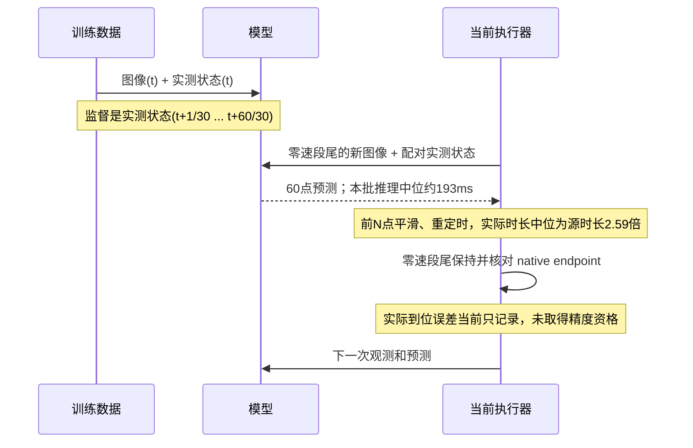

# ARX6：7 条封存 infer episode 分析

日期：2026-11-04。分析负责人：本聊天 `01a16327-7545-7332-a361-0123ddad811d`。
范围：只读封存输入、输出、控制和反馈；CPU 分析、图像抽帧；没有启动模型、GPU 推理、SDK、相机或机器人动作。

## 结论

当前问题包含模型输出、执行方式与真机跟踪三个层面。已排除关节坐标转换和夹爪米／毫米转换中的明显数值错误；不能据此认定真机已经准确执行模型意图。

1. **真机跟踪误差已被直接证实。** 第 5 条末段左 J1/J5 误差约 −4.80°/+5.41°；第 7 条末段左 J3/J4 约 −3.54°/−4.93°。延长观察至终点后 300–500 ms，仍有接近 5° 的残差，不是单纯几十毫秒读数延迟。按当前名义 URDF，由这些编码器与指令差推算的左腕位置误差最大约 38.5/34.4 mm。它不是杯子位置或指尖 TCP 的实测真值，但足以说明递送／放杯必须先核验控制跟踪。
2. **模型在短执行前缀上存在明显停滞。** 第 1、3、4 条每次预测前 15 点的最大左臂关节变化中位数只有 0.94°、0.93°、1.06°，同次完整 60 点预测却分别达到 84.6°、90.8°、76.2°。执行前缀后再次预测，使大动作持续落在尚未执行的后半段；照片中也基本停在起始区域。这是已记录的输出特征，不是转换层丢点。不能据本样本断言所有停滞均由 N=15 造成。
3. **输入的时间配对并未完全达到训练数据门槛。** 106 次模型输入中，45 次至少一项超出训练数据采用的 RGB ±25 ms／机器人 ±12 ms 公共栅格误差范围。三相机时间跨度中位数 23.8 ms，最大 64.95 ms；相机与配对机器人状态的有符号时间差约 −35.6～+55.3 ms。现代码采用最近邻，但训练阈值只记录、不拒绝。这一项可以改善，不能仅凭相关性认定它是全部空间误差的根因。
4. **夹爪数字链路基本正确，物理夹持宽度尚不能仅凭日志认证。** 单位转换、81 mm 命令上限、82 mm SDK 全程与 83 mm 录制坐标的换算一致。正常片段的跟踪偏差多为 0.2–0.5 mm，运动中最大约 2.24 mm；新指尖接触面之间的真实间距、接触位置和夹持摩擦，需要独立测量，编码器不是卡尺。

因此，优先排查实际跟踪和输入配对，再在同一场景、同一控制条件下比较模型。不能通过提高速度／加速度或继续放宽保护来替代定位。

## 样本与完整性

数据根：`/home/wujie/work/feiyu.zhou/workbench-collection-switch-20261104-v1/workbench-storage/inference`。

7 条均为 `artifact_status=complete`；逐行重算 trace SHA256 与事件数均匹配。共 106 次模型输入输出、104 段已下发参考、99 段完成，其余在 Stop 时中断。7 条全部是 **Torch**，没有 Triton episode。6 条使用 `coffee999-xnorm-epoch005-step32120`，最后 1 条使用 `mixed366-nohistory-epoch010-step34250`。

| 编号 | execution ID 前缀 | 模型 | 执行步数 | 预测／完成片段 | 视觉观察与边界 |
|---|---|---|---:|---:|---|
| 1 | aab9d35c | coffee999 | 15 | 10／9 | 起始区域小幅运动，操作者 Stop |
| 2 | 0d65292e | coffee999 | 15 | 15／14 | 已接近杯子，末次图像杯子倾斜；Stop，不能按完整抓放任务评价 |
| 3 | 966eb70f | coffee999 | 15 | 21／20 | 起始区域持续小幅运动，Stop |
| 4 | c02fa4c9 | coffee999 | 15 | 14／13 | 起始区域持续小幅运动，Stop |
| 5 | b1ad577d | coffee999 | 30 | 18／17 | 出现人工扶／重新摆杯，之后接近接液盘；最终新预测超过 4 秒上限 |
| 6 | 152ad360 | coffee999 | 25 | 5／4 | 尚未完成抓取，后续预测的刹车余量不满足预算，正常保持结束 |
| 7 | bc4d30c2 | mixed366 | 25 | 23／22 | 抓杯并到达咖啡机附近，最终杯位有偏差，操作者 Stop |

这些不是 7 次同条件、独立且完整结束的成功率试验。第 5 条存在人工干预；第 7 条换了模型；前三种执行长度也不同。这里报告逐段事实，不给出“模型成功率 0/7”之类混合指标。

## 从原输出到控制，再到真机

逐请求读取 `output.npz` 的原始 60×14 输出，与实际已准备参考的每个模型结点对齐：

- 104 段参考的关节数值转换最大误差 `2.22e-16 rad`。
- 按冻结夹爪限幅重建后，参考结点最大误差 `3.81e-6 mm`，属于 float32 舍入。
- 这证明所选 N 点没有在单位、轴序或参考结点上被改成另一条轨迹。结点之间使用平滑曲线、整体重定时；不能把“结点一致”扩大为原始离散时间曲线完全不变。

| 编号 | 全 12 关节片段终点绝对误差 P95 | 最大关节误差 | 左腕名义 FK 误差中位／最大 |
|---|---:|---:|---:|
| 1 | 0.479° | 0.715° | 3.14／4.27 mm |
| 2 | 0.659° | 0.854° | 3.88／5.82 mm |
| 3 | 0.600° | 0.748° | 3.64／4.75 mm |
| 4 | 0.455° | 0.595° | 2.61／3.55 mm |
| 5 | 0.882° | 5.406° | 4.82／38.46 mm |
| 6 | 0.597° | 0.806° | 4.20／5.60 mm |
| 7 | 1.496° | 4.928° | 8.38／34.41 mm |

全 12 关节 P95 会被基本静止的右臂稀释，不能代替左臂最差轴及具体放置段的检查。名义 FK 使用当前工作台配置指向的 `robot.urdf` 与 `left_link6`，仅估算关节误差带来的左腕几何影响；没有验证新指尖 TCP，也没有杯子 3D 真值。

当前完整片段检查确认的是 native endpoint 与参考一致、零速输出已返回；日志明确写有 `actual_arrival_qualified=false`。实际到位误差虽然录下来了，并没有因此保证达到原先 ≤0.2° 的精度目标。这是控制验收与业务精度之间的明确缺口。

第 7 条控制实况：实线为编码器反馈，虚线为控制参考；中图是相同时间下的实际减指令值，下图是左夹爪。

约 40 秒后，左臂部分关节的误差持续存在。需要区分碰撞／接触阻碍、静态负载补偿、关节摩擦、控制增益和机构误差；当前日志不能唯一判定其中哪一项。不要直接把这段残差解释成模型坐标变换错误。

## 夹爪开度

数值链为：录制原生坐标 m → ×1000 得录制坐标 mm → `[0,81] mm` 命令限幅 → SDK `×82/83/1000` → 电机端点控制。反馈按相反方向换回录制坐标。

所以原始模型输出 83 mm 会被命令限幅到 81 mm；不会原样执行到 83 mm。这个 2 mm 开端余量是已配置行为，不是单位错误。完整片段的左夹爪终点残差最大约 1.25 mm，运动中最大约 2.24 mm；右夹爪大多约 0.22 mm。第 1、3、4 条夹爪基本保持张开，原因在原始模型前缀，并非下层没有执行闭合指令。

当前数据能核验电机／录制坐标自洽，不能核验新指尖的实际几何开度。用户曾确认只更换指尖／夹持件，电机与机构未换；这支持复用电机端点，但不能代替接触面宽度、夹持高度、摩擦和杯体压缩的测量。

## 输入与训练的时序一致性

已直接读取两个部署 bundle 的冻结训练源码、各自 stats、prompts、IO 契约，以及每次实际输入。

| 项目 | 结论 |
|---|---|
| 单次输入 | 同为当前 14D 状态、三路 RGB、无 history；本次 106 条状态换算最大差约 `3.73e-9`，是 float32 舍入 |
| RGB | 同为原始 RGB 640×480；冻结训练预处理执行归一化和 224×224 letterbox；infer 使用 eval 预处理，无训练随机增强 |
| Prompt／统计量 | 请求模型身份与各自 bundle 绑定；两者咖啡 prompt 一致，coffee999 使用其自身 xnorm stats |
| actions[0] | 训练 loader 明确断言 `action[:-1] == state[1:]`；首点是下一个 30 Hz 采样点，即 t+1/30 秒，当前解释一致 |
| 输入采样时间 | 都采用公共 30 Hz 栅格最近邻，但当前 45/106 次超出训练样本入选的时间门槛；不完全一致 |
| 输出执行节奏 | 训练目标是连续 30 Hz 的未来**实际测量状态**；当前是零速分段参考，重定时后执行，再等待观测／预测；不完全一致 |

当前三相机跨度中位数 23.8 ms、最大 64.95 ms；相机时间戳与所配机器人反馈相差最大约 55.3 ms。时间戳来自 publisher 采集后的 host wall time，不是经过额外校准的曝光时刻，因此不能把这些数值说成已测得的曝光同步误差。

准备完成时观测年龄中位数约 353.8 ms、最大 481.0 ms；模型推理中位数约 193.1 ms。参考首个下发点相对观测中位数约 374.6 ms。104 段实际时长／源时长的比例中位数 2.59、最大 4.0。即使轴序、t+1 解释正确，闭环的速度状态、停顿和观察节奏仍与连续演示不同。

训练 action 是未来测量值，并非原操作者下发的控制目标；用预测测量值作为新系统的位置目标，会再经过新系统的闭环跟踪。对速度、跟踪滞后和摩擦的差异，不能假设模型自动补偿。

## 模型本身的证据

第 1、3、4 条反复把大动作放在未执行的预测后半段；所选前 15 步变化小，重规划后仍如此。第 5 条改为 30 步后更明显地推进任务，但它包含人工扶杯，不能据此量化 N 的因果改善。第 7 条 25 步也推进到咖啡机附近，但换了模型。

coffee999 自带的 50 条 held-out 评估、150 个固定窗口元数据，左 J2 MAE 为 `0.1222 rad≈7.00°`，左 J4 为 `0.0886 rad≈5.08°`，左夹爪 MAE 为约 2.20 mm。这是完整 60 点开放环预测指标，不是第一点误差、当前现场误差或任务成功率；但说明不能由低 flow loss 推断预测已经具备放杯精度。

当前 7 条均走 Torch 的连续动作输出路径，实时执行不经过 FAST action 解码。xnorm 训练准备记录的 FAST 系数量化裁剪计数为 0。因此没有证据把本批问题归因于 Triton 计算图或实时 FAST 解码。

第 7 条实际模型输入抽帧如下。它只能支持杯子与夹爪在画面中的位置关系，不能提供毫米级杯位真值。

## 对三个任务问题的判断

| 用户观察 | 当前可确认的贡献因素 | 尚不能确认 |
|---|---|---|
| 抓杯不准 | 短前缀反复小动作；部分输入配对超训练门槛；第 2 条已出现杯子倾斜 | 夹持点的真实空间误差；新指尖接触几何和摩擦的贡献 |
| 递送深度不够 | 第 5、7 条实际关节与目标有持续偏差；原始模型预测与执行节奏存在分段差异 | 深度误差中模型目标不足与控制不足各占多少；缺少目标杯位真值 |
| 放杯位置不准 | 第 7 条后段关节残差达到数度；名义腕部位置偏差达到厘米级；模型开放环本身也有误差 | 杯子是否滑动、接触咖啡机及是否提前切换任务阶段的因果分量 |

不能把一张图上杯子看起来偏前，直接换算成“模型少输出几厘米”。需要同一时刻的目标 TCP、实际 TCP、杯位与期望落点，才能完成这一步归因。

## 推荐后续顺序

1. **先核验实际跟踪。** 在独立、获准的控制验收中检查第 5/7 条暴露的姿态，区分静态误差与接触；把实际到位与 native 输出完成分开。不要先扩大保护阈值。
2. **收紧输入配对至训练范围。** 候选修复等待满足 RGB/机器人时间误差的组合，保留当前观测新鲜度门槛；先以封存数据和 CPU 检查验证，不自动控机。
3. **做同场景、同模型、同初始状态的前缀对照。** 用现有 60 点输出先做 15/25/30 点离线比较，再由用户进行小范围真机对照；避免换模型、换场景、人工扶杯同时发生。
4. **补真实夹爪／杯位真值。** 测新指尖至少几个典型开度和接触高度，标注抓取点、接液盘目标区域与最后杯位。没有这些数据，不宣称已经认证物理夹爪精度或毫米级放杯误差。
5. 控制、配对基线稳定后，再依据早期前缀误差、抓放阶段分布和固定输入预测，决定训练数据或损失配方如何调整。本次不启动训练或修改在线服务。

## 可复查材料

- [逐 Run、逐预测、逐片段统计](../.evidence/infer-episode-analysis-20261104-v1/analysis.json)
- [名义 FK、延后观察及前缀占比](../.evidence/infer-episode-analysis-20261104-v1/extended.json)
- [主分析脚本](../.evidence/infer-episode-analysis-20261104-v1/analyze.py)／[扩展脚本](../.evidence/infer-episode-analysis-20261104-v1/extend.py)
- [coffee999 原严格加载／同 CUDA 适配器验证](../.evidence/coffee999-catalog-20261104-v1/delivery.json)
- 训练来源：各模型 `bundle/source/experiments/pi05_human_base/{data,model}.py`、`bundle/sidecars/{stats,prompts,io-contract}.json`；以及 `_context/notes/pi05-coffee999-20261102/quality-audit.json` 与 `pi05-coffee-crossstage-norm-20261102/preparation.json`。
- 训练聊天已归档，未为提问而恢复它；本报告的训练结论来自冻结源码与实际元数据。
