# 五轮数采与 LeRobot 保存验收合同

2026-10-21；Owner：工作台任务 `01a13e4e-70dc-7513-9467-d34b9a7a99a3`。
维护触发：用户目标、资产、采集/放回/保存接口、实际验收结果变化时更新。
这是本轮实施与验收入口，不代表已完成实机资格；当前连续成功轮数为 **0/5**。

## 用户目标与验收

连续五轮完成采集及放回。每轮采集前重新检测咖啡机与杯子，冻结新的观测、资产、
标定及计划身份；放回复用本轮实际成功采集的轨迹，不进行新的检测、IK 或碰撞计算。
不支持用上一轮计划冒充本轮新观测，也不把维护放回记成新的感知数采样本。
用户追加要求：数据保存链路必须调通并遵循 LeRobot 格式。

每轮证据必须同时包含：新观测/检测收据、采集执行及三相机原始记录、对应父执行的
放回命令派生与完成收据、无检测/碰撞调用证明，以及 LeRobot 保存/原生读回验收。
一次动作成功、回放视频可看或生成目录都不能代替五轮完整通过。任何一轮失败保留
首次失败并停止该次连续计数，不自动重复未知结果的动作。

## 最新实际检查点（2026-10-22；实际返回失败，五轮仍0/5）

阻塞审计补充：相同“实际取杯失败、接触／拉扯不能排除且现场事实未回复”的条件已连续
存在三个目标回合。独立反馈尾部修复已正常发布为V17并重接验证，Owner为
PID1782519/start109395527，nonce `7ed458f0000f63eefe99685ec8e64c5deb1826e23f9c0eea`，
collection epoch1，READY／健康／静止且automatic_enabled=false；相机、预览及热模型进程
身份保持。没有新增采集、取杯或力矩修改。当前实际杯仍在托盘，源帧1792632401469552967。
最新发布及实际状态以`.evidence/recording-feedback-tail-20261022-v1/publication-verified.json`
和`after-v17-actual-state.json`为准；V17已加载，但修复后的完整实际数采尚未验收。
目标已通过`update_goal`标记blocked，正式0/5，不标完成。待用户补充现场事实后恢复，
主任务不归档、服务与GPU预留不释放；以下旧PID／未发布描述为此补充前的历史检查点。

**正式连续0/5。累计4次放杯控制完成；4次返回控制完成，但实际图像只确认前3次杯回桌面。**
第四次（V16正式c01）返回后杯仍在托盘，不能把controller completed扩大为任务成功。
最新带时间戳实际图像为`.evidence/recording-feedback-tail-20261022-v1/fresh-cup-state-head.jpg`，
源帧1792631253294687494；实际状态见同目录`current-actual-state.json`，由continuation-state索引。
已按授权低速回零，SDK保持连接／READY／健康／静止，holder=calibration、epoch2，
nonce与PID3187230不变，automatic_enabled=false。没有正常释放或发布V17，杯仍在托盘。

第四次raw严格无效：末端反馈比首目标提交时间＋完整时长短2.4948ms；右腕在索引1686
原始SDK帧号190103→190105（depth190117→190119）缺一对，约66.7ms，SDK等待60.86ms。
队列没有丢诊断记录，无接受过滤拒绝；内核相应11秒窗口无记录。这不足以唯一归因USB、
SDK或设备。原始文件／失败manifest不改，旧的同raw异常返回派生仅用于恢复，不进入训练。
详细收据见`.evidence/lerobot-bounded-writer-20261022-v1/formal-c01-data-failure-diagnostic.json`。

反馈尾部V17候选记录首目标的完整反馈终点，控制完成后只等待下一条覆盖终点的新反馈
再封存，不改变运动、到位／跟踪／限位／心跳或相机连续性门槛。17项Linux检查及完整
控制协议回归通过，含8ms反馈滞后和不新增目标的尾部收尾检查；**候选未发布**。

实际返回失败的根因尚未闭环：父轨迹插入末端／松爪时左J1目标−0.64346rad、实测
−0.66625rad，残差约−1.305°；SDK原生output_qpos等于参考，不能归咎重复零偏换算。
kp/kd为80/2，既有有界补偿到+0.4N·m上限。此前返回成功的父轨迹同一区域也有约
−1.178°残差，实测停在同一角度。因此这不能单独证明返回失败由补偿不足导致，更不能
据此加力矩；必须先区分接触／线缆拉扯、摩擦和控制模型因素。三相机父录像已提取，
腕部遮挡使接触关系不明，已向用户询问该具体现场事实。没有重放失败返回。
曲线／SDK输出／对照／录像帧分别见同目录`left-j1-release-residual.png`、
`parent-sdk-release-diagnostics.json`、`j1-parent-comparison.json`及`parent-video-evidence.json`。

当前已授权且独立完成的真实保存资格仍有效：V16 bounded writer已产出1份2824时刻、
三路各2824帧的LeRobot v2.1并通过原生读回及文件hash复核。它不是连续五轮验收。
主任务保持active，服务／GPU预留保留，不归档；没有新的控制参数或运动许可扩展。

只读继续核验：设备仍为同PID／nonce、calibration epoch2、READY／健康／静止。
使用同一已校验URDF、明确且只加一次零偏，对已有目标及实测关节做FK；最初抓杯处左腕
平移差0.926mm，松爪处11.170mm（分量约−7.132／−8.346／+2.062mm）、姿态差0.907°。
收据为同目录`release-feedback-fk-diagnostic.json`。这是模型下的关节反馈推算，不能当成
杯子实测位姿或接触证明，也未进行新感知、IK、碰撞计算、运动或发布。现场接触事实仍待确认。

## 历史：V16实际LeRobot读回通过，正式五轮0/5

**正式连续轮数仍0/5；累计3次实际放杯和3次同父轨迹放回完成。**
第三次三相机raw首次完整通过：头2842、左右腕各2841帧；2825目标、9268反馈，
manifest完整／验证通过／控制完成。杯在托盘及放回桌面的图和终态收据位于
`.evidence/modern-collection-save-release-20261022-v2/c01-*`。

同步PNG写入实测约8张/秒，不足以在600秒预算内处理三相机约8472张训练图像。
只对已核验PID78414/start109053951的CPU导出组正常TERM，raw及部分输出保留，
没有机器人命令。随后复用同一份封存raw，在新目录以LeRobot原生4线程、32张队列上限
导出；5个CPU fixture episode／155时刻／15视频先通过，再完成实际640×480样本：
**LeRobot v2.1、1 episode、2824时刻、3视频各2824帧，NATIVE_READBACK_PASS**，
数值读回、完整视频解码及文件hash复核通过，整个实际导出在600秒内完成。
证据为`.evidence/lerobot-bounded-writer-20261022-v1/actual-native-verification.json`；
真实数据位于ARX`/home/wujie/work/feiyu.zhou/lerobot-bounded-writer-20261022-v1/actual-c01-dataset`。
这是已中断串行保存基线的同raw资格复验，不将旧失败记录抹掉或补成连续成功。

当前实际业务／管理为V16，SDK Owner仍V13 PID3187230、同nonce和epoch1，三相机仍V11；
本次业务发布没有SDK重接、相机重启或模型推理。发布／状态统一以continuation-state指向
`.evidence/lerobot-bounded-writer-20261022-v1/publication-verified.json`和`actual-state.json`为准。
新正式系列ledger为同目录`five-cycle-ledger.json`。当前准备作业
`7ca9ab3ea5aa4733b0c4c1c5486a5479`只提交一次，服务正在加载；就绪后单次预热、
逐轮新观测／完整GPU路径／实际raw与原生保存读回／直接父轨迹放回／图像复核。

## 历史：V14／V15正式保存入口与逐轮状态修复

**合格数据仍0/5；累计2次实际放杯和2次对应父轨迹放回均完成。**
第二次放回终态与杯回桌面图见
`.evidence/return-clear-proxy-release-20261022-v1/c01-return-controller-completed.json`
和 `c01-after-return-head.jpg`。两次失败数据的处置不变，均不能计数。

实际业务／管理为V14，独立SDK Owner为V13，PID3187230/start108840313，
nonce `209098c4442f0809fd4a78b24eef3f00ffdb71091751ad44`，boot82464446。
已低速回零、正常释放和重接，健康、静止、collection持权，未自动启用运动。
三相机仍为FIFO V11 PID1916470，原热模型及预览进程保留。
最新发布和实际状态统一由continuation-state指向
`.evidence/modern-collection-save-release-20261022-v1/publication-verified.json`和`actual-state.json`。

相机工厂每次在后台解析当前descriptor的修复已实际加载；相关39项检查通过。
取回任务交接后仍误报running的状态错误也已修复：只有明确的新nonce／epoch使旧任务
superseded，不能将未知上下文或原上下文中未确认的动作当作结束。相关33项检查通过。
此前回零预览409没有下发运动；业务重载修复状态后，一次0.1rad/s回零完成，没有Stop。

另查明LeRobot导出原来只在旧app入口调用，新Playground执行入口未调用共用finalizer。
V14将正式入口接到原`finalize_collection`，要求LeRobot v2.1原生读回成功；失败仍判数据无效。
复用同一次源视频导出，页面诊断显示dataset根和验收结果。
真实数采配置显式使用已有`render_replay=false`，不再启动、上传或等待独立辅助回放；
新鲜观测、原GPU首帧／完整路径资格与机器人全部保护未改变。77项Linux检查及完整执行、
raw录制两组断言回归通过；这仍不代表已产出真实合格训练样本。

上一失败作业的独立Isaac回放在UI正常中断后留下PID40380/start3308072，导致新计算组
预检将其判作unowned。已严格核对739 boot、wrapper40369/start3308032及全部子组归属，
正常TERM wrapper，由既有清理逻辑退出整组，实核无活进程、GPU C/G为空；没有机器人命令、
没有释放GPU预留、没有触碰其他Session。收据为
`.evidence/owner-recording-camera-release-20261022-v1/failed-replay-cleanup.json`。
显式辅助回放的通用跨SSH取消清理仍留为后续问题；本轮真实源数据模式不启动该回放。

当前V14的无盖杯准备作业为`eae99bd882c146e588f5914da7b45707`，只提交一次。
接下来：准备及一次业务预热 → 每轮新观测／GPU路径 → 实际录制／原生LeRobot读回 →
同父轨迹放回与实际杯位复核；全部满足才递增五轮计数。服务和资源预留继续保留。

## 历史：Owner录制实例与取回上下文修复

**完整验收仍为0/5。累计两次实际放杯完成；第一次父轨迹放回完成，第二次父轨迹放回正在执行。**
两次均不是合格数据：第一次 raw 缺帧，第二次在录制初始化时报告
`recording camera service changed`，没有创建 raw 目录。第二次杯在托盘的画面及完整控制终态
分别保存在 `.evidence/return-clear-proxy-release-20261022-v1/c01-after-collection-head.jpg`
和 `c01-controller-completed.json`，不得把无 raw 的动作计为 LeRobot 成功样本。

当前业务为 ARX V12，独立 Owner 与相机为 V11，739 仍为 V7。当前发布、实际组件和进程
以 continuation-state 指向的 `publication-verified.json` 与 `actual-state.json` 为准。
上一处准备错误来自取回清理代码调用代理没有的私有 `_idle_reason`；现改用已有的
`admit_business`，56项 Linux 检查及实际准备作业通过，没有重接 SDK 或相机。

120秒三相机 FIFO 入站检查已完成，每路3598帧、零缺帧；它没有覆盖 Owner 的录制工厂。
Owner 在启动时缓存旧 `CommonCameraService`，相机更新后业务端已重绑，Owner 工厂仍把
旧实例作为录制期望值，子进程读取当前 descriptor 后因此拒绝。这是实例绑定错误，
不是本次重新出现了缺帧。现有录制准备失败不阻断运动的策略保持原样，数据始终判无效。

V13候选仅将当前 descriptor 的读取移入每次后台录制工厂调用，39项 Linux 检查通过，
**尚未实际发布**。含相机重启后第二次录制选中新实例的回归；没有新增 SDK 接入或相机重启。
第二次失败动作已由完整 Owner 事件验证2825个运行时目标及终态，直接派生95.03秒放回，
新增感知／IK／碰撞调用均0；该一次性派生明确记录 `parent_data_valid=false`，不能用于
放宽正常 raw 校验。正常中断了本失败作业的辅助回放，SDK仍同PID、nonce、epoch且READY。
放回执行与观察证据见同目录 `c01-failed-direct-return-execute.json`；完成后核验杯回原位置，
再按既有授权低速回零、正常释放／加载／重接，重新开始五轮完整验收。

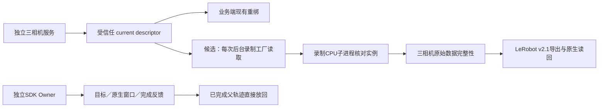

后续次序：实际放回与受控发布 → 验证真实运动下的完整 raw／LeRobot → 连续五轮。
辅助仿真在 raw 已确定失败后仍长时间占据业务收尾，另记为后续体验问题，未改变控制或
碰撞策略。资源与服务继续保留，主任务不归档。

## 历史：首次实际放杯／放回及入站修复

**实际完整验收仍0/5。已有1次实际放杯完成、1次对应父轨迹直接放回完成；该次采集raw无效，不能计入成功。**
现有画面分别见`.evidence/frozen-preview-ipc-release-20261022-v1/cycle01-after-collection-head.jpg`
（杯在托盘、双臂撤回）及`.evidence/parent-return-hardware-release-20261022-v1/failed-attempt-after-return-head.jpg`
（杯回原桌面位置、双臂撤回）；视觉复核不冒充独立定量位姿或夹持力测量。

当前业务、SDK Owner和相机入站源码均为ARX V11；739计算源码仍V7，GPU预留保留。
实际发布与状态以continuation-state指向的`.evidence/camera-fifo-release-20261022-v1/publication.json`
和`actual-state.json`为准。SDK Owner1564509/start108508662、nonce `b41fd30271c430f399fc43f8b809e617944e1530c16b00d6`；
相机父进程1916470/start108588770，均在boot82464446-0523-44bf-8e24-e0a9d1f050af实核。
CPU候选、历史PID和单项动作成功均不替代五轮数据验收。

实际放杯计划94秒／2820源点，运行时2821点、9254反馈；父执行
`ea65aee489d6ee2dfccf9410c40385be`，timeline `4e01bacde209f7037b4a22b30ccefb0437d365ae065a1254d8d6fab4673dd123`。
raw三路2836／2836／2837帧，头与左腕各缺1对，均发生在索引182处、间隔约66.7ms。
SDK入站journal已经显示原始RGB与depth帧号跳2、等待约60／62ms；因此不是录制器
丢弃已收到的帧。内核对应窗口无记录、三设备均USB3；这不足以唯一归因USB或SDK内部。
首次raw、失败manifest及journal保留，不插帧、不改成complete；实际LeRobot合格样本尚为0。

放回仅由完整控制事件与已完成父轨迹派生，数据失败不等于控制父轨迹未知。
专用验证本来已证明全部命令、终态及父GPU几何资格；硬件编译器重复旧schema白名单却
拒绝了它。V11删除重复分类，继续使用强校验器并强制旧仿真成功不能绕过几何／父证据。
8项父轨迹回归、旧硬件负例、真实94.9秒产物的hardware模式CPU编译通过；92项Linux
单测及2组断言脚本通过。正常回零／释放／重接成功后，以新nonce和新鲜反馈重建候选，
放回执行`862c18e47df289fe2f286b7562229659`已完成，timeline
`8b20cacb572de34f4b54921bb94b15ddbfb60d9adabaee603bcdb07b89c80b67`；新增感知／IK／碰撞调用均0。
原始失败数据不作为训练样本，维护放回也不计新数采。

相机FIFO候选采用已核验的SDK原生32帧有界队列（keep_frames），分辨率、格式、30Hz、
原始时间戳与严格连续帧判据不变。80ms慢发布／30Hz生产的CPU回归通过；实际相机服务
已单独停止、核验旧进程退出并以V11重启、重绑，SDK与原Infer进程身份不变。
120秒三路纯入站验收已通过，各3598帧且零缺帧，不执行机器人动作、不生成训练episode；有限通过
不自动扩大为长期稳定性结论。后续仍须真实数采＋LeRobot原生读回＋父轨迹放回五轮。

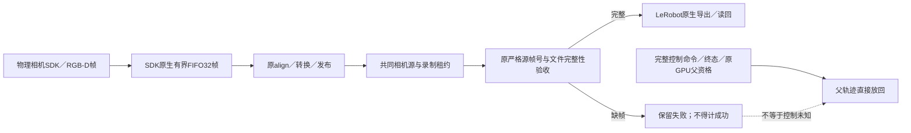

以下为此前阶段的历史记录；发布、进程与计数以上述实际收据为准。

## 历史：静态窄相与冻结预览修复

当前实际业务／管理源码为ARX V9，独立SDK Owner为V7；739准备源码为V7，
原生场景仍使用Native4。实际发布为`.evidence/fixed-self-narrow-release-20261022-v1/publication-verified.json`；
当前实际状态收据为同目录`actual-state.json`，统一由continuation-state索引。
维护回零与正常重接不计为数采；SDK现在保持collection持权、READY、健康反馈，未自动执行。

用户已确认无盖110.5mm模型；当前组合摘要为
`0e126dc52984a52184d19933df0f3910e7958d210b7811e0b95e79cbcaad5c9d`。
264球内缩证明沿用已封存通过结果；抓取种子71mm尚未取得本轮接触／完整路径资格。
杯口定位使用固定视觉mesh顶圈半径39.500mm、高度109.250mm；此前原型使用的
碰撞包络终端尺寸不是当前视觉测量参数，不能混用。原始FoundationPose和杯口复核
各自保存来源，仍执行完整XYZ小于6mm、至少3源秒且9帧的原稳定门。

先前V8／DSW6组的正常业务预热已通过：新鲜窗口9帧／3.87源秒，Source／Suite桥接、Native4场景
及首帧通过，cuRobo初始化通过；总耗时167.19秒。先前桥接在系统Python缺NumPy的
问题已通过标准库几何声明核验修复；数值拟合模块字节不变。此次没有SDK重接、
相机重启或机器人动作。预热收据为`.evidence/metadata-bridge-20261022-v1/metadata-business-warmup-v1.json`及
同目录`warmup-complete-actual.json`；该历史预热不自动资格新计算服务，亦不代表路径、接触或真实数采成功。

第1轮新观测与规划已唯一提交（`cycle01-collection-plan-v1.json`），123.05秒后在固定右臂
静态自碰撞验收停止：右臂／外部环境通过，机身与右J1／J2的14对OBB未证明分离。
没有任务动作。已封存失败产物；旧辅助61／65mm单次定位的固定右臂豁免不扩至本轮。
GPU原始网格顶点查询无穿入见证，仅属定位诊断，不能证明三角面或实体完全分离。
诊断进程32411／实际Python32416已结束。下图GPU窄相已完成实现及实际共享入口验收：
全部2748对通过，其中14对由原始三角面及闭合实体包含检查证明分离，0.1mm间隙不变。
实际入口耗时0.163秒；9项GPU正反例（含OBB重叠但SAT可分离、近间隙拒绝、完整包含及开口网格拒绝）
通过，两端各17项CPU单测与原包围盒断言脚本通过。诊断32546／32551与集成32752／32757
均已实核退出；未引入CPU碰撞资格替代、未改变源网格或增加右臂豁免。
V9业务／管理及DSW7配置受控发布通过，Owner、SDK、三相机、原Infer模型不变。
本轮新受管组预热159.73秒通过；首个94秒／2820点计划已通过新杯71mm接触证书、
GPU闭合扫掠及完整路径资格，热模型复用。证书杯身金属穿入为0、腕杯间距下界19.82mm，
不是实际夹持力或任务成功资格。执行请求在预览阶段被拒绝：`preview_frozen requires plan and source`。
`execution-phase.json=pre_action`、独立观察者事件数0、Owner READY且automatic=false，
均已实核；没有运动或录制，观察者66276已正常清退。仍需实机执行／保存／放回
资格、实际执行、三相机raw封存、LeRobot原生读回、实际落杯见证，再由完成父轨迹
直接派生放回。完成数仍为**0/5**。放回脚本补用了现有`build_binding`，避免只改摘要
而保留采集绑定格式；ARX现有V7源码上的7项CPU回归通过，无新感知／SDK操作。

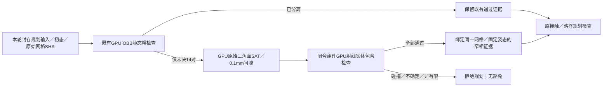

### 冻结预览跨进程格式遗漏：先梳理再修复

`RealBridge`把大计划发给业务HTTP网关，网关用`RawPreview.raw`避免Owner线程解码。
文件式放回则用`ArtifactPreview.paths`。`ControlRuntimeClient.submit`却把这些dict子类
直接JSON化；它们的dict内容只有action，属性未上线路，独立Owner因此明确拒绝。
此前大计划HTTP测试用同进程Runtime，独立Owner测试用小型人工姿态，缺少两者组合。
修复统一放在共享IPC边界：私有暂存文件＋大小／SHA，Owner重建原包装；大JSON仍由
原隔离编译器解码。成功／明确拒绝后清临时输入，未知回执保留且不重放，新增能力显式声明。

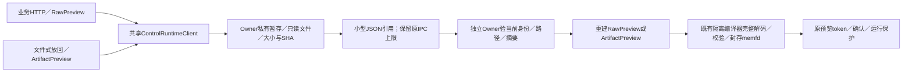

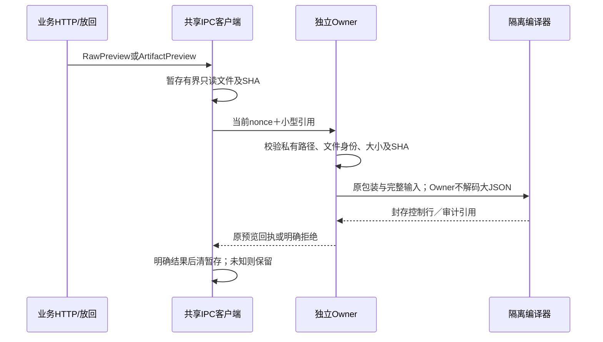

以下为04:09及以前的历史定位和候选记录，不覆盖上述实际状态。

## 历史对象和定位故障（2026-10-22 04:09 CST）

当前实际业务／管理源码为 ARX `robot-workbench-five-collection-20261022-v6`，独立 SDK
Owner 保持 V4；739 准备层源码为 V4，原生场景仍使用已实测通过的 Native4。
实际发布与现场状态统一见 `.evidence/next-optimization-20261017/continuation-state.json`
的 `current_publication` 与 `current_actual_state_evidence`，不按本地 HEAD 推断在线版本。

用户确认使用无盖纸杯；数字模型高 110.5 mm，不冒充实物测量。共享场景资产选择已上线，
当前执行组合是新咖啡机＋无盖杯，带盖杯仅可预览。新杯已生成独立的 264 球内缩代理，
完整 6 mm 核心覆盖证明检查 44,701 单元、失败／未决均为 0，保留至少 3 mm 内缩、
外部碰撞范围及原接触保护。修复了普通资产选择仍回退旧杯证明的遗漏，按文件 SHA、
杯 profile 和实际几何绑定证明；错误证明仍在 GPU 模型初始化前拒绝。

本阶段新增 13 项本机单测、原杯内缩断言检查、17 项739单测、33 项ARX单测通过；
实际新杯几何接受新证明、拒绝旧证明，未创建 CUDA 上下文。更早的完整标准检查
1705 次执行／36 跳过及 6 项 Node 检查仅为未变代码的基线，不是本次重新执行。
本次发布没有 SDK 重接、相机重启、Infer模型重载或任务动作；已有维护回零及重接
仍属于先前阶段，不计为数采。源码差量约104KB，未传模型权重或20MB执行包。

新组合已正式应用、检测器就绪；本次业务预热在原有 300 秒观测预算内失败：
612 帧采集、294 帧判定、稳定窗口重新计时 90 次，未进入场景／cuRobo模型初始化，
没有下发机器人任务动作。连续成功仍为 **0/5**，不直接重试已知失败或改阈值。

已保存的293个有效结果中，相邻杯位位移中位4.90mm、P95 11.96mm；285个候选
连续9帧窗口里，3D跨度<6mm的为0，最佳6.84mm；仅XY检查则有54个窗口。
两个Z估计极值相差19.20mm，对应图像杯区35个特征的移动中位0.022像素，
P95 0.119像素；这支持估计抖动，并不是独立的物体真值测量。
原始固定杯身区域深度中位数的标准差5.22mm，桌面区域2.48mm，说明输入也有噪声；
不能据此宣称已经分离出深度、模型refiner和传输时序各自的贡献。

现有信息流为：RGB-D → FoundationPose当前XYZ → **3D 6mm／3秒／9帧稳定门** →
安装桌面支撑约束（Z固定0.78m）→ cuRobo规划。两层Z语义不同，改变为XY稳定门
会改变原保护范围，已向用户提出选择，**尚未修改**；未获新决定时保持原3D门。
已完成一项有界离线对照：同32帧分别使用原始深度和当前帧3×3空间中值降噪，
复用既有检测器23725/start1937046，模型初始化计数始终1；耗时28.66秒，64次推理、
0新增物理观测、0运动。原始／降噪的相邻杯位P95分别10.01／10.67mm，均无稳定窗口，
因此候选不发布、不继续扩大滤波。控制器25435/start2051010已实核退出；热服务保留。
证据：`.evidence/perception-spatial-diagnostic-20261022-v1/result.json`。
后续定位质量优化仍优先复用封存数据，区别像素深度、姿态迭代和支撑平面语义；
本次未修改源资产、相机参数、生产滤波或控制保护。D405官方理想范围7–50cm，当前杯体深度约55cm、估计根部
约64cm；这是环境风险线索，不是已经验证的唯一根因。
来源：[D405官方规格](https://www.realsenseai.com/products/stereo-depth-camera-d405/)。

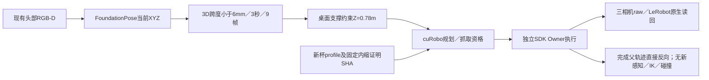

独立Owner的原始录制根已与业务配置对齐，配置为`lerobot-v2.1`；CPU构造数据的
读回资格不能代替真实数采。尚待定位稳定性、实际cuRobo预热／抓取路径资格、
首轮执行及LeRobot原生读回，再完成五轮父轨迹放回。资源预留与常驻服务保留。
证据入口：`.evidence/selected-cup-envelope-20261022-v1/phase-result.json`；最新实际现场
收据为同目录`actual-state-after-observation-failure.json`，已由continuation-state索引。

## 历史：保留3D稳定门的杯口定位候选（当时尚未接入，2026-10-22）

正式发布仍为Owner V4＋业务V6，保护与动作均未改变。另实核发现Owner V4的
`scene_assets.validate`不接受新增`cup.inward_envelope`字段；此前扩展遗漏了独立Owner消费端，
该项须在首次任务动作前与新准备源码一并验收／加载，不能把业务发布当成全链兼容。

实际发布参数为register_iterations=5、track_iterations=1；构建器默认2并非在线事实。
有界隔离诊断先因该预期值检查停止（0帧调用，清理通过），随后正确做1/2/4各32帧，
相邻3D位移P95为9.87／7.40／8.73mm，三档均无合格窗口。2次全294帧复核仍无合格窗口，
P95=10.71mm；不发布该参数候选。两个完成试验都保留原生产模型及3D稳定门，新增物理
观测与动作均为0，独立诊断进程已结束。证据为`.evidence/perception-iterations-20261022-v2/`
及`v3/`，同32帧图`v2/comparison.png`仅展示相对变化，不代表绝对精度。

CPU候选依据所选无盖杯profile的杯口半径39.113mm与高度110.500mm、当前图像白色圆口、
相机内参／外参拟合**完整XYZ平移**。前提是当前同一模型、直立且杯口可见；不固定桌面Z，
不做时间平均，不改变3D6mm／3秒／9帧门。检测框扩10%避免切掉杯口边缘，像素几何误差
超过0.75px或相对原姿态变化超过3cm时该帧失败，不回退原XYZ凑通过。CPU样本的293有效
帧中292通过几何检查，XYZ标准差0.276／0.172／0.298mm，首个原稳定门窗口在第9号帧；
第255帧拒绝后按原窗口规则重新积累。这只是静态重放，不证明绝对精度或真实运动响应。
原型V2序列化NumPy标量失败，V3显式转换后重放完成，原件都保留。

拟接入位置与边界：

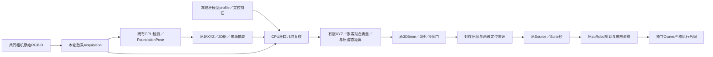

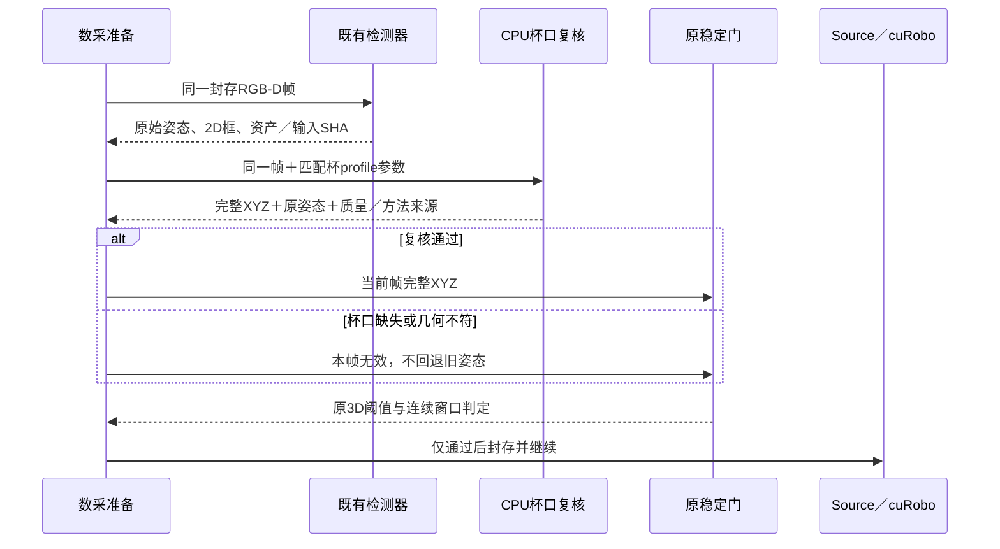

正式实现前／后验收：图像上确认匹配的是杯口；用独立合成三维平移，特别是Z移动，
证明输出仍响应真实3D变化而非固定Z；遮挡、错误尺寸／资产、低质量均拒绝；既有资产
无声明时保留原路，新声明失败时不静默回退。来源记录保留原始FP与复核结果，不能将
后处理冒充纯FP输出。桥接须独立校验声明与回执，全部组件严格解析新字段。
之后以既有回零／正常释放／重接维护授权受控加载Owner与业务，完成新鲜观测、GPU准备、
具体路径检查，再做五轮真实采集／父轨迹放回／LeRobot读回；当前完成仍0/5。

以下各节保留对应历史阶段的实现与验收，不用其中“尚未发布”等旧描述覆盖上述实际收据。

## 2026-10-22 资产选择模块（本地实现，尚未发布）

用户提出应能选择不同咖啡机、杯子，避免逐次人工替换。建议使用共享“场景资产”目录，
数采页提供两项选择；真机使用与实物相匹配的数字模型，仿真使用相同定义构建场景。
每个版本关联源发布manifest、GLB/USD、感知包、任务语义/碰撞派生及共同坐标定义，
区分“可预览”“可感知”“可规划”和具体组合的任务资格，不凭目录名宣告可执行。

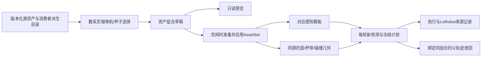

选择草稿不发动作；应用时冻结资产组合和摘要，清除旧对象位置/未执行计划，并要求
重新观测。资产变更只重建受影响的运行缓存；真机SDK、相机及机器人标定保持独立。
活动动作/录制期间不应用另一组合。每轮数据和放回必须引用当轮冻结组合，放回仍不得
调用感知/IK/碰撞。首版覆盖现有1份咖啡机及2份杯子资产的选择、预览、状态与应用。
资产选择界面和后端本地实现已通过72项后端检查及2项Node检查；尚未发布或取得新组合真机资格。

### 2026-10-22 共享绑定实现进度

已实现 `rule_based_workbench/scene_assets.py` 的冻结组合接口：机器、杯子原生版本及交互
profile摘要，与感知release/config和源文件SHA绑定。新组合从准备目录的
`scene-assets.json`读入；声明的新组合缺失、源文件改变、检测模型/版本不同、安装支撑
仍指向另一机器、导出几何profile不同均明确拒绝，不静默退回旧资产。旧配置仍保留原路径。
组合随检测source、原生suite metadata及LeRobot audit保存，资产变化使旧观测/计划复用
与场景缓存失效。当前仅接通接口与检查，尚未生成新资产的原生碰撞/抓取profile。

`native_scene_assets.py`在新目录构建现有原生代码的消费者适配，不改共享源或原始资产。
739实际CPU检查已通过：6个消费入口编译、实际EpisodeScene接受显式新机器、杯子与组合
身份匹配、组合变化改变实际scene_build_key，206份其余原生文件字节保持一致。首版v1
实测发现原生初态metadata仅接受旧字段；v2加入独立资产字段校验后仍保留原初态/摘要门。
失败原件保留，不把v1失败目录当成功版本。

证据：`.evidence/scene-asset-binding-20261022-v2/result.json`；实际派生原生目录为
`/mnt/data/feiyu.zhou/runs/robot-workbench/scene-asset-binding-20261022-v2/native`。
新物体profile加载、模拟器启动、模型加载、GPU作业和机器人命令均为0。
新增4项组合/混用拒绝检查与4项真机配置CPU检查通过，完整本机CPU检查另行落盘。
实际原生初态入口另完成只读核验：新资产metadata与完整实测初态共存；错误初态摘要和
未知metadata字段仍拒绝。证据为同目录`native-initial-guards.json`，未写远端或触发动作。
本节不是在线发布或新几何资格；资产选择界面、实际新几何绑定及5轮实机仍未完成。

### 2026-10-22 新原生几何与组合候选

三份源资产已在739生成任务自有原生包，并由真实原生读取器加载、核验USD/材质/
派生文件的完整摘要依赖。当前候选是
`/mnt/data/feiyu.zhou/runs/robot-workbench/scene-task-geometry-20261022-v3/assets`：

- 咖啡机1973个包络，复用原生半空间裁切函数；凹面按10mm X/Z格裁切，Y区间仅在
  表面重叠时合并，保留0.2mm skin；其他部件使用包含源顶点的AABB。仅证明已建模
  三角表面覆盖，不推断不可见内部实心结构。托盘候选来自源水平顶面的凸包，出液口
  等语义位置沿用同一发布清单。质量/摩擦/惯量/按键行程均保留未知。
- 无盖杯25段、带盖杯48段连续包络。截面采样只用于提出分段；全部源顶点及每个
  分段平面的三角边交点证明完整三角面包含。按原生默认32边形做外接补偿，合并小于
  0.1mm的薄层为包含旧包络的相邻包络，避免微米级倒角成为独立凸碰撞体。合并带来
  的局部保守增大另记，不把50μm初始拟合参数当作整包外形误差或实物精度。
- 源模型没有可用按键行程。原生消费者候选的第7项适配允许“零按键且零按键碰撞体”；
  有按键碰撞体却缺metadata、重复按键仍拒绝。没有虚构按键可控资格。

完整证据为`.evidence/scene-task-geometry-20261022-v3/result.json`，视觉证据为同目录
`geometry-comparison.png`。v1读取器拒绝零按键及v2薄层记录保留，当前优先使用v3。
本阶段没有启动模拟器、GPU模型或机器人动作，尚无接触、力、实物身份或任务资格。

无盖组合候选（用户已确认本轮实物为无盖纸杯）位于
`/mnt/data/feiyu.zhou/runs/robot-workbench/scene-asset-pair-20261022-v2/assets`。
它把新机器/杯包、机器人接口及已闭包的感知release绑定为
`e2b3b5a22e11f40a9ed65f818b8edef1732333fd88e4005abb6ea354a9bb25cd`，
23份文件摘要和实际原生接口通过。437个资产文件在服务器内硬链接复用，不向Mac传模型
权重或整套资产，未改原件字节。带盖原生包也已准备，仍需对应的两对象感知运行组合。

新资产不再静默使用65mm夹爪默认值。源、组合和规划使用同一份几何种子；种子由杯身
候选带中点的包络直径及原1.5mm胶垫模型，从既有65/71mm候选中选择最近值。当前为
71mm，明确`qualified=false`，仅用于提出抓姿；完整接触证书、原始mesh检查与GPU
路径验收仍必需，不能当成可直接下发或已验证的夹持力。种子缺失、摘要不符、超过
当前标定命令范围或被改回旧默认值均拒绝；旧资产/人工辅助路径的既有规则保留。

冻结源码已暂存739的
`/mnt/data/feiyu.zhou/code/robot-workbench-five-collection-20261022-v2`，11组Linux CPU
检查通过（33项有计数单测、4组断言脚本），包含真实原生数学习惯、几何种子、完整
规划编排替身、物理转换、父轨迹放回及保存检查。证据：
`.evidence/five-collection-20261022-v2/qualification.json`。这些不是GPU或真机资格，
之前1697项完整本机结果对应上一份源码，不冒充本次新改动的全量结果。

另一次未纳入标准入口的旧`test_gripper_distance_plan.py`断言84.01mm反馈必须拒绝，
而未改动的已提交`contract.py`默认上限为87mm，故该旧检查失败。已在
`.evidence/scene-task-geometry-20261022-v3/local-regression.json`记录基线不一致；
本轮未为让其通过而放宽/改写生产反馈门槛。SDK89mm与规则层旧反馈口径的统一仍待处理。

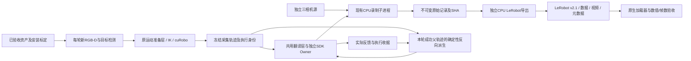

```mermaid
sequenceDiagram
  participant Loop as 五轮编排
  participant Perception as 感知/准备层
  participant Control as 翻译层/Owner
  participant Record as CPU录制/导出
  loop 五轮连续成功
    Loop->>Perception: 采集本轮新观测，更新机器/杯位
    Perception-->>Loop: 已检查的冻结计划及观测身份
    Loop->>Record: 准备本轮独立录制目录
    Loop->>Control: 执行采集计划
    Control-->>Record: 目标参考及实际反馈
    Control-->>Loop: 本轮执行完成收据
    Record-->>Loop: sealed raw及数据有效性
    Loop->>Record: 导出并用LeRobot原生加载器读回
    Record-->>Loop: 数据/视频/时间对齐验收收据
    Note over Loop,Control: 放回只派生本轮成功父轨迹；不调用感知/IK/碰撞
    Loop->>Control: 原轨迹反向放回（保持反馈、限位、Stop等运行保护）
    Control-->>Loop: 放回完成及父轨迹身份
    Loop->>Loop: 全部通过才增加连续成功计数
  end
```

## 保存边界

实际ARX解释器 `/home/wujie/miniconda3/envs/arx_openpi/bin/python` 已安装 LeRobot
0.3.3，其数据格式常量为 **v2.1**；优先使用该版本原生 `LeRobotDataset.create`、
`add_frame`、`save_episode`，不手工仿造 parquet/索引，不上传到Hub。

导出器在独立CPU进程中消费已核验raw；不得在Owner中编码、扫描大索引或构建数据集。
固定30Hz网格对齐参考命令、反馈及三相机；原始时间戳保留在对齐审计中，不重写raw。
`action` 是原记录的绝对目标参考，`observation.state` 是实际反馈，禁止相互替代。
物理14维顺序为左6关节、左夹爪、右6关节、右夹爪，关节rad、夹爪mm。
禁用且未知的夹爪必须带有效性掩码；有限填充值不视为实测，也不承诺未适配的训练
消费者能忽略掩码。深度和完整源时钟继续留在raw，RGB进入三路标准video特征。

输出使用新的唯一根目录；不覆盖旧数据、不删除失败原件。先用CPU构造样本验证
对齐/缺口/缺失轴/原生格式读回，再用真实本轮数据验证完整保存链。保存失败必须
呈现为数据失败，不能仅因机器人完成而晋升整轮成功。

## 实施顺序

1. 完成感知材质、几何及实际739格式/外观检查，构建当前资产与缓存身份。
2. 补LeRobot隔离导出与原生读回，先覆盖保存故障/时钟缺口等负例。
3. 将真机放回接到本轮成功父执行，证明零检测/零碰撞调用，保留运行保护。
4. 建立新计算Owner与当前场景的新计划，按实际路径门执行五轮完整验收。

现存 SIGKILL 根因、全服务长期内存、全关节≤0.2°和低优先级标定链路不冒充已解决，
不为了本轮资产/CPU保存开发额外重接SDK或重复控机。

### 2026-10-22 目录与准备服务的信息流

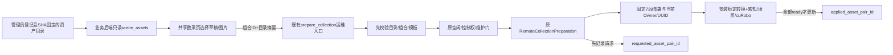

只读草稿和图片不触发控制/相机/模型操作。公共API不暴露部署路径或命令；图片限制在
目录内且校验SHA。应用仍走原维护门；准备失败保留上一已应用组合身份，但不得将失败
服务报为ready，也不得让新的待应用组合沿用旧普通计划。活动动作/录制时禁止切换。
当前原生包已有带盖模型，但首轮按已确认的无盖杯推进；带盖感知组合尚未登记时仅可预览。

### 实际准备首次拒绝与修复边界

资产目录已实际发布，原Owner、SDK、三相机和热模型身份不变；首次准备在GPU转换前
拒绝旧Owner绑定路径：`prepare_remote_collection`将它错误限定到本次业务run内。
独立Owner的绑定位置应由Owner的只读`inputs`提供，不能由业务重启迁移或由浏览器传入。
修复只增加精确Owner引用（私有descriptor+当前nonce），经既有ControlChannel核验真实
进程身份后检查绑定路径完全相符；无引用仍走原run内限制，错误nonce/路径/符号链接均拒绝。
私有descriptor/凭据不进入送往739的标定capsule；安装前再核对同一绑定位置。

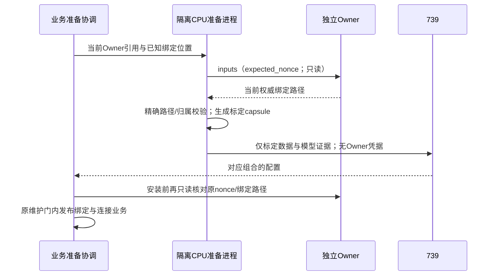

本次失败不是GPU、感知、IK或机器人故障；保留原失败收据，不计入五轮实际动作。

### 2026-10-22 实际发布与接入进展

用户确认本轮实物为无盖纸杯，使用110.5mm模型，不再保留待确认状态。共享资产目录、
两项选择/图片/尺寸/草稿与已应用状态已发布；带盖杯当前可预览，未登记可执行计算组合。
标准CPU入口1705次执行（36跳过）及6个Node检查通过；ARX冻结V3另有125项检查。
路径兼容修复及连续参考放回证据适配后，V4在ARX通过108项相关检查和3项真实只读Owner
绑定检查。未将这些CPU结果计入真实数采。

首次准备因独立Owner的绑定文件不位于新业务run而在GPU转换前拒绝，已按上节精确引用
修复。随后发现739重启后缺少ARX既有数采公钥；用户明确批准恢复登记该公钥，已完成
严格SSH认证及boot核验，没有生成/复制私钥或改网络。失败收据保留。

业务/网页先独立发布；随后实核旧Owner不支持新的直接父轨迹放回规则，因此按本项目
既定维护授权完成一次0.1rad/s回零、正常释放与SDK重接。当前Owner代码为V4，已恢复
collection持权、READY和健康反馈；三相机、原Infer模型及目标预览进程身份不变。
维护回零并非数采，真实完成数仍为0/5。此前三次维护预检没有下发动作：旧脚本反馈
开度越过命令上限、显式None开度无效及数采未准备时人工审阅被准备视图隐藏；最终使用
既有合法保持开度映射和标定人工规划入口完成一次回零。未放宽命令范围/原保护。

新Owner实际发布收据：`.evidence/five-collection-owner-20261022-v1/publication.json`；
回零与正常释放/重接原件位于对应ARX run。当前已完成新资产标定转换、固定配置传输，
唯一受管检测进程在初始化；模型、场景、最终路径/接触和五轮实机资格尚不能宣布通过。

连续控制的父轨迹证据现在接受实际`source_target`参考点及`native_reference_window`
准入收据，不把它们写成逐点SDK下发。每个源点、运行时轨迹摘要、原生窗口引用、完成
反馈和后续READY均须保留。独立Owner包络的发送/采样时间沿用原始字段；终态只使用
明确标注的观察者接收时间，不冒充SDK时钟或固件ACK。直接放回仍不得带入IK/碰撞结果。

### 原稳定门通过后的零关节场景兼容修复

实际初始化最终取得通过原稳定门的窗口（采集522帧、处理238帧，原3秒/9帧/6mm门未改）。
此前估计确有波动：197份有效对中杯位相邻估计中位3.99mm、P95 10.31mm；既有图片
中相隔约78秒的1395个静态特征匹配中位位移0px、P95 1px，说明观测估计波动需要保留
跟进，不宣称图像/深度完全无噪声。没有再采观测或调用推理来做这些统计。

后续`playground-geometry-inputs`在Isaac Articulation初始化失败：新机器无按键关节，
继承的机器初值仍含`.*`，匹配到空关节列表。修复范围先限于新独立native派生目录：
仅当已核验profile的buttons为空时，把机器joint_pos/joint_vel初值及actuators置为空。
保留原Articulation与USD、固定关系、碰撞/材质/质量等属性；有按键的旧机器配置保持不变。
先CPU验证两分支，再复用这份已封存观测运行一次原几何输入阶段，不重新检测或动真机。

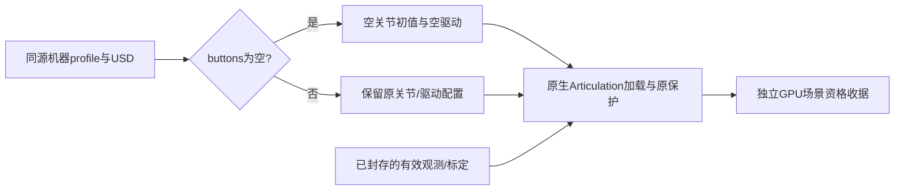

### 首次实际下发前的保存根目录核对

独立Owner的真实工厂固定在`<Owner私有root>/collection-raw/<episode>`录制，业务原配置
却把`local_recording_root`设到新业务run。保持原`resolve_raw_source`包含性保护时会拒绝
真实Owner raw，因此在第一轮任务下发前修正：Owner工厂和业务准备共用同一根目录定义。
当前已发布Owner的原字面路径与该定义等价，不为此再重接SDK。隔离CPU准备通过当前
私有descriptor/nonce只读核验：physical命名空间、受管`serve_control_owner.py`脚本、
同root私有socket且录制已配置；只接受该root下固定的`collection-raw`，拒绝任意其他目录。
实际raw仍须是根目录内新episode，禁止符号链接，并校验封存、source/plan/Owner身份、
每个文件摘要及LeRobot原生读回；不放宽导出器的包含性校验。

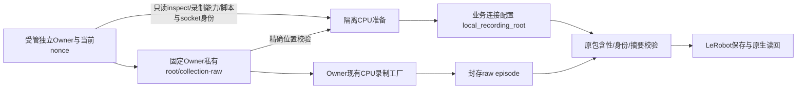

这次修复仅统一已存在的目录ABI，不增加任意路径、Owner属性读取或SDK操作接口。
