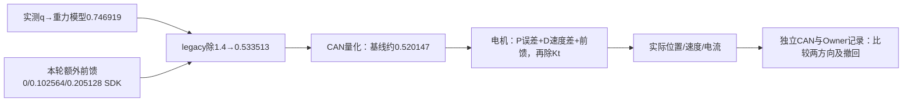
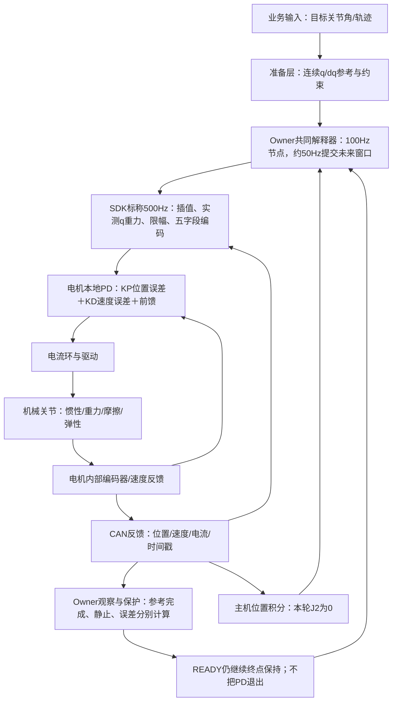
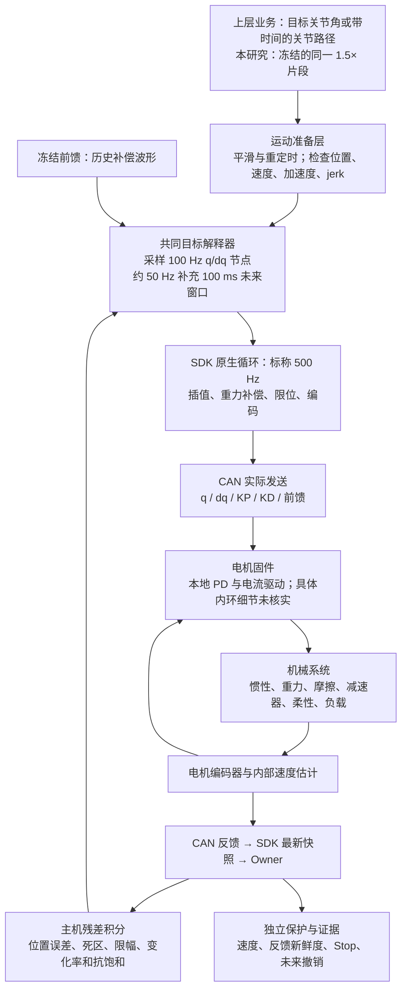
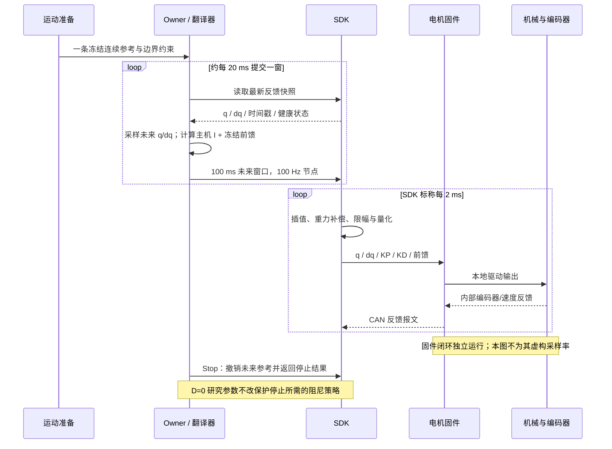

# 当前控制链路与 J2/J3 的 P-only 诊断

## 2026-10-27 当前覆盖：已安装关节标定已进入SDK重力计算

gravitycal-v1已受控加载并完成12窗静态/正常Stop/显式不续跑/回零释放。SDK原二进制与PD/单位不变，SDK配置为每臂专属URDF：joint origin吸收一次安装零偏，数学上等价原模型g(q_raw+delta)；控制目标与PD反馈仍为原始q，没有重复加偏。相机外参不等于g方向，当前仍g=[0,0,-9.807]。旧FF必须绑定新重力身份，标定按连接冻结，安装变化需受控重新绑定。当前SDK断开、无活动任务；入口`.evidence/gravity-calibration-20261027-v1/delivery.json`。完整组件/时序及前后不利结果在[标定接入报告](gravity-calibration-integration-20261027.md)。引用同q的g2从0.746919变为0.730096，7.65°CAN仍0.520147，两码残差未消除；没有精度改善或完整1.5×资格宣称。

静态总电流可以用于后续重力辨识；P/D是驱动输出的构成，不是机械侧另一份负载。无摩擦/外扰且Kt可信时KtI≈g(q)，有摩擦/方向效应时不能把某一方向电流直接当纯重力。下方旧数值仍作为原始发送链和量化核算历史保留。

## 2026-10-27 已完成：固定位置的有界前馈因果验证

Owner：session `01a16327-7545-7332-a361-0123ddad811d`；新的实测或单位契约变化时更新。用户已批准并完成下述四次方案，证据根为`.evidence/j2-feedforward-causal-20261027-v1/`。当前入口`delivery.json`、实核`final-current-state.json`：两批正常回零释放，SDK断开，无控制故障；2,383,758帧CAN零丢帧/无调度截断。实发前馈及q/dq/J2 I0均已核对。下方两次+10码分别大部分仍两码、改善为一码且撤回后保留，上方两次始终零码残差；不推广常数补偿。最大剂量理想静态只对应约0.020987°，不是足够消除原两码的剂量；方向/历史、量化与单位修复分别判断。完整数表、曲线和后续见[前馈因果对照](gravity-compensation-audit-20261026.md)。

0.52的发送来源已能完整核算：模型按实际q求重力得到0.746919 SDK；legacy发送层再除1.4得到0.533513；CAN向下量化后实发0.520147。电机按厂家公式再将`P位置项+D速度项+CAN前馈`除Kt=1.4得到电流请求。已确认的单位缩放与模型是否符合真实负载是两个问题；不能把前馈字段等同总驱动力，更不能把未闭合电流差全归为重力。

左J2固定7.65°、J3固定6.5°，J2 P400/D0/I0；两批方向为下→上、上→下，每批正常回零释放。每次25秒：0–4基线、4–7渐增至+5码、7–11平台、11–14增至+10码、14–18平台、18–21撤回、21–25基线。每码60/4095，增量为0.073260/0.146520协议名义力矩，通过legacy换算为0.102564/0.205128 SDK。q/dq保持不变；保留其他左轴当前总补偿及右轴继承补偿。结束先用同增益普通保持接回FF尾值，再切维护增益。全部原保护及Stop/epoch保留，不加研究诊断停止阈值。

若增加FF时残差/P承担量减少、撤回后回升，支持额外保持输出缺口的因果关系；总电流不一定增加，因为P项可同时下降。若两方向不同，不能直接统一放大整臂重力。该探针只作辨识，正式修复仍应统一显式EC单位契约并核验负载/重力/摩擦。

SDK断开时还完成一次J2只读mode7查询：11帧、9回复，Kt1.4；电流环PI为0.0359/250，另有浮点位置/速度/电流读数。位置伺服查询值不是实时MIT包P400。原始编码器/零偏查询未回复，Kt校准mode0不在手册枚举内，均不强行解释；内部PD采样与滤波、负载模型仍未完整核实。未改电机配置，也不在活动SDK期间注入这些查询。

## 2026-10-27 当前J2闭环、READY语义及两码残差逐项核算

本节覆盖下方10月26日的参数/资格历史。用户要求先理解到位状态、反馈、校正输出之间的关系；同时显式要求J2 P400/D0/I0实测。P400/D0.2→0→0→0.2的24个双向静态窗口已完成；新发布response-v4仅允许研究KD0并同步页面下限，P仍>0，SDK二进制/原保护未改。每批正常回零释放，最后12轴最大0.273208°，无控制故障；4,219,989帧独立CAN零socket丢帧/无调度截断。72项Linux回归与实际24条件无控机检查通过。SDK当前实核断开，无holder/nonce/活动作业，证据见`j2-damping-zero-20261027-v1/delivery.json`及`final-current-state.json`。真实SDK硬故障停止资格不由这些CPU/正常生命周期结果替代。

### 1. 哪一层在闭环，哪一层在判状态

SDK500Hz是主机原生输出/反馈节奏，不是已核实的电机内部PD/电流环频率。主机没有在J2的两个命令点之间不断提高速度或目标角来积累纠偏；本轮位置积分为0、无新增冻结FF，主要位置纠偏在电机内部。电机厂家4.1给出的模型为：

`I_req = [KP*(q_CAN目标−q_internal) + KD*(dq_CAN目标−dq_internal) + T_CAN前馈] / Kt`

位置单位rad、速度rad/s，Kt本机读取1.4。该式为厂商文档模型；内部滤波/采样频率/实际电流环跟随误差仍未逐项识别。主机记录的反馈是经CAN编码后的量，不等于固件内部每一拍的未量化反馈。

### 2. READY不代表误差归零，达到READY也没有停止保持

研究执行策略`arrival_enabled=false`。`MotionRunner.tick()`在参考时间结束后设置READY，同时每次tick继续`send_reference()`；解释器继续提交终点恒定q/dq窗口。研究脚本的`motion_complete`还要求同计划SHA、stationary=true、automatic_enabled=false。`StationaryWindow`检查至少0.3秒的位置跨度≤0.3°，与目标误差是不同量；速度值在该静止窗口只是诊断，0.8rad/s速度保护独立执行。

因此当前READY的具体意义是“参考已完成，正在终点保持”，不能作为精度达标。即便误差0.04°，状态也可以READY。观察窗口中`position_hold_active=true`、全部79个主机样本motion.status=READY，随后2秒仍有975帧J2命令，发送间隔中位数2.052ms。目标/P/D/FF均恒定，证明不是READY后关掉PD、或把目标改成实测角导致停在此处。

相关实现：`calibration/infra/arx_env/joint_head_real_motion.py`的`MotionRunner.tick()`/`StationaryWindow.update()`，`robot_workbench/target_interpreter.py`的`_tick()`，研究`operations.py`的`motion_complete()`。SDK`update_output_cmd_()`对实测q求重力，并不在主机执行P位置闭环。

### 3. 图中7.65°平台：0.04°到底是哪两个数相减

具体样本为旧a400批次`J2-P400-Q7.65-D1`、末2秒974个原始反馈；当前SDK二进制相同。无硬件动作的核算脚本/完整收据为`.evidence/j2-direction-load-20261027-v1/explain_hold_chain.py`与`hold-chain-accounting.json`。

|层/量|实际值|
|---|---:|
|用户名义目标|7.650000000°|
|准备参考终点|7.650000000°|
|SDK原生输出位置|7.650000000°|
|CAN目标位置码|33117|
|解码CAN目标|7.639000130°|
|CAN反馈位置码|33115（整个末段同一码）|
|解码CAN反馈|7.595286252°|
|位置码宽|0.021856939°|

`名义目标总差0.054713748° = 编码差0.010999870° + 两码跟踪差0.043713878°`。

0.043713878°就是2×0.021856939°，不是图上拟合出来的数；0.022°只是对外数据粒度，不证明机械绝对精度、内部编码器分辨率或两码间没有更细运动。

### 4. 继续把误差算成P、D、前馈和电流

同一窗口，实际CAN KP=400.000000，KD=0.195694716（请求0.2）。所有量先留在协议名义力矩域，不冒充独立轴端Nm。

- `e_CAN=0.043713878°=0.000762951 rad`，故`P项=400*e_CAN=0.305180438`。
- SDK目标速度为0；其CAN零速度码解码为−0.004395604rad/s；反馈速度窗口均值+0.004431708rad/s，故`D项=0.195694716*(−0.004395604−0.004431708)=−0.001727458`。零速码不精确表示0，不应描述为故意反向驱动。
- SDK该轴输出前馈（本轮J2 I0、无新增FF）为0.746918879 SDK；legacy发送前除1.4得到0.533513485，再编码后实发`T_FF=0.520146520`。
- 按厂商公式与CAN反馈代入：`I估计=(0.305180438−0.001727458+0.520146520)/1.4=0.588285357A`。
- 实际相电流均值`I_actual=0.545027867A`，差`−0.043257490A`，不能把这个不闭合量删掉。

在P400下，半个CAN反馈位置码就对应约0.0544965A的P输出变化，已经大于上述0.04326A差额。若**条件性假设**厂商公式/精确Kt/电流跟随均成立，倒算内部位置误差约0.035039°，比公开反馈得到的0.043714°少0.008675°，小于半码。这说明量化与内部反馈可以解释不闭合量的数量级，但不是对内部真值的实测证明，也不能由此排除电流校准/滤波等因素。半码只是量级分析，不是已校准的传感器误差界。

按`Kt*I_actual`估算，电机总驱动约0.763039名义Nm，减去实发前馈0.520147，剩余约0.242892。这里包括重力/负载、摩擦/传动状态及标定误差。在目标处若P误差为0、I又为0，现有前馈必须独自承担保持需求；若它仍有缺口，关节会偏离目标，直到P产生足够补偿，或进入静摩擦可保持的区间。

当前SDK模型值0.746919与上述总驱动在本窗口接近，但模型→CAN的换算/量化已损失约0.226772名义量。这是应优先验证的明确链路差值；**不能只取此方向便全量增加重力**，因为同目标从上方到达时电流明显较低，已到CAN目标，方向历史不能忽略。模型真实重力与摩擦仍未独立标定。

### 5. D0实机结果：这个两码平台没有消失

同一P400、三个目标、双向到位，D0.2→0→0→0.2共24窗，每条件两次，实际12个D0窗口的CAN KD均为0、D项均值为0。

|7.65°到位方向|D0.2两次|D0两次|
|---|---:|---:|
|从下方到达：实发目标−反馈|0.043713878° / 0.043713878°|0.043713878° / 0.043713878°|
|从上方到达：实发目标−反馈|0° / 0°|0° / 0°|

D项的直接静态平均值约只对应P400下0.00025°量级，D0试验也确认此处两码残差不由D直接制造。6.5°、9.5°有一代码宽左右的不同结果且非全方向一致改善；D0没有被推广为全轨迹最优。全12窗名义误差均值D0约0.04338°、D0.2约0.04669°，差小于一码且含方向/轮间历史，不以这个平均差单独认证D0胜出。完整图为`j2-damping-zero-20261027-v1/D0-vs-D02.png`，每批完整保持曲线为各目录`response.png`。准备使用同一规则，但fresh-start绑定可按实测起点重定时，动态对照以实发参考为准，末段结果不代替整段平顺性。

### 6. P最大值、无明显超调的解释与未核实项

本机电机只读参数和CAN编码的KP范围0–500；当前工作台J2研究上限490是此前用户max−10要求，实际试验P400已解码核验，不是被SDK压成更小值。400→500仅增加25%，在线性静态近似下同一剩余需求的角度误差只减20%，不能保证归零。没有自动提高上限或下发500。

有限P/I0允许静态误差：局部近似`e≈剩余保持需求/KP`；有静摩擦时是一段可保持区间，不是唯一零误差平衡点。400必须乘弧度误差，0.05°时P项只有约0.349协议名义驱动量；不能依据参数数值看起来大便断言驱动力已很大。

大P增加超调风险，不保证每次都出现超调。当前接近段是约1°/1.6–1.76秒的平滑参考，最大约0.02rad/s，终点速度降到0，远非瞬时1°阶跃；物理摩擦/阻尼、偏置平衡点和CAN粒度都会影响观察。仅“没有跨过目标”不能判断动力学阻尼：它可能在偏移的平衡点附近有瞬态峰值。相反，从高角度侧向下到9.5°时实际最终低于CAN目标约一码，说明也不能说“从未越过目标”；这是目标跨越与静态偏差，并不自动证明欠阻尼振荡。

原始24次接近的审计见`j2-direction-load-20261027-v1/response-shape-audit.json`：分别保留终点跨越、相对末段均值的瞬态偏离及完整q曲线，量化噪声不包装成真实振动。电机内部实际PD/电流环频率、滤波、当前限幅及内部未量化角度仍未实测；没有证据时不将某项猜成根因。

优先后续：对齐并做小幅、有界共同FF干预，核验是否在两个方向同时降低残差和P承担的保持输出；然后才做方向补偿及J2/J3、同一1.5×。保持实际发送/反馈逐项核算，不把READY/CPU通过/没有触发0.8保护当成精度或平顺性通过。

---

维护者：session `01a16327-7545-7332-a361-0123ddad811d`；2026-10-26。
触发更新：控制实现、固件事实、实验变量或用户研究方向改变。
本页是本轮研究顺序的权威补充，覆盖旧文档中继续周期探针、累计任务空间补偿的下一步安排。
最新状态见[重力补偿专项核验](gravity-compensation-audit-20261026.md)：用户批准后已完成参数查询与一次J2/J3 Ki0的高刚度静态基线；保留原P/D，未执行D0或低P。静态1mm未通过，SDK已正常回零释放。
下方“未接入/尚未执行”描述为本页初始审计阶段；后续事实以上述专项报告和continuation-state指向的收据为准。

## 最新优先级：先验重力补偿，低增益值暂作候选

用户随后将重力补偿核验提升为最高优先级，提出左J2/J3从 **Ki0/KD0.2/KP0.5** 开始，并要求给出更合理的起点建议。
该方向覆盖下方“先D0/P对照”的立即执行顺序；**KD0.2是最新候选，尚未设置或执行**。
之前没有验证重力补偿足够准确；这属于缺失前提，不等于现在已证明模型错误。历史实验数据保留，因果解释需要重审。

最新只读加载链核验：实际发布的physical-profile指向`coffee-rule-harness-20260916/source-owner-v6-home`；后端初始化采用SDK的X5配置，只覆盖夹爪读数/宽度、运行配置等，未见重力向量或URDF覆盖。工作台包装器另改DM速度编码与禁用夹爪策略，没有重力模型修正。
X5默认重力向量为`[0,0,-9.807]`。后续纯SDK配置实读纠正了此前依据build receipt推断路径的错误：实际`urdf_path`为当前native-build-v1/source/models/X5.urdf；模型SHA仍为`b74c5fcf81901767fad33906852ae3400fad739270bd004653110577be11a08d`，与旧目录字节相同。模型加载位置以实际配置读取为准，不以构建元数据字段代替。
实际求解库为已锁定的厂商`libsolver.so`，头文件暴露KDL RNE类型，但交付不含solver实现源码。质量/质心/输入/调用可审计，内部实现尚未逐行核验。默认link6质量0.581kg、eef_link质量0；是否已等效包含现场相机、夹爪/支架及线缆负载未确认，不能仅凭末端质量0断言遗漏。

现有原FF基线与6Hz试验（端点探针已归零）的最后保持样本里，J3主机附加偏置中位数均为 **1.2642312 SDK**，当前J3 Ki0；它来自历史冻结项，不是新在线积分，也不是纯重力失配的测量。
这表明当前停位由“SDK重力＋历史补偿＋PD”共同承担，不能将姿态误差小作为重力模型已准确的证明。

KP0.5在1°位置误差下仅产生`0.5*pi/180≈0.00873`协议驱动需求；KD0.2在静止时不能抵消持续负载。
在忽略摩擦/饱和的局部静态近似中，`e≈剩余驱动需求/KP`。降低P有助于暴露模型缺口，但极低P也会使未知负载误差转为大幅姿态漂移；原速度0.8保护不能替代位置漂移保护。
因此本轮不推荐直接以0.5/0.2/0跑原1.5×，也不凭空换成另一组固定值。先离线核对模型/基座/链范围/单位换算、拆出既有静态输出；仍需实机取证时，应单独设计受控静态辨识，保留已验证持位能力，不将新静态动作或配置视为已经验收。
候选P范围应由`abs(残余驱动需求)/允许角误差`估计，再检查动态稳定性；这是局部静态估计，不是充分稳定性保证。KD0.2、KP0.5可保留为模型验证后的低刚度资格点。现阶段不宣称存在已证明更优的固定P/D起始值。
模型审计期间不同时清除未知历史FF、撤掉阻尼并跑整段轨迹；I0与历史FF归零是不同操作。完成模型核验后再对齐实际辨识条件与低增益范围。

## 1. 先校正控制模型

PID 是“根据误差生成控制输出”的结构，输出可为电流、力矩、速度或其他量，取决于被控对象。
本机已验证的接口是 q、dq、KP、KD、前馈五字段的 MIT 式组合控制；其预期结构为：

`u = KP × (q目标 − q电机) + KD × (dq目标 − dq电机估计) + u前馈`

这里用 u 表示协议下的驱动需求，不将它冒充已标定的真实输出轴 N·m。
SDK 源码、独立 CAN 解码和生态 SDK 维护者说明支持这个接口结构；闭源电机固件中的实现细节仍需硬件方确认。
主机不是在相邻两条目标之间用 PID 计算一个新速度；它预先给出 q/dq，电机本地闭环产生驱动需求，机械系统随之运动。

因此：

- 上游更新频率通常低于电流环/伺服环，但“上游频率必须严格低于 PID”不是普遍成立的稳定性判据。时延、采样保持、带宽、滤波、量化和负载共同决定效果。
- SDK 标称 500 Hz 是主机通信/插值循环，不是已经测得的固件 PID 频率。
- I 并非通常不需要。它能消除慢偏置，也会引入累积、相位滞后和饱和问题。本机主机 I 与电机 PD 是两个不同位置的控制环节；本轮先隔离 I 有诊断意义。
- D=0 同时去掉 `−KD×实际速度` 的阻尼与 `KD×目标速度` 的驱动项。跟踪变慢不能单独作为“D 噪声”或“P 不够”的证据。
- 大 P 不必然超调，大 D 不必然振动；D=0 也不必然更平滑。

## 2. 当前实际组件与信息流

IK、路径规划与碰撞检查属于显式调用的上层服务，不在快速翻译环里。保护拥有独立的停止路径。

|层|当前实际做什么|不应混淆的事实|
|---|---|---|
|上层输入|点目标或含时间/顺序的关节路径，夹爪另有通道；本研究复用固定 1.5× 参考|不是直接给 P 项一个电流，也不是每个上层点都必须等到位|
|准备层|生成连续多项式参考，算 q/dq/ddq，检查 jerk 和边界，处理起止衔接|这些导数用于参考生成与检查，不代表已做完整动力学前馈|
|翻译器|研究配置 10 ms 节点、约 20 ms 更新一窗；每窗覆盖 100 ms；双臂首点至少预留约 30 ms 并对齐公共网格|50 Hz 上传并不等于电机每 20 ms 才收到一个目标；一次上传含多个未来节点|
|主机补偿|用反馈时间对应的目标误差计算有界积分；叠加冻结前馈；总量/变化率受限|积分当前在提交窗口时更新，不能把 Owner 约 100 Hz 观测频率当作每个积分更新率|
|SDK|标称每 2 ms 取原生插值状态；叠加重力项；执行位置/速度/前馈限幅，发五字段|当前研究制品声明 SDK linear samples；连续数学参考不等于线上的码值连续|
|SDK 重力项|`inverse_dynamics(q实际, 0, 0)`|没有用本段 dq/ddq 做完整惯性/科氏力前馈；历史冻结项也不是经物理标定的完整动力学模型|
|电机固件|利用本地反馈形成驱动需求；执行电流环/换相|精确频率、速度估计滤波、时延、电流映射与固件内部额外控制尚未核实|
|反馈/评价|主机日志与独立 CAN 分别保留；用关节 FK 计算末端残差|接收时刻不等于固件采样时刻；关节 FK 看不到相机外壳或末端安装件的全部弹性形变|

## 3. 实际配置与不能混入的变量

最近完整研究基线的左 J2 为 KP210/KD5/主机Ki400，左 J3 为 KP330/KD5/主机Ki0。
这是封存研究请求与实际执行的配置，不等于页面默认值已晋级。
左 J2/J3 均为 EC_A4310，左 CAN3 上分别是 motor2/motor4；左 J4 为 DM_J4310、motor5。

EC 通道发送的前馈字段是 SDK 总前馈除以 1.4；P/D 直接作为协议字段发送。
SDK 总前馈包括原生重力项和主机提交的冻结项/残余积分。这个实现比例尚未完整校准成输出轴真实力矩。
将 KP、Ki 或前馈数值直接放在一张物理力矩表里比较是不成立的。

冻结前馈最初来自 **1×、J3 KP210/KD5** 时已接受的总偏置，包含历史主机积分；随后去掉指定 J3 周期项、迁移到 1.5× 并沿用。
所以 Ki=0 只代表不再在线累积，不能声称冻结波形中从未包含历史积分效果。
它应在 P 组间严格同源、同数值，不重新学习；若跟踪范围因低 P 明显变化，要考虑它已不再匹配实际姿态。

线上的量化也须纳入输入审计：EC q 编码步长约 `25/65535=0.0003815 rad=0.02186°`，dq 编码步长约 `36/4095=0.00879 rad/s`。
在其他量暂时相同的概念公式中，KP330 对一个 q 指令码阶跃的输出敏感度约 0.126 协议单位；KD5 对一个目标 dq 码阶跃约 0.044。
这说明高增益会放大离散输入的作用，**不是已证明的振动根因**。返回报文的量化精度也不能当成电机内部编码器/速度环的精度。

## 4. 不同 P 的响应：已知原理与本机证据分开

在恒定目标附近，单惯量、无延迟/饱和/柔性的简化模型为：

`J·e'' + (b + kd有效)·e' + kp有效·e = 0`

`固有频率 ωn≈sqrt(kp有效/J)`，`阻尼比 ζ≈(b+kd有效)/(2sqrt(J·kp有效))`。

这里 kp有效、kd有效是经过实际驱动比例映射的量，不直接把 SDK 数字当物理单位。
固定 D 时增大 P，通常减小低频负载偏差、提高响应频率，同时降低相对阻尼；存在时延、摩擦、柔性或饱和时可能放大振铃。
D=0 后仍有机械摩擦等阻尼，但不能假定足够；因此不能在 210/330 等既有高 P 上直接撤掉 D 来寻找持续振荡。

|已有实机比较|已得到的结论|不能推出什么|
|---|---|---|
|J3 KP180/210/240，D5|轮间漂移明显|没有可靠 P 最优点，更没有 D0 的稳定区间|
|J3 210/330 穿插，D5，历史 1×|330 的选定角度周期幅度重复下降约 17%–38%；400未继续改善该指标|不能证明330最适合当前1.5×末端平滑度|
|J3 8/1/Ki1.8 与 53/2/Ki30.72|前者全段重力峰峰值26.697mm、静态9.546mm；后者6.222mm、静态1.628mm|P/D/I同时不同，不能将全部差异归因于P|
|本轮所需 J2/J3 D0、Ki0 的 P 对照|尚无合格实测|不能提前描述电机已经出现哪一种响应|

J2/J3是重点，但不是已证明的唯一来源。此前同段FK贡献分解：J2约0.970–1.361mm、J3约1.065–1.420mm、J4约0.527–0.680mm的Z峰峰值。
各分量相位不同，不能把峰峰值直接相加。只改J2/J3，仍需观察J4及其余轴，避免把耦合响应误当单轴问题。

## 5. 下一步实验与分支判断

本页先给出诊断协议；具体 P 数值尚待现有输出/负载余量审计后确定，不生成或执行未经核对的 D0 配置。
用户已选择 D0/P 方向；这里不重新询问场景、支撑或正常维护授权。

1. **先离线拆输出。** 对齐准备参考、SDK输出与独立TX的q/dq、KP/KD、冻结项、主机I、原生重力/限幅和RX。
   分别重建近似P项、D项和前馈项，注明外部RX不是电机内部同步采样，不能把重建值当固件真实驱动输出。
   用残余负载需求/允许误差估计P的最低有用范围；这仅是候选区间，不能作为稳定性保证。
2. **固定条件建立诊断基线。** 同一1.5×原始平滑参考、不加新周期或6Hz探针、不用累计任务空间修正。
   冻结FF数值和SDK重力补偿保留；J2/J3主机Ki均设0，并核验新增积分、遗留bias/rate均为0，不能只改Ki却携带旧偏置。
   进入该条件的输出过渡须连续；这一步与旧基线不同，先单独记录，不能把它的变化归到P或D。
3. **每次只研究一个轴。** 先J3，再J2。被测轴D=0，另一轴保留已定义的固定D；其余关节增益、FF、保护、100Hz节点和SDK500Hz不变。
   选低/中/高的局部P候选并穿插重复基线。每轮只变被测轴P，不自动递增到持续振荡，不从编码上限反推可用上限。
   第一组若已有明显摆动增长、失跟或输出持续饱和，停止升P；D0是诊断，不承诺成为生产配置。
4. **使用既有完整证据。** 原始q误差、dq、P/D近似贡献、I与FF、实际CAN码值、饱和和时序一同保存；验收仍用完整Motion+保持的原始FK重力峰峰值及静态端点。
   不滤波、不移时、不挑有利窗口来替代验收。递送段/角度周期/频域拟合只作诊断。
   只研究1.5×；本页不引入新阶跃、扫频或其他速度，不安排录像。
5. **按结果选择下一步。** D0无效不自动继续堆P；若确需阻尼则在选定P后单独加入小D，再按已测信号确定滤波/补偿需求。

|观测|支持的解释；尚不能证明的部分|下一步|
|---|---|---|
|降低D后高频输出/响应起伏减弱，平均滞后变大|D通道参与激励；也可能同时移除了目标速度驱动|分开dq目标量化与速度估计噪声，向硬件方核实内部速度估计；固定P后小D对照|
|P升高后振铃频率上移、衰减变慢|与闭环刚度/相对阻尼变化一致|停止升P，回到低P或增加适量阻尼；不继续用前馈掩盖|
|P降低后长时间停住、误差积累后突然运动|摩擦/死区、负载补偿不足或饱和均可能|核查驱动/电流和实际负载；不凭现象断言硬件损坏|
|q/dq/FF在线上已有重复跳变，响应随其相位变化|参考、量化、窗口或限幅可能是激励源|先修被证实的软件/接口问题，不先调内环掩盖|
|低P、D0、无在线I后，误差仍随机械角度以约0.72°重复|更支持角度相关扰动；编码、齿槽/减速器、固件周期表仍待区分|准备原始TX/RX、角度相位与配置证据交硬件方；不声称已定位某个硬件部件|
|关节FK平滑但实际爪体/相机外壳仍晃|可能是模型/安装/结构柔性，编码器未测到|需要硬件方结构检查或独立测量；软件FK达标不能代替该验收|

速度0.8rad/s、反馈/心跳、限位、Stop及未来撤销继续保留。任何异常本轮即停，不自动重试或绕过。
“没触发0.8”不代表平滑；新实验还需用现有反馈核查振荡增长与失跟，不能仅靠速度阈值兜底。
正常维护仍按已授权的低速回零、12轴±0.3°且健康静止后释放；异常分支遵守原有停止约定。
真实运动Stop与未来撤销已有证据，真实软件故障清锁尚未完整验收，两者不得混写。

## 6. 软件与硬件责任边界

软件可直接处理：参考平滑/时序、窗口衔接、单位与编码错误、可配置PD/主机I、可重复扰动的有界补偿、限幅与停止语义。
硬件/固件需要提供：EC电机确切模式与固件版本，位置/速度/电流环频率，内部速度估计滤波/时延，增益与电流/输出轴力矩映射，编码器分辨率与减速器传动/柔性资料。
如果角度周期与机械/固件一致且对合理软件干预不敏感，应提交硬件问题，不能无限软件搜索。
硬件来源的扰动有时可用软件减轻，但不意味着根因已消失；软件振荡也必须有受控对照支持，不能仅凭“高P”认定。

本轮未向其他同事或session发送消息。硬件问题清单已可供用户review后转交；无硬件资料的项明确保持未知。

## 7. 证据入口

- 实际发布：`.evidence/native-overcurrent-lock-20261026-v1/lifecycle-qualified-publication.json`。
- 本轮只读状态：`.evidence/control-chain-p-only-review-20261026-v1/audit.json`。
- 准备/翻译：`robot_workbench/control_reference.py`、`target_interpreter.py`、`motion_reference.py`。
- 对应SDK源：`.evidence/native-overcurrent-lock-20261026-v1/source-candidate/src/app/controller_base.cpp`，本地与远端构建源SHA均为`66a9eb8bfc3376455c7482a461f71a3bdef9917ab21db2605bbdfc1948e1f290`。
- 最近实际参数、CAN解码与数值：`.evidence/gravity-response-6hz-1p5x-20261026-v2/{frequency-artifacts.json,extract_remote.py,r01-meta.json}`；其6Hz输入不用于下一轮P对照。
- 冻结FF来源：`.evidence/frozen-ff-input-audit-20261026-v1/audit.json`。
- 历史P证据与公开原理来源：`docs/control-principles-and-next-experiments-20261025.md`；[SDK维护者关于五字段控制的说明](https://github.com/real-stanford/arx5-sdk/issues/34)。此说明不证明本机固件的具体内环频率。

剩余顺序：输出分解与P区间 → D0/P单轴受控对照 → 按分支补小D或转硬件辨识。
长期内存、维护租约、真实软件故障清锁资格继续保留；本轮不扩大为这些支线的执行。
