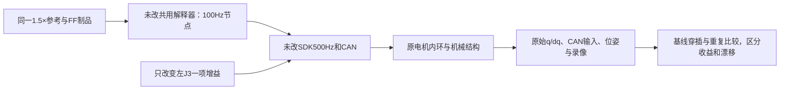
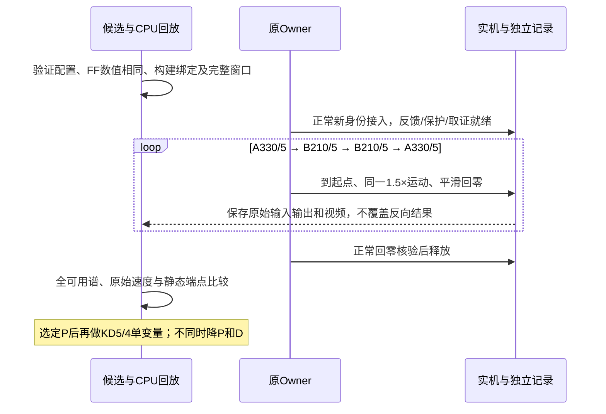

# 1.5×连续递送的局部增益和平顺性对照

2026-10-25；维护者Session `01a16327-7545-7332-a361-0123ddad811d`，试验/异常/结果/用户决策时更新。
用户明确关注连续运动中忽快忽慢与起伏，要求继续设计实验推进；原工序停顿不是本轮对象。
仅1.5×，沿用已授权场景、正常回零维护和异常不自动重试约定。优先局部增益，不再提高节点率。

## 当前执行门：用户要求先review多路线方案，53/2不执行

用户再次要求停止直接试参，先明确路线/预期/观测分支，并把Ki纳入系统PID计算。
统一行动入口已改为[模型化PID与路线筛选](control-route-screening-plan-20261025.md)，本文件以下为历史方案。
53/2候选2167个CPU窗口通过，但没有接入、driver或execution-intent；SDK只读核验断开。
原候选沿用旧I，不能视为约53/2/31的完整PID候选；待review后按新方案实现/验证，不自动启动旧脚本。

## 最新指示：取消KD5对照，从KD2开始

用户随后明确“从kd2-对应的合适的kp为起点开始研究”。旧批次首轮只完成Align/Motion，回零期间收到新指示，
已通过普通Stop撤销旧执行身份，随后走正常低速回零并释放。工具将epoch变更记为批次中断；这是用户改计划导致，
没有新CAN/控制故障，不自动补跑旧KD5轮次。旧证据保留在`.evidence/gain-smoothness-1p5x-20261025-v1/`。
独立CAN1,068,714帧零丢帧，release的sdk_close_returned=true，运维无未确认恢复。

新起点取左J3 **KP53/KD2**：从330/5按忽略机械阻尼的同相对阻尼比例估算为330×(2/5)²=52.8。
真实惯量、机械阻尼、摩擦和积分会改变这一关系，53只是待验证起点，不宣称临界阻尼或已保证稳定。
先仅一次完整1.5×→回零释放，其他关节、100Hz、SDK500Hz、原FF数值、J3积分暂停策略及保护不改。
新证据根`.evidence/gain-kd2-1p5x-20261025-v1/`。结果出来前不自动安排长批次或重试故障。
本节替代下文原KP330/210及KD5/4执行安排；下文保留此前设计及评价口径的历史记录。

## 假设与边界

高P可能放大位置相关扰动和柔性响应；高D在理想模型中增加阻尼，但速度估计噪声/延迟可能经D进入输出。
当前不能把相关性当成高增益激振的证明。已有1.5×原始反馈在连续目标下有明显速度起伏；这支持对照增益，不能直接确诊摩擦或固件缺陷。
100/200Hz试验只检验参考节点密度，未排除所有固件/通信频率问题。

冻结原1.5×连续参考、100Hz节点、SDK500Hz、约50Hz窗口提交、其他关节增益、原FF数值与积分策略。
J3在原素材44–51秒暂停新增积分、保留偏置；轮间偏置可能不同，必须记录，不能声称初态完全一致。
参考的暂停、夹爪事件、几何/时长不改。所有动作走现有Owner审阅接口，保持0.8rad/s及原保护。

## 评价与下一步准入

1. 先做P块A/B/B/A；它是针对当前1.5×与速度平顺目标的新对照，不把旧1×结果当本次结论。
2. 主评同时保留原始反馈速度曲线、速度误差RMS/分位数/低速停滞片段、完整可用频谱与分带能量、FK位置/朝向、相机外壳与夹爪视觉。1–12Hz仅作历史可比诊断，不再独占主指标。
3. 反馈速度来自固件估计，不把单个负值或量化台阶直接认定为真实反向/静摩擦；必须结合独立位置增量与录像。P/D重建仅为协议量纲指标，非已测输出力矩。
4. 递送末1秒左右TCP峰值≤1mm；停位和回零不得出现新持续摆动。新故障、失联、超速或取证失败停止本批，不自动恢复续跑。
5. 200Hz研究已通过的当前代码Stop/未来撤销/恢复资格沿用；没有改控制/SDK代码，不额外发布或重复维护。
6. P结果若明显恶化，不晋级；无一致收益则保留330。随后固定所选P做KD5→4→4→5，不改其他变量；这一阶段需独立CPU制品资格，保存结果后再决定是否研究积分/前馈。

当前：方案已建立，尚未执行新P/D批次。证据根`.evidence/gain-smoothness-1p5x-20261025-v1/`。
