# 前 50 秒控制精度研究

2026-10-22；Owner：工作台 Session `01a13e4e-70dc-7513-9467-d34b9a7a99a3`。
维护触发：试验边界、测量模型、参考格式、候选或实测结果变化。

**2026-10-24 15:59 CST 最新状态**：用户已恢复研究，过滤/合并和延迟取证实际上线；
完成四档基线及一轮 0.5× 平滑补偿对照。31,588 条反馈无延迟故障，单次左臂振动带
综合 RMS 约下降 6%、左空间峰值 1.460→1.402 mm，仍未达到 1 mm。默认积分已恢复并
回零，SDK 健康连接、无自动动作。实际发布为 smoothness-resume-20261024-v3。
图表、完整入口修复、配置差异与证据见[本轮研究报告](control-smoothness-resume-20261024.md)。
下方暂停与旧实例按当时状态保留，不覆盖新的实际收据；全天延迟接受仍待后续记录。

**2026-10-24 11:13 CST 状态更新**：09:33:25 Guard 因已处理 CAN 反馈年龄
`can3:6=100.891 ms` 终止 SDK；当时 Owner heartbeat 年龄仅 1.619 ms。当前 SDK
未连接、故障锁定，精度研究暂停，本轮未恢复或控机。下方凌晨的有界验收结果保留，
但不代表长期运行通过；新分片预算是否导致接收积压、或实际反馈/调度中断，仍待区分。
最新事实和证据见[控制链路当前状态](control-runtime-status.md)。

## 2026-10-24 01:18 CST：三处延迟竞争已修复，静态负载、动态时序及停止验收通过

维护者：Session `01a16327-7545-7332-a361-0123ddad811d`。实际工作台源码为
`robot-workbench-latency-root-cause-20261023-v2`；原生 SDK 为已核验的 native-build-v2，
模块 SHA256 `16b8bb7dfa8db94dd537f27bd9c8004fe350907f4abed5a6841b3dda5b8d008d`。
当前 nonce `34d2873e84a01c02b89e427832f9a2e8c8903eda03af789a`、epoch 3，
SDK 连接，动态时序复核后已低速回零、`READY`，反馈健康静止，research 持权，
`automatic_enabled=false`。显式恢复不续跑旧动作；动态复核是新审阅，精度评分和调参仍暂停。
下面旧“未发布”等描述保留为历史。
实际状态仍以 continuation-state 的 publication/actual-state 指针及新鲜核验为准。

### 根因与修复边界

|竞争位置|直接证据|本次处理|
|---|---|---|
|Owner 完整状态 JSON 编码争抢 GIL|实际 off-CPU/GIL 栈命中请求线程；同一翻译器的 CPU 因果复现中，2.56 MB JSON 竞争使参考求值 wall 达 38.345 ms、CPU 仅 0.247 ms|inspect/snapshot 的大包编码移到独立 CPU 进程；两槽有界等待发生在读取状态和控制锁之外，小型控制操作不走该队列|
|原生参考入队等待整个 CAN 周期的生命周期锁|实际栈命中 set_joint_reference→互斥等待；原函数体竞争测试持锁 40 ms 时旧入口拒绝，候选约 0.092 ms 完成|独立 reference_mutex 覆盖验证至入队；cmd_mutex 仍保护队列；Stop、旧目标替换和 quiesce 保持统一锁顺序及排空|
|Guard 先处理过多 CAN 帧，延误同步心跳回复|真实故障反馈读取 79.273 ms，其中 Guard 往返 75.229 ms；select 返回前已等约 38.414 ms，随后 256 帧批处理 wall 35.817 ms、CPU 29.474 ms|active/releasing 时每条总线每轮约 0.5 ms 工作预算，及时回到 IPC；未读帧留队，保留原内核接收时间，已发现 CAN 故障立即处理|

这三处是不同竞争源；不能把它们的耗时相加，也不能声称已重建历史 29.800 ms 那一次
等待的每一毫秒。Guard 批处理预算限制可控工作量，不承诺通用 Linux 调度的硬实时上限。
没有更改轨迹 q/dq、时间戳、增益、积分算法、100 Hz 节点、3 ms 准入余量、反馈新鲜度、
100 ms 保护或 0.8 rad/s 峰速保护，未通过牺牲精度换取延迟改善。

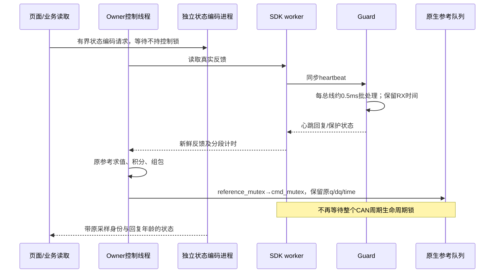

### 实机延迟与停止验收

先正常释放旧故障实例，再发布、重接、低速回零，回零记录
`f8d6bfdfea2adbe713e47a29`。新版本两路并发完整状态读取：30 秒 8,448 次、
300 秒 84,124 次，均无读取错误、故障或 SDK 身份变化。300 秒捕获 12,444 个不同
翻译窗口、29,658 个不同反馈样本；这是有界负载资格，不是长期无人值守稳定性统计。

|300 秒并发读取下的阶段|P99|最大值|
|---|---:|---:|
|Guard 心跳往返|0.197 ms|2.044 ms|
|Guard 当轮 CAN 批处理|0.042 ms|0.385 ms|
|SDK 反馈读取 RPC|1.003 ms|2.641 ms|
|参考翻译至提交返回|2.549 ms|3.519 ms|
|提交阶段（包含 Python/RPC，并非仅 C++）|2.050 ms|2.835 ms|

提交前首点余量最小 **27.981 ms**，原准入门仍为 3 ms。观察端回复最大 79.675 ms，
产生最大 90.668 ms 的**采样空档**；完整 Owner 事件环未截断，且无超过 25 ms 的
owner_loop_trace，不能将观察空档冒充控制周期停顿。尚未对观察客户端的 GC/调度
做因果采样，不指定其唯一原因。

随后用已通过 CPU 的合成零位保持参考做真实拒绝/Stop/恢复：1,234 个正常窗口，
2,960 条反馈覆盖 29.872 秒，最大实际反馈间隔 11.625 ms；所有已准入关节 q/dq 为零。
第 30 秒前的故意未来速度断点在调用 C++ 前被拒绝，未来队列清空，停止保持返回；
显式恢复 epoch 2→3，SDK 身份不变，2 秒持续核验无旧动作续跑。该段真实 C++ 提交
左/右最大 0.056/0.065 ms，P99 0.038/0.027 ms。无精度轨迹、相机录制或模型调用。
100 ms tick-gap 的新显式恢复分支已通过 CPU 人为时间跳变、健康门及无续跑回归；
本次没有人为挂起真机 Owner 来触发失联保护，不把准入故障验收冒充该分支的实机注入。

最后补齐原 **0.5×、102 秒**动态片段的纯时序复核，记录
`b12123420132d2661eb41485`。沿用方案 3 和相同已核验前馈
`ccf31761c50a47e2818b93be466356276e3c94d62d7950027464a8ec89a7683c`，
无增益/轨迹修改、无精度评分。4,326 个完整窗口、10,196 条反馈，0 个控制故障、
0 个 ≥10 ms SDK 慢调用、0 个 >25 ms Owner 慢周期；反馈间隔最大 13.168 ms。
Guard 往返最大 3.232 ms，反馈 RPC 最大 3.621 ms，整体翻译至提交返回最大
6.098 ms，首点余量最小 **26.281 ms**；C++ 左/右提交最大 0.087/0.076 ms。
左积分 wall P99 0.097 ms，左前馈 wall P99 2.173 ms、线程 CPU P99 0.325 ms，
不能把前馈的墙钟等待都称作数学计算。完成后低速回零
`6ed24eea8f7c1fa383746ee2`，READY、健康静止，当前保持原研究配置。

验收过程问题也保留：发布脚本连续字符串替换导致 `workbench-run-v2-v2`，新 Owner
在 SDK 接入前因配置缺失退出；已改为单次替换、核验全部旧控制进程退出后完成惰性发布，
未重复释放。停止验收脚本最初读取了故障同周期、Stop 之前的缓存反馈；后续以双方
hold-return 之后的新鲜反馈确认撤销，并完成同一次故障的恢复，没有重放实验。

证据位于 `.evidence/latency-root-cause-20261023-v2/`：`qualification.json`、
`release-applied.json`、`inert-path-repair-applied.json`、`connection-verified` 对应的
`connect-applied.json`、`publication.json`、`latest-actual-state.json`、
`pressure-hold-result.json`、`pressure-hold-300s-result.json`、`pressure-gap-analysis.json`、
`stationary-rejection-acceptance-verified.json`、`latency-v2-dynamic-half-timing.json`。
动态执行/回零收据在 `.evidence/smoothness-priority-20261022-v6/latency-v2-*.json`；
该目录名不代表部署版本。CPU 检查为首组 113 项及补充组 117 项，
存在重叠，不相加为唯一测试数；强制进程死亡测试的 10 个 semaphore 清理警告保留，
不能据此宣称长期内存验收通过。

后续按顺序：恢复原路径四档平滑度/空间 FK ≤1 mm 对照，持续保留同源分段计时；
当前无需精度换延迟的用户决策。完整业务长时间
内存资格仍为独立遗留，不以本次 5 分钟只读负载代替。

## 2026-10-23 正向因果分析检查点（历史）

### 用户再次明确：延迟解决前停止精度研究；锁/GIL根因专项

用户明确要求延迟优先，只有解决延迟需要牺牲精度时才提出取舍。此前恢复1×/1.5×精度
对照过早；2×只完成起点，未执行。精度试验已暂停，并完成维护回零
`a27b2ba3b221bcd002d41d5f`。当前SDK保持、健康静止，nonce eeb10bf…、epoch3。

只读实核主机支持sudo perf；没有修改内核调度或控制参数。5秒off-CPU堆栈采样直接看到：
SDK线程245次睡眠栈含`set_joint_reference → command_lock_ → pthread_mutex_lock`；Owner
线程359次睡眠栈含`take_gil`，涉及NumPy赋值/排序及socket返回。它们是实际阻塞路径，
不是历史29.800ms/21.337ms那一次的完整重建。首个perf解码因默认符号解析超时，已核验
并终止本任务的孤儿解析进程；改用禁用debuginfod及inline解析，原始采样完整保留。
附加隔离安装py-spy 0.4.1，仅作非阻塞只读采样，不进入机器人运行依赖；5秒200Hz GIL
采样有效206、错误45（非阻塞读取局限），多数有效栈位于Owner请求线程，其中明确含
`control_owner.py:230 → _encode → json.dumps/iterencode`，控制线程仅65样本。
因此仅把研究监视器降频不够：其他业务/页面仍能触发Owner里的完整JSON编码。
证据在`.evidence/latency-root-cause-20261023-v1/`，远端原始perf数据不经本机转存。

实施前组件边界：

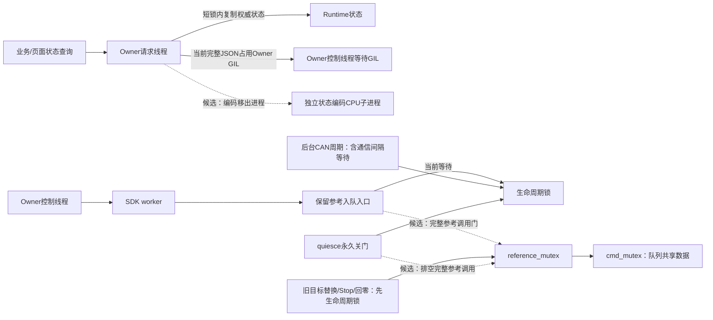

两个最小候选分别处理已见到的竞争源，验收独立：

1. Owner完整状态（inspect/snapshot）回复的JSON编码移到独立CPU子进程；复用现有spawn和生命周期
   模式，保留事件编码子进程独立性。Stop、恢复、维护等写操作不等待这些编码队列。
   快照身份和原始时间不变，队列有界，并显式带回回复年龄。小型控制输入/状态、Stop等
   不绕编码子进程，不增加控制读数延迟。未添加新的100ms读请求失败门；不能以改时间戳
   或丢事件伪装实时成功。CPU模拟编码阻塞250ms时控制tick、Stop独立，旧样本年龄保留。
2. 新的`set_joint_reference`只修改插值队列，不执行CAN输出。候选只移除它对整段CAN
   周期生命周期锁的依赖，保留`cmd_mutex`保护入队；另以`reference_mutex`覆盖验证到
   返回的完整调用，旧目标替换、Stop和回零也按生命周期锁→reference锁串行化；quiesce
   同序关门并排空完整在途参考。原CAN周期、sleep、PD、驱动、
   q/dq/补偿值、时间戳、限幅及准入余量不改，其他旧命令入口保留原行为。

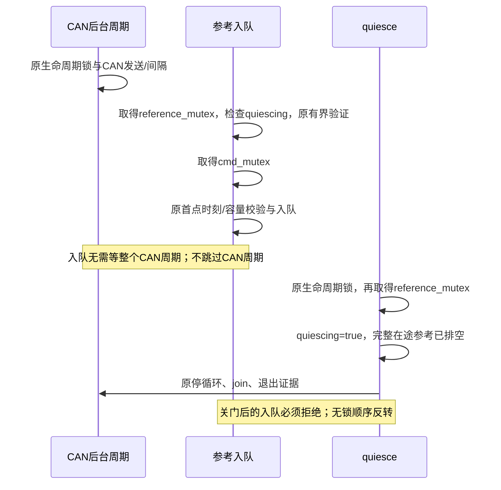

先做相同负载的CPU争用/异常/生命周期检查，再受控加载并在零位保持采样；不以恢复
精度试跑代替延迟验收。当前根因候选已实现、未发布，不宣称历史故障已消除。原生v1只
排空队列修改的范围不足，且需覆盖旧轨迹替换，已在上线前废弃；v2增加独立参考调用门，
并对旧目标替换/Stop/回零保持串行化，所有数据与控制时序数值不改。源函数体CPU竞态
试验中，后台生命周期锁被人为持有40ms时，旧入口40.19ms后过期拒绝，v2约0.092ms入队；
cmd锁导致真正过期仍拒绝，验证阶段和提交阶段都须先退出才能quiesce，关门后拒绝新命令。
此为CPU锁模型，不是实机统计。v2构建号9e04df…，真实二进制9144窗口、容量/Stop及
模型资产加载检查通过；仍需实际发布后验证。

零位保持期间又捕获一次原生过期（monotonic1230328.093887725）：翻译求值/补偿/组包
3.392ms，提交前首点余量26.646ms，提交阶段41.305ms；原生拒绝触发Stop，健康静止。
已显式ack epoch4→5，SDK身份未变、不续跑旧动作。事件环可能挤出RPC明细，因此候选
同时把拒绝异常携带的RPC/native计时写入持久故障快照；22项定向CPU回归通过。

### 分段诊断已加载；研究观察减负已发布，实测对照进行中

2026-10-23本轮维护先发现旧Owner在零位保持期间新增`control tick gap exceeds 0.1 s`锁，
epoch8、SDK仍连接、停止阻尼返回且反馈健康静止。用户通过
`call_8a62390665764fc2a2240af45a6ce439`明确批准双臂已支撑、本次当前位置释放/加载/重接后回零；
没有绕过锁下发回零。正常释放和旧worker/supervisor退出均实核通过。
诊断候选168项Linux CPU检查、受控发布与重接完成；nonce eeb10bf…，回零和研究起点均通过。
诊断实际收据在`.evidence/reference-budget-diagnostics-20261023-v1/`。

保持方案3增益/积分，0.5×无前馈`7df2f40bf503a17e7b9b0721`与有前馈
`7eeb63841a86ca6152476f7f`均完整执行并回零。两轮分别4370/4377个窗口：

|项|无前馈|有前馈|
|---|---:|---:|
|参考求值wall P99|1.755ms|1.876ms|
|左积分wall P99|0.103ms|0.102ms|
|左前馈wall/CPU P99|不适用|2.595/0.336ms|
|提交阶段wall P99|4.114ms|4.417ms|
|提交前首点余量最小|27.609ms|25.325ms|
|左/右native调用最大|1.821/3.269ms|3.593/2.994ms|

两轮没有重现历史29.800ms；不能将新正常记录当成历史根因已唯一定位或长期稳定性证明。
新Owner与历史Owner寿命、状态历史和负载不同。本地隔离的同数学代码+历史54,794字节
状态复制/JSON竞争实验也只证明该路径增加等待，没有完整重现历史故障。

研究监视器原每轮完整snapshot又读取同一原始事件。已按上文设计改为远端完整轨迹只10Hz
读完整状态，原事件读取节奏不变；峰速和样本数从本次reference_id、起始时间和wall时间
匹配的原始反馈统计；新鲜完整状态才能确认终态，丢事件仍Stop并未确认。
记录`monitor_reads`以便核验实际减负；分析同样排除旧/异参考反馈。点目标与回零行为不变。
110项Linux检查通过，含轮询间短峰保留、异参考/旧起点排除、事件丢失Stop。

实际业务版为`research-observer-budget-20261023-v1`，Owner仍为
`reference-budget-diagnostics-20261023-v1`；只重启业务/manager，Owner、SDK、相机、模型、
预览服务身份不变，无SDK重接。完整收据见`.evidence/research-observer-budget-20261023-v1/`。
已复用同一CPU合格短段进行真实拒绝/Stop/恢复验收：124个正常窗口后拒绝未来速度断点，
非零未来尾段被清空、停止阻尼返回、健康静止；SDK身份不变，显式ack epoch2→3，2秒内
无旧动作续跑。停止期间左J3反馈变化约0.00610rad，故本验收不宣称≤1mm停止位置漂移。
当前正在做同轨迹同前馈的减负后完整对照，尚未宣布四档精度通过。

### 首点提前量不足：实测时序与诊断补齐（优先于参数对照）

维护者：当前 Session `01a16327-7545-7332-a361-0123ddad811d`。依据为
`.evidence/smooth-load-soft-kp-20261023-v1/sequence-analysis.json` 及其原始
`fault-timing.json`、`fault-owner-loop-traces.json`；记录 `4546914044edb6117ac5aef9`，
Owner loop 368356，零点为同主机 monotonic 1185947.448430497。

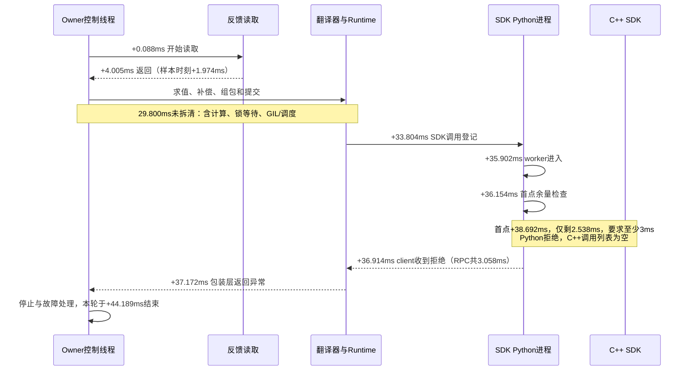

本包仍在未来，触发的是提前量门；不能写成已过期或本次C++调用慢。
RPC包括0.003ms客户端锁等待、2.416ms编码/发送区间、0.639ms等待/解码；发送结束
标记可能晚于worker开始，不能把编码/发送区间全部当CPU计算。Stop返回已确认，
随后按健康静止反馈显式恢复epoch6→7；没有续跑失败动作。

当前实现按翻译开始时刻+30ms建立双臂窗口，并对齐固定100Hz节点（实际提前30–40ms）。
之后的计算、锁与调度等待都会消耗同一份提前量；3ms检查只是最终暴露问题。
完整tick墙钟44.189ms、控制线程CPU13.602ms。同机空后端1000次相同求值/补偿的
P99约0.358ms，最大0.500ms；不支持把29.800ms全部归给数学运算，也不能用空后端
证明实际竞争源。故障快照中的13.356ms参考求值属于**上一成功窗口**，不属于失败包。

此前另一次故障发生在C++原生提交内部：RPC38.325ms，左臂native调用约21.337ms、
线程CPU0.563ms，最终native拒绝过期；证据见
`.evidence/native-input-residual-20261023-v1/native-expiry-timing-summary.json`。
两次是不同阻塞位置，不能混用原因；原生互斥等待与调度尚未分开。

诊断候选先复用SDK适配层已有的分段mark模式，仅补共同入口：

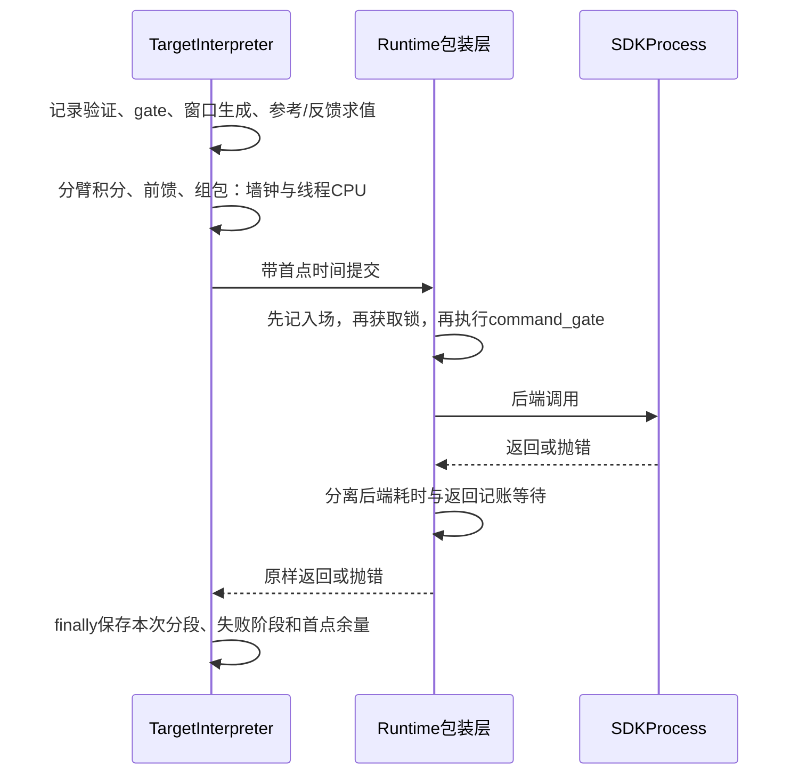

失败同样保留计时；跳过上传的正常tick不覆盖上一提交记录。计时按单次有界记录保存，
不增加100Hz文件写入。先用CPU人为插入求值等待、积分等待、锁等待和拒绝验证归因；
所有门限、首点时间、q/dq、异常Stop行为保持原契约，不通过平移时间或自动重试掩盖。
本轮诊断候选已实现，停止后将失败计时写入既有fault_diagnostic事件。83项本地CPU回归
通过；覆盖求值/积分/前馈/准入各阶段的失败保留、锁竞争、Stop清队列且无续跑。
1100次新旧控制包完全一致；本地空后端基准中位数0.081→0.088ms，仅用于评估计时开销，
不代表真机尾延迟。候选和验证见`.evidence/reference-budget-diagnostics-20261023-v1/`，
尚未发布，具体等待源未宣称解决；参数对照暂停至阻塞链路收敛。实际状态已刷新为SDK连接、
READY、健康静止、epoch7、设置revision15，保持方案3及积分，不自动执行。

### 研究状态读取减负候选：实施前对象与边界

较低KP对照在约32.8参考秒因首点剩余2.538ms被3ms准入门拒绝；该包SDK RPC仅3.058ms，
提交前预算已被消耗。已显式恢复epoch6→7、还原方案3设置revision15并完成回零
`a5bc5f2ab9d24b1bd80d171b`。未把失败前缀当完整精度通过，未重复该动作。
同机独立进程执行同一翻译/前馈1000次：总P99约0.358ms，参考求值最大0.228ms；这不支持
将live窗口的13ms参考wall时间解释为纯计算成本，但仍未分离实际GIL/锁/调度等待。

代码实核研究监视器每轮拉完整Runtime.snapshot，同时读取已有100Hz反馈事件；完整snapshot
在Runtime锁内复制状态并读取保护信息。下一候选只对有独立事件流的完整轨迹，把完整状态
查询节流到10Hz，事件读取继续原节奏。速度峰值和反馈样本数由同reference_id的新鲜原始事件
统计，防止较慢的状态轮询漏峰；点目标/回零与无事件客户端保持原采样行为。
终态仅用新取的状态确认；事件缺失、身份变化仍判未确认并Stop。它减少重复观察开销，不
承诺已经消除全部调度长尾。只改业务监视器并独立发布，保留Owner/SDK实例、控制频率、
原始事件时间和50/100ms保护。

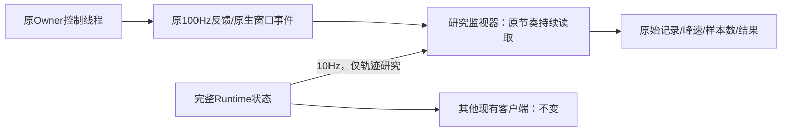

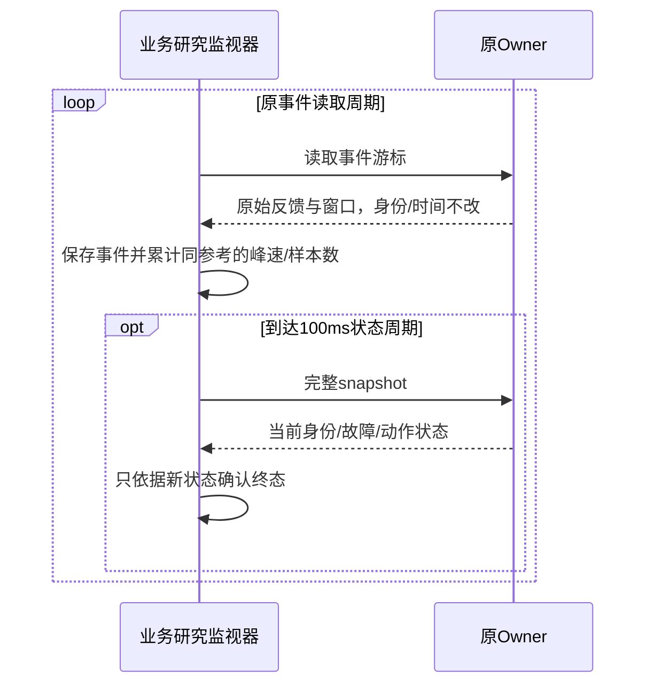

### 下一候选实施前设计：统一发送单位的低频前馈，保留原力矩上限

已录制新SDK积分开/关两轮可作离线负载代理。必须使用发送层的相同单位：源码对X5前3轴
附加torque除1.4、后三轴除0.424，KP/KD原样传入；因此I+PD不能直接相加。首版混单位的
`load-proxy-analysis.json`定量力矩结论已明确废弃，修正版为
`.evidence/smooth-load-proxy-20261023-v1/unit-corrected-load-analysis.json`。
这只约束发送字段，不证明电机固件力矩标定。峰值附近J3的平滑发送单位负载代理开/关积分
约1.089/1.075，接近；不能用原混单位结果宣布必须增加附加力矩。

下一候选仅复用现有冻结前馈入口：用新SDK两轮记录的
`I_sdk + k_motor*(KP*(q_ref-q_fb)+KD*(dq_ref-dq_fb))`得到SDK字段单位代理，均值经250ms
离线Gaussian平滑，按原幅度/变化率预算约束并进一步平滑限幅边缘，保存1536节点的小制品。
它是固定0.5×路径的经验候选，不是已标定负载模型，也不能资格其他速度。原q/dq、原路径
评分、时长、增益、积分和保护不变；在线仍使用原总限幅/抗饱和，不能把原积分再次叠进base。
先检查制品来源/模式、窗口连续、总幅度/斜率、隐藏饱和、Stop撤销，再单次0.5×对照并回零。
对其他速度或增益必须重新资格；不复用旧SDK模式下的前馈通过标记。

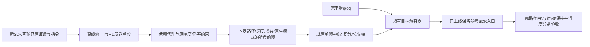

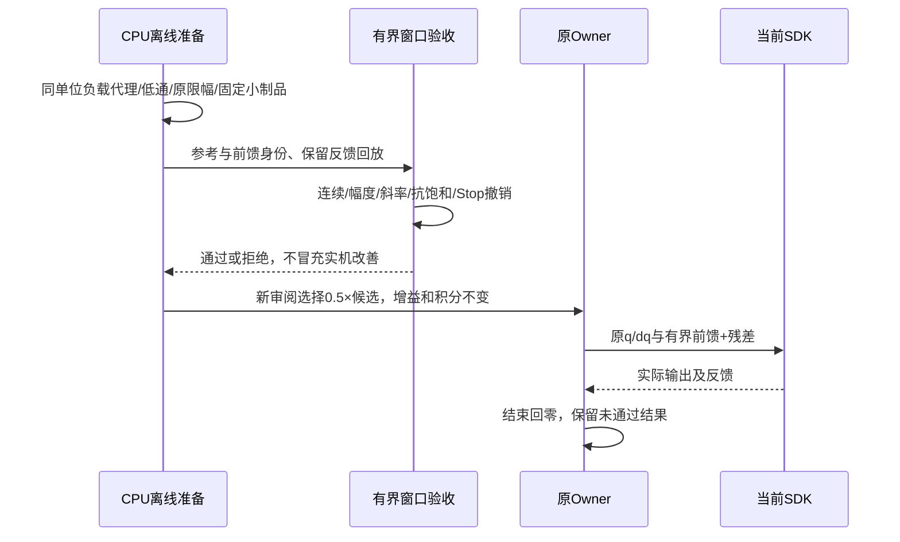

### 最新进展：积分开关对照完成并恢复，左J3为本轮空间误差重点

实际SDK/源码保持preserved-native-adapter-v1；最新回零`natref-ioff-restored-home`记录
`0404bdf6ff1d8159dd4627dc`完成，nonce dc95189…、epoch5、研究revision13，原方案3增益和
积分已恢复。最近核验READY、健康静止、无自动动作。全速度1mm仍未通过。

已有0.5×记录的原路径最大误差位于执行94.832秒/原源46.914秒：左1.520812mm。
局部Jacobian沿误差方向投影中，左J3约贡献1.223mm（该时刻同时间关节残差−0.1576°），
J2约0.272mm；这是局部诊断，不改变双臂共用空间进度的验收，也不单独证明摩擦/重力根因。
原窗口补偿首值跳变均0，但斜率变化仍在；左J3附加补偿约9.28%样本接近1.5上限，峰值
误差处约1.460，尚不能把全部误差归为上限。不得盲目提高限值。

同一新SDK/原路径/0.5×/方案3增益，关闭积分一次`natref-ioff-half`
（`48392f1b6eebecfcea95bea1`）完成，实际附加补偿全零、反馈峰速0.252747rad/s：

| 指标 | 积分开 | 积分关 |
| --- | ---: | ---: |
| 左原路径峰值mm | 1.520812 | 3.792732 |
| 端点峰值mm | 0.156717 | 1.778038 |
| 左六轴3–约44.6Hz残差范数° | 0.039918 | 0.036288 |
| 运动片段诊断范数° | 0.045360 | 0.041220 |
| 静止参考片段诊断范数° | 0.008275 | 0.008372 |

每配置仅一次，不能把约9%变化当稳定统计或因果定论。去掉积分后精度显著变差而大部分
振动仍在，保留积分，后续分解平滑负载需求/PD/积分/重力贡献再决定前馈或阻尼候选。
原始曲线及诊断图位于`.evidence/native-input-residual-20261023-v1/`；
`diagnosis.json`、`integral-comparison.json`和`input-feedback-diagnostic.png`为本轮入口。

**新增原生过期故障及恢复：**关闭积分请求在任何配置提交前被拒，因为回零后持续保持
出现`Reference expired before native commit`。SDK保持连接，反馈健康静止，Stop已返回且
未来参考清空。实际拒绝RPC共38.325ms；左原生set_joint_reference 21.337ms、线程CPU
0.563ms；验证2.908ms，左右frame构建0.809/0.741ms，拒绝后Stop8.954ms。
这次等待已定位到原生提交，尚未区分锁等待与调度；不能归因为积分计算。前置读反馈
4.252ms，非50ms反馈过期。未放宽50/100ms保护、未自动重试旧窗口。
同连接显式恢复epoch4→5，观察2秒未续跑；随后才按新计划完成上述积分对照。
故障/事件/计时/恢复见`native-expiry-*`收据。该实例发生在零位保持，不能外推运动中
原生过期的停止位移。首轮事件分页未取到故障，已用明确sequence22000–22500补齐，
不能用更早或更晚的慢读取替代这一次拒绝的计时证据。

### 最新实际：SDK保留参考入口已加载，0.5×输入保真通过采样核验，物理精度未通过

用户已明确回复“允许新增最小SDK入口”，范围收据位于
`.evidence/preserved-native-adapter-20261023-v1/human-sdk-scope-approval.json`，此前等待门已解除。
本轮执行Session为`01a16327-7545-7332-a361-0123ddad811d`。实际源码/运行目录已切到
`robot-workbench-preserved-native-adapter-20261023-v1` / `preserved-native-adapter-20261023-v1`；
continuation-state指向该版实际收据。原生模式preserve_reference_v1，模块SHA3b5b45be…、
build_id b8a1e0e…，已核验实际worker的/proc/maps、模块哈希和运行模式。当前nonce
`dc95189b9a9a881fa36e70db4936a9c31482258d01938b48`，epoch3，research持权，设置revision11。
最新回零`natref-half-home`记录`4aee37607a743855c0217579`完成；READY、健康静止、无自动动作。

**首次接入失败与修复：**正常回零释放已通过，但新候选未携带models目录。
get_root_dir优先解析动态库位置，编译时SDK_ROOT并不能使其复用旧模型目录；因此新SDK在
KDL加载URDF时报Failed to get chain from kdl tree。源代码调用序列及日志定位在init_robot_之前，
已创建CAN接收socket，但未到电机初始化；两个SDK进程退出，首次失败/未知维护票据均保留。
这是本轮打包及验收遗漏，不是真机反馈故障。补入原20个模型资产、共25,404,447字节，逐文件
SHA一致；以实际Owner依赖环境运行新旧RobotConfig/Arx5Solver，3个姿态的FK与重力结果完全
一致，strace无AF_CAN。测试脚本首次漏AMENT_PREFIX_PATH的失败另存，不与真实故障混淆。
未改二进制或模型内容；构建脚本与发布资产检查已补齐。现有recover_control核验同票据、
正常重接及research交接成功，没有自动续跑旧动作。

**停止验收：**新SDK中先执行原0.5×路径的短前缀，再让3秒处的人为速度不连续被准入门拒绝。
故障前已提交117个原生窗口，存在非零速度的未来尾段；Stop清空未来参考，SDK身份保持，反馈
健康静止；显式恢复epoch2→3、观察2秒不续跑。对应`moving-rejection-acceptance-verified.json`。
故障到静止采样中最大关节位移约0.328°，不宣称急停位置≤1mm；此证据不冒充原生过期、
真实心跳失联和参考断流所有故障的实机覆盖。

**完整0.5×对照：**`natref-half`记录`95cbbdaee9824cea9abe81da`完成，反馈峰速0.252747rad/s；
随后回零。沿用方案3增益和积分，不使用旧模式冻结前馈。4317个窗口均走set_joint_reference，
1018个原生诊断样本保留命令时间戳；运动内部981样本/臂，按实际时钟映射比较，没有拟合相位：
左臂最终输出相对传入节点插值的最大位置差4.84e-8rad、速度差1.22e-8rad/s；相对解析参考
速度差≤1.50e-6rad/s。证明这次采样中的速度重算差异已消除，不是物理FK精度或连续高频
平滑度证明。实际提交客户端中位1.884ms/P99 3.744ms/最大7.723ms；左右commit最大
6.130/3.225ms。无慢SDK事件，不能外推长尾68.9ms问题永久消失。

同一原路径、双臂共用空间进度的FK峰值：左1.520812mm、右0.158045mm；终点0.156717mm，
反向覆盖峰值1.223094mm，未达到1mm。左3–约44.6Hz诊断范数0.03992°；历史同增益、无冻结
前馈的单次damping-base-half为1.349909mm和0.03246°，没有证据证明这次机械平滑度改善。
两轮不是同生命周期重复统计；不把差值当作稳定劣化结论。实际反馈最大间隔13.563ms。

下一步先分析剩余积分/总补偿输入与反馈振动关系，再决定增益/积分对照，不继续增加旧冻结
前馈或改变原路径来获得较小分数。四档全程≤1mm目标保留，未完成。详细输入和计时证据：
本版`natref-half-native-analysis.json`；路径/平滑度分析仍存于历史v6证据目录的
`natref-half-analysis.json`，其实际执行模式明确为preserve_reference_v1，不按目录名判断版本。

### 历史候选检查点：SDK隔离构建与210项适配回归通过，彼时尚未替换运行版本

本轮按用户“先保证最终输入平滑”的优先级继续，未调KP/KD、积分，未新增误差学习或
实机动作。图中Frozen base是冻结前馈力矩补偿；目标q/dq已经高阶准备和固定100Hz采样，
但该事实不覆盖补偿的斜率变化，也不覆盖SDK重算dq与重接窗口造成的最终输入差异。
上一版只滤波base的实机对照未改善，不推广；见后文失败及恢复收据。

5文件SDK候选已在独立目录完整构建，原SDK及vendor二进制未改。
build_id=`b8a1e0e083514cd619d22f395dbd0c6f8d821f7a255ffd19bf5eeb8654c49c91`，
模块SHA=`3b5b45be05bf744ee79269da51c148d321bddb81d1d5c20de2c649ca9bb20767`。
真实候选模块的身份/旧新接口/真实C++拒绝异常检查通过；原生数学路径的64节点容量
拒绝、固定Stop清空与四档9144窗口重放通过（峰值15节点）。未构造控制器，strace未见AF_CAN。
这不替代真实控制器生命周期、并发Stop或机械精度验收。

工作台适配已在`robot-workbench-preserved-native-adapter-20261023-v1`独立源码完成
210项Linux回归，覆盖共享准备/点目标、SDK IPC、保护、维护与研究。新增实际C++异常经
适配层映射的CPU集成检查通过：右臂拒绝后双臂测试队列清空，不退回旧API。
强杀CPU生命周期测试仍报告5个信号量由resource_tracker清理；不据此宣称长期内存通过。

仅显式`native_reference_api=preserve_reference_v1`选择新入口，默认仍是旧入口。
旧原生模式下的冻结前馈不自动继承资格。已准备私有profile与Owner unit草稿：只改变
SDK pin和显式模式，并将Owner的SDK PYTHONPATH指向新模块，其他依赖路径保持。
仅改profile pin不足以加载新模块；实际import必须与合同路径/build_id匹配。草稿未安装。

后续自动goal轮补齐`publish.py`和完整发布dry-run：核对实际五个服务归属、共享参考制品、
新profile与旧profile仅SDK pin/模式差异、Owner环境仅SDK PYTHONPATH变化，并生成
业务/Owner/manager配置及回滚私有草稿。`publication-dry-run.json`为通过，未执行--apply、
未重启服务。发布后新SDK的Stop/恢复资格会明确重置为待验，不能继承旧SDK的实机通过标志。
之后只读快照仍为同一nonce/epoch与已完成home。当前所有独立构建/适配/发布准备均完成，
下一步真实加载仍依赖同一SDK范围答复，不通过追加无关检查或实机循环代替该选择。

最新只读核验：实际仍为`reference-timing-20261023-v1`，SDK连接、READY、反馈健康静止、
automatic_enabled=false，nonce8efa0b…、epoch1；最后为已完成的`timing-v1-home`。
本轮执行Session `01a16327-7545-7332-a361-0123ddad811d`。新SDK真实替换仍等待已提出的
人类范围选择；隔离构建不再因该问题停工，自动续跑也不构成替换授权。

证据：`.evidence/native-reference-entry-20261023-v1/{build-receipt,module-qualification}.json`；
`.evidence/preserved-native-adapter-20261023-v1/{qualification,candidate-plan}.json`。
后续依次：范围选择→健康回零维护及身份核验→Stop/过期/断流撤销及显式恢复不续跑→
无旧冻结前馈的低速最终输入对照→四档原路径/运动与保持平滑度验收，再考虑调参。
双TCP始终共用一个空间进度匹配原路径；全速度≤1mm尚未完成。

### 历史检查点：SDK候选容量审查完成，彼时尚未完整构建

范围问题尚无用户答复，运行SDK和已发布提交计时版保持不变。独立审查发现每包32点
不能限制保留前缀后的总节点数：同一原生数学插值器的40轮CPU反例积累1281点，最慢
append约2.3ms。该反例不是当前真机故障，不能据此归因此前68.9ms提交延迟。

待审阅入口已补充总队列64点边界：新增append_reference数学助手先计算当前点、
保留前缀与新窗口总数，超额时不修改原队列；原append_traj和原控制入口不变。
控制器统一通过ReferenceAdmissionRejected报告过期、容量与输入拒绝。候选因此涉及
5个文件，全部仍为同一“显式保留参考”范围；SDK模块未构建、未加载。

精确的候选数学助手已单独编译为CPU测试程序，链接原二进制数学实现，无控制器/CAN：
反例39次超额拒绝均在修改前完成，Stop清空未来队列；四档真实记录的9144个窗口全部
通过，峰值15点。三份实现/绑定源码的syntax-only检查通过。这些结果不能替代完整
SDK模块构建、工作台异常映射、并发Stop/生命周期及实机精度验收。
证据`.evidence/native-reference-entry-20261023-v1/`的`bound-qualification.json`、
`syntax-receipt.json`与更新后的`sdk-reference-entry.patch`。
当前独立准备已完成，后续SDK实现路线依赖已提出的范围选择；不反复提问，也不追加
实机循环等待答复。目标仍为全速度区间原路径FK≤1mm，未完成。

### 最新实际：提交计时版已上线；SDK新入口等待范围选择

当前实际源码为`robot-workbench-reference-timing-20261023-v1`，发布/状态收据位于
`.evidence/reference-timing-20261023-v1/`，continuation-state已切换。140项Linux检查通过，
覆盖成功/拒绝计时、部分双臂提交后的Stop、故障无自动重试、控制Owner/维护等路径。
按已授权的健康回零维护正常释放与重接，SDK模块仍为原`1ec750e2…`，未启用新SDK入口。
新nonce：`8efa0b565c4603e550ce614d735ededf5c2c6d9e352f59c1`，epoch1，研究设置revision11。
新回零`timing-v1-home`完成，记录`929ad6ece0b1938c06a41f71`；最后READY、健康静止、
research持权、无自动动作。实际回零反馈峰速0.297rad/s，未触发0.8rad/s保护；不作精度验收。

原生命令SDK时间戳已在22个实际诊断样本中核验存在。回零是point路径，不输出主轨迹的
control_study_native_window事件，且该记录没有慢queue_reference事件，因此没有把空样本
报告为完整实际分段计时验收；阶段计时已CPU资格，待后续已准备轨迹自然产生事件时核验。
140项检查中强杀CPU生命周期测试的5个信号量由资源跟踪器清理；不冒充长期内存结论。

原生输出审计、修正后的同二进制重放与可审阅SDK补丁已完成；SDK范围问题已通过异步
问题向用户提出，目前没有答复，原SDK仍保持。SDK新入口候选只在
`.evidence/native-reference-entry-20261023-v1/`保存5文件diff，状态review_only_not_built_or_deployed；
不能把它当成实际发布或已通过完整生命周期资格。下一步先依用户的范围选择推进，保持
输入平滑优先、禁止用调增益/放宽保护掩盖接口差异，四档1mm目标仍active且未通过。

### 原生输出审计与最小接口提案（仅候选，未修改运行SDK）

以下审计取自v11、epoch3阶段；最新运行状态见上节。已提取现有四档和失败平滑对照的
原生输出诊断，约101ms/样本；通过共同的命令位置相位拟合仅补偿缺失的native command
时间戳，未改变实际反馈的原路径验收。2×的J2/J3/J4速度差采样峰值约0.0460/0.0228/
0.0314rad/s。10Hz记录不能证明高频连续性，但确认了SDK重算并非只存在于源码。

同一二进制的插值器按实际提交窗口做2ms CPU重放：现有路径重算dq并替换未来前缀；
只保留dq能消除重算差异，但仍会重连当前点至下一批首点；同时保留dq与尚未执行的
前缀节点后，2×输入位置采样峰值差约5.11e-6rad、速度约3.56e-5rad/s。仅为数学路径
与解析参考的差，不是机械臂跟踪精度。原型固定Stop清空未来节点检查通过，未构造
控制器或触碰CAN。初版重放把计算与替换设为同一时刻，制造重复当前节点并夸大差异；
已明确废弃其定量结论。修正版R2使用100us调用推进，当前路径峰值速度差约0.0493rad/s，
与实测采样0.0460rad/s同量级；仍须补充时钟敏感性和真实入口验收。

**候选边界补充（实现前设计）：**纯CPU对既有append_traj的反例表明，每包32个
有序有限未来点、跨度/未来期限都合格，保留前缀40轮后仍可累积1281点；最慢append约
2.33ms。它不是实机故障或常规100Hz流的实际队列长度，但证实新入口需要约束总队列。
新增数学助手append_reference在任何修改前核对“当前点＋保留前缀＋新窗口”≤64点；
超额拒绝并保持旧队列，工作台随后走原Stop/显式恢复。原append_traj不改，SDK新入口
使用该有界助手，拒绝类型统一为ReferenceAdmissionRejected（包含过期/容量/输入拒绝）。
因此审阅diff扩展到控制器、绑定及数学助手共5个文件，目的与范围仍是同一最小入口。
仅准备/CPU验证候选，不构建或加载新的控制器SDK模块；范围问题仍待用户答复。

**提案边界：**现有控制器公开批量接口不能保留dq，单点接口会清空未来队列。
拟新增一个明确调用的`set_joint_reference`薄入口，复用原生`append_traj`，保留原
`set_joint_traj`行为。只增加输入形状/有限数/排序/未来时间验证，并保留原command_lock、
cmd_mutex与quiesce屏障。未来窗口过期使用明确的可恢复异常；工作台仍独立Stop并清锁后
才能新动作。驱动、PD算法、CAN编码、原生插值器、增益、限位、0.8rad/s及50/100ms保护
都不修改。是否允许新增SDK入口需对齐此前“SDK不太可能去动它”的边界；目前仅准备
可审阅diff和纯CPU证据，不修改/加载运行SDK，不回退逐点发送。

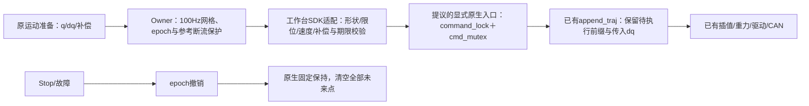

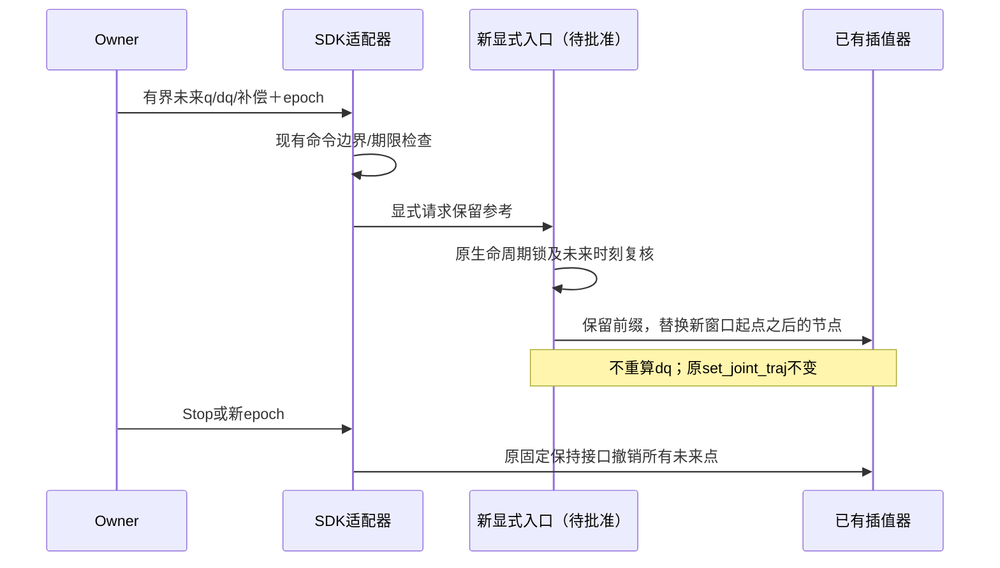

工作台侧计时实施先于任何新的实机对照：复用现有native调用探针，给queue_reference
记录验证、时钟采样、frame构建、双臂commit和收据阶段的wall/CPU时间；失败也保留。
IPC只为该方法附加有界计时元数据，客户端保留自己的锁/编码/等待时间；Runtime在慢调用
或明确拒绝时保存同一份事件。原接入/释放/Stop/异常分类及deadline不变，不新增RPC或
后台心跳。原生诊断同时保存已有get_joint_cmd结果里的SDK时间戳，避免后续相位拟合。

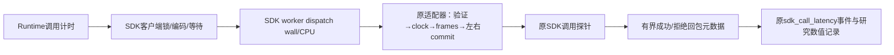

独立待办仍可推进：queue_reference成功/失败分段计时、记录native command时间戳、
最终输出审计。若接口获准，先完成构建身份与CPU拒绝/Stop/生命周期检查，再按已授权
健康回零维护加载，实机低速对照通过后才扩到四档。输入平滑优先，仍不调KP/KD/积分。
证据`.evidence/native-output-audit-20261023-v1/`；定量重放只使用`*-r2`文件。

### 最新检查点：base候选不推广；确认SDK会重算速度，优先补最终输出验收

用户再次要求输入平滑优先，后续不新增误差学习、不调KP/KD或积分。已对R2冻结base
做100ms离线Gaussian平滑，原位置/速度参考、时长、1536节点、总补偿上限和保护不变。
四档11025个CPU窗口重放通过入口q/dq/补偿首值连续、原生适配器准入、幅度/变化率、
抗饱和和Stop撤销；这些检查**不是SDK最终速度保持资格**，下文发现了相应契约缺口。

0.5×新计划`smooth-base-half`记录`b7906f3dd89d5d56d8865d44`在约68.55墙钟秒因
`ReferenceWindowRejected: future reference expired during multi-arm admission`中断，
计划时长102秒，未完成全段，也未执行其余档位。现场tick间隔68.89ms，反馈读取4.00ms，
queue_reference的分段耗时尚缺；不能归因给平滑运算（它已离线完成）。保留失败，不重放。
SDK仍连接、双臂Stop均返回、反馈健康静止、未来引用撤销、无活动心跳异常；已通过
现有受限维护接口显式恢复，epoch2→3，观察2秒未续跑旧动作、SDK PID/start/boot不变。
新回零`smooth-base-recovered-home`已完成，记录`76713060db330c565ad27a39`、计划
`75c39275973947cca39b7772d397b9bd52547f5eb9d03264c724932620b8cb24`。
最后READY、健康静止、research持权、无自动动作；当前保持带积分、不带轨迹前馈。

同一SDK内匹配故障前2–60秒：旧R2左3–45Hz残差范数0.03856°，平滑base候选0.04060°，
没有观察到改善。该区间新/旧最大采样间隔13.56/14.38ms；这只是一次局部对照，
不能推断全段精度、终点或稳定性，更不能因输入图形更圆滑就推广候选。

**新确认的接口事实：**当前线上SDK的`set_joint_traj()`在收到q/dq点后，添加历史点，
调用`calc_joint_vel(...,0.05)`从位置重算速度，再进入插值器；传入dq被覆盖。
已核对实际worker映射的模块、构建收据与源码SHA，模块为
`1ec750e2452390442a0a91b173629e9bd09540e93e3fca1029d817d66d2df57e`。
又链接同一二进制，直接执行纯CPU的`calc_joint_vel`：相同位置、两组不同输入速度，
得到完全相同输出。测试未创建控制器、未接SDK，strace未见AF_CAN socket。
该数学样例与解析导数最大差0.06936rad/s，**不是本轮真机轨迹的实测速度误差**。

因此此前C6准备、固定100Hz入口与无跳值检查仍有效，但不足以证明SDK最终输出的
速度等于解析dq。不能据此继续调增益。已查`set_joint_cmd()`也不能直接替换：其
`override_waypoint()`会清空原未来轨迹，只保留当前点和一个终点；尚无保留整个未来
窗口及原dq的已资格替代入口。未修改SDK、未切到逐点发送、未绕过其保护。

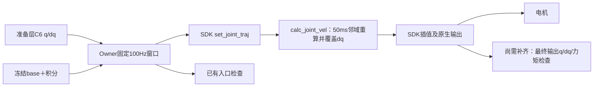

下一步：先用保存的原生controller_telemetry及实际二进制CPU重放，量化最终q/dq与
入口解析参考的差异、窗口替换和终点效应；同时给queue_reference补齐成功/失败均
可保留的分段计时，解释本次提交长尾。确认可用的SDK适配策略后再实施，保持SDK
本体、原空间路径与保护边界。base平滑制品保留为未通过实机资格的对照，不继续加滤波。
证据集中在`.evidence/smooth-input-feedforward-20261023-v1/`：`preparation.json`、
`feedforward-qualification.json`、`partial-prefix-comparison.json`、`fault-state.json`、
`smooth-base-admission-recovery-verified.json`、`sdk-velocity-pin-verification.json`、
`native-velocity-probe.json`及输入前后图。长期目标仍为四档原路径FK≤1mm，未完成。

### 输入平滑优先：先修Frozen base，不继续追误差或调增益

用户于本轮指出Frozen base曲线明显有波纹，要求先保证下发控制本身平滑。图中的base
是冻结前馈力矩补偿，属于下发控制；此前q/dq的C6准备和100Hz网格检查不能覆盖它。
现有补偿仅约束幅度、一阶变化率和窗口首值连续，未充分约束斜率突变。暂停新增误差
学习和KP/KD/积分参数对照，先处理输入。该段为执行前设计，实际执行及失败/恢复以最新检查点为准。

只读实核仍为READY、研究持权、反馈健康静止、nonce不变。保留真机记录重建0.5×/2×
积分与最终补偿，逐窗口最大重建误差均0、六轴隐藏总补偿超额均0；旧抗饱和修复有效。
因此不能把剩余波纹直接归为又一次积分超额。J4常触及既定补偿上限；J3误差在有余量
时也存在。限幅事实只作诊断，不据此提高上限。

下一候选只对现有R2冻结表作100ms时间域Gaussian离线平滑，保留1536节点、原q/dq、
执行时长、模型/原路径、原增益、在线积分和全部保护。平滑在CPU准备层完成，Owner
只复用原有有界插值，不新增控制周期计算或SDK重接。候选不是第3轮误差学习。

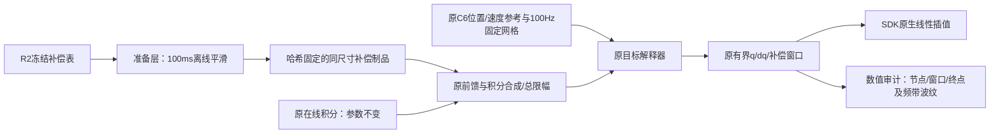

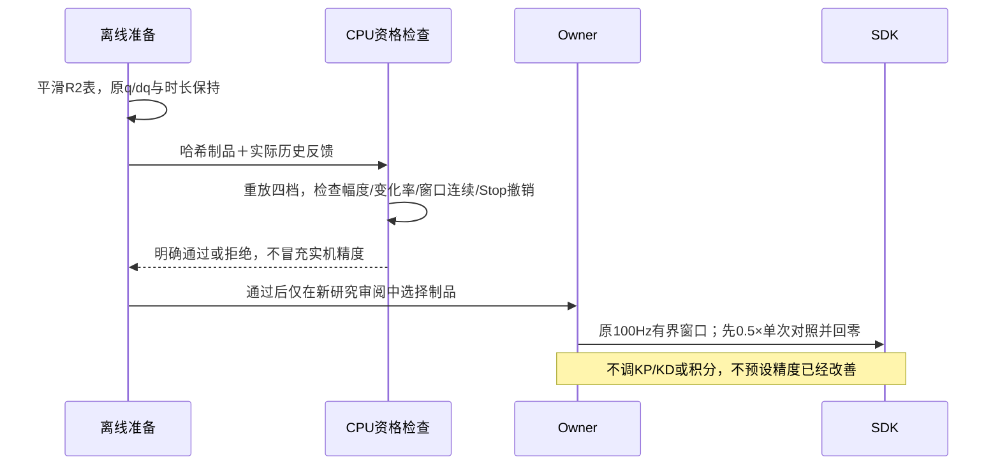

当前离线固定反馈回放：100ms平滑令四档base的3–15Hz波纹范数降至原7.3%–8.5%，
最终合成输出降至原33.9%–42.4%；窗口首值跳变量均0，原幅度/变化率上限保留。
最大窗口斜率变化仍有积分贡献，约J2/J3每秒0.54–0.75 SDK单位，未被base平滑消除。
这部分继续检查，不能声称整条输出已达到数学C1/C2连续。SDK100Hz线性节点本身也
不能冒充连续C6。离线回放固定了反馈，只说明输入形态变化，不预测真实闭环响应。
原始分析、波形和逐档结果在`.evidence/residual-causality-20261023-v1/`。

### 最新实际：v11事件编码隔离已发布；同一SDK四档完成，1mm仍未通过

执行Session：`01a16327-7545-7332-a361-0123ddad811d`。实际发布和状态入口已切换至
`.evidence/owner-encoding-20261023-v2/publication.json`及其latest-actual收据；远端源码为
`robot-workbench-smoothness-priority-20261023-v11`。v10曾惰性发布，但SDK未接入；
在重接前补齐共用Infer事件的有界批量读取，随后发布v11，不能把v10当作本轮实测版。

事件JSON编码由Owner接入前启动的唯一spawn CPU子进程承担；保留JSON协议、事件
游标/顺序、不完整标记、4MiB消息上限与2个在途任务上限。已知有界研究和Infer事件
最多32条一批，未知大事件单独传输。编码子进程不持有SDK、不生成心跳，状态、Stop、
维护仍独立服务。命令执行成功后若响应编码失败，返回结果未知并要求查收据，不能
错误地报拒绝并诱导重放。Linux父死亡清退、正常退出、子进程故障、并发大事件及
实际CPU Runtime/Guard的原100ms保护均覆盖；最终136项Linux检查通过。
强杀CPU测试的资源跟踪器报告并清理了5个信号量；正常退出检查通过，不冒充长期内存验收。

同机2.67MB历史故障响应CPU重放40次/模式：进程内JSON编码时观察线程最大间隔
35.85ms，spawn候选为9.28ms；候选总响应中位64.84ms高于直接编码25.61ms，换来
控制进程不承担主要JSON计算。末20次Owner RSS跨度4KiB、子进程1024KiB，子进程正常
退出；这只是有界重复重放，不能证明全业务长期内存恒定，也不能完全归因旧故障瞬间。
基准为v10同一编码函数，v11只额外恢复有界Infer事件的批量分组。

沿用已有维护授权，核验v9已完成回零及当下健康静止后正常释放；SDK worker/Guard
退出实核通过。v11接入后nonce为`2e564903dad311c6a95cc9ea7583bce19195442ad483ad17`，
研究设置revision11、方案3增益+积分、第2轮冻结前馈、原参考曲线及全部保护上限不变。
在同一SDK生命周期中完成四档原前50秒素材，每次均低速到起点、执行并另用新计划回零。
没有新录像、相机采集、模型调用或GPU任务。

| 速度 | 左TCP原路径峰值 mm | 右TCP峰值 mm | 最大反馈间隔 ms | 左3–45Hz残差范数 ° |
|---|---:|---:|---:|---:|
| 0.5× | 1.3129 | 0.3246 | 14.378 | 0.03676 |
| 1× | 1.4922 | 0.2472 | 13.395 | 0.04095 |
| 1.5× | 1.5617 | 0.2198 | 13.459 | 0.04150 |
| 2× | 1.5664 | 0.2198 | 12.882 | 0.04101 |

四次动作及回零均完成，未触发控制故障；实测峰速为0.253/0.363/0.560/0.582rad/s，
0.8rad/s保护保持开启。每档仅一次，不能作为稳定性统计。验收仍为同一空间进度的
双TCP原路径FK偏离，允许延迟；未使用每关节独立时间平移，也未换成平滑后的路径。
四档均未通过1mm。0.5×旧R2记录最大反馈间隔52.15ms，新为14.38ms，但两次跨重接；
其残差范数0.03671°→0.03676°近乎不变，不能把时序改善表述成抖动已经明显降低。

末次回零记录`b4d60948bd2364cab12d0e2f`，计划
`29398b9d98a6ef064905db6c855aaef754598a78884b0ddd594c4ce1d15fa2eb`。
最后READY、反馈健康且静止、research持权、automatic_enabled=false；保持SDK连接。
当前回零保持带积分、不带轨迹前馈。四条中间结论已通过工作台notes接口保存并读回。

本轮证据入口：`.evidence/owner-encoding-20261023-v2/`的`qualification.json`、
`four-speed-results.json`、`gain-study-notes-verified.json`、`four-speed-summary.png`及
`two-speed-joint-curves.png`；基准在相邻v1的`candidate-benchmark.json`。
原始数值与trace仍按既有目录保留在v6 evidence/run；标签为`enc-r2-half`、
`enc-r2-one`、`enc-r2-onehalf`、`enc-r2-two`，目录名不代表其执行版本。

下一步先用本轮完整数值定位残差发生的姿态、关节和补偿输出，区分可重复的动态误差
与量化/抖动；随后准备最小的有界补偿或重定时对照，并先写组件/时序及CPU资格。
不靠放宽误差、速度、50/100ms保护或提高总补偿上限过关。全速度1mm、重复性与外部
空间精度仍待验收，目标保持active；本轮未commit/push。

### v9阶段记录：已恢复；编码隔离设计随后由v11实现


v9阶段的大事件编码隔离设计（已由上节v11实现）：实际2.67MB故障事件的同机CPU对比中，JSON编码使观察
线程最大间隔约26.69ms；pickle进程间快照约4.81ms；标准库逐项JSON编码约7.35ms，
但总CPU耗时约74ms且会引入需GC回收的编码器闭包。选择已有标准库spawn CPU进程
承担事件JSON编码，保持现有JSON线协议。Owner主线程在SDK接入前预热唯一编码进程，
Linux绑定父死亡清退；不从临时请求线程创建依赖PDEATHSIG的子进程。

事件读取只在原锁内摘取有界引用，已知小反馈/窗口批量最多32条；未知/大事件单条
交付。子进程执行原字节预算和JSON编码，游标、不完整标记、顺序及总4MiB消息上限
保持。最多2个在途编码请求，排队等待释放GIL；编码故障仅使events读取失败，状态、
Stop及维护路由继续独立服务，不能假造心跳。大事件并发、子进程故障、游标/边界和
正常退出须在CPU真实Owner/Guard模型验收，之后才受控发布。当前仍实际v9。

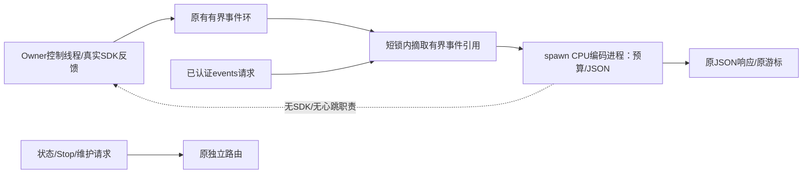

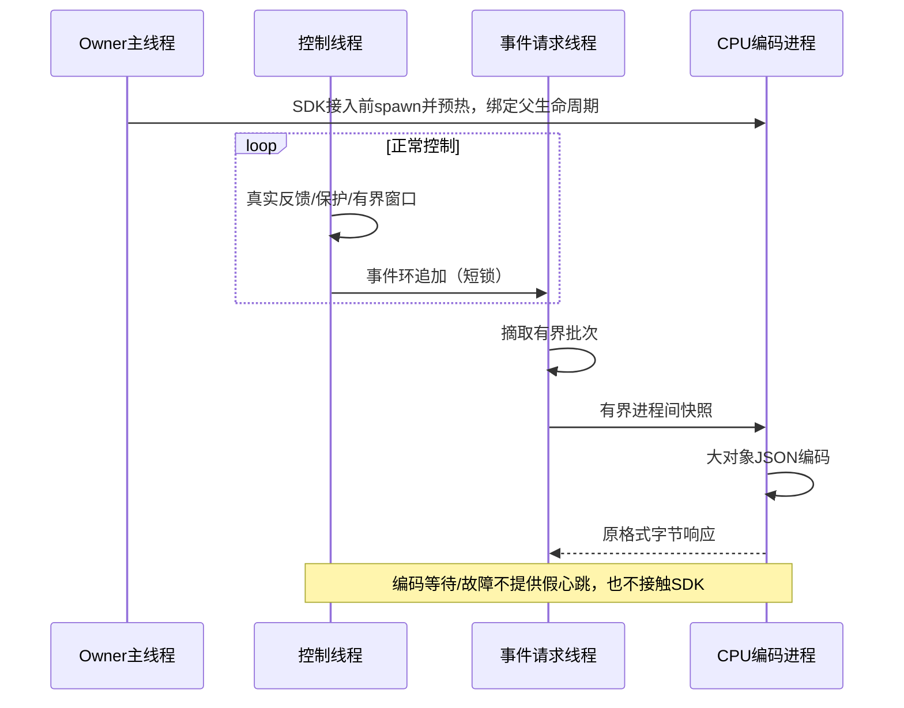

第2轮细化前馈的0.5×已实测：记录`544600dbda6496d5bd046f90`，左路径峰值1.460mm、
右0.220mm，左3–45Hz残差范数0.03671°，最大采样缺口52.152ms；未通过精度/覆盖门。
结束后既有保持的10秒被动数值观察取得969样本，FK采样摆动直径左0.0935mm、右
0.0826mm，最大采样缺口15.911ms。这只描述已保持姿态的摆动，不代表终点绝对误差
或动态路径资格；记录在r2的`r2-half-hold.json`。

随后回零`dd6a909bd5d872ba6da221ff`出现
`ReferenceWindowRejected: future reference expired during multi-arm admission`。
此次SDK保持连接、心跳健康、Stop双臂返回、未来窗口清空、反馈健康静止；经已有受限
维护接口显式恢复，epoch2→3，2秒确认无旧动作续跑、SDK PID/start_ticks/boot_id不变。
没有释放/重接SDK，也未重放失败计划。新回零`8a5f84fd3637705455804660`已完成，最后
READY、健康静止、research持权、automatic_enabled=false。实际设置revision11仍为
方案3+积分；当前回零保持未带轨迹前馈。恢复收据为v9的`admission-recovery-verified.json`。
第2轮1×/1.5×/2×尚未实测；下一步先处理Owner/IPC编码长尾与双臂窗口准入的时效，
再继续动态补偿对照，不放宽50ms/100ms或速度保护。

静态限位缓存候选完成123项Linux检查后，先核验旧SDK worker/Guard退出，使用已有
受限维护接口退休死SDK对象（不冒充正常SDK close），惰性发布v9。用户随后明确回复
“已可靠支撑、已暂停控机，可以重接后回零”；据此正常接入、核对反馈/保持、低速回零。
当前SDK nonce为`ff34e4c478e5fb9c0757e3f3b08f794c57924fd7bcb1823c`，后续仍实核PID/start_ticks/boot_id。
旧故障与退休证据保留，不将旧Guard last_latch当成当前心跳异常。

v9的1.5×、2×新计划及各自回零均已完成，未再触发心跳故障，反馈峰速约0.473/0.626rad/s。
原始路径FK左峰值为1.744/1.761mm，右均约0.220mm；采样最大缺口约30.458/30.088ms，
仍未满足30ms覆盖门，不能将完成动作作为精度通过。抗饱和实际窗口重建输出误差为0，
六轴隐藏总补偿超额均为0。0.5×/1×的抗饱和结果来自v8，分别为1.396/1.500mm；
v8/v9控制算法/前馈相同，但SDK生命周期和静态RPC路径不同，不冒充同一会话的全速度重复资格。

故障事件离线CPU重放：单事件2,669,682字节，JSON编码中位25.51ms、观察线程最大
间隔26.88ms；事件大小估计+deepcopy+响应编码中位81.21ms，最大观察间隔32.43ms。
这证实同进程序列化有GIL干扰能力，不能据此宣称已经完全归因故障瞬间的所有调度等待。
证据见v9的`event-encoding-benchmark.json`；这项序列化尾延迟仍待进一步处理。

前馈第2轮候选位于`.evidence/feedforward-refinement-20261023-r2/`：
原有0.5×表512节点约0.2秒间隔，只保留较慢分量；重复无前馈记录中J3的3–10Hz误差
相关系数约0.82，10–40Hz约0.14。新候选使用1536节点、50ms Gaussian误差滤波，
在旧冻结前馈上加0.5倍低通PD误差，不重复加入旧在线积分。原q/dq、增益、总补偿
幅值/变化率和安全门不变；四档文件约100KiB，均在原128KiB边界内。
11025个CPU重放窗口通过准入、隐藏积分余量和Stop撤销检查；当前开始0.5×新对照，
尚未有第2轮实机精度结论，后续按实际结果更新。无需重接SDK即可选择新的哈希制品。

最新实际发布和状态指针均已在continuation-state更新到v9。所有试验仍只记录数值，
未新增视频、相机采集、模型调用或GPU任务；未commit/push。六条近期研究记录已通过
工作台notes API保存中间结论。服务与预留保留，任务目标仍为0.5×～2×原路径FK≤1mm。

### 已恢复中断：静态限位RPC叠加反馈等待（00:42 CST历史）

实际v8抗饱和已发布并重接，152项Linux执行通过；0.5×实测4256窗口重建输出差为0，
六轴隐藏总补偿超额均为0。0.5×路径峰值1.396mm、高频范数0.03827°；同版本无前馈
对照为1.549mm/0.03957°。1×为1.500mm/0.04177°。均未通过1mm；0.5×跨重接的高频
指标比较存在会话条件差异，不把其升高简单归因抗饱和代码。

准备1.5×时的低速起点动作在结束转保持处故障，完整1.5×和2×前馈轨迹未提交。
首次故障是`shared reference requires fresh feedback within50ms; observed_age_ms=52.212; phase=terminal_hold`：
read_calibration_state RPC约27.88ms（SDK worker内部约0.228ms），随后静态限位RPC
23.82ms。Stop事件之后，读取RPC约48.50ms与静态限位RPC56.42ms再次叠加，Guard在
100.084ms未收到心跳时终止SDK worker。此时各电机CAN回报年龄约0.1–2ms；三次采样
到的SDK worker栈均在等待下一条IPC请求。Owner侧等待的GIL/调度/序列化贡献仍未分离。

当前已严格核验SDK worker/Guard均退出，connected=false，FAULT_STOP_UNCONFIRMED，
没有当前健康反馈或机械保持证据。未自动重接、回零或重试。故障发生于未带前馈的
起点动作，不将其归因前馈/抗饱和计算。当前实际收据已刷新；旧READY描述为历史。

下一候选只缓存当前SDK连接内不可变的14轴命令限位，使用现有SDKProcess对象和锁。
首次读取验证形状/有限值/边界；后续返回副本，不再每tick发静态RPC；关闭/重接清缓存，
进程退出或失联时不能用缓存冒充可用。实时关节反馈、Guard心跳、50ms/100ms门均不缓存
或放宽。它消除已确认的第二次串行等待，但不宣称解决了所有Owner调度长尾。

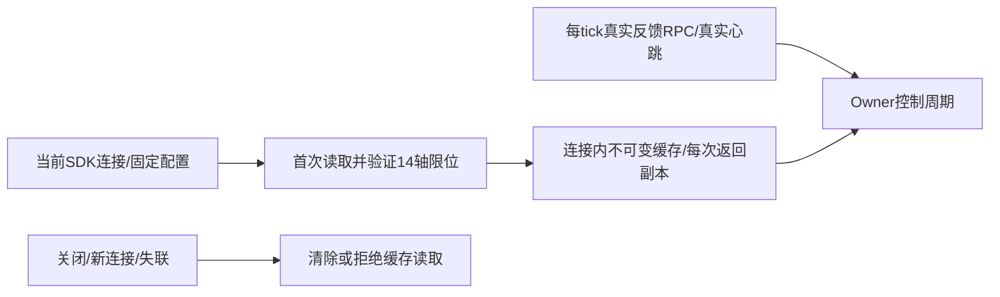

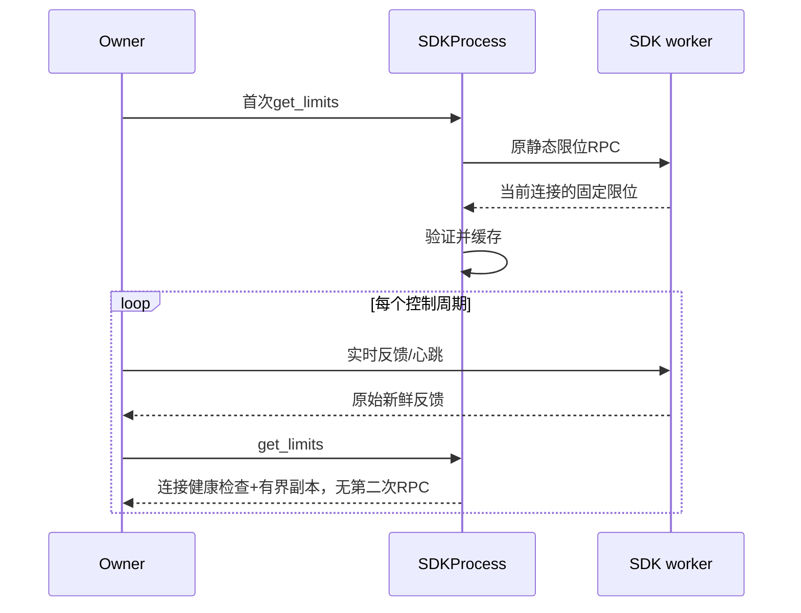

### 前馈实测后的抗饱和缺口（实施前设计，已在v8发布并验证机制）

前馈第1轮0.5×/1×已完成并各自回零，左路径峰值为1.501/1.540mm，未通过1mm；
高频残差范数为0.03206/0.03364°。未继续1.5×/2×。
逐事件重建0.5×的4254个实际窗口，输出差最大值和P99均为0，确认内部残差积分
在前馈+积分总输出限幅时仍独立累积：J3合计超限约22.3%窗口，最大隐藏超额约
0.748 SDK补偿单位；J4约27.6%。这是总限幅与内部积分状态未协调的确定性机制，
不意味着它解释了全部1.5mm误差。证据为v7的`ff1-half-reconstruction.json`。

修复边界：在原ReferenceFeedforward合成处，用首个未来节点的前馈值计算剩余
幅值空间，投影残差积分状态及同包预测值；原有总输出连续衔接和变化率限制继续
生效。共用翻译器与旧原生参考兼容调用都传入同一个积分对象，无前馈的执行保持
原行为。它解决幅值饱和积累，不冒充已完成所有变化率饱和/真实动力学调节。

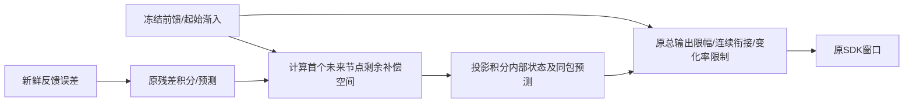

```mermaid
sequenceDiagram
  participant T as 共享翻译器
  participant I as 原积分对象
  participant F as 原前馈合成器
  participant S as SDK
  T->>I: 原误差与有界未来时刻
  I-->>T: 残差预测
  T->>F: 残差预测+同一积分对象
  F->>I: 将隐藏积分投影到总限幅剩余空间
  F->>F: 原连续首节点/总限幅/斜率限制
  F-->>T: 有界总补偿
  T->>S: 原q/dq及修正后总补偿
```

用户要求先梳理影响平顺度/精度的对象、作用方式和可解性，暂不提交新的完整前馈轨迹。
当前实际业务已为v7、Owner/SDK仍为v6原实例；106项Linux执行通过，业务独立发布通过，
没有SDK重接。实际为方案3（J2/J3 KP210、KD5，其余V8）+积分，revision11。
最后低速起点动作`c4d16cdf2a47eaf875c24d1e`已完成，READY、健康静止、无活动审阅，
automatic_enabled=false。不是零位，也没有执行完整前馈片段。当前实际收据已指向v7。

| 倍速 | 左原始路径峰值mm | 右峰值mm | 左六轴3–45Hz残差范数° | 最大反馈速度rad/s |
| --- | ---: | ---: | ---: | ---: |
| 0.5×复测 | 1.559 | 0.211 | 0.03297 | 0.253 |
| 1× | 1.459 | 0.138 | 0.03630 | 0.363 |
| 1.5× | 2.002 | 0.138 | 0.03631 | 0.516 |
| 2× | 2.183 | 0.138 | 0.03787 | 0.620 |

四档均完成并分别回零，未意外触发保护；这是固定前缀、当前负载的测量，不证明任意动作、
连续整个速度区间或长期稳定性。0.5×已有两次方案3记录（首次1.350mm），其余每档一次。
反馈采样最大缺口仍超过30ms，因此不能把轨迹完成当精度覆盖通过。

### 影响项与证据边界

- 参考几何与导数：C6准备已经将路径偏移控制在采样峰值0.236mm，1× jerk峰值
  94.20→17.80rad/s³。仍需把原始路径作为验收源，不能让平滑改掉目标后自证通过。
- 100Hz离散：新增离线核验把2×连续参考与理想固定100Hz线性位置插值，在2ms采样下
  比较FK，左TCP最大差约0.002554mm。该结果说明纯位置离散误差远小于当前1–2mm；
  不能据此证明真实输出微振动不存在，SDK速度/力矩独立插值和窗口更新仍需分别观察。
- 时序：未来窗口可覆盖业务上传间歇，但积分看到的是过去反馈、作用于未来输出。
  统一延迟可被当前空间路径口径容忍，各关节不同的滞后会改变末端空间路径。
  新一轮23.6ms读取RPC中worker执行约0.37ms，client的encode/send墙钟段约23ms；
  worker时间位于该墙钟段内，提示客户端可能在发送后被调度/GIL延迟，不可称为编码
  计算用了23ms，也不等于复现历史40ms根因。
- 动力学/重复扰动：相同路径位置的低频误差具有重复性；加速后误差增加。它与惯性、
  摩擦/重力模型误差、外环相位滞后等假设一致，尚未分离证明各项贡献。
- 积分：已有关积分对照显著变差；方案3一直含积分。积分可消除慢偏差，但通过误差
  累积后才补偿，不能代替预测负载。外环延迟、死区、限幅、变化率和饱和恢复共同影响
  相位与保持微动，不能只提高Ki。
- 补偿上限：新0.5×到2×中，左J3原有附加补偿达到99%限幅的样本占比约2.8%→21.5%，
  J4约17.7%→27.2%。这是软件附加补偿上限，不是已证明电机达到硬件力矩上限；
  触顶本身也不能证明该时刻误差的因果来源。不得直接放宽上限来掩盖分析缺口。
- 反馈分辨率：本轮关节反馈最小非零步进为0.00038147rad≈0.02186°；名义FK模型下
  左J3一个步进约0.169–0.179mm、J1约0.083–0.167mm，J6绕工具轴自转对当前TCP平移
  影响很小。这是报告分辨率/几何敏感度，不是已知真实编码器分辨率或硬件精度极限。
  因此TCP1mm不能替代关节/姿态平顺度，J6振动仍须独立评价。
- 模式切换：正常结束保持应继承连续状态；故障Stop仍采用独立安全保持。已测Stop
  约2.864mm位移与低增益/积分撤销同时发生，因果未分离；不能盲继承运动增益或积分。
- 实际空间误差：零偏、TCP标定、结构柔顺、背隙、装配和负载可能使编码器FK看不见
  真末端偏差；必须用独立外部计量判断，当前不能归咎硬件性能或宣称实空间1mm通过。

### 优化顺序

先按路径位置、方向、速度、加速度、关节相对滞后、补偿限幅及原生输出，把现有记录
分成静止/恒速/加减速/换向/结束保持；形成误差预算和可反驳假设。再在相同已授权
路径上做一次只改变一个因素的验证，优先减少重复扰动与关节不同步，再做PD/积分
闭环调节。100Hz位置插值精度暂不是主要优化对象；调度尾延迟仍是覆盖和稳健性待办。

四档精确轨迹的低通前馈制品已准备，原总补偿幅值/变化率上限不变；11025个CPU窗口
通过原生适配器准入和Stop撤销。它们仅可作为固定轨迹辨识实验，不能作为已验证的
通用动力学控制器，也未做实机完整执行。参考/速度/增益/积分均精确绑定，v7入口
显式接收制品并把身份写入审阅及结果；无参数自动应用。

证据：v6的`kd5-repeat-half/kd5-one/kd5-onehalf/kd5-two-analysis.json`和对应trace；
v7的`qualification.json`、`publication.json`、`feedforward-qualification.json`、
`reference-grid-error.json`、`latest-actual-state.json`。下一次实测或方案变化时更新本节。

## v6当前实际状态、恢复验收和同轨迹对照（2026-10-22）

### 后续全速度研究（进行中，非发布收据）

用户要求继续以0.5×～2×全速度区间、允许时间滞后的原始空间路径FK偏离≤1mm为目标。
方案3本身已含积分：左J2/J3 KP210、KD5，其余V8，积分参数及力矩上下限不变。
第二次0.5×实测左路径峰值1.559mm（第一次1.350mm），高频残差范数约0.03297°；
两次左J3低频误差相关系数约0.89，左J4约0.98，仍须区分重复负载与随机误差。
当前正在补齐同配置四档速度数据，配置为临时研究设置，不替代常规默认资格。

下一候选复用已有ReferenceFeedforward和总力矩/变化率限幅；不修改SDK、不增加KP、
不放宽速度、反馈或Stop保护。只为精度研究准备接口增加显式的可选不可变前馈制品，
绑定精确参考、速度、增益及积分配置；新审阅后才可执行，结果保留制品身份。起点和
回零继续使用原执行链，不能将轨迹前馈用于其他姿态。先CPU完整执行/撤销测试，再
仅发布业务入口，保持独立Owner/SDK实例；本段是实施前设计，未声称候选已发布。

```mermaid
flowchart LR
  T[同参考实测反馈/原生补偿] --> L[离线重复误差分析/低通/有界前馈]
  L --> P[哈希制品：参考/速度/实际增益/积分绑定]
  P --> R[研究准备层：显式选择制品/新鲜初态/新审阅]
  R --> O[现有Owner目标解释器]
  O --> F[现有前馈+残差积分/总幅值与变化率限幅]
  F --> S[SDK原生窗口/现有停止保护]
  S --> M[原始路径FK/覆盖/运动及保持平滑度分别评价]
```

```mermaid
sequenceDiagram
  participant A as 离线准备
  participant B as 研究业务
  participant O as 独立Owner
  participant S as SDK
  A->>A: 多次误差低通/冻结前馈/CPU验证
  A-->>B: 显式制品pin与精确配置
  B->>B: 核对哈希/配置/速度，只允许trajectory
  B->>O: 原参考+可选前馈的普通新审阅
  O-->>B: 参考与前馈身份绑定的审阅
  B->>O: 一次确认，数值记录包含制品pin
  loop 有界100Hz节点窗口
    O->>S: 原q/dq+有界前馈/残差积分
  end
  Note over O,S: Stop撤销参考和补偿，不自动续跑；独立停位精度仍待改进
```

当前实际已发布`smoothness-priority-20261022-v6`，本轮执行Session为
`01a16327-7545-7332-a361-0123ddad811d`。用户明确确认“双臂已支撑，允许本次非零
释放、发布重接后回零”，据此完成一次正常释放、旧worker/Guard身份退出核验、
惰性发布、正常重接、research交接和低速回零。未绕过旧进程的运动门、未注入进程
内存、未另开SDK抢占。相机、热模型和目标显示保持原实例。本节及continuation-state
指向的实际收据优先于下方的发布前状态；下方v3/v5/v6候选描述保留为历史。

本轮最后状态为连接、READY、反馈健康且静止、research持权、automatic_enabled=false。
**实际增益已恢复完整V8，积分开启，研究设置revision10；最后一条新回零已完成。**
选中查看的KD=5历史候选没有自动应用。SDK nonce为
`dac1243d1c6fefbb532d08f6d7ee4cfa9bfd60834df254b6`，后续仍按新鲜身份核验。
服务和资源保持，无自动截止；未新启动GPU负载、模型、相机采集或视频录制，未commit/push。

实际代码包括：高阶参考求值兼容、研究C6分段参考及固定相位100Hz节点；事件编码/复制
移出事件环锁；窗口生成时重读时钟并按真实反馈年龄检查；准入拒绝的显式恢复分类。
原50ms/100ms和0.8rad/s保护不变。v5完整246次Linux检查通过，恢复分类改动后另有
76次相关Linux回归通过，复用未变的v5资格；两类人工故障均先通过完整CPU执行链。

### 已实核的停止与恢复边界

静止诊断在原生窗口准入处被拒绝，未提交新的未来轨迹；通过工作台运维的
`recover_control`操作确认恢复。运动诊断先执行已批准的原前缀，在未来3秒处构造
速度不连续，实际停止在该缺陷之前：故障前119个窗口已成功提交，触发时仍有非零
未来轨迹，Stop后prepared_reference清空、原生输出速度归零，SDK/Guard保持健康。
运动诊断使用已有Owner受限维护接口确认恢复，避免任何释放/重接回退；运维按钮
路由另已在静止诊断实核。两次均撤销旧epoch/runner/审批，进入
STOPPED_DAMPING_HOLD；SDK worker/Guard的PID、start_ticks、boot_id及nonce不变。
确认后各观察2秒无旧动作续跑，随后用新计划回零。没有自动清锁或重试被拒绝的动作。

**这不等于毫米级原位停止已经通过。** 运动诊断中，从触发反馈到首个停后健康/静止
快照，左TCP的FK位移约2.864mm，最大关节变化约0.372°；这不是连续采样下的最大
停止距离或外部计量。停后2秒左J2跨度约0.240°。当前静止门仍按用户指定的0.3°/0.3秒，
不能用“静止”替代停位精度。Stop切换到独立的低增益保持（左J3 kp21/kd1.2）并撤销
运动积分；两项同时改变，尚未区分其对漂移的因果贡献。后续需独立资格停止保持，
不能直接把未知/不稳定的实验增益继承为安全Stop配置。

```mermaid
flowchart LR
  R[原生准入拒绝] --> S[撤销旧epoch和未来窗口]
  S --> H[独立Stop保持：零速度/低增益，运动积分撤销]
  H --> F[SDK仍连接、反馈健康并满足静止门]
  F --> A[显式中断恢复：不重接、不续跑]
  A --> N[新审阅计划才允许运动]
  H --> P[单独评价停位FK漂移：本次约2.864mm]
```

### 控制精度和平滑度：同一新曲线的实机数据

各配置仅执行一次完整前缀，均正常结束并回零；不能据此形成稳定性统计。
下面为0.5×、允许延迟的原始路径FK口径；右夹爪禁用、其余保护保持。
“左终点”使用最后实测点对原终点的距离，区别于历史字段endpoint_peak_mm取起点/
终点两者最大值。此前进度中的约0.19mm为新曲线基线的端点最大值，其左终点实际约0.157mm。

| 配置（未列字段均为V8） | 左路径峰值mm | 左终点mm | 左六轴3–45Hz残差RMS范数° |
| --- | ---: | ---: | ---: |
| 原增益，积分开启 | 1.606 | 0.157 | 0.04050 |
| 仅关闭积分 | 3.626 | 0.982 | 0.03897 |
| 仅左J2/J3 KD从约4.24到5，KP仍210 | 1.350 | 0.278 | 0.03246 |
| 左J2/J3 KP168、KD5 | 1.770 | 0.196 | 0.03398 |

局部KD=5候选相对同曲线原增益，采样路径峰值降低约16%、高频残差合成指标降低约20%；
仍未到1mm，且尚无重复验收。关积分显著损害精度，降低KP也未改善本轮结果，因此均
恢复原设置。原增益1×另执行一次，左路径峰值1.761mm、左终点0.279mm；新曲线的
1.5×/2×以及候选的全速度区间均未实机验收。未将研究结果推广为其他action的新资格。

0.5×/1×峰值分别发生在约34.91/17.61秒，局部线性化提示主要贡献为左J2/J3的相对
跟踪；1×峰值处J3的切向以外贡献约1.09mm。该分解依赖同时间参考，贡献可能抵消，
不是最终动力学根因。积分触顶占比也不能单独证明因果：0.5×下左J1/J4约19%、J3约3%。

0.5×/1×窗口分别核对37060/19036个重叠节点，q和dq差值均为0；100Hz相位一致。
已返回RPC后的首节点最小提前量约23.45/22.21ms，上传最大间隔约62.04/65.12ms，
未来窗口保持有界并覆盖这些间隔。纯CPU基准P99约0.276ms；真实运行的分段wall时间
P99约2.53/3.06ms，包含调度/GIL等待，不能宣称最坏耗时已小于1ms。0.5×另捕获读取
RPC10.70ms（worker执行约0.254ms）和静态限位RPC18.97ms；这不等于历史40ms的
原样复现，也不把等待算成积分计算。反馈最大采样缺口约34–37ms，超过当前30ms
覆盖门；采样精度本身也未通过，不将轨迹完成当作完整采样资格。

结果已通过工作台notes接口保存到五条研究记录，完整增益快照和原生观测一致。
图表与数值统一在`.evidence/smoothness-priority-20261022-v6/`：`round-results.json`、
`round-comparison.png`、`all-joint-damping-comparison.png`、`native-windows-audit.json`、
`compensation-diagnostics.json`、`spatial-peak-diagnostics.json`、`endpoint-errors.json`及
两类rejection-acceptance收据。当前控制入口仍为`http://10.17.32.5:18868/`。

下一优先级：先分离停止保持增益与补偿撤销导致的漂移；再复测局部阻尼候选、针对
J2/J3做有界补偿/动态协调对照；最后扩到1×–2×并满足原路径1mm，再推广其他action。
静态限位每tick重复RPC和Owner事件处理的调度长尾保留为性能待办，不据此推断1.35mm
残差的动力学根因。没有自动发布新的Stop增益或扩大安全阈值。

## 40ms专项历史交付与20分钟边界（v3，2026-10-22）

### 后续主线：先准备曲线，再比较实际平滑度

**当时的发布前状态：旧v3仍连接且健康/静止，但上述结束窗口故障保持锁定；v6仅CPU
资格通过，尚未发布。** 用户进一步要求用普通运动接口绕过后先回零，当前接口无
force入口：研究prepare、Runtime空闲门及原recover均拒绝该故障；pedal也不会清锁。
未向进程注入代码、修改其内存状态、另开SDK或执行故障后的运动。首轮加载仍受
当前进程缺少恢复分类这一事实限制；不能把用户授权当成现有接口已具备能力。

v5完整246次Linux检查通过；v6恢复分类改动后76次相关Linux回归通过，复用未变
的v5资格。显式准入拒绝（本地ReferenceWindowRejected或IPC的SDKCommandRejected）
只有Stop调用成功返回后才可列为可恢复；反馈/静止/时间/踏板及速度条件仍需重新
满足。人工确认后撤销旧epoch、清除旧runner/审批，进入STOPPED，不重接SDK、不
续跑旧动作。停止失败或未知SDK/通信错误不能由该路径清除。CPU验收覆盖以上正反例；
真实停止/恢复闭环尚未执行，待首次受控加载后验证。

准备曲线CPU资格：采样TCP偏离原路径最大0.236mm，反向覆盖0.241mm，端点保持；
1× jerk峰值由94.20降至17.80rad/s³，100Hz位置分段斜率跳变最大由0.00862降至
0.001237rad/s；这是参考曲线的比较，不是已改善的真实反馈。原SDK仍为线性插值，
不宣称其输出连续C6。四档命令峰值约0.111/0.222/0.333/0.444rad/s。ARX纯翻译
计算5000次：中位0.184ms、P99 0.276ms、最大0.331ms；单包最大7865字节。
夹爪原插值与准备结果差值小于1.4e-17SDK米；未改抓放时序、右夹爪禁用或增益/积分。

新旧曲线/锁修复均未实机对照。旧曲线本轮约10036条反馈的空间路径峰值为左1.523mm、
右0.152mm，结束样本距端点约0.270mm；故障记录保留，不作本轮通过。数值分析修复
了首条VERIFYING反馈started=None被误当未执行的问题，使用首个真实started作时钟原点，
保留前卷真实时间。所有制品见v4曲线/基线、v5图表/完整资格和v6最新候选/状态收据。
本轮无视频、相机采集、模型调用、GPU任务或Git提交/推送。

本轮旧曲线0.5×基线记录`c2003e36ffe55b6d4ce8b15b`在102秒动作结束后约56ms
出现新窗口拒绝。SDK仍连接、反馈健康且静止，未自动恢复、回零或继续试验。
该次反馈读取0.615ms，而传入翻译官的now至SDK准入已过去30.568ms，首节点
过期0.568ms。故障前一记录已进入READY；这次不是读取40ms，也不是积分耗时。
大motion_state结束记录会被事件读取在event_lock内编码/深拷贝，而研究反馈事件
在下发前竞争同一把锁。这是已确认的结构性阻塞风险；故障本身尚缺该锁的现场等待
计时，不能把推断说成最终根因。修复先缩小锁范围，并在真正生成窗口时重取时钟，
用真实反馈时间重新检查50ms预算；不平移反馈时间、不放宽保护、不自动重试拒绝。

```mermaid
sequenceDiagram
  participant R as 业务事件读取
  participant L as Owner事件环锁
  participant O as 控制线程
  participant T as 翻译官
  R->>L: 取得有界事件引用和游标快照
  L-->>R: 立即释放锁
  R->>R: 锁外编码与复制
  O->>L: 追加反馈事件
  O->>T: tick(先前采样时刻,真实反馈)
  T->>T: 重取当前时钟，检查真实反馈年龄及断流
  T->>T: 生成仍在未来的固定相位窗口
```

本轮执行Session为`01a16327-7545-7332-a361-0123ddad811d`。计时版保持运行，
不等待历史40ms再次出现才推进。先固定V8增益、积分及0.8rad/s保护，离线准备
高阶平滑参考；初次五次拟合虽将准备偏离限制在0.236mm，却在端点仍有
32.12rad/s³的jerk边界值，故继续用七次样条同时约束端点速度/加速度/jerk为零。
保持原始TCP路径为评分真源，准备曲线的空间偏离单独核验。
所有拟合、FK与全段检查在准备进程；Owner仅做有界多项式求值和窗口提交。
先用100Hz且相位固定的节点比较，保留原未来窗口长度；不为提高采样率缩短
可撤销窗口的容错时间，不改SDK原生线性插值。更密节点留待该对照结果决定。

```mermaid
flowchart LR
  S[冻结原始前50秒路径] --> P[CPU准备：平滑及七次样条，端点v/a/jerk为零]
  P --> Q[检查位置/速度/加速度/jerk和端点]
  S --> G[冻结原始TCP几何]
  Q --> F[FK检查准备曲线对原路径偏离]
  G --> F
  F --> A[不可变研究制品]
  A --> T[共享翻译官：固定相位100Hz节点]
  T --> W[原有有界未来窗口]
  W --> SDK[SDK线性插值与原保护]
  SDK --> R[反馈与慢事件数值记录]
  R --> E[平滑度/原空间路径/终点分别评价]
  G --> E
```

```mermaid
sequenceDiagram
  participant P as 准备进程
  participant B as 研究业务
  participant O as Owner/翻译官
  participant S as SDK
  P->>P: 平滑/拟合/全段限值/FK离线路径核验
  P-->>B: 哈希绑定的参考制品与资格收据
  B->>O: 新鲜初态准备及审阅
  B->>O: 单次确认已审阅片段
  loop 原有上传周期
    O->>O: 健康/新鲜度/epoch检查
    O->>O: 固定相位节点求值，保留事件时刻
    O->>S: q/dq/有界补偿未来窗口
    S-->>O: 实际反馈及原生输出诊断
  end
  O->>S: 末端零速度保持；Stop时撤销未来窗口
  B->>B: 数值评分，无录像、无模型调用
```

这是实施前设计，准备策略仍须经过数值资格核验，尚未代表发布或真机通过。原三次制品继续兼容，
准备曲线与实测FK均对原始路径评分，不以平滑后的路径替换验收目标。

**当前实际版本为smoothness-priority-20261022-v3计时版；控制增益仍为已保存的V8，
积分仍开启，设置revision4未改。** current_publication/current_actual_state_evidence已
更新为本轮实际收据。正常回零、SDK释放退出、惰性发布、正常重接及research交接均实核；
新版Owner PID2220410、Guard PID2245831、worker PID2245856仅是本次观测身份，后续
仍按boot_id/start_ticks/最新收据重核，不沿用PID。当前READY、反馈健康、静止、保持
当前位置，无自动任务。没有发布曲线或修改KP/KD/积分策略，也没有进行完整新轨迹试验。

v2的204项Linux检查通过；v3追加GC/原生getter/生产端慢事件后207项Linux检查全部
通过。原共用Infer用例把预测请求计数当成准备完成，现改为等待实际准备结果或已消费
命令；首次失败保留。原两项HTTP失败在完整51项重跑中未复现，不猜测其历史原因。
当前GUI自动化仍被设置禁用，本轮不宣称页面截图验收；实际发布资产、API、进程与状态
已经核验。相机/热模型/目标显示身份保留，本轮研究未采视频、未调用模型。

从原SDK attempt904e799136f1edfd0814fbe52c66eb8c退休收据取回栈：故障前约1.96秒，
worker曾停在GuardClient.call的socket.recv(4096)。这是附近同链路的等待证据，不是
最终52ms故障样本自身的分段计时，不能把两次停顿合并成同一次。源日志与限定内核
窗口未发现该时段的新CAN/USB故障记录。当前所有控制相关线程为SCHED_OTHER、nice0，
允许0–27 CPU；没有CPU配额节流记录。内核schedstats关闭，未擅自改变全局调度设置。
这些当前核验不能替代历史故障瞬间的调度证据。

新增观测在一次正常回零后持续**位置/积分保持**中运行20分钟，而非manual_damping。
普通缓存样本56611点（名义50Hz，不冒充全部100Hz）；每次SDK调用若≥10ms均由生产端
单独留慢事件，不依赖普通样本是否抽到。慢事件游标无缺口，计数为0。该轮没有复现
40ms，不把已改变采样顺序后的短尾统计当成历史根因或永久最坏时限。

| 20分钟实测项目 | 中位ms | P99 ms | 最大ms |
| --- | ---: | ---: | ---: |
| 整次反馈RPC | 0.443 | 0.791 | 3.491 |
| worker读取执行 | 0.179 | 0.338 | 3.114 |
| Guard往返 | 0.093 | 0.211 | 2.978 |
| 诊断合计 | 0.021 | 0.125 | 1.485 |
| 双臂原始快照合计 | 0.047 | 0.084 | 0.809 |
| Guard CAN批次 | 0.00081 | 0.0445 | 0.453 |

worker/Guard各自GC监测保持自动策略开启；仅看到一条早期gen0约0.0393ms记录，无
长GC暂停。不能追认历史40ms由GC、调度或SDK锁导致。独立CPU注入4类40ms均正确定位：
Guard应答约40.8ms、原生getter等待约45.0ms但CPU仅0.012ms、原生计算wall/CPU均约
40ms、SDK客户端锁等待约43.2ms而worker约0.106ms；这些是计时机制验证，不是实机复现。

统一证据为`.evidence/smoothness-priority-20261022-v3/`：`publication.json`、
`qualification.json`、`hold-trace-summary-full.json`、`trace-artifacts-verified.json`、
`original-attempt-guard-evidence.json`、`native-read-locks.json`、`timing-points.json`及
`delay-probe-qualification.json`。远端压缩数字日志18,648,710字节留在本任务目录，
已核对SHA256、gzip/JSON完整性、56611条严格递增采样时刻；未转为数采或训练数据。

**未完成：历史40ms的更细因果仍缺自然长尾的新计时样本。** 已修正旧快照先采样再等待
的结构、解除本次控制阻塞，不能称40ms延迟源已消失。计时与故障诊断继续保留。后续
先根据新的长尾闭环定位，再按用户要求处理输入曲线/100Hz衔接，最后才做KP/KD/积分。

## 40ms专项定位：生产端完整慢事件，2026-10-22追加

用户要求先针对40ms长尾插计时点定位，不用短时常态替代根因。暂停曲线/增益试验。
已实际加载smoothness-priority-v2，SDK正常释放/重接，READY且无自动动作；40秒被动
缓存观察1925点，读取RPC中位0.356ms、P99 0.640ms、最大2.249ms，Guard中位
0.084ms、原始读取中位0.047ms。这仅是manual_damping下常态基线，非原故障的持续
位置/积分快速保持工况，亦未捕获历史40ms，不能宣布长尾根因查明。

```mermaid
flowchart LR
  O[Owner: 每次SDK调用wall/CPU计时] --> C[SDK客户端 锁/编码发送/等待解码]
  C --> W[worker: wall/线程CPU/GC事件]
  W --> G[Guard客户端 wall/CPU/锁/发送/等待]
  G --> S[Guard服务端 CAN批次/接收时刻/wall/CPU/GC]
  W --> N[每臂get_state/get_cmd/get_gain]
  O --> E[生产端慢调用事件环 每次超过10ms均留证]
  E --> R[独立CPU记录器流式落盘 不做控机]
```

SDK worker与Guard过去未安装GC监测，不能从Owner的GC关闭/无暂停推断另外两进程
没有GC。追加各自进程的只读GC callback、最近事件起止时间；保持GC策略不变，不在
实机中人为触发GC。所有疑似阻塞调用同时记录wall与当前线程CPU时间：wall增长但CPU
未增长说明等待/未被调度，不能笼统称为数学计算。原生SDK getter只包既有调用，不增
新硬件读取或改变SDK二进制；字段保留所属阶段和双臂身份。

慢事件在生产端按每次调用判断并写原有有界内存事件环，记录器按游标取回，避免50Hz
缓存轮询漏掉100Hz里的孤立长尾。观测应覆盖原故障的回零后持续位置/积分保持；达到
有界观察时长仍未复现时如实报告未复现，不以正常样本替代旧异常细分。SDK/Guard仍
按原停止保护，不放宽阈值，不自动重试或清锁。

## 2026-10-22 追加顺序与反馈超龄耗时核验

用户追加：先确认命令曲线本身的平滑性和100Hz插值，再做KP/KD、积分对照。此前提议的
关闭积分对照已暂停；本轮没有改实际增益/积分、没有发布或执行新动作。当前研究数学
参考是C2三次样条，节点10ms、窗口名义20ms上传；已核对SDK源码为2ms周期配置、各
字段独立线性插值。不能把准备层C2直接称为最终SDK位置曲线C2，实际节拍另需遥测。
原生cubic在10月20日CPU反例中不符合带物理时间的Hermite公式，仍保持禁用，不切换SDK。
四档解析核验见`.evidence/smoothness-priority-20261022-v1/reference-smoothness-audit.json`：
1×/2×参考的jerk峰值约94.20/753.60rad/s³，分段jerk跳变约188.40/1507.19rad/s³；
现有100Hz线性位置输出的相邻斜率最大变化约0.00862/0.02290rad/s。这是命令模型审计，
尚未证明它导致某次实机振动；起停、包边界和位置/速度一致性须先独立验收。

19:49:17.433650 CST，回零完成约13分50秒后，保持阶段触发
`shared reference requires fresh feedback within50ms`。实际控制仍使用已保存V8参数，
不是新V10试验。故障时反馈年龄51.986ms、反馈读取RPC耗时48.194ms、前一tick间隔
16.656ms；这些不是可直接相加的同一计时区间。快路径的新鲜度检查先于积分计算。

- 原始sample_time为1131373.326717321；Guard记录处理心跳时间为1131373.372249999，
  相隔45.533ms。这段包含原始读取、调度及Guard IPC，旧日志不能分摊为精确Guard耗时。
- 原生诊断读取起点1131373.372762116，距离Guard时间0.512ms；到Owner故障检查约
  5.935ms，包含诊断取回、进程返回和Owner后续处理，不能全部称为积分或网络耗时。
- SDK仍连接、Guard无新锁存、心跳健康；停止保持调用约4.07ms返回，后续反馈健康且
  满足静止判据，原生目标速度全0。此类ValueError此前未列可确认恢复，recoverable_fault
  为null，因此不能凭健康恢复便认定控制解锁。未清锁、重接或替用户恢复。

ARX实际部署数学模块的5000次CPU测量（无SDK/CAN/模型/相机调用）：单臂积分中位
17.17µs、P99 49.21µs；双臂翻译计算总中位140.67µs、P99 348.46µs、最大560.82µs。
其中两次参考求值中位74.80µs，左/右积分约21.31/18.65µs，其余Python约25.59µs。
分位数不是同一轮样本，不相加当精确总数。基准使用SDK队列替身，不证明实时最坏界限。
旧V8四档真实入队RPC中位约1.71–1.93ms、P99约3.94–4.78ms；与数学计算分开记录。
本轮Linux CPU资格检查第一项在故障约一分钟后完成（用时0.361s），不能将这次更早的
故障归因于该批检查；仍缺故障瞬间的逐线程调度/Guard队列证据，不猜具体长等待来源。

```mermaid
flowchart LR
  A[旧读取：先取原始状态] --> B[Guard心跳往返]
  B --> C[夹爪与原生诊断]
  C --> D[IPC返回 Owner新鲜度检查]
  D -->|超50ms| F[跳过积分 撤销参考 停止保持 锁定]
  D -->|未超龄| I[轻量积分 参考组包 SDK入队]
```

本地候选将Guard/诊断放在真正原始采样之前，最后**重新读取真实状态**，保留原始采样
时间，绝不给旧数据重打时间；保留50ms和100ms保护。分别记录Guard往返、诊断、原始
采样、SDK进程锁等待/发送/应答、worker执行、参考求值、每臂积分、组包和原生入队。
实际原始读取慢仍触发原门槛；超龄成为类型化故障，健康静止且恢复原新鲜度预算后才可
人工确认，不自动清锁/续跑；时钟倒退、未知SDK失败不沿用此恢复资格。

状态边界：该计时/采样顺序候选仍在本地，未发布。先前空间指标候选的Linux扩展检查
存在共用Infer和HTTP检查失败，原失败保留，不能称整个候选资格通过。当前实际仍为
原preview-research-ui业务与precision-panel-v3 Owner。证据统一为
`.evidence/smoothness-priority-20261022-v1/`下的`freshness-fault-readonly.json`、
`native-interpolation-read.json`、`math-benchmark.json`、`qualification.json`及定向检查日志。

## 2026-10-22 最新口径：平滑优先，空间路径精度允许延迟

用户明确调整优先级：运动中和到位保持时的反复振动均不可接受；允许放慢、重定时及
到位时间变化，先平滑再精度。1mm指相对预期**空间路径**的偏离，纯command/status
延迟不算该项偏差。下方旧同时间1mm合同仅用于解释已有记录，不再作为新试验主评分。
旧结果不改写；新记录冻结`spatial_path.v2`口径，同时保留同时间误差和耗时作为诊断。

准备后参考相对原始前50秒空间路径的偏离、反馈FK相对准备后路径的偏离分别报告；
不能通过重写参考掩盖路径变化。现有四份参考的准备层空间偏离资格仍独立核对，未改
参考时不重新拟合。左右TCP使用同一个路径进度匹配，允许慢到和等待；完整性另查
起终点、双向路径覆盖及明显进度倒退，不能让停在路径起点也通过。关节/姿态振动独立
观察，不能只看TCP毫米值。几何量基于关节反馈FK，仍不冒充独立真实空间精度。

```mermaid
flowchart LR
  R[已冻结原始前50秒路径] --> P[CPU运动准备与空间偏离核验]
  P --> Q[原连续参考制品 q/dq]
  Q --> T[共用轻量翻译器 原保护]
  T --> S[既有SDK与反馈]
  Q --> M[独立CPU研究分析]
  S --> M
  M --> G[共享进度的双臂空间误差 起终点及覆盖]
  M --> V[运动残差频谱 保持往返 各关节速度]
  M --> D[同时间误差 延迟及完成时间 仅诊断]
```

```mermaid
sequenceDiagram
  participant C as CPU分析/准备
  participant O as 共用Owner
  participant S as SDK
  C->>C: 旧数据建立平滑度和空间误差基线
  C->>C: 先通过停止拒绝修复及候选CPU检查
  Note over C,S: 当前速度故障锁保留；不可据未触发0.8保护认定不抖动
  C->>O: 后续受控研究：先保守增益和小范围单因素
  O->>S: 原保护下执行 有界窗口
  S-->>C: 原反馈/原生输出/停止收据 无录像
  C->>C: 分别比较运动和保持平滑 再比较空间路径误差
```

实施边界：先在原研究CPU分析进程增补指标，不把FK、频谱或路径投影放入Owner循环；
不自动修改SDK、不放宽0.8rad/s/心跳/断流/位置保护。空间指标先计算有序离散反馈与
双臂联合折线路径的距离；折线采样近似和反馈缺口必须保留，不能当成连续物理证明。
高频指标覆盖可观测的3–45Hz（受实际采样率限制），另保留低频/峰峰值与原速度。
这只是诊断频带，不是新的通用平滑度合格阈值。特别是此前严重振动的主峰约36–38Hz，
不可只看30Hz以下。按上方追加指示，先核验参考与下发曲线；之后才考虑降低环路激进程度，
不继续以增大KP/KD追赶同时间误差。

## 已确认合同

用户确认旧动作碰到咖啡机，将提供新动作；旧碰撞段不再执行，不以加力矩解决碰撞。
本研究只使用最近一次真实采集执行的源时间 `[0,50]` 秒，保留该区间的空间路径。
四档名义速度为原执行的 0.5×、1×、1.5×、2×；夹爪沿用片段命令，右夹爪仍禁用。
每次完成后走已有低速回零流程。用户明确授权本实验动作及必要维护，免除重复的
净空、支撑和支撑移开确认；反馈失联、Stop、限位、归属未知仍停止，不绕过保护。

验收为左右抓取中心 TCP 在每个反馈采样时刻相对同一时刻准备后参考的三维 FK
距离均 ≤1 mm，包括运动、停顿及终点；不平移时间、不以均值替代最大值。
真实空间精度另验。姿态误差单独记录，不混入毫米指标。
只对精度指标的失败做记录；任何硬件、心跳、断流或边界故障均停止当前试验。
不把研究片段登记为感知数采或 LeRobot 训练样本。

## 对象和边界

```mermaid
flowchart LR
  P[不可变父执行与源时间0到50秒] --> C[CPU准备与验证]
  C --> B[带哈希的有界二进制参考]
  B --> R[现有预览与一次确认准入]
  R --> O[独立Owner与MotionRunner]
  O --> T[共用TargetInterpreter]
  T --> S[既有SDK原生位置速度窗口]
  F[关节反馈] --> O
  F --> M[离线同时间FK误差分析]
  B --> M
  V[共用三相机服务] --> A[研究录像与完整遥测]
  O --> A
```

准备、文件读取、整段验证、FK、拟合和画图均在非控制工作线程/CPU子进程中。
快路径只求有限数量参考点并上传既有 SDK 队列；不引入感知、IK、碰撞或模型调用。
上层仍提供相同关节目标和空间路径，SDK不修改。

```mermaid
sequenceDiagram
  participant D as 研究驱动
  participant C as CPU准备
  participant O as 独立Owner
  participant T as 共用翻译器
  participant S as SDK
  participant A as 录像与遥测
  D->>C: 父执行哈希、前50秒、名义倍率
  C-->>D: 有界参考、范围/导数/路径偏差验证
  D->>O: 小型预览请求和参考制品哈希
  O->>C: 非控制线程核验参考
  O-->>D: 现有epoch、目标与参考身份绑定的审阅
  D->>A: 开始三相机和完整反馈留证
  D->>O: 一次确认，不重放未知结果
  loop 执行与终点保持
    O->>T: 新鲜反馈、当前单调时钟
    T->>S: 有界位置/速度/补偿窗口
    O-->>A: 反馈、原生输出、参考与准入事件
  end
  O-->>D: 完成或故障
  D->>A: 封存并核验
  D->>O: 完成后已有低速回零
  D->>C: 不移时的FK误差与曲线
```

## 测量与基线

TCP 定义为原始两侧橡胶垫 collision mesh 的包围盒中心的中点；对称夹爪行程抵消，
相对两侧 link6 的坐标均为 `[0.1199700012,0.001786,-0.0000002493]` m。
使用当前名义 URDF `682591d2…` 和原已安装标定零偏，零偏仅加一次。
父执行计算端导出 URDF 哈希为 `92f12999…`，不宣称两文件相同；当前名义模型精确
重现此前四份左法兰 FK 见证，后续仍须保存实际使用模型身份，不混用文件哈希。

已有一倍速数据：4919反馈点，最大采样间隔18.09ms。左TCP最大5.650mm、p95 3.359mm；
右TCP最大0.211mm。仅为已录反馈的控制研究基线，原raw完整性失败不因此被晋级。
证据：`.evidence/control50-20261022-v1/existing-analysis.json` 与 `existing-trace.json`。

第50秒参考仍非零速度，不能直接截断。准备层在片段内完成受限起停并记录实际时长，
不增加第50秒以后的目标。参考平滑偏离原折线的量另行计算和限制，不能通过移动
验收目标来制造精度通过。先测量，后逐项对照；既有增益、力矩上限不默认扩大。

待核验假设：规则执行首窗口补偿从零开始，可能与旧保持补偿不连续；离散位置/速度
场可能存在不一致。两者均需独立对照，不能从饱和或单条曲线直接推断硬件能力。

## 2026-10-22 V2 实测与下一对照

V2 已实际发布，四档均完成参考执行及低速回零。0.5×、1×、1.5× 左 TCP
峰值分别为 4.761、9.886、10.699 mm；均未达到全程 1 mm，不能推广。
终点约 0.6–0.9 mm 不代表动态通过。原生参考与名义参考误差远小于实际关节误差。
实测左 J3 的所需补偿随运动方向变化，现有慢积分在启动阶段尚未形成补偿；
这是待做因果对照的摩擦/动力学假设，不能仅由此认定具体机械根因。

下一候选复用已存在的有界前馈执行器，离线从同一参考、同一倍率的实测
“已有补偿 + 低通后的 PD 误差力矩”构造一份冻结前馈。其用途只限本片段研究，
不是通用动力学模型或任意路径资格。参考 q/dq、SDK、增益、力矩幅度和变化率上限、
Stop/心跳/断流保护保持原约束。只将前馈作用于左臂，右臂维持原保持。

```mermaid
flowchart LR
  E[V2原始反馈与原生输出] --> L[离线低通与有界补偿准备]
  L --> F[倍率及参考ID绑定的前馈制品]
  R[原不可变q/dq参考] --> A[同一次审阅绑定参考及前馈哈希]
  F --> A
  A --> T[原共用TargetInterpreter]
  T --> B[前馈加慢积分及总幅度/变化率限制]
  B --> S[原SDK原生窗口]
  S --> Q[同时间FK重新计分]
```

```mermaid
sequenceDiagram
  participant C as 离线CPU
  participant O as Owner审阅
  participant T as 共用翻译器
  participant S as SDK
  C->>C: 只读旧记录，冻结并校验前馈
  C->>O: 参考制品与前馈制品哈希
  O->>O: 核对参考ID、倍率、增益配置和当前epoch
  O->>T: 已授权新执行
  T->>T: 从原保持补偿连续过渡，不双计积分
  loop 有界窗口
    T->>S: 同一q/dq及限幅后的左臂补偿
  end
  O-->>C: 完整新反馈、原生输出和回零收据
  C->>C: 不移动时间轴，独立计算全部采样峰值
```

录像 raw 的旧完整性失败和控制误差独立报告；研究片段不导出为训练样本。
当前实际发布仍以 continuation-state 指向收据为准。五轮数采仍等待新动作设计。

## 诊断存储边界

四档原始 RGB-D 共约 19 GiB，ARX 系统盘剩余 8.7 GiB。用户已明确批准完整归档到
本任务 739 的新目录，独立逐文件核对 SHA256 后清理 ARX 对应相机负载副本；
所有 manifest、帧元数据、反馈、命令、原生事件和 MP4 留在 ARX。实际复制、核验和
清理收据均在 `.evidence/control50-20261022-v3/`，未知或不匹配结果不清理。

用户随后明确：**精度研究不需要录像，不等待归档传输，直接并行研究。**
后续研究只保存全量控制反馈、命令及原生窗口；不调用相机、不保存 RGB 或深度，
不伪装成 RGB-D 数采，也不进入 LeRobot 训练数据。已完成的历史录像与归档保持。

```mermaid
flowchart LR
  O[独立Owner] -->|完整反馈与原生窗口| T[诊断遥测日志]
  T --> A[原同时间FK计分]
  R[不可变参考] --> A
  D[已封存历史RGBD] --> B[后台归档与逐文件核验]
```

实验记录端先完成参考准备，再开始遥测记录，避免动作前等待准备产生约 0.55 秒的缺口。
遥测记录器已有独立 CPU 自检。此前 RGB 记录器仅做过三路 CPU 模拟源 smoke，未用于
任何真机试验，按用户最新要求弃用；不启动新相机 SDK，不改变相机配置或 Owner。

## PD 单因素对照

首轮 0.5× 冻结前馈实测左 TCP 峰值 4.158 mm，终点峰值 1.323 mm，均不合格；
原 0.5× 为 4.761 / 0.607 mm。只靠固定补偿未解决误差，也不能由此宣布摩擦根因。
下一候选关闭冻结前馈，将左臂原 kp/kd 同时乘 1.5：
kp `[120,105,105,45,45,30]`、kd `[3,3,3,1.5,1.5,1.05]`；右臂原配置保留。
额外补偿幅度和变化率、q/dq 参考、位置/速度/加速度/心跳/Stop 保护均不改变。
这是研究配置 `x5_control50_pd15_v1`，不是已通过的常规配置。首先用 0.5× 全片段
做实际对照，记录 SDK 原生输出中的真实 kp/kd 和误差，结束回零。

```mermaid
flowchart LR
  P[已冻结原参考] --> T[原共用翻译器]
  G[受信研究配置 左臂PD乘1.5] --> T
  T --> S[原SDK位置速度窗口]
  S --> F[反馈及实际增益遥测]
  F --> A[同时间FK与稳定性对照]
```

时序保持“CPU验证 → 正常回零 → 释放/加载/重接 → 核验保持 → 执行同一参考
→ 原始遥测计分 → 回零”；不重新规划、感知或调用模型，不采集视频。

PD×1.5 实测峰值 3.364 mm、p95 1.898 mm、终点峰值 0.416 mm，仍未通过。
峰值约 16.78 s 附近，J3 参考已反向，积分补偿约 0.779 SDK 单位，却受限于
每秒 0.3 单位的撤回速度；这支持“补偿转向过慢”的具体原因。下一单因素对照
`x5_control50_pd15_fast_i_v1` 保持同一 PD、取消冻结前馈，只将左臂积分增益乘 4、
内部积分变化率上限改为既有总前馈变化率保护的一半，即
`[1,1,1.5,0.4,0.2,0.2]` SDK 单位/秒。总幅度、总变化率保护及其余保护不放宽。
右臂仍用原积分策略。控制路径依旧是新鲜反馈 → 同时间误差 → 有界积分 → 原生窗口；
没有增加准备计算、文件访问或 IK。先做 CPU 时钟/边界/收敛对照，再做 0.5× 实测。

该对照 0.5× 实测峰值 2.744 mm、p95 1.572 mm、终点 0.878 mm，仍未通过。
下一反馈候选保持同一 PD，将额外补偿反馈/上传周期由 100 ms 改为 20 ms，
原生未来窗口由 21 点改为 11 点（双臂 30–130 ms），只对左臂使用 8 倍原积分增益，
内部变化率至既有总保护的 80%。总补偿幅度/变化率保护与其余保护保持。
SDK 的位置/速度线性插值仍是原实现，未修改二进制。

积分状态的时间定义必须随之核验：状态位于“上次第一个未来结点”，不能用
“当前观测时刻已晚于上次未来结点”作为前提。新周期 20 ms 小于原生提前量 30 ms，
应独立检查观测时钟单调、按两个未来结点之间的时间差推进积分；对原 100 ms 模式
此计算与旧公式等价。Stop/epoch 撤销、反馈陈旧和参考断流门继续独立执行。

```mermaid
sequenceDiagram
  participant F as 100Hz原始反馈
  participant T as 翻译器
  participant Q as SDK未来窗口
  F->>T: 原采样时刻与关节状态
  T->>T: 同时间误差与有界积分
  Note over T: 观测时钟和未来结点时钟分别核验
  T->>Q: 每20ms刷新未来30到130ms窗口
  Q->>Q: 原生线性插值，保护不变
```

## 2026-10-22 12:46 SDK 退出阻塞

V6 正常接入后、首次研究动作尚未提交前，SDK worker `2973155` 收到 SIGKILL(-9)，
supervisor `2973121` 退出 1。当前故障为实际新故障，不能沿用 V5 的健康状态。
最后接收的 Owner 心跳距故障约 9.76 ms、各电机 RX 约 17–19 ms；监督器未记录
主动终止，相关 cgroup OOM 计数均 0。**信号发送者尚未证实。**
已存在且 CPU 复现过的候选机制是 GuardClient 对 IPC 使用 50 ms 等待，超时直接
自行 SIGKILL，却没有保存异常原因。此次不能仅凭短心跳年龄认定或排除该机制：
客户端往返起点与监督器收到请求的时刻不同。

下一候选保留独立 100 ms Owner/CAN 保护、fail-stop 及全部运动保护；仅将 heartbeat
IPC 回应等待预算与既有 100 ms 保护对齐，其余生命周期等待不变。用启动前建立且
预触页的 4 KiB 共享内存保存失败时的动作、发送/等待时刻、异常与耗时；成功调用
不写磁盘，失败仍立即 fail-stop。监督器在进程退出后落盘，缺少记录时继续标未知。

```mermaid
flowchart LR
  O[Owner反馈请求] --> W[SDK worker]
  W -->|heartbeat IPC| G[独立100ms监督器]
  W -->|仅IPC失败时写入| M[4KiB共享失败收据]
  G -->|退出后读取并落盘| M
  G -->|真实超时/CAN丢失| S[原fail-stop]
```

先用 CPU 构造 60 ms 延迟、超过 100 ms 的无回应、peer 关闭及真实心跳/CAN 丢失，
分别验证。该候选尚不代表本次 SIGKILL 根因已证实，也不自动清除当前真机故障。


## V7 实测与 V8 单变量 PD 对照

V7（20 ms 上传、左积分×8）0.5×实测：左峰值3.309 mm、p95 1.771 mm、
终点峰值0.997 mm，右峰值0.253 mm；全部10155评分反馈覆盖通过，相机调用0。
同倍率V5峰值2.744 mm，因此提频及加快积分没有证明改善，V7不得晋级。
35.197秒误差峰附近左J3、J4误差和补偿往返变化；这是实测现象，不认定具体机械根因。
证据：`.evidence/control50-20261022-v7/halfspeed-feedback50-v7-analysis.json`。

V8仅对照左臂PD：kp由V7的120/105/105/45/45/30提高到240/210/210/90/90/60，
kd按√2倍由3/3/3/1.5/1.5/1.05变为约4.243/4.243/4.243/2.121/2.121/1.485。
该比例旨在同步增加阻尼，不声称已知真实惯量或已证明不振荡；全部值低于SDK编码上限
kp500/kd5。右臂、积分×8、20ms周期、原q/dq、补偿幅度/斜率及全部保护保持。
先CPU验证，再按已有低速回零维护加载，只做同一0.5×片段；若无改善不继续高档。

```mermaid
flowchart LR
  R[同一不可变参考] --> T[现有共用翻译器]
  F[新鲜关节反馈] --> T
  P[V8左PD候选 右臂原值] --> S[既有SDK]
  T -->|原q dq 有界积分| S
  S --> F
  F --> M[独立同时间FK 1mm全样本验收]
```

```mermaid
sequenceDiagram
  participant C as CPU检查
  participant D as 原研究驱动
  participant O as 现有Owner
  participant S as SDK
  C-->>D: 候选源身份及边界通过
  D->>O: 已授权低速回零 正常释放重接
  O->>S: 新左PD 原右臂和保护
  D->>O: 同一参考单次执行
  loop 遥测 无相机调用
    O->>S: 原位置速度与有界补偿
    S-->>O: 反馈和原生输出
  end
  D->>O: 正常低速回零
  D->>C: 逐样本FK评分 保留失败
```


## V9 实验补偿限幅对照

V8的0.5×/1×/1.5×左TCP峰值为1.497/1.956/1.905mm，终点0.322/0.279/0.410mm。
均未通过。1×最大误差发生于50.548秒：J3误差−0.1865°，补偿约1.479，已接近1.5上限。
0.5×中J1/J3/J4补偿分别约19.8%/1.5%/15.4%的原生观测到达原上限；这是离散10Hz
原生遥测的饱和证据，不能推广为完整固件ACK或全部时刻占比。

V9仅更改实验左臂额外补偿上限：J1 0.4→0.8、J3 1.5→2.3、J4 0.3→0.65 SDK单位；
其余仍为J2 1.2/J5 0.15/J6 0.15。原额外变化率2/2/3/0.8/0.4/0.4保持，积分率和
20ms上传、V8的PD、原参考均不变。此为显式实验保护策略变更，不称“所有限幅不变”。
右臂及所有旧配置仍使用原限幅；厂家总力矩保护、Stop、心跳、反馈和位置/速度/加速度
保护不变。新限幅约为厂家J1/J3/J4总力矩上限30/30/15Nm的2.7%/7.7%/4.3%；该比较
仅说明数值范围，不能单独证明实机性能或机械根因。仍只测试已授权的空夹爪前50秒。

```mermaid
flowchart LR
  P[显式V9实验配置] --> L[按配置和左右臂选择额外限幅]
  E[原反馈积分] --> C[限幅输出 原变化率]
  L --> C
  C --> A[SDK适配器重新校验同一上限]
  L --> A
  A --> S[原SDK与厂家总力矩保护]
  S --> F[反馈遥测]
  F --> M[原同时间FK验收]
```

```mermaid
sequenceDiagram
  participant C as CPU检查
  participant T as 翻译器
  participant A as SDK适配器
  participant S as 原SDK
  C->>C: 校验新左臂/原右臂边界和越界拒绝
  C-->>T: 受控发布实验配置
  loop 同一不可变参考
    T->>T: 原积分率与变化率 按左右臂限幅
    T->>A: 有界窗口
    A->>A: 重验配置、限幅、跨窗口变化率
    A->>S: 原SDK入队
  end
  S-->>C: 遥测、完成与回零收据
  C->>C: 原峰值口径评分 不放宽1mm
```


## V9拒绝与V10阻尼对照

V9的0.5×峰值1.647mm、p95 0.818mm、终点0.279mm，未优于V8的峰值1.497mm。
没有证据支持扩大补偿即可消除慢速峰值，因此该分支不晋级。V8完整四档峰值为
1.497/1.956/1.905/2.375mm，全部未达标，终点均小于0.44mm。

V10以V8为对照：左kp保持240/210/210/90/90/60，仅kd由约
4.243/4.243/4.243/2.121/2.121/1.485改为5/5/5/3/3/2.1。
回到V8原补偿幅度和斜率；右臂、积分、时序、参考和保护不变。
此为阻尼实测，不用理想惯量假设保证真实阻尼比。先同一0.5×，不通过则保留失败。

```mermaid
flowchart LR
  R[同一参考与反馈] --> T[原翻译器 原额外补偿上限]
  K[V10仅左kd变化 原kp右臂] --> S[原SDK]
  T --> S
  S --> F[原同时间FK与遥测]
```

```mermaid
sequenceDiagram
  participant C as CPU资格检查
  participant O as 既有Owner和翻译器
  participant S as 原SDK
  C-->>O: 命名实验增益与边界通过
  O->>S: 已授权回零后正常加载 kd对照
  O->>S: 同一参考单次执行
  S-->>C: 反馈、原生输出、回零收据
  C->>C: 与V8逐样本口径比较 不改变1mm门槛
```


## 13:35:54 USB/CAN断链与恢复

V10首次尝试只完成回到素材起点，正式参考提交0；随后13:35:54内核报告USB
`1-1.1`掉线，注销can3（原ttyACM0）。guard在can3电机反馈年龄100.171ms时主动
SIGSTOP/SIGKILL SDK worker；当时Owner心跳6.818ms、右can1反馈约0.06–1.74ms。
本次有监督器发送信号证据，与12:46未证明信号来源的SIGKILL分别保存。

13:36:18相同ARX USB2CAN序列号001E002F4C48570920373330重枚举为ttyACM2。
udev `/dev/arxcan3`别名正确，但原slcand进程4295仍持有已删除的ttyACM0 fd；
`prometheus-x5-can.service`以进程存在判断running，只等待子进程退出，因此不会因
接口消失而自动恢复。这解释了“设备已回来，can3仍不存在”，不解释USB自身为何掉线。
用户答复“应该是没有的，可能是can不稳定”；人为插拔未得到明确证实，也不能据此
认定具体线缆、供电、参数或GC是根因。12秒静态读取已含断链旧缓存，不作为静止或精度证据。

用户随后明确授权恢复原CAN服务。执行前核验worker179828、supervisor179789均已退出，
内核所有CAN接收订阅为空，原脚本哈希及设备序列号匹配；只重启原服务一次，不改配置。
Type=simple刚返回时接口尚在启动，最初即时检查未通过；随后等待实际接口就绪，
can1/can3均UP、ERROR-ACTIVE，收到持续反馈且错误计数0，未重复重启。
此通信恢复步骤SDK接入0、运动0。

之后按既有实验接入授权调用一次标准中断恢复，反馈健康且静止，当前姿态与断链前
已核验起点的最大关节差0.019455rad（约1.11°），通过同一实验走廊检查；仍无运动。
新运行nonce/Owner身份见最新`publication-current.json`及continuation-state实际收据，
不沿用故障前nonce。后续复测使用新标签halfspeed-damping-r2-v10，不重放原失败标签。
驱动回到起点后增加原条件的最长8秒静止等待，不放宽阈值，故障立即停止。

证据目录`.evidence/control50-20261022-v10/`中的sdk-fault-inspection、can-passive-inspection、
can-usb-identity、slcan-binding-inspection、can-repair-plan-input、can-repair-verified、
can-sdk-recovery-summary等JSON。原异常、首次检查未通过与恢复收据全部保留。

后续独立待办：排查USB自行掉线来源；CAN服务健康应核对接口和实际串口fd，不能只看PID；
是否加入受控重绑需独立设计，不在本轮擅自修改系统级服务。一次恢复不构成长期稳定性结论。


## 第二次USB掉线与当前停止点

13:45:19，内核再次报告USB `1-1.1`（同一设备，device number36）disconnect，
随后注销can3/ttyACM2。guard在can3:5反馈年龄100.116ms时终止SDK；Owner心跳3.168ms，
右can1仍有0.03–2.01ms新反馈。SDK worker395760、supervisor395728均已退出，
控制为FAULT_STOP_UNCONFIRMED。第二次检查时设备没有重新出现，`/dev/arxcan3`悬空。
未再次重启、重接或继续动作；已请用户现场检查USB线/插口/集线器供电。

V10两个标签halfspeed-damping-v10及halfspeed-damping-r2-v10均只完成素材起点对齐，
正式参考提交均为0，不能生成该增益配置的动态精度结论，也不能据两次掉线直接认定
kd或参数是USB掉线根因。用户授权的受控前50秒范围未扩展，历史碰撞段未执行。
当前累计完成主参考16次（不包含对齐、回零、维护）；没有将未执行的V6/V10算入结果。

当前最佳完整四档仍为V8：0.5/1/1.5/2倍速度的左峰值
1.497/1.956/1.905/2.375mm，终点0.322/0.279/0.410/0.439mm，右全程约0.22–0.30mm。
所有四档均未达到“全程左右1mm”；均为同时间关节反馈FK、空夹爪，不是独立真实空间
或持杯结果。精度研究无新录像、相机调用0。

后台原始数据归档已完成：四份原数据逐文件独立校验19,370,193,665字节，清理授权范围
内相机负载副本18,974,415,101字节；原manifest、反馈、命令、原生输出、MP4和分析均
保留，归档进程已退出。此归档终态不等于整个机器人任务结束，不释放服务或GPU预留。
证据：v10/second-can-fault-evidence.json、second-can-fault-state.json、
damping-trial-receipts.json、archive-completion-summary.json；版本/当前状态仍以
continuation-state的实际收据为准。

剩余顺序：先恢复并查清USB连接可靠性；恢复实机前回到已测V8增益作为基线，避免将
未完成的V10误作接受配置；再针对动态峰值优化，并按四档逐样本1mm重新验收。
USB修复期间允许继续离线分析，不自动循环重启/接入来制造稳定性结论。实际空间与
持杯精度独立验证、全五轮数采继续等用户新版动作，标定链路仍低优先级。


## 用户纠正与振动证据（优先于上述USB自行掉线假设）

用户随后明确：机器臂因振动厉害被人拔线，要求不要重新接入；不能确定两次事件的
具体现场时段。当前停止原因改为**V10控制失稳审查及用户禁止接入**，不能继续将
USB可靠性当成主因并自动恢复。断链内核/guard记录仍保留，但它们描述的是后续断链。

只读获得两次各200样本故障前缓存，排除CAN断流后旧值，各190条新鲜样本显示左腕
J4/J5/J6周期性振动；J5峰峰值2.229/2.688°，速度峰值5.747/6.670rad/s。两段SDK
命令位置完全不变、命令速度0，第一段已在参考结束32秒后。实际V10 Kp/Kd已核验，
增大左腕Kd后的闭环失稳为首要嫌疑，电机内环及外积分具体耦合尚不能分离确认。
同时确认：研究到位/跟踪关闭也覆盖起点与保持，时间到READY不代表静止；驱动失败
只在main_submissions>0时Stop，遗漏已开始输出的前置对齐。第一次因此未及时Stop，
不应在看到stationary=false和大速度后仍将排查重心放到CAN恢复并重接同一配置。

完整权威事故分析、曲线、参数对照、组件/时序图和恢复前条件：
[控制振动事故核验](control-vibration-incident-20261022.md)。
实际SDK仍断开；当前实际部署仍为V10，尚未部署禁用或回退补丁；离线保护候选并非
实机停止验收。V8也不能称为全阶段稳定性已验收版本。后续先完成保护及候选隔离，
再取得用户恢复实机指示，不能直接重接或继续参数扫描。
