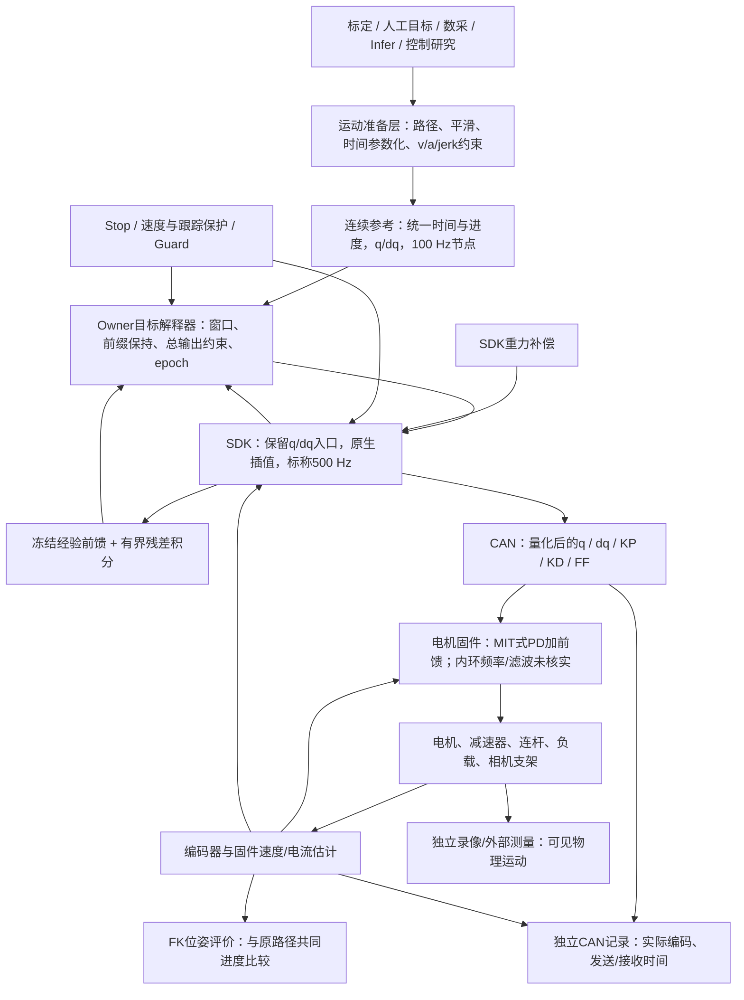
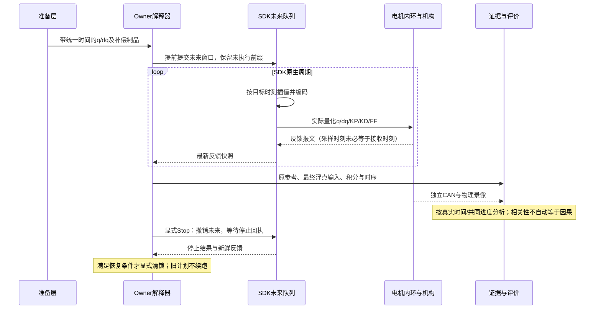
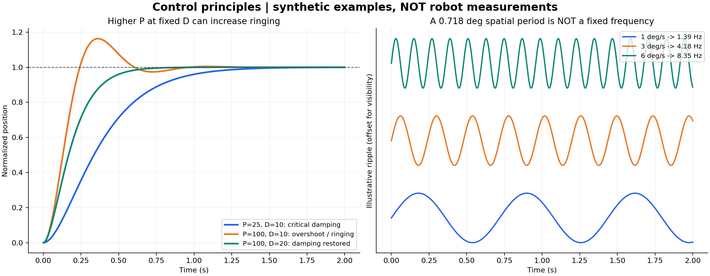

# 控制原理、已有试验与下一步方案审阅

日期：2026-10-25。维护者：本任务 Session `01a16327-7545-7332-a361-0123ddad811d`。
范围：Robot Workbench / ARX 控制研究；此文记录证据与建议，不代表厂商或团队共识。
更新触发：用户 review、候选实现、实机试验或新证据改变结论时。

**后续决策更新：用户已认可本报告并授权自主排序，仅研究1.5×，不再使用其他倍率。**
已完成的100/200Hz单变量对照、真实Stop/恢复及当前终态见[1.5×参考频率研究](control-reference-rate-study-20261025.md)。
本文以下原理、方法盘点与初始提案保留其形成时语境；新增动作以最新1.5×范围和专项报告为准。
初始资料梳理阶段没有控机；不得把后来实机结果混称为当时已经完成。
CPU/Guard 间歇性异常调查按用户要求暂缓；不认定“CPU 抽风”已经证实，不放宽保护、不自动恢复重试。
最后实际核验为正常回零后 `DISCONNECTED / holder=null`，见文末状态收据；这是已有核验，不是本轮重新测量。

## 1. 结论与优先顺序

我们已经解决了若干参考生成、调度和停止语义问题，也取得了一些增益改善证据，**但尚未完成一个基本环节：在实际 CAN 输入和真实反馈之间建立可信、可重复的幅值与相位关系**。
现在不宜把所有振动归结为 P 太大、控制频率太高、摩擦或电机性能，也不宜继续盲目叠加补偿。

推荐顺序为：

1. 核对准备参考、SDK 插值、CAN 编码和反馈测量之间的差异；先用已有数据，避免再做无辨识力的试验。
2. 用小幅、单变量、可观察的输入建立局部响应；区分角度相关波动、固定频率共振、阻尼不足和量化/估计问题。
3. 按辨识结果只选择一个改动：周期前馈、输入整形、PD/积分调整，或有界任务空间修正。
4. 以末端位置和朝向平顺性验收；保持递送静态端点 FK ≤1 mm。后续仅完善1.5×，其他倍率扩展已取消。

**不优先做：继续抬高 KP、把所有频率一起翻倍、给反馈套一个强低通、用 RTS 把验收曲线变平。**
这些措施不一定作用于真正的激振源，甚至可能消耗相位裕量或掩盖误差。

## 2. 目标、测量与当前基线

|项目|当前约定与边界|
|---|---|
|主目标|递送、停位、回零中的末端位置与朝向平顺性；包括运动中起伏和停住后的摆动|
|精度硬门|本阶段递送静态端点，最后至少 1 秒的 FK 位置误差峰值 ≤1 mm；不是平均误差|
|允许的延迟|允许沿原路径到达得晚；不能用每个轴各自错位、路径进度回退或任意时间扭曲隐藏偏离|
|动态几何偏差|继续报告相对原始路径的偏离与朝向差；不因静态通过就宣称动态全程 ≤1 mm|
|诊断指标|J3 固定约 0.718332° 角度周期的单边幅度 A；峰峰值为 2A，不能混同总误差峰值|
|独立物理证据|相机外壳/夹爪录像与关节 FK 分开报告；编码器 FK 不能独立证明壳体、柔性结构和真实 TCP 的运动|
|研究增益|左 J3 330/5 有当前较好的重复性证据；生产默认仍 210/5，330 未晋级|
|频率与保护|100 Hz 参考节点、SDK 标称 500 Hz；速度保护 0.8 rad/s、Guard 反馈时限 100 ms 保留|
|研究素材|旧采集的前 50 秒，经准备后 1×约 53 秒、1.5×约 35.33 秒；不包含后段与咖啡机碰撞的动作|
|暂缓项|CPU/Guard 触发源、回零静态残差；它们没有被宣布解决|

“平顺”不能只用速度未超 0.8 判断。应同时给出位姿残差的频带 RMS、峰峰值、最差时间窗、进入保持后的衰减，以及原速录像。所有滤波都要注明用途，原始量必须保留。

## 3. 当前真实控制结构

IK、碰撞和几何路径搜索属于显式调用的上层服务。准备层可以做耗时优化；运行时解释器应做有界、可测的插值/修正/检查，不能把大规模优化、磁盘 IO 或录像塞进控制热路径。

图中不预设某段耗时为40 ms，也不把宿主接收时间当成固件采样时间；这些差异需要用记录证明。

### 3.1 我们不是只有“位置命令”

已核验实际部署 SDK 同时发送 `q、dq、KP、KD、FF`。厂商生态 SDK 维护者也明确描述电机侧 MIT 式组合控制 [S2]。
概念上可写作：

\[
u=K_p(q_d-q)+K_d(\dot q_d-\dot q)+u_{ff}
\]

工作台的残差积分主要加到前馈通道；这不等于我们已经掌握或更改了固件内环的全部 PID。
这里用 `u` 而不是直接写真实输出轴力矩：当前 SDK 单位没有完整校准成输出轴 N·m。

部署代码中 EC 输出前馈除以 1.4，反馈电流估算经过 1.4×1.4；DM 使用另一套常数。
这些代码事实既不证明换算正确，也不允许直接删掉一个系数。需要实际电机型号、减速比、电流/力矩定义及独立载荷锚点。
已有角度与电流反馈可以辨识 **SDK 单位下** 的相对补偿，却无法仅靠同一组有未知比例的数据唯一确定真实力矩比例、重力、摩擦和载荷。

### 3.2 频率必须分层谈

|层|已核验状态|改变它会改变什么|
|---|---|---|
|路径/参考节点|100 Hz|提高节点密度，减少离散参考近似；不等于提高固件伺服频率|
|Owner 提交窗口|当前研究配置约 50 Hz 上传一段未来参考|影响队列余量、窗口切换和负载；每次提交不是只执行一个点|
|Owner 反馈/外部补偿|约 100 Hz|影响宿主积分/协同的观测和延迟；不是电机本地 D 的采样率|
|SDK 原生发送/读取|标称 500 Hz，已有 CAN 命令间隔中位数约 2.052 ms|影响总线更新、插值和采样噪声；还受调度、总线容量影响|
|固件位置/速度/电流环|具体频率、滤波、延迟未知|是真正的内环动态；不能由“SDK 500 Hz”推断|
|缓存力矩遥测|已有审计约 10 Hz 更新，可能在 100 Hz 日志中重复|不能当高频独立测量；辨识需原始 CAN 并核对真实更新率|

500→250→125 Hz 是曾讨论的 SDK 整臂实验，**尚未完成实机频率扫描**。
提高频率通常减小采样/保持延迟，但不自动降低振动；降低频率可能削弱高频激励，也可能增加相位滞后和阶梯效应。
固件本地 PD 若没有改变，调整宿主发包频率并不直接改变那个 PD 的采样率。

## 4. 控制原理：哪些事情会让“更准”反而“更抖”

### 4.1 P 是刚度，D 是阻尼；它们不是独立的“越大越好”按钮

在单惯量、连续、无饱和的简化模型中，恒定目标附近有：

\[
J\ddot e+(b+K_d)\dot e+K_pe=0,\quad
\omega_n=\sqrt{K_p/J},\quad
\zeta=\frac{b+K_d}{2\sqrt{JK_p}}.
\]

固定 D 时增大 P，会更强地纠正位置误差，也提高固有频率、降低相对阻尼；对阶跃或扰动可能出现更多过冲/振铃。
但理想模型在正刚度、正总阻尼下仍可稳定；真实系统的柔性、时延、离散采样、限幅和测量误差才可能进一步造成不稳定。[S1]

因此必须区分三种情况：**扰动后衰减的振铃、被持续周期扰动驱动的波动、没有对应外部激励仍增长/持续的自激振荡**。
目前没有证据把 J3 的全部周期波动认定为“P 过大自激”。

图为合成例子，**不是 ARX 实测或参数建议**。左图使用 J=1、b=0：橙线只提高 P，绿线同时提高 D。
实际 J3 的有效 KD 已到协议上限 5，不能照图把 D 再翻倍；如果确为阻尼不足，降低 P 或改变激励/补偿反而可能更有效。
SDK 编码上限 KP=500 不等于推荐值、安全资格或性能最优点。

### 4.2 积分适合慢偏置，不适合不加分辨地追周期振动

积分可消除重力误差、摩擦等造成的慢偏置。但相位滞后、饱和累积、过零释放，以及与冻结前馈的重复补偿，可能导致摆动。
当前已有总限幅、抗饱和和斜率约束，并做过“暂停新累加、保留已有偏置”的对照；尚未完成 Ki、积分带宽、死区和泄漏策略的系统辨识。
不能把“有积分”当成“积分已经调好”。

慢偏置和周期项宜分开估计，再在总输出处统一限幅/变化率；不能每个模块各自合法、合起来却突变。
同样，平滑 q/dq 不能保证 FF 平滑，任何补偿叠加都要重验最终发送量。

### 4.3 0.718° 是空间周期，不是 0.718 Hz，也不是每到该角度跳一次

当前观测支持误差中有一个随 J3 角度重复的分量。若周期为 λ，局部时间频率为：

\[
f(t)=|\dot q_3(t)|/\lambda,\qquad \lambda\approx0.718332^\circ.
\]

例如 1、3、6 °/s 对应约 1.39、4.18、8.35 Hz；这只是换算示例。
它可能涉及齿槽/换相、传动、编码器周期误差，也可能是控制器对这些扰动的响应。
接近某个电机阶次不能证明具体极对数或减速器根因；实际完整型号、齿比、固件仍需核实。

判别办法是同时看角度域和时间域：随角度对齐、随速度改变 Hz，支持位置相关源；跨速度仍集中在类似 Hz、姿态负载改变后频率移动，支持机械模态；两者也可能叠加。

### 4.4 参考平滑、插值平滑和真实输出平滑是三层资格

准备层已用高阶平滑与 jerk 约束；但部署 SDK 仍分别线性插值 q 和 dq。
因此“准备参考 C6”不能推导出“SDK 输出全局 C2/C3”：q 的段间斜率可能跳变，且线性插值的 dq 不必等于线性 q 的导数。
实际影响取决于节点间隔、曲率、量化和闭环，需按真实输出核验。

ROS2 官方轨迹控制器按输入字段选择线性、三次、五次插值，分别提供不同连续性，也提醒不一致导数会造成过冲。[S3]
可借鉴的是 q/dq/ddq 一致的轨迹契约，而非把另一套框架整体搬入。

当前 1×、1.5×、2×参考的分析 jerk 峰值约 0.896、3.024、7.17 rad/s³，原上限为 20。
把上限从 20 改到 10 **不会改变这条 1.5×基线参考**。需要检查哪里实际存在激励，不能只改一个没有生效的阈值。
CAN 量化后的阶梯用差分算出的 jerk 也不能与连续曲线的解析 jerk 直接混为一谈，应另报编码步长/跳变谱。

### 4.5 小补偿也可能被编码改变

EC 指令编码范围对应：位置 LSB ≈0.02185694°，速度 LSB ≈0.00879121 rad/s。
前一版 1.5×协同候选的最大 q 修正约 0.008°，约 0.366 LSB；最大 dq 修正约 0.006129 rad/s，约 0.697 LSB。

**这不等于修正必然为零**：它可以改变基线跨越编码边界的时刻。但理想的正弦幅相不等于最终 CAN 的幅相，其他关节更小的修正也可能呈现不同失真。
下一次必须用实际编码后的差分输入评价激励能量、谐波和可重复性，不能只拿浮点制品判定“辨识条件良好”。
命令分辨率也不是机械精度硬下限：反馈、内环和载荷共同决定实际位置；它首先限制的是我们能干净注入/观察什么。

## 5. 已试、未试与结果边界

下表以保存的试验记录、源码和制品为准。“已实机”不代表最终验收通过。

|方法|状态与已知结果|仍缺什么|
|---|---|---|
|窗口/轨迹平滑|已实机：Gaussian、高阶连续参考、速度/加速度/jerk约束、端点缓入缓出|最终编码后激励谱；不能仅凭参考平滑宣布物理平顺|
|100 Hz 插值节点|已实机；统一时间原点、重叠前缀和未来窗口|SDK独立线性q/dq的动态影响；未验证提高节点率收益|
|保留原生 q/dq|最小 SDK 入口已实机，避免原批量入口重算 dq|固件真实内环细节仍未知|
|结束转保持、Stop/epoch|已有真实验收和多次修复；最近协同候选的专门验收未完成|新候选不能继承尚未执行的停止资格|
|电机 MIT / 位置模式|已查源码、CAN字段及维护者说明：五字段混合控制|没有进行模式切换实验；不建议未知固件模式试切|
|整臂降低 P|已实机；某次左臂半P使垂向FK RMS 0.341→0.724 mm，视觉0.339→0.473 px|只能否定那一配置，不能证明所有单关节降P无效|
|整臂降低 D|已实机；0.5×下KD×0.8视觉0.292→0.356 px|不是J3单独KD扫描；固件速度估计仍未知|
|J3 KP180/210/240|六轮已实机，漂移影响大|未形成稳定最优点|
|J3 KP270/330/400|逐级七轮已实机；330有收益，400未进一步改善选定周期项|不能据此宣称330全局最优|
|210/330交替复核|新七轮中三次330，相对穿插210周期幅度降低17.44%/23.57%/37.76%|先前中断批有反向结果，必须保留；四档和停位未全面通过|
|重力与冻结经验前馈|已实机；有SDK重力补偿和经验冻结制品|不是完整的惯性/科氏/载荷/摩擦标定模型|
|有界残差积分|已实机；J3总附加预算±2 SDK单位，限幅/抗饱和/斜率约束|Ki、带宽、死区、偏置初始化未系统优化|
|暂停J3新增积分|已实机，保留DC偏置并平滑切换；重复收益混合|轮间偏置和前段状态影响未充分消除|
|周期前馈/两相位探针|已有多轮实机；部分平均周期下降，但幅相重复性不足；早期视觉一对改善11.34%，另一对恶化0.99%|未通过固定补偿晋级门；后续统一周期六轮存在中断，不能合称全部完成|
|任务空间协同|FK/Jacobian评估与有界q/dq CPU回放完成|实机改善未验证；最近10轮是无协同基线，不是协同成功|
|任务空间2 Hz低通|仅离线原型；两级滤波在2.5/10 Hz约滞后103°/157°|不能据此直接上线追周期振动|
|固件反馈低通/速度估计|未系统辨识，接口和参数未核实|宿主显示滤波不改变固件D项使用的速度|
|RTS平滑|未使用|适合离线状态估计/参考去噪，不是直接的因果控制器或jerk生成器|
|SDK频率500/250/125对照|讨论过，未完成实机|频率改变还牵涉保护计时、通信负载和离散控制，需独立资格|
|提高CAN/固件内环频率|未验证、固件频率未知|需要厂商能力与带宽证据，不是改工作台配置就能完成|
|输入整形、陷波|未实机|先找到可重复机械模态与响应相位|
|正式ILC重复学习|未实现有收敛/带宽/留出验收的更新器|已有冻结补偿不等于完整ILC；需可重复误差和响应模型|
|DOB/ESO、完整逆动力学|未资格化|需模型、带宽、单位与噪声边界|

最近 330 的旧记录按末端重评分：递送位置频带波动相对相邻 210 改善约 16.48%–25.67%，朝向约 11.20%–14.60%，递送末秒误差峰值 ≤0.313 mm。
这是旧记录的新评分，**不是协同控制器成绩**；动态路径仍有 >1 mm 点，停位与右臂没有一致收益。

最近 10 轮 1×/1.5×与 300 秒静止未复现 Guard 异常，证明这些已执行批次完整，不证明长期故障消失，也不构成新控制方法效果对照。

## 6. 成熟方法能借鉴什么，为什么不能直接照搬

|方法与来源|解决的问题|在本项目的适用边界与建议|
|---|---|---|
|一致样条与时间参数化：ROS2、MoveIt、Ruckig [S3–S5]|节点衔接、速度/加速度/jerk和到达状态|准备层可借鉴；已有实现先审计再决定是否替换。逐关节生成不自动保持原笛卡尔路径；Ruckig社区版多中间点会涉及云API，不能当本地实时替代品直接接入|
|角度相关前馈：ODrive anticogging [S6]|可重复的位置相关扰动|与0.718°现象相符的候选路线，但未证明ARX是齿槽。需要稳定角度基准、方向/速度/载荷重复；该官方功能本身也标为实验性，并说明位置估计误差可能降低稳定裕量|
|输入整形：Klipper [S7]|已辨识机械共振的指令激励|用户允许时间变长，很适合研究；但会产生平滑/路径损失，应限制几何偏离。机械臂模态随姿态负载改变，不能照搬打印机频率或只按0.718°设固定Hz|
|陷波：Synapticon [S8]|特定频段的共振激励|先辨识频率与相位，再选放置位置。低频陷波会引入明显相位代价，不能套用其某个驱动器的频率建议作为本机保证|
|任务空间PI/Jacobian [S9]|把位置/朝向目标映射成协调关节运动|支持我们的方向；但该教材控制输入为速度，本机是混合内环，必须包括从q/dq命令到实际姿态的动态，不能仅有几何逆解|
|ILC重复学习 [S10]|重复动作中的可重复误差|与固定片段高度匹配。可离线学习、下轮冻结；更新限制频带和幅度，分离漂移、初始化与随机噪声，用留出轮验收，不能每轮把误差反号全加回去|
|RTS/Kalman [S11]|噪声下的状态估计|RTS用后续样本反向平滑，适合离线辨识；可辅助已知完整参考去噪，但不保证路径或jerk，不能用平滑后的实际反馈替代验收原始反馈|
|增益调度、摩擦/速度/加速度前馈|姿态惯量变化、慢负载、反向摩擦|比继续统一抬P更有针对性；先做局部辨识，平滑调度并统一输出预算，避免在切换处造阶跃|
|DOB/ESO、MPC/LQR|模型化扰动、耦合和约束控制|可行但不是眼前最小步骤；噪声、时延和模型错误同样会被放大，先补输入响应与量纲|
|结构加固/独立测量|支架、连杆、末端柔性造成的可见振动|编码器未必看得见；先证实是否存在结构模态，不能以“控制曲线好看”排除机械因素|

调研没有找到“相同 ARX 型号、相同 0.718°现象、已经验证的唯一修复”。上表是可复用的方法与实现，不能据此宣布本机根因。

### 6.1 多关节协同的能力与限制

协同不是让 J3 抖、其他轴任意抵消。六关节机械臂在非奇异位姿控制完整六维位姿时通常没有额外局部自由度；采样审计中 6D Jacobian 为满秩6。
只保持位置则可能有姿态余量：离线例子里 J3 +0.1°造成约0.7877 mm位置变化，其他轴几何补偿能把位置降到约0.00147 mm，却改变朝向约0.119°，J4修正约−0.196°。
这只是几何计算，既没有模拟真实内环，也不是可直接执行的补偿。

建议以同一单调路径进度 `s` 比较位置与朝向，使用带条件数/幅值约束的映射，保留关节内环。
如果只从原编码器计算FK再反馈，新增的是协调目标，不是新增独立传感器；真实壳体振动还需要视频或外部测量验证。

## 7. 可验证的原因假设

|假设|预计能看到什么|如何反证/区分|对应动作|
|---|---|---|---|
|H1 位置相关扰动/测量周期|角度域周期与相位重复，时间频率随速度变|反向、不同速度/负载后的角度相位；外部视频与编码器是否同周期|角度同步前馈；若为测量误差先处理标定|
|H2 柔性机械模态|激励/停顿后以近似固定Hz衰减，姿态改变模态移动|比较速度变化与停位衰减；编码器与外壳可能不同|输入整形、降低对应频段激励；必要时结构处理|
|H3 P/D与时延匹配不足|改变局部P或D会系统改变过冲/相位峰，可能接近模态|保持输入与积分不变的局部响应；不能用全臂一起改判断|局部PD或平滑增益调度；D到顶时考虑降P|
|H4 积分/冻结前馈互相追逐|周期项与新增积分/总补偿强耦合；冻结后响应改变|在同一偏置和总限幅下暂停单一累加；看实际总输出|慢积分、周期项分离、带宽/死区/泄漏调整|
|H5 编码/速度估计/离散插值|实际CAN含参考里没有的阶梯、谐波；反馈增量落在量化格|直接比较编码前后和原始RX；宿主显示值不能代替|一致插值/编码路径、估计器调整；不盲增频|
|H6 多轴耦合/姿态放大|J2/J3等相关误差在末端相加，位置改善却朝向恶化|多输入到六维输出的响应、共同进度与奇异性|有界任务空间协同，按位姿双指标优化|

这些假设可同时存在。只有同步相关性不能判断谁激发谁，闭环控制量往往是在对误差作反应。
研究应先找有辨识力的独立变化，再谈因果；周期补偿的相位必须包含闭环响应，不能在误差波峰时直接减同相命令。

## 8. 待 review 的下一轮行动方案

以下均为提案，不是本轮已执行或已获新增试验批准。先完成A，再根据结果选择B/C，避免同时改频率、增益、滤波和补偿。

### A. 离线资格与测量统一

复用最近10轮、330复核及原始CAN：按固定窗口对齐原参考→最终q/dq/FF→实际TX→RX→FK/录像，区分指令发送时间、反馈接收时间和固件采样未知量。
核对dq与q变化的关系、每个窗口/转保持的连续性、编码跳变、真实反馈更新率；将旧0.008°候选经过相同编码回放。
同时比较角度域0.718°分量、时间域峰、姿态/速度/方向变化以及积分状态，给出各假设的支持与反例。

交付：一张完整链路时序图、每层频谱/幅相/量化误差表、可用辨识频段、输入能量与重复基线噪声。
若实际输入无法区分于编码和噪声，不进入物理试验，也不为得到数据自动增大幅度。

### B. 先辨识局部响应，再选控制策略

建议在原递送范围内选一个已访问、远离限位/奇异的代表姿态，先只激励J3，观察所有关节及末端；固定研究330/5、其余增益/频率/保护，不叠加新周期补偿。
保留已建立慢偏置，辨识窗暂停J3新增积分并平滑切换，记录其他关节积分响应。

待审阅起点：J3位置激励单边幅度不超过0.05°，从0.5/1/2/4 Hz中选择A阶段可分辨的频点，逐个频点、至少3个完整周期、平滑进入退出；不做突然阶跃或未经检查的连续扫频。
仅纯正弦的4 Hz上界为dq≈0.02193 rad/s、ddq≈0.5512 rad/s²、jerk≈13.85 rad/s³，**包络、原参考叠加、编码与全部保护仍须重新验算**。
0.05°也仅约2.29个位置LSB；低频速度项仍可能不足一格，因此这是候选上界，不是保证可辨识的方案。

若A表明q/dq通道不足以辨识，先报告原因；可另选已有预算内的SDK单位前馈探针，但不能混在同一轮里同时改变q与FF，也不能自动扩大预算。
这类静态局部辨识不能代替运动时的姿态/负载动态，结果只用于筛选后续1.5×单变量方案。

执行前补齐实际新身份的连接/释放/再连接和运动中Stop、未来撤销、显式恢复资格；正常取消后不续跑旧动作。
该资格沿用现有控制接口，不旁路Owner，不解除速度保护。出现新控制/CAN异常时停止本批并保存证据，不自动重试或转成全天故障复现任务。

### C. 按证据只选择一条主线

|A/B的结果|首选候选|暂不做|
|---|---|---|
|角度同步、方向/重复响应稳定|SDK单位角度前馈，先辨识幅相，再带限幅/带宽学习；慢偏置另处理|直接误差反号、不受限求逆|
|有明确固定时间模态|针对模态的准备层输入整形，检查全路径偏离与朝向|给所有反馈强低通或套一个未知陷波|
|局部高P带来过冲/共振峰|J3局部PD单变量；KD已封顶时先考虑降低P，候选由响应决定|继续把P推到400/500|
|多轴响应可预测且独立单轴仍不足|有界q/dq任务空间修正；先前馈式/离线冻结，再考虑在线低带宽反馈|未经相位验证的快速末端积分外环|
|误差只在编码器中明显，视频不支持|核验编码器/估计器；独立物理测量|用真实运动补偿虚假测量纹波|

对固定片段，正式的带限幅、带宽与留出验收的ILC值得优先考虑，但只学习重复分量。每轮更新离线完成，运行时复用现有冻结制品接口；初版不新增常驻优化器。

### D. 1.5×重复对照与晋级

按用户最新指定首先做1.5×候选对照，采用 `A→B→A→B→A→B→A`，每次正常回零，保留失败与反向结果。
以穿插基线估计慢漂移，但不把插值基线当成完全消除了温度/载荷/积分变化；记录这些条件。
推荐预先固定以下研究门槛供review：

- 递送静态末秒的左右TCP位置峰值均≤1 mm；停位无新增持续摆动。
- 递送位置/朝向频带波动作为双主指标；建议目标为配对改善中位数均≥20%，三个配对方向一致。该20%是研究筛选建议，尚未获得用户批准，也不等于肉眼已不可见。
- 位置/朝向、停位、回零及其他关节的恶化不能被某个J3谐波改善抵消；原速、同视角录像一起审阅。
- 保留同时间误差、共同单调进度的空间误差、延迟与全段最大偏离；不通过重新平滑反馈或各轴独立移时缩小结果。
- 最终q/dq/FF的总幅值、斜率、窗口/终点连续性和参考jerk通过；编码跳变另报；速度/反馈/Stop保护不变。
- 新增准备参考或修正导致几何精度损失时先量化、提交review，不以“更平滑”为由静默改变精度要求。

后续只完善1.5×递送/停位/回零，不执行原提案中的其他倍率扩展。固定时间模型或ILC也仅对经验证的1.5×条件作结论。

## 9. “中断恢复”到底能恢复到什么状态

|故障后的真实状态|支持的恢复路径|不能声称的事|
|---|---|---|
|SDK仍连接，Stop已返回，反馈新鲜健康静止，符合允许恢复的故障条件|显式原地恢复→清旧计划→STOPPED；再审阅新计划|不能自动清锁、续跑旧窗口|
|Guard已使SDK退出，退出/归属已确认|退役旧实例，经现有接入前置建立新SDK/runtime身份，重新核验反馈，再接受新计划|这不是原连接保持；杀进程不等于正常close，也不保证故障瞬间原位保持|
|退出、控制权、反馈或活动调用状态不明确|拒绝恢复，保留故障与证据|不能用“怀疑只是CPU”代替事实检查|

代码入口：`management.py` 的 `recover_control`/恢复分类、`runtime.py` 的 `control_recover`/`retire_protected`。
本轮针对这些分支的10项本机CPU测试通过（5.901秒），包含旧实例退役、新实例恢复、发布状态等待、动态条件变化拒绝、原地恢复不释放/重接且不续跑。
最近真实Guard退出后曾成功走新接入路径并完成10轮；**没有新增一次“同类CAN故障→点击recover_control→恢复完成”的完整实机专项验收**。
因此可以说“软件支持恢复”，不能说“这次故障的一键恢复已经完整实机验收”或“恢复能防止复发”。

## 10. 证据与来源

### 本项目可追溯证据

相对仓库根目录：

- 当前部署：`.evidence/guard-idle-phase-20261025-v1/final-publication.json`；最后状态：同目录`final-readonly-state.json`。权威指针：`.evidence/next-optimization-20261017/continuation-state.json`。
- 历史过程与失败边界：[J3研究记录](j3-periodic-error-plan-20261024.md)、[平顺研究记录](control-smoothness-resume-20261024.md)、[控制IO与Guard审计](control-storage-io-audit-20261024.md)。以各文最新状态为准，旧段落保留历史事实。
- KP重复：`.evidence/j3-kp330-repeat-20261025-v2/repeatability.json`；先前反向批：`.evidence/j3-kp330-repeat-20261025-v1/`。
- 任务空间与量纲：`.evidence/taskspace-coordination-20261025-v1/analysis.json`、`torque-audit.json`、`sdk-source-excerpts.json`；几何约束：`.evidence/taskspace-feasibility-20261025-v1/audit.json`。
- 1.5×探针：`.evidence/taskspace-live-20261025-v1/coordination-artifacts.json`、`linux-coordination-qualification.json`。CPU通过不等于已执行。
- 10轮与录像：`.evidence/guard-ten-runs-20261025-v1/result.json`、`run-validation.json`、`lifecycle-analysis.json`、`video-delivery.json`。
- 本轮离线计算与CPU检查收据：`.evidence/control-principles-review-20261025-v1/offline-checks.json`；原理图为合成数据，不属于实机证据。

### 一手外部来源（本轮2026-10-25核验）

- **S1** [Modern Robotics §11.4：关节力矩输入与PD/PID](https://modernrobotics.northwestern.edu/nu-gm-book-resource/11-4-motion-control-with-torque-or-force-inputs-part-1-of-3/)：刚度、阻尼、增益与未建模动态。
- **S2** [arx5-sdk Issue 34，维护者关于五字段MIT控制的回复](https://github.com/real-stanford/arx5-sdk/issues/34)：支持控制拓扑；不提供本机固件具体频率。
- **S3** [ROS2 joint_trajectory_controller轨迹表示](https://control.ros.org/rolling/doc/ros2_controllers/joint_trajectory_controller/doc/trajectory.html)：插值与导数一致性；页面为Rolling开发文档。
- **S4** [Ruckig官方教程](https://docs.ruckig.com/tutorial.html)：状态到状态的v/a/jerk约束，以及中间点版本限制。
- **S5** [MoveIt时间参数化](https://moveit.picknik.ai/main/doc/examples/time_parameterization/time_parameterization_tutorial.html)：几何路径与时间化、jerk平滑的职责。
- **S6** [ODrive anticogging](https://docs.odriverobotics.com/v/latest/guides/anticogging.html)：角度相关前馈及其限制。
- **S7** [Klipper共振补偿](https://www.klipper3d.org/Resonance_Compensation.html)：输入整形、频率误差与平滑代价。
- **S8** [Synapticon力矩环陷波/输入整形](https://doc.synapticon.com/node/sw5.4/motion_control/advanced_control_options/filtering/notch_filter.html)：先辨识响应、考虑相位代价。
- **S9** [Modern Robotics §11.3：任务空间前馈与PI](https://modernrobotics.northwestern.edu/nu-gm-book-resource/11-3-motion-control-with-velocity-inputs-part-3-of-3/)：SE(3)误差、Jacobian映射。
- **S10** [MathWorks迭代学习控制](https://www.mathworks.com/help/slcontrol/ug/iterativelearningcontrol.html)：重复初始条件、误差历史更新、带宽限制；参考方法，不引入Simulink依赖。
- **S11** [FilterPy RTS接口与源代码入口](https://filterpy.readthedocs.io/en/latest/kalman/KalmanFilter.html#filterpy.kalman.KalmanFilter.rts_smoother)：离线状态平滑用途。

本轮knowledge lookup按本项目owner与Anyverse语境查询，无匹配且coverage未报告缺失语境；随后核验上述原始来源。没有把调研结论写入canonical knowledge。

## 11. 剩余待办与责任

1. **review已完成，范围限定1.5×**；当前优先级与已执行结果见参考频率专项报告，旧静态/其他速度提案不自动执行。
2. **离线实际CAN输入与响应审计**；先解决探针可辨识性、时间与编码口径，避免下一轮仍得不到因果结论。
3. **恢复/Stop专项实机资格，随后局部辨识和1.5×单变量对照**；保留真实停止证据，不能以CPU测试代替。
4. **稳定候选仅1.5×位姿双指标验收**；未通过前不改普通默认配置。
5. **保留但暂缓：CPU/Guard触发源、回零残差**。维护租约、前馈制品绑定、完整业务长期内存验证继续在项目待办中，尚未宣称关闭；本轮不扩展处理。

已确认负责人是本session的资料/实现/验证工作；新增现场协作与厂商支持未分派，不能假定已有负责人与资源承诺。
