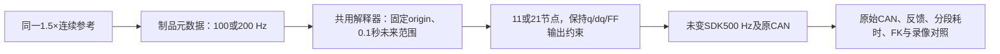
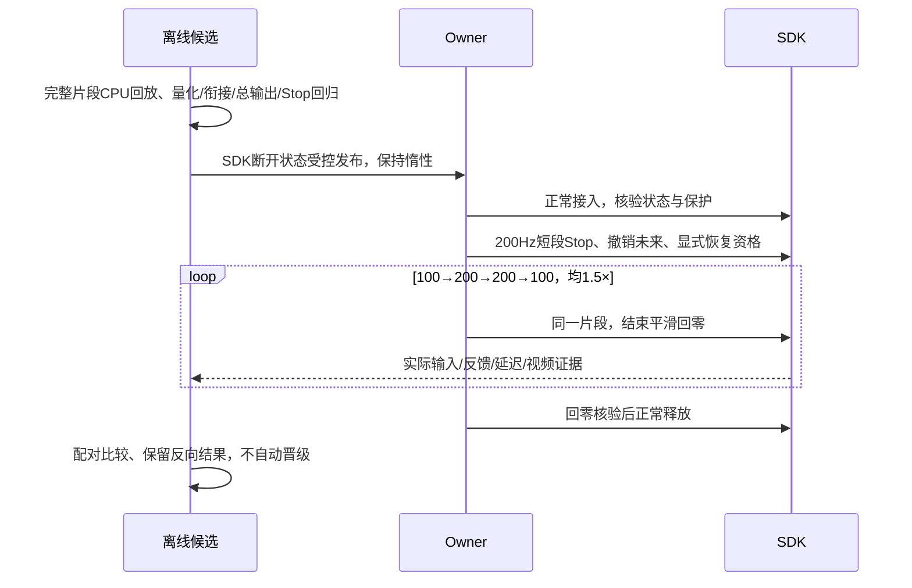
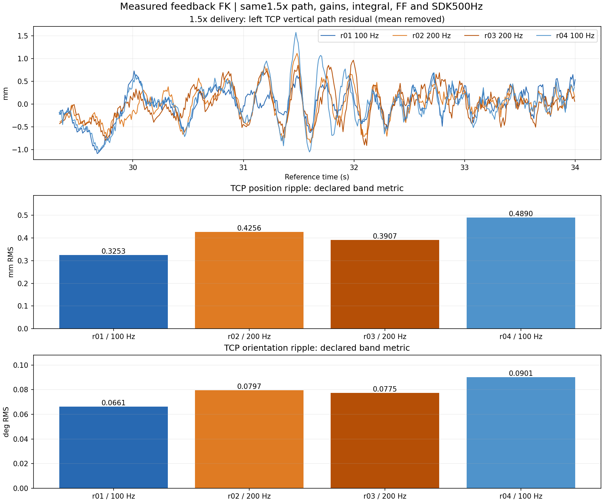

# 1.5×参考节点100/200 Hz单变量研究

2026-10-25，本session `01a16327-7545-7332-a361-0123ddad811d` 负责；试验/发布/故障/用户决策时更新。
用户批准提高到200 Hz试验，随后认可控制分析并授权自行排序；后续只研究1.5×，不再做其他倍率。
此项是[控制研究报告](control-principles-and-next-experiments-20261025.md)的当前优先分支；四档扩展计划由本次指示取消。

## 改动边界

只改变同一准备参考的原生节点间隔：10 ms→5 ms。连续多项式、轨迹时长/几何、研究330/5、其余增益、前馈数值、积分策略、SDK500 Hz、上传约50 Hz及全部保护保持原契约。
参考origin固定、未来时间跨度0.1秒不缩短：每包11→21节点，仍在32行上限内。夹爪事件按原时刻插入。
200 Hz只允许现有短窗口研究profile；不把普通0.2秒窗口扩到41行或静默缩短未来余量。
100 Hz为默认与对照；200 Hz在不可变参考制品上显式标记，审阅回执及运行诊断应显示真实节点频率。

## 验收与停止

- CPU核验：100Hz兼容；200Hz21行、未来范围/提前量不减、窗口重叠同源；终点dq=0、积分/FF限幅斜率、撤销未来；未知频率/不适合profile明确拒绝。
- 相同连续参考重采样，不能重新平滑或重定时来混淆变量；FF因制品ID重绑，数值与初始策略不改变。
- 实机先验证新身份、Stop与显式恢复；独立TX/RX和调度记录覆盖接入到退出，异常即停、不自动重试。
- 只做1.5× A→B→B→A；末端位置/朝向平顺性为主，J3周期为诊断；递送末1秒FK峰值≤1mm。
- 同报参考线性近似误差、实际编码差异、位姿频带RMS/峰峰值、停位/回零及原速录像；没有显著收益不默认推广200Hz。
- 不新增CPU/Guard故障复现任务；若再异常，保存本轮证据后停止依赖动作。

## 已完成结果：200Hz没有一致平顺收益，不晋级

本地62项、Linux97项检查通过；100/200Hz各2167个完整窗口回放通过，q/dq与补偿重叠接缝为0、末端dq=0、Stop清未来通过。
对部署源逐文件核验后只改两个生产文件：共用解释器和审阅回执；SDK二进制、其余控制实现不改。
先惰性发布，再真实接入→200Hz短段Stop/显式恢复→正常回零释放→新身份接入→四轮ABBA→正常回零释放。
没有新故障、没有自动重试。最新API核验DISCONNECTED、holder=null、无活动运维或动作；默认仍100Hz，200仅作为显式研究制品选项。

以下波动统计取1.5×递送段实际参考时间约29.33–34秒（原素材进度44–51秒），FK位姿共同路径进度残差的1–12Hz频带RMS。
它不是全段误差峰值；静态列为递送终点最后1秒左右TCP峰值的较大者。

|顺序|节点频率|左TCP位置波动 mm RMS|左TCP朝向波动 ° RMS|相机外壳上下波动 px RMS|递送静态误差峰值 mm|J3周期A °|
|---|---:|---:|---:|---:|---:|---:|
|r01|100Hz|0.3253|0.06613|0.2039|0.3095|0.02916|
|r02|200Hz|0.4256|0.07965|0.2461|0.3992|0.03055|
|r03|200Hz|0.3907|0.07749|0.2340|0.2773|0.03372|
|r04|100Hz|0.4890|0.09008|0.2886|0.3095|0.02908|

相对按时间穿插的两端100Hz基线，200Hz两次位置波动分别**恶化12.01% / 改善10.07%**，朝向分别恶化7.46% / 改善5.62%；没有重复的收益方向。
同时间残差结论一致，位置分别恶化8.15% / 改善11.55%。图像外壳指标也处于基线漂移范围内。
前后100Hz位置RMS由0.325升至0.489，表明轮间变化不能忽略；不能把r03比r04小单独当200Hz有效，也不能把r02比r01大认定200Hz必然更差。
全部递送静态端点≤0.4mm，满足本阶段≤1mm；回零12轴最大偏零约0.2295°，不冒充回零TCP≤1mm验收。

录像按真实帧号顺序解码，用源相机时间对齐；外壳与夹爪起伏相关系数0.919–0.956，静止背景波动仅0.0012–0.0042px。
像素结果有透视、压缩和特征估计误差，不是独立毫米标定；外壳特征分组差异约0.062–0.086px，不能把几个百分点的差异解释为确定改善。
四个原速完整视频、原始manifest、完整CAN/数值/调度均保留；本地交付在`/Users/wujie/Documents/Codex/outputs/reference-rate-200hz-20261025-v1/manifest.json`。

### 为什么不继续把频率往上堆

同一连续参考在理想500Hz输出时刻计算，100Hz最大位置线性插值误差约0.0001648°，200Hz约0.00004119°，下降约75%，但两者都远小于EC位置LSB0.02186°。
该离线网格上J3的量化位置码只有约0.0283%的采样不同；不能当真实CAN逐帧比例，但足以说明宏观参考几何变化很小。
可观察到的物理波动没有随插值误差同比下降，支持把下一步重点转回输入响应、周期激励和多关节耦合，而非单纯增加节点。

### 实际时序与停止证据

|轮次|实际包行数（含事件）|窗口提交间隔中位数 ms|翻译至提交返回中位数 / P99 ms|提交返回后距首点最小余量 ms|
|---|---|---:|---:|---:|
|r01 100Hz|11/12|20.83|1.843 / 3.575|25.89|
|r02 200Hz|21/22|21.01|2.444 / 5.182|24.40|
|r03 200Hz|21/22|21.15|2.233 / 5.280|24.42|
|r04 100Hz|11/12|21.13|2.078 / 4.965|24.38|

统计只包含匹配研究参考的窗口。200Hz增加了数据/计算成本，但本批没有耗尽时间余量；翻译CPU中位数约1.00–1.03ms，不能宣称已经严格亚毫秒。
最大反馈间隔12.95ms，最大观测关节速度0.5055rad/s，原0.8保护保留；Guard最大消费帧年龄约4.03ms。
独立记录5,144,410帧，零socket丢帧、调度记录未截断；只说明本批未复现，CPU/Guard根因调查仍暂缓。

200Hz运动中Stop后epoch更新、所有旧调用完成、未来参考清空；显式恢复保持同一SDK身份，没有续跑旧动作。
独立CAN核验Stop后200–1000ms十二轴目标位置全部恒定，速度字段为零附近的编码值；保留了既有软保持输出。
这是正常Stop/恢复资格，不是人为CAN超时或心跳失联的专项验收。随后正常释放并新身份再接入通过。

### 当前决定与剩余事项

1. 100Hz继续作为1.5×研究基线，200Hz不晋级；不增加其他倍率，也不盲目继续升频。
2. 优先用本批完整1.5×记录分解J2/J3目标、实际反馈、积分/前馈及末端位姿的幅相；先找到可重复激励和轮间变化，再选同轨迹的单变量干预。
3. 后续候选只验1.5×的递送、停位和回零平顺性，递送静态≤1mm保持；不自动扩成其他频率/静态姿态扫频试验。
4. 维护租约、前馈绑定、完整业务长期内存继续保留；CPU/Guard触发源与回零残差仍按用户指示暂缓。

证据根`.evidence/reference-rate-200hz-20261025-v1/`：`comparison.json`、`visual-comparison.json`、`sampling-audit.json`、
`stop-wire-validation.json`、`run-validation.json`、`lifecycle-analysis.json`、`local-video-delivery.json`、`final-publication.json`及`final-readonly-state.json`。
一次离线并发评分先于r01基线文件完成而失败，已按依赖顺序完成；没有因此重跑硬件。初次未压缩制品传输超时，随后压缩传输和哈希核验通过，发生时SDK尚未接入。
