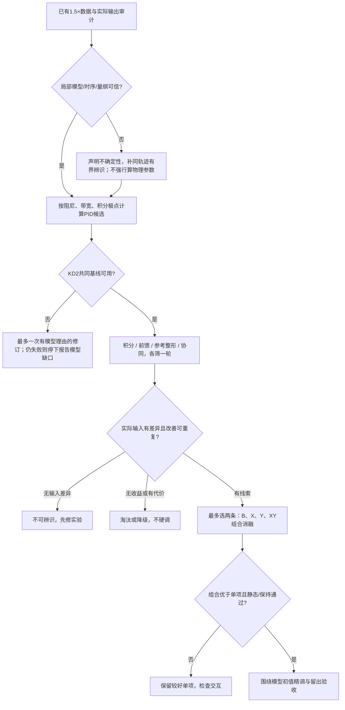
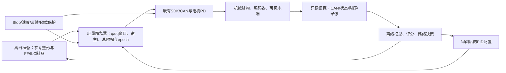
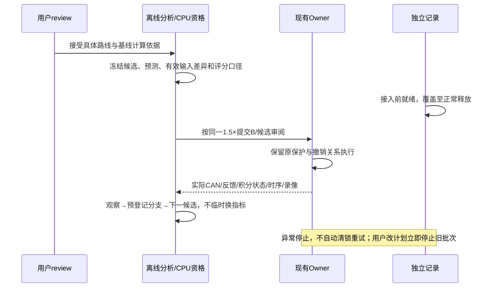

# 1.5×连续运动：模型化PID初值、路线筛选与组合消融

2026-10-25；本任务Session `01a16327-7545-7332-a361-0123ddad811d` 负责维护，用户review、模型/实现/实机结果变化时更新。
**状态：用户已批准按本设计开展多组实机实验与迭代；active goal进行中。** 本文替代此前“继续330/210→降KD”及“立即53/2试跑”的行动顺序；历史证据保留。

## 最新目标与执行约束

用户将主目标明确为爪体重力方向非预期上下起伏**峰峰值≤1mm**，已确认最高到最低总跨度，不以RMS替代。
沿用抓取中心TCP，以实际关节反馈FK和模型重力方向计算；指令本身只能作参考，不能证明实际抖动。
只研究1.5×；**此后不采集、不保存图片/视频，也不再用视觉评分**。以下历史方案里的录像/图像要求由本节撤销，保留纯数值证据。
实际空间独立精度仍不是本轮验收范围；不宣称编码器FK覆盖结构柔性。
先给出同时间参考扣除有意升降后的未滤波重力残差峰峰值作为保守门，同时保留进度/延迟诊断，不用逐点移时或拟合趋势取得过门结果。
覆盖完整研究运动中的各连续段及停位；重点递送段单列，但不能只截取最好的一小段宣布全目标完成。
数值采集保留原始TX/RX、关节反馈、q/dq/FF/I及时间证据，原安全保护和异常停止规则保留。

首次实现为现有研究设置增加可选、严格有界的`integral_gains`，缺省时保留原Ki行为与旧制品身份。
设置经审阅绑定→Runtime→共用解释器→原积分器；Ki变更撤销旧执行状态，Stop仍清未来与补偿；FF继续校验完整研究设置。
最新用户起点为**左J3 KP=8、KD=1**，覆盖历史53/2方案；其余关节不变。候选Ki=1.8 SDK/(rad·s)，依据相对时间尺度先验 `r=min(1/5,sqrt(8/330))`、`480*r³=1.81178` 保守取整；不是实测辨识值或稳定性证明。理想Routh比例给出约2.327，也不能代替真实资格。
首次基线保留既有冻结FF的数值波形和J3暂停窗，并重新绑定完整PID设置，明确它是历史FF的增益迁移试验，不冒充新增益采集。后续R1比较有效累加/进入暂停窗前的偏置，不能把暂停窗内改Ki当作新增激励。
实现已通过150项Linux CPU检查及2167完整窗口检查，已受控加载并完成真实Stop/显式恢复及再接入。8/1/1.8的首个完整1.5×Motion取得数值证据，但全段重力残差26.697mm、静态端点9.546mm，未达到资格；整轮因回零阶段旧反馈误匹配而失败，已正常回零释放、原失败保留。详细数字、阶段边界修复和未证明的粘滑假设见[最新阶段状态](control-runtime-status.md)。R0共同基线仍未合格，不直接把当前候选带入组合消融；先量化摩擦/负载与FF失配。

### 当前迭代：积分状态固定与有界任务空间学习（2026-10-26）

已采用既有330/5内环、J3 Ki0固定状态两轮，所有研究窗口残余I均为0；静态≤0.277mm、全研究重力P2P2.169–2.249mm。
随后B/P0/P90/B的3Hz、0.4mm纯Z探针完成：两相位实测Z幅度比约2.07/2.04，相位约−19/−21°，且出现约0.09°附带旋转；J2/J3/J4在联合输入下的有效幅度比约1.5/1.25/0.54。不能据静态几何直接等量反向叠加，也不能把3Hz认定为固有振动频率。
依据四份同条件基线生成C1离线位姿学习候选：2Hz低通、步长0.4、J2/J3指令约15ms提前、带阻尼逆解和总q/姿态/jerk预算；运行时只使用既有冻结q/dq。实际参考偏移≤0.360mm、关节≤0.044°、解析jerk≤10.264；未执行v1保留，v2才完成两次实机。
C1最初原始全研究P2P2.062/1.980mm，后续同条件复核2.449/2.506mm；不能据最初两次声称稳健收益。第二次累计学习C2已完成两轮，2.456/2.200mm未改善，停止累加；C1仅保留为回退配置。J2 Ki400→0→0→400的同C1对照全段2.449/1.861/2.360/2.506mm，但递送和停位收益不稳定，暂不推广关闭J2积分。验收含完整参考后保持，静态与全段分开；详情见[最新阶段记录](control-runtime-status.md)。

下一步先完成[原生故障锁候选](native-emergency-latch-plan-20261026.md)新增SDK范围确认及受控生命周期/停止资格。该缺陷由源码核验发现，本轮无真实原生故障，不能把修复当作已解决抖动。候选已构建并完成原生、适配/RPC及166项Linux CPU检查，尚未发布；不制造真实过载。通过后继续同一1.5×下的平顺性研究，不继续任意PID网格或累加C3。原始反馈、原始目标和1mm门槛保留，滤波只用于分析/候选生成。

### 留出预测、频率与实际输入预算（2026-10-26，纯离线）

已将原始参考4轮、C1四轮、C2两轮按同PD/Ki条件分组，逐轮留出，使用其余轮误差预测未参与拟合的一轮；原始FK重算与权威评分一致。全部完整Motion及停位保留，没有改评分窗口、移时或滤波验收。

- 假设其他轮的均值误差可以被控制器**完全、同时间地抵消**，原始组全段仍剩1.618–2.008mm，C1组1.519–2.318mm；C2约2.49–2.51mm。2Hz平滑均值没有补上缺口。它只是加性反事实，不是物理结果、最优控制下界或“所有前馈都不可能”的证明。
- 用其他轮拟合J2/J3的0.718332°单周期、仅减去该分量的几何反事实，原始组递送仍1.508–2.142mm，C1组1.344–1.659mm。只处理该周期不足以证明全段1mm，慢变/非重复分量及其他段仍需处理。
- 由原始参考dq/角度周期计算，递送J2的对应时间频率中位4.682Hz、最高6.803Hz；J3中位4.083Hz、最高7.883Hz。**这不是发现新的固定共振频率**，而是同一角度周期随速度变化。已有3Hz联合Z探针不能外推到完整4–8Hz响应，更不能把约15ms的单频等效提前当成全频辨识结果。
- 固定位姿线性化下，0.4mm Z正弦所需J2/J3/J4修正的J4 jerk在3Hz约13.3rad/s³，6Hz约106.4、8Hz约252.1。保持总jerk20的乐观预算，6Hz可用Z单边幅度约0.075–0.088mm，8Hz约0.032–0.037mm；相应关节修正可能低于一个0.02186°位置码。该预算未含包络和变化几何的额外导数，不能作为执行资格；也不意味着小于一码就绝对没有CAN变化。它解释了为何不能把3Hz的0.4mm q/dq探针原幅搬到高频。

证据：`.evidence/control-repeatability-1p5x-20261026-v1/{report,summary,bandwidth-audit}.json`及可重跑脚本。不存在新实机结果或图片/视频。

### 已准备的下一组辨识输入，仍待SDK资格前置

在原始1.5×参考、既有330/5、J3 Ki0及其余参数不变的条件下，仅增加J3按名义角度进度的**0.04 SDK**正交FF探针，平滑包络仍为source43→44→51→52秒。
初拟0/+90°中，+90°与冻结FF叠加后变化率达3.908SDK/s，超过原3SDK/s，现有跟随器会改变输入，最大偏离期望约0.01456SDK。未经实机证据，不能将此诊断反推为历史所有幅相不重复的已证根因。
改为**0/−90°**，仍相差90°；两份总FF变化率分别约2.327/2.091SDK/s，原限制不变，离线跟随器在递送段完整保留输入。q/dq参考完全不变；右臂和其他关节FF不变，总J3补偿仍≤2SDK。

三份输入各2167窗口（合计6501）本地CPU检查通过：q/dq接缝、偏置接缝均为0，终点速度0，Stop清未来通过。文件位于`.evidence/j3-angle-response-1p5x-20261026-v1/`，**仅本地生成，未上传、未创建执行身份、未实机**。当前FF仍绑定旧SDK；新增SDK若批准加载，必须先按实际SDK重绑并重验，不能拿旧哈希直接执行。
拟在SDK停止资格通过后，按B→P0→P−90→P−90→P0→B辨识，每次正常回零、异常停止不重试；用独立实际CAN输入及全部关节/FK输出核对幅相的重复性。只有实测响应足以与相邻基线散布区分，才产生补偿，不预设这两份探针能降低抖动、不提高限幅。完整1.5×与完整停位的原始峰峰值≤1mm继续是最终目标。

### 最新筛选结果与下一步（2026-10-26）

已完成8/1/1.8原暂停与取消暂停、第二整体种子53/2/30.72，以及53/2上的B→J3FF+0.06→B。
本轮新增5个完整1.5×，均正常回零释放；第二种子首次重力P2P6.222mm、静态1.628mm，仍未资格。
B/F/B递送P2P5.663/6.397/5.514mm，没有平顺收益；进入窗口时保留I约+0.170/−0.577/−0.578SDK，不能将结果简单归因于0.06FF。带FF新Motion会清残余I，差异主要需沿前段真实累积核验，未证明是继承状态bug。
取消暂停的8/1轮在干预前已存在明显差异，不凭一次实验宣称积分导致所有变差。局部动力学拟合留出失败，不用于直接下发PID。
两种低PID种子已经筛过，**不继续任意PD网格**；下一步先控制积分历史/比较条件，采用已有资格的内环参照，再验证任务空间有界q/dq路线。
0.5mmZ修正同时约束X/Y与朝向的几何需求已计算：J2/J3约0.07°、J4约0.14°，跨过编码步长；尚未生成/下发该新参考，需先通过C3、q/dq、jerk、幅相、原路径和Stop检查。
原始输出、所有数值、实际发布状态及解释边界见[最新阶段状态](control-runtime-status.md)；goal未完成，候选不推广，媒体禁用与单一1.5×约束持续有效。

### GitHub harness检索结论（2026-10-26）

已读取公开源码，精确内容SHA与URL在`.evidence/pid-harness-survey-20261025-v1/source-files.json`；未固定仓库commit，不声称已集成第三方工具。

|来源|已核验能力|本任务适用边界|
|---|---|---|
|[nfreq/ktune](https://github.com/nfreq/ktune)|伺服实机/仿真sine、step、chirp与参数试验，MIT/Alpha|实际调用pykos.KOS并配置电机；没有本Owner的停止/恢复合同及固定1.5×评分，不能直接替换执行层|
|[PIDTuningIreland/pyPIDTune](https://github.com/PIDTuningIreland/pyPIDTune)|FOPDT辨识→CHR/IMC/AIMC初值→仿真，MIT|一阶加纯延迟模型未证明适合耦合机械臂，不能直接照搬计算增益|
|[mzahana/px4_pid_tuner](https://github.com/mzahana/px4_pid_tuner)|N4SID/ARMAX辨识→LQR/优化得到PID，MIT|PX4 ulog与角速度数据接口；借鉴辨识/留出验证流程，非MIT位置PD+宿主I直接工具|
|[befelix/SafeOpt](https://github.com/befelix/SafeOpt)|已有可行初点上的外层安全贝叶斯搜索，MIT|README为maintenance mode；需要合格初点和噪声/模型假设，不提供机器人停止保证|

决定：复用现有Owner实机harness、现有SciPy和数值记录，补最小Ki入口；不引入另一套控机栈。先建立可行低PID起点，再做已批准的机制筛选。用户额外PID参考中的参数作用纳入分析，但不以关闭D、主动诱发持续振荡来找临界增益。

来源：[控制原理与方法盘点](control-principles-and-next-experiments-20261025.md)、[100/200Hz对照](control-reference-rate-study-20261025.md)、[增益计划变更记录](control-gain-smoothness-1p5x-20261025.md)，以及本轮代码核验。

## 1. 本轮要解决什么

对象是**连续运动内部的忽快忽慢、周期起伏和停位后摆动**，不是原任务工序的停顿。
仅使用同一1.5×轨迹；不改夹爪事件、原工序停顿、碰撞/几何边界，不增加其他倍率或另开静态扫频。
允许沿路径的整体滞后，不能通过逐点时间扭曲或强制单调投影抹掉速度波动/回退。
递送静态端点FK≤1mm保留；平顺性是主目标，J3的0.718°周期只是诊断项。

策略改为：**先建立一个模型有依据、可运行的低增益基线；再对不同机制各筛一轮；保留最有证据的两条路线做组合与消融。**
首轮不围绕单个KP/KD连续搜索最优值，也不把所有算法一次叠上去。

## 2. 已知事实与不能跳过的限制

- 100/200Hz参考节点对照没有一致平顺收益，默认100Hz；这不等于排除了所有SDK/固件频率因素。
- 已有1.5×连续递送窗口中，J2/J3目标速度平滑变化，原始接收速度有显著起伏；固件速度估计有噪声和量化，单个负值不能直接证明机械反转。
- 当前J3研究点330/5来自旧周期指标的局部收益；它不是全程速度平顺的最优解。用户最新要求新方向从KP=8、KD=1出发，不再自动补跑KD=5研究。
- 53/2只完成2167个CPU窗口；没有执行、没有稳定性结论。其沿用旧积分策略的版本被本次review门暂停。
- 原经验前馈含历史闭环信息，并不是已标定的纯外部扰动力矩；改变PID后，旧前馈可能不再合适。
- 先前简化动力学拟合曾出现负阻尼或约束贴边，说明模型/激励/量纲不足；该拟合不能拿来计算并直接下发增益。
- 六关节满秩6D任务一般没有任意局部冗余；降低位置波动不能靠把误差转移到朝向。
- 原0.008°协同探针小于EC位置一格约0.02186°。浮点制品有波形不代表CAN端存在足够可辨识激励。

## 3. Ki目前到底是什么

核验位置：`robot_workbench/motion_reference.py::ReferenceIntegral.packet`，调用策略在`target_interpreter.py`。
它是宿主侧误差累加到SDK补偿通道，不是已掌握固件全部PID参数。

|项|当前左J3研究配置|
|---|---|
|未限幅、未暂停时的误差→积分变化率系数|60×8=480，单位为SDK补偿单位/(rad·s)|
|误差死区|0.0005rad，约0.02865°|
|积分自身变化率上限|±2.4 SDK单位/s|
|冻结FF+积分总幅度预算|±2 SDK单位，含总限幅与抗饱和|
|最终合计变化率上限|3 SDK单位/s|
|1.5×下J3暂停安排|28.67–29.33秒渐停，29.33–34秒不新增累加，34–34.67秒恢复；保留已有偏置|

例如误差0.1°，未被其他限制约束时，480对应约0.838 SDK单位/s的累加；31对应约0.054 SDK单位/s。
“代码注释叫慢积分”不等于这个配置已经有合适的动态带宽。

此前实机做过积分开/关、冻结补偿、暂停新增累加、统一限幅/抗饱和，但**没有完成当前1.5×条件下Ki的系统辨识和独立参数对照**。
尤其不能在J3已经暂停累加的29.33–34秒内只改Ki数字，然后声称已测试积分强弱。
实验必须说明改变的是进入窗口前的积分历史、窗口中的有效累加，还是已有DC偏置；三者不能混为一项。

## 4. 系统计算PID初值：先数据与模型，再配置

### 4.1 实测数据怎样进入计算

1. 对齐准备参考、实际CAN q/dq/KP/KD/FF、原始RX q/dq、宿主积分状态与限幅、FK/录像。使用真实时间，不把缓存力矩字段当高频测量。
2. 分离指令→SDK/CAN延迟、速度估计的相位，以及机械响应。先重建实际输出；限幅、死区、积分暂停段单独标注，不用一条线性公式吞掉所有状态。
3. 用当前1.5×不同重复轮训练和留出验证局部输入响应。模型按递送进度/姿态分段，不凭一个全程拟合出的惯量外推全臂。
4. 现有数据激励不足时，优先复用已批准的同轨迹有界前馈幅相辨识；先证明实际CAN端激励存在。不能把闭环相关性当因果传递函数，也不能强行拟合出“物理惯量”。
5. 输出参数区间、预测误差、相位误差和适用频段；出现负阻尼、明显参数贴边、重复间参数大幅变化、留出预测失效时，模型不合格，不据此自动调参。

真实Nm尚未标定不等于不能辨识：可以在一致的SDK/CAN控制单位中建立局部响应模型。
但必须核实P/D通道与FF通道的相对尺度，不能把未对齐的数值直接塞进力矩方程。

### 4.2 可用的计算关系

对恒定目标附近、暂忽略延迟/柔性/饱和的单惯量模型，用**同一有效输出单位**表示：

\[
J\ddot q+b\dot q=u-d,\qquad u=K_pe+K_d\dot e+K_i\int e\,dt+u_{ff}.
\]

误差特征多项式为：

\[
Js^3+(b+K_d)s^2+K_ps+K_i.
\]

正参数之外，还需要：

\[
(b+K_d)K_p>J K_i.
\]

因此降低P、D却不相应检查I，**即使理想模型也可能失稳**；总限幅只限制输出幅度，不自动证明闭环稳定。

选择目标阻尼比ζ、主响应频率ωₙ和较慢的积分极点α，使目标为
`(s+α)(s²+2ζωₙs+ωₙ²)`，则：

\[
K_d=J(2\zeta\omega_n+\alpha)-b,\quad
K_p=J(\omega_n^2+2\zeta\omega_n\alpha),\quad
K_i=J\alpha\omega_n^2.
\]

建议ζ初值取约0.9–1.2，积分极点α先慢于主响应（例如0.1–0.3倍ωₙ）；这都是待验证设计选择，不是本机测得参数。
ωₙ根据真实延迟、速度估计与最低显著柔性模态限制，而不是依据100Hz采样率直接指定。
在模型置信区间内检查极点、延迟裕量和限幅非线性；KD=2是配置约束，须经通道映射后求可行ωₙ，不能把未知J硬填为1。

### 4.3 历史53/2初猜（已被最新8/1覆盖，仅保留推导）

若只做同一实现内的相对缩放，近似忽略机械阻尼，并希望把原响应时间尺度整体放慢：

\[
r=2/5=0.4,\quad P'\approx r^2P,\quad D'\approx rD,\quad I'\approx r^3I.
\]

由330/5及未限幅积分系数480得到：**P≈52.8、D=2、I≈30.72**。
所以“53/2/约31”比“53/2/480”更有整体依据，但它仍只是相对缩放先验：

- 原基线没有被证明最优，缩放不会自动消除原基线的问题。
- 此比值计算不依赖声称真实Nm，但不代表通道已完成绝对标定。
- 摩擦、柔性、延迟、多轴耦合、采样、死区和积分限幅不按这个简单比例缩放。
- 当前代码的Ki不是独立配置项。约31尚未实现、未回放、未实机；已有53/2候选仍带旧策略，禁止误当新PID候选使用。

这套初猜只用于建立可比较基线，不能被记作“已辨识出正确PID”。

## 5. 先统一评价，避免指标把顿挫藏起来

|评价层|看什么|避免什么误判|
|---|---|---|
|连续段速度|原始关节/末端线速度、角速度曲线，短窗起伏、峰峰值、速度误差分布，停滞/回退候选及其持续时间|整体匀速滞后不等于抖动；单个量化负值不等于机械反转|
|物理可见性|同源时间、同视角原速录像；外壳/夹爪位移，并保留静止背景和特征误差|不能只凭编码器曲线或降噪后画面宣称平顺|
|频率结构|全可用谱与时频图、角度域周期；按真实采样/窗口说明可辨范围，1–12Hz仅留作历史诊断|不事后挑有利频带；低频漂移、可见波动、高频估计噪声分开|
|路径与姿态|原始位置/朝向误差、几何偏离、沿路径进度/速度；保留同时间误差作诊断|路径投影可能隐藏沿路径的忽快忽慢，不以投影残差代替速度评价|
|静态与保持|固定观察时段内，递送末端最后至少1秒峰值≤1mm，记录到位用时和保持摆动|不能无限延长等待，只截取最好的一秒|
|输出与时间|实际CAN变化、FF/I各项及总限幅、饱和占比/持续时间、积分状态、提交余量、反馈间隔|软件浮点指令、未发送窗口、重复遥测不能当实际输出|

连续段窗口由原轨迹语义/参考速度预先固定，工序暂停另列，不删除动作内的新停顿。
滤波只用于注明假设的诊断/估计，原始数据保留；每个候选使用同一评分代码与窗口。
先测共同基线的自然散布和观测噪声，再判定有意义的改善；不再把任意20%或某一频带当成现成的最终验收标准。

## 6. 路线筛选：每条路线有问题、有预期、有退出分支

先建立共同基线B：KP=8、KD=1、候选Ki=1.8、既有FF、100Hz参考和500Hz SDK。最初范围沿用正在讨论的左J3；J2继续观察，不悄悄把整臂都换成8/1。
基线切换本身会同时改变P/D/I，属于**新起点资格**，不能把相对历史数据的全部差异归因于某一个参数。
各候选都从同一B出发，固定其余模块；改变基线后，不能把新旧基线上的结果拼成一张因果对照表。

|路线|首轮改变与前置|预期证据|不同观测对应的下一步|
|---|---|---|---|
|R0：完整PID，而非只调PD|从用户指定8/1、Ki≈1.8建立B，旧53/2/31已被覆盖；先检查真实有效I、限幅和模型不确定性|反馈速度与可见起伏减小，稳态还能满足1mm；或揭示欠刚度/积分耦合|平顺但慢偏置增大→优先补FF/慢I；衰减振铃→依模型改阻尼/带宽；不衰减或增长→停止，审查I/延迟/模态，不继续抬P；最多两个有模型理由的基线候选，不无限搜索|
|R1：积分是否追着运动误差走|在B上只改J3新增累加：低Ki vs 冻结新增量；保留并记录同源DC、FF和抗饱和。必须核验对比区的有效Ki不同，现有暂停窗不能做无效对照|冻结后速度起伏/可见摆动减小，且输出变化有对应差异|变平顺但偏置变大→运动慢I/停位恢复I，配合FF；没有实际输出差异→试验无辨识力，不算“积分无用”；同频仍在→I不是该分量唯一来源；改变前段历史仅能说明历史/偏置作用，不冒充窗口内激振证明|
|R2：重复扰动与前馈|保持B与I策略，利用同1.5×独立CAN做两个正交有界FF探针，确认响应后形成一个补偿候选。最多复用已有0.04–0.06 SDK新增量资格范围，不自动扩幅，合计仍±2|角度/路径进度相关残差在留出轮下降，波峰相位可预测，减少对高反馈增益的依赖|幅相重复→形成冻结补偿或带宽受限ILC；只有慢偏置→先做负载/摩擦趋势；重复方向相反/输入被量化淹没→不求逆，标为未辨识；补偿使饱和更多→回退，不能加预算掩盖|
|R3：参考激振/输入整形|先从同1.5×记录找到可重复时间模态或最终输入中的激励；只在准备层生成一个有界整形候选，q/dq一致、总jerk与几何检查通过|对应实际输入频段减弱，运动/停位衰减同步改善，输出仍可辨识|改善且几何/事件不损坏→保留；只把指令曲线画平、实际不改善→降级；无固定时间模态→不能按0.718°硬设固定Hz陷波；若需减慢成别的倍率或改夹爪时序→不纳入本轮同条件比较|
|R4：任务空间协同|在B上只加有界q/dq协同修正；先验证真实幅相、条件数和CAN有效幅度。完整6D位姿共同评分，不只抵消位置|末端线/角速度及可见起伏同时降低，即使J3角度周期变化不大|末端改善且无代价→保留；位置改善而朝向恶化→不接受，调整权重/约束；关节变好末端不变→优先核对结构/观测；修正低于编码/噪声→标未辨识，不当路线失败|

**首轮顺序：R0基线资格 → R1积分 → R2前馈辨识 → R3整形 → R4协同。**
这是覆盖机制的筛选顺序，不意味着必须先把前一条调到最优才允许看下一条。
R3/R4的实施准备可独立开展；若某路线的必要条件不成立，就明确记为“本轮不可辨识/接口未就绪”，继续其他路线，不用假动作凑一次试验。

### 不在首轮强行上机的路线

- **固件速度滤波/驱动环参数**：值得查，但现有宿主滤波不能改变电机本地D输入。先确认真实配置接口、时延和恢复能力；没有接口不能假装已试。
- **参考100→200Hz**：已有同条件完整对照，本轮不重复。SDK频率/固件频率是其他变量，只有时序或编码证据指向它们时再提出独立候选。
- **RTS**：用于离线去噪/辨识，不是因果控制器，不用来美化验收曲线。
- **完整逆动力学、DOB/ESO、MPC/LQR**：模型/量纲/带宽证据不足时不作为首轮可执行候选。R2若表明简单补偿不够且模型可信，再升级。
- **机械/编码器修正**：若录像与编码器出现系统性分歧，先补独立观测/硬件核验；不能用额外关节运动补偿可能虚假的测量波纹。

## 7. 筛选、组合、细调的执行规则

### 第一阶段：宽筛，不宣称一次就找到最优

每条可执行路线先一个代表候选，前后穿插B；共用相邻基线估计漂移，保留相反结果。
FF额外允许两个用于辨识的正交探针；它们不是两次已改善的控制器试验。
优先复用已有有效证据，首轮预计约9–13个有效研究片段，实际按路线前置决定，不预排几十轮PID搜索。
一轮只提供“值得保留/没有线索/不可辨识”的筛选判断；改善必须超过可观察的基线散布，并同时核对视频、位姿、速度和静态门槛。
因随机变化太大而方向不确定的路线记为待复核，不能为了给结论反复换指标或加次数。

### 第二阶段：最多选两条互补路线做组合

例如R0低带宽PID已经成为B，宽筛显示“积分策略X”和“周期前馈Y”有收益，则比较：

|配置|作用|
|---|---|
|B|共同基线|
|B+X|积分策略单独效果|
|B+Y|前馈单独效果|
|B+X+Y|验证两者相互作用，而非假定收益相加|

建议顺序`B→X→Y→XY→XY→Y→X→B`，两次反向重复，仍只1.5×。若XY差于单项，就保留单项，先查共享限幅、相位和状态耦合，不再叠第三种方法。
如果是整形+协同入围，同样比较四格；不把任务空间外环、前馈、积分三者同时打开后无法归因。

### 第三阶段：只对胜出结构精调

在已选择的结构中围绕模型初值调整带宽/阻尼/积分时间常数，而非任意搜索三个独立数字；每一步记录公式预测与实测是否一致。
保留一个未参与拟合的重复轮作为最终验证，完整覆盖连续递送、停位和回零。
只有通过1.5×主指标、静态≤1mm、输出/时间约束与当前实现Stop资格后，才考虑纳入默认配置。

## 8. 决策树与组件边界

拟合、FFT、逆解预计算、制品读写在控制热路径外。宿主积分参数若需要新增显式配置，只扩展既有版本化研究入口，保留旧配置兼容、前馈绑定、限幅/抗饱和和Stop清状态，不新建第二套控制器。

## 9. 保护、精度代价与当前状态

保留0.8rad/s速度保护、原反馈/跟踪/限位/Stop规则及总输出预算；本方案不借筛选之名放宽门槛。
正常回零维护和既有场景授权沿用，不反复询问；故障按既有停止约定处理。
若任何候选需要牺牲既定几何/静态精度、修改SDK/固件范围、改变任务时序或增加资源成本，先列出具体代价再对齐，不静默实施。

截至本次只读核验：SDK为DISCONNECTED、holder=null；KD2目录无execution-intent、无driver-launch，仅CPU资格完成。
旧KD5批次按用户改计划中止并已正常回零释放；不是新保护故障。53/2+旧I候选保留证据但不再作为待直接执行配置。
本轮没有新运动、接入、部署或控制代码改动。当前未分派额外现场/厂商协作，不假定有人负责未核实的固件接口。

## 10. 依据与剩余待办

公式采用标准局部PID误差模型，参见[Modern Robotics §11.4 PD/PID](https://modernrobotics.northwestern.edu/nu-gm-book-resource/11-4-motion-control-with-torque-or-force-inputs-part-2-of-3/)；模型前馈及模型误差边界见[§11.4 computed torque](https://modernrobotics.northwestern.edu/nu-gm-book-resource/11-4-motion-control-with-torque-or-force-inputs-part-3-of-3/)。这些原理不能替代本机辨识。
其他方法的一手来源、历史已试/未试矩阵继续由控制原理报告提供；本轮不重复下载模型或开展GPU工作。

剩余顺序：

1. review本方案的“模型基线→路线宽筛→最多两路组合→精调”顺序及共同评价口径。
2. 离线补齐有效Ki/积分状态、完整可用谱与局部模型可辨识性；给出带不确定区间的PID候选和逐路线制品。
3. review后的受控筛选；不能把已有CPU资格当新PID或组合控制器已稳定。
4. 仅1.5×组合/留出验收；原维护租约、前馈绑定、长期内存保留，CPU/Guard触发源和回零残差仍暂缓。
