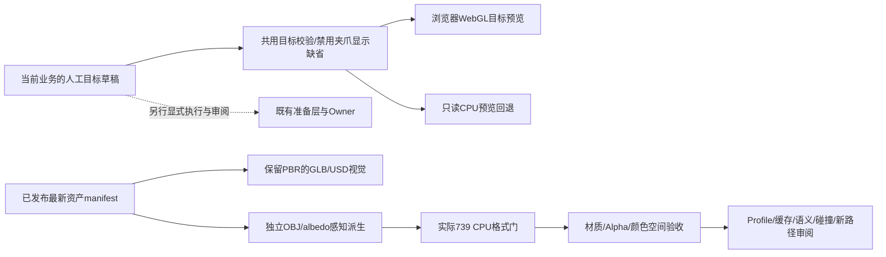
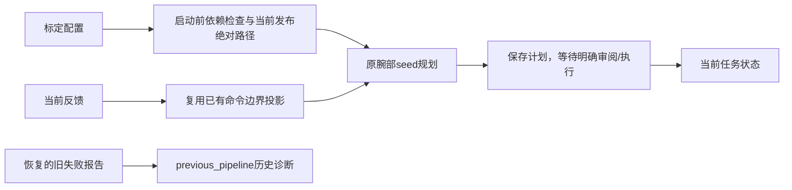
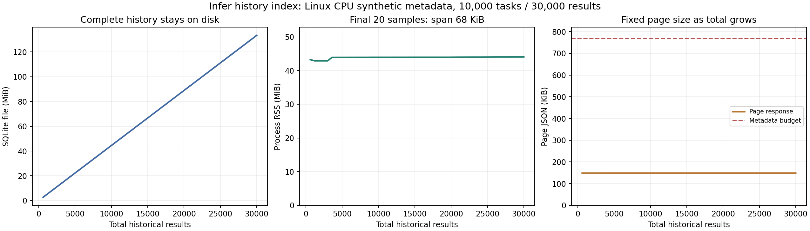
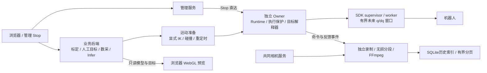
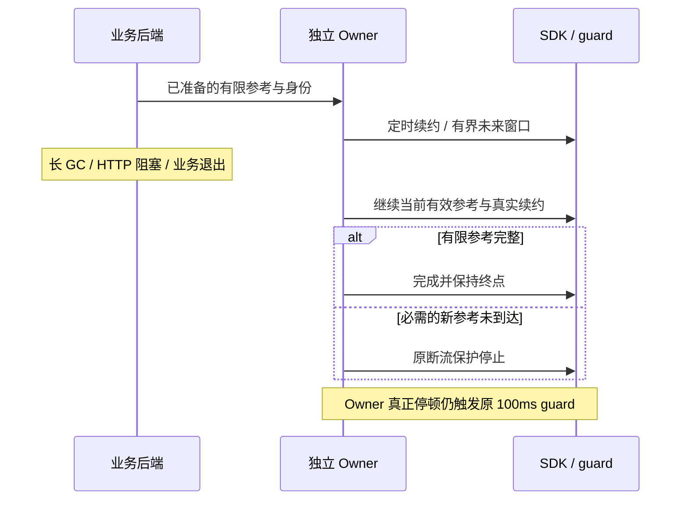

# 控制链路阶段状态

## 2026-10-31 源码整理与交付边界

使用与部署统一入口：[工作台说明](WORKBENCH_GUIDE.md)，部署规范：[启动、封存与回滚](physical-deployment-runbook.md)。
本次Git交付保存累计控制保护、平滑参考／研究诊断、历史索引、场景资产、Torch/Triton及一键运维源码。
CPU／前端回归结果见[可移植验收摘要](acceptance/workbench-20261031.json)；运行时配置、原始录像、
完整日志和模型／SDK外部制品不进入Git。源码提交不会更新线上冻结发布或重新取得真机控制权。

03:45实机交接验收通过：退出按钮真实点击，正常回零并释放工作台全部硬件／模型资源，
原人工数采任务1251正常启动到ready，无新录制。09:32该数采因踏板USB断连后的进程退出而停止；
10:36只读核验仍为failed、硬件进程退出、无孤儿进程，认领保持有效；工作台未自动接回。
此故障属于后续运行事件，不撤销此前真实交接证据，也不能继续把03:45的ready当成当前状态。
恢复前须核对实时状态和踏板USB。完整研究精度／平顺性、模型映射及踏板3物理Stop仍未全部验收。

以下按各节日期保留历史研究与验收；旧段落的“当前”“本次”“未提交”仅指当时，
`migration/validation-summary.json`仍是旧迁移阶段资料，不能替代上述入口及实际发布收据。

当前问题摘要：[ARX13 控制平顺性阶段总结（2026-10-30）](arx13-control-findings-20261030.md)，汇总现象、已做对照、根因假设与后续顺序；新研究结论形成时同步维护。

## 2026-10-30 Triton 工作台上线与用户授权的输入交接

统一交付入口：[Triton转换与输出预览](triton-output-preview-20261030.md)。与
`01a136ba-6810-7262-b354-3358b3fac8f5`协作，新增两步UI、同源API与独立CPU任务服务；
只在有效GPU窗口执行固定转换/推理CLI。模型9组数值对照最大差0，真实页面转换job
`116c2db142b24caf83fa9cefd9b06428` READY，Infer job `cc8f3c674b7446b99820b6d203c480b1`
SUCCEEDED，60×14名义实时输出，worker74.19ms、加载预热另49.26s。无模型动作/额外轨迹。

用户在协作聊天新增授权将控制交回工作台。核验原数采idle/无manager与orphan、无teleop、
待上传批次review后，正常暂停其网页，恢复三相机及原Owner保持。最终SDK仍连接，holder
calibration、epoch0、READY静止健康、相机新鲜，nonce以新交接证据为准；不自动归还数采。
当前holder沿用已保存1.0rad/s保护，未修改研究栏策略。原18869/18870标定服务PID不变。

manager/UI=`source-triton-ui-v3`，CPU任务服务=`source-triton-control-v3`；原业务/Owner仍
`source-dm-equivalent-v1/run-dm-B0-final-v1`。页面发布只重载manager；之后接入来自用户
独立授权。启动seal误收动态pointer/--output回执的缺陷已修复，13项Linux检查与新seal的
`--check`通过，startup_ready=true；没有借启动检查重接SDK。

两GPU任务的容器/worker已退出、compute为空；预留仍由推理协作Session负责，不将GPU
进程退出写成预留已释放。证据根`.evidence/arx13-triton-ui-20261030-v1/`；已保存真实按钮
request_id、READY制品、数值报告、桌面/移动端截图、无JS错误及最终控制/退出证据。
控制权管理小模块按用户要求只登记后续，不提前开发。模型映射标定、预测动作资格未验收。

## 2026-10-30 30Hz位置点、SDK自行计算速度实拍

用户明确选择“只提供位置点，让SDK自行算速度”，而非将电机目标速度设为零。
新增制品绑定的`velocity_source=sdk_position_only`，限定30Hz研究参考、Ki0和无附加前馈；
适配层保留解析dq用于原边界检查，但给原生`set_joint_traj`的JointState速度字段置零，
由SDK既有`calc_joint_vel(...,0.05)`重算。准备/回零仍100Hz并使用原`set_joint_reference`
保留q/dq。原生库、PD、重力、500Hz循环及0.8rad/s保护不变，不绕过Owner或Stop。

125项Linux回归通过。使用本机原生utils.cpp进行无控机回放；0.1/1/2ms提交耗时下，
生成速度峰值约0.321rad/s、加速度峰值0.64/0.95/1.32rad/s²，对原保留q/dq路径的位置
差最大约0.0098°。零耗时回放会构造实际调用没有的重复当前时间戳，单独保留，不能把该退化
夹具中的尖峰当作真机输出。旧接口还会重连未来窗口，因此本轮是完整原生接口行为对照。

首次候选启动配置仍指向旧source，接入门在任何接入请求前拒绝；新建run-position30-v2
纠正引用并重新核验身份，未绕过门禁。唯一实机执行身份随后完成同一完整35.333秒1.5×、
5秒停位、0.1rad/s回零和正常释放。1662个主段/保持窗口均确认走`legacy_recompute`；
1190522帧独立CAN、零socket丢帧，无本轮速度/CAN/心跳故障，native admission最大6.732ms。
实测节点33.333ms、每关节CAN中位2.053ms。视频76.902秒、1724帧，按原帧索引/PTS对齐，
处理MP4首帧归零，不移动state曲线消除滞后。三路相机非硬同步；释放发生在交付视频结束后。

与上一轮30Hz预设dq比较，递送27–33.8秒原始速度误差RMS的J1–J6变化为
−2.54/−2.39/−4.76/−0.66/+2.29/+0.66%；100ms位置位移速度误差变化为
−1.54/−4.63/+8.12/+0.07/−0.73/−7.61%。左J1静态仍4码；反馈起伏未消失，
各项收益不一致，单次对照不支持晋级。图中橙色解析速度仅用于对照，本轮未传入SDK。

交付：[实拍、全部12轴q/v/a与前次对照](/Users/wujie/Documents/Codex/outputs/arx13-position30-video-20261030/index.html)。
证据根`.evidence/arx13-position30-video-20261030-v1/`，远端同任务根`position30-video-20261030-v1/`；
原视频、CAN、事件、快照、原生回放及全部未成功准备记录均保留。
已恢复source-dm-equivalent-v1/run-dm-B0-final-v1、100Hz默认及原生保留q/dq接口，撤掉本轮
起点准入例外；SDK断开，工作台相机归还，原数采网页恢复idle且manager/orphan均无。
启动seal动态文件及CLI相机重绑遗留未在本轮修复。维护者为本任务，新对照或候选晋级时更新。

## 2026-10-30 原视频曲线与30Hz参考节点实拍对照

用户先要求绘制上一段视频对应的控制/state角度、速度、加速度，随后明确要求若原为100Hz，
改30Hz录制相同1.5×并输出曲线。已核对原窗口：参考节点10ms，窗口补给间隔中位21.551ms，
CAN单关节发送间隔中位2.053ms。按已说明的单变量口径，只改主参考节点为30Hz，
准备/回零仍100Hz、补给目标50Hz、SDK配置500Hz、默认P/D/I0、单位契约、0.8rad/s保护不变。

新增显式reference_origin_30Hz，仅允许既有0.1s研究窗口；连续q/dq/ddq系数与原参考完全相同。
CPU下30Hz线性插值相对原连续曲线最大关节角差约0.001902°。首次CPU检查发现30Hz网格
可能让连续两次补给共用未来首点，旧积分状态机即使Ki0也误报时钟回退。已在共用逻辑正确
允许首点Δt=0（不重复积分）；观测时钟仍须前进，真正回退/过期/断流及原保护均保留。
70项本地检查、123项Linux检查通过，含重叠、重复首点、非零Ki不重复累加、终点和Stop撤销。
SDK原生库未改。候选source-reference30-v1/run-reference30-v1只在本轮加载。

新执行身份完成完整1.5×主轨迹、停位、0.1rad/s回零及正常释放，1193067帧CAN零丢帧。
实测节点间隔33.333ms，窗口补给中位21.767ms，CAN单关节仍2.053ms（约487Hz实际、500Hz配置）。
全部12轴实际CAN增益与冻结base-v1相符。30Hz视频77.050秒、1732帧，SHA256
3c2baa297471dc8a13069b102e21901e86012987971075595eaea0619260cab8。
仅裁去动作前空等和回零后等待，保留每帧时间间隔；原始视频/CAN/数字记录保留。

原100Hz视频1190762帧CAN及新30Hz视频分别生成双臂总览、24张逐关节大图、递送局部和
运动状态图。横轴按各视频保留帧的真实主机时间对齐。核验发现MP4封装会将首帧PTS归零，
而frames.jsonl保存原PTS；已逐帧验证映射并校正约53.671/45.666ms的封装偏移，不通过
移动state曲线拟合消除跟踪滞后。旧视频烧录文字时钟有该量级偏移；相机也非硬同步。
角度/速度主图来自原始CAN TX/RX；加速度是500Hz分析网格上的速度差分，逐关节页保留
未滤波结果，总览另显示共同20Hz零相位离线趋势，不能当作机械加速度直接读数或控制器滤波。

统一入口：/Users/wujie/Documents/Codex/outputs/arx13-rate30-video-20261030/index.html。
该目录含两段视频、100hz/与30hz/全12轴曲线、数据NPZ和来源报告。证据根为
`.evidence/arx13-rate30-video-20261030-v1/`；remote为任务根reference30-video-20261030-v1。
本轮仅单次对照，速度起伏仍存在，不能据峰值有升有降推广30Hz或否定降低SDK原生频率的假设。

最终恢复source-dm-equivalent-v1/run-dm-B0-final-v1及原100Hz默认，SDK正常断开，
工作台相机停止，原数采网页恢复idle且无manager/orphan。没有改变原数采环境/固件。
收尾只读检查进一步发现旧启动seal误收录backend/current.json和model-prestart.json这两份
正常重启会变化的运行产物，导致启动脚本完整性误报；实际Deployment源码/配置核验仍通过。
未删减清单绕过检查、未伪造启动通过。此动态文件分类问题与前述相机旧绑定刷新共同待修。
维护者为本任务；后续视频、频率、发布或启动修复时更新。

## 2026-10-30 当前base-v1完整1.5×实拍

按用户请求录制一轮当前保留的base-v1：默认双臂P/D、I0、无学习前馈、DM等价单位，
同一参考c3d3ed10170f33ba4a8079f0a2e30f863a5e31f3f27839e2c9a192238f6df6e8。
复用本轮已验收的有限起点准入配置完成准备、完整35.333秒主段、5秒停位、0.1rad/s正常
回零及释放；随后恢复B0-final无起点例外配置，不改变研究参数。独立CAN和数字证据保留。
交付视频76.921秒、1747帧、1440×720，头部大图＋左右腕视角；逐帧保留原始PTS，
只剪去运动前空等并重标录像时钟，无加速。00:02进入主轨迹，00:37.34停位，
00:42.57回零，01:16.68回零完成。释放发生在视频之后，由数值收据验证，不宣称录像拍到释放。
三路为实际预览而非硬同步，最大源年龄67ms、最大视角时差74ms；没有据此宣布平顺性通过。
原始180秒视频保留远端，交付SHA256为1076e97ebaa84982af586b78d688323ef988fccc032a6114ec1f833e7982a696。

本地视频：/Users/wujie/Documents/Codex/outputs/arx13-video-20261030/arx13-base-v1-1p5x.mp4。
证据根`.evidence/arx13-video-20261030-v1/`，远端任务根`video-20261030-v1/`。
录像依赖仅安装到任务专属video-deps-v1，没有改原数采或控制Python环境。
正常释放后已停工作台相机并恢复原数采网页，核验idle、无manager/orphan；SDK为DISCONNECTED。

新观察：一键启动从“业务仍运行、相机已停止”的状态恢复时，相机新实例已就绪，但旧业务
相机客户端仍指向旧连接，最终ready检查拒绝通过。本轮受控切换录像配置时重载业务恢复绑定；
没有循环重启或自动接SDK。CLI部分服务恢复后的自动rebind仍待补，不能把先前全停冷启动
夹具通过当成该场景已覆盖。维护者仍为本任务，后续录像/发布/该问题修复时更新本节。

## 2026-10-29 本机内环读回、DM等价单位与新单变量批次

维护者：本任务。证据根`.evidence/arx13-inner-loop-20261029-v1/`，更新触发为参数读回、
候选切换、每轮终态和新异常。用户批准按内环核验→单位迁移→完整1.5×单变量对照推进；
另确认本次心跳退出后的双臂承托恢复，并允许本轮继续≤2°起点实测差，逐份绑定配置、
检查指令连续和健康静止，原限位/0.8rad/s不变。不是永久扩大原一次性准入例外。

启动核验发现此前SDK在21:11:22因Owner心跳100.059ms退出；Guard两路零socket丢帧，
各电机报文年龄约0.1–2ms，不能称为CAN掉线。旧Owner保留故障runtime，按其退出处理
逻辑拒绝普通SIGTERM，不是已证明的线程死锁。核验SDK/Guard已退出、唯一子进程是
Python resource_tracker后，保存线程现场并清退本任务旧Owner，归档旧私有Owner目录。
原数采manager已停，临时暂停其网页；未停止native_teach等其他任务服务或改数采环境。
用户确认后已重接、正常0.1rad/s回零释放；回零静态残差单列，不作为已达精度。

192项只读参数查询取得191项回复，左J5软件版本以独立一次补查补齐，原缺失保留。
首个脚本未区分设备侧阻尼背景流，达到异常流证据上限退出，未产出完整参数收据，
不能记成成功。后续被动证据显示主机TX增量0、约21ms一组固定阻尼格式包，与此前
已验证设备侧超时阻尼特征相符，未据此断言具体MCU实现。新查询保留完整TX/RX和进度。
全部查询均未构造SDK、未使能、未写配置。

- 两臂EC J1–3：硬件[1,0,1]、软件[1,0,0]，Kt1.4，KP范围0–500、KD0–5，
  POS±12.5、SPD±18、TOR/CUR±30、CAN超时500ms；电流PI0.0359/250，速度PI0.006/0.1，
  位置PD0.006/0.00004。Kt校准状态原始回复0与新手册枚举不一致，保留原码不臆断。
- 六DM腕部：CTRL_MODE1(MIT)，PMAX12.5、VMAX30、TMAX10；I_BW1000、V_BW40，
  KP_ASR约0.00372、KI_ASR0.002、KP_APR54、KI_APR0、GREF1、Deta4、NPP14、Gr10。
  Kt覆盖值0按手册表示用内部理论值，不是物理Kt为零；磁链分轴保留，不宣称机械力矩已校准。
  版本原始字节：硬件33303056、软件35303137，左子版本52、右53，未臆造语义版本号。
- V_BW在本机存在并可读已证实；是否作用于此固件的MIT D支路、滤波形式、单位及群延迟，
  仍缺源码/厂商证据。本次不写V_BW、电流PI、模式或flash。

DM候选`arx13_dm_protocol_equivalent_v1`默认关闭，仅ARX13六腕显式启用。前馈命令
采用协议名义扭矩，发送乘18/10；重力及命令上限乘10/18/0.424，保留原CAN输出。
反馈effort继续旧兼容尺度供原保护使用，另提供protocol T诊断；EC、夹爪、PD和频率不变。
旧前馈制品因单位身份不同被拒绝。200001个原生换算用例通过（float32编码最多差1码），
123项Linux检查通过；构建ID`1b1f2f155cb3ec99d347546e151a824447ccd5f7befcc30a548870ded3d8c5e2`。

真实B0验收完成接入、同一1.5×参考运行中正常Stop、未来目标撤销、显式不续跑、回零释放。
Stop返回后50–500ms，12轴每轴212–218条TX位置码跨度0、速度码2047。
静止同拍快照与新单位重力计算误差0，实际DM CAN前馈码差0；830417帧零socket丢帧。
没有注入真实故障，不能将正常Stop后的恢复请求记成故障清锁验收。
已真实回退原SDK接入/回零/释放，再返回B0。原模块及两套配置保留。

`study-plan.json`冻结完整1.5×、P不变、其他轴D不变、I0，只比较左J1 D1.5/2/2.5，
再试沿参考速度方向的平滑FF：最高0.061482旧EC SDK单位（协议≤3码），斜率≤0.042202
SDK/s，起终点为0。顺序A→D低→A→D高→A→FF→A，每轮回零释放、真实异常整批停止。
未改V_BW，因此D对照仅判断D支路敏感性，不唯一辨识内部估计器。
截至2026-10-30凌晨，七轮完整轨迹均完成，各自正常回零释放，累计8312721帧，零socket
丢帧、无调度记录截断、无新速度/CAN/心跳保护故障。主段/保持反馈RPC最大15.228ms。
首个FF身份`study-r06-FF`在审阅阶段因制品漏写provenance.study_settings被拒，主段未执行；
已回零释放，保留失败。补全配置、原样保留全部数值，新增精确制品走真实Runtime.preview的
CPU通过/旧缺失元数据拒绝检查，换新制品和执行身份`study-r06b-FF`完成，未跳过校验。

下表均为左J1递送27–33.8秒，相对前后相邻A基线均值；100ms位置位移是诊断视图，
不是新保护、控制器滤波或固定验收频带。同拍误差包含允许的跟踪滞后，不冒充空间路径误差。

| 单变量 | 原始速度误差RMS变化 | 100ms位移速度误差RMS变化 | 同拍角误差峰峰值 | 静态误差 |
| --- | ---: | ---: | ---: | ---: |
| D2→1.5 | +9.44% | +15.55% | 0.678°，增加6.90% | 4码 |
| D2→2.5 | −10.80% | −4.82% | 0.678°，增加6.90% | 4码 |
| D2＋方向FF | −1.33% | +9.65% | 0.656°，增加5.26% | 4码 |

四轮A的100ms指标范围0.01808–0.01961rad/s，D2.5为0.01806，已接近基线自然波动范围，
不能把原始速度尖峰降低直接当成明显可见平顺性改善。方向FF把平均落后减少0.01616°；
CAN前馈平均变化−0.02771、按ΔFF/Kp的准静态近似预测约−0.01985°，作用方向一致，
但反复快慢变化未消除。这里只检验小幅方向项，不能据此排除其他摩擦/周期补偿模型。
没有晋级任何D/FF试验值；默认运动仍为base-v1 P/D、I0，无新学习前馈。
左J1静态3–4码，整体一格目标未通过；全12轴终点误差见comparison-summary.json。
未录像，未将数值变化宣称为肉眼平顺性已通过。根因仍不能在机械摩擦/弹性、位置相关项、
速度估计与反馈耦合之间唯一归因；V_BW固件路径继续未确认。

最终惰性发布：source-dm-equivalent-v1 / run-dm-B0-final-v1，保留已验证的DM等价单位，
撤掉本轮≤2°起点例外，不自动接入。已刷新995项静态输入的一键启动清单
startup/release-dm-equivalent-20261029-v1.json和current-release选择器，旧清单/启动器可回退。
交付前完整性、显示、人工规划、三相机检查通过；之后按原交接约定正常停工作台相机、恢复
prometheus-arx13-web.service，核实robot_vin=arx13、collect_status=idle、manager/orphan均未运行。
最终SDK为DISCONNECTED；相机停用是交还原数采资源，不能解释为相机故障。
本次未动原数采代码/环境、驱动、CAN命名和固件参数。

比较图：/Users/wujie/Documents/Codex/outputs/arx13-inner-loop-20261029/j1-comparison.png。
本地保留七轮analysis/series/request/status及完整寄存器TX/RX；原始CAN、调度、反馈及事件
在远端同名研究根，已核对各轮SHA。完整结果为comparison-summary.json；候选、Stop、
回退、原数采恢复、最终状态与发布收据均在本节证据根。
下一步优先用现有全段/回零数据区分角度相关周期项与时间域响应，并补V_BW/内部速度路径
的厂商证据；随后针对有效机制做新对照，再处理静态偏置及其他关节，不继续仅凭单个尖峰调D。

下方独立部署标准化的封存基线早于本次候选，不能据旧source-v8/v6封存去回切当前研究。
本次实际发布以continuation-state的current_publication为准；候选撤回或晋级时需同步核验启动入口。

## 2026-10-29 部署流程标准化与一键启动（独立于控机研究）

统一入口：[真机部署与二次启动规范](physical-deployment-runbook.md)，复盘本轮机器绑定、
Python/SDK/ament、反馈边界、生命周期、显示/人工规划、增益入口、记录器和服务竞争问题。
新增`workbench_deploy.py seal/check/start`及ARX13任务根`start-workbench.sh`，封存当前
source-v8业务/管理、source-v6 Owner、source-v2相机的1442项静态输入，正常二次启动不接SDK。
12项Linux测试与独立真实systemd无硬件冷启动/重复启动通过，临时unit已正常清退。
生产脚本实测拒绝同boot Owner残留，不清锁、不重试、不改生产服务/PID/控制状态。
本轮末次只读检查Owner已退出、控制UNKNOWN，三相机及显示/人工规划服务可用；
这不是本轮标准化脚本导致的停止，也不将旧研究状态收据当作当前就绪证明。
恢复该现场异常仍走显式故障维护；本次没有真机断电测试或控制动作。
交付收据：`.evidence/arx13-deployment-standardization-20261029-v1/delivery.json`。

## 2026-10-29 base-v1 同拍输出与内环接口核验（只读）

本轮完成两项分析中现有记录、SDK与公开厂商接口的核验：对齐位置、速度、电流/反馈T
与近似P/D，并明确速度估计、滤波和可配置接口的已知范围；固件内部未知项仍待核验。
本项目负责本记录，原始数据与厂商来源见本节末。只复用ARX13 r03完整1.5×记录、读取已部署SDK源码/库与厂商资料，
没有新动作、SDK接入/释放、CAN参数查询或参数写入。运行态未重新验收，上一节的
final-state.json仅是此前状态证据，不能据本轮离线分析声称当前真机状态。

### 数据口径与可以确认的现象

原始CAN SHA256、零socket丢帧及12轴实际运动增益重新核对通过。每条反馈使用同关节
最近一条在先TX；q、v、effort来自同一RX帧，按主机接收时间对齐，不平移曲线补延迟。
用实际码值重建P=Kp(q_cmd-q_rx)、D=Kd(v_cmd-v_rx)、FF；这只是可观测近似，
固件内部采样、更细量化、滤波及处理延时未知。EC的Kt=1.4及增益范围沿SDK名义契约，
尚未在ARX13独立读回；ARX6历史读回不能替代。所有数值都是当前协议单位下的分析，
没有校准成独立实测关节力矩。
同一RX帧只保证这些字段被一起上报，不保证它们在固件中同一时刻采样或经过相同滤波。

J1–3是EC：普通反馈包含相电流，近似电流请求=(P+D+FF)/Kt。
J4–6是DM：普通反馈字段是T，不能称作独立实测电流；近似T请求=P+D+FF。
两类电机都由固件执行混合PD，再交给电流内环。上层I=0不代表电流环PI被关闭。
当前SDK直接取speed_actual_rad（DM随后做已验证的1.5速度比例换算），没有在这条
状态读取路径上做主机速度估计或低通。100Hz参考/约500Hz通信频率也不是固件电流环频率。

28–30秒位置变化与反馈速度一致：此前交叉核验的左J1/J5，20Hz位置导数对反馈速度
相关系数分别0.9967/0.9614，100ms位移与速度积分相关系数0.9976/0.9884。
不能只把尖峰归为速度显示噪声；但二者可能共用编码器，仍不是外部独立运动测量。

进一步按同一RX时间格精确拆开ΔP=KpΔq_cmd−KpΔq_rx，
ΔD=KdΔv_cmd−KdΔv_rx（固定增益，未除以dt）：

| 28–30秒 | ΔD目标项RMS | ΔD反馈项RMS | 后者/前者 |
| --- | ---: | ---: | ---: |
| 左J1 | 0.001594 | 0.041385 | 26.0 |
| 左J5 | 0.000940 | 0.023506 | 25.0 |
| 左J6 | 0.000570 | 0.013019 | 22.8 |

这说明重建D尖峰主要来自反馈速度变化，并不证明反馈是纯噪声，也不能作为因果贡献率。
P项变化中，目标位置量化台阶不能忽略；每码约0.021857°，目标与反馈都阶梯化。
平滑浮点参考不等于线上每个量化控制量连续，不能据此排除量化触发。

27–33.8秒共选出左J1/J5/J6的37/22/22个速度峰。沿运动方向为正，对每个峰比较
前80–40ms与峰值±10ms，以下为各事件窗口均值的中位数：

| 轴 | 速度 峰前→峰中 rad/s | 近似D 峰前→峰中 | 反馈输出 峰前→峰中 |
| --- | --- | --- | --- |
| 左J1 | 0.0495→0.2406 | +0.1373→−0.2608 | 电流0.3859→−0.0013 A |
| 左J5 | 0.0663→0.1734 | +0.0193→−0.0684 | 反馈T 0.2795→0.2040 |
| 左J6 | 0.0915→0.1587 | −0.0004→−0.0568 | 反馈T 0.1199→0.0859 |

三个轴的峰中D均制动；按超目标速度选峰后，这一符号部分由公式决定，不能当成独立
因果证据。反馈输出峰前大于峰中分别37/37、21/22、22/22。离线选峰滤波10/20/30Hz、
prominence 0.04/0.08/0.12rad/s共9种设置中，这一比例最低为100%/91%/79%，
方向总体一致，事件数量随设置变化。选峰滤波仅用于离线描述，不是控制器或验收频带。

左J1/J6在该段FF各自恒定，排除了其自身FF跳变作为每次脉冲的直接触发项。
位置误差逐步增大、快速追赶时输出减小的形状，与摩擦/弹性和闭环共同形成的周期运动
相容；也可能涉及驱动速度估计延迟、量化、结构共振或多轴耦合。闭环记录不足以唯一
归因，不能宣布“已证明粘滑”“D没有参与振荡”或“D必须降低”。互相关峰的时移也没有
被当作真实电流环延迟。主段最大SDK反馈RPC8.822ms，未发现此前35ms问题在主段复现；
这并不能据此排除所有较小调度扰动。回零的33.890ms另有原始证据，未混入本段归因。

### 哪些接口实际作用于哪一层

| 措施 | 证据与适用范围 | 当前结论 |
| --- | --- | --- |
| q/dq、Kp/Kd、FF | 两厂商混合控制公式与实际CAN；现有SDK可发 | 直接改变驱动混合PD的目标/增益/前馈，可做同轨迹单变量对照 |
| 主机平滑q/dq，限制参考加速度/jerk | 改变电机输入；需保持dq与q导数一致 | 能减少参考激励，不能保证实际加速度被限住或消除固件内部振荡 |
| 主机滤波反馈/绘图 | 固件D读取自身反馈，不读取主机绘图结果 | 只滤显示不会改善内环；将来若用于外层闭环需另算延迟 |
| EC电流PI | 手册配置mode6/code0x0c，查询mode7/code32；厂商VESC工具有电流环说明 | 确实针对电流环，当前ARX SDK没有通用配置封装；本机值/固件待核验 |
| EC速度PI、位置PD配置 | 面向相应速度/位置伺服模式；不是每帧混合模式Kp/Kd | 不能把这些配置直接当作当前混合D的速度滤波旋钮 |
| EC加速度参数 | 文档有查询/配置，未明确保证用于当前混合模式 | 作用范围未证实，不能直接用来解决当前MIT速度起伏 |
| DM ACC/DEC | 厂商调试手册V1.4第10页明确“非MIT模式下使用” | 当前MIT下不能靠这两个寄存器限制加减速 |
| DM I_BW / 电流带宽 | 厂商手册第11页与官方SDK RID24(0x18) | 针对电流环；文档默认1000不等于本机值，也不等于回路采样频率 |
| DM V_BW | 官方motor-sdk枚举RID32(0x20)，支持通用读写 | 接口存在；是否被ARX13固件支持、是否作用MIT D支路、单位/延迟均未确认 |
| DM KP_ASR/KI_ASR、KP_APR/KI_APR | 厂商独立速度/位置环参数 | 不得默认它们就是MIT每帧Kp/Kd；模式路径需核实 |
| 更高CAN/参考频率 | 只改变主机更新周期 | 不等于提高固件电流环频率，不能直接修改内部估计器 |

当前ARX SDK的公开C++/Python接口与实际库符号没有通用寄存器读写、速度低通或notch接口。
厂商协议存在功能不等于工作台已接入；尤其V_BW的名字不足以证明它滤的是MIT D使用的速度。
内部速度算法（差分、观测器或PLL）、采样率、滤波截止/群延迟、编码器位置、上报v与
内环v是否相同，现有公开手册/可用SDK源码尚不能确认。这些是明确的固件证据缺口。

### 新发现：DM前馈与反馈T的单位映射尚未统一

ARX13既有18条寄存器读回确认两臂J4–6均PMAX12.5、VMAX30、TMAX10。
本轮静态反汇编部署中的libhardware.so，TX/RX均实际引用±18的T常量；不是只读头文件猜测。
上层发送前再除以0.424、接收后乘0.424。因此忽略量化：

    T_CAN_nominal = SDK_FF / 0.424 × 10/18 ≈ 1.31027 × SDK_FF
    SDK_effort = T_CAN_reported × 18/10 × 0.424 = 0.7632 × T_CAN_reported

实际原生记录与独立CAN重解码均支持该比例。上述是软件换算关系，不是实测机械力矩校准，
也没有证明它就是速度脉冲的根因。本轮分析已按电机TMAX10从原始CAN解码，未拿SDK通用
effort冒充电流；现有约1.5速度比例修正已另有验收，不与扭矩问题混淆。修正扭矩契约会改变
实际驱动力，后续需单独冻结旧/新输出关系并做可回退验证，不能顺手改线上系数。

### 下一步与来源

优先核验本机固件与只读参数，再设计有效的单变量干预。候选读取清单：
EC mode7的Kt(22)、KP/KD范围(23/24)、速度/扭矩/电流范围(26/27/28)、
硬软件版本(30)、电流PI(32)；必要时速度PI(33)、位置PD(34)仅作模式识别。
DM HW/SW(13/14)、子版本(36)、I_BW(24)、V_BW(32)、Kt(1)、极对数(16)、
磁链(19)、减速比(20)、GREF(30)，保留既有PMAX/VMAX/TMAX。
不是本轮执行许可或已读取结果；查询回复会与普通反馈复用CAN ID，必须在正常维护窗口、
独占接收并隔离查询回复后做，不能在当前保持进程旁临时塞入厂商SDK。

待厂商明确：实际固件版本的速度估计链、MIT D所用速度、V_BW作用位置/单位/延迟、
电流环/位置计算频率、反馈T的估计来源及KT_OUT语义。没有向厂商发送消息。
核验后仍以同一完整1.5×轨迹做单变量对照；按观测区分摩擦/补偿、阻尼/相位与结构问题，
不采用仅把反馈画平的方式验收。单位契约问题单独处理，不与D滤波修改捆绑。

证据根：`.evidence/arx13-base-v1-20261029/inner-loop-audit/`。
`analyze_effort.py`可重跑全12轴解码、图和统计，带独立整包位域断言、时间序列、
默认增益与SHA检查；`verification-summary.json`含选峰敏感性和库常量；
`pd-change-decomposition.json`含ΔP/ΔD拆分；`dm-library-disassembly.txt`保留反汇编；
`sdk-source/`保留相关源码；`vendor/sources.json`保存公开资料URL、版本、Git blob和SHA256。
图在输出目录`arx13-base-v1-20261029/inner-loop-audit/`的`aligned-pd-effort.png`与
`burst-sequence.png`，均已检查布局。普通CAN原始值、选峰和统计未被滤波后的图替代。

厂商原始来源：恩科斯技术手册V1.20物理页11/24–25/35/40–47；达妙官方GitHub
dmBots/damiao-document的MIT模式说明页1–2、调试协议V1.4页10–11；
dmBots/motor-sdk的DM_CAN.py枚举和寄存器读写实现。EC PDF位于既有
`.evidence/gravity-model-audit-20261026-v1/manuals/encos-technical-v1.20.pdf`；DM文件在本轮vendor目录。
资料接口能力与本机固件支持明确分开。更新触发：本机参数读回、厂商明确固件链路、
新的干预实验或单位契约变化；届时保留本轮只读结论与原始数据。

## 2026-10-29 base-v1 首轮完整1.5×测量

用户将SDK默认运动P/D指定为`base-v1`，要求重启控制研究，先看精度与抖动及指令/反馈
角度、速度、加速度曲线。基线完整冻结在`.evidence/arx13-base-v1-20261029/base-v1.json`。
双臂P=[80,70,70,30,30,20]、D=[2,2,2,1,1,0.7]，Ki均0；名义SDK重力与旧EC单位契约
保留，无学习前馈，窗口附加补偿实测峰值0。原前50秒空间路径的1.5×参考运行35.333秒，
100Hz节点、SDK原生约500Hz。主段右臂固定，完整记录双臂12轴。

三个身份分别保留：r01在控机前的脚本曲线预检误用夹爪原始反馈而失败，无运动确认；
已修复为同一feedback_to_command边界逻辑。r02实际完成对齐，但左J3起点误差约1.005°、
右J4约−0.612°，超原0.01rad准入，主段未启动，随后正常回零释放。
用户明确允许本轮起点实测差最多2°并要求指令连续，候选另加精确reference_id、默认P/D、
Ki0、无前馈、健康静止、上一段同epoch完成、命令q/dq及原生输出匹配检查，71项Linux通过。
**r03完整主段、5秒终点保持、0.1rad/s回零及释放均完成，无速度或CAN保护故障**；
随后已回退原`source-v6`Owner与原0.01rad起点准入，不留本轮例外。

证据：远端独立任务根`research/base-v1-20261029-r03`；本地同名证据目录`r03/`。
独立CAN 1,170,519帧、socket丢帧[0,0]、调度记录无截断，发送增益码值与默认P/D相符。
主段/保持Owner反馈3993样本，反馈RPC中位2.277ms、P99 5.208ms、最大8.822ms；
窗口流程中位2.976ms、最大10.918ms，提交首点最小余量26.486ms。
回零另有一次33.890ms读取，诊断32.984ms、Guard0.166ms；该事件及两个循环时序包已保留，
没有据此声称延迟问题根治，也未偏离基线任务去追加延迟实验。

终点最后1.5秒：12关节位置跨度均为0或1码（一码约0.021857°），但到位只有右J6全窗≤1码。
左J1–J6平均误差约[−0.0656,+0.0437,−0.4371,−0.1335,+0.3060,+0.3487]°；
右约[+0.0629,−0.1311,+0.3497,−0.5901,−0.2808,−0.0016]°。
因此静态稳定不能替代到位精度。左臂主段速度峰值约[0.514,0.532,0.330,0.403,0.388,0.286]rad/s；
28–30秒的J1/J5/J6跟踪误差及速度仍反复起伏。单轮与未录像不能证明所有可见振动已消除，
也不足以在PD、摩擦、负载和反馈噪声之间唯一归因。

曲线交付目录`/Users/wujie/Documents/Codex/outputs/arx13-base-v1-20261029/`：
`index.html`、18页`base-v1-curves.pdf`、双臂总图、12轴单图、局部误差图、探索性频谱及CSV。
角度/速度来自独立CAN实际TX/RX；加速度是200Hz重采样速度的差分，同时显示原始差分与
相同20Hz四阶零相位滤波后的差分。后者仅离线可读性，不是控制器滤波，也不是固定抖动验收频带；
不把量化尖峰当作等幅机械加速度。无ARX13实测零偏与外部测量，不宣称绝对TCP精度。
原始统计与方法见`r03-analysis.json`，完整故障与发布收据保留。

配置下拉新增base-v1，当前保存值匹配，未改变其他预设。网页业务`source-v8/run-base-v1-preset`，
Owner仍为`source-v6/run-default-pd-v1`；当前发布与实态见本轮`publication.json`、`final-state.json`。
SDK重接后健康静止、标定持权、无自动动作。下拉接口核验通过；本地浏览器控制现被用户设置禁用，
未冒充新预设的页面截图验收。下一步先由用户审阅这些曲线，再针对运动速度不均匀与静态偏置分别设计对照；
保留同一1.5×主轨迹和本轮基线，暂不据当前结果增加P/D。

本轮结束时对原数采1651份基线复核发现5份身份/网页文件有变化；逐文件SHA均与并行
`[10.28] 跑通真人数采 pipeline`任务的`prometheusv2-arx-startup-fixes`工作树一致，
该任务正按用户要求处理ARX13身份与跨任务管理。本控制研究未写这些文件，也未回退他人更改；
不能继续声称原数采全树与最初部署时完全相同。逐文件证据在本轮`isolation-final.json`。
治理shadow仍存在历史AMBIGUOUS_DOCUMENT_KIND、DURABLE_OBSERVATION_UNACCOUNTED和
UNRECONCILED_STATUS_DELTA，不作为代码测试通过，也未伪造治理通过。

## 2026-10-29 ARX13 运动P/D切回SDK默认值

用户要求“运动时的pd直接先使用默认值，默认值有问题再调”。当前发布入口改为
`.evidence/arx13-default-pd-20261029-v1/publication.json`，实态为同目录`final-state.json`。
独立部署使用`source-v6 / run-default-pd-v1`，原生SDK库未改。双臂运动P均为
[80,70,70,30,30,20]，D均为[2,2,2,1,1,0.7]；当前研究保存配置也已更新为同值（revision3）。
显式研究覆盖仍有优先级；后续若选择其他预设，须以该次冻结配置为准。

新增可信部署字段`motion_gain_profile=normal_X5`，与原`target_interpreter_profile`
分离：普通标定/人工动作、数采、推理的begin入口统一读取默认P/D，原100Hz节点、原生窗口、
重力/单位契约和停止保持不变。停止保持仍为双臂P=[24,21,21,9,9,6]、
D=[1.2,1.2,1.2,1.1,1.1,1.07]；不能把它与运动参数混读。

142项Linux检查通过，覆盖增益默认/显式研究覆盖/恢复默认、共享执行、停止、速度保护与SDK生命周期。
进程测试退出仍报告Python清理10个semaphore，未当作长期内存验收。准备记录器首次因缺少PYTHONPATH
在控机前退出，执行epoch未变；补齐环境后以新目录开始，没有重放未知运动。
旧进程通过显式研究参数完成一次0.1rad/s维护回零，原生实际P/D逐项吻合默认值；
最大静态残差1.3879°，精度未通过。沿用户此前“回零静态残差先不管”及ARX13既有承托/维护授权
正常释放后加载，未旁路或提高输出追零。独立记录器零socket丢帧，释放后才批量归档。

重接后runtime_nonce=`b71b224c346b4ff15bfa7549728bc149ba63f2a5ed389f73`，
READY、反馈健康静止、标定持权、无自动动作，三相机新鲜；新进程报告运动增益配置normal_X5。
研究配置读取仍为默认值。此轮未自动启动完整1.5×研究，不宣称高频振动已消除。
速度保护保存策略未改：标定5rad/s，研究0.8rad/s，实际监测服从当前持权业务。
下一步使用默认P/D核验完整1.5×动作；只有仍出现振动/到位问题时，再按关节设计对照。

## 2026-10-29 19:20 ARX13 接入与停止验收通过，显示／人工规划已补齐

当前权威入口为 `.evidence/arx13-commissioning-20261029-v1/commissioning-receipt.json`，
其 `publication-current.json` 和 `final-actual-state.json` 分别记录发布与实际状态。
业务／网页为独立任务根下 `source-v5 / run-preview-v2`；控制 Owner 继续使用
`source-v3 / run-v3`，SDK build `77e8c205628269ebd6d31ab4d424b5c21e6ca45c461290d0584b98e0e522f7f0`。
ARX6仍留给人工示教；本任务只操作ARX13，没有启动GPU推理。

已完成正常接入、释放、再接入；运动中正常Stop、低速真实反馈触发速度保护、
未来目标撤销、显式原地恢复均有实机证据。低速保护验收临时使用0.06 rad/s，
触发值0.065933 rad/s；恢复保留同一SDK身份，不续跑旧动作，随后恢复0.8 rad/s。
独立CAN共2,401,894帧、两路记录器丢帧均0；触发后0.2–0.7秒的244条左J1 TX位置码
完全相同。此为本地主机TX回显与电机RX证据，不冒充固件ACK或测得精确物理停止时间。
原驱动脚本因等待`FAULT`而实际收到`FAULT_STOP_UNCONFIRMED`退出；原失败不改写，
上述单独证据补足真实行为，详见`wire-stop-verification.json`和`speed-recovery-result.json`。

反馈与指令范围分离已统一到接入、Stop保持、起点和人工规划：左夹爪命令0–80 mm、
观测−3–83 mm；右命令0–89 mm、观测−3–92 mm；关节观测按SDK原限位外扩±2°。
原始反馈不改写，只将保持／起点指令投影回原合法范围。速度、电流和通信保护保留。
目标浏览已绑定名义URDF和浏览器WebGL；人工规划接入既有路径校验，冻结球模型按相同
几何与ARX13夹爪映射重新核验。离线显示使用已读出的SDK限位；连接后使用当前Owner限位。
滑杆20°显示测试核验SDK身份、执行epoch和保持状态均不变，测试后已恢复原草稿。
未安装ARX13实测相机外参／关节零偏，不能把名义显示或自碰撞粗检查当作标定和场景碰撞资格。

用户随后通过页面重新接入并执行动作；最近一次19:10:47速度故障为左J5 −2.190475 rad/s，
当时阈值2 rad/s，后已显式恢复。最新只读状态为SDK连接、反馈健康静止、标定持权、无自动动作。
Owner直接读取的保存策略：标定速度保护5 rad/s，研究0.8 rad/s；实际监测服从当前持权业务。
故障前原生P/D：左P=[240,210,210,90,90,60]、D=[5,5,5,3,3,2.1]；
右P=[80,70,70,80,30,20]、D=[2,2,2,1.6,1,0.7]。当前Stop保持双臂均
P=[24,21,21,9,9,6]、D=[1.2,1.2,1.2,1.1,1.1,1.07]。
研究页面保存的增益未覆盖标定人工动作；不要据页面草稿推断实际控制参数。

显示／规划相关152项Linux回归通过，离线入口与HTTP补充54项通过（套件有重叠），
浏览器FK对46个原生link变换最大差7.8e−16。受保护的1651份原数采代码、配置、SDK和
环境元数据哈希均未变；原数采网页恢复/预览已验证，当前按授权暂停以避免第二控制器，
工作台下次释放后需先停自己的相机再恢复原网页。原claim保留，重启后的临时task选择为null。

下一步优先复核左J5增益与振动、确认下一轮实际生效的速度保护配置，再进行同一完整1.5×
轨迹的平顺性研究。静态回零残差和最终精度尚未验收，不能宣称控制优化已完成。
以下初始部署记录为本轮早期历史，当前状态以本节收据为准。

## 2026-10-29 研究目标迁到 ARX13，独立部署与真机资格分开

用户指定 `wujie@10.17.32.3`（ARX13）继续控制研究，明确不得污染本地数采环境；
随后确认双臂安装及原完整1.5×研究轨迹的递送、回零空间与ARX6一致，可核验后研究。
该授权恢复的是ARX13研究准备，ARX6继续交给人工示教任务，不重新占用。

部署入口 `http://10.17.32.3:18868/?environment=physical&business=research`，任务根
`/home/wujie/work/feiyu.zhou/arx13-control-20261029-v1`。源码、Python3.11环境、SDK源码/
原生库/几何模型、配置、日志、研究数据均独立；3个 `robot-workbench-arx13-*.service`
仅本轮启动，不设开机自启。进程启用 `PrivateUsers=yes`、`ProtectSystem=strict`、`ProtectHome=read-only`，
仅该任务根可写；不改Prometheus源码、Conda数采环境、CAN名称、udev、系统库或数采服务。
基线与后检覆盖1651份数采代码/配置/SDK/环境元数据，当前字节哈希均未变化。

ARX13接口为左`can13l`/右`can13r`，相机序列号为头`412622270819`、左腕`261022273368`、
右腕`261022271792`，只读枚举均USB3.2。本轮仅获取内参，没有启动相机流或SDK控制器。
隔离SDK构建ID `8b4991a3d8b58a268c2d8f0eca5d5d52430bf8fd2d265cae4fd9810358dd39e8`，
保留已批准的q/dq、故障锁存和EC查询隔离实现；导入及只读工厂核验通过，不代表新机停止行为通过。

控制研究只登记1.5×参考`bc70abdc57fe9c261433312e89994f038815d0c0638b7eb35c7de6fd653bf353`，
导入ARX6 A1b参数作待验证候选（左J2/J3 P400/D1、J4 P100/D0.5、I0），没有应用到新机。
参考中的旧夹爪坐标、ARX13夹爪开闭偏置/宽度、DM编码范围及重力模型需重新绑定；
未复制ARX6标定、原生寄存器回执、旧执行身份或推理模型。当前配置明确禁止接入；
夹爪禁用标志只属于未启用的暂存配置，不代表实际已修改电机或认可最终研究夹爪策略。

部署回归发现Conda Python未暴露Linux memfd/封印符号；已通过libc调用同一内核memfd并保留
原封印、不可增长及失败不落盘语义。104项Linux CPU检查通过，含6000点不可改写计划；
CPU停止/恢复不替代首次真实Stop、未来轨迹撤销和显式恢复验收。
另发现Owner正常退出遗留私有token妨碍重启，修复仅在无连接、正常退出且token仍属于本实例时清理。
首次失败目录保留；另27项Owner/租约CPU回归通过（进程测试结束报告10个semaphore由Python清理，
该提示保留，不当作长期内存验收通过）。真实未接机服务的正常退出、同目录重新启动已验证，
实例与凭据均更新；这仍不是SDK接入/运动Stop验收。后续重载与隔离收据以本轮证据为准。
实际`/proc/<PID>/mountinfo`已确认3个服务各自的根挂载只读、任务根可写，未仅凭systemd属性宣称隔离。
前端另修正KD=0的校验，使其与服务端一致；单倍率显示及准备起点的引用选择均通过Node回归。

证据统一入口：`.evidence/arx13-deployment-20261029-v1/`；实际服务收据与后检在此落盘。
Owner为本session。下一步：先完善ARX13专属设备绑定及与本地数采的控机互斥，再进行真实反馈/
停止恢复验收，最后恢复同一完整1.5×研究。原一格内到位、无超调振动、0.8rad/s保护目标不变。

## 2026-10-28 用户已暂停控制研究，优先人工示教数采

用户明确“我们的事情先暂停下，现在需要优先跑通真人数采pipeline”，并确认是人工遥操作/示教录制。
控制研究goal已设为paused，不继续C档、重复、SDK重接或原轨迹实验；保留全部参数、A/B证据和待办。
重启检查已确认新boot、CAN接口及原制品完整。旧工作台观察服务恢复尝试因遗留Unix socket失败，
尚未移动/删除旧socket或根目录，未接入SDK、未下发动作；原manager/业务未启动，公共相机聚合与Owner为失败状态。
独立相机ROS发布及用户已启动的Prometheus网页保留，均未停止。
人工数采当前主入口是远端`/home/wujie/workspace/new_data_collection/PrometheusV2`的`prometheus.web`，
本地canonical Prometheus仓库版本较旧且有既有修改，不得直接覆盖现场代码。
当前任务证据转至`/Users/wujie/Developer/work/anyverse/data-engineering/prometheusv2/.evidence/arx6-manual-collection-20261028-v1/`。
控制研究Owner仍为本session；仅用户恢复该研究时再处理，人工数采工作不算恢复调参。

## 2026-10-28 当前目标与实拍：一格内到位、无超调振动；动态候选未通过

### 当前授权与研究对象更新：自主调参、P400基线、重点评价J4角度回摆

**最新实测：A/B均完成研究轨迹及8秒观察，B回零时发生真实CAN失联，随后ARX网络不可达；已停止真机。**
A1为准备工具的起点/jerk误算，研究增益和研究轨迹均未启动；A1b才是第一轮真实A研究。
A1b的研究段左P100/400、J2/J3 D1、J4 D0.5、I0实际CAN核验通过，完整35.333333秒运动＋8秒终点完成。
同一1～2.5秒前缀J4最大反向回摆12码/0.26228°，旧D0为31码/0.67757°；
J2/J3新组合该窗口均0码逆行。这是三个关节共同新增D的组合收益，尚不是J4单轴D的因果结论。
终点末2秒左J1～J6最大码差为`[4,1,4,7,5,1]`，一格内目标未通过；J4静态偏差与角度回摆分开报告。

A1b维护段暴露独立脚本缺陷：`study_settings`缺省时正常点运动回退到旧V10增益并启用默认积分，
而非“沿用停止阻尼/研究I0”。两次该路径回零均由J5速度保护中断；不能混算为研究段失败。
随后显式I0低P维护回零无超速但有>0.3°残差，再经正常Stop匹配保持、显式P/D回零校正后达到±0.3°并释放。
最终收尾用`finish-home-v2`，本机保存成功终端收据，详细远端收据尚待取回。
未来研究工具已显式绑定这一维护配置，保留I0与原保护，不再缺省回V10；维护失败不自动重复原回零。
连续点的jerk校验另已按实际上一命令衔接起点修正，原20rad/s³上限不变；离线实录重放原误算0.04348秒，
实际命令衔接为0.5秒、arm jerk2.10571rad/s³。准备失败原记录保留，未弱化保护或重试真实研究故障。

B1仅将研究J4 D改为1，J2/J3 D1及其他研究参数保持，研究运动及8秒观察均完成。
在显式I0的维护回零阶段，SDK监督进程以1退出，原因`CAN feedback lost: can3:2, can3:4`。
未重试该回零/研究、未自动重接；脚本确认SDK已退出后归档数值至ARX
`/home/wujie/work/feiyu.zhou/p400-damping-1p5x-20261028-v1/B1`，本机有该归档成功终端收据。
**B原始TX/RX、Guard/调度尚未取回，故不能判断发送停顿/上游无回包/消费积压，也不能给出B的回摆或精度结论。**
本机与3090 station两处探测ARX的22/18868均超时，3090 station本身可达；未改网络配置。
主机/到主机链路不可达，当前姿态与实时反馈无法核验；“已保护退出”是最后远端执行收据，不等于当前物理状态已知。
C及重复未启动，没有晋级最佳方案；当前不是等待调参批准，而是需要恢复可达性后先取证和确认恢复条件。

最新统一证据入口`.evidence/p400-damping-1p5x-20261028-v1/{summary,last-confirmed-state}.json`；
A本机完整数值/校验清单位于`A1b/results/`，B先看`B1.stdout`；网络读核验为
`network-readonly-diagnosis.json`及`network-second-vantage.json`。
Owner为本session；新网络/反馈/恢复事实或参数、实测结果变化时更新本节，不继承旧“当前断开已回零”描述。

用户已明确“调参方案不必和我对齐，你直接推进就好”，随后指定更倾向P400基线增加D。
当前研究范围内的常规P/D选值、对照顺序及有效候选重复由本任务自行推进，不再逐轮请求参数批准。
同一完整1.5×、原保护、正常维护授权及异常停止边界仍保留；不扩大SDK修改/单位/设备配置权限，
不自动重放触发真实故障的旧动作。本节替代下文历史“下一参数待review/先逐档对齐”要求。

低P50＋D0.2提案未执行，已由新指示取消。下一批固定双臂P`[100,400,400,100,100,100]`、I0，
右D0；左J2/J3先固定D1，仅左J4 D依次候选0.5/1/2，左J1/J5/J6 D0。
每轮仍是相同35.333333秒参考＋8秒终点观察；先一轮，分析全程后决定更高D或同配置重复，
最多三档筛选加选中档两次重复。真实保护故障停止当批，支持条件成立时只做正常维护恢复回零。
冻结制品、配置、CPU检查和新执行身份入口为`.evidence/p400-damping-1p5x-20261028-v1/`。

评价区分速度脉动与角度往返。独立CAN在两轮共同参考进度1～2.5秒，最大逆参考方向回摆：
旧P400配置J2约0.06557°/3码、J3约0.02186°/1码、J4约0.67757°/31码；
P50轮分别约0.04371°/2码、0.02186°/1码、0.78685°/36码。
因此J4是当前更明确的角度回摆轴；J2有较小回摆，J3一码不足以单独证明真实机械角振动。
该窗口用于两次失败前缀的同段诊断，不代替完整运动评价；J4明显响应不唯一证明激励源就在J4，
仍保留J2/J3耦合及各轴速度保护。原始量化脚本/数据见`angle-backtrack-audit.json`。

### 降P实测结果：L1速度保护中断，整批停止，已正常维护回零释放

用户已明确批准下列三档及最多两次选中档重复。仅启动L1：左P为
`[12.5,50,50,12.5,12.5,12.5]`，D/I0、右臂/SDK/重力/单位/原保护保持。
独立CAN核实实际EC P49.93895、其余左轴P12.45421，D0；原生观察确认没有积分。
使用上次失败轮同一份完整35.333333秒q/dq参考，但在实际参考进度约2.72129秒，
左J2反馈+0.848352rad/s触发既有0.8保护，未到达末端；M/H和全部重复均未启动。
不能声称完成整条轨迹、找到稳定区间或取得终点一格内资格。

降P有局部效果：本次J4反馈峰值约0.53480rad/s，旧高P轮约0.90110；但两轮停止进度不同，
不以峰值直接作完整轨迹收益结论。J2仍明显速度起伏，低P位置滞后/偏差增加。
结论仅为“当前8倍降P、D0仍未稳定”，不推出P无关或所有更低P都必然失败。
比较曲线按相同reference_id及实际解释器起时对齐，原始q/dq未滤波；见
`.evidence/p-down-1p5x-20261028-v1/analysis.json`及交付图`P400-vs-P50-prefix.png`。

脚本在故障当拍即检查维护条件，当时停止静止确认尚未完成，因此正确未直接回零，但结束了研究进程。
随后独立只读核验确认停止返回、反馈健康静止、Guard/原生无异常，按既有显式维护恢复授权，
新被动记录下正常recover、不重接/不续跑旧动作，沿用正常维护路线低速回零并释放。
12轴最大零位偏差0.251351°仅是±0.3°维护释放门，不是一格内精度通过。
L1独立CAN共1,407,299帧、零socket丢帧、调度无截断，覆盖保护及维护前保持；
新维护另有独立取证。采样在RAM，SDK退出后归档并逐文件校验取回。
实际最后状态为DISCONNECTED、无holder/nonce、无活动任务、部署未漂移，研究页面保存设置未改。
当前权威状态：`.evidence/p-down-1p5x-20261028-v1/final-current-state.json`。

下一份具体提案尚未批准/执行：固定L1的P、I0、相同完整1.5×，仅左J2/J3/J4 D改为0.2，
其余D保持0；先一轮，平顺才同配置再重复两轮，故障仍停止整批。
该建议检验小阻尼能否抑制运动振荡，不预设静态一格内已达到；详见`next-D-proposal.json`。
不自动恢复原P100/200筛选，不重跑P400，不改保护/重力/前馈。

计时纠正：旧实拍15.20秒是进入准备审阅阶段，实际参考约17.60秒起，20.11秒触发保护，
实际轨迹进度为2.51074秒；此前4.91秒包含审阅准备等待，不能继续称为运动执行时长。
旧原始收据保留，统一精确计时见本轮`analysis.json`的source_time_origin_s。

### 已批准的降P筛选设计（L1后整批停止，其余未执行）

用户要求先找无明显振荡的P工作区间，再改善一格内到位，必要时少量增加D。
具体提案位于`.evidence/p-down-1p5x-20261028-v1/plan.json`，授权见`authorization.json`；实测结果以上节为准。
唯一新增实验参数为左臂共同P缩放系数；右臂P100/400及其D/I0、当前SDK/重力/单位、100Hz/500Hz、
夹爪路径、原保护保持。包括左J4在内共同降低，避免仅降J2/J3而遗漏上次触发保护的轴；
该筛选只能说明整个左臂P向量的效应，不用于唯一归因某个关节。

|顺序|左J2/J3 P|左J1/J4/J5/J6 P|D/I|
|---|---:|---:|---|
|L|50|12.5|0/0|
|M|100|25|0/0|
|H|200|50|0/0|

复用上次失败轮已校验原件`current-control-video-20261028-v1/results/motion-artifact/motion.npz`，
包括相同右臂恒定目标及左夹爪；不另改几何、重定时或补偿。每档完整35.333333秒运动，
终点持续观察8秒，末2秒逐样本核对12轴CAN目标与反馈码差是否≤1，同时保留前6秒收敛过程及整段振动。
8秒是固定观测窗口，不是新增安全保护门；未收敛则报告未在该窗口取得精度资格，不自动改窗。
低P可能增加滞后及静态残差，第一阶段只筛平顺性，不将中间版本称为一格内达标。

L→M→H各筛一次；未出现明确振荡才向上，某档振荡则不再试更高档/重复该档。
从已完成、平顺的档位中选出静态残差更小的候选，再用完全相同配置重复两次，最多5次完整研究运动。
若L也振荡，则停止升P，转为固定低P、小D的具体提案再review，不立即启动新参数。
真实保护/失联故障停止整批，不自动开始后续候选；维护恢复仅在原支持条件成立时按正常链执行，不续跑。
不重跑已知失败的P400/D0作为基线，不新增0.1rad/s等研究中断门。

所有轮次保留独立TX/RX、原生输出、Guard队列与调度；活动采样/媒体存RAM，SDK退出后归档。
评价包含完整运动和终点，不用每关节独立移时、低通或RMS替代原始峰值；单个速度变号/一码跳动
不单独证明振动，应结合原始位置多码往返、参考本身转向与速度波形。
稳定区间形成后，精度阶段仅在该区间内细化P；若需要D则固定P后逐轴、小幅干预，具体数值依据本轮结果另行对齐。
当前三档配置校验、实际共用解释器完整轨迹＋8秒保持、撤销后不再提交已通过，
每档2012包，三档q/dq完全相同、无附加输出；不证明真实电机稳定或到位通过。
CPU收据`.evidence/p-down-1p5x-20261028-v1/cpu-check.json`。Owner为本session，review/配置/实测变化时更新。

**用户随后收紧研究对象：今后统一使用同一完整1.5×研究轨迹，不再用其他倍率或单点扫描选参。**
对象仍为已授权的安全前50源秒及其已核验平滑参考，不扩展到咖啡机交互后段。
当前1.5×基准制品为`.evidence/control-videos-20261024/reference-1.5.npz`，SHA256
`3cb68bfad28569d25fb3bc2a3e557e8a07348305704cd7f62f9d1028654b36c2`，运动时长35.333333秒。
每个拟晋级配置均须经过该整段运动、结束转保持和终点到位观察；异常中断只记失败/未完成，
不得改统计窗口而晋级，也不得用静态通过替代动态稳定性。正常准备/回零维护沿用原平滑流程，
不构成另一个倍率的研究试验；新增具体参数/干预仍先按既有约定对齐，故障不自动重试。

历史P研究范围已核对：J3的210/270/330/400及210/330重复轮主要用1×连续参考、D5；
10月25日曾启动1.5×增益对照，但当时增益/前馈/积分与当前配置不同。
后来的J2 P400依据来自1/3/5°＋0.15°小角度响应、P200/400双向低速到位及D0.2/D0静态对照；
48姿态/192窗也是路径分段后静止采样，并不等价完整连续1.5×。
因此当前P100/400、D0配置没有可继承的完整1.5×动态资格；实拍前缺少同配置整段回归是验证缺口。
当前实测优先支持“现有P/D组合下的运动振荡”，较高P/不足阻尼是首要验证假设，
尚未由同条件降低P的动态对照唯一证明P为全部根因。本次范围更新没有接入SDK或下发动作。
证据：`j3-kp330-repeat-20261025-v2/a1-request.json`、`j3-kp-ceiling400-20261025-v1/a1-request.json`、
`docs/control-gain-smoothness-1p5x-20261025.md`、`docs/control-chain-and-p-only-20261026.md`及下述最新实拍。

Owner：session `01a16327-7545-7332-a361-0123ddad811d`。用户已将目标更新为现有反馈
一格内到位（约0.02185694°）、不出现超调引起的振动；运动允许滞后。
先前0.01°目标与float32观测ABBA路径停止推进，历史证据保留。新采样、配置/模型变化或
真实状态变化时更新本节；当前状态以`.evidence/current-control-video-20261028-v1/final-current-state.json`为准。

当前已加载SDK为EC收包隔离v2，正常发包与单位不变；真实普通Stop/未来队列撤销、
释放再接入已通过，见`.evidence/j23-float-observation-20261028-v1/control-lifecycle-acceptance.json`。
浮点观测在SDK连接条件下有查询未回复，四块ABBA未开始，不能称为测量合格。

本轮按现有已选配置进行一次1.5×连续轨迹评估：双臂P`[100,400,400,100,100,100]`、
D/I全0，当前已标定重力、legacy单位；无额外学习前馈、编码补偿或浮点查询。
左臂沿用已核验平滑曲线，右臂冻结保持；指令峰值0.332732rad/s，解析jerk约3.02445rad/s³。
实拍503帧、约20.2秒，视频约15.20秒进入审阅准备、实际参考约17.60秒起，约20.11秒左J4反馈-0.9011rad/s
触发原0.8rad/s保护，实际轨迹进度约2.51074秒，**未完成，不能称最佳或达标**。
独立CAN确认研究增益实际生效；平滑目标下J2/J3速度已明显起伏、J4反向摆动，
不是仅凭视频印象或单次保护码判断。研究前固定姿态的原始码差：左J2最多1格、J3最多2格；
这不是全路径端点验收。完整动态后的静态到位资格仍未取得。

任务脚本最初把epoch变化统一标成external Stop/handoff，原失败收据保留；独立保护事件
确认本次epoch变化由速度保护引起，没有据此认定他人操作。
故障后停止保持已返回、反馈健康静止、Guard/原生故障均无异常，沿用既有显式维护恢复授权，
通过正常manager入口清除可恢复软件锁，不重接、不续跑；使用已恢复的原生维护增益低速回零。
12轴均进入±0.3°（最大0.251351°），正常释放并核验SDK进程退出；未重试研究轨迹。
最终DISCONNECTED、无holder/nonce、无活动运维任务，部署未漂移。

三相机视频与原始CAN/调度在RAM中采集，SDK退出后才归档；视频实速、未剪帧，
保留了故障前画面。此前录像startup/request-id/近零入口检查中断独立留档，不混为研究重复轮次。
视频、逐帧核验、原始曲线与最终状态统一入口：
`.evidence/current-control-video-20261028-v1/{delivery,analysis,final-current-state}.json`。
下一步先解释并抑制运动中振动，再完成整段1.5×及静态一格内验收；不继续细角度查询研究。

## 历史：2026-10-28浮点观测/编码残差CPU候选，后续已加载，目标已由上节替代

自动继续核验记录1：同一SDK范围/ABBA序列尚无人类答复，SDK仍DISCONNECTED、无活动任务、部署未漂移。
必要独立CPU检查已完成，本轮仅状态核验，明确计为no_progress，不把文档或收据更新算作研究进展。
goal仍active且未达标；新SDK加载/新实机序列继续等待原确认，不追加现场条件询问。
本轮一份shadow声明遗漏累计owner-source outcome，更正被记录为冲突；原收据保留，未视为治理通过。

完整目标保持：已登记1.5×整段轨迹的J2/J3到位误差≤0.01°，且无超调；goal active，未认定达标。
证据`.evidence/j23-model-selection-20261028-v1/summary.json`，Owner仍为本session。
新批准、SDK资格、真实状态或测量/模型结论变化时更新，实时状态以带时间的收据核验。

本轮仅在SDK断开时做非控机mode7查询，六帧瞬时查询及100帧code1连续查询均核对主机TX增量。
每轴50个浮点角度样本落于同一个粗16位位置码区间内；浮点峰峰值J2约0.002955°、J3约0.001802°。
当前实际查询约6.23Hz、单次往返最大<0.63ms；只证明更细读数入口，不证明绝对精度/全轨迹无超调。
SDK未接入，既有设备侧超时阻尼流持续；原生模块、部署和研究设置未改。

实际供应商库CPU回放显示，comm_mode=0收到查询回复可误改普通速度/电流缓存。
standalone共享EC入口guard候选：5000个正常/故障type1帧与原库状态逐字节一致，查询/不支持/截断帧不改缓存；
GOT绑定与libhardware SHA核验通过，strace无AF_CAN。尚未集成、加载或资格实际SDK，查询不能直接加入控机。

从旧192窗逐0.25秒重建保持曲线，首末1秒变化>0.01°：J2为34窗，J3为20窗；
同姿态同方向的每轴96组重复标签，各有20组半极差>0.01°。这是现有粗反馈标签的拟合/沉降问题，
不是对全部真实补偿模型的物理不可能性证明。

编码残差候选采用协议域`P*(q_reference-q_encoded)`补偿。实际quantizer、同一1.5×每轴17001个500Hz点、
6个FF基值纯算术检查，编码等效误差最坏约0.02393°→0.002128°。新增输出上界约0.214 legacy SDK单位，
P=0时为0；未实现在线输出或下发，不作为实机精度/无超调通过证据。

后续CPU补查（无新控机）：192窗旧P代理与逐姿态编码项合计最大J2约1.04982/J3约1.88026 SDK单位，
在已核对部署源的1.2/2.0总预算内；用最大代理＋完整编码预算保守相加为1.06813/1.92264。
这是静态粗标签的预算筛查，不证明动态/载荷所需输出可行，不放宽既有上限。
实际100/200Hz节点线性插值到500Hz、5相位对照中，上层节点直接补偿方法的最坏编码等效误差约0.0218°；
逐帧方案约0.00215～0.00227°。它仅比较这一上层方法，且不含上层FF slew limiter，不能作为实际执行器/无超调资格。
同一新增SDK/四块对照确认仍未获答复；goal继续消息不作批准。证据`output-budget.json`与`node-compensation-check.json`。

已提交异步对齐：新增SDK收包隔离＋独立float32观察，回归及受控加载/停止恢复通过后，
姿态6、左J3、路径正向A→B→B→A四块；A为同样46秒零补偿，B为原±5/±10码序列，
增益/保护/原C3路径及每块回零释放不变，浮点观察目标10Hz。编码补偿继续仅CPU。
用户未答复前不加载或执行新序列。详见[重力/测量/编码分解及提案](gravity-residual-payload-model-20261027.md)。

## 2026-10-28 01:23 当前：八块局部前馈响应完成，正常回零释放

Owner：session `01a16327-7545-7332-a361-0123ddad811d`。权威试验入口
`.evidence/ff-local-response-20261028-v1/summary.json`及`final-current-state.json`；
新采样、模型/单位/负载资格或真实运行状态变化时更新本节，当前状态需按收据时间重新核验。
实际部署保持gravity-observation-v4、同一SDK/校准几何/legacy单位，双臂P为
`[100,400,400,100,100,100]`、D/I全0、0.8rad/s及原保护不变。
最终SDK DISCONNECTED，无holder/nonce/活动作业或录制；8块每次均正常回零释放，
12轴最大回零偏差0.251351°。

按用户批准，在原路径姿态6/22、左J2/J3分别执行正反到位、额外0/+5/+10/0/−5/−10/0 CAN码对应输出，
3秒渐变、4秒平台，共8块56个平台。每块46秒序列因现有静态制品30秒上限拆成两份23秒，
在中央零输出平台交接，实际间隔0.406～0.450秒记录，q/dq与未选轴附加量不变。
全部13,274,313帧独立CAN零丢帧/无调度截断，原始文本和二进制本地gzip解压SHA核对，远端原件保留；
9507条同拍观测校验增益、校准身份与附加量，缓存重复不当独立电机样本。
本机/Linux实际8块驱动体和8份解释器CPU检查通过，生产源码与SDK二进制均未修改。

姿态6的J2正/反向加10码均减少约0.031°残差，撤回后基本返回；J3相应残差约0.153°/0.087°，
7级输出期间位置码不变但电流改变。姿态22的J2撤回后保留约1～2码变化，
J3两方向加10码均减少约一码。响应依赖姿态、方向和历史；慢漂移/蠕变尚未由等时长零输出对照分离。
不能据此把所有误差唯一归为重力，也不发布整张补偿表。

当前P400下10个前馈码的理想线性平衡位移约0.02099°，略小于一个位置码0.02186°，
未跳码不等于绝对不动。零编码误差也不代表名义目标0.01°已达标，指令量化和更细测量须另行处理。
原192窗模型仍为离线候选，无新模型推广；完整结果、逐平台图与下一步边界见
[重力残差与局部响应](gravity-residual-payload-model-20261027.md)。

工具事件：第四块监控读取空日志越界，仅恢复原身份的只读监控，未重放动作；
文档首次admission缺少事件触发/细化，已记录并在后续修订前补齐有效声明，未影响原始证据或控机。
本轮未发生控制故障或故障自动重试。
下一步先设计等时长零补偿对照与方向重复，之后才对齐更可辨识的有界J3剂量并拟合历史相关修正。
额外负载配对、较细精度测量、同一1.5×动态平顺性，以及既有维护租约/前馈绑定/限位统一/长期内存待办保留。

## 2026-10-27 23:17 前一阶段：48姿态192窗完成，混合P配置已保存，候选未加载

Owner仍为session `01a16327-7545-7332-a361-0123ddad811d`。当前统一证据入口
`.evidence/gravity-sampling48-20261027-v1/summary.json`、`final-current-state.json`。
实际发布为gravity-observation-v4及同拍SDK；数值重力模型未改，只将原始URDF同内容绑定到新构建路径。
双臂研究P均为`[100,400,400,100,100,100]`，D/I全0，已保存并回读工作台设置。
最终正常回零释放，SDK DISCONNECTED、无holder/nonce/活动作业。

48个原1.5×路径的等时间间隔姿态完成正反各2次，共192个4秒静态窗；36姿态训练、12姿态留出。
F1记录器64MiB预算满后正常停止/回零，保留39窗，F1b新身份补9窗；任务独立事件缓冲扩为有界256MiB，
不改控制/保护。R1/R2/F2各48窗完成。22647944帧独立CAN无丢帧/调度截断，原始流本地无损SHA校验且远端保留，
各批回零最大偏差0.273207567°。此前全轴P400时右J5真实速度保护及软件模型路径拒绝单独归档，不混入训练。

有界输出模型目前仅离线候选：重力形状、路径相关前馈表、较灵活姿态/历史模型已比较。
路径表留出输出预测残差/P的RMS约J1 0.0224°、J2 0.0193°、J3 0.0327°、J4 0.0439°、J5 0.0219°、J6 0.0281°，
最大值仍约0.0437～0.1050°。这是代数等效指标，未加载模型，没有实测新补偿精度，更未达到0.01°验收。
拟合标签使用实际CAN前馈之外的编码P项，不以未经核实的原生到wire尺度推断物理负载。

下一步已提出两个现有姿态、J2/J3分别±5/±10 CAN码的渐变干预，确认局部输入—输出和方向记忆，待用户审阅；
不自动加载整张表。额外负载质量/重心项只完成几何CPU资格，仍须已知负载配对数据。
更细反馈与指令量化验收、随后同一1.5×平顺性、维护租约/前馈绑定/限位统一/长期内存待办保留。
完整数据、组件图和提案见[残差与负载模型](gravity-residual-payload-model-20261027.md)。

## 2026-10-27 前一阶段：带载荷分离的残差模型和同拍观测已完成离线资格

Owner仍为session `01a16327-7545-7332-a361-0123ddad811d`。用户明确改用现有单位下的预测修正，
静态到位优先、运动允许滞后，0.01°为更细测量完善后的最终目标；指令/反馈编码当前均约0.02186°，
不能据零码差认证0.01°。保持PD内环，当前工作是模型前馈，不是MPC。

新只读SDK快照将本拍用于重力计算的反馈、完整输出和增益一起发布，try_lock不允许诊断反压控制；
适配层保留原采样时间/序号，旧SDK明确标为不同拍，未就绪不会冒充零输出。实际SDK的2000计算/
1270并发读取、读者占锁不阻塞写者、故障快照区分通过；18种原生故障模式、3项单位/原过流检查通过，
无AF_CAN。候选Python源的242项Linux回归通过，新SDK及适配层尚未加载。

离线模块分离基础重力形状残差、方向相关代理和可变负载；负载显式提供质量、重心及附着link，
各轴现有单位转换单独传入。与原校准模型100姿态对照最大差1.78e−15，势能导数、零载荷、留出合成
数据和输出边界检查通过。尚未拟合新实机系数，额外负载也未实机标定，不能作为已发布补偿。

已从现有1.5×路径选出8拟合+4留出姿态，拟双向各2次、共48个4秒静态窗；先复验原7.65°四窗。
新范围和基础载荷身份待用户回复。当前真实部署仍是原A/legacy、SDK正常断开、无holder/nonce/活动作业。
完整组件图、时序图、候选与采样点见[残差和额外负载方案](gravity-residual-payload-model-20261027.md)，
证据`.evidence/gravity-model-payload-20261027-v1/preparation.json`。具体采样/补偿继续先对齐，
既有现场及正常回零维护授权不重问。此前延迟与工程待办继续保留。

## 2026-10-27 21:28 前一阶段：五批J2重力剂量对照完成，已恢复A并正常释放

Owner仍为session `01a16327-7545-7332-a361-0123ddad811d`；新发布、实测或恢复事实变化时更新。入口`.evidence/ec-dose-final-20261027-v1/delivery.json`及`final-current-state.json`，实际部署boundary-recovery-v2、同一SDK二进制。A0→Bhalf→A1→B1→A2共20个静态到位窗口完成，固定J2 P400/D0/I0、目标7.65°，只有左J2固定重力剂量不同。每批12轴最大零位偏差0.273207567°、健康静止后正常释放；当前DISCONNECTED、无holder/nonce/活动作业，A/legacy恢复、当前标定绑定保留、部署未漂移。没有将B1推广至完整业务。

实际CAN前馈依次0.520146520→0.622710623→0.520146520→0.725274725→0.520146520名义Nm。Bhalf下方残差仍两码0.043713878°；B1下方两次均降为一码0.021856939°，A2恢复两码。B1上方在编码目标和高一码间切换，均值残差−0.002917251°/−0.003990292°，位置峰峰值一码；A上方接近零码。残差相对实际编码目标7.639000130°，不是名义7.65°。剂量响应支持前馈影响静态到位，但尚未证明全姿态补偿正确或全部误差为重力缺口。

4,219,340帧独立CAN零socket丢帧、零调度截断，无控制故障/故障重试；原始流本地无损gzip解压SHA一致，远端原文保留。每批都在SDK确认退出后才批量归档。原始电流与0.8rad/s研究保护保留。本轮未新增运动中Stop/故障清锁试验；已有Stop资格与238项边界Linux检查不能改写为本轮新测。无录像/GPU/commit/push。

离线发现遥测q/output不具备原子配对：SDK分开getter，输出写入插值和加入重力又使用不同锁。B1位置跳码时原严格逐样本重算失败；Bhalf有一个零输出遥测快照，而同期独立CAN无掉零。保留原失败检查，不放宽容差；改以每窗实际q预测唯一前馈码，逐帧与独立CAN精确核验，20窗通过。观测快照一致性须在后续负载拟合前修复，不能用错配差值估计缺失扭矩。详见[剂量结果、原始证据及后续](ec-units-and-gravity-identification-20261027.md)。

下一步先完善同拍观测，再对齐多姿态/双向/留出补偿，最后恢复同一1.5×平顺性及静态TCP≤1mm验收。旧100ms根因按用户要求暂缓；维护租约、完整前馈绑定、限位统一、完整业务长期内存与规划消费者保留待办。

## 2026-10-27 前一阶段：左J6反馈越界分类/恢复修复已上线

Owner仍为session `01a16327-7545-7332-a361-0123ddad811d`，新边界证据、恢复验收或发布时更新。统一入口`.evidence/joint-boundary-incident-20261027-v1/delivery.json`、`final-current-state.json`，发布boundary-recovery-v2，同一SDK二进制。发生时左J6反馈2.036126rad超过SDK上限2rad及2°观测容差；joint 5为去夹爪向量的0-based左J6。没有放宽限位或容差。

新版给出结构化关节名、实值/上下限/超出量，将反馈越界归为joint_position_boundary。保持返回、故障锁存分别记录；修复FAULT状态下正常Stop保持已返回但回执始终false的问题。停止成功、反馈新鲜健康静止、全部关节回到严格指令范围且无Guard/原生故障时，允许显式原地恢复，不续旧动作；仍越界或停止失败不得清锁。

238项Linux回归通过。用户明确承托授权后，当前位置正常释放旧SDK、加载、重新接入，取得117个健康静止样本；普通Stop/恢复入口及正常释放通过，98,478帧独立CAN零丢帧/无调度截断，Stop后约1.925秒12轴目标q/dq码值恒定。没有回零、研究轨迹或真实越界注入；新边界故障清锁由CPU共用Runtime注入测试覆盖，未声称真机已再次越界并清锁。

期间接入被左腕相机缺少RGB-D帧挡住，尚未到SDK接入；经既有运维接口一次左腕软件复位恢复三路画面后再接入。维护失败与相机失败都保留原结果。最终SDK正常断开、无holder/nonce/活动动作。下一步可继续批准的重力剂量研究；SDK/URDF/真实机械限位统一及自然发生时的边界恢复实测仍待办。详见[边界故障与恢复](joint-boundary-recovery-20261027.md)。

## 2026-10-27 前一阶段：按用户要求恢复控制研究，新候选已惰性发布

用户明确暂不追查此次100ms问题，继续已批准的A→Bhalf→A→B1→A。新执行根`.evidence/ec-dose-resume-20261027-v1/`。经现有维护/Owner接口清退旧的已保护退出实例，记录正常SDK close未确认、机械状态未验证；没有把退役伪装成正常释放。

136项Linux合格的ec-dose-v2已发布为新Owner/工作台，初始A单位、原标定模型/电流/0.8保护不变，相机/模型/预览进程保留。SDK当前DISCONNECTED、无nonce；A0脚本及独立取证已准备，尚未重接或执行。旧SDK保护退出后缺少新鲜关节反馈，首次重接的当前承托事实已向用户询问，后续正常回零后的维护不重复询问。此前故障与16.22秒取证缺口完整保留，未宣布根因解决。

负责人仍为本session。下步先完成首次重接/回零，再进行五批剂量研究；旧异常不重放、不计入新批次结论。发布入口`publication/publication.json`；控制与实验方案见[EC单位与剂量报告](ec-units-and-gravity-identification-20261027.md)。

## 2026-10-27 前一阶段：剂量A0释放失败后Guard退出，研究已停且未重试

Owner仍为session `01a16327-7545-7332-a361-0123ddad811d`，新恢复、发布或实测时更新。统一入口`.evidence/ec-dose-20261027-v1/delivery.json`及`final-current-state.json`。当前真实源仍ec-eq-v1/legacy；Bhalf/B1和新源码均未加载。SDK及Guard退出已确认，状态FAULT_STOP_UNCONFIRMED、反馈不健康；保留research故障身份，没有活动动作/运维作业。不能把它写成正常释放或无人持权。

用户已批准A→Bhalf→A→B1→A。首批A0四次双向到位和正常链回零完成，最近健康12轴最大零位偏差0.273208°；18:38:48及53秒的两次释放因100ms空闲边界未取得而失败，原生close从未开始。第二次来自旧脚本既有的Stop/回零失败清理分支，未隐藏。18:39:11.836 Guard因can3:8/7反馈龄期超时退出SDK；心跳龄期6.325ms、socket丢帧0，内核窗口无USB掉线条目。CAN超时根因仍未闭合。

独立TX/RX最后一帧在18:38:55.612，距Guard故障缺16.2236秒；旧记录器把其后归档完成时间误用作整体结束时间，且在SDK仍连接时批量落盘解析。已保存921,667帧原始流及调度，SHA核验本地无损压缩，远端原文保留；另补取368条晚到Owner事件。不能用“零丢帧”暗示故障瞬间覆盖。释放窗口已记录慢调用最长14.21/17.47ms，连续tick竞争边界是待验证假设，不能称一次SDK调用卡100ms；归档与故障重叠也不能直接认定因果。

离线候选增加半/全剂量固定模式、绑定标定、保留原始电流/输出/0.8保护；同一SDK132个CPU姿态验证通过。新增边界超时调用序列证据、SDK仍存在时延后结束采样/归档，Linux136项、五批20窗替身及记录器PID/分支检查通过。候选源ec-dose-v2已冻结但未激活服务。取证修正只资格成功接入后释放失败的路径，未知接入失败身份分支仍未覆盖。

本轮实机五批未完成，没有成功释放的A0完整批次。按明确的“异常停止、不自动重试”保持断开；后续应先处理释放边界及取证收尾，取得明确的新批次恢复指令后，再按批准顺序重新执行，不直接补跑旧身份。恢复后的机械状态、正常释放及剂量效果均待实机验收。维护租约、完整FF绑定、限位一致性、长期内存等待办保留。完整时序、事实/假设边界见[EC单位与剂量报告](ec-units-and-gravity-identification-20261027.md)。

## 2026-10-27 前一阶段：EC等价单位A→B0→A实机通过，日常A恢复且已断开

Owner仍为session `01a16327-7545-7332-a361-0123ddad811d`；新单位/模型/实测或发布变化时更新。统一入口`.evidence/ec-units-calibrated-20261027-v1/delivery.json`、实核`final-current-state.json`，当前发布`a2-publication/publication.json`，源`robot-workbench-ec-eq-20261027-v1`。仅新增左J2等价静态单位选入能力，同一SDK二进制与当前标定重力不变；实验结束移除EC选入，日常仍A，SDK DISCONNECTED、无holder/nonce/活动作业。三批均正常回零12轴最大0.273208°后释放。

135项Linux回归及完整驱动CPU检查通过；A1→B0→A2固定J2 P400/D0/I0、7.65°双向各两次共12窗完成，2,482,339帧独立CAN零丢帧/无调度截断/无控制故障。B0仅左J2 native=g/1.4、发送不再除，J3/右臂/原电流及0.8保护不变。所有窗FF实发0.520146520；下方残差均两码0.043713878°、上方零码，与A1/A2完全复现。该误差相对实际编码目标；相对名义7.65°还须加编码差0.010999870°。本轮证明等价迁移未引入幅值变化，未提高实际前馈、未解决全部残差。

B0真实运动中Stop接受至SDK保持返回7.746ms；后约1.446秒12轴各704–705帧q/dq编码恒定，旧future不再推进；显式恢复already_operable、不续旧动作。真实原生故障清锁与固件ACK本轮未验证。原始TX/RX/调度与完整事件已无损SHA归档，远端原文保留。B0第一次发布因Owner单位配置误写入业务profile而拒绝启动（SDK未接入、零B0动作），已修正发布分发并分别验证两份profile，故障记录保留；当前工作台健康。

Fable5.1最终复核完成，支持先等价迁移、再单位剂量与可辨识基参数/留出；撤回首轮0.92电流重标、确定摩擦下界及一码灵敏度大一倍的判断。方向/历史相关带与40窗电流不闭合继续保留，不把全部误差或J3周期项归为重力。完整结果、组件/时序图和下一具体剂量提案见[EC单位隔离与重力/负载辨识](ec-units-and-gravity-identification-20261027.md)。

下一步待对齐A→Bhalf→A→B1→A，引用姿态仅左J2 FF分别增加7/14码；固定constructor从接入首帧生效、非时间渐变，Stop保持同一支持。通过后再扩多姿态/方向/留出，最终恢复同一1.5×平顺性和静态TCP≤1mm。维护租约、完整FF绑定、限位一致性、完整业务长期内存与独立规划消费者继续保留；本轮无录像/GPU/commit/push。

## 2026-10-27 前一阶段：已安装关节零偏接入SDK重力，静态验收完成但残差未消除

Owner：session `01a16327-7545-7332-a361-0123ddad811d`；标定/模型/发布或新实测变化时更新。统一入口`.evidence/gravity-calibration-20261027-v1/delivery.json`与`final-current-state.json`。当前受控发布gravitycal-v1，SDK二进制/legacy单位/原始q及控制目标/PD/保护不变；左右臂专属重力URDF把当前已安装零偏应用一次，旧FF须重新绑定。SDK已正常回零释放，12轴最大0.273208°；无holder/nonce/活动作业。

134项Linux检查、64个实际SDK纯计算姿态通过；J2 P400/D0/I0的三目标双向两次共12窗完成，实际J2/J3输出及Stop重力均匹配新模型。7.65°相同q的J2输出从原模型0.746919变为0.730096，CAN前馈仍0.520147，两码/零码方向差不变；其他条件小差异未显示整体改善，9.5°下方均值比历史大约0.01085°，保留不利结果及非交错基线限制。没有新加补偿，没有恢复1.5×或认证全部TCP≤1mm。

正常参考执行中Stop及显式不续跑已核对；Stop保持返回约5.28ms，独立CAN超过1秒的q/dq恒定。恢复只是already_operable，不代表清真实故障；固件ACK仍不支持。两次正常接入/回零/释放，2,128,091帧CAN零丢帧/无调度截断、无控制故障；原始及完整标定输入均有SHA归档。模型按连接冻结，新安装标定需受控重新绑定。详见[标定接入组件/时序/实测](gravity-calibration-integration-20261027.md)。

下一步：先明确单位、负载/摩擦与静态力平衡，再对齐有界附加补偿；该阶段Fable5.1尚无有效答复；本轮已完成最终复核，见上方最新状态。维护租约、完整FF绑定、限位一致性、完整业务长期内存与独立规划消费者待办继续保留。本轮无录像/GPU/commit/push。

## 2026-10-27 当前：有界前馈四次验证完成，正常回零释放

Owner：session `01a16327-7545-7332-a361-0123ddad811d`；新实测、单位契约或现场状态变化时更新。统一入口`.evidence/j2-feedforward-causal-20261027-v1/delivery.json`；实核`final-current-state.json`。response-v4/SDK/原保护未改，SDK DISCONNECTED、无holder/nonce/活动作业；两批回零12轴最大均0.273208°后正常释放。

用户批准J2 P400/D0/I0、固定7.65°/J3 6.5°、下→上→上→下，四次各25秒，额外前馈0→+5→+10→0 CAN码。实发FF确为0.520147→0.593407→0.666667→0.520147；4,318探针窗口q/dq恒定、J2积分偏置/累加为0。2,383,758帧独立CAN零丢帧/无调度截断，无控制故障。无损原始流解压SHA匹配且远端原文保留；工具旧Python导致的只读归档首次失败及第一批人类标签沿用错误有独立记录，未重放控机。

下方到达两次均从两码0.043713878°开始；+10码第一批均值0.042098170°，第二批一码0.021856939°且撤回后保持一码。上方两次始终零码残差。位置/电流有响应，但方向/历史效应明显，未认证固定补偿。最大剂量理想静态仅应移动约0.020987°，不能期望消掉两码。0.52来源为模型0.746919经legacy÷1.4及CAN量化；已知单位链和未知现场负载/内部反馈分开。详见[当前前馈因果对照与下一步](gravity-compensation-audit-20261026.md)。

下一步先资格验证细遥测的兼容性，继续显式EC单位/负载/方向辨识，再恢复J2/J3同一1.5×平顺性及静态TCP≤1mm；具体新增干预先对齐。维护租约、FF完整制品绑定、限位一致性、完整业务长期内存及独立规划消费者继续保留。本轮未改变生产控制或进行新实机Stop资格宣称，无录像/GPU/commit/push。

## 2026-10-27 当前：D0对照完成，J2两码残差不由D直接制造

Owner：session `01a16327-7545-7332-a361-0123ddad811d`；现场状态或新实测变化时更新。最新发布response-v4，SDK同一二进制；只允许研究KD>=0、P仍>0，页面KD下限同步0。72项Linux回归及24条件实际驱动CPU检查通过。当前SDK正常回零释放、无holder/nonce/活动作业；四批回零最大0.273208°。入口`.evidence/j2-damping-zero-20261027-v1/delivery.json`与`final-current-state.json`。

按用户要求P400/I0、D0.2→0→0→0.2完成24窗，原FF、重力与保护不变；4,219,989帧CAN零socket丢帧/无调度截断，无控制故障。实际12个D0窗口CAN KD均为0；7.65°从下方到达在两档D、两重复中均保留同一0.043713878°残差，从上方均达到CAN目标。未推广D0到完整1.5×，静态端点TCP≤1mm与完整平顺性资格仍分开。

当前研究arrival_enabled=false，READY表示参考已完成但继续终点保持；主机静止条件是0.3秒位置跨度≤0.3°，不等于误差归零。旧a400的7.65°窗口，名义目标/SDK输出7.65°，CAN目标码33117=7.639000130°，反馈码33115=7.595286252°；编码差0.010999870°+两码差0.043713878°=总差0.054713748°。READY后2秒继续发975帧恒定目标，PD未退出。

P项0.305180、D项−0.001727、CAN前馈0.520147，按厂家公式预计电流0.588285A，实际0.545028A；不闭合量与量化/内部未公开反馈的计算不确定性分别保留。详细组件/状态/公式与数值在[闭环与终点误差核算](control-chain-and-p-only-20261026.md)，实验结果在[重力与研究报告](gravity-compensation-audit-20261026.md)。下一步优先有界FF因果验证；维护租约、完整FF绑定、限位一致性、长期内存和规划消费者待办保留。本轮无录像/GPU/commit/push。

## 2026-10-27 前一阶段：J2固定P400/P200双向同目标辨识完成

Owner：session `01a16327-7545-7332-a361-0123ddad811d`；新实测/发布/终态变化时更新。最新统一入口`.evidence/j2-direction-load-20261027-v1/delivery.json`，实核`final-current-state.json`。原response-v3/SDK/前馈未改，SDK已正常回零释放、无holder/nonce/活动作业；四批回零最大均0.273208°。

用户指定P400为研究基线、P200为对照；D0.2/J2 I0不变。以6.50/7.65/9.50°三个同目标、各从±1°到位，按400→200→200→400及镜像方向/姿态顺序完成24窗，每条件两次。Linux无控机检查覆盖实际循环/参数/外部Stop；原运维工具未改。4,227,363帧独立CAN无socket丢帧、无调度截断或控制故障，原始与数字证据均校验归档。没有新增FF、GPU、录像或commit/push。

P400在三姿态的两方向末段误差均优于或持平P200，可继续作为研究基线；12窗平均绝对误差约0.04665° vs0.07607°。但6.50°处P400方向差更明显，不能说完全无副作用。7.65°与9.50°方向相关角度/电流变化在两档P和两次重复中出现；6.50°的共同残差在P翻倍后近似缩半，支持剩余保持负载。共同项/方向项并非已标定的纯重力/摩擦参数；需扣除名义目标到CAN目标的量化差，不能直接全局加FF。

详表、分解公式、原始曲线与下一步见[重力与响应研究报告](gravity-compensation-audit-20261026.md)。建议保持P400先在6.50°做有界共同FF因果验证，具体策略按用户要求先对齐；7.65°从上方已经到实发目标，避免按从下方的全部残差统一补偿。随后才做J2/J3组合与同一1.5×平顺/静态TCP≤1mm。维护租约、完整FF制品绑定、SDK/URDF限位统一、长期内存和规划消费者待办保留。

## 2026-10-27 前一阶段：180组响应矩阵完成，SDK已正常回零释放

Owner：session `01a16327-7545-7332-a361-0123ddad811d`；新实测/发布/终态变化时更新。本条覆盖下方历史状态。统一交付入口`.evidence/joint-response-matrix-20261027-v1/delivery.json`；最新实核`final-current-state.json`。当前源`robot-workbench-response-20261027-v3`，SDK DISCONNECTED，无holder/nonce/活动作业，部署文件未变；最后12轴回零最大0.273208°并正常释放。研究上限490、保存默认210，未推广400/490或新FF。

左J1–J6原P1/10/30/50、D0.2/被测轴I0的144组，加上J2追加P100/150/200/300/400/490的36组，共180个完整参考已全部取得。33批取证含历史中断共48,663,625帧CAN，零记录socket丢帧/零调度截断；原始CAN、调度、命令和反馈有校验归档。新增60组正常完成，无新增失败；此前额外0.1门中断与工具预算故障保留。参考完成不等于跟随达标，未宣称整段1.5×或静态TCP≤1mm资格。

J2 P300/400/490六组末段平均绝对误差约0.02930/0.02698/0.03008°，最大末段跨度0.02186/0.04371/0.02186°，没有明确的近上限收益；每条件一轮，不能认证最佳P。P300在+1.15°末段仅相邻两码切换、实际q/dq/FF恒定，P400/490同段单一码；不能把该码跳变直接等同真实机械振幅。±3°首个平台的正残差需要与最终3.15°分开；有限P承担剩余静态负载，重力不足、摩擦/方向历史、内部死区与量化尚未唯一分离。SDK用实测q计算重力，但legacy有效输出及现场负载仍未完整标定。

v2→v3只扩大J2研究cap及对应测试，SDK二进制/原保护不变。46项Linux回归、36参考/20,856窗口/30配置通过；CPU与正常生命周期不扩为真实硬故障认证。详细表、完整六轴曲线与下一步见[重力与响应矩阵报告](gravity-compensation-audit-20261026.md)。本轮无录像、GPU、commit/push。

下一步优先固定J2工作点，以同目标双向到位区分共同偏置/方向效应，再对齐有界FF渐变策略；随后J2/J3组合和同一1.5×平顺/静态端点验收。维护租约、FF绑定、SDK/URDF限位统一、完整业务长期内存和独立规划消费者待办保留。

## 2026-10-27 前一阶段：左臂六轴响应矩阵执行中，额外研究停止门已按用户要求撤销

Owner：session `01a16327-7545-7332-a361-0123ddad811d`。当前发布`.evidence/joint-response-matrix-20261027-v1/publication.json`，实际源`robot-workbench-response-20261027-v1`，SDK/单位/默认增益不变。当前活动进度以该根`matrix-progress.json`及精确driver身份为准，不能把下方历史DISCONNECTED当成实时状态。每批正常回零释放后才启动下一批；用户明确限定左臂6关节，右臂保持。

用户确认：1/3/5°平滑大段结束后1秒，再同方向增加0.15°；P1/10/30/50、D0.2、被测轴I0，共144组。此前因自行增设0.1rad/s诊断门使J2 P10 +3°中断，用户明确指出0.154rad/s不能作为该停止理由，要求不要额外门槛干扰研究。新driver已删除0.1速度与0.5°额外误差的中断分支，只记录连续观测值；保留正式0.8速度、原始电流/机械限位、CAN/反馈、外部Stop与epoch保护。此纠正不是绕过故障锁；先前已正常回零释放，使用新执行身份继续未完成组合，不重放已完成8组。

当前候选相关61项Linux、网格17项、36条完整参考/20,856个翻译窗口检查通过；最终取消诊断中断的driver再次通过真实sample函数检查。旧中断数据和流水线工具修复均保留，详见[重力核验与矩阵报告](gravity-compensation-audit-20261026.md)。模型重力按legacy有效输出换算仍是待验因素，不能称为补偿已正确。矩阵结束再评价各轴/档位，不因参考完成就判精度通过。1.5×、静态端点≤1mm、平顺性以及维护租约/FF绑定/限位一致性/长期内存待办保留。

## 2026-10-27 最新：J2低PD能保持，小目标P48仍未有效跟随，已正常释放并恢复日常单位

Owner仍为session `01a16327-7545-7332-a361-0123ddad811d`。本条覆盖下方旧状态；维护触发为新实测、发布或现场负载变化。当前SDK **DISCONNECTED**，无持权/活动作业；源仍为`robot-workbench-lowpd-20261027-v1`，SDK二进制未改，单位默认已经回到legacy。统一入口`.evidence/low-pd-identification-20261027-v2/delivery.json`，当前发布`legacy-final/publication.json`，最新实核`final-current-state.json`。

J2预平衡修正为−0.0565246944协议名义Nm后，实际P0.4884/D0.1957（请求0.5/0.2）、I0持续23.30秒，完成18秒探针；本姿态左FK峰值0.4271mm、上下峰峰值0.3357mm。固定D/I的P0.5→48双向±0.15°测试仍没有有效跟随，尽管小目标下静态FK均≤1mm；原始CAN目标/增益和电流均有响应。不能把“不动也在容差内”当作跟随成功。

P48在0.1°误差下只产生约0.0838协议名义Nm；独立低PD慢FF首次双向起动观测为+0.2491/−0.1905。支持起动死区方向，但尚不能唯一归因摩擦、传动或电机内部控制；一次对照不能生成可部署查表，也不能直接把起动量用于运动前馈。专项数字、曲线和停止证据见[重力与低PD核验报告](gravity-compensation-audit-20261026.md)。

邻近姿态B在高P210/D5的预平衡等待段，速度反馈触发0.05rad/s静态诊断；原始CAN峰值0.0659，q/dq/FF编码固定，渐变尚未开始，低PD帧数0。已停止、不重试；Stop→保持5.36ms，正常回零12轴最大0.273208°后释放。未提高诊断或0.8rad/s生产保护。8个实际批次总10,966,069帧CAN零丢帧/无调度截断；原始失败与无损压缩取证保留。本轮无生产代码变更、commit/push或录像。

下一步优先分析并资格B预平衡，再补双向/姿态重复性及运动摩擦，验证有界平滑补偿和真实小目标跟随；之后才做J2/J3组合与同一1.5×。整段资格未通过，静态端点≤1mm与非预期上下峰峰值≤1mm目标保留。维护租约、完整FF绑定、SDK/URDF限位统一、完整业务长期内存和独立规划消费者待办继续保留。

## 2026-10-27 最新：按P0.5/D0.2/I0重启，J3静态基线完成，J2待预平衡

用户重新指定低PD起点，覆盖此前105/3.5355降档路线。左J3实际编码P0.488400/D0.195695持续22.245s，完成18s固定姿态的正负单码前馈探针；该窗口左末端原始FK峰值0.187538mm、竖直峰峰值0.158618mm。J3位置CAN保持同一码，只资格一个姿态/上方接近的静态保持，不证明动态跟随或物理严格零位移；没有恢复1.5×。

本轮发现并修复“改左J3增益→双臂重新begin/清积分→右J2前馈突跳”。旧版独立TX中右J2前馈0.036630→0.578755，触发诊断停止。修复在同epoch终点保持且Ki不变时仅更新变化臂Gain，保留q/dq、未来保持队列与有界补偿；新探针显式保留其他左关节保持项。修复后右J2在左J3增益切换前后目标和前馈编码不变。181项Linux回归、2300窗口检查通过；Stop竞争确认撤销的新增分支为CPU资格，未制造实机竞争或原生过载。

J2切换前目标−实际约−0.037268°，P项约−0.136592协议名义Nm，超过本次预平衡入口；低PD实际CAN帧数为0，不能计为低PD失败。下一步用该量作为有界平滑预补偿的初始估计，在0.5/0.2/I0下继续辨识，再做角度/方向查表与固定D的P扫描；并非回退高D调法。查表制品目前不可部署。

4批共3074180 CAN帧，零丢帧/无调度截断，均正常回零释放；最终12轴最大零位偏差0.273208°。当前源`robot-workbench-lowpd-20261027-v1`，单位默认恢复legacy，SDK DISCONNECTED、无持权或活动作业。原始电流、输出及0.8rad/s保护不变。冗余CAN文本经无损压缩/解压哈希核对后移除未压缩副本，原始内容、二进制和失败证据保留；无录像、GPU、commit/push。

当前实际入口：`.evidence/low-pd-restart-20261027-v1/legacy-final/publication.json`与`final-current-state.json`。专项结果/组件及切换时序图见[重力与低PD核验报告](gravity-compensation-audit-20261026.md)。维护租约、完整前馈绑定、SDK/URDF限位统一及完整业务长期内存待办继续保留。

## 2026-10-27 前一阶段：双向静态辨识与降档完成，105/3.5355静态1mm未过

本轮复用已通过单位/Stop检查的SDK，不改原始电流、输出及0.8rad/s保护。零位下方准备目标−1°只到+0.098°，已停止；SDK运行下限−0.1rad与其URDF下限0不一致，零位不适合作双向自由关节辨识。研究已改到原1.5×轨迹内部的J2≈4.63°/J3≈4.21°，在模型范围内±1°，所有准备速度≤0.01rad/s。全工作台的限位契约统一仍待处理。

P210/D5、J2/J3 Ki0、零附加FF下，四轮下→上→上→下复现：J3下方到位−0.153573°，上方−0.000576°。局部共同项估计+0.28249、半方向差0.28038协议名义Nm；只是命令域估计，不是物理重力/库仑摩擦的唯一分解。共同补偿跨普通点连续保留、最后平滑撤回，CPU2701窗口和实机均核验。

|条件|下方到位左FK峰值|上方到位左FK峰值|
|---|---:|---:|
|210/5，无附加项，两次重复|1.400–1.402mm|0.165–0.167mm|
|210/5，新共同项+0.28249|0.891mm|0.628mm|
|105/3.5355，同一共同项|1.402mm|0.715mm|

静态高PD候选仅在该姿态通过，降档后未满足两方向均≤1mm，所以没有执行1.5×。首次低PD定位在补偿加载前达−0.5033°触发诊断停止，不冒充带补偿试验；后续使用高PD上方到位、小P项入口完成正式降档对照。原始FK峰值完整计算，不滤波、不移时、不以平均值替代峰值。

四个完整批次CAN共5673627帧，均零丢帧/无调度截断；两个诊断停止批次另外保留，均已正常回零释放。最终12轴最大零位偏差0.273208°，SDK已断开；日常默认已回退旧单位，候选代码/新制品保留，未推广新补偿或低PD。

当前发布入口`.evidence/ec-static-identification-20261027-v2/legacy-final/publication.json`；结果、失败与下一候选位于同根目录，专项权威说明见[重力核验报告](gravity-compensation-audit-20261026.md)。下一步针对方向与角度相关项做辨识及多姿态复核，低PD静态过门后再恢复同一1.5×。维护租约、完整制品绑定和完整业务长期内存待办保留；本轮没有commit/push、录像、图像或GPU操作。

## 2026-10-27：EC单位候选已完成小幅静态与Stop检查，正常回零释放，恢复旧单位默认

用户已批准新增EC单位契约；已实现逐关节显式选入、模型重力隔离比例、原电流保护与CAN输出上限不变、新旧FF单位不匹配拒绝及选中轴Ki0约束。当前实际发布为`.evidence/ec-torque-contract-20261027-v1/legacy-final/publication.json`，SDK SHA `c04642434da4a6ab46d09adb688f5f00e3efb2ee1af71147fd54d53dbc6004d9`；代码包含候选能力，设备配置已移除EC试验选入项，默认仍走旧单位。工作台可访问、SDK DISCONNECTED、两次实际SDK进程均已退出；没有低PD或动态1.5×执行。

原P210/D5、左J2/J3 Ki0下，两组单轴小增量均完成。实际CAN前馈增加0.014652/0.161172协议名义Nm，电流增加0.009992/0.105701A；J3偏差仍在0.27321°同一编码，静态左端FK基线峰值1.995mm，1mm仍未通过。不能把电流有响应、编码位置未变解释成已经校准力矩或找到了周期抖动根因；下一步应区分摩擦/死区与慢偏置，再决定低PD。

单独Stop补验收已完成：参考取消，50–1500ms内12轴实际TX位置编码固定、速度为零编码，J3未来附加项撤销；本次Stop→保持返回约6.61ms。显式恢复仅是already_operable，无真实故障清锁/过载注入资格。每批最终正常回零释放，最后12轴最大0.273208°。两批独立CAN1032711/247712帧均零丢帧、调度不截断；中间不宣称无缝取证。

173项Linux回归、原生单位/故障与SDK适配RPC检查、2600个CPU静态窗口通过。首批工具原始事件64MiB上限触发已保留并修复为现有有界压缩流，134.2MB离线回放占19.8MB；回零执行被日志门打断记录时只核对已执行计划并释放，未重发动作。惰性发布路径/证据字节/准备实例锁的工具问题均在未接入时修复；详情与组件/时序图统一见[重力核验报告](gravity-compensation-audit-20261026.md)。本次无commit/push、无视频/图片/GPU工作。

## 2026-10-26 最新：X5厂家协议与本机参数核验完成，Ki0静态基线未达1mm，已回零释放

专项权威入口：[重力补偿核验报告](gravity-compensation-audit-20261026.md)。用户确认X5；USB实读三路D405；方舟官方手册说明默认重力模型只包含夹爪，加装相机需处理末端质量。
当前SDK模型重力与独立质量/力臂、势能差分一致；模型惯量矩阵也与纯SDK逆动力学一致。这不等于现场负载已经标定。
本机J2/J3共18项只读参数查询均返回：Kt1.4、P0–500、D0–5、q±12.5rad、v±18rad/s、T/I均±30，硬件1.0.1、软件1.0.0。Encos手册定义前馈字段为扭矩，固件合成P/D/FF后除Kt；现SDK发送前又除1.4、反馈又乘1.4²。原始电流响应支持手册定义，单位契约差异已明确，物理Nm绝对精度仍未标定。
首次静态工具在右J4约−2.20°的起始姿态预检退出，未发静态位置目标；正常Stop回执嵌套处理遗漏使自动维护未执行，随后独立核验真实回执、正常回零释放。没有CAN/控制故障，没有绕过保护；失败与维护证据保留。
修正流程后，以新SDK身份、第一条参考就令J2/J3 Ki0正常回零，再观察12秒；PD仍210/5，无历史FF。左J2/J3平均偏差+0.097759°/+0.273208°，左TCP位置均值/峰值1.910/1.991mm、上下峰峰值0.159mm；这是零位诊断姿态，不能与原带补偿递送终点直接比较。静态1mm未通过，不恢复低增益或1.5×。
正式静态捕获204074帧CAN零丢帧、无调度截断，正常维护末12轴最大0.273208°并释放。当前SDK DISCONNECTED；未修改生产SDK或页面默认参数。
低PD条件区间已按模型惯量与TCP误差预算计算：完成补偿后P约4–8、D约1–2可进一步缩小；不是已通过或可立即执行的参数。P0.5/I0在当前残差下无依据。新增SDK单位契约范围已向用户申请，尚未收到答复/实现/加载；旧FF/I制品与保护阈值需要显式单位迁移，不能直接整体提高输出40%。
证据根`.evidence/gravity-model-audit-20261026-v1/`；当前状态以`static-v2/final-state.json`及`current-review.json`为准。模型实际读取路径是新构建source/models，纠正此前从旧build字段作出的路径推断；两份模型哈希相同。

## 2026-10-26 最新：重力补偿核验优先，I0/D0.2/P0.5仅登记为候选

用户要求从重力模型与实际负载重新分析，并提出左J2/J3的Ki0/KD0.2/KP0.5起点；尚未下发。最新只读状态仍DISCONNECTED，原研究driver已退出。本段覆盖下方立即开始D0/P或继续周期探针的安排。
实际加载链未见重力向量/模型覆盖，采用SDK默认X5模型与`[0,0,-9.807]`；求解器为厂商二进制。模型是否准确包含相机、支架和现场负载尚未核验，不能写成已正确，也不能仅凭低P失跟断言模型错误。
两份已有末端保持记录中，J3在Ki0下仍有1.2642312 SDK冻结补偿；这是历史补偿事实，不是纯重力误差测量。KP0.5在1°误差下只产生约0.00873协议驱动需求，KD静止时不承担持续负载，故暂不建议以该组直接执行整段1.5×。
推荐先离线核对模型/坐标/单位、分解既有静态输出，依据残余负载与允许误差估计P区间；0.5/0.2/0保留为后续低刚度验证候选。没有另行拍定新P/D数字或改动保护。
完整依据和顺序见[控制链路审计的最新优先级](control-chain-and-p-only-20261026.md)，数值与状态见`.evidence/control-chain-p-only-review-20261026-v1/audit.json`的`gravity_priority_review`。此前数据保留，原因解释待模型核验后重审。

## 2026-10-26：用户转向控制链路审计，再做 J2/J3 的 D0/P 单轴研究

当前研究顺序以[控制链路与P-only诊断](control-chain-and-p-only-20261026.md)为准，覆盖下方继续周期探针、任务空间累计学习的旧下一步。用户要求先弄清上层输入、准备/翻译、PD位置、不同P响应及软硬件边界，再调参。本轮只读核验Owner为DISCONNECTED、nonce为空，最近driver已退出；没有接入、动作或参数修改。运行时`get_goal`本轮返回null，不能将历史文字中的active当成当前工具事实；项目1mm目标仍未完成。

已查实研究基线左J2为210/5/主机Ki400，J3为330/5/Ki0。主机积分注入FF，电机接收q/dq/KP/KD/FF；SDK500Hz不等于固件伺服频率。只将D清零仍混有J2在线I；D0还会同时撤掉目标速度驱动和速度反馈阻尼。拟议诊断先隔离目标轴主机I状态、冻结FF与重力补偿，再一次仅改一个关节P；具体P区间和首轮资格未完成，不自动执行。

补记用户转向之前已完成、尚未推广的六个完整循环：

|试验|左端完整Motion+保持Z峰峰值mm|静态端点最大mm|结论|
|---|---|---|---|
|J3冻结FF平滑100ms→原FF|2.753 / 2.725|0.309|已接受FF斜率变化RMS约降76%，未改善实际主指标|
|6Hz微小Z协同探针0→180°|2.127 / 2.872|0.347|实际CAN差分输入0.05555mm，表观增益2.129、相位−149.06°|
|同探针反序180→0°|2.311 / 2.523|0.310|实际CAN差分输入0.05988mm，表观增益1.634、相位−135.38°|

6Hz是人为输入，并非认定的固有频率；两组是多关节同时干预的有效响应，不是单轴传递函数，也不是RPC延迟。响应幅相差异尚不足以支持固定逆补偿，所有探针未推广。两组J2有效相位约−128/−96°、J3约−119/−120°、J4约−4.6/−8.2°仅用于诊断，不推导独立因果。上述三批均完成研究、回零与正常释放；CAN合计7594226帧、零丢帧/调度截断。没有新增视频或图片。

冻结FF来源已审计：最初为1×、J3 210/5的已接受总偏置，包含历史积分，后迁移至当前1.5×；不是独立标定的完整重力/动力学模型。J3/J2优先研究，J4继续观察；原始FK还不能解释外壳/安装件全部结构形变。详见新方案的组件图、时序图、变量控制与观测分支表。

统一数值/状态入口：`.evidence/control-chain-p-only-review-20261026-v1/audit.json`。原始证据分别在`j3-ff-smoothing-1p5x-20261026-v1`、`gravity-response-6hz-1p5x-20261026-v1/v2`及`frozen-ff-input-audit-20261026-v1`。继续保留停止/恢复资格边界、维护租约与长期业务内存待办，不把CPU检查或已可操作恢复冒充真实故障清锁通过。

## 2026-10-26：新增六轮1.5×慢积分筛选完成，J3 Ki120与J4 Ki20均未推广

Owner仍为本session `01a16327-7545-7332-a361-0123ddad811d`，goal继续active、未达到1mm。上一goal轮属于progress：加载/生命周期资格和六轮正交前馈证据改变了下一步决策；本轮继续完成以下真实干预。仅数值，无图片/视频、无SDK或生产源代码变更、未扩大补偿/保护限值。

先核对六轮原始1.5×：J3最小二乘整体滞后约1.55–2.27ms，扣除最佳常数滞后对关节误差RMSE改善很小，不能靠移时解释或过门。原始参考不移时评分保留。J3全段峰值多涉及早段正偏与递送负偏，故检验慢积分补偿，而非继续拟合不重复的周期逆模型。

### J3 Ki0→120→120→0：两组配对的全段结果均变差

保持330/5内环、原始参考、原冻结FF数值、100Hz/500Hz与全部保护，唯一设置差异为左J3 Ki。Ki120在当前SDK通道比例下的P/I相对时间尺度约`1.4*330/120=3.85s`，不是实测物理稳定性证明。保留source43→44→51→52秒的累加暂停，记录实际进入窗口偏置，不把不同积分历史说成完全相同初态。两个独立批次各2个完整循环，均正常回零释放。

|轮次|J3 Ki|全Motion+保持Z峰峰值mm|递送Z峰峰值mm|静态端点位置峰值mm|进入暂停的J3残余积分SDK|
|---|---:|---:|---:|---:|---:|
|A1|0|2.485|2.131|0.310|0|
|B1|120|2.696|2.696|0.309|0.06024|
|B2|120|2.434|1.859|0.310|0.04817|
|A2|0|2.265|2.112|0.310|0|

两组B−A的全段差分别+0.210/+0.169mm，未见主指标收益；递送一好一坏，不据B2单轮降幅晋级。两B实际I范围约−0.0344～+0.1963SDK，暂停区有效新增rate均为0；已验证改变真实发生。J3 Ki120不推广，不自动增大Ki继续搜索。输入单变量/原FF数组相同断言、各配置2167窗口CPU资格通过；实机合计5064374帧CAN零丢帧、调度未截断。

### J4 Ki20→160：积分摆幅缩小，但全段无收益

先拆开“触顶”和“积分”：此前六轮J4总补偿约15.3%–16.4%窗口触及+0.3SDK上限，触顶时积分中位数为0，主要是冻结项占用额度；不能把触顶直接归因于积分。非触顶时J4积分仍约−0.08～+0.06SDK波动，其大小足以影响该轴残差，故仅把左J4 Ki160减至既有常规Ki20进行一次筛选，再返回160。J3保持Ki0；冻结FF、PD、轨迹、上限不变。已核验本SDK X5 J4为DM_J4310，FF除以0.424的实现比例使P/I相对时间尺度从约0.239s变为1.908s；仍不宣称标定物理Nm。

|J4 Ki|全Motion+保持Z峰峰值mm|递送Z峰峰值mm|完整保持Z峰峰值mm|静态端点位置峰值mm|实际J4残余I范围SDK|
|---|---:|---:|---:|---:|---|
|20|2.444|2.071|0.210|0.366|−0.01544～+0.01910|
|160|2.423|2.295|0.211|0.261|−0.07574～+0.06369|

总上限占比13.2%/16.2%。Ki20的输入差异和积分摆幅缩小已验证，但全段未改善、静态余差略增；本轮不晋级，也不把一对数据宣称成对所有J4积分策略的否定。该批2535199帧CAN零丢帧、调度未截断，正常回零释放。

### 执行与下一步

六个新完整循环全部成功，包括各自回零及每批末正常释放；独立CAN总7599573帧，零丢帧/截断，无新控制故障；所测反馈峰值最高0.5143rad/s，提交返回至首点最小余量24.845ms。两轮J4下载时遇到VPN路径SSH超时，重新核验TCP22/18868可达后只重读同一批数据，未重启实验、未改VPN/网络配置。

600秒记录窗口最多2轮的本地预算候选已实际用于这三个批次，全部完整收尾；不再把六个循环放入单窗口。J3第一批launcher文字标签沿用了旧“phase probe”名称，实际已封存请求/执行均为`j3_slow_integral_v1`、Ki0/120两轮；`launch-label-correction.json`保留原标签并注明，不改原执行收据。

证据入口：`.evidence/j3-slow-integral-1p5x-20261026-v1/{prepare,four-run-summary}.json`及其`batch1/batch2`；`.evidence/j4-slow-integral-1p5x-20261026-v1/{design,two-run-summary,network-observation}.json`。所有原始事件、TX/RX、调度证据及实际运行身份保留远端同名目录，SHA核验后的数值副本在本地。三批不修改页面默认配置。

下一步停止单独Ki数字搜索：结合已验证的多关节FK贡献和这些反例，审计当前冻结前馈的历史来源、幅度/变化率及其与误差的关系；随后优先选择有依据的任务空间闭环/输入修正候选。固定周期逆补偿仍未辨识，不能直接扩大探针或累计C3。1mm完整Motion+保持验收、静态≤1mm及停止/时序约束不变；低优先级维护租约、完整业务内存、真实软件故障清锁资格继续保留。

## 2026-10-26：加载配置和故障维护已修复；实机生命周期/Stop通过，六轮1.5×前馈辨识未推广

维护者：本session `01a16327-7545-7332-a361-0123ddad811d`。本节覆盖下方较早的等待批准、加载失败和未执行状态。当前SDK已正常回零释放；新原生模块仍为`c1e49abbe5a45355d08f7e67f107a7f93a8433e00174e5832a1a209569200942`，不自动接入。没有新图片、视频、GPU工作、提交或推送。原始反馈FK全Motion及完整保持的重力方向峰峰值≤1mm目标**未完成**。

### 加载与接收方向阻尼报文

- 本session发布遗漏的Owner `PYTHONPATH`已经修正，实际启动环境的无实例模块查找命中新SDK；原有模块指纹门保留。通过正式`recover_maintenance`结束旧失败维护，再通过`retire_protected`核验退役已退出SDK，不把保护退出记为正常SDK close。
- 修复中还遇到惰性Owner的一次性`control-token`残留：首次同目录启动拒绝；核验旧Owner和SDK均退出后，将旧Owner目录完整归档，再启动新惰性Owner。未删除旧证据，也没有因这个启动失败接入机器人。相机、模型、目标显示服务身份均保留。
- 三秒SDK断开取证中，两路主机TX均增加0帧、RX各增加1716帧；root级maps没有SDK库使用者，串口只有原slcand持有。重复阻尼格式包每关节约21ms出现一次。v3完整生命周期进一步显示：普通SDK发送期间这些包消失；排除DM使能特殊报文后，它们最早在最后普通指令之后201.572–218.071ms重新出现，12关节均未在普通TX后200ms内出现。功能来源定位为**SLCAN设备侧的超时阻尼输出**，不支持另一个本机SDK抢控的解释。具体板载MCU/固件例程未取得，不把这一硬件归属细节写成已证明。
- 证据：`.evidence/native-overcurrent-lock-20261026-v1/{loader-repair-publication,maintenance-cleanup-result,passive-disconnected-audit,damping-origin-evidence,lifecycle-v3-device-damping-timing}.json`。旧失败收据原样保留。

### 新身份实机验收

`lifecycle-acceptance-v3`完成接入→回零释放→新nonce/新SDK PID再接入→同一1.5×参考运动中Stop→未来撤销→显式恢复请求→回零释放。两次释放前12关节最大零位误差分别0.251351°/0.273208°，反馈健康静止。独立CAN697587帧，零丢帧、调度未截断。

Stop接收到SDK保持返回约4.19ms；这是本次观测，不是最坏时间保证。Stop后50–1500ms，独立TX中12关节位置编码跨度均为0、速度均为零编码2047；Owner未来队列为空，反馈停止后2秒最大相对Stop前位移0.004959rad，旧参考未续跑。无固件ACK，不宣称外部测量已证明真实空间停止精度。

恢复请求实际为`already_operable_no_fault_cleared`，**没有真实软件故障清锁验收，也没有真实原生过载注入**。不能把它写成原生故障恢复通过。证据：`lifecycle-v3-wire-and-receipts.json`、`lifecycle-v3-stop-wire-verified.json`。

### 六轮同一1.5×研究

固定原始参考、100Hz节点、SDK500Hz、PD/其余Ki、J3 Ki0与原保护。三份制品重新绑定新模块，6501个CPU窗口通过；新增输入只为左J3、0.718332°角度周期、峰值0.04SDK、0/−90°两相位，包络和变化率约束不变。顺序B→P0→P−90→P−90→P0→B。

|轮次|输入|左端全Motion+保持Z峰峰值mm|递送Z峰峰值mm|静态最后1秒位置峰值mm|J3角度周期单边幅度°（诊断）|
|---|---|---:|---:|---:|---:|
|r01|基线|2.280|2.011|0.310|0.03335|
|r02|0°|2.331|2.160|0.174|0.03193|
|r03|−90°|2.277|1.474|0.260|0.03265|
|r04|−90°|2.348|1.944|0.261|0.02893|
|r05|0°|2.338|2.048|0.309|0.02682|
|r06|基线|2.470|2.079|0.174|0.02743|

原始评分不滤波、不移时、不拟合趋势，只用同一时刻原始参考和反馈FK，覆盖完整Motion+保持。角度谐波拟合仅用于诊断，含常数/一次/二次慢趋势，绝不替代上述验收。六轮左端姿态误差峰值0.220–0.244°，静态位置均≤1mm；动态Z仍未达标。

输入重复性较好：相同相位的已接受偏置和独立CAN field接近；但两侧基线自身J3周期幅度从0.03335°变为0.02743°，末端该谐波幅度从0.268mm变为0.127mm。按两侧基线复相量作线性插值（仅诊断假设）后，0°两次J3响应幅度0.00107°/0.00486°，−90°为0.01019°/0.00116°；末端响应相位重复差约89°。因此本轮不足以辨识稳定逆补偿，不扩大幅值、不推广任一探针。

进一步按同一时刻逐关节代入FK分解递送段：J2、J3、J4单独产生的Z残差峰峰值范围分别约0.970–1.361mm、1.065–1.420mm、0.527–0.680mm（不能直接把各自峰峰值相加）。六轮非线性交叉余项最大仅0.001064mm，几何分解足以解释这组反馈FK起伏。尤其r03/r04同为−90°探针，J3在固定角度周期上的Z贡献幅度为0.212/0.189mm，r03反而更大；但r03的J2与J3相差约139°、部分抵消，r04仅约37°、趋于叠加，所以总谐波反而为0.137/0.227mm。r03较低的末端起伏不能只归功于J3补偿。这是实际误差的运动学贡献分解，不足以证明是哪项输入激发了另一关节。证据：`joint-contributions.json`。

时间链：六轮原始反馈最大间隔12.83–16.23ms；反馈RPC最大4.83–5.97ms；原生提交返回至首点最小余量25.05ms；研究反馈事件中没有控制故障。7,575,119帧独立CAN零丢帧、调度未截断。没有把本机网页传输超时记成SDK延迟故障。

### 本轮记录预算缺陷与收尾

本session把六个完整循环放进了600秒记录窗口，但每轮含约11.36秒对齐、35.33秒Motion、33.65秒回零及保持/调度开销，预算不足。第六轮Motion和完整保持已完成，最后回零触发“剩余不足15秒”的记录门，脚本请求正常Stop；SDK保持连接、健康静止，无CAN/原生控制故障。五个完整原循环通过，第六个原循环保留失败，不能写成六个完整生命周期通过。

随后以匹配nonce和**实际Stop回执**建立独立180秒记录窗口，通过正常控制链重新审阅回零；12关节最大0.273208°、健康静止后正常释放。没有重放研究轨迹。第六轮`motion-result.json`只是从原progress/事件生成的分析索引，明确注明回零另行收尾，不覆盖原失败。一次维护预检错误假定epoch≤3被拒绝，未发动作；修正后匹配实际barrier4→completion5的原Stop收据。

下一批执行模板已加开始前预算门：600秒窗口最多2个完整循环，单轮预留240秒、生命周期60秒；本地候选通过预算断言，未上传/执行。它解决的是研究工具容量，不修改任何控制保护阈值。

主证据根：`.evidence/j3-angle-response-1p5x-20261026-v2/`，入口`maintenance-closure.json`、`six-motion-summary.json`、`response-analysis.json`、`capture-budget-correction.json`；完整原始CAN、事件和调度仍保留远端同名任务目录。

下一步优先分离可重复J3输入响应与J2/J4等关节共同造成的末端起伏；不根据漂移中的单次最低值继续累加学习或放大周期项。真实软件故障清锁验收、维护租约与完整业务长期内存仍未完成；回零静态精度按用户要求继续暂缓。

## 2026-10-26：新增SDK范围已批准、源代码惰性发布；接入因旧PYTHONPATH被身份门拒绝，未重试

用户已明确允许加载并完成停止/恢复验收。本session完成惰性发布，新Owner/业务配置已上线，正常控制参数不变。首次验收runner在6GiB存储预检退出，未创建execution intent或接入；原失败保留。为短生命周期验收明确限定CAN原始缓存1GiB、调度序列化512MiB、600秒上限，包含二进制副本/事件/归档余量的上界3,088,056,320字节，小于3GiB门槛；可用空间约5.64GiB。未删旧数据、未放宽控制保护，使用新身份v2。

v2在首次接入时失败：profile绑定新模块`c1e49a...0942`，但本session的发布脚本遗漏了systemd `PYTHONPATH`中的旧SDK目录，Python仍解析`dm-velocity-contract-20261024-v1`模块。身份门正确拒绝，Guard/SDK进程均已核实退出，未开始研究轨迹、回零或Stop实机验收。当前为**FAULT_STOP_UNCONFIRMED、connected=false、反馈不健康**；失败nonce `455403b0804943e5db99efb59c6ad86547cefe322ad0ff0a`，维护仍有未确认收尾。不得将其记为正常释放或自动再次接入。

发布脚本遗漏已用本次rollback unit、当前unit和无SDK实例的Python模块查找复现。候选修正同时改SDK目录映射，并在服务切换前用实际Environment和worker路径顺序验证import来源；实际旧unit的负例被拒绝，修正unit的正例解析到候选准确路径。**修正仍在本地发布工具中，在线unit尚未再次修改，未重复接入。** 证据：`.evidence/native-overcurrent-lock-20261026-v1/{sdk-loader-root-cause,sdk-import-preflight-rejection,sdk-import-preflight-corrected,acquire-failure-state}.json`及`publish-before-loader-fix.py`。

用户询问「[9.23] sim2real协助」是否干扰：已检查该线程创建后12轮记录及其权威接手入口；其工作在隔离worktree和3090主机CPU测试中，最新为idle/CLOSED_WITH_RESIDUALS，所查记录没有ARX控机操作。本次SDK路径错误有本session发布遗漏的直接证据，不归因于该线程。

CAN证据需保留边界：独立记录1384帧、零丢帧、调度未截断。本机标记TX的7帧全是Guard `0x7FF/0xCC`只读查询；另有686帧RX方向的重复阻尼格式指令，来源尚未确认，不能由“本机TX只有查询”推导全总线没有控制输出。当前未检出载入SDK库的本用户进程；部分root进程maps不可读，不作全机排他证明。CAN服务核验只运行原slcand初始化脚本；未停止或修改其他任务进程。证据为`cross-session-can-process-audit.jsonl`、`acquire-wire-classification.json`、`native-process-and-can-service.txt`及`can-service-readonly-audit.txt`。

下一步按异常即停约定：先完成未知阻尼来源和故障实例/维护收尾的只读归属核验，修正加载路径后以新身份完成尚未通过的实际验收；不自动重试这次故障。原1.5×平顺性研究和≤1mm目标继续保留，当前没有新的控制性能成绩。

## 2026-10-26：受控发布预检与生命周期执行工具准备完成；实际接入等待新增SDK范围答复

本session维护。本轮继续完成独立准备：惰性发布预检通过，上一批回零最大0.251351°与旧进程退出重新核验；SDK文件索引在候选中与实际模块对齐；22项Stop收据、控制权、恢复语义及未授权启动拒绝检查在目标Linux通过。服务未切换，SDK仍正常断开，没有新动作/媒体。

已有恢复证据需精确表述：上次真实operation为`already_operable=true`，不是实际软件故障清锁。新验收脚本会分别记录正常Stop后的幂等恢复和真正故障清锁；本轮协议不制造真实原生过载，不能把CPU或无故障恢复请求写成实机清锁成功。停止后的维护也改为同时匹配本次Stop回执及其完成代次，外部停止/交接或失败回零均不续动。

发布、发布后重绑/暂存、单次启动脚本及完整前置已准备，均有身份/散列/一次性执行检查。除发布预检外未执行；未创建实机执行身份。源码/构建、离线研究和下一组纯数值输入准备均已完成，下一项有意义的证据需要本轮新增SDK故障分支范围答复后受控上机；不再重复询问现场条件。
详见[故障锁候选与发布验收准备](native-emergency-latch-plan-20261026.md)。目标仍未达成，1.5×全运动及停位的原始重力波动峰峰值≤1mm不变。

## 2026-10-26：等待SDK新增范围答复期间完成留出预测与频率/限幅审计，已准备未执行的正交FF输入

本session维护，goal active；上一轮为实际代码/CPU资格进展，本轮为新的离线证据与输入制品进展。当前SDK仍DISCONNECTED，新增SDK故障处理范围答复仍待接收，没有重问现场条件、没有新真机动作、没有图片/视频。

10份已完成1.5×数据按相同参考条件分组留出：原始组/C1组即使假设其他轮均值误差被理想抵消，全段仍约1.62–2.01/1.52–2.32mm；只理想抵消J2/J3固定角度谐波，递送也不能稳定≤1mm。这是诊断反事实，不是控制器成绩或硬件精度下界。停止继续累加C3的决定保持。

当前1.5×递送段，0.718332°角度周期换算的J3时间频率中位4.08Hz、最高7.88Hz，已有3Hz探针不能代表全段。固定几何预算显示0.4mm Z的q/dq正弦不能原幅升到6/8Hz而仍满足jerk20；预算后修正可能小于位置编码一格，需核对真实输入。

已在原始参考、J3 Ki0基线上离线准备0/−90°、峰值0.04SDK的角度进度FF辨识对。选择这对是因为原拟+90°会触发现有3SDK/s变化率限制；替代对总变化率2.327/2.091SDK/s，原门槛不变，跟随器回放无递送段削弱。三份输入各2167窗口本地CPU通过，未上传/未执行；SDK变更后仍需重绑定及目标Linux资格。后续拟按相邻基线夹住的两次反向重复判断响应，不预设补偿收益。

详细数字、假设和下一步门见[研究计划最新分析](control-route-screening-plan-20261025.md)；证据根为`.evidence/control-repeatability-1p5x-20261026-v1/`及`.evidence/j3-angle-response-1p5x-20261026-v1/`。1mm目标没有达成，当前实机成绩仍是下面已保存的记录。

## 2026-10-26：C2累计学习未通过，J2积分对照收益不稳定；原生故障锁候选CPU通过、未加载

维护者仍为本session；实现、实测或批准范围变化时更新。goal保持active，末端重力方向原始峰峰值≤1mm尚未达标。仅同一1.5×、反馈FK、原始参考、完整研究和停位，不生成图片/视频。当前实际SDK正常断开，未自动恢复；新增原生故障处理范围已提交用户确认，既有现场/正常维护授权继续有效。

### 新的研究结果

C2在C1上累加第二次有界学习，固定PD、Ki和FF，新增量beta=1通过所有预算；总参考偏移≤0.61325mm、朝向≤0.08727°、关节≤0.07186°、解析jerk≤17.025。两个完整研究+保持的重力P2P为**2.456/2.200mm**，静态最后1秒位置峰值0.174/0.309mm。未改善，不再继续累计C3，保留C1回退。证据：`.evidence/taskspace-learning-iter2-1p5x-20261026-v1/`。

随后在同一C1上仅将J2宿主Ki按400→0→0→400对照，J3 Ki始终0、其余参数不变，含Align初始化。

|轮次 / J2 Ki|全研究+完整保持重力P2P mm|递送P2P mm|完整停位P2P mm|最后1秒位置峰值mm|
|---|---:|---:|---:|---:|
|A1 / 400|2.449|1.344|0.211|0.261|
|B1 / 0|1.861|1.392|0.838|0.309|
|B2 / 0|2.360|2.165|0.187|0.309|
|A2 / 400|2.506|1.362|0.628|0.310|

B的全段结果低于两侧A，但递送/停位不稳定，不能宣称各段一致改善，暂不推广。两个B所有原生窗口J2积分bias/rate均为0。也不能再用C1最初2.062/1.980mm声称稳健优势：本轮同一C1条件已出现2.449/2.506mm。六轮新研究均正常完成与回零释放，没有新控制/CAN故障；C2/J2批次独立CAN分别2,517,193/5,029,597帧，零丢帧。

评分已补齐`whole_reference_and_hold`与`post_reference_hold`，不只看最后1秒；C1也补了同口径文件。独立500Hz CAN同时间重建与100Hz Owner评分接近，未显示采样偏斜可以解释约2mm残差。0.718332°角度谐波在J2/J3重复且相干，但实际角度比名义角度拟合仅小幅更好，不据此宣布已辨识出可直接反向施加的扰动力矩。详见J2根下的`full-path-diagnostic.json`、`angle-domain-repeatability.json`、`extrema-contributions.json`。

研究harness同时收紧中断语义：外部Stop/交接/epoch变化不再触发自动回零；只认同一nonce、研究持权、健康静止及本脚本明确发出的Stop，失败回零不重试。真实状态六case回放及之后四轮正常动作通过。今后复用J2证据根的最新harness。

### 原生故障锁候选

核验已部署源码后发现紧急入口重复获取非递归cmd锁，并持生命周期锁进入无限循环；这是独立安全缺陷，本轮没有实际过流或新硬件故障，也不是已证明的抖动根因。
现已完成独立SDK构建、9类真实原生代码/内存传输故障测试、166项Linux回归、既有插值窗口回放，以及真实SDK→legacy backend→适配层→RPC的CPU组合测试。候选撤销未来、拒绝普通命令，允许读状态、故障阻尼确认及quiesce；另一健康臂保留正常Stop，真实原生锁存禁止原地清除。无效反馈走Guard退出，不承诺原位保持。
候选未发布、没有接入SDK或执行真机动作。完整范围、SHA、测试边界和未决资格见[原生故障锁修复契约](native-emergency-latch-plan-20261026.md)。166项检查的semaphore清理警告、CPU测试初次失败与清退证据均保留，不掩盖为无告警结果。

下一步：先就新增SDK故障处理范围取得明确答复，再完成受控加载及正常生命周期/运动Stop/未来撤销/软件恢复实机资格；通过后回到同一1.5×平顺性研究。真实原生故障不做清锁测试，不制造真实过载。维护租约、长期内存与前馈完整绑定继续保留，回零静态精度暂缓。

## 2026-10-26：固定积分历史→实测任务空间响应→首版有界学习；两次残差约2.06/1.98mm，目标未完成

本session负责，证据/实现/验收变化时更新。仅同一1.5×固定研究Motion及其停位；正常维护回零单独核验平滑指令、保护和±0.3°释放门，回零静态残差仍按用户要求暂缓。goal保持active，未推广到默认配置或其他action。本轮无生产源代码/SDK二进制变更，不采集或保存图像/视频。

### 1. 固定J3补偿历史的两轮

采用已有实测330/5内环作参照，仅显式设置J3 Ki=0，从Align到Motion保持；其他关节Ki、冻结FF、参考100Hz、SDK500Hz及保护不变。两轮每个研究原生窗口J3残余积分bias/rate均精确为0，消除了此前core偏置相差约0.75SDK的比较条件。
全研究重力P2P为2.249/2.169mm，递送2.133/1.632mm，静态端点0.222/0.277mm。静态达标，动态未达标。几何路径投影后递送重力P2P仍2.140/1.629mm，不是简单时间滞后；对应路径峰值1.247/0.971mm。滤波只用于诊断重复性：递送2Hz低通信号相关系数约0.895，原始相关系数约0.725；验收未过滤。
证据：`.evidence/fixed-j3-state-1p5x-20261026-v1/`的`repeatability.json`、`path-diagnostics.json`及两份原始评分。

### 2. 有界任务空间幅相辨识

按B→相位0→相位90→B执行。探针在source43–52秒由C3包络开启/关闭，3Hz、Z单边0.4mm；几何计算约束X/Y/朝向，右臂与夹爪不变。实际最大参考位移0.40013mm，J2/J3/J4偏移上限约0.059°/0.055°/0.114°，解析jerk≤14.58rad/s³，低于原20门。3种参考各2167原生窗口CPU检查通过，包括q/dq接缝、总输出、末端转保持和未来撤销。复用未改变的Owner/SDK既有真实Stop/恢复资格；本批未重新诱发高姿态Stop，不扩大停止证据范围。

|独立CAN重建的联合响应|相位0|相位90|
|---|---:|---:|
|实际输入Z单边幅度mm|0.399|0.395|
|实际反馈Z单边幅度mm|0.824|0.805|
|Z幅度比|2.066|2.036|
|Z相位差|−18.86°|−20.82°|
|有效J2幅度比|1.474|1.493|
|有效J3幅度比|1.288|1.225|
|有效J4幅度比|0.531|0.556|

反馈还出现约0.086–0.088°的世界Y旋转分量；仅靠静态几何逆解不能保证动态姿态平衡。这里的3Hz是人为辨识输入，不是已证明的固有振动频率。各关节比值来自同时J2/J3/J4输入，不冒充独立MIMO辨识。单频等效约18ms也不是先前Owner/Guard传输延迟的重新测量。
左六轴TX/RX均独立解码，按真实时间戳重采样仅用于幅相拟合；原始100Hz Owner反馈仍作未滤波验收，两者分开。已用合成0.8增益/20ms延迟核验两相位复数拟合算法。证据：`.evidence/gravity-response-probe-1p5x-20261026-v1/response.json`、`joint-response.json`、`*-left-pose-wire.npz`。首次文件同步超时只留下未启用的部分制品；核验无执行身份和残留tar后仅补传不完整文件并校验全部SHA，再做Linux资格；没有因观察超时重放动作。

### 3. 第一次实际补偿与两次独立执行

从上述四份同条件基线（fixed两轮、probe中的前后B）提取相对原始目标的位姿误差；均值后2Hz离线低通、学习步长0.4，通过带阻尼的任务空间逆解只更新J2/J3/J4。J2/J3补偿指令按实测单频相位约提前15.1/14.8ms，J4无提前；这是候选近似，不移动验收的测量时间。参考起终点及其导数不变，整体仍1.5×。运行时仅执行冻结q/dq，不引入在线IK或新控制线程。

C1候选累计参考位移≤0.35944mm、朝向变化≤0.05112°，关节修正≤0.04319°，解析jerk≤10.264rad/s³、100Hz离散jerk≤2.667。未执行的v1使用线性提前插值，解析jerk约16.26；改为三次插值后重建C3的v2才进入实机。两者均保留，不覆盖记录。v2经2167个Linux窗口检查后执行；编码检查显示J2/J3/J4约24%/44%/36%节点改变位置码，最大2码，其他关节不变。

|未滤波、对原始目标评分|四份基线范围|C1第1次|C1第2次|
|---|---:|---:|---:|
|固定研究Motion全段重力P2P mm|2.169–2.405|2.062|1.980|
|递送段重力P2P mm|1.632–2.191|2.042|1.487|
|静态端点最大位置偏差mm|0.222–0.309|0.185|0.309|
|全段朝向误差峰值°|0.209–0.278|0.237|0.209|
|递送段原路径峰值mm|0.971–1.493|1.247|0.959|

两次全研究P2P均低于四份基线，但改善有限，仍未达到1mm；朝向未超出基线范围，不声称显著改善。J3的0.718°周期单边拟合幅度由基线约0.0307–0.0374°变为0.0312/0.0324°，只作诊断，不替代原始P2P。
证据：`.evidence/taskspace-learning-1p5x-20261026-v2/`的`design.json`、`preparation.json`、`pose-comparison.json`、`periodic-diagnostic.json`、`final-publication.json`及原始评分/制品。C1只对绑定的固定1.5×材料有效，未推广其他动作。

### 4. 当前状态与下一步

本轮8次完整研究/回零，独立CAN合计10,042,119帧，记录器零丢帧，调度未截断，无控制保护故障。最终12轴回零峰值0.25135°，正常释放返回，SDK为DISCONNECTED/holder=null；源代码及SDK未重新发布，默认配置不变。原始CAN/events/调度保留在各对应ARX目录。
此处原计划的第二次累计学习已执行并否决，后续J2对照也已结束；以文首最新记录为准，不重放历史下一步。CPU/Guard触发源、回零静态残差、维护租约、长期内存待办沿用原优先级。

## 2026-10-26：新增5轮纯数值1.5×，低PID及小幅FF未通过1mm；全部正常回零释放

本session负责；新证据/执行时更新。goal仍active，未达标，不推广候选。新增实机使用同一1.5×参考、100Hz节点/500Hz SDK和原0.8rad/s等保护，没有媒体采集、SDK二进制或生产源代码变更。
修正后的研究事件按reference身份核验增益、阶段完成读新鲜增益；5轮均完成Align→Motion→Return home，先前回零阶段旧反馈误匹配没有再出现。

|条件|全研究重力残差峰峰值mm|递送段峰峰值mm|末端最后1秒位置最大偏差mm|
|---|---:|---:|---:|
|8/1/1.8，仅取消J3积分暂停|37.997|31.641|3.962|
|第二R0起点53/2/30.72，原FF/暂停|6.222|6.222|1.628|
|53/2/30.72，B/F/B第1轮基线|6.381|5.663|1.655|
|同参数，第2轮J3FF平滑+0.06SDK|9.404|6.397|1.200|
|同参数，第3轮基线|8.552|5.514|1.700|

均为未滤波、同时间实际反馈FK减去有意轨迹升降；没有用时间扭曲、拟合去趋势或RMS取得过门结果。只为诊断允许几何路径投影，53/2首轮仍偏离约3.84mm。

### 已取得的机制证据与边界

- 8/1取消暂停后实际I新增有效，core偏置−0.358～−0.280SDK；但在策略尚未开始不同的source43秒以前，两轮重力P2P已为23.341和33.670mm。因此不能把本轮所有变差归因于取消暂停。低增益种子缺乏重复性，未作为共同合格基线。
- 两次滑动片段局部输入响应拟合：首段训练RMSE约0.03SDK，留出段0.17–0.41SDK，参数随平滑尺度明显改变且阻尼估计为负；不据此计算/下发所谓最优PID。
- 第二R0使用此前已说明的相对缩放`330/5/480 × (0.4²,0.4,0.4³)`，P取53，得到53/2/30.72。这是第二个整体种子资格，非P/D/I单变量归因；两种低增益种子都未达标，不继续PD网格。
- B/F/B中原生输出扣除同刻记录的I后，实际冻结FF偏移分别为0、0.060000、0SDK；CAN实码KP52.991/KD1.996。SDK把EC的FF除以1.4，0.06SDK对应约0.04286线缆单位，不能把两者或Nm混用。
- 三轮进入core的保留I分别为+0.169675、−0.576936、−0.578282SDK；前两轮差约0.747SDK，远超0.06探针。递送P2P基线范围5.514–5.663、探针6.397，没有平顺收益。末端数值虽变小，也不能直接声称由FF改善；不依据单轮反求补偿。
- 源码确认带FF的新Motion会把J3残余I重置为0，旧输出仅作连续转换种子；core偏置是前段执行累积，不能直接指认为继承旧动作的代码缺陷。后续先固定/核验这个比较条件及执行前状态。
- 历史较好330/5的递送FK单关节恢复诊断：J2贡献P2P约0.896mm、J3约1.136mm；理想消除J3后仍剩约1.067mm。这是几何反事实，不是可相加的独立误差预算。
- 新离线任务空间可行性：在X/Y与朝向受约束时，0.5mmZ修正约需J2/J3各0.07°、J4约0.14°，超过0.02186°位置编码一格；rigidFK位置线性化误差<0.00067mm，朝向变化近数值零。未生成/下发新q/dq候选，仍需时间平滑、幅相、jerk、原路径及Stop资格。

### 当前状态与证据

5轮独立CAN共6,303,124帧，零socket丢帧，调度未截断，未发生CAN/控制保护故障。最终12轴回零峰值0.25135°，正常release返回，DISCONNECTED/holder=null。旧失败完整保留，新轮都是独立身份；不自动重试故障。
证据根分别为`.evidence/integral-unpause-1p5x-20261026-v1/`、`.evidence/scaled-pid-1p5x-20261026-v1/`、`.evidence/slow-ff-screen-1p5x-20261026-v1/`。后者的`comparison.json`、`final-publication.json`和各`*-vertical-score.json`是本轮入口；原CAN/events/调度保留在对应ARX目录。
FF候选第一次CPU资格因131597字节超过既有128KiB上限被拒绝，未连接SDK；以父制品hash保留完整来源，去掉重复历史描述后为130249/130849字节。没有放宽读取上限或改变波形；两种制品各2167窗口通过后才执行。

下一步：先控制残余I历史及基线可比性，使用已有资格的内环参照而非继续任意扫PD；随后准备能跨过编码分辨率的有界任务空间q/dq对照，同时保持原路径、朝向和停止合同。当前未达到全程峰峰值≤1mm及静态≤1mm；不得把几何可行或某次末端摆幅小当成整体完成。CPU/Guard触发源、回零残差、维护租约和完整业务长期内存待办保持原优先级。

## 2026-10-26：Ki候选已加载；8/1/1.8首个1.5×研究段完成，未达标；正常回零释放

本session负责；active goal仍进行中：**重力方向非预期上下起伏峰峰值≤1mm**，只使用1.5×，不再采集/保存图片或视频。以实际关节反馈FK评估，不以指令或视觉代替。
用户最新左J3起点KP8/KD1覆盖历史53/2；Ki先按相对时间尺度取1.8，其他关节/参考100Hz/SDK500Hz/保护不变。
[统一路线计划](control-route-screening-plan-20261025.md)的GitHub源码检索已完成：ktune、pyPIDTune、px4_pid_tuner、SafeOpt均非本Owner的直接替代，借鉴辨识/候选/留出验证流程，不另接控机栈。

本地专项5项、Linux150项和本地/远端各2167窗口检查通过。最小可选`integral_gains`经完整设置绑定进入原积分器；缺省行为不变，Ki改变撤销旧状态，原前馈绑定/限幅/Stop保留。已惰性发布至`robot-workbench-study-ki-20261025-v1`，不改SDK二进制、默认增益或保护。
新身份实机正常运动Stop、未来队列撤销、显式原地恢复（同SDK）、回零释放→再接入均通过。未人为诱发CAN/心跳故障，不将这些资格混同。

|左TCP指标|8/1/1.8本轮|历史330/5四轮（诊断对照）|
|---|---:|---:|
|全研究参考重力残差峰峰值，同时间且未滤波|26.697mm|2.072–2.631mm|
|递送窗口重力残差峰峰值|25.982mm|1.841–2.631mm|
|末端最后1秒重力摆幅|0.307mm|本项未重新汇总|
|末端最后1秒三维位置最大偏差|9.546mm|既有报告约0.28–0.40mm|

这是新基线资格，不是P/D/I的单变量因果对照。8/1/1.8不具备晋级条件，不称低增益必然更平顺。
独立CAN实码J3 KP7.9365/KD0.9980，与8/1量化匹配。递送窗口J3积分偏置为−0.08448 SDK，新增量为零。
源44–46秒（实际1.333秒）目标前进0.903°，RX只动一格0.02186°；随后实际1秒内RX跨度5.005°；源47.5–48.5秒（实际0.667秒）目标前进2.290°而RX不动，随后跨度5.901°。TX目标仍变化、这几段最大TX间隔4.12ms。
允许几何路径投影后递送偏离仍达17.238mm，不能归为单纯跟踪滞后。**低恢复刚度与摩擦/负载前馈失配导致粘住再滑动**是当前可验证假设；固件死区/传动迟滞尚未排除，不声称已证明物理摩擦根因。新增积分和发送停顿不能解释该窗口内全部现象。

完整研究Motion已结束并保留3秒保持；进入Return home时，脚本将上一参考排队反馈的KP8与新回零KP210比较，误报参数不符并Stop。原失败不覆盖，完整Motion可单独分析，整轮仍记失败。后续普通维护链回零并释放，12轴峰值0.25135°；最终DISCONNECTED/holder=null。修正为按reference身份核验研究反馈、阶段完成用新鲜反馈核验参数，实际误报样本已离线回放通过；没有自动重跑。
独立CAN1,846,906帧零丢帧，调度未截断；完整研究最大反馈间隔13.07ms，原生提交返回后最小首点余量26.87ms，峰速0.47033rad/s，无CAN/控制保护故障。没有新图像/视频。

证据入口：`.evidence/vertical-stability-goal-20261025-v1/` 的`final-publication.json`、`trial-failure-evidence.json`、`r01-vertical-score.json`、`r01-mechanism-diagnostics.json`、`phase-gain-regression.json`；原始CAN/events/调度继续在对应ARX目录保留。continuation指向最新断开终态。
下一步优先量化粘住/释放的输出与FF需求，选择有依据的有界FF/积分路线对照，再补独立重复；不继续盲扫PD、不将原0.72°诊断分量误当本轮大幅顿挫的全部。CPU/Guard触发源和回零残差继续暂缓；维护租约、前馈制品绑定与完整业务长期内存待办保留。

## 2026-10-25：新实验暂停于review；先模型化PID与多路线筛选，包含Ki

用户要求先列清下一步、预期和观测分支，先筛可行机制再组合消融，并指出必须系统设计Ki。
当前统一入口：[1.5×模型化PID、路线筛选与组合消融](control-route-screening-plan-20261025.md)。
330/210旧批次按用户改计划中止并正常回零释放；53/2仅CPU2167窗口通过，没有driver/execution-intent、未实机。
本轮只读复核SDK为DISCONNECTED/holder=null；没有新增接入、动作或发布。后续动作等待本方案review。

已核验当前左J3未限幅/未暂停Ki为480，死区0.0005rad、积分变化率限2.4SDK/s、FF+I合计±2；
1.5×29.33–34秒新增积分本来暂停。因此需分开前段积分历史、保留偏置和窗口内有效累加，不能做无输出差异的Ki对照。
KD2的相对时间尺度初猜应联动P≈53/I≈31；这不是已辨识参数。原53/2+旧I候选暂停，未被当成新完整PID资格。
新计划为模型/测量资格→共同低增益基线→积分/FF/参考整形/协同宽筛→最多两路组合→精调，仅1.5×。
CPU/Guard触发源与回零残差继续暂缓；原长期项目待办保留。

## 2026-10-25：只研究1.5×；100/200Hz四轮完成，未见一致改善，默认100保留

用户已认可控制分析并授权自主排序，取消后续其他倍率研究。本session完成200Hz显式制品选择，
保持SDK500Hz、0.1秒未来窗口、原增益/积分/保护；本地62、Linux97项及两组各2167窗口通过。
受控发布后真实200Hz Stop/未来撤销/显式恢复通过，独立CAN十二轴停止后目标恒定，正常释放再接入通过。
100→200→200→100Hz均使用同一1.5×轨迹；全部正常回零释放，当前DISCONNECTED/holder=null。

200Hz相对穿插基线，左TCP位置波动一轮恶化12.01%、一轮改善10.07%，朝向和视觉也无一致收益；
递送静态峰值全部≤0.4mm。默认100Hz不晋级，200Hz仅为显式研究制品可选项，不表示已加入UI下拉栏。
514万独立CAN帧零丢帧，调度记录未截断；未复现不等于CPU根因关闭。当前完整报告与证据入口：
[1.5×参考频率对照](control-reference-rate-study-20261025.md)。continuation指向本批final-publication与final-readonly-state。
下一优先级是同一1.5×数据的周期激励/幅相/多轴耦合，不扩展其他速度或另开静态扫频；
CPU/Guard触发源、回零残差暂缓，维护租约/前馈绑定/完整业务长期内存保留。

## 2026-10-25：控制原理与方法审阅；CPU调查暂缓，待用户review后再动作

本session负责，用户review/新证据/执行时更新。当前方案统一入口为
[控制原理、已有试验与下一步方案](control-principles-and-next-experiments-20261025.md)。
已核验一手控制资料、现有实现和历史试验；10项本机CPU恢复分支检查通过。
本轮无SDK接入、运动、参数修改或发布；最后实际核验仍为正常回零释放后的DISCONNECTED。

用户要求先review再继续，覆盖此前研究授权的执行时点；不自动启动新试验。
CPU/Guard触发源按用户要求暂缓，不认定CPU原因已证实，不取消保护或自动重试。
建议先做实际CAN输入/量化/幅相审计，再按可验证假设辨识、选择单变量候选、1.5×对照。
旧0.008°协同探针小于一个位置编码步长，需重新核验实际激励；CPU资格不等于实机收益。
原地软件恢复与SDK退出后的新实例恢复分开；这次CAN故障的一键恢复未新增完整实机验收。
下文“优先低处理能力根因”的旧优先级已被本节替代；其他未完成事项保留。

## 2026-10-25：10轮1×/1.5×控制录像和300秒静止对照完成；正常释放，Guard根因未闭环

本session负责，新故障/验证/发布时更新。用户要求的10轮已按两档交替各5轮完成，每轮实际动作、
平滑回零和三相机录像均完整；随后150秒无录像静止准备＋150秒有录像静止也完成。
均未复现Guard故障，结束正常回零释放，当前DISCONNECTED；未修改Owner/Guard/SDK、增益策略或保护。
固定研究左J3 330/5，独立CAN确认每轮实际编码KP329.915/KD5；默认配置仍210/5，未晋级。

10轮独立CAN13,458,856帧、静止批3,845,732帧，均零socket丢帧；Guard最大帧年龄3.665/4.746ms。
10轮研究段反馈最大间隔14.485ms、峰速0.479120rad/s。10个视频副本帧数/时长/SHA256均核验，
保留原片/完整CAN/events/调度；主观察跨SDK接入到退出，消除了旧工具中断就结束取证的缺口。

17:51旧私有观察器状态队列误报已CPU复现修复：独立接收线程持续保留最新状态，真实生产者停顿仍拒绝。
17:52 Guard积压/丢86帧是另一个问题。失败连接留存窗口Guard CPU约89.5%、核心采样800MHz；
本批约19–23%、4.3GHz。旧CPU证据止于故障前约38秒，未找到低处理能力状态触发源，不能称根因解决。
无录像静止也稳定，不能据是否录像单独解释触发；未修改CPU政策或放宽100ms保护。

完整结果、根因边界、组件图和10个视频入口见[控制取证审计最新节](control-storage-io-audit-20261024.md)。
证据根`.evidence/guard-ten-runs-20261025-v1/`、`.evidence/guard-idle-phase-20261025-v1/`；
continuation-state.json指向后一批正常释放终态。两批均新身份、无故障自动重试。
此前最佳330/5单独1×实拍也已交付；协同探针仅完成CPU资格，实机Stop/恢复及1.5×协同对照仍待办。
当前优先低处理能力根因/吞吐余量，随后停止恢复与协同研究；维护租约/前馈绑定/长期内存保留。

## 2026-10-25 17:23：用户批准末端位姿主评；完成离线基线和有界q/dq需求回放，当前仍释放

本session负责，新实现/实测/决策时更新。研究主指标改为末端位置/朝向平顺性、递送静态≤1mm，
J3固定周期幅度保留诊断。新增离线位姿残差/频带RMS，22项CPU检查通过；无生产发布或动作。
历史七轮重算：330相对相邻210左末端递送位置波动降低16.48%–25.67%，朝向降低11.20%–14.60%；
末1秒位置峰值≤0.313mm，但动态路径峰值仍>1mm、停位波动没有一致改善、右臂也无一致收益。
此结果仅为旧记录新评分，不是任务空间控制器成绩。

离线全6D有界q/dq需求回放完成：各轴±0.05°，实际速度修正峰值0.00663rad/s。
未模拟plant、未把修正加到冻结反馈冒充效果。2Hz滤波有显著相位滞后，不能直接追周期振动；
在线路径进度、总输出连续性/jerk、Stop/epoch和ARX耗时待验，再进入1×单变量实机对照。

SDK EC发送÷1.4、反馈×1.96已查源码；反馈为固件电流估算，非独立输出轴Nm。
缓存扭矩遥测约10Hz，不能当100Hz测量；改用原始CAN分析，快照非原子同拍仍限制标定结论。
单位换算未被证明是0.718°周期波动的根因；SDK单位的残差补偿研究可继续，真实Nm需独立锚。
详细组件/时序图、结果与边界见[J3研究最新记录](j3-periodic-error-plan-20261024.md)。
证据`.evidence/taskspace-coordination-20261025-v1/analysis.json`、`torque-audit.json`、
`current-state.json`；当前DISCONNECTED、holder=null，实际部署与默认210/5未变。
330仍仅研究选择，未自动执行已准备前馈探针。原四档、维护租约、制品绑定、长期内存待办保留。

## 2026-10-25 13:33：已获重启授权并完成330重复性；当前正常释放，评估任务空间协同方案

本session维护，新决策/实现/实测时更新。内存记录通道的新七轮全部完成，无控制/记录故障，
三次330的相邻基线改善17.44%/23.57%/37.76%，研究选型门通过，默认仍210。
正常回零、最大偏零0.251351°后释放，当前DISCONNECTED。实际收据见
`.evidence/j3-kp330-repeat-20261025-v2/research-publication.json`、`final-summary.json`、
`repeatability.json`；continuation-state.json已指向新终态。前次失败/反向样本不删除。
固定330前馈探针仅准备本地制品，未新做CPU资格或实机执行。用户转向询问多关节末端稳定，
已完成离线FK/Jacobian几何可行性审计；未实现/加载任务空间控制器，没有新增动作。
建议、6D自由度边界与证据见[J3研究最新记录](j3-periodic-error-plan-20261024.md)和
`.evidence/taskspace-feasibility-20261025-v1/audit.json`。原前馈、积分、四档验收待办保留。

## 2026-10-25 12:30：330复核遇记录器状态误停，控制链健康；工具已修、正常回零释放，待新批次确认

维护者仍为本session；恢复、发布或新证据时更新。cap400生产版本未修改，默认210/5。
新复核只完成A1(210，A=0.024840°)与B1(330，A=0.035524°)；330本次反向变化，
后置A2在Motion中途停止，因此尚无完整配对与重复性结论，前馈及四档速度未开始。

停止由私有研究脚本读取磁盘`wire/status.json`超过1秒陈旧触发；SDK/Guard没有CAN故障或退出，
正常Stop返回、旧参考撤销、健康静止。独立CAN919125帧零丢帧，停前最大电机RX间隔5.331ms；
无时钟跳变，采样线程约20ms连续。J3在8.337ms切至既有软保持增益，后续20–250ms目标不推进。
原始证据不能确认当时具体哪个文件系统调用阻塞，不把推断写成已证内核根因。

CPU注入1.4秒状态写盘，旧工具复现1.009秒状态年龄及停止门；内存数据报版本采集期间零状态写盘，
最大年龄0.1002秒，真实状态停顿仍拒绝。原始CAN仍固定内存接收、结束后归档；观察器新增自身与
研究脚本调度证据。修复仅限私有研究工具，未改控制/SDK/保护。前两次CPU替身未正确模拟timeout
子进程而失败，第三次补齐模型后通过，保留全部记录，未进行硬件重试。

随后在同一健康SDK用正常控制链低速回零、12轴最大偏零0.251351°后正常释放；内存记录器随该
操作完成实机验证。当前DISCONNECTED，SDK1748690/Guard1748661退出。最终Guard最大RX年龄
左3.488/右3.621ms，丢帧/陈旧/未来0。A2不重放，未自动接入或继续剩余研究；新批次启动确认待回复。
本次没有生产发布、commit/push、新GPU或录像。

权威入口：`.evidence/j3-kp330-repeat-20261025-v1/research-publication.json`、
`interruption-summary.json`、`cleanup-result.json`、`final-state.json`、`final-guard.json`；
continuation-state.json已同步。详细组件图、因果边界、复现与工具入口见
[J3研究最新记录](j3-periodic-error-plan-20261024.md)。CAN上游触发与回零静态残差仍暂缓。

## 2026-10-25 12:00：J3研究上限400已上线，六轮邻域＋七轮逐级探索完成，已正常释放

当前牵头session维护，新发布/恢复/结论时更新。当前Owner/网页DISCONNECTED、nonce=null；
SDK1099631、Guard1099601及七轮独立观察器已退出。最后12轴最大偏零0.251351°，健康静止后
正常释放。默认左J3仍210/5，研究上限400，其余轴和0.8rad/s等原保护不变。
线上源码`/home/wujie/work/feiyu.zhou/robot-workbench-j3-kp-ceiling400-20261025-v1`；SDK二进制不变。

先完成210→180→240→240→180→210，240平均周期幅度虽降低10.15%，但首尾210变化更大，
未晋级默认。随后按用户“研究上限提高到400”完成210→270→210→330→210→400→210。
固定0.718332057°周期项，270/330/400单边幅度分别0.029120/0.021627/0.029824°；
相对各自前后210均值分别改善19.81%/27.08%/恶化14.46%。每个高档只有一次，基线随轮次变动，
330只是下一步复核候选；不能宣称最优或四档可见平滑度通过。递送末1秒双侧FK峰值均≤0.261mm，
回零静态FK约1.68–2.04mm继续暂缓，不与维护±0.3°门槛混用。

新候选14项本地、153项Linux检查和12200窗口通过，实机CAN确认实际增益；七轮无控制故障，
独立CAN10594029帧零丢帧、调度零截断。最终Guard左/右最大RX年龄4.343/3.435ms、
丢帧/陈旧/未来计数0。活跃期Guard不写盘，轮间guard.json是启动快照；最终累计记录在正常释放后保存。
没有新注入Stop/超速/心跳故障，不扩大旧实机停止资格；未复现不等于CAN上游根因已修复。

实际入口：`.evidence/j3-kp-ceiling400-20261025-v1/research-publication.json`、
`final-summary.json`、`final-state.json`、`final-guard.json`、`release-result.json`；
continuation-state.json已指向该终态。完整方法、数据、曲线和前馈空间见
[J3研究最新记录](j3-periodic-error-plan-20261024.md)。历史六轮证据在`.evidence/j3-basic-audit-20261025-v1/`。
后续优先重复验证330，再在固定增益下做前馈幅相/慢偏置与积分带宽对照，最后四档验证。
用户暂缓的CAN触发源、回零静态残差，以及长期内存等原待办继续保留。无新GPU/录像，未commit/push。

## 2026-10-25 02:05：四轮真机复现＋180秒静止结束，未复现，已回零正常释放

当前Owner/网页DISCONNECTED，SDK1304112和Guard1304075已退出；最后正常释放门槛为
12关节最大0.251351°、健康静止。相机/热模型/预览保留。此节由牵头session在恢复、发布、
新证据到来时维护；详细回放、组件图和边界见[故障审计最新节](control-storage-io-audit-20261024.md)。

离线已用真实Unix socket、隔离vcan的AF_CAN/BPF/内核时间戳，以及原Guard主循环+惰性SDK
替身回放。90秒完整链路接收560795帧，零丢帧，最大RX年龄1.76ms；未复现在线积压。
随后按用户“直接真机复现”授权，一次新接入、不改生产代码/增益/保护，做四轮相同1× C配置的
到起点→53秒片段→回零，再保持零位静止取证180秒，最后正常释放。四轮动作均完成，
没有慢调用告警，反馈RPC运动段最大3.342ms，首点最小余量25.150ms，独立记录约835万帧零丢帧。
Guard全连接生命周期累计接收5435534帧，socket丢帧/陈旧/未来计数均0，最大RX年龄3.48ms。

旧故障前Guard、SDK、Owner的CPU执行占用同时增加约4–6倍；新四轮Guard保持约23–25%。
新采样记录到62–96°C和热节流计数增长，但无故障；热节流存在本身不是已验证根因。
原00:43故障的Guard队列积压/丢253帧仍为已证事实；其上游触发源仍未完全定位。
**未复现不等于修复，未发布根因修复，也没有推进修复后Stop资格或补齐原六轮J3研究。**

增强取证只在独立观察器采样主机频率/温度/节流和调度，固定内存上限，结束归档；
测试动作/接入释放/静止段记录完整，轮间只读分析间隙没有连续原始CAN。未改主机CPU策略/
perf权限，无新GPU、录像、commit/push。收尾脚本在正常释放后读取缺省nonce报KeyError，
已按原运维成功收据与进程退出调和、修正私有脚本，没有重发释放。

实际入口：`.evidence/guard-live-reproduction-20261025-v1/final-publication.json`、
`final-summary.json`、`final-release-reconciled.json`；离线证据在
`.evidence/guard-socket-replay-20261025-v1/`。continuation-state.json已指向新最终状态。
剩余顺序：定位共同执行能力突降触发→有证据修复与停止验收→原J3重复轮次。
回零静态残差优化按本轮用户指示暂缓，不作为当前阻塞或新增动作理由。

## 2026-10-25 00:46：生命周期与受控停止/恢复已验收；J3完成3轮，第4轮CAN复现后停止

牵头：当前控制研究session `01a16327-7545-7332-a361-0123ddad811d`。维护触发：新发布、恢复、故障或验收结果。
当前实际状态为 `FAULT_STOP_UNCONFIRMED`、SDK断开、反馈不健康；nonce
`5e2edbe316b79702744570e2080cf133519af54bb29b9399`、epoch5。Guard3626044与SDK3626070已退出。
未自动重接、清锁、回零或重试；现场机械位置/承托不能由旧反馈确认。相机、模型、预览与业务服务保留。

本轮最新版v2实机通过接入→正常回零释放→再接入；运动中故意加入未来速度不连续，
由既有加速度准入拒绝后停止，未来队列清空，停止后最大漂移0.02186°。
显式恢复epoch4→5，SDK/Guard身份不变、不续跑旧动作；新计划回零最大0.251351°后正常释放。
这是受控参考拒绝的停止资格，不包含人为超速、心跳失联或真实CAN失联的机械保持资格。
验收有效段691480帧CAN零丢帧、2835调度样本；两次私有脚本状态读取错误均已按实际收据调和，未重放旧动作。

随后新执行身份运行已批准的1×六轮：A1R、B1、C1完成片段和回零；C2在Align约9秒时
于00:43:07 CST发生 `CAN feedback lost: can3:6, can3:5, can3:4`。B2、A2未启动。
固定0.718332057°分量（源44–51秒、三次慢趋势）的单边幅度分别0.021106°、0.027548°、0.020061°；
缺少重复轮次，不能反算或推广补偿。三次递送末端最后1秒的双侧峰值均≤0.347mm；
回零单次快照左TCP约2.040mm，不能称所有静态端点≤1mm。
积分逐包重建误差0，分析窗口积分恒定、无±2饱和。KP/KD、频率、参考和保护均未改。

**本次CAN根因已缩小到Guard消费积压，而非主机100ms没有收到反馈。** 独立记录117544帧、
零丢帧；故障前250ms各电机RX最长间隔≤5.584ms，持续到触发前不足2ms。
Guard左接收socket累计丢253帧，最后读到98.399ms旧报文；右侧73.580ms。
独立记录在Guard最后读到的时间之后还收到了左332/右204条RX。Owner心跳年龄10.953ms。
最后500ms Guard平均执行占单核85.9%、可运行等待6.94%，非整段失去CPU或长写盘睡眠。
仍需查明消费能力下降的触发源，不能把“积压已证实”写成更上游根因全部解决。

C1回零还出现380条SDK慢调用与123条Owner周期诊断：最慢26.674ms，SDK内部4.889ms、
原生双臂提交约0.277ms，主要余量在SDK返回至Owner接收/处理；最小首点余量24.505ms。
这些是诊断事件，不是控制FAULT。与后续Guard消费下降是否同源仍待证；已保存调度和分段原始数据。

证据根：`.evidence/control-acceptance-20261025-v1/`；实际指针在continuation-state.json。
关键文件：`acceptance-result.json`、`c2-fresh-after-failure.json`、`c2-guard.json`、
`can-recurrence-analysis.json`、`can-recurrence-evidence.png`、`c1-latency-check.json`。
A1R调度环形缓存覆盖了最早789条（约17秒）；CAN/数值完整。此后20000条上限覆盖完整限时实验，
B1/C1/C2调度零截断。研究脚本初次仅因不接受正常阻尼态而在动作前拒绝，原失败保留。
CPU微基准在同机仅6.39/8.62/10.72µs每帧（无计时/墙钟/详细计时）；不含真实socket和在线调度，
没有复现在线慢速，不能据此认定已修复。本轮无生产代码变更、commit/push或新GPU工作。

下一顺序：离线复现Guard消费不足并核验CPU/排队开销→生产候选和故障回归→另行受控恢复验收→补齐研究重复。
当前遵守异常停止约定，不自动再次接入。维护租约、前馈制品绑定、完整业务长期内存等原待办保留。

## 2026-10-25 00:03：回零正常释放完成，生命周期修复195项通过并惰性上线，未重试实验

当前Owner和网页一致为DISCONNECTED、nonce=null；两次SDK/Guard和三个观察器均已退出。
线上源码`/home/wujie/work/feiyu.zhou/robot-workbench-lease-lifecycle-20261024-v2`，发布未自动接入。
相机/热模型/预览服务保留，未commit/push。详细因果图与证据见
[审计报告最新续进](control-storage-io-audit-20261024.md)。本节由牵头session在发布/恢复/验收变化时维护。

先退役已保护退出的旧实例并上线存储隔离v1。新连接的独立CAN120秒原始记录覆盖接入确认后
99.126秒，128.82万帧零丢帧、最长电机反馈间隔15.522ms，无新CAN故障。详细监控因记录器
期限到达归档而在52.685秒误报状态过期；原失败保留，只读核验最终归档后调和，不重新接入。
普通静止Stop返回确认；第一次正常回零动作完成后脚本review字段错误造成收尾延迟，按实际
执行收据核验0.295064°后正常释放，没有重放该动作。

第四步验收的新接入暴露维护租约残留：SDK已创建并Stop，业务却因begin_maintenance失败
未保存绑定，网页误报断开。按异常停止、不重试接入；只重启业务恢复对同一Owner的只读绑定，
SDK/Guard身份不变。清理回零最大0.251351°，门槛确认后0.156668秒提交正常释放，close及
进程退出确认。累计两次SDK创建、两次回零/正常释放，未执行验收轨迹或周期补偿。

v2修复释放后先结束维护租约再detach、创建SDK前拒绝旧租约、接入后续失败仍保持真实Owner
绑定并请求Stop。实际独立CPU进程的释放/再接入及运维/HTTP等195项Linux检查通过、源hash一致，
此前126项存储资格保留；新v2尚无实机完整Stop/原地恢复资格。第一次释放延迟及两处私有脚本
问题均如实保留，不以调和记录抹掉原failure。23:13历史CAN超时根因仍未判定。

权威实际收据：`.evidence/control-lease-lifecycle-20261024-v2/final-verification.json`、
`publication.json`、`qualification.json`；全过程在`.evidence/control-storage-io-audit-20261024/`。
后续按新attempt验收v2生命周期及运动中Stop/原地恢复，再继续六轮周期补偿（仍0/6）；
本轮按约不自动重试。维护/长期内存/前馈制品等其余待办保留。

## 2026-10-24 23:13后：CAN保护退出；存储隔离组合候选126项Linux检查通过，未加载

当前牵头session负责；新发布/恢复/验收变化时更新。详细问题清单、组件/时序图、根因边界和
取证入口见[存储阻塞审计与新CAN故障](control-storage-io-audit-20261024.md)。

用户已确认现场同事可靠承托，允许当前位置正常释放/加载修复/重接后正常低速回零，
12关节均在±0.3°且健康静止后立即释放。但在释放请求提交前，旧SDK于23:13:13因
`CAN feedback lost: can3:2, can3:8, can3:1`保护退出。维护脚本在前置检查终止；
本轮未发释放/重接/运动。Guard119281和Worker119316已退出，Owner116769仍在；
nonce仍376844781f6e95059feaac89dc52ff9326135be00c19d0ec、epoch5，反馈不再健康。
下方“连接并阻尼”描述为此前历史，不是当前状态。保护退出不算正常释放或回零成功。

新故障触发时心跳年龄10.32ms、无堆栈请求；左臂多轴RX年龄约100ms、右臂约74ms。
最后反馈RPC12.714ms、Guard批次1.766ms，暂不能归因为已发现的写盘阻塞、长GC或USB拔线。
原始记录已保存；缺少该时段独立全量TX/RX，底层原因仍未判定，不自动重连/续跑研究。

本轮修复：配置保存改为锁外IO、新动作准入预留但tick/Stop继续；活跃SDK状态不持锁读
Guard磁盘文件；命令代次/诊断/堆栈/标准输出改为固定内存fd；研究数值记录64MiB共享
内存预算、监控结束后归档；Guard补RX年龄/过期/未来时间戳/socket丢帧计数，阈值不变。
此前受控原地软件清锁及Stop竞争修复一并纳入；真实CAN故障不由该软件清锁逻辑清除。

修复前CPU注入150ms写盘同时阻塞tick和Stop约151ms；修复后write/replace阻塞、失败、
并发Stop和旧审批反例均通过。Linux最终126项检查和源hash通过；初始/proc退出竞态测试
修正后定点重跑，未改控制保护语义。未做新实机验收，未commit/push。
候选`/home/wujie/work/feiyu.zhou/robot-workbench-storage-isolation-20261024-v1`尚未激活；
线上源码仍为j3-unified-periodic版本。证据：`.evidence/control-storage-io-audit-20261024/`。

剩余顺序：保护退出的正常清退与惰性发布→完整TX/RX静止取证→正常回零/±0.3°静止后释放
→实机Stop/恢复→周期补偿六轮。维护租约、前馈制品绑定、长期内存等旧待办保留。

## 2026-10-24 最新：受控原地软件误锁恢复已实现，176项Linux检查通过，未加载

用户明确给了一次越过Owner回零的授权，并要求补原地清锁后继续研究。本轮记录了授权，
但没有下发旁路动作、没有另开SDK客户端，也没有释放/重接。现有旧进程缺少能保留完整
指令准入与Stop撤销一致性的回零入口；用户不在现场，不能把旁路授权当作可靠支撑事实。
当前阻塞是安全首次加载路径，不是再次缺少同一动作授权；保留SDK连接/阻尼及故障锁。

在140项Stop竞争修复基础上，已实现本次已知软件取消误锁的原地确认：同一Stop/旧参考
版本与诊断相符、旧调用完成、双臂阻尼成功返回、停止后的新鲜健康静止反馈、Guard armed
及健康踏板全部满足才允许。状态查询不清锁；显式确认后原连接进入STOPPED、撤销旧计划，
不续跑，新的回零仍需正常审阅。真实SDK错误、Guard异常、未知/缺失证据仍拒绝。

管理入口复用“中断恢复”，只在需释放重接时要求支撑；条件变化会拒绝，不会把无支撑的
原地恢复偷偷变成释放重接。Owner恢复判据不增加文件/RPC读取。CPU已覆盖旧ValueError
故障、真实错误/无请求版本变化反例、停止后反馈门、SDK连接保持、无旧动作续跑、新计划
审阅，以及运维阶段恢复条件变化；176项Linux检查和最终源指纹/发布预检通过。
未变模块复用同轮通过结果，受影响的恢复/Owner测试已重跑；没有真机/线上UI通过声明。

下一候选为`/home/wujie/work/feiyu.zhou/robot-workbench-in-place-software-stop-20261024-v1`，
替代下节仅Stop预防候选作为后续加载对象。实际在线仍是`robot-workbench-j3-unified-periodic-20261024-v1`，
左J3±2已生效，新六轮完整完成数仍0/6。证据见
`.evidence/in-place-software-stop-20261024-v1/qualification.json`、`publication-dry-run.json`，
详细组件/恢复边界见[研究报告第10节](j3-periodic-error-plan-20261024.md)。
本轮无新真机动作/SDK连接、commit/push、GPU工作或常驻服务释放。

优先顺序：受支持的首次加载→实核Stop/原地恢复/新审阅回零→继续六轮周期补偿。
本节在现场条件、实际加载或验收变化时更新，由当前牵头session负责。

## 2026-10-24 夜间：左J3±2已发布，研究被取证/Stop竞争打断，修复待支持释放

当前牵头session负责；新动作/发布/故障/授权到达时更新。本节覆盖下方21:30阶段。
用户批准统一周期补偿，并明确把左J3附加补偿合计预算从±1.5调为±2 SDK单位。
共用限幅函数覆盖制品/积分/总输出/原生提交，其他轴与变化率、q/dq、KP/KD及SDK不变。
108项Linux检查及三制品9150窗口CPU回放通过，正常回零/释放/发布/重接/回零成功；
实际运行源码`/home/wujie/work/feiyu.zhou/robot-workbench-j3-unified-periodic-20261024-v1`。

新六轮完整完成数0/6。A1对齐完成，但原生CAN记录器在准备期间丢帧，执行器未在确认前
再次检查，缓存automatic_enabled又使异常清理错过排队动作。发现后显式Stop，旧解释器
把正常epoch撤销误判为故障。当前FAULT_STOP_UNCONFIRMED，reason=target reference epoch revoked，
SDK连接、反馈健康静止、无动作、双臂阻尼、非零姿态；不能宣称READY或已回零。
nonce=376844781f6e95059feaac89dc52ff9326135be00c19d0ec、epoch4、Worker119316、Guard119281。
停止SDK调用已返回，旧状态回执未确认，锁定未解除。

被动静止复现找到了记录器的写盘阻塞：nice15/nice0接收器同时在do_get_write_access
连续阻塞至少102ms，随后各丢318/207帧。候选改为有512MiB预算的匿名内存临时文件，
接收结束后归档；120秒静止151.98万帧零丢帧、归档完成、进程退出。同期磁盘对照也未
复现阻塞，资格限于该有界窗口。辅助监控退出时/proc/io权限错误已记录并独立核验capture。
这不等于解释了此前20:45 SDK反馈超时；该旧问题仍按再发取证，不主动追加运动。

Stop修复候选已通过140项Linux检查、发布预检和非零释放dry-run：明确请求Stop/release
导致的引用撤销按取消收尾；真实SDK错误和无请求epoch变化仍故障，Infer同路覆盖。
停止回执修正旧调用完成标志。研究执行器候选补充确认前取证复核，以及排队确认的停止清理。
候选源码`/home/wujie/work/feiyu.zhou/robot-workbench-j3-stop-race-20261024-v1`尚未发布。
已询问并等待一次“可靠支撑后当前位置正常释放、加载、重接后回零”的授权；不自动解除
当前故障、不绕过普通运动接口回零。此前实验/净空许可保留，不再问支撑移开。

详见[研究报告第9节](j3-periodic-error-plan-20261024.md)，证据为
`.evidence/j3-unified-periodic-20261024-v1/stop-current-state.json`及
`.evidence/j3-stop-race-20261024-v1/qualification.json`、`observer-priority-analysis.json`、
`observer-memory-result.json`、`fault-release-dry-run.json`。continuation指向实际故障版本，
候选与线上严格分开。本轮未commit/push、新占GPU或释放常驻服务。

补充现场/授权事实：用户随后说明当前不在现场，询问能否直接SDK回零。只读复核SDK仍
连接、健康静止、阻尼、相同nonce/epoch4，但recoverable_fault为空。现有管理恢复代码
会在该状态先释放再重接，不能作为保持连接的清锁路径；未调用恢复/释放/运动，也没有
另开SDK客户端。非零释放未批准，现场支撑条件当前不可核实，不重复索取同一确认。
新的只读证据为`.evidence/j3-stop-race-20261024-v1/unattended-recovery-readonly.json`；
后续恢复能力应让可判定的软件取消在原Owner内确认停止、撤销旧计划，再接受新的低速回零，
不能通过低层SDK绕过故障锁。当前已准备的取消修复可以预防新发生的这一竞争，但无法改变
尚未重启的旧进程锁存。

优先顺序：支持释放后加载并验收Stop→用可靠取证继续六轮→稳定后四档；
回零残差、硬件身份、维护租约、前馈绑定、完整业务长期内存遗留保留。

## 2026-10-24 21:30：J3积分暂停ADDA完成，未推广；CAN旧故障未复发

当前牵头session负责；本节在新动作/发布/故障或策略决策时更新。详见
[研究报告第8.4–8.6节](j3-periodic-error-plan-20261024.md)。

此前批准的J3误差累加暂停入口已通过107项Linux检查、A/D共6100窗口CPU回放，
并正常回零/释放/发布/重接。20:45 CAN反馈超时曾在A1下发前使SDK退出；随后获批恢复并
完成180秒KP=0阻尼静止取证，无复现。额外位置保持对照被用户暂缓；用户之后明确恢复研究。
本轮复用健康连接，未再次发布/重接/修改控制代码或SDK。

A1R→D1→D2→A2四次1×研究与回零完成，q/dq、100Hz参考、原SDK频率、逐关节实际KP/KD
和全部保护一致。固定0.718332°单周期幅度依次0.038552/0.036750/0.028665/0.046249°；
A均值0.042400°、D均值0.032708°，下降22.86%，配对改善4.67%/38.02%，重复性仍不足。
9552窗口总偏置重建完全匹配；D区间积分确实不变。冻结前馈本身仍含约0.046284 SDK单位
的同频项，故不能将残余波动直接归为硬件。下一步先离线隔离固定前馈周期项并保持原限幅，
再提交具体单变量策略对齐；不自动执行第五轮，不将D纳入默认。

22315条轨迹反馈无控制fault/慢周期/SDK延迟事件。Guard/读取/翻译至提交最大
1.810/4.679/6.987ms，提交后首点最小余量24.777ms，反馈峰值0.3473rad/s。
递送终点最后1秒左右TCP峰值0.304/0.194mm；回零左TCP快照约2.040mm仍未通过。

D2回零到位后Python被动CAN观察器丢帧，执行器收尾失败；Owner三次到位事件和后续匹配
静止状态已独立调和，未重跑D2。其研究区间完整，整轮CAN证据不完整，原failure保留。
只读双socket实验复现停读200ms→观察器丢925帧，而连续读零丢帧、SDK状态不变。
申请1MiB缓冲实际只有425984字节；原观察器停读究竟是调度还是写盘仍未定位，不能与旧CAN
故障混为一谈。改用已安装candump原生接收/写盘：30秒静止38.13万帧及A2 151.03万帧
均零丢帧，时间戳精度1µs；这是有界通过，不是长期保证。未改系统缓冲/优先级/控制保护。

最终READY、连接、健康静止、research持权、无自动动作，已回零并保持原研究位置增益；
不是之前KP=0阻尼模式。nonce `751b359a1d570151997237de47e3fd477b9c2bcd8d955c6d`、
epoch1、Worker2797964、Guard2797931；全部观察器已退出，主服务身份保留。
实际入口仍为`http://10.17.32.5:18868/`；实际源码为
`/home/wujie/work/feiyu.zhou/robot-workbench-j3-integral-pause-20261024-v1`。

证据统一入口：`.evidence/j3-integral-pause-20261024/round-summary.json`、
`resume-publication.json`、`final-state.json`，及`continuation-state.json`当前指针。
未commit/push、未新占GPU、未释放主服务。旧CAN根因按用户要求暂不追加动作；若再现，
必须保存独立TX/RX和Guard/SDK/Owner分段信息后分析。实际硬件身份、四档复验、回零残差、
维护租约、前馈构建绑定、完整业务长期内存验证继续保留。

## 2026-10-24 两相位辨识完成：六轮回零，周期幅度下降但响应未稳定

用户选择两相位方案后，本任务完成A→B→C→C→B→A六次1×与每次正常回零；
原q/dq、100Hz节点、SDK频率、KP/KD、积分策略及全部保护保留。三制品先通过
各3,050个Linux CPU窗口，共9,150个；无需发布/重接SDK，无视频/RGB-D采集。

固定0.71833°分量A：基线0.054208/0.052204°，B为0.047894/0.040699°，C为
0.037387/0.047622°；六次样本均值相对基线分别下降16.75%/20.11%。基线幅度接近但
相位漂移约9.89°，两个探针的重复响应方向未通过预设辨识门；未据此求逆下发或推广
默认配置，完整误差/局部频段也未一致改善。详见[研究报告第7节](j3-periodic-error-plan-20261024.md)。

14,147个实际窗口完成积分重建，重建总偏置与记录一致；同一C制品下积分状态确实不同，
分析窗约8.90%–15.15%的窗口首点总偏置触顶。仍属闭环响应/非线性证据，不能认定积分
是原始激发源，也不能由此直接放宽限幅。下一步优先设计仅J3误差积分累加的单变量对照，
保留静态偏置和抗饱和；新策略须先形成具体方案并对齐，原六次授权不扩为自动调参。

33,260条研究轨迹反馈，无fault/Owner慢周期/SDK延迟事件；峰值速度0.347rad/s，
最大采样间隔15.783ms。909.8万帧CAN无观察丢包。Guard/反馈读取/翻译至提交最大
2.078/4.199/9.844ms，成功提交后首点最小余量21.509ms。原始记录和SHA已保留。
六轮递送终点最后1秒左右峰值0.309/0.126mm；回零左TCP静止快照2.04–2.12mm仍失败。

最终READY、SDK连接、健康静止、research持权、无动作/审阅，settings revision19、
epoch3/nonce不变，原配置保留；六个被动记录进程核实退出，主服务保留。最新证据为
`.evidence/j3-phase-probe-20261024/round-summary.json`、`final-state.json`及实际发布收据。
本轮无生产代码修改、commit/push或资源释放。硬件具体后缀/减速比/极对数仍未知；
四档推广、回零残差、维护租约、前馈构建绑定和长期内存遗留保留。

## 2026-10-24 双线分析：J3周期补偿与方舟底层溯源

本任务继续负责，详见[方案第6节](j3-periodic-error-plan-20261024.md)。本轮只读公开资料
和离线分析，没有改生产参数、接入SDK或新增动作；运行身份仍以既有实际收据为准，
不能将其视为本轮实时状态核验。

厂家手册核实EC-A4310-P2-36为36:1、双编码器，但本机只核实到SDK类型EC_A4310，完整
后缀/固件/极对数/齿数仍未知。若采用36:1，0.71833°相当于转子每圈13.921次，近14；
七段参考/反馈角度拟合并非都精确匹配14阶次，因此只是可验证线索。SDK公开issue另有
EC力矩换算/标定未明，不能用其字段单独证明真实力矩扰动。官方电机校准文档只是设零。

控制侧建议复用同一冻结偏置基线，原积分初始化及限制保持，只改变J3的两个正交相位，
新增项各≤0.06 SDK单位；先CPU资格，再按A/B/C/C/B/A做6次1×与回零。该轮用于辨识，
不自动扩大补偿、推广默认或同步降频。具体方案已提交对齐，沿用用户此前“先方案后测试”
的门；无重复现场安全确认。主指标仍为固定0.71833°分量幅度A，最终数值门槛未确定。

证据：`.evidence/j3-dual-track-20261024/`内厂家资料固定快照、公开SDK问题、
`check_rotor_order.py`与`rotor-order-compatibility.json`。既有零位静态残差、四档复验、
维护租约、前馈构建绑定和长期内存遗留保持。

## 2026-10-24 目标更新：仅优化J3约0.72°周期分量，频率试验待方案对齐

用户确认主指标为单个周期分量的幅度A，完整误差/其他频率另行处理。实际总误差约
±0.1°和拟合A约0.04°不是同一指标，不代表前者已降为后者。新增因素分析、数据核对
和拟议SDK500/250/125Hz对照见[方案草案](j3-periodic-error-plan-20261024.md)。
同一路径位置处四倍率实际误差局部谱峰约2.5/5.1/7.3/9.7Hz，随轨迹速度变化，
并未与固定100Hz参考或约500Hz发送时钟匹配。降低SDK频率可能改变放大/抑制作用，
不等于已证明发送频率是激发源。SDK周期还耦合过流次数和反馈刷新，方案须保证保护
时间不放宽。当前仍在回答频率层级问题，**未新增测试、未改频、未发布/重接SDK**。

## 2026-10-24 最新：当前编码版停止恢复通过，J3单变量配对未晋级

本任务继续负责，来源及后续维护触发见[研究记录最新节](control-smoothness-resume-20261024.md)。
已对齐J2/J3实际CAN、反馈和已接受窗口积分。七段J3误差的角度周期为0.714–0.726°；
同频命令编码误差约0.000166°，跟踪分量约0.03–0.05°。P/D以响应为主，积分存在较小
同向代理功率；未证明唯一物理激发源，不把未校准字段当Nm。简化逆动力学拟合出现
非物理/边界参数，未用于控制。

当前SDK真实未来窗口拒绝→清未来→低刚度位置保持→显式恢复不续跑已完成一次，最大
观测位置变化约0.02186°，SDK身份未变，epoch2→3；随后新计划回零。该资格不扩为
诱发超速或心跳失联。最初验收器误要求保留运动增益，已按既定停止增益补核同一结果，
没有重复故障动作。

A→B→B→A四次1×对照只改变J3周期补偿，原q/dq、KP/KD和保护不变。J3周期幅度两对
下降5.84%/6.86%，相机整体起伏则下降11.34%/增加0.99%，可见收益不稳定，候选不晋级，
四档推广验收未通过。递送终点最大FK误差<0.31mm；旧回零左TCP约2.04mm仍失败。
四次20,841条运动反馈未出现控制故障/Owner慢周期，不能外推全天。

发现并修复离线视频随机定位错误：A2可变帧率录像按帧号seek错位27帧/1.10秒。相关
三个分析器改顺序解码，11段组件指标重算，四段新录像每帧PTS/索引契约通过。旧视频
指标保留并标历史；关节/CAN/停止结果未受影响。A2起点段另有0.433秒采样缺口，递送
分析段无同量级缺口，不用该片段声称起点视频连续性通过。

最终READY、连接、健康静止、research持权、无动作/录制，原配置已恢复，revision19、
epoch3、nonce不变。最新入口 `.evidence/j23-cause-20261024-v1/delivery-publication.json`，
`final-state.json`、`round-summary.json`；continuation已更新。无生产代码发布、commit/push
或资源释放。下一步先处理J3扰动响应/相位及J2耦合与零位静态残差，再验四档；维护租约、
前馈构建绑定、长期内存遗留保持。

## 2026-10-24 18:49 CST：可见摆动仍未通过，已定位组件共同运动与 J3/J2 关联

维护：本任务 Session `01a16327-7545-7332-a361-0123ddad811d`；下一次发布、试验或
归因证据变化时更新。本节优先于下方历史状态，完整结果及边界见
[平滑度研究最新记录](control-smoothness-resume-20261024.md)。

DM 电机实读速度量程 ±30，实际 vendor 编解码 ±45，速度映射修复已上线并完成左腕
动态单位核验，114 项 Linux 检查通过；位置/力矩路径未改。0.8 rad/s 保护开启，改为
读取修正后的物理速度。修复没有实质改善可见抖动；左 KP 减半、KD×0.8 分别变差，
均已恢复原值。三个临时重复前馈候选漏掉发送单位换算，方法资格撤销，禁止重用。
不能将该 SDK 的 CPU Stop 检查或旧版本真实 Stop 结果当新编码版本真实停止资格。

复用四档及三个对照录像，未追加机器人动作。四档递送段相机外壳与夹爪上下运动
r=0.957–0.972；与左 J3 误差的相关绝对值0.600–0.824，在各档六关节中均最高，
J2也有关联。当前优先查 J3/J2 实际响应，尚未证明摩擦、传动周期扰动或闭环耦合主因。
相机自身视角夹爪相对运动很小；不同视角像素不能直接换算或比较物理幅度。
被动 CAN 捕获约156万帧、无观察丢包；53秒动作各关节发送间隔中位2.052ms，无>10ms
间隔，未支持本段抖动由长下发断档引起。证据不外推其他时段或硬件内部执行确认。

18:47只读状态：已回零（原门槛）、READY/连接/健康/静止，双臂保持，research持权，
无活动动作或录制，设置revision19及原增益。旧零位左J3约0.251°、TCP约2mm残差仍在，
递送端点<1mm不覆盖该零位。当前nonce `135955359136c8194cd3887f279dae58b99c2c23e6fd16b4`。
新权威收据为 `.evidence/visible-smoothness-20261024/component-analysis-publication.json`
与 `latest-actual-state.json`，continuation指针已修正旧“KD执行中”状态。

待办：先对齐J2/J3的实际目标/反馈/积分/输出后形成单变量假设，再继续四档平滑验收；
补新编码真实Stop/恢复，维护租约生命周期修复、前馈制品构建绑定及完整业务长期内存
验收保留。当前无待用户确认；不释放/归档服务，不commit/push。

## 2026-10-24 17:14 CST：四档真实视频及同倍率回零完成

按用户新要求完成 0.5/1/1.5/2× 四段连续视频，包含到起点、控制片段和对应倍率回零。
回零速度上限依次为 0.05/0.1/0.15/0.2 rad/s；实际四次均完成，SDK 健康连接、READY、
静止、无自动动作，设置 revision 19 保持。生产源码和 SDK 实例未更换。

本次使用经离线核验的新时间重参数化参考：1× 从 51 秒增至 53 秒，处理端部 jerk 与
夹爪插值尖峰；空间路径准备偏离仍约 0.236 mm。关节 jerk 上限 20 rad/s³、夹爪
5,000 mm/s³；最快档连续关节曲线实际极值 7.169 rad/s³，回零最大 0.022591 rad/s³。
9,434 个实际窗口补偿连接差为 0；无控制故障或 Owner 慢周期事件。

交付与边界详见[视频及指令核验](control-demo-videos-20261024.md)。当前实际收据为
`.evidence/control-videos-20261024/final-verification.json` 和 `latest-actual-state.json`，
continuation-state 指针已更新。四个录制进程及临时交付服务已退出，生产服务保留。
视频不替代 ≤1 mm 控制精度或全天稳定性验收。

## 2026-10-24 15:59 CST：研究恢复，延迟取证上线，五段实测后已回零

用户允许恢复平滑度/精度研究，以今日后续是否再出现延迟故障作阶段接受依据，要求保留
足够现场信息。实际发布已更新为 `robot-workbench-smoothness-resume-20261024-v3`；
前置过滤、状态合并和 Guard 循环分段已上线，研究记录补存 Owner 慢周期；另修复研究
前馈依赖积分开关的三层耦合。最终相关 86 项 Linux 检查与 5,500 个补偿 CPU 窗口通过。

0.5/1/1.5/2× 四档基线及一次 0.5× 平滑冻结补偿对照均完成，31,588 条反馈都有 Guard
分段信息，无延迟故障或 Owner 慢周期事件。五段最大 Guard 往返 1.949 ms、反馈读取
3.282 ms、翻译至提交 5.870 ms。单次补偿对照左臂振动带综合 RMS 约下降 6%，左路径
峰值 1.460→1.402 mm；仍不满足 1 mm，不晋级默认。右侧和端点误差略增，边界已记录。
原积分已恢复到设置 revision 19，双臂已回零，READY、健康静止、无自动动作。

当前 nonce `73860c581eb64a7cefb1f2b30ec54ba879d885a09b6604ed`。当前实际入口为
`.evidence/smoothness-resume-20261024-v3/delivery-publication.json` 与 `latest-actual-state.json`。
完整图表、曾漏掉入口耦合的修复过程、采样器关闭超时及原始证据可读性见
[本轮研究报告](control-smoothness-resume-20261024.md)。历史 35 ms 根因仍未确认；本轮
无复发不代表今日尚未结束的时段已通过。下方“候选未发布”属于本轮加载前历史。

## 2026-10-24：过滤/合并生产候选 v2 完成，35 ms 根因调查仍未完成

用户要求两项同步推进。已形成 `robot-workbench-guard-reduction-20261024-v2` 候选，
未发布；生产仍为 latency-root-cause-20261023-v2。每 socket 内核过滤在 begin 恢复
原输入、activate 验证后启用；正常反馈按电机合并，异常前缀/故障锁存、原 RX 时间、
超时与逐臂释放语义保留。每批次增加轻量 wall 分段，IPC 就绪时追加 CPU/rusage
细分，并有界留存慢批次；热路径没有新增文件写入。68 项 Linux 检查、63,305 条
原始报文的真实内核过滤回放、独立
真实 CAN 接收及完整假 SDK 影子监督流程通过。生产 SDK 未重接、未运动、未改参数。

同候选同调度边界/合并/诊断，独立观察 socket 开/关内核过滤的 30 秒分次对照：CPU
11.731→5.990 s，下降约 48.9%；这支持前置过滤减负，不是 35 ms 根因证明。

第二项不能标完成：真实原始帧的内存/内核接收回放、生产解释器/配置环境、旧完整监督
循环 300 秒（29,822 次心跳）都没有重现历史 wall35.817/CPU29.474 ms。只让影子
队列积累40ms虽读到256帧，批处理CPU仍最高2.562ms；人工等待造成的往返增加不算
复现。高迁移次数也在无异常的旧循环中出现，不能据此直接改生产亲和性。20秒现有
Guard系统调用观察未见对应长等待。历史数据缺少慢批次逐阶段/用户态-内核态细分，
当前只确认阻塞位置，尚未证明慢处理的真实原因；不把过滤成功冒充根因已消除。

后续又完成 1,000 次独立实时满批：wall 最大 4.115 ms、CPU 最大 3.812 ms，仍未复现。
本次刻意积累使旁听 socket 自身发生丢包，原始计数及边界保留；生产实例/epoch/健康
不变，无控制操作。故障时序也排除了“后来才启动的双读取压测导致这次故障”的归因。

组件图、保护边界、检查、复现与未决问题见
[Guard 过滤与根因调查](guard-feedback-reduction.md)。证据入口：
`.evidence/guard-reduction-rootcause-20261024-v1/qualification.json` 与
`root-cause-status.json`。当前优先级仍为实际慢批次归因，精度调参未恢复。

## 2026-10-24 14:10 CST：用户要求的旧接收循环临时测试已完成，仅被动采样

用户重新授权的范围是临时复现旧 128 帧/总线的读取方式、确认报文组成，并评估前置
过滤/语义合并；不扩展为恢复 9:33 根因调查或发布。生产 Guard、SDK、配置均未改动，
未发送 CAN 查询/运动指令、未接入 SDK。测试开始时已有新 SDK 实例接入，nonce
`5d2d2ecb14f1bc1b97ce12c9d8a6609dff10a330a3aa329e`、epoch 1、inference 持权；
采样前后都是 READY、健康静止、automatic_enabled=false，身份未变。旧“当前断开”
按其观察时间保留，continuation-state 已转向本轮新鲜实际收据。

独立只读 SocketCAN observer 复用了上一实际版本的每总线最多 128 帧循环及现有
FeedbackLatch 解析逻辑；独立 socket 不消费实际 Guard/SDK 的接收副本。5 秒自然流
收到 **63,305 条**，其中 **31,648 条本机发送回显、31,657 条有效反馈**，后者对应
13 个电机（每个约 487 条/秒）。自然阶段最大单轮 56 条、没有 256 满批；未观察到
observer socket RX drop。随后只让 observer 自己的队列积累 40 ms，取得真实报文
组成的一个 128+128 满批，非对历史慢故障时序的完整重现：

|总线|EC 有效反馈|DM 有效反馈|EC 发送回显|DM 发送回显|合计|
|---|---:|---:|---:|---:|---:|
|can3 左臂|27|38|27|36|128|
|can1 右臂|32|31|33|32|128|
|合计|59|69|60|68|256|

128 条有效反馈均为正常反馈，来自 13 个受监测电机，每个在本批重复 9–11 次；
按 CAN ID 粗筛可以从 256 降到 188，但 EC 发送/响应共享 CAN ID，需要方向或响应
格式判定才能进一步筛到 128。对 63,305 条自然原始数据做离线响应格式回放，同样
准确保留了全部 31,657 条已识别有效反馈，排除全部已观测发送回显；这不是生产
内核过滤器已经实现/验收的声明。

对本批正常反馈进一步按电机合并，可得到 **13 条最新状态（限定本批内最新）**，
保留原 kernel RX 时间；另须锁存故障/失能以及接收间隔异常。离线原型检查通过：
原始最新时间逐项相同；人工插入 disabled/fault→normal 不抹掉故障；110 ms 接收
间隔保留；响应格式过滤不丢失这些故障状态。原型没有覆盖初始化/释放的完整等价性，
也未上线；starting 阶段原 Guard 用发送回显识别输出开始，不能全阶段无条件丢弃。
聚合本身仍需扫描输入，若要减少 Python 开销，过滤应尽量发生在内核/原生接收端，
不能仅在同一 Python 循环末尾把结果变小。原始 SocketCAN 回显也不是电机发回的
第二份控制响应。

本次满批 observer wall **1.325 ms**、CPU **1.324 ms**，未复现历史 35.817 ms。
采样含额外记录成本，且不承担真实 Guard 的 IPC/生命周期，不能当同条件性能对照；
但已足以否定“256 帧必然需要几十毫秒”的说法。此前 0.5 ms≈4–8 帧的估算来自
历史偏慢样本，不代表正常处理能力。历史满批的逐帧组成仍未知，本次组成不回填历史。

证据在 `.evidence/guard-frame-audit-20261024/`：`passive_audit.py`、`result.json`、
`full256.csv`、两段 `*-frames.jsonl.gz`、`download-manifest.json`（逐文件 SHA256）、
`analyze_reduction.py`、`reduction-feasibility.json`。远端副本：
`/home/wujie/work/feiyu.zhou/guard-frame-audit-20261024-v1`。本轮只输出过滤/语义合并
的测量依据，未把候选晋级为生产发布。

**2026-10-24 11:50 CST 用户阶段决定**：9:33 CAN 故障先暂缓调查；用户怀疑偶发总线问题，
此判断尚非已核实根因。延迟优化按当前版本停在这里，保留已完成的有界静态/动态/停止
验收，不追加试验、修改或自动接入。本轮仅解释既有 Guard 批处理与改动；下方诊断待办
改为暂缓，实际断开状态仍以最新收据为准，不将阶段接受写成长时稳定性通过。

## 2026-10-24 11:13 CST 只读复核：当前已因 CAN 反馈年龄超限退出，长期根因待确认

维护者：Session `01a16327-7545-7332-a361-0123ddad811d`。实际源码与 SDK pin 未变，
但下方 01:18 的 READY 不是当前状态。09:33:25.323 CST，Guard 报
`CAN feedback lost: can3:6`，显式发出 SIGSTOP/SIGKILL，SDK worker 和 supervisor
均确认退出。当前 nonce 未变、epoch 5，`FAULT_STOP_UNCONFIRMED`、SDK 未连接、
无自动动作、无可用健康反馈；不能原地清锁后直接运动。本轮仅只读核验，未重接、
重启服务或控机，机械状态未独立确认。

**11:21 口径补充**：用户确认 09:33 没有控机。故障前的记录也显示 `motion_state=READY`，
plan SHA `5a13fd65…` 对应凌晨最后回零，双臂目标/原生输出 q、dq 均为零；没有新运动任务。
但是正常释放没有发生，SDK 仍使能，非零增益、力矩补偿和 CAN 发送持续运行；
末端保持还通过翻译器刷新未来 11 点窗口。`automatic_enabled=false` 仅表示无活动动作，
不等于无电机保持或无控制循环。持续持位需要反馈/保护，但是否需要继续完整任务执行器、
组窗与诊断路径，是可独立优化的架构问题，不能将这些开销都当成静态保持的必需成本。

同轮核对：此前 **2,559,667 字节**源自 `gil_admission_repro.py` 人为生成
26,000×14 个数值的 CPU 压力包，并非线上实测单包。当前 Owner snapshot 结果按实际
编码约 **33,137 字节**（不含 RPC 外壳）；网页 `/api/state` HTTP body 实测
**232,551 字节**，其中紧凑表示的 preview 字段约 118,607 字节，由业务端组装。
这两类响应不能混为控制进程的同一个大包，当前故障状态尺寸也不代表历史最大值。
Owner 响应主要包含反馈/遥测、故障诊断、到位历史与参考计时；编码隔离已做，
高频最小状态与按需诊断/历史的接口拆分尚未完成。压力复现只证明 GIL 干扰机制，
不能凭 2.56 MB 的人造输入定量归因历史 29.800 ms。
尺寸证据：`.evidence/latency-status-20261024/status-payload-audit.json`。

触发瞬间 Owner heartbeat 年龄为 **1.619 ms**；`can3:6` 的已处理反馈年龄为
**100.891 ms**，其余电机约 **66.681–76.791 ms**。因此它不是 `SDK owner heartbeat lost`。
故障前保存的慢周期上下文包含 25–36.264 ms 周期；退出后的 961 ms 周期包含通信
失败和故障处理，不能倒置成故障原因。内核故障前后两分钟无日志；当前 can1/can3
仍 UP，接口累计 error/drop/bus-off 为零。这些信息不能证明没有反馈空档，也不能
把它解释为先前的 USB 拔线。

**未定根因**：总线/电机真实反馈间断、Guard 接收积压与调度尚未区分。尤其新增加的
每总线 0.5 ms 分片只约束单轮工作量，尚需证明长时间的处理速率足以跟上到达速率；
不能仅因 heartbeat 已变快就宣称整个链路长期稳定。SDK 最后若干样本仍在推进，但
每臂 SDK 时间推进不能替代逐电机到帧证据。当前 Owner RSS 约 367 MiB、主机可用
内存约 46.6 GiB，只是当前资源观察，不能代替故障时刻或完整业务内存验收。

凌晨静态/动态验收的原始结果保留，不改写为失败，也不再外推长期通过。优先级恢复为：
先离线定位此长运行退化（CAN 帧到达/消费年龄、积压、每轮吞吐和控制耗时），再设计
有界验证与恢复；精度调参暂停。当前证据为 `.evidence/latency-status-20261024/` 下
`current-fault-summary.json`、`current-observation.json`、`guard-and-kernel.stdout`、
`last-owner-events.json`。continuation-state 的实际状态和故障指针已更新。

## 2026-10-24 01:18 CST 当前实际：延迟根因修复已发布，静态负载、动态时序及停止验收通过

维护者：Session `01a16327-7545-7332-a361-0123ddad811d`；触发：发布、状态、验收或研究优先级变化。
实际为 `robot-workbench-latency-root-cause-20261023-v2`，SDK 保持已核验的 native-build-v2，
模块 SHA256 `16b8bb7d…`。用户已确认支撑并批准旧故障下释放、加载重接后回零；
正常释放、旧进程退出、新实例接入与回零 `f8d6bfdfea2adbe713e47a29` 均已实核。
当前 nonce `34d2873e84a01c02b89e427832f9a2e8c8903eda03af789a`、epoch 3，
research 持权，SDK 连接，最后低速回零 `6ed24eea8f7c1fa383746ee2`，`READY`、健康静止、
无自动动作。此前显式恢复后未续跑旧动作，后续动态时序复核为重新审阅的已授权片段。

已处理三个不同延迟源：Owner 完整状态 JSON 的 GIL 竞争、原生入队对整个 CAN 周期锁
的依赖、Guard 每轮多达 256 帧 CAN 批处理拖延同步 heartbeat。第三处真实故障中
Guard 往返 75.229 ms，CAN 批处理 35.817 ms；现在 active/releasing 按每总线约 0.5 ms
分片，保留 RX 时间和全部保护。还加入有界读者等待及 typed tick-gap 的显式恢复，
仅在 Stop 返回、反馈健康静止等原门通过后允许确认，不自动清锁或续跑。

实机 30 秒及 300 秒双路并发状态读取分别 8,448/84,124 次，无错误或控制故障。
300 秒 Guard 往返最大 2.044 ms，反馈 RPC 最大 2.641 ms，翻译至提交返回最大
3.519 ms，首点余量最小 27.981 ms。观察回复最大约 80 ms；对应事件环完整且无
>25 ms Owner 慢周期记录，采样空档不能当控制停顿。该结果不外推长期稳定性。
零位保持的真实故意准入拒绝验收：1,234 正常窗口后 Stop 清空未来队列，显式恢复
epoch 2→3，SDK 不重接、无续跑；实际 C++ 左/右提交最大 0.056/0.065 ms。
新的 tick-gap 恢复分支是 CPU 人为时间跳变资格，本轮未做真机线程挂起注入。

零位资格通过后，另用原 0.5× 102 秒片段和相同前馈做**纯时序复核**，记录
`b12123420132d2661eb41485`；不调参、不作精度评分。4,326 个窗口、10,196 条反馈，
无故障、无 ≥10 ms SDK 慢调用、无 >25 ms Owner 慢周期；首点余量最小 26.281 ms，
Guard 往返最大 3.232 ms、反馈 RPC 最大 3.621 ms，C++ 左/右提交最大 0.087/0.076 ms。
完整翻译至提交返回最大 6.098 ms，反馈间隔最大 13.168 ms。执行后已回零。

轨迹、q/dq、时间、增益、积分、100 Hz 节点、3 ms 准入门、50 ms 反馈门、100 ms
保护与 0.8 rad/s 保护均未放宽，未牺牲精度换延迟。精度评分/调参仍暂停，下一步恢复
平滑度/原路径四档 ≤1 mm 对照，并保留分段诊断；完整业务长期内存资格
仍独立待办。详细组件/时序图、发布脚本路径错误和同周期缓存验收修正、统计及边界见
[最新研究记录](control-prefix-precision-study.md)。权威实际指针见 continuation-state，
验收收据位于 `.evidence/latency-root-cause-20261023-v2/`。

以下均为历史检查点；其中“当前”“最新”“未发布”以各段日期和当时证据理解。

## 2026-10-23当前检查点：首点预算耗尽优先，分段诊断候选CPU通过、未发布

维护者：Session `01a16327-7545-7332-a361-0123ddad811d`；触发：诊断、实际发布或实验状态变化。
当前实际仍为preserved-native-adapter-v1。新鲜核验nonce dc95189…、epoch7、研究设置revision15，
SDK连接、READY、反馈健康静止、automatic_enabled=false；方案3增益与积分已恢复，
最近回零`a5bc5f2ab9d24b1bd80d171b`完成。当前publication/actual-state指针已刷新；
以下检查点按历史保留，不替代本段和continuation-state实际收据。

较低KP对照`4546914044edb6117ac5aef9`在约32.8参考秒被Python适配层拒绝：首点仍在未来，
但只剩2.538ms，低于3ms准入要求；未调用C++。反馈返回至SDK调用登记有29.800ms未拆清，
RPC本身3.058ms。它与历史原生提交内部21.337ms等待是不同位置；具体竞争源尚未实测归因。
实测时序图、已知/未知边界见[精度研究首点预算分析](control-prefix-precision-study.md)。

本轮仅新增诊断候选：翻译器失败阶段也保留墙钟/线程CPU；Runtime记录入场锁等待、
后端执行和返回记账；停止后将翻译计时放入既有fault_diagnostic事件，避免恢复后丢证据。
83项本地CPU回归通过，含人为阶段等待/拒绝、锁竞争、未来队列撤销与无自动续跑；
1100次新旧生成控制包完全一致。计时基准是本地空后端，不能代替真机尾延迟验收。
证据：`.evidence/reference-budget-diagnostics-20261023-v1/{qualification.json,regression.log,candidate.patch}`。
本轮没有发布、重接或新增运动；参数试验暂停。下一步先受控加载诊断、取得实际等待分布，
据证据消除状态查询/锁/调度或原生提交等待，再继续平滑度与四档原路径≤1mm验收。

## 2026-10-23最新检查点：同SDK积分对照已完成，恢复原配置并回零

实际仍为preserved-native-adapter-v1；nonce dc95189…、epoch5、研究设置revision13，积分
与方案3增益已恢复。回零`0404bdf6ff1d8159dd4627dc`完成，最近核验READY、健康静止。
关闭积分的0.5×新记录`48392f1b6eebecfcea95bea1`完成：左原路径峰值由1.520812增至
3.792732mm，左振动诊断范数0.039918→0.036288°；仅单次对照，大部分振动仍在，不能
直接去掉积分或宣称1mm通过。已有峰值局部诊断以左J3为重点，下一步分解负载/PD/积分贡献。

对照前在零位保持自然发生一次原生窗口过期：RPC38.325ms，其中左SDK提交21.337ms、
线程CPU0.563ms，锁等待与调度尚未分离。SDK未退出，未来参考清空，显式恢复4→5且无续跑；
保护阈值不变。证据与图见`.evidence/native-input-residual-20261023-v1/`及
[精度研究最新检查点](control-prefix-precision-study.md)。

## 2026-10-23最新实际：SDK保留参考入口已加载，0.5×物理精度仍未通过

用户已明确批准新增最小SDK入口，等待门解除。实际为
`robot-workbench-preserved-native-adapter-20261023-v1`；模式preserve_reference_v1，已核验
worker实际加载SHA3b5b45be…模块。首次接入因候选缺models目录导致KDL加载失败；原20个
资产逐文件校验补齐后，实际依赖环境下新旧solver的FK/重力一致、无CAN的CPU检查通过，
现有恢复入口重接成功。首次失败及恢复票据保留，构建/发布检查已补资产闭包。

新SDK的短前缀准入故障验收：117个窗口提交后Stop撤销未来尾段；SDK未退出，显式恢复
epoch2→3且不续跑。该证据不替代全部心跳/断流/原生过期案例或≤1mm停止位置验收。
0.5×完整研究`95cbbdaee9824cea9abe81da`及回零`4aee37607a743855c0217579`完成，
无旧冻结前馈，方案3增益/积分保持。原生命令采样对输入节点的速度差≤1.22e-8rad/s，
输入重算差异消除；但左TCP原路径FK峰值1.520812mm，抖动诊断未见改善，不能宣称精度通过。
最新nonce dc95189…、epoch3、research设置revision11，READY、健康静止、无自动动作。
下一步先分析剩余补偿输入与反馈振动，再做有依据的参数对照和四档≤1mm验收。
完整根因、指标、资格边界及收据见[精度研究最新状态](control-prefix-precision-study.md)。

## 2026-10-23候选进展：保留原生参考的隔离构建和适配检查完成，未上线

最新实际仍为下节提交计时版：只读核验SDK连接、READY、健康静止、无自动动作，nonce
8efa0b…、epoch1。本轮未运动或重接。用户优先级保持为最终q/dq/补偿输入平滑，暂不调增益
或学习新补偿；Frozen base是力矩前馈，既有目标轨迹平滑和100Hz采样不能证明它与SDK最终输出平滑。

独立SDK候选已构建（模块SHA `3b5b45be…`），候选真实二进制的CPU身份/异常/容量/Stop数学
路径及四档9144窗口重放通过；未创建控制器或CAN socket。工作台显式入口适配在新源码
`robot-workbench-preserved-native-adapter-20261023-v1`通过210项Linux回归及实际C++拒绝异常
映射检查，右臂拒绝后双臂CPU队列清空。生命周期测试的5个信号量清理警告保留，非长期内存验收。

仅显式preserve_reference_v1可启用；旧冻结前馈不能跨原生模式自动取得资格。私有profile和
Owner unit草稿已准备，SDK PYTHONPATH需要随pin一起选择新模块，原依赖和vendor保持。
这些均未安装；替换实际SDK仍等待此前的人类范围答复。接下来是实际身份、Stop/过期/断流
撤销及恢复不续跑、低速最终输入和四档物理对照。输入数学误差改善不代表实际≤1mm通过。
证据与边界见[精度研究最新检查点](control-prefix-precision-study.md)及
`.evidence/preserved-native-adapter-20261023-v1/{qualification,candidate-plan}.json`。

## 2026-10-23最新：提交计时版已上线，SDK保留参考入口待范围确认

实际源码`robot-workbench-reference-timing-20261023-v1`，140项Linux检查通过后按健康
回零授权正常释放/重接；原SDK二进制哈希不变。新增queue_reference验证、clock、frames、
左右commit和拒绝Stop的有界wall/CPU计时及客户端等待诊断，保留原生输出命令时间戳。
新回零`929ad6ece0b1938c06a41f71`完成；最后READY、健康静止、research持权、无自动动作，
nonce=`8efa0b565c4603e550ce614d735ededf5c2c6d9e352f59c1`、epoch1、研究设置revision11。
22个实际诊断样本已核验原生命令时间戳；回零point路径不输出主轨迹窗口事件且无慢调用
样本，未将其当作完整实机分段计时验收或68.9ms问题已复现/消失。

原生输出审计确认2× J2/J3/J4相对解析dq的采样峰值差约0.0460/0.0228/0.0314rad/s。
同二进制2ms数学重放表明，保留dq并保留待执行前缀可以改善输入保真度；不能当作
真实TCP精度通过。零耗时的旧重放会保留重复当前节点，已废弃其定量结论，只使用R2。

SDK仅有重算速度的批量接口和清空未来队列的单点接口；新增最小显式入口的5文件diff
已备好，原接口/驱动/增益/保护不变，但它涉及此前希望不动SDK的边界。已向用户提出
范围选择，目前未收到答复；SDK入口候选未构建、未发布。独立计时工作已推进，不以
等待该决定为由重复动作。输入平滑继续优先于增益/积分或误差学习，四档1mm仍未通过。

统一证据：[前50秒控制研究](control-prefix-precision-study.md)；实际收据在
`.evidence/reference-timing-20261023-v1/`，输入审计在`native-output-audit-20261023-v1/`，
待审阅补丁在`native-reference-entry-20261023-v1/`（后两者均位于`.evidence/`）。

候选边界审查又补齐64点总队列上限，防止仅限制每包32点却累积过大前缀。未改运行SDK。
候选数学助手的CPU反例拒绝/Stop检查通过，四档实际记录9144窗口全部通过、峰值15点；
候选3份实现/绑定源码的syntax-only通过。完整SDK模块未构建/加载，接口范围仍无答复，
当前可独立完成的候选准备已做完；后续实现路线需要已提出的范围选择。

服务与预留保持，未调用模型/相机/GPU，未commit/push。以下为历史检查点。

## 2026-10-23最新：输入平滑优先，确认SDK速度重算；base候选未通过

用户要求先保证控制输入平滑，暂停新增误差学习与KP/KD/积分参数对照。100ms平滑
base候选已通过11025个入口CPU窗口检查，但0.5×在约68.55秒因未来窗口过期截停；
不是速度超限。SDK保持连接、Stop返回，已受限显式恢复且旧动作未续跑，再用新计划
回零。最后READY、健康静止、research持权、automatic_enabled=false，nonce仍为
`2e564903dad311c6a95cc9ea7583bce19195442ad483ad17`，epoch3，研究设置revision11。
末次回零记录`76713060db330c565ad27a39`；当前保持不带轨迹前馈。

故障前相同2–60秒，新/旧左高频残差范数0.04060°/0.03856°，没有观察到平滑改善；
本次未完成全段，不作精度通过或稳定性统计，也不推广新表。提交长尾的循环间隔68.89ms、
反馈读取4.00ms，queue_reference内部阶段尚未充分计时，不能归因给离线平滑本身。

已核对线上SDK模块/源码构建哈希，并用同一二进制的纯CPU函数确认：`set_joint_traj`
调用`calc_joint_vel`，从位置按50ms邻域重新计算速度，覆盖传入dq。此前入口C6/100Hz
检查不能代替最终原生输出验收。替代`set_joint_cmd`会清空未来窗口，也尚未资格。
没有修改SDK、接入额外控制器或绕过未来轨迹保护。下一步优先量化原生最终速度、
窗口替换/终点及提交长尾，然后设计SDK适配方案；全部增益和保护边界保持不变。

证据与设计图统一在[前50秒控制研究](control-prefix-precision-study.md)最新检查点；
`.evidence/smooth-input-feedforward-20261023-v1/`保存候选、输入曲线、失败/恢复及二进制CPU验证。
实际发布仍v11，后续以continuation-state指向的最新状态收据为准。下文为此前检查点。

## 2026-10-23：实际v11，事件编码隔离已上线；同一SDK四档完成，1mm未通过

实际发布与反馈以continuation-state指向的`.evidence/owner-encoding-20261023-v2/`
为准。独立CPU进程承担大事件JSON编码，保留原JSON/游标/大小门，Infer有界事件
继续批量交付；Stop、状态及维护不依赖编码子进程，写操作回包失败保留结果未知语义。
最终136项Linux检查通过，含大事件并发、编码子进程故障、父死亡与原100ms保护。
已从健康回零位正常释放、加载重接；没有重复索取现场确认。

同一SDK生命周期、方案3+积分及第2轮有界前馈的四档结果：

| 速度 | 左TCP原路径峰值 | 最大反馈采样间隔 | 左高频残差范数 |
|---|---:|---:|---:|
| 0.5× | 1.313mm | 14.38ms | 0.03676° |
| 1× | 1.492mm | 13.40ms | 0.04095° |
| 1.5× | 1.562mm | 13.46ms | 0.04150° |
| 2× | 1.566mm | 12.88ms | 0.04101° |

四档及各自回零均完成，无保护触发；每档仅一次，不作稳定性统计。时序有改善证据，
但0.5×高频残差与旧R2近乎不变，不能声称抖动已显著降低；所有档位仍未通过1mm。
局部线性诊断显示J3仍是关键贡献项：1.5×峰值处约1.31mm，2×约0.97mm，后者另有
J4约0.59mm；这是原路径法向误差的局部分解，不等同于已识别完整机械动力学。
后续先解释这些相位的补偿输出、误差方向与可重复性，再做有界对照，不放宽保护或
总补偿上限。原始路径、双TCP共享进度及允许延迟的验收口径保留。

最后READY、健康静止、research持权、automatic_enabled=false；SDK nonce为
`2e564903dad311c6a95cc9ea7583bce19195442ad483ad17`，研究设置revision11，末次回零
记录`b4d60948bd2364cab12d0e2f`。研究页面四条结论已保存读回；汇总与12关节曲线见
证据目录的`four-speed-summary.png`、`two-speed-joint-curves.png`。
详细组件/时序图、发布/恢复、原始数值索引与剩余事项见
[前50秒控制研究](control-prefix-precision-study.md)。服务与预留保留；未新录像、调用模型、
启GPU任务或commit/push。完整业务长期内存及重复性验收仍未完成；下文为历史阶段。

## 2026-10-23历史：v9，动态1mm未通过，已恢复并完成新回零

当前实际为`smoothness-priority-20261023-v9`；continuation-state指向最新发布、反馈和
环境收据。v8修复前馈/积分总限幅后的隐藏积分积累，152项Linux检查及实测窗口重建
通过；v9缓存SDK连接内静态限位，123项Linux检查通过，保留实时反馈和50/100ms保护。
一次SDK心跳故障已在用户确认支撑后正常重接；后续一次双臂窗口准入过期则在SDK仍
连接、Stop返回且健康静止时原地显式恢复，未重接、未续跑旧动作。新回零已完成，
最后READY、research持权、健康静止、automatic_enabled=false，研究设置revision11为
左J2/J3 KP210/KD5、其余V8、积分开启；它仍是研究配置。

第一轮前馈+抗饱和的四档左路径峰值约1.396/1.500/1.744/1.761mm（v8/v9不同生命周期，
各一次），仍未通过1mm。细化前馈第2轮0.5×为1.460mm，最大采样缺口52.152ms；其余
档位未实测。10秒既有保持的左右FK摆动直径约0.0935/0.0826mm，仅描述保持摆动。
优先处理Owner序列化/IPC长尾与窗口准入时效，再继续动态补偿和完整速度区间验证。
完整因果分析、组件/时序图、故障/恢复收据及数据入口见
[前50秒控制研究](control-prefix-precision-study.md)。本状态在发布/参数/验收变化时更新。
服务与预留保留；没有新commit/push、模型调用、录像或GPU任务。下文均为历史阶段。

## 2026-10-22：v6已发布并回零；恢复逻辑通过，毫米级控制仍未通过

本节由本轮实际发布/反馈/试验收据派生；详细来源由下方控制研究文档统一索引。
本轮执行Session为`01a16327-7545-7332-a361-0123ddad811d`。实际来源仍以
continuation-state的current_publication/current_actual_state_evidence为准。
用户明确授权一次支撑后的非零释放，已正常释放旧SDK并核验退出、发布
smoothness-priority-v6、重接并回零；相机/热模型/目标显示实例保留。
最后连接、READY、research持权、反馈健康且静止、无自动动作，实际V8增益及积分已恢复。

静止和运动中的原生准入拒绝均已实机验证：未来窗口撤销、SDK/Guard不退出、
显式恢复后旧动作不续跑，新回零计划可执行。运动停止的触发至停后快照仍测得左TCP
约2.864mm位移，不能扩大为毫米级原位停止通过。0.5×同曲线中，仅左J2/J3 KD=5
候选取得1.350mm路径峰值，残差合成指标比同曲线V8低约20%；原V8为1.606mm，
关积分3.626mm、KP168/KD5为1.770mm。每配置仅一次，1mm和完整速度区间仍未验收。
细节、组件/时序图、五份研究记录、完整曲线、计时边界及下一优先级见
[前50秒控制研究](control-prefix-precision-study.md)。记录已通过工作台notes接口保存。

本状态在实际发布、参数、停止策略或验收变化时更新；下方为对应历史阶段，不代表
当前SDK或服务状态。本轮未新commit/push，未新启GPU工作或录像，服务及预留保留。

## 2026-10-21 23:58：材质候选通过；补 LeRobot 保存链，真实五轮仍 0/5

Owner仍为本任务；在资产/保存代码、发布、实际收据或五轮进度变化时更新。
用户目标是连续五轮采集＋放回；每轮采集前新检测，放回复用本轮成功父轨迹且不调用
感知/IK/碰撞；追加 LeRobot 保存要求。组件图、时序图和完整验收入口见
[五轮合同](collection-five-run-contract.md)。没有缩小为CPU或单轮成功。

机器材质候选 cpu-candidate.5 已修复透明贴花背景、线性/sRGB转换及图集边缘采样。
同相机/灯光的源底色/Alpha对照整图MAE为0.252/255、面板为1.654/255；不冒充PBR反射
等价。保留实体几何和原法向，移除48个17位小数OBJ序列化后精确退化面、2258个可证明
全透明的空白贴花面，最终94688面。源GLB/共同包未改。739新v2目录实际格式检查3/3
通过；旧v1与v3失败候选保留，正式配置仍未激活。两杯外观、完整Profile/pack、新计算
Owner及场景语义/碰撞/抓取资格尚待完成，不能仅凭OBJ通过去控机。

保存候选复用ARX已有LeRobot 0.3.3（格式v2.1）：独立CPU进程消费sealed raw，在30Hz
网格上分别保存参考action与实测state，保留原始时间对齐审计、未知禁用轴掩码及raw深度。
已接入新物理数采配置和封存流程；保存失败会阻止整轮完成，UI摘要也不能用raw/视频
成功掩盖数据集失败。新配置默认启用；历史未声明的数据不冒充已按LeRobot保存。
完成导出按文件SHA复用，原始记录、任务或fps变化不能复用旧输出，不覆盖部分失败目录。

本机6项对齐/复用/本地与远端配置贯通检查、5项录制子进程检查、原raw封存/导出/完整性与工作流回归通过。
ARX独立目录用5个CPU构造episode实际写出155样本/15视频：原生加载器逐项读回数值，
全部视频逐帧解码核对帧数/PTS，另验证子进程保存与复用不重编码。该v4候选之后只补了
task/repo/fps复用身份门及测试，正式发布后仍需按最终源码核验。CPU样本不计入真机5轮。
收据 `.evidence/lerobot-save-20261021/acceptance.json`；材质与739格式收据分别位于
`.evidence/coffee-scene-pipeline-20261021/material-fixed-v4/` 和 `target-v2/`。

本阶段无SDK重接、交接、机器人动作或模型加载，在线业务仍V11、网页仍manual-preview-v1，
Owner PID1968260/nonce/epoch1保持；23:56:52只读核验连接、READY、collection持权且反馈健康。
代码未新commit/push/发布；真机连续完整成功为0/5，目标继续有效。资源保持预留，23:30
已strict SSH更新ARX/739两份记录；非阻断治理shadow的历史分类/结算告警仍未清除。

## 2026-10-21：人工目标预览三页一致；开始新版资产检查

维护触发：网页/资产候选/739身份/目标验收状态变化时更新。负责人仍为本任务Codex。
业务后端仍为workspace-tools-v11；仅管理/网页发布为manual-target-preview-v1，Owner仍为v2。
本轮没有业务后端重启、SDK重接、控制权交接或机器人动作。按用户最新要求，标定链路
后续验证暂缓、优先级低；当前主线转为最新咖啡机和杯子资产的数采接入验证。

三页共用同一人工工具。右夹爪禁用且反馈未知时，某些业务草稿为空/越界，整机目标
预览被夹爪校验拒绝；有有效历史草稿的标定页看起来正常。修复共用初始化与草稿恢复，
只为缺失的禁用夹爪提供83mm显示目标，保留实测未知和禁用状态；已有有效草稿不覆盖，
启用夹爪的非法目标仍拒绝。3个Node入口通过，三页实际GPU预览均从frame2更新至3，
草稿改动只影响显示。证据：`.evidence/manual-target-preview-20261021/acceptance.json`。

已核对此前[10.20]资产协调交付：共同manifest SHA为
`13c3e255600bff1a95e2ca56de04fd2c9c809541d047fa2b7273dfb5baddc373`；复用已发布
共享包和本任务旧消费者候选，未重传/修改共同bundle。两杯分别79×79×110.5mm、
82×82×124mm，X/Y仍为整体外包络，不是抓取直径。最新机器感知派生保留96994三角面，
直接保留GLB原法向，避免Scene.dump丢缓存和Blender OBJ六位小数带来的退化；在739实际
validator上机器及两杯3/3格式通过，尚无模型推理、碰撞或真机运动验收。

用户指出颜色异常后追加材质审查：原始GLB与发布GLB的12份材质和7张内嵌图逐项一致，
同相机/灯光CPU渲染外观一致；问题在单albedo OBJ派生，Alpha贴花没有正确保留，旋钮
白框及面板黑块不是源GLB改色。OBJ另丢失PBR金属度/粗糙度并含0.4漫反射系数。
因此只记录format_pass，appearance_pass/binding_ready/runtime_pass均为false，不能将其
用作仿真视觉或正式感知资产。额外几何检查发现原规范坐标展开后仍有48个精确零面积面，
需作为独立派生清理并留证，不能把格式通过扩大成碰撞资格。
颜色对照与材质回执：`.evidence/coffee-scene-pipeline-20261021/material-audit/`；
新候选统一入口：同目录上层`consumer-binding-candidate.json`。

用户确认并重启739后，strict SSH重新核验hostname为dsw-900757-78786bb5db-2ctmd、
boot=d3f14de4-750e-4102-8b64-6431db9e7707、GPU0为
GPU-c91a5773-d19a-7a27-267c-907fc9ffc663。自有旧计算进程为空、C/G均空、共享包SHA一致。
按同实例身份迁移结束旧GPU195生命周期并立即独占预留新UUID，记录为
physical-arx6-p0p2-20261021-rebuilt；没有因空卡或失联释放任务。既有小时核验脚本已改为
新record/hostname/UUID，旧PID与旧预热不复用。739只运行本轮CPU格式检查，尚未启动新
GPU作业；新Owner/执行合同、Profile/语义与碰撞资格仍待完成，正式数采配置仍未切新资产。

## 2026-10-21：腕部 seed 依赖与旧失败状态修复（当前业务v11）

维护触发：发布、seed内容/解析路径、规划边界或当前控制状态变化时更新。负责人为本任务
Codex；实际入口仍为continuation-state指向的发布与实际状态收据。Owner保持本轮v2。

旧stationary-v1目录缺少`configs/wrist-motion-seed-v7.json`，原发布预检只检查标定配置文件，
未检查它引用的腕部seed，故在腕部规划时才失败。后续包已含同一SHA的v7 seed，但持久化
旧流水线失败仍被投影到当前任务。本轮在公共配置装配中将相对seed绑定当前发布目录，
预检即核验文件存在，失败明确指向`calibration.wrist_seed_file`，不静默换用别的seed。

实际规划先通过seed读取，另揭示返回起点直接使用带噪实测值的问题：右J3为
−0.00019073486328125 rad（约−0.0109°），略低于0下限。现在复用既有0.01 rad命令
边界噪声投影，返回目标为0，原始反馈和corrections均保留；未扩大命令范围，超过原
噪声容许量仍拒绝。静止、到位、反馈2°容忍和其他控制保护均未修改。

V8实机业务链规划成功：36路径点、32采样点；V11保留相同seed/边界实现，补齐独立
操作及后端重启后的旧失败隔离。87项组合目标Linux检查通过（未变的V8检查＋V10
工作流50项），浏览器确认旧FileNotFoundError不再占当前任务，36点计划保留。
旧报告仍留在持久化数据及previous_pipeline，不擦除历史；通过初始化时明确记录的
restored_pipeline_report_id识别恢复的旧报告，新实时REJECTED和质量失败仍报失败。

核验期间控制权被交接给collection、epoch变为1；本轮未发该交接、未抢回标定。
最终只读核验READY、SDK连接和反馈健康，原Owner身份/nonce保留。发布没有SDK重接、
机器人动作或新采集，规划成功不等于实际采集/求解通过。下一步由用户切回标定，
从分步工具生成本批采集预览并审阅。证据统一见
`.evidence/wrist-seed-path-20261021/v11/acceptance.json`；更早SIGKILL根因仍未解决。

## 2026-10-21：完整标定组选择与独立运维栏目（上一阶段v7）

维护触发：发布/显示契约/控制实际状态变化时按实际收据更新。本轮业务/管理为v7，
独立Owner保持v2；此前v4共享页尾方案已被本节独立栏目替代。mesh选择一次完整
头部v000005＋双腕v000006组，四视角沿用同组ID；运维只有一个同页独立栏目，不再
显示在三业务页尾。到位统计/业务原始状态归业务区，画面诊断归预览，运维只保留
服务/生命周期及控制诊断。业务请求/预览提示也不出现在运维；修复首次直达真机URL
时运维先读到默认Fake环境的问题。147项Linux、3个Node入口和实际浏览器验收通过。

发布前控制已由本轮之外的操作恢复READY，本轮保持Owner/PID/nonce/epoch/连接，
没有SDK重接、机器人运动、模型推理或相机重启，不把READY等同于SIGKILL根因解决。
当前实际与验收：`.evidence/workspace-tools-20261021/group-operations/v7/acceptance.json`、
`publication.json`、`actual-verification.json`；显示设计及信息流见
[本次设计](workspace-tools-calibration-bundle.md)。以下“当前锁定”叙述属于较早v2–v4事件，
以最新实际状态收据为准。

## 2026-10-21：共享工具、单文件标定与内嵌运维

本节维护触发：实际发布、SDK故障/恢复、标定显示例外或验收边界变化时更新；事实以所链实际收据为准。

业务/管理实际为 workspace-tools-v4，独立Owner为本轮v2；实际入口为
`.evidence/workspace-tools-20261021/latest-actual-publication.json` 与 `latest-actual-state.json`。
九项页面整理已上线，组件/信息流见 [本次设计](workspace-tools-calibration-bundle.md)，
验收边界见同证据目录 `acceptance.json`。三业务复用唯一人工规划与目标预览，人工执行
状态分离，标定队列独立；推理长度仅在推理页；移除现场相机入口；运维原页展开并含诊断。
完整标定一条结果、一个自包含JSON，内部依赖记录/安装布局保留，旧下载和40项推理历史保留。

用户追加指定最新v000006作为左右腕显示候选，已核对同一资产封存、physical来源、头部
v000005依赖与摘要/刚体参数；v4配置只点名此ID的显示例外。浏览器左右腕均已选中，
安装/求解资格没有放宽。SDK仍断开，未验收新实时图像与反馈叠加。

维护低速回零、正常释放、一次重接均有成功收据；但21:04:43新SDK worker再次SIGKILL，
当前 FAULT_STOP_UNCONFIRMED、connected=false，输出进程退出已确认、机械状态未核验。
最后心跳年龄13.25ms，保护进程无termination记录；具体根因未定案，没有自动恢复或重试。
相机、热模型、目标显示均保留原进程。已有wrist.plan引用缺失旧v7 seed路径，未重跑标定。

完整回归1675次（1639通过/36跳过）及6个Node入口；Linux基础307项、最终工作流49项、
显示网关2项；v6显示追加85项通过。实体三业务动作受SDK故障阻塞，不宣称稳定性或≤0.2°
全部验收。当前分支fix/shared-workspace-tools，未新增commit或push，原有修改保留。

Owner：Robot Workbench 牵头任务，Session `01a13e4e-70dc-7513-9467-d34b9a7a99a3`。
本页记录已发布合同与验收边界；发布、故障恢复或验收结论变化时更新。
实际运行身份仍须读取任务本地的
`.evidence/next-optimization-20261017/continuation-state.json` 的
`current_publication` 和 `current_actual_state_evidence`，不能从分支 HEAD 推断。

## 当前交付

ARX6 真机入口为 <http://10.17.32.5:18868/>。最新业务／网页为
`robot-workbench-inference-history-20261021-v2`，独立Owner仍为V14，详见下节。
2026-10-21 18:34 CST 的上一阶段核验：
独立 Owner V14/env2 已发布，SDK 连接、READY、反馈健康，自动执行关闭。
本次 Git 收尾不重启、释放或重新接入设备。10月15日及更早 fake 部署记录均为历史。

### 结果索引已分页；另有发布前的SDK故障

历史结果已改为标准库SQLite索引，不再将全量 `catalog`／`media_files` 常驻，
也不再每轮重写全部历史JSON。一次事务追加本轮结果；页面用任务序号游标读取相邻页，
每页最多12个任务及768KiB结果元数据，单任务不拆页。单项元数据上限256KiB，
单任务上限512KiB／8项；超过限制明确拒绝索引写入，原始录制与收据仍保留。
SQLite连接按操作关闭，页缓存设为1MiB。历史录像按结果ID独立索引查询，浏览不依赖当前页。

首次启动流式导入 `history.json`，数据库DDL、内容和版本标记在同一事务提交；
原JSON不改写、不删除。后续以 `history.sqlite3` 为权威，保存旧JSON的SHA和大小，
检测到旧版再次改写归档时明确报冲突，不悄悄丢弃另一份索引。
维护保留链路已同时支持新旧格式，复制完整数据库与全部已索引媒体，数据库不做硬链接。
回退到仅支持旧JSON的版本前，必须从新索引导出完整历史，不能直接使用已冻结的旧JSON替代。

API保持 `results` 列表，并增加 `results_page`；`/api/state` 的 `results_before`／
`results_after` 为互斥正整数任务游标，仅适用于Infer。默认读取最新页。
页面提供“最新任务／较新任务／更早任务”，轮询保持当前游标；旧应答不能覆盖新的页，
翻页不交接控制权、不执行动作。其他业务结果接口保持原行为。

验证见 [本轮验收摘要](acceptance/inference-history-20261021.json)：

- 本机标准检查覆盖1672次单测执行（1636通过、36跳过），6个Node检查通过；Linux目标211项／9组通过。
- 1万任务／3万项合成索引元数据增长验证通过，尾20样本RSS跨度68KiB、中位增长64KiB，最大单页JSON约149KiB。
- 旧完整codec长测的1131项索引逐项相等，原6,224,437字节JSON的SHA保持；流式导入Python峰值约2.13MiB。
- 当前40项实际历史完整迁移，首页36项、旧页4项；旧录像Range206通过，浏览器已实核翻页、选择旧任务及显示旧录像。
- 本轮只更新业务后端与管理网页。Owner PID／nonce／epoch保持，相机与热模型身份未变；SDK重接、运动和模型推理调用均为0。

上述增长验证在数秒内完成，**只证明索引路径的规模边界**，不能替代完整真实模型业务的长时验证。
完整业务长期常量内存仍未判通过。

发布前新故障须独立保留：19:37:25 SDK worker收到SIGKILL（−9），随后监督进程退出1，
Owner仍存活。故障当时Owner心跳龄约12ms、CAN反馈龄约17–20ms，不是已观测的100ms超时；
guard没有记录信号发送者，cgroup的OOM计数为0，不能据此推断外部来源或完整根因。
本次发布前已是 `FAULT_STOP_UNCONFIRMED`、SDK断开且两个退出确认均为真，发布后原锁定状态保持，
没有自动清故障或重接。当前不能执行控机；后续优先调查该SIGKILL来源，再受控恢复。

本阶段包含共同目标解释器、原生 q/dq 窗口、控制故障与恢复事实分离、独立 Owner、
共同 RGB-D IPC／独立录制子进程、管理接口和浏览器 WebGL 目标预览。
标定、人工目标、回零、规则数采和 Infer 通过共享控制入口进入同一解释器；
IK、碰撞检查和路径准备由显式上层调用，显示预览只用目标与模型数据在浏览器 GPU 绘制。

## 故障语义与依赖

此前业务线程的长循环 GC 持有 GIL，Owner 续约被延迟；原 100ms guard 按真实续约缺口
保护 SDK，随后业务、控制进程与页面事实又混在一起，造成恢复和模型准备被旧状态阻塞。
连接期延后循环 GC 只消除一种阻塞来源；现在 Owner 与业务、管理分别运行，SDK 从属于
Owner 的生命周期。业务 HTTP、GC 或退出不会伪造控制续约，也不会直接销毁 Owner。

- Stop 撤销未来窗口及迟到模型输出；业务 HTTP 不可用时管理入口仍可直达 Owner。
- 控制变更应答丢失记为结果未知，用 request ID 查收据，不自动重放运动。
- 当前心跳异常在事实恢复后消失；历史中断警告独立保留至人工知晓，不能把历史锁存解释为当前断流。
- 单点准备将 NumPy 标量归一为内建 float；输入类型错误指出字段与类型，不能冒充硬件反馈异常。
- 固定参考完成时核验既有窗口覆盖终点，不再在片段结束后补发多余命令；录制时间边界未放宽。
- 标定终态不因遗留 active 标志报告忙碌；真实 busy 仍阻止维护。
- 关节静止窗口跨度为 0.3°／0.3秒，夹爪为 2mm。静止跨度和 ≤0.2°精度验收是不同指标；
  最近回零左 J3 约 0.295°残差，不能宣称所有关节精度目标已通过。
- 维护先正常执行链低速回零，再正常释放与重接；不得从旧 PID、候选目录或历史动作权限推断当前状态。

## 验收与适用范围

可移植统计见 [验收摘要](acceptance/owner-isolation-20261021.json)，
实测曲线见下图。原始完整收据保存在本任务 `.evidence/gc-owner-isolation-20261021/`，
该目录不进入 Git，以下数据不是通过提交源码重新产生的实机资格。

30分钟长测在V13启动，相关控制／相机IPC／录制／FFmpeg的9个核心文件与V14逐一SHA相同；
505个Python文件中仅标定终态busy逻辑及其测试不同。长测只复用到这些相同路径，
V14另完成三轮真实codec冒烟；对应来源核对收据的SHA保存在摘要中。

| 验收 | 结果与边界 |
| --- | --- |
| 发布前 Linux CPU | V14 516 项／33组通过；真实业务长GC、HTTP、退出，Stop、迟到结果、未知应答及参考断流均覆盖 |
| 真实控制停顿 | Linux CPU Owner SIGSTOP 配生产 FeedbackLatch，100ms保护仍触发；没有在真机注入停顿 |
| 真实部署生命周期 | 正常重载业务一次，Owner、runtime nonce、SDK attempt及SDK两进程不变；相机与热模型保留 |
| 完整数据路径长测 | 1800.495秒、377轮、1131个真实视频；真实RGB-D IPC、640×480三相机、无损存储与FFmpeg，机器人、模型和像素来源为CPU替身 |
| 人为业务阻塞 | 126次GC约354–362ms，126次HTTP约501ms；注入后Owner心跳最大龄10.43ms，录制反馈最大间隔16.615ms |
| 对象与队列 | 退役run／recorder弱引用留存0；共享队列峰值42.53MiB，上限1GiB |
| CPU Owner 内存 | 预热后约151MiB，末125轮跨度640KiB，中位数增量616KiB |
| 真机连接空闲观察 | 900.133秒／180样本，Owner增16KiB、SDK两个进程无增长；不代表实际模型持续闭环 |
| 浏览器FK | 4组原生URDF对照、92个link变换；fixture只含运动学元数据，无mesh或权重 |

**全服务长期常量内存尚未通过。** 下述为索引修复前的历史观测：`InferenceWorkflow.catalog` 与 `media_files` 当时保留全量历史；
本轮1131项索引JSON约6.22MB，业务末125轮RSS中位数仍增加10044KiB。
虽在本轮工作负载预算内，仍随历史规模增长；未将全部RSS逐字节归因为该索引。

首次发布因工具漏继承 SDK 的 PYTHONPATH／动态库路径被来源校验拒绝，已恢复：
保留来源 guard、确认失败进程退出、继承完整启动环境并在接入前校验路径／SHA。
该事件是已恢复的发布工具环境缺陷，不是当前心跳故障。

## 复现检查与后续

CPU检查：安装 `requirements.txt` 后运行 `sh scripts/check.sh`。
脚本包括 Owner、SDK子进程、目标解释器、内存与界面回归；Linux专属进程检查在其他系统明确跳过。
原生资产／检测环境未配置的检查会明确跳过，不以通过计；不会为收尾启动GPU、SDK或机器人。

本次提交按实际 V14 内容保留维护几何的历史限定误差合同；只适用于原封存输入，
不作为通用放宽规则。该处两份本地未发布改动与历史生成的 `migration/validation-summary.json`
留在工作树，不混入本次实际基线；后者不能作为当前 V14 验收真源。

剩余工作由牵头任务继续，按优先级：

1. 调查19:37 SDK worker的SIGKILL来源并受控恢复；本轮未自动恢复或修改控制保护。
2. 索引边界已补齐，后续做更长的真实模型在线业务内存验证；目前不宣称全天真机闭环有界。
3. 后续精度阶段收敛左J3等残差并按 ≤0.2°重新验收；J6保持微动与完成／保持质量状态语义按用户要求低优先级。
