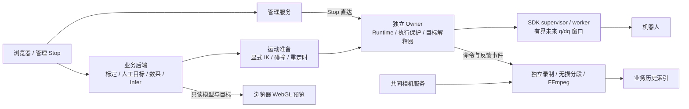
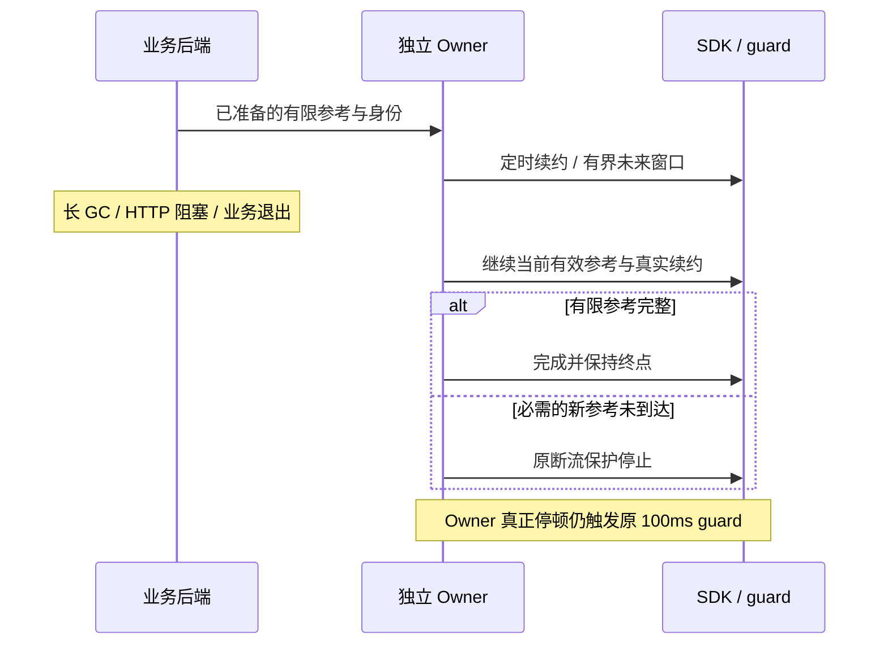
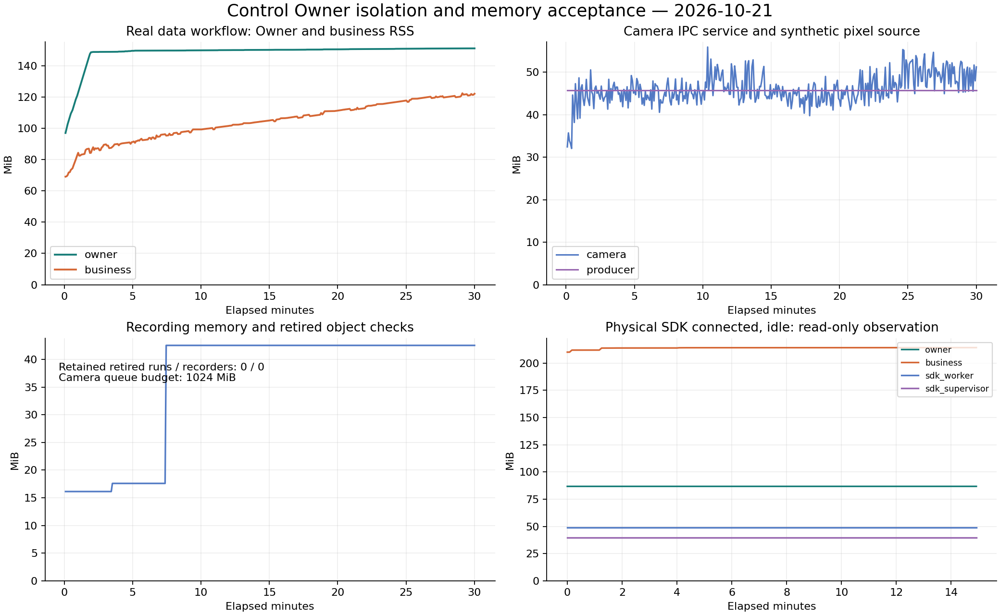

# 控制链路阶段状态（2026-10-21）

Owner：Robot Workbench 牵头任务，Session `01a13e4e-70dc-7513-9467-d34b9a7a99a3`。
本页记录已发布合同与验收边界；发布、故障恢复或验收结论变化时更新。
实际运行身份仍须读取任务本地的
`.evidence/next-optimization-20261017/continuation-state.json` 的
`current_publication` 和 `current_actual_state_evidence`，不能从分支 HEAD 推断。

## 当前交付

ARX6 真机入口为 <http://10.17.32.5:18868/>。2026-10-21 18:34 CST 阶段核验：
独立 Owner V14/env2 已发布，SDK 连接、READY、反馈健康，自动执行关闭。
本次 Git 收尾不重启、释放或重新接入设备。10月15日及更早 fake 部署记录均为历史。

本阶段包含共同目标解释器、原生 q/dq 窗口、控制故障与恢复事实分离、独立 Owner、
共同 RGB-D IPC／独立录制子进程、管理接口和浏览器 WebGL 目标预览。
标定、人工目标、回零、规则数采和 Infer 通过共享控制入口进入同一解释器；
IK、碰撞检查和路径准备由显式上层调用，显示预览只用目标与模型数据在浏览器 GPU 绘制。

## 故障语义与依赖

此前业务线程的长循环 GC 持有 GIL，Owner 续约被延迟；原 100ms guard 按真实续约缺口
保护 SDK，随后业务、控制进程与页面事实又混在一起，造成恢复和模型准备被旧状态阻塞。
连接期延后循环 GC 只消除一种阻塞来源；现在 Owner 与业务、管理分别运行，SDK 从属于
Owner 的生命周期。业务 HTTP、GC 或退出不会伪造控制续约，也不会直接销毁 Owner。

- Stop 撤销未来窗口及迟到模型输出；业务 HTTP 不可用时管理入口仍可直达 Owner。
- 控制变更应答丢失记为结果未知，用 request ID 查收据，不自动重放运动。
- 当前心跳异常在事实恢复后消失；历史中断警告独立保留至人工知晓，不能把历史锁存解释为当前断流。
- 单点准备将 NumPy 标量归一为内建 float；输入类型错误指出字段与类型，不能冒充硬件反馈异常。
- 固定参考完成时核验既有窗口覆盖终点，不再在片段结束后补发多余命令；录制时间边界未放宽。
- 标定终态不因遗留 active 标志报告忙碌；真实 busy 仍阻止维护。
- 关节静止窗口跨度为 0.3°／0.3秒，夹爪为 2mm。静止跨度和 ≤0.2°精度验收是不同指标；
  最近回零左 J3 约 0.295°残差，不能宣称所有关节精度目标已通过。
- 维护先正常执行链低速回零，再正常释放与重接；不得从旧 PID、候选目录或历史动作权限推断当前状态。

## 验收与适用范围

可移植统计见 [验收摘要](acceptance/owner-isolation-20261021.json)，
实测曲线见下图。原始完整收据保存在本任务 `.evidence/gc-owner-isolation-20261021/`，
该目录不进入 Git，以下数据不是通过提交源码重新产生的实机资格。

30分钟长测在V13启动，相关控制／相机IPC／录制／FFmpeg的9个核心文件与V14逐一SHA相同；
505个Python文件中仅标定终态busy逻辑及其测试不同。长测只复用到这些相同路径，
V14另完成三轮真实codec冒烟；对应来源核对收据的SHA保存在摘要中。

| 验收 | 结果与边界 |
| --- | --- |
| 发布前 Linux CPU | V14 516 项／33组通过；真实业务长GC、HTTP、退出，Stop、迟到结果、未知应答及参考断流均覆盖 |
| 真实控制停顿 | Linux CPU Owner SIGSTOP 配生产 FeedbackLatch，100ms保护仍触发；没有在真机注入停顿 |
| 真实部署生命周期 | 正常重载业务一次，Owner、runtime nonce、SDK attempt及SDK两进程不变；相机与热模型保留 |
| 完整数据路径长测 | 1800.495秒、377轮、1131个真实视频；真实RGB-D IPC、640×480三相机、无损存储与FFmpeg，机器人、模型和像素来源为CPU替身 |
| 人为业务阻塞 | 126次GC约354–362ms，126次HTTP约501ms；注入后Owner心跳最大龄10.43ms，录制反馈最大间隔16.615ms |
| 对象与队列 | 退役run／recorder弱引用留存0；共享队列峰值42.53MiB，上限1GiB |
| CPU Owner 内存 | 预热后约151MiB，末125轮跨度640KiB，中位数增量616KiB |
| 真机连接空闲观察 | 900.133秒／180样本，Owner增16KiB、SDK两个进程无增长；不代表实际模型持续闭环 |
| 浏览器FK | 4组原生URDF对照、92个link变换；fixture只含运动学元数据，无mesh或权重 |

**全服务长期常量内存尚未通过。** `InferenceWorkflow.catalog` 与 `media_files` 保留全量历史；
本轮1131项索引JSON约6.22MB，业务末125轮RSS中位数仍增加10044KiB。
虽在本轮工作负载预算内，仍随历史规模增长；未将全部RSS逐字节归因为该索引。

首次发布因工具漏继承 SDK 的 PYTHONPATH／动态库路径被来源校验拒绝，已恢复：
保留来源 guard、确认失败进程退出、继承完整启动环境并在接入前校验路径／SHA。
该事件是已恢复的发布工具环境缺陷，不是当前心跳故障。

## 复现检查与后续

CPU检查：安装 `requirements.txt` 后运行 `sh scripts/check.sh`。
脚本包括 Owner、SDK子进程、目标解释器、内存与界面回归；Linux专属进程检查在其他系统明确跳过。
原生资产／检测环境未配置的检查会明确跳过，不以通过计；不会为收尾启动GPU、SDK或机器人。

本次提交按实际 V14 内容保留维护几何的历史限定误差合同；只适用于原封存输入，
不作为通用放宽规则。该处两份本地未发布改动与历史生成的 `migration/validation-summary.json`
留在工作树，不混入本次实际基线；后者不能作为当前 V14 验收真源。

剩余工作由牵头任务继续，按优先级：

1. 给历史索引增加分页／按需加载或常驻上限，保留完整落盘结果与历史访问兼容。
2. 索引边界补齐后，做更长的真实模型在线业务内存验证；目前不宣称全天真机闭环有界。
3. 后续精度阶段收敛左J3等残差并按 ≤0.2°重新验收；J6保持微动与完成／保持质量状态语义按用户要求低优先级。
