# 2026-10-24 控制研究恢复与延迟取证

## 最新实测结论：J3角度周期明确，单变量补偿未通过平滑验收

本任务 Session `01a16327-7545-7332-a361-0123ddad811d` 完成下面计划的 A→B→B→A
四次1×实测，每次均到起点、53秒完整片段、回零并恢复原配置；未新增生产代码发布。
两候选各3,050个CPU窗口通过，同一反馈回放的非J3补偿输出完全相同，q/dq及增益不变，
连续性、原幅值/斜率和撤销检查通过。加入项峰值0.06 SDK单位；因残差积分/限幅耦合，
CPU中两组**最终J3总输出差**可达0.07008，不能把0.06误说成最终差的硬上界。

### 四次实测及决定

|配置|J3误差0.5–12Hz RMS °|外壳上下RMS px（修正后）|递送终点最后1秒最大FK误差 mm（左/右）|
|---|---:|---:|---:|
|A1 冻结基线+残差积分|0.04583|0.31917|0.141 / 0.126|
|B1 仅增加J3周期项|0.04112|0.28298|0.304 / 0.126|
|B2 同配置重复|0.04322|0.31307|0.261 / 0.126|
|A2 反序基线重复|0.04639|0.30999|0.310 / 0.126|

预先固定的0.71833°周期误差幅度，两对分别减少5.84%/6.86%；外壳整体RMS则减少
11.34%/增加0.99%，收益不稳定，仍有可见起伏。候选**不晋级、不开展四档推广验收**。
这支持J3位置周期项有可干预分量，但不证明全部抖动由同一项造成，更不等于物理根因
已查清。尚需区分位置相关扰动、闭环响应和其他关节耦合；不能用直接位置误差模板
冒充已辨识的扰动力矩。离线简化动力学拟合虽有部分解释度，但无约束拟合出现负阻尼、
约束拟合贴阻尼下边界，存在漏项/可辨识性问题，**没有用于控制或解释为电机参数故障**。

两对实际总补偿差/误差差的整体响应相位估计约−47.6°/−43.5°，但分角度区间后差异
很大，不足以把一个固定相位提前量用于全段。该估计含残差积分响应，不能当独立受迫
辨识。后续应以独立、有界小幅输入验证J3动态响应/相位，才能区分外部扰动与闭环反应；
该新辨识输入尚未准备或执行。见`paired-response-estimate.json`。

四次动作提取20,841条运动反馈，最大样本间隔14.23ms，速度峰值0.374rad/s；所留事件
没有控制故障/Owner慢周期。该范围不代表全天或全部故障稳定性。递送终点均<1mm，
但A1/B1回零后的左TCP均2.0399mm、左J3约0.25135°，原积分边界饱和遗留仍在；
不能声称所有静态端点通过。当前相位补偿仅43–52秒，对零位残差没有修复。

### 视频对齐错误的修正与证据

首轮相机指标的分析器使用OpenCV `CAP_PROP_POS_FRAMES` 随机定位；可变帧率下该
定位不保证实际帧号。逐像素匹配证明A2请求第1643帧，旧实现实际取到第1616帧，早了
27帧/1.10026秒；wire-one同项检查偏移0。问题在离线取帧，不是机器人时间戳或原录像。
三个相关分析脚本均已改为从头逐帧解码，按原始frame index取样；七段既有记录和四段
新记录已重算组件指标。四段新录像每一帧PTS均与原manifest扣除固定容器起点后的PTS
相符（最大残差<0.002ms），帧数一致。旧结果保存在`pre-frame-seek-fix/`，此前关于
外壳周期分量单次减少46%、第二次整体增加5%的表述撤销，以上表和新JSON为准。
J3角度周期、关节误差、CAN和停止结果不依赖视频随机取帧，因此不受该修正影响。

A2录像到起点阶段最大采样间隔0.433秒，递送分析段最大0.06685秒；不以这段录像证明
到起点全过程的视觉连续性。所有原视频保留真实时序，未补帧或改播放速度。两段递送
短视频按实际帧索引裁出，保留VFR，见`comparison-clips.json`；不作训练数据。

### 当前状态和下一步

最新只读状态为READY、连接、反馈健康且静止、research持权，无动作/录制，原增益和
积分已恢复，设置revision19、epoch3，原nonce不变。没有默认启用周期补偿。当前发布
和状态收据在 `.evidence/j23-cause-20261024-v1/delivery-publication.json`、
`final-state.json`；主要索引`round-summary.json`，continuation已更新。
真实停止/恢复已按下文范围通过；初验脚本误要求运动增益未保留为硬件故障，未重放动作。

剩余顺序：先核验J3位置周期扰动的响应/相位及J2耦合，形成可复现的改善；单独处理
零位J3静态残差；两项通过后再验四档递送、停位和回零。维护租约、前馈制品构建绑定、
完整业务长期内存验证继续保留，未冒充完成。不commit/push，不释放生产服务或资源。

## 2026-10-24 J2/J3 对齐及单变量试验计划（已执行，结果见上）

本任务继续负责；证据 `.evidence/j23-cause-20261024-v1/`。实际操作/资格变化时更新。
用户已明确授权继续停止恢复、单变量及四档验收，不新增现场确认。KP/KD、原 q/dq、
0.8 rad/s、100 ms和总补偿幅值/斜率保护保持。未获接受的配置不晋级常规控制。

已按“首点已到且已被SDK接收的最新窗口”重建积分，保留旧窗口待执行前缀，避免重复
时间点取首值的错误。J2/J3 CAN接收速度与位置误差导数在0.5–8Hz的相关为0.906/0.975；
P主要随位置误差响应，D反向阻尼。积分项与残差速度同向，其观测功率代理约为D反向项
的4.9%/9.1%，用位置导数估计为6.0%/11.4%。这是未校准的wire字段比，不是Nm，且
闭环观察不能把同向相关当成初始激发源。去积分后的输出（重力+编码残差）频带波动小。

更强线索：七段递送记录按J3角度排列，独立拟合周期为0.714–0.726°。0.5×拟合周期
0.71833°，固定频率在各记录中解释约29%–53%的该关节去慢趋势误差方差；相位随速度
变化。wire-one位置命令编码残差在此频率上的幅度0.000166°，反馈误差对应幅度0.03758°。
因此优先假设为位置相关扰动，而非目标本身同幅起伏；尚不能区分电磁/传动/编码器因素。
见 `j23-alignment.json/png` 和 `j3-position-period.json/png`。

真实故障停止在本SDK上已执行一次：正常原轨迹前段运行，未来3秒处人为速度不连续被
原加速度门提前拒绝；CPU事先验证约2.88秒拒绝。未来队列清空，SDK身份不变，反馈健康，
输出速度零；停止切入既有低刚度位置保持，最大观测位置变化0.00038147rad（约0.02186°）。
显式恢复epoch2→3，观察2秒无旧动作续跑，再以新计划回零。不是超速/心跳丢失故障注入。
初版验收脚本误要求停止保留运动增益，在真实停止后断言失败；按现有已批准停止增益
核验并继续同一次恢复，未重跑故障。原失败与补完收据均保留。

下一对照只改变J3周期反向项，采用同一1×53秒参考，两组均使用从wire-one实际已接收
窗口提取的冻结总补偿基线+原残差积分。这个配对使非J3配置一致；不把直接积分基线和
冻结基线的不同当周期项效果。第二组在参考43–52秒平滑进出，仅加J3正弦反向项，SDK
幅值上限0.06；按实际EC发送 `/1.4` 反换算，明确乘1.4，不重复此前单位错误。不声称
这是物理扰动力矩的固定百分比。总输出仍经原限幅/斜率限制，52秒后两制品相同。

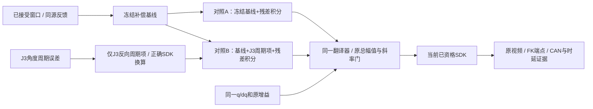

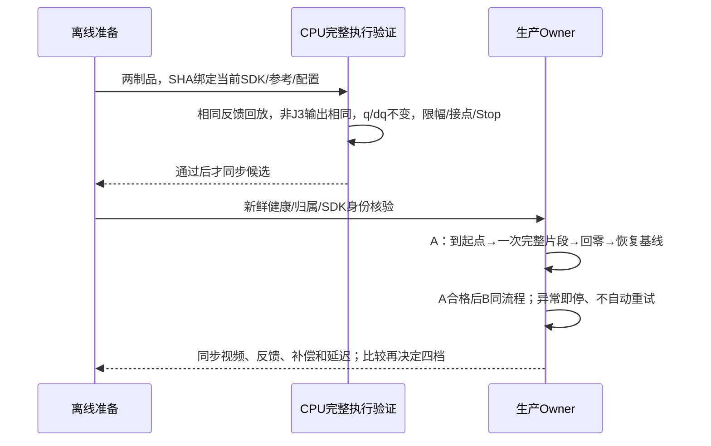

## 2026-10-24 最新：可见摆动未解决，离线定位收敛到左 J3/J2

维护人：本任务 Session `01a16327-7545-7332-a361-0123ddad811d`。本节覆盖下文旧候选和
阶段状态；下一次实际发布、试验或归因证据变化时更新。本轮不 commit/push。

用户观察为四档递送时相机外壳上下抖动。先做增益对照、后补组件运动定位的顺序不够好；
目前暂停追加参数试验/真机循环，先分析已有视频及同步反馈。可见平滑度仍不通过，不能
用轨迹 jerk、到位精度或延迟检查通过替代。没有已接受的新平滑配置。

### 组件运动证据

对已有四档及三个对照录像的等效参考 43–52 秒进行逐帧光流跟踪，以每路源相机
`host_receive_ns` 对齐反馈，不拟合时间平移。剔除同源重复帧后重采样，去除 1.5 参考秒
三阶慢趋势；统计只取 44–51 秒，避免滤波端点。初/末特征归属已查看；夹爪自身视角只
取初帧两枚最强尖端角点，避免把背景布料混入相对运动。脚本含已知平移的合成检查。

|原倍率|外壳与夹爪上下运动相关 r|外壳与左 J3 误差相关绝对值|
|---|---:|---:|
|0.5×|0.965|0.824|
|1×|0.972|0.712|
|1.5×|0.963|0.637|
|2×|0.957|0.600|

四档左 J3 都是六个关节中相关最强者。相机与夹爪主要共同上下摆；同一头部画面内静止
背景 RMS 约 0.002–0.006 px。左腕相机自身画面里的两夹爪尖端去趋势 RMS 约
0.014–0.048 px，未显示相机独立大幅摆动，但压缩、光流噪声及小幅安装相对运动仍不能
排除。不同视角像素不直接比较物理幅度，也不能换算为毫米。

修复速度编码后的 `wire-one`，外壳/夹爪 r=0.967；J3/J2 与外壳的有符号相关分别
−0.714/+0.556。仅在 `codec-half` 上拟合 J2/J3 误差到外壳像素的线性关系，不调整时间，
移用至其他原四档时方差拟合分数约 0.48–0.79；这是独立片段的关联检验，不是物理贡献
比例或因果证明。优先对象现收敛为 J3/J2 实际响应，而非仅因相机安装在腕部就归因 J6。

主要证据：`.evidence/visible-smoothness-20261024/component-motion-summary.json`、
`*-components.json/npz/png`、`track_components.py`、`summarize_components.py`。
视频约 25 FPS、相机约 30 FPS且非硬同步；源时间对齐不能消除未知曝光/传输时延。
本分析不覆盖起动、停位、回零的完整平滑验收。首轮宽尖端 ROI 含背景点，已收窄并重算，
最终数字以上述文件为准。参考路径随姿态变化、观测相关性均不足以确认摩擦、传动周期
扰动或闭环耦合的唯一根因。

### 速度契约修复实际结果及被拒候选

DM 速度映射已发布并接入，114 项 Linux 检查通过。原生 SDK 模块 SHA256
`c249a08c144198f2c0a1abe62d14f04ce443b55522f2213d050267c42f3d0d3c`，六个实读 DM
关节启用 1.5 编码比；默认仍为 1。实机左 J4/J5/J6 速度对位置导数回归从
1.477/1.430/1.499 改为 0.978/0.926/0.977；右臂由寄存器及共享代码覆盖，未做右臂动态
验收。0.8 rad/s 仍开启且现在使用修正后的物理速度，旧 DM 数值实际上更保守，不声称
新旧数值触发行为相同。该模块尚未单独补做真实 Stop/恢复验收。

|对照|竖直 FK 误差频带 RMS mm|外壳原跟踪指标 RMS px|结论|
|---|---:|---:|---|
|原 1×|0.341|0.339|可见抖动基线|
|左 KP 减半 1×|0.724|0.473|变差，拒绝|
|原 0.5×|0.323|0.288|对照基线|
|速度编码修正 0.5×|0.322|0.292|单位修复通过，抖动未实质改善|
|修正编码、左 KD×0.8，0.5×|0.345|0.356|变差，恢复原增益|

此表沿用原 `track_scene.py` ROI/统计，不能和新组件跟踪的不同 ROI 数值直接混用。
各试验均已执行结束、回零并恢复基线；没有正在等待完成的 KD 试验。

**下文三个临时重复前馈候选的方法资格已撤销。** `repeat-bias/full/band` 错把 PD 残差
直接加到 SDK bias，漏掉已记录的发送单位换算，因此“50%/100%补偿”解释无效；不再用
其结果支持物理因果结论。原始数据保留、资格添加拒绝标记、runner 拒绝重用，生成器已
退役。原幅度/斜率保护未取消，这些候选未成为默认配置。见
`feedforward-method-rejection.json`；以后还需把编码/构建身份纳入前馈制品资格。

### 实际 CAN 与当前状态

`wire-one` 被动观察保存 1,563,648 帧、观察 socket 丢包 0。任务 53 秒段每关节发送
回显中位间隔约 2.052 ms，左臂最大 4.32–6.16 ms，无 >10 ms 发送间隔；本段摆动期间
没有对应长下发断档。回显不是电机逐条执行确认，不排除更短调度变化或其他时段故障。
位置量化步长约 0.02186°；量化误差可能被动态放大，不能仅凭其数值较小排除。
实际 EC 编码 KD 上限为 5；J2/J3 已到该值，直接配置更大数字会截断，不能作为有效对照。

最新只读快照 `component-analysis-current-state.json`：SDK连接、READY、research持权、
反馈健康且静止、双臂位置保持、无动作/录制，nonce
`135955359136c8194cd3887f279dae58b99c2c23e6fd16b4`；左 KP
`[240,210,210,90,90,60]`，KD `[4.24264,5,5,2.12132,2.12132,1.48492]`，右侧原值，
积分启用、设置 revision 19。回零完成沿用原门槛；左 J3 零位残差约 0.251°、左 TCP
约 2 mm 是既存遗留，不能被递送终点 <1 mm 掩盖。服务、保持、资源保留。

下一步按优先级：

1. 由本任务针对 J2/J3 对齐真实 q/dq、反馈、积分及原生输出，区分扰动激发与闭环响应；
   正确重建最后被接受窗口的补偿，不复用“重复时间取第一个值”的历史近似。
2. 有明确假设后只做对应的单变量平滑对照，保留 0.8 保护与静态端点 ≤1 mm；再验四档、
   停位和回零。当前没有待用户决策或现场确认。
3. 补速度修正模块的真实 Stop/显式恢复资格；修复维护窗口 release 后残留租约，以及
   前馈制品编码/构建绑定。维护租约问题只恢复过绑定，尚未修代码。
4. 长期内存完整业务验收和旧零位精度独立保留；历史 35 ms 根因仍未证明，继续留存延迟证据。

## 最新验收口径：可见抖动优先，静态末端 ≤1 mm

用户在四档视频后明确：精度符合预期，静止末端到位 ≤1 mm 足够；各倍率向前递送时
相机外壳仍明显上下抖动，平滑度不通过。此口径优先于下文历史的全路径 ≤1 mm 门槛。
运动、减速、终点保持、回零均检查；动态路径误差继续记录，但不据此拒绝更平滑候选。
轨迹 jerk 合格、无速度故障和 3–45 Hz 误差 RMS 下降都不能代替可见平滑度验收。

本轮复用 `.evidence/control-videos-20261024/` 四视频原始记录，不重复基线动作。
新分析位于 `.evidence/visible-smoothness-20261024/`。已提取源相机时间戳、关节反馈、
原生输出、积分窗口与延迟日志。递送段 J5/J6 的误差具有跨速度的姿态相关重复，
不是已证明的机械故障；相机约 30 Hz、合成录像约 25 Hz，采样节奏单独核对。
图像像素幅度不等于外部空间毫米精度，也不自动排除底座/支架振动。

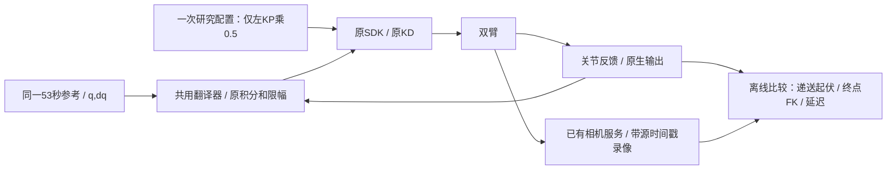

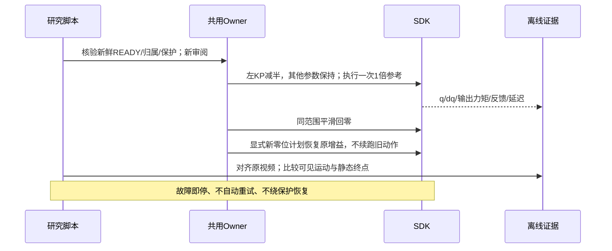

第一候选左 KP `[120,105,105,45,45,30]`，KD、右臂、积分、参考及原保护不变。
它是低刚度假设的单变量实验，尚未证明有益；不会直接改默认控制配置。
依次核验真实应用增益、递送相机外壳起伏、全段关节反馈与终点至少1秒的 FK，
无明确收益则恢复基线并保留失败结论。已有净空、研究动作及回零维护授权持续有效。

第一轮 `kp-half-one` 已执行、回零并恢复原增益，无故障。1倍递送段 0.5–12 Hz
竖直 FK 误差 RMS 0.341→0.724 mm，相机外壳竖直像素 RMS 0.339→0.473；
终点最后1秒左最大0.391 mm。低刚度候选拒绝，不宣称静态精度通过就代表平滑。
左J2/J3误差RMS分别约变成1.82/1.91倍，KP恰减半，支持存在需控制抵消的扰动，
不支持“高KP是本次摆动唯一原因”；仍不构成电机/减速器物理根因证明。

第二候选复用原有总补偿前馈入口：从原1倍记录提取有界积分基线，离线计算
`-0.5*(KP*平滑位置误差 + KD*平滑误差导数)`，仅在递送41–53秒平滑进出。
误差先作60 ms Gaussian平滑，避免对量化速度直接差分；原位置、速度、增益及
残差积分均不变。它是在同一确定轨迹上预先抵消部分重复扰动的实验，不在线学习，
不改SDK。总补偿仍受原幅度/斜率上限限制，不能用前馈叠加绕开限幅。

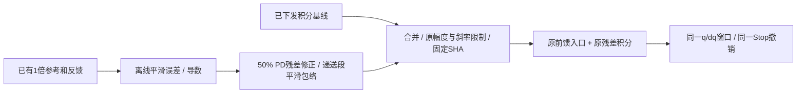

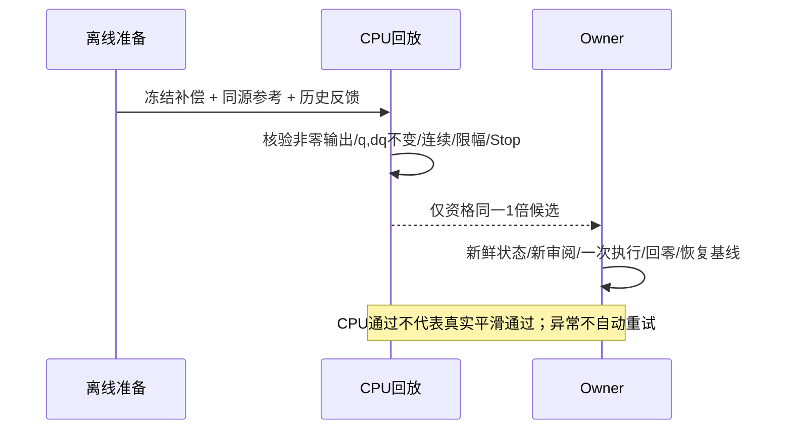

### 新发现：先核验DM速度映射契约

1倍记录的位置变化与速度读回回归：左J1–J3比例约0.97/1.00/0.99，
J4–J6约1.50/1.45/1.45；后者分组差异不能当噪声忽略。实际加载SDK源目录
`latency-root-cause-20261023-v1/native-build-v2/source/include/hardware/arx_can.h`
声明DM速度范围±45 rad/s，底层为未修改的供应商`libhardware.so`。尚未读取电机VMAX，
故此时只是量程不一致假设，不把默认型号参数当本机实测。

按[厂家说明书的寄存器协议](https://doc.switch-science.com/media/files/5e033168-99f1-4d2d-b758-e03192a1f071.pdf)
与[厂家例程读参数函数](https://github.com/dmBots/motor-control-routine/blob/master/orin%E8%BD%BD%E6%9D%BFcan%E6%8E%A7%E5%88%B6%E8%BE%BE%E5%A6%99%E7%94%B5%E6%9C%BA%E4%BE%8B%E7%A8%8B/dm_hw/src/hardware_interface/damiao.cpp)，
只发送0x7FF、操作码0x33，读取PMAX/VMAX/TMAX（21/22/23）；不使用写入、存储、
使能、设置零点或运动操作。寄存器回复与常规状态共用ID，所以不能在SDK接收期间查询。

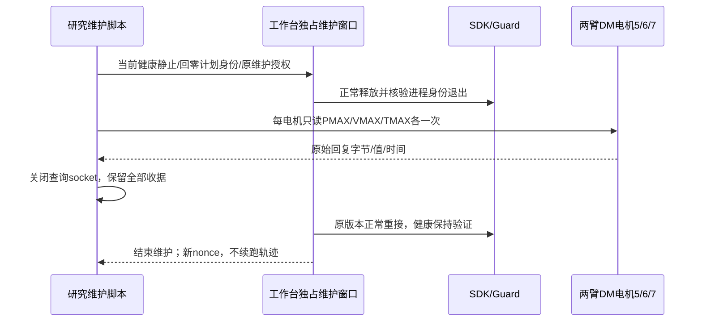

读取前不新增轨迹试验；现有保护、增益和总补偿上限保留。回零沿原到位/静止门验证，
它不是零位≤1mm的新资格：本轮发现旧基线左J3零位残差约0.25°、FK约2mm，
补偿已到−1.5边界；递送终点小于1mm与回零精度必须分开记录。

实读已完成：六个DM关节电机均PMAX=12.5、VMAX=30、TMAX=10；18次请求各有一条
匹配回复，无写参/使能/运动。实际vendor库纯CPU解码与发送函数反汇编确认速度范围±45，
不是只依赖头文件。位置映射一致；速度读回扩大1.5倍、速度前馈编码后被电机解释为约2/3，
属于确定的接口量程错误。对当前可见抖动的贡献仍须修复后同轨迹对照，不能宣称唯一根因。
力矩还经过SDK的0.424系数，物理单位契约需另查，不自动按18/10更改。

查询后同一维护窗口内重接触发旧Owner维护租约残留：原SDK已正常释放，新SDK健康保持，
业务绑定被拒。已结束业务维护、通过正式运维入口仅重载业务后端并恢复绑定；新SDK未再
重接。此生命周期缺陷另记，不能隐去首次拒绝。读回/释放/重载收据在新证据目录的`dm-ranges/`。

速度修复候选：`RobotConfig`增加默认1的DM关节速度编码比，只有带六电机实读收据的
本机部署启用45/30。公共SDK适配器在构造controller前赋值；关节发送乘该比、反馈除该比。
EC关节、夹爪、位置、力矩、增益及准备层q/dq均不改变。0.8 rad/s保护继续对真实物理速度
执行；旧速度数值与新物理速度不能直接混作一组统计。查询收据、源码、模块SHA一并绑定。

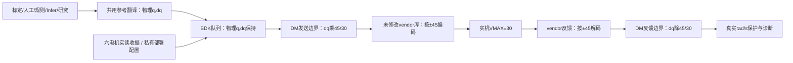

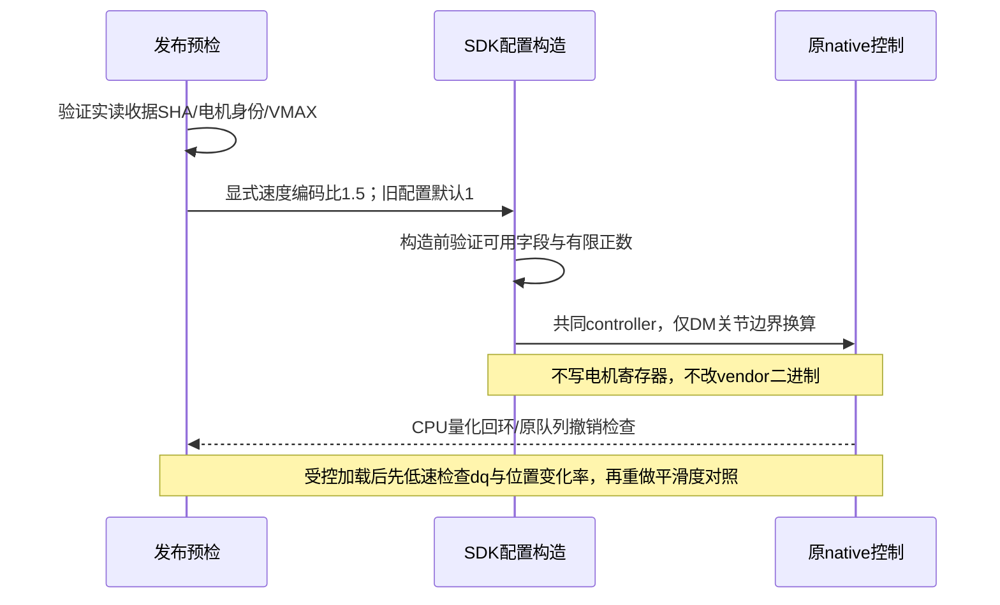

下文为本轮此前阶段记录。

Owner：Session `01a16327-7545-7332-a361-0123ddad811d`。维护触发：研究口径、实际发布、
对照结果或延迟异常变化。本轮为阶段研究，不是全速度精度通过或全天稳定性结论。

用户恢复平滑度与精度研究，要求在优化中留存足够的延迟分析信息；若今日后续不再出现
延迟问题，按用户口径阶段性接受；若复发，使用现场证据定位。不将这一规则写成已经找到
历史 35 ms 根因。起点仍是原安全前 50 秒，0.5/1/1.5/2 倍速度，空间路径 FK 允许时间
滞后，≤1 mm 目标不变。无录像、相机采集或模型调用。

## 已发布的组件与信息流

实际源码：`/home/wujie/work/feiyu.zhou/robot-workbench-smoothness-resume-20261024-v3`。
SDK 二进制、PD 增益、0.8 rad/s 峰速保护及 100 ms 心跳/反馈保护未改。实际发布、重接和
最终状态入口是 `.evidence/smoothness-resume-20261024-v3/delivery-publication.json`。

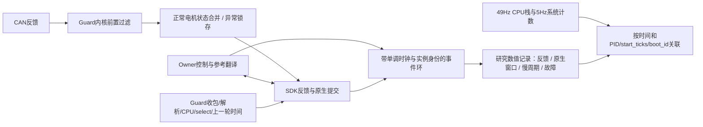

所有反馈保留 Guard 往返、CAN 批次与分段、CPU/上下文切换/缺页、select 前后及上一轮
时间；非 IPC 就绪批次保留轻量 wall 分段，慢批总 CPU 仍保留。>=5 ms 慢批先留在 Guard
内存，下一次心跳携带新记录，Guard 退出也持久化。研究记录补存此前遗漏的
`owner_loop_trace`。热控制路径不新增文件写入，CPU 栈和系统计数由独立有界观察进程写盘。

本轮五段轨迹 31,588 条反馈均有 Guard 分段和循环上下文，未丢失 Owner 事件。
CPU 栈是采样，不保证每个短事件都有栈；精确分段时间与采样互补。记录基于用户态观测和
关节反馈，不替代外部空间计量，也不保证对历史缺失的现场作唯一还原。

## 前馈/积分耦合修复与资格

准备平滑补偿对照时，发现三处原实现耦合：研究入口禁止前馈开/积分关，Owner 创建前馈
强依赖左积分器，翻译层只在积分循环中执行前馈。现已让研究前馈与可选积分分别进入
原总幅值/变化率限制。前馈仍只允许精确绑定参考、速度、增益、积分设置及原生接口的制品，
不能用旧接口产物冒充新资格；正常配置行为不变。

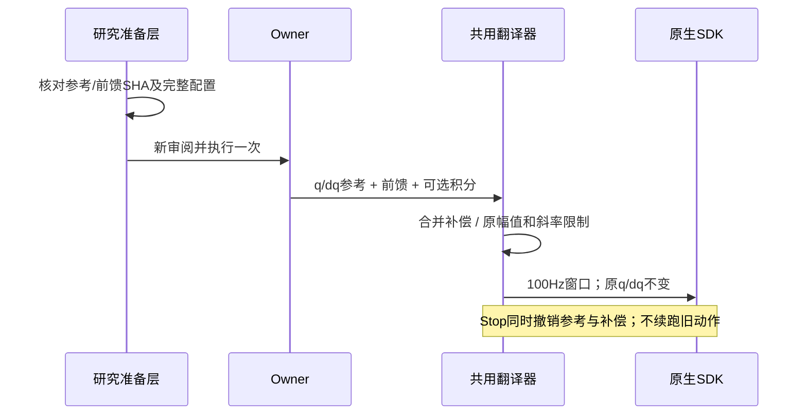

最初只检查到翻译器，漏掉完整入口，是本轮实现疏漏；无积分前馈两次在实际运动前
被准备门拒绝。最初 CPU 检查只验证连续性，零补偿也能通过，资格已明确撤销并保存
`frozen-feedforward-zero-output-invalid.json`；新增非零输出断言及完整
准备→执行→补偿输出→Stop 回归后才进行实测。不能把早期“检查通过”当最终资格。

取证版 79 项 Linux 检查通过；最终入口修复 86 项 Linux 检查通过，两组有重叠，不相加。
补偿候选另外经过 5,500 个 CPU 原生适配窗口：实际补偿非零，q/dq/补偿在窗口接点连续，
原幅值和斜率边界通过，Stop 撤销后不能续跑。每次 SDK 维护均先完成新鲜回零，再正常
释放/重接，保存旧进程退出和新实例反馈；没有使用非零强制释放。

## 本轮实测

|配置|左 TCP 最大空间偏离 mm|右 TCP 最大空间偏离 mm|端点最大 mm|
|---|---:|---:|---:|
|0.5× 原已资格前馈＋积分|1.460|0.143|0.222|
|1× 积分基线，无外加前馈|1.667|0.151|0.183|
|1.5× 积分基线，无外加前馈|1.816|0.220|0.279|
|2× 积分基线，无外加前馈|2.030|0.220|0.279|
|0.5× 冻结平滑总补偿，无残差积分|1.402|0.293|0.295|

高档位原旧前馈绑定 `legacy_recompute` 接口，准备时被拒绝；未改其身份或强行执行，
故高档位使用当前接口的无外加前馈基线。表中 0.5× 与高档位配置不同，不能把全部差异
归于速度。2× 实际速度峰值 0.637 rad/s，未触发 0.8 保护。

最后一项来自本轮 0.5× 已下发总补偿曲线，离线 Gaussian 150 ms 平滑、原限幅/斜率
投影后冻结；只对同一参考和配置适用。左臂六关节 3–45 Hz 综合 RMS 从
0.016199°→0.015225°，单次下降约 6.0%，各关节约下降 1.6%–17.2%；左 J3 约下降 9.0%。
但左空间峰值仍 >1 mm，右侧与端点误差有所增加，因此不晋级默认配置。这个频带不能
排除低频摆动，也不能凭单次 6% 变化宣称稳定收益。两轮左臂末端保持位置跨度最大均约
0.02186°；保持时长约一秒，不代表长时间持位资格。

0.5× 原基线的最大偏差在约 38.705 秒，左 J3 相对同时间参考误差约 +0.144°；局部
Jacobian 去除路径切向后，其贡献约 1.155 mm。贡献可相互抵消、且使用同时间参考，
只能用于定位研究对象，不能据此认定摩擦、刚度或重力模型的唯一根因。

五段轨迹：Guard 往返最大 1.949 ms、CAN 批次最大 0.669 ms、反馈 RPC 最大 3.282 ms、
参考翻译至提交最大 5.870 ms；无控制故障、无 >25 ms Owner 慢周期事件、无保留的
>=5 ms CAN 慢批。这个有界观察不覆盖今日剩余时间，全天阶段接受仍待后续记录。

## 状态、证据与剩余工作

最终已恢复原积分开关，设置 revision 19，并完成回零 `3c073cf0e1f3b2c5e0fff908`；
SDK 保持连接，research 持权，READY、健康静止、无自动动作。nonce
`73860c581eb64a7cefb1f2b30ec54ba879d885a09b6604ed`；身份后续须按实际收据重新核验。
服务、相机与热模型保持；不 commit/push，不自动释放资源。五条轨迹的结论已通过工作台
版本检查的 notes API 保存到控制研究结果中。

证据根：`.evidence/smoothness-resume-20261024-v1/`，主要为 `round-summary.json`、
`four-speed-baseline.json`、各 `*-analysis.json`、`*-trace.npz`、
`frozen-feedforward-qualification.json`、`study-notes-verified.json`。实际发布/身份在 v3
目录。原始数值事件继续在 ARX 研究结果目录；CPU 栈在各 v1/v2/v3 远端
`latency-capture/`，均可解码并校验 SHA。

首个附加采样器的 sudo 包装进程等待关闭超时，原始数据随后确认完整可读，17,355 个
CPU 样本约 10 MB；原错误保留。后续按精确 perf 身份正常终止采样，未向控制进程发送
信号。三个附加采样器已退出；生产 SDK 不清退。

剩余待办按优先级：

1. 对同配置作重复对照，区分补偿曲线平滑收益与单次波动，再决定是否采用。
2. 针对左 J3 减速段的路径法向残差优化，同时保持运动和停位平滑；≤1 mm 仍未通过。
3. 后续研究继续留存延迟证据；日终按用户规则核对是否新增故障。历史 35 ms 原因仍未确认。
4. 完整业务长期内存验证仍是独立遗留，不被本轮数值研究替代。
