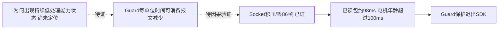
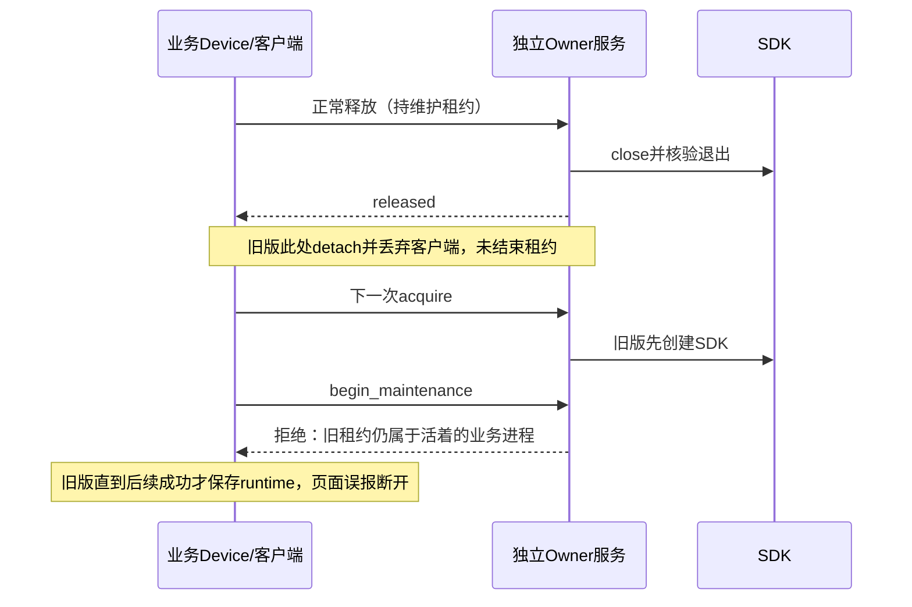
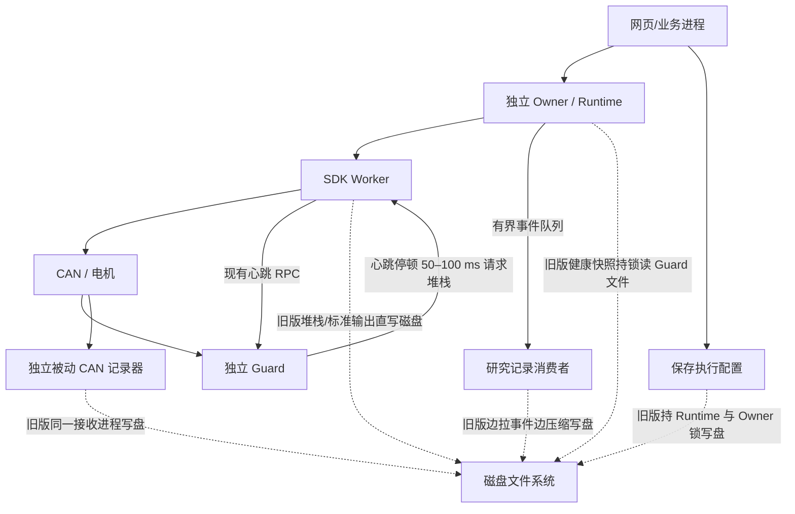
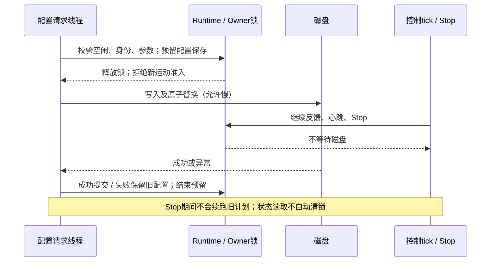
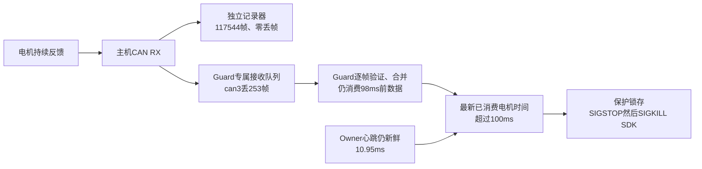
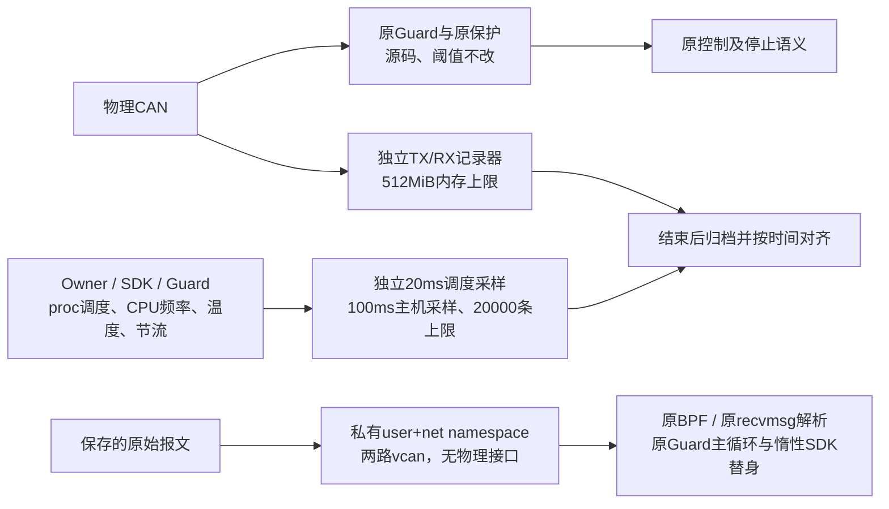

# 控制与取证链路：存储阻塞审计和 23:13 CAN 故障

日期：2026-10-24（Asia/Shanghai）。负责人：工作台牵头 session
`01a16327-7545-7332-a361-0123ddad811d`。本文件负责本轮问题清单、因果边界和修复验收；
整体运行状态仍以 `control-runtime-status.md` 与 continuation 指向的实际收据为准。
新部署、实机恢复、故障复现或验收结果变化时更新，不把候选通过表述为线上通过。
本轮代码检查的结论适用于下文列明的部署来源和候选hash；后续源码变化须重核受影响路径。

## 2026-10-25：10轮控制录像＋300秒匹配静止对照，完整取证，未复现；根因仍未闭环

本session负责，下一次故障/受控验证/根因修复时更新。本节为本文件最新阶段，覆盖下方历史状态。
用户在17:52故障后要求准备数据保存并连续跑10次1×/1.5×控制及录制，以复现定位。
按已告知的总计10轮、两档交替各5轮执行；全部完成到起点→固定片段→同倍率平滑回零和三相机录像。
随后补150秒无录像静止准备、150秒带录像静止，对齐旧故障的无任务工况，也未复现。
两批结束均正常回零释放，当前SDK断开。没有把“未复现”标为Guard根因修复或实机Stop/恢复资格。

### 本轮控制与留存范围

沿用`robot-workbench-j3-kp-ceiling400-20261025-v1`，Owner/Guard/SDK代码与保护未改；
SDK二进制SHA256仍`c249a08c144198f2c0a1abe62d14f04ce443b55522f2213d050267c42f3d0d3c`。
左J3固定330/5，原前馈与源进度积分暂停，其他轴原配置、右夹爪禁用、0.8rad/s保护。
本轮没有加入任务空间协同探针；1.5×使用数值与既有参考相同的base制品。
独立CAN确认10轮J3 KP约329.915、KD5，配置确实生效。最大反馈速度0.479120rad/s，
研究段反馈最大间隔14.485ms，无控制fault事件。参考保持既有20rad/s³命令jerk边界；
不声称原生分别线性插值q/dq或物理机械运动处处具有连续有限jerk。

|项目|10轮动作＋录像|匹配静止300秒＋正常收尾|
|---|---:|---:|
|独立CAN帧数|13,458,856|3,845,732|
|独立记录器socket丢帧|0|0|
|Guard socket丢帧|0|0|
|Guard最大已读帧年龄|3.665ms|4.746ms|
|观测区间电机最大RX间隔|16.357ms|15.631ms|
|Guard单核CPU占用中位数|21.8%|19.4%无录像／20.3%有录像|
|Guard运行核心采样频率中位数|4.3GHz|4.3GHz／4.3GHz|
|终态|正常释放DISCONNECTED|正常释放DISCONNECTED|

10轮独立记录持续约1098.84秒（含退出后归档耗时），调度采样50,887条，无截断。
记录器在SDK接入前启动，跨准备/动作/回零/轮间等待，SDK退出确认后再停止接收、归档。
原始CAN固定4GiB memfd上限，调度10万条上限；接收时不依赖磁盘状态文件。
逐轮numeric events先在内存保存、SDK退出后写盘；视频单独CPU编码并保留帧源时间/身份。
CPU政策补充1Hz采样在第3轮开始，共780条，非初始接入覆盖；静止对照补充全连接覆盖。
频率上限、EPP performance、intel_pstate min15%/max100%均未观察到切换，无固定800MHz软件上限。
主机未提供power_supply条目，不能据空记录宣称供电稳定。未改频率策略、调度优先级或系统权限。

### 两个失败必须分开记账

1. 17:51私有验收脚本在参考准备后报`witness memory status stale`，当时SDK健康静止，
   第一条align尚未preview/confirm。直接原因是主线程准备时不消费状态，数据报队列塞满旧值，
   生产者非阻塞发送丢弃新状态，主线程返回后把旧队列误当最新状态。
   已改为独立接收线程保留最新值。Linux CPU复现：暂停消费者1.6秒，旧年龄1.570秒，
   新年龄5.4ms、零状态丢弃；真正生产者停止1.05秒仍拒绝。仅修取证工具。
2. 17:52:41旧SDK在无动作阻尼态因Guard反馈超时被保护退出，can3丢86帧、已读帧年龄约98ms，
   can3:7/8最后有效反馈年龄约100.4ms，心跳2.17ms。接收消费积压已证，不能据reason认定电机/线缆掉线。
   之前独立观察已结束，CPU留存窗口结束在故障前约37.56秒；缺少最后现场，不能排除并发上游问题。
   当时SDK/Guard已核实退出、接口仍UP/ERROR-ACTIVE，相关kernel时段无USB/CAN重置记录。
   ERROR-ACTIVE是CAN协议正常错误计数状态，不是“正在报错”的证据。

本轮新观察器smoke首次误用系统Python，退出归档时因不支持`hashlib.file_digest`失败；
SDK当时断开、无控制动作。改用正式arx_openpi解释器重做被动smoke通过，失败原件保留。
后续10轮和静止对照均使用正式解释器并核验完整归档，未以CPU修复或smoke代替控制试验。

### 根因假设与证据边界

旧失败连接留下的约23秒窗口中，Guard单核CPU中位89.5%，运行队列等待约1.56%，
采样核心频率持续约800MHz，温度46–48°C，窗口内热节流计数/累计时长未增长。
本次相同部署的Guard约19–23%单核、4.3GHz；同一参考离线验证实测2.783秒。
旧研究脚本在上述窗口几乎持续占满一核，但未单独记录decode计时，不能写成精确的相同条件微基准。

当前首要线索是低处理能力下Guard余量不足；“CPU采样频率低→处理能力下降”有关联，尚无完整因果证明，
也未找到低频状态的触发者。scaling_cur_freq采样不是APERF/MPERF独立计量，且旧CPU窗口未覆盖最终故障。
无录像静止150秒也稳定，说明不能把是否录像单独当成本次触发因素。摄像头编码有无均未改Guard代码。
现有perf_event_paranoid=4、ptrace_scope=1且无py-spy，未改权限/加载系统模块去伪造栈证据。
根因状态必须保持未闭环，不能标记CAN硬件已损坏、Guard已修好，或简单提高100ms阈值。

### 视频与证据入口

10个可播放副本均核对原片/副本帧数相等、时长差<0.1秒、完整SHA256，原片继续保留。
全部为真实时间播放，无剪切、无倍速播放；倍率是实际命令轨迹倍率。三相机预览并非硬件同步计量或训练RGB-D。

|重复组|1×|1.5×|
|---|---|---|
|1|[r01](/Users/wujie/Documents/Codex/outputs/guard-ten-runs-20261025-v1/r01-1x.mp4)|[r02](/Users/wujie/Documents/Codex/outputs/guard-ten-runs-20261025-v1/r02-1.5x.mp4)|
|2|[r03](/Users/wujie/Documents/Codex/outputs/guard-ten-runs-20261025-v1/r03-1x.mp4)|[r04](/Users/wujie/Documents/Codex/outputs/guard-ten-runs-20261025-v1/r04-1.5x.mp4)|
|3|[r05](/Users/wujie/Documents/Codex/outputs/guard-ten-runs-20261025-v1/r05-1x.mp4)|[r06](/Users/wujie/Documents/Codex/outputs/guard-ten-runs-20261025-v1/r06-1.5x.mp4)|
|4|[r07](/Users/wujie/Documents/Codex/outputs/guard-ten-runs-20261025-v1/r07-1x.mp4)|[r08](/Users/wujie/Documents/Codex/outputs/guard-ten-runs-20261025-v1/r08-1.5x.mp4)|
|5|[r09](/Users/wujie/Documents/Codex/outputs/guard-ten-runs-20261025-v1/r09-1x.mp4)|[r10](/Users/wujie/Documents/Codex/outputs/guard-ten-runs-20261025-v1/r10-1.5x.mp4)|

本地证据`.evidence/guard-ten-runs-20261025-v1/`：`contract.json`、`result.json`、`run-validation.json`、
`lifecycle-analysis.json`、`guard-timeline.npz`、`cpu-policy-record.json`、`video-delivery.json`、
`guard-capacity-comparison.png`与`final-state.json`。匹配静止在`.evidence/guard-idle-phase-20261025-v1/`。
远端同名task目录保留完整`lifecycle/frames.bin`、`candump.txt`、`scheduling.jsonl.gz`、逐轮events和原片。
原17:52故障及观察器修复在`.evidence/taskspace-live-20261025-v1/`；失败材料未覆盖/删除。

剩余优先级：受控定位持续低处理能力的触发源与Guard吞吐余量→根因修复后的真实Stop/恢复→
再恢复协同相位/1.5×对照。维护租约、前馈绑定及长期内存原待办保留；本轮无commit/push。

## 2026-10-25 00:03 续进：组合修复已上线，正常回零释放完成，实验因生命周期缺陷中止

本节覆盖下文“当前设备/未加载”的旧阶段。当前页面与独立Owner均为DISCONNECTED、
runtime_nonce=null；两次SDK/Guard及三个被动记录器均核实退出。线上源码为
`/home/wujie/work/feiyu.zhou/robot-workbench-lease-lifecycle-20261024-v2`，最终发布不自动接入。
相机、模型、预览服务保留，未commit/push。操作者仍是本文件首部的牵头session。

### 本次真实执行与限制

1. 通过已有`retire_protected`维护接口核验并退役23:13故障实例，未绕过Owner发动作。
   先发布storage-isolation-v1并核验Owner惰性，再进行一次受支持的SDK接入。
2. 独立CAN记录120秒，覆盖接入确认后99.126秒，1,288,237帧、零socket丢帧。
   13个启用电机最长反馈间隔15.522ms，无故障状态报文；SDK/Guard未再异常。
   详细状态/调度监控只有52.685秒（237/2360样本）：提前启动的记录器到120秒后归档，
   监控误把归档中的状态延迟报为过期，并按预案请求普通Stop。原失败收据保留，未重跑。
   只读检查最终归档与同一SDK连续健康事实后，形成独立reconciliation，不改写失败为成功。
3. 普通Stop回执确认旧调用结束、阻尼返回；后续反馈静止。这只覆盖静止时的普通Stop，
   不是运动中未来队列撤销/原地清锁/超速急停的完整实机资格。
4. 第一次正常回零动作完成，随后验证脚本错误读取公共review不包含的`plan_sha256`导致
   收尾报错和普通Stop。按实际latest执行记录与当前反馈复核后正常释放，最大关节误差0.295064°。
   原脚本错误与延迟释放保留，不能称这第一次已满足“刚进入门槛立即释放”；没有重放未知动作。
5. 为第四步验收发起新的正常接入，遇到旧维护租约冲突。此时SDK其实已经创建，Owner
   已Stop且反馈健康，但业务未保存其绑定，网页错误显示DISCONNECTED。没有执行验收轨迹。
6. 停止该实验，不重试SDK接入；只重启业务服务，通过已有只读attach重新绑定同一Owner，
   核验SDK/Guard PID与nonce不变。再做一次正常清理回零，最大误差0.251351°；门槛确认后
   0.156668秒提交正常释放，SDK close约2秒返回、两个进程退出。第二次回零是异常连接清理，
   不冒称本轮只有一次运动。累计两次SDK创建、两次回零、两次正常释放；周期研究0/6。
7. 修复生命周期并完成195项Linux检查后再次惰性发布v2，未再次接入或重跑失败实验。

两次SDK实例的Guard记录均为disconnected、正常退出码0；实时fd实查均为memfd。
首次实例Guard最大RX读取年龄左/右3.420/3.707ms，第二次3.418/3.567ms；过期帧、
未来时间戳和socket丢帧计数均0。上述为本次观测，不能据此宣布23:13历史故障根因已解决。
SDK标准输出均成功在退出后归档（2246字节），堆栈归档无截断。

### 新发现的维护租约/连接状态根因和修复

v2处理三个边界：

- 业务观察到已确认释放后，先`end_maintenance`，再detach/丢弃客户端；若租约结束失败，
  保留客户端与capability，明确显示“SDK已释放但租约清理未确认”，不冒充已完成收尾。
- Owner在创建SDK之前拒绝任何仍存在的维护租约，避免先产生物理副作用再检查。
- 若SDK创建成功而后续维护失败，Device立即保留新Owner真实绑定、启动状态订阅并请求Stop，
  不再将已连接的SDK隐藏成“未连接”。不会自动再次acquire。

CPU覆盖实际独立Owner进程下的接入→持租约释放→租约消耗→再次接入，旧租约阻止SDK创建、
接入后续失败保持真实连接、失败清理不吞权限错误，以及运维/HTTP/研究链路。195项通过，
源hash一致；保留此前126项存储隔离资格。v2自身尚无新的SDK实机接入/完整Stop恢复资格。

私有验收脚本也补了公共review字段的正确来源、独立`archiving`状态及记录器剩余时间门，
后续应在启动观察前保证完整窗口与归档余量，并在同一预备好的执行链内启动记录/接入/监控，
不在计时已开始后继续编写或等待交互。历史源和失败均保留，不把工具脚本错误说成机器人故障。

最终证据：`../.evidence/control-lease-lifecycle-20261024-v2/final-verification.json`、
`publication.json`、`qualification.json`；实机过程在
`../.evidence/control-storage-io-audit-20261024/static-evidence-review.json`、
`home-release-verified.json`、`stop-acquire-failure-state.json`、`business-rebind-result.json`、
`cleanup-home-release-verified.json`、`post-release-diagnostics.json`。

下一步须用新attempt身份验收v2正常接入/释放/再接入及实机运动中Stop/显式原地恢复，
通过后才继续已批准的六轮周期补偿。不得重放本轮失败接入或旧fixture，不得声称第四步已完成。

## 当前设备与授权

- 用户已安排现场同事可靠承托双臂，明确允许先在当前位置正常释放、加载修复、重接后正常低速回零。
  回零后 12 个手臂关节都进入零位 ±0.3°、反馈健康静止时立即正常释放；不自动继续研究轮次。
- 在释放请求提交前，23:13:13 左右旧 SDK 因新的 CAN 反馈超时保护退出。前置校验发现
  nonce 相同但 epoch 4→5、connected=false，因此退出；没有提交释放、重接或运动。
- Guard119281、SDK Worker119316 已退出；Owner116769 仍在，故障为 CAN feedback lost。
  这是保护退出，不是正常释放成功，更不是已回零。不能沿用此前“SDK连接/阻尼保持”描述。
- 本轮生产修复只存在于本地与未激活的 Linux 候选。没有 commit/push，没有新 GPU 任务。

## 对象、依赖与问题链

三个已确认的软件问题不能合并成一个“CAN不稳定”：记录器写盘停读、Stop取消误锁、
配置保存持锁阻塞。23:13 的 CAN 超时是第四条独立事件，触发机制已确认，底层原因未确认。

| 优先级/问题 | 原因与影响 | 本轮处理/资格 |
| --- | --- | --- |
| P0 配置持锁落盘 | `Runtime.update_execution_settings` 持两把控制锁写临时文件和 replace；磁盘卡顿会同时阻塞 tick、心跳续约路径和 Stop 准入 | 改为锁内校验及预留、锁外落盘、锁内提交；期间拒绝新动作/维护，tick 与 Stop 继续。写盘失败保留旧策略；旧审批不能续跑 |
| P0 在线保护快照读盘 | `SDKProcess.protection_snapshot` 在 Owner 状态快照锁内读普通文件；O_NONBLOCK 对普通磁盘文件不构成延迟上限 | 活跃期间只用现有 RPC 心跳和进程事实；Worker PID 从现有反馈 RPC 取得。监督进程退出后才读最终 Guard 收据 |
| P1 SDK诊断及输出依赖磁盘 | 50–100ms 心跳停顿触发 SIGUSR1，SDK faulthandler 同步写磁盘；stdout/stderr 也直接连 worker.log | 堆栈/标准输出分别使用固定 4MiB Linux memfd，禁止扩容；SDK/监督进程退出后归档，容量耗尽明确标注截断 |
| P1 Stop代次/故障/释放诊断的文件映射 | TemporaryFile/mmap 不等于 RAM-only；本机远端核验 `/tmp` 和 SDK storage 均在 ext4，实际 fd 也指向这些文件 | 32B命令代次、两份4KiB诊断均改为预触页、固定长度 memfd；不改撤销、限速、超时或释放语义 |
| P1 被动 CAN 记录器丢帧 | 单进程接收和同步写盘耦合；写盘等待期间 socket 不再被消费 | 已有 RAM 暂存候选，接收退出后归档；120秒约151.98万帧零丢帧。同轮磁盘对照也零丢帧，不能外推长期保证 |
| P1 研究数值记录 | `PrecisionStudy._monitor` 边拉取 Owner 事件边 gzip 落盘，磁盘等待会延后状态监控与事件消费 | 两份 gzip 在内存共享64MiB预算；监控结束或执行失败/Stop处理后归档；超预算或归档失败不得标成完整结果 |
| P1 Stop后误锁/恢复缺口 | 正常取消导致旧 epoch 的参考失效，旧解释器把异常当故障；旧版无原地确认恢复 | 前轮修复已完成并纳入本候选；只接受有同次Stop、已结束旧调用、阻尼成功返回及新鲜健康静止反馈的原地恢复；不恢复旧动作 |
| P1 新的 CAN 反馈超时 | Guard看到电机反馈年龄超过100ms，发SIGSTOP/SIGKILL；实际报文为何未刷新尚不能定位 | 保存原始Guard/Owner/内核证据；补内存接收诊断，后续在正常恢复前先安排静止取证，不能把上述软件修复算作CAN根因已解决 |

### 配置保存的新时序

本修复不承诺磁盘永不阻塞，也不以扩大缓冲/超时掩盖阻塞。Linux memfd 和预触页消除了
普通文件系统写回依赖，但不是内存压力、swap、CPU调度的硬实时证明。诊断预算不影响保护阈值。

## 原记录器复现的证据边界

nice15/nice0两个原生candump接收器同时在 `do_get_write_access` 处于D状态，六个连续样本
首尾跨度102.102ms；随后各报告 can3/can1 丢318/207帧。这证明提高CPU优先级不能解决该
次文件系统等待。具体哪次journal事务或其他写入导致等待尚未定位，不能宣称硬盘损坏。

请求SO_RCVBUF=1MiB受 rmem_max=212992 限制，内核返回425984字节；不能以归档格式的
24字节/帧来计算内核队列容量。观察器socket的丢包不能证明SDK socket或物理总线同样丢包。

已有记录器的512MiB预算是监督器容量检查，不是memfd增长封印；本轮新增的控制诊断
memfd才有内核固定长度封印。两者的保证不可混写。

## 23:13新故障：事实、排除与待验证假设

1. Guard在 `1316409.75505133` 单调时刻判定反馈超时；故障收据墙钟为
   2026-10-24 23:13:13.822 CST。首次原因是 `CAN feedback lost: can3:2, can3:8, can3:1`。
2. 同次快照左臂多轴反馈年龄约99.5–100.9ms，右臂约72.6–74.5ms；最后心跳仅约10.32ms前。
   这不是一次Owner心跳100ms断流。Guard明确记录自己发送SIGSTOP、SIGKILL，Worker返回-9。
3. `release_events=[]`、释放诊断 `not_started`。本轮维护脚本在状态前置检查阶段退出，
   没有发释放请求；也没有运动或重接。不能把保护退出归为本轮释放造成。
4. `stack_requests=[]`、故障IPC槽为空；本次没有50ms堆栈采集。日志未显示USB重枚举，
   can1/can3仍UP，bus-off/接口drop计数为0；这些计数不能证明每个socket队列都未积压。
5. 故障前最后成功反馈RPC约12.714ms，Guard CAN批次约1.766ms、6帧；无同期长GC证据。
   随后约114.6ms的读取错误开始于Guard触发之后，是退出/断连处理，不能倒置为触发原因。
6. 最后一次批次仍读到帧但多轴“有效新鲜反馈”已老化，队列积压/过期帧过滤是待验证假设。
   仍需与SDK原生发送/接收停顿、USB/CAN上游延迟及时间戳映射异常区分；现有记录不足以判定。
7. 原 `last_fault_diagnostic` 仍是22:02旧软件Stop故障，不能当成23:13事件的原始记录。

候选新增每总线内存统计：接收帧数、有效反馈帧数、过期/未来时间戳帧数、最新与最大RX年龄、
最后kernel时间戳/读取单调时间，以及SO_RXQ_OVFL累计丢帧数。只诊断、不改100ms门槛、
0.5ms批次预算、故障锁存或旧报文的新鲜度规则。下次静止恢复必须同时留独立被动TX/RX，
才能区分“未发送”“发送无回包”“已有回包但Guard消费延迟”；不自动重试失败连接或动作。

## 已检查、未发现同类实时写盘依赖的路径

- 当前 Owner 事件发布是内存deque，8192条且回放可报告incomplete；HTTP编码已在独立进程。
- 当前物理相机采集向共同相机进程发布内存帧；CaptureDiagnostics单后台writer、队列128、
  journal16MiB，慢诊断写入只跳过/标记证据。关闭时等待writer仍可能拖慢相机收尾，属于遗留。
- 正式RGB-D录制已隔离子进程，Owner提交使用有界非阻塞事件队列，磁盘慢主要导致录制失败。
  进程隔离不等于无限吞吐；保留64MiB队列和pipe超时，不静默丢失后冒称成功。
- 管理器持久化收据仍需fsync，可能拖慢运维请求；它属于业务/管理进程，不持有Owner控制锁。
  HTTP Stop路由跳过部署文件核验；不能为了低延迟去掉请求去重和持久化审计。
- 旧`RecordingSpool`同步落盘仍在兼容代码中；当前物理入口走CommonCameraService，不能把
  仅存在于代码中的旧分支说成当前相机故障原因。若再启用旧分支，需先迁移为有界异步写入。

## 验证、交付与下一步

- 修复前CPU注入150ms写盘等待：tick和Stop均等待约151ms，见
  `../.evidence/control-storage-io-audit-20261024/settings-lock-reproduction.json`。
- 修复后阻塞write/replace时，tick和Stop在解除磁盘阻塞前均可完成；新确认/重复配置/维护
  被拒绝，磁盘失败保留旧值，旧审批不复用。
- Linux最终126项检查通过，源文件hash匹配。覆盖memfd容量/权限/共享可见性、真实CPU子进程
  心跳/反馈丢失/父进程退出后的停止、原地软件恢复反例、旧动作不续跑、研究证据限额等。
- 首次Guard套件暴露测试自身的 `/proc/<pid>/stat` exists/read退出竞态；修正ENOENT/ESRCH
  处理后重跑Guard及过滤套件。未变套件结果复用；原失败收据保留。不是实机停止验收。
- Linux候选：`/home/wujie/work/feiyu.zhou/robot-workbench-storage-isolation-20261024-v1`，
  **尚未激活**。本轮不修改SDK二进制、轨迹、KP/KD、积分幅值或保护阈值。

证据入口为 `../.evidence/control-storage-io-audit-20261024/qualification.json`、
`incident-remote.json`、`incident-owner-tail.json`、`incident-state.json`；此前记录器证据仍在
`../.evidence/j3-stop-race-20261024-v1/`。独立取证缺失部分明确保留，不伪称已补齐历史报文。

后续按顺序：确认保护退出并正常清退旧实例→惰性发布组合候选→带完整TX/RX与调度取证的
受控静止恢复→正常回零/±0.3°静止后立即释放→实机Stop/原地恢复验收→再继续周期补偿。
当前用户授权不自动变成绕过保护的动作，已有现场支持事实也不构成CAN根因已解决的证据。

## 2026-10-25 00:43复现：主机持续收发，Guard自有socket溢出

本节为最新证据；维护者为控制研究牵头session，新的回放、代码修复或实机结果到来时更新。
当前SDK/Guard已保护退出，不再有健康反馈；没有执行自动恢复、重接或回零。此前正常释放/
重新接入/受控未来参考拒绝停止/显式原地恢复的v2验收通过，见控制阶段状态最新节。

故障前250ms的独立证据：每个电机的TX/RX持续，RX最长间隔≤5.584ms；最后RX距离Guard
触发不足2ms。Guard最后消费时间之后，独立记录仍有can3 332条、can1 204条新RX。
Guard最后读回年龄左98.399ms、右73.580ms；两路内核时间与单调时间映射差约0.48µs，
没有future/stale计数、没有堆栈信号请求。真实被终止原因可由发送者和信号回执确认，非未知SIGKILL。
这些足以排除“该段主机CAN完全没有收到反馈100ms”，直接证明Guard消费积压及自有socket溢出。

最后500ms的19个调度样本中，Guard执行占单核85.9%，可运行等待6.94%。Guard持续运行，
不是100ms整段被文件IO挂住；不因此宣称完全排除所有调度影响。检查窗口内内核日志无USB重枚举记录。
故障后CPU频率/温度只属于后验快照，不能证明故障瞬间没有降频。

进一步原因尚未全部确定：在线慢读样本每批5帧约0.75ms CPU，计时、头/时间戳和验证均明显
增加；同机新Python进程的内存假recvmsg微基准为无计时6.39、墙钟8.62、详细10.72µs/帧。
后者不含真实socket/在线进程状态，未复现持续高消耗。不能简单认定放大socket、加长0.5ms预算
或延长100ms阈值能根治；下一步需在不接SDK的录制报文回放中分离真实recvmsg、计时、进程调度/
CPU执行差异与逐帧对象处理，验证总处理能力高于两总线持续输入，并保留故障帧锁存顺序。

另有相关但尚不能合并归因的C1回零诊断：380次SDK调用超过10ms，最慢26.674ms；该次Worker
内部4.889ms、原生提交约0.277ms，大部分等待在Worker返回后到Owner收到/处理回复。调度记录
显示Owner其他线程也在执行；尚无足够边界证据区分响应编码/进程管道/GIL竞争，不冒充已完全定位。
C1所有窗口均被接受，最小首点余量24.505ms；C2故障后的约1秒调用是SDK终止/清理后果，不能
倒推成故障前SDK执行了1秒。Guard和Owner的CPU竞争是否同源仍未验证。

本轮停止时研究只完成A1R/B1/C1；C2在对齐起点中断。独立原始CAN、Guard最终累积计数、
Owner分段事件和未截断的故障调度证据均保留。A1R调度仅保留后5000样本，最早789样本被覆盖，
随后上限提升为20000；此缺口不能追补，也没有为了补证据重做物理动作。

证据根：`.evidence/control-acceptance-20261025-v1/`；`c2-guard.json`、`c2-frames.bin`、
`c2-scheduling.jsonl.gz`、`c2-events.jsonl.gz`、`can-recurrence-analysis.json`及
`can-recurrence-evidence.png`。原始全量记录也在ARX任务专属目录，SHA已核对；无录像/RGB-D。

## 2026-10-25 02:05：真实socket离线回放及四轮真机复现完成，未再现，尚无根因修复资格

Owner为本控制研究session；用户先要求离线定位，随后明确“那你直接真机复现问题吧”。
回零静态残差优化按用户要求暂缓，正常维护回零门槛仍为12关节±0.3°且健康静止。

### 取证对象与边界

离线使用真实Unix datagram，再使用隔离网络命名空间的真实AF_CAN/vcan套接字，
均保留生产BPF、内核SO_TIMESTAMPNS和生产解析；vcan自身local echo标志仅在离线包装器
中归一化为模拟上游RX。没有向主机can1/can3发送回放报文，也未创建真实SDK。
虚拟接口随命名空间进程退出销毁，未修改全局网络/CPU策略、perf权限或保护门槛。

相同117544条原始帧，生产BPF后58771条；此次同机AF_CAN回放每接收帧CPU成本约：
原生接收/时间戳读取含循环12.08µs；加生产验证/状态合并20.75µs；加墙钟分段27.63µs；
加完整CPU分段35.58µs。属于这组回放测量，不是承诺的硬实时上界或多次统计中位数。
各组socket丢帧0，最大队列年龄≤1.28ms。探针有成本，但单独没有复现在线积压。

完整Guard主循环、独立心跳IPC和惰性SDK替身在真实vcan运行90秒：560795条接收，
Guard约占单核20.46%，最大队列年龄左1.606/右1.761ms，正常释放完成。
首次全量源录制回放在记录末尾停发段触发了替身超时，属于CPU替身对源停发的正常拒绝，
没有真实机器人动作；随后只截取健康8秒片段循环作持续负载测试。两份结果均保留。
普通perf被主机现有paranoid=4拒绝，未放宽权限；sar/atop历史记录不存在。故障时频率/节流
历史不能事后补造。故障后读取的历史累计热节流计数不代表00:43那一次的因果证据。

### 真机动作与结果

使用一个新执行身份`cd077334e2fb999205d03ec2513e70ebe83d8a520f062480`，SDK1304112、Guard1304075。
原版本、原KP/KD、原1×固定参考、C相位制品、0.8rad/s保护、夹爪策略均未改变。
连续四次“低速到起点→53秒固定片段→低速回零”，每次完整结束且证据核验后才开始下一次。
之后零位静止观察180秒，再正常释放。没有故障重试、保护旁路、候选上线或精度参数晋级。

| 轮次 | Guard平均单核占用 | 运动段反馈RPC最大 | 首点最小剩余时间 | 结果 |
|---|---:|---:|---:|---|
| 1 | 23.42% | 2.993ms | 25.640ms | 动作、回零完成 |
| 2 | 25.01% | 3.189ms | 25.616ms | 动作、回零完成 |
| 3 | 22.71% | 3.342ms | 25.227ms | 动作、回零完成 |
| 4 | 23.68% | 3.178ms | 25.150ms | 动作、回零完成 |

四轮独立TX/RX共6055335帧、180秒静止与释放记录2295765帧，均零丢帧、调度零截断。
记录覆盖所有测试动作、静止段与接入/释放操作；轮间只读分析间隙未连续保存独立原始CAN，
但Guard连接生命周期累计RX5435534帧、socket丢帧/陈旧/未来计数均0，最大RX年龄约3.48ms。
四轮无sdk_call_latency或owner_loop_trace告警；新的主机采样最大开销2.285ms，位于独立观察器。
温度62–96°C，并有节流计数增量，但未出现故障；温度/节流存在本身不足以解释此前异常。

旧C1的同窗调度补算：Guard 22.50%→88.22%、SDK全部线程15.47%→87.30%、Owner长期线程
14.54%→56.03%。不是只看到Guard单一对象变慢；共同CPU执行环境是待核验方向，
不是已证实的降频/散热/系统策略根因。新四轮始终处于正常区间，不能用未复现宣称修复完成。

180秒观察取得1748个健康静止样本。释放前最大关节偏差0.251351°，运维job成功、close确认，
SDK/Guard实际退出，网页DISCONNECTED。收尾私有脚本在已成功释放后误索引缺省runtime_nonce
而报KeyError；已用原job和进程退出独立调和，未重发释放。该脚本已改用明确断开态+get判定，
原failure保留，生产代码未改。相机/模型/预览服务保留；没有commit/push、新GPU占用或录像。

证据根：`.evidence/guard-socket-replay-20261025-v1/`和
`.evidence/guard-live-reproduction-20261025-v1/`。主要入口为`final-summary.json`、
`final-release-reconciled.json`、`final-guard.json`、各轮analysis与`reproduction-summary.png`。
下一步仍是捕获并解释全链路执行成本同步上升；尚不具备“根因修复→修复后Stop验收→补齐J3”的
晋级条件。四轮C配置是本次诊断数据，不能充当原A/B/C六轮完整研究验收。回零静态残差继续暂缓。
