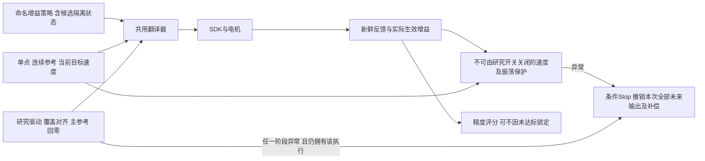
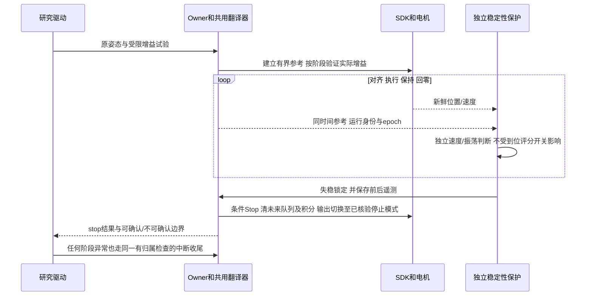

# V10 左腕振动：只读事故核验与恢复前条件

Owner：工作台 Session `01a13e4e-70dc-7513-9467-d34b9a7a99a3`；2026-10-22，Asia/Shanghai。
维护触发：补充现场观察、保护候选离线结果、实际接入/部署或新增证据。
父入口：[前50秒精度研究](control-prefix-precision-study.md)。实际部署以
`.evidence/next-optimization-20261017/continuation-state.json` 的发布与实际状态收据为准。

## 当前结论和明确停止条件

用户已明确要求：**不要重新接入操作，先确认振动原因并避免重现。**
本轮只读/离线核验，SDK接入、CAN重启、运动均为0。SDK当前仍断开，现有实际部署配置
仍为V10；本文的候选保护没有部署，不能把记录“隔离/拒绝V10”误写成远端技术禁用已完成。

新的人类信息：用户报告机器臂因振动厉害而被人拔线，至少不能再把最近断链解读为
USB自行掉线。用户不能确认两次拔线的对应时段和具体手臂。**两次都有实际振动先于
USB断开**，已由历史反馈证实；两次是否均为人为拔线，仍保留不确定性。
旧“USB不稳定需先修线”的判断被本报告纠正，不用USB断链解释先发生的振动。

主要已证事实是：V10在几乎静态的起点/保持阶段，左腕J4/J5/J6发生快速往返；SDK输出
位置恒定、输出速度为0。运动增益组合造成闭环失稳是首要判断，V10相对V8的直接变化
是左臂Kd增加。内部电机速度估计、滤波、离散环路及外积分的具体耦合尚未被分离识别，
不能把哪一个固件细节称为已确定根因，亦不能根据编码上限推断稳定范围。

## 证据链和数据有效范围

读取仍存活Owner的事件缓存，18个事件序号1–18完整，无游标缺口。包括两次
`fault_diagnostic`，每次200个历史样本。下载压缩日志，核对原始SHA256：
`e6dd48362e1aefdf288bfb5b12ec4c08800bcd0c123df1b6f4d0a6243c3bf207`。
源原始日志6,629,361字节；未读取新相机观测、未调用SDK。

按guard记录的最早左电机最后接收时刻，再留2ms余量，排除断线后缓存尾段。
每次保留190条新鲜有序反馈，分别覆盖1.906和1.907秒。各样本`motion_state=READY`，
`stationary`比例均为0。第一段处于参考结束约32秒后；第二段处于参考结束约0.243秒后。
两次正式50秒研究参考提交数都是0，发生问题的是前置起点对齐和持续保持。

| 左腕关节 | 第一次位置往返峰峰值 | 第二次位置往返峰峰值 | 第一次反馈速度绝对峰值 | 第二次反馈速度绝对峰值 |
|---|---:|---:|---:|---:|
| J4 | 0.372° | 1.311° | 1.066 rad/s | 3.418 rad/s |
| J5 | 2.229° | 2.688° | 5.747 rad/s | 6.670 rad/s |
| J6 | 1.311° | 1.770° | 3.308 rad/s | 4.429 rad/s |

不使用SDK速度字段，仅对关节位置差分，左J5速度绝对峰值仍达3.670/4.514rad/s。
因此不能将其归为“静止速度字段有少量噪声”。右臂也有较小波动，不能说完全无振动。
100Hz采样下的频谱主峰约35–38Hz，但存在混叠可能，不称为真实电机内部精确振动频率。

两段里分别有19/20个不同时间的SDK原生输出样本，六关节命令位置跨度全为0，命令速度
全为0；关节反馈仍持续往返。原生样本是CAN编码前输出，不是固件ACK或高频总力矩。

图与结果：[腕部曲线](../.evidence/vibration-audit-20261022-v1/wrist-vibration.png)、
[左臂全部关节](../.evidence/vibration-audit-20261022-v1/all-left-joints.png)、
[分析JSON](../.evidence/vibration-audit-20261022-v1/analysis.json)。

## 增益在什么时候真正生效

V10接入/恢复后的原生状态是Kp全0、Kd约0.2/0.2/0.2/0.1/0.1/0.07的重力/阻尼模式。
此时显示的`controller_profile=x5_control50_damping_v1`是配置，不表示运动增益已生效。
`hardware_backend.begin()`先建立当前测量位置命令，然后一次性调用`set_gain()`。
V10运动/保持时实际读取的Kp为240/210/210/90/90/60，Kd为5/5/5/3/3/2.1。
因此“接入成功、反馈静止”没有验收过随后将使用的新增益。

| 对象 | V8实际运动增益 | V10实际运动增益 | 差异 |
|---|---|---|---|
| 左Kp J1–J6 | 240/210/210/90/90/60 | 相同 | 无 |
| 左Kd J1–J3 | 4.243/4.243/4.243 | 5/5/5 | 约+17.9% |
| 左Kd J4–J6 | 2.121/2.121/1.485 | 3/3/2.1 | 约+41.4% |
| 左快速积分、20ms上传 | 原实验策略 | 相同 | 无 |
| 额外补偿幅度和斜率 | 原边界 | 相同 | 无 |
| 右臂参数 | 原值，右J4为80/1.6 | 相同 | 无 |

V8四档已记录的动态及终点样本中，左关节反馈速度最大约0.648rad/s；V10左J5达到
6.670rad/s。V8起点快照也明显平稳。但V8的前置对齐未全量记录，只有快照，不能把
V8称为已完成所有阶段稳定性验收的安全版本，更不能据此自动恢复实机。

V10只通过CPU合法性、边界及功能回归，**145项Linux检查不验证真实机电闭环稳定性**。
将“在SDK编码范围内”当成可以整臂使用的物理增益范围，以及同时上调全部左关节Kd，
是本次试验选择的错误。提高Kd对理想连续模型的阻尼作用，不能作为当前电机链路必然
更稳定的保证。现有强证据指向V10增益组合，仍不宣称已分离单个关节/固件内部机理。

## 为什么没有自动停下：三个具体缺口

1. **精度观察策略作用范围过大。** 实际执行策略`arrival_enabled=false`、
   `tracking_enabled=false`，同时用于起点对齐、主参考和回零。数采业务原默认跟踪关闭，
   研究流程没有另设不可关闭的失稳保护。关闭到位精度锁定被错误地与稳定性保护混在一起。
2. **时间到即READY，并继续保持。** `MotionRunner.tick()`的arrival-off分支在名义时长
   结束即设READY，不要求静止；后续仍持续向SDK提交保持参考和补偿。
   `record_arrival()`因此记success/arrival_enforced=false。当时的success不是稳定到位。
   第一轮可在目标结束32秒后仍见振动，不能因驱动失败就认为输出已停止。
3. **异常清理只看主研究轨迹。** 驱动仅在`main_submissions>0`且主参考未完成时发送Stop。
   第一轮已实际执行起点对齐，却因下一步不静止被拒绝；主参考提交为0，异常路径没有Stop，
   Owner独立存活并保留高增益输出。第二轮等待静止时遭拔线，也没有得到独立失稳拦截。

第一轮断链前status已经给出stationary=false和高速度，我没有及时据此认定失稳，
而先进行了CAN恢复并重接同一实验配置。这是本次诊断和执行控制上的错误，不能归责于
USB设备性能或用“反馈健康”解释为机器人机械状态安全。

### SDK已有保护没有覆盖什么

已核对实际使用的SDK源`src/app/controller_base.cpp`：632–646行裁剪的是
`output_joint_cmd_.torque`，683–698行将Kp、Kd、目标位置、目标速度和该力矩分别传给
电机接口。**不能把这个前馈力矩裁剪当成电机内部PD加前馈的总力矩上限。**
SDK另有反馈过流保护（420–450行），但它不是振荡检测；力矩没达到过流条件，也可能
在小惯量腕部出现快速振动。没有读取电机固件实现，不推断内部PD总力矩或实际限流值。
guard的CAN/Owner100ms保护负责通信失联，不负责“通信正常但机械在振动”。

## 修复设计：先离线覆盖，当前不发布/不接入





需要落实并验证的对象：

- V10进入禁止接入候选集合，配置解析/恢复前先拒绝；**当前未部署此技术拦截**。
  不能以仅记录“拒绝V10”代替接口拦截，也不以无条件回退V8取代稳定性验收。
- 将研究“未达精度可继续观测”与不可关闭的速度/周期性振荡保护分开；前置对齐与回零
  采用正常准入，研究例外只能绑定确切主参考身份及有效时段。
- 驱动记录所有可能开始输出的阶段（含确认结果未知），异常时按Owner/nonce/epoch和
  计划/执行身份条件停止自己的输出；不能只看已完成计数或主参考计数，不停止其他执行。
- 增益变更不得整臂同步试大步；恢复动作前先撤销新实验增益及快速积分，采用保守配置，
  每次单关节/小步，并在实际新增益生效后做稳定性门。任何实机验证需先解除本次用户禁令。
- 只记录TCP位置不够：腕部滚转J6对该TCP位置影响小，仍可剧烈振动。验收另含各关节
  速度、位置往返、姿态误差、停止后稳定和外扰响应；不以毫米指标代替稳定性。
- 对齐和保持同样保留命令、反馈、实际增益与有界故障前后遥测，不新增视频需求。
- 真实Stop输出也必须验证，不能假设任意“阻尼模式”天然不振；通信正常与CAN失联两种
  情况分别定义Stop可确认和不可确认，未获确认不得自动恢复或重试。

## 已完成的离线反例回放

两个候选检测器仅在本次离线分析中实现，尚未加入控制服务：

- 速度候选：同关节55ms内最近5个样本至少3个报告速度绝对值>2rad/s。
- 振荡候选：同时间参考误差在150ms内峰峰值>0.6°，至少8个样本且有效方向反转>=4；
  忽略单次<=0.0005rad的变化。

两次故障的有效保留窗口都被识别：分别约在窗口开始40ms/71ms判定。这不是从实际
振动开始计算的延时；原200样本环仅保留末尾约2秒，真实起振可能早得多。
V8四档含回零的26,590条速度样本未命中速度候选，四档21,319条主参考/终点样本
未命中振荡候选。起点对齐未全量记录，也没有故障后的真实Stop验收，不能把该结果
称为通用阈值、零误报统计或实机稳定性通过。更慢、更小幅、不同负载等仍须覆盖。

可运行复核：

```sh
.venv/bin/python .evidence/vibration-audit-20261022-v1/analyze.py
.venv/bin/python .evidence/vibration-audit-20261022-v1/replay.py
```

[回放结果](../.evidence/vibration-audit-20261022-v1/guard-replay.json)、
[四档速度基线](../.evidence/vibration-audit-20261022-v1/baseline-speed-replay.json)、
[SDK发送路径摘录](../.evidence/vibration-audit-20261022-v1/sdk-control-loop-read.txt)。

## 剩余顺序

1. 离线完成候选隔离、独立稳定性保护及全阶段异常Stop；用本次真实日志和人工构造的
   孤立尖峰、持续振荡、参考运动、丢样、epoch变化及结果未知分支验证。
2. 增益和安全模式恢复设计及Stop结果核验通过后，再获得用户明确恢复实机的指示。
3. 先恢复稳定控制，再重新推进四档1mm研究；实际空间和持杯精度仍另验。

本报告不授权接入、回零、CAN重启或运动，不把历史动作授权覆盖最新用户禁止接入的指令。
