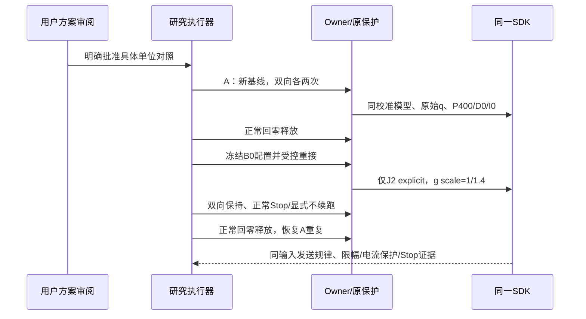
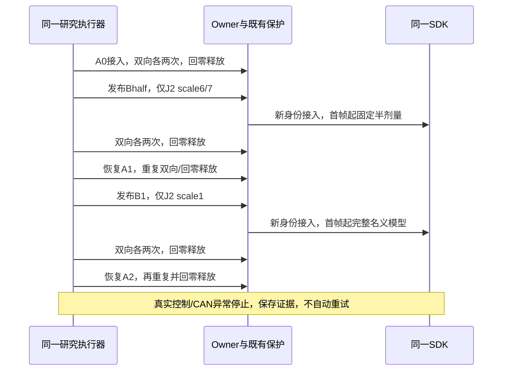
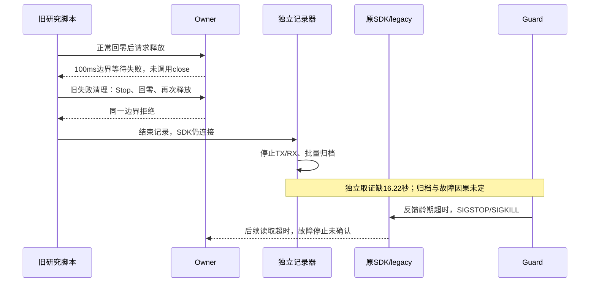

# EC单位隔离与重力/负载联合辨识

## 最新结果：A→Bhalf→A→B1→A全部完成

2026-10-27 21:28完成，Owner仍为session `01a16327-7545-7332-a361-0123ddad811d`。统一证据入口`.evidence/ec-dose-final-20261027-v1/delivery.json`、实核`final-current-state.json`；旧失败批次保留，不混入本轮。五批使用boundary-recovery-v2和同一SDK二进制，仅改变左J2固定重力剂量，P400/D0/I0、J3目标6.5°、J2目标7.65°；每批下→上→上→下、末2秒统计，共20窗。没有新增保护门或自动故障重试。

|批次|实际CAN前馈／名义Nm|下方到位残差，两次／°|上方到位残差，两次／°|
|---|---:|---|---|
|A0|0.520146520|0.043713878 / 0.043713878|0.000067252 / 0|
|Bhalf|0.622710623|0.043713878 / 0.043713878|0 / 0|
|A1|0.520146520|0.043713878 / 0.043713878|0 / 0|
|B1|0.725274725|0.021856939 / 0.021856939|−0.002917251 / −0.003990292|
|A2|0.520146520|0.043713878 / 0.043713878|0 / 0|

残差定义为实际CAN目标减实际CAN反馈，正值表示未到目标，负值表示超过编码目标。实际目标7.639000130°，与名义7.65°相差0.010999870°；上方B1的负编码残差不等于超过名义7.65°。位置一码约0.021856939°。B1上方在编码目标与高一码之间切换，末段位置峰峰值一码，两窗高一码样本约13.35%及18.26%；不能用均值近零掩盖此跳码。

半剂量没有跨过位置码，实测电流上升；完整剂量把下方残差从两码降为一码，恢复A后又回两码。下方P项代理从0.305180降为0.152590名义Nm，符合前馈分担保持作用的方向。B1下方实际电流0.56717–0.57884A，上方0.41685–0.41833A；A的上下电流仍明显不同。结果支持前馈幅值影响静态到位，但不能把剩余误差全部归因于重力不足，也不能唯一拆出摩擦、线缆、负载或内部电流环参数。B1目前只有一个剂量批次、每方向两次，不构成多姿态或1.5×运动资格。


### 验证、归档与当前状态

五批合计4,219,340独立TX/RX帧，socket丢帧0、调度截断0；无控制故障。全部在12轴最大零位偏差0.273207567°、健康静止后正常释放。原始文本与二进制本地gzip逐份解压SHA核验，远端原文保留；批量归档均在SDK退出后完成。沿用已通过238项Linux检查的边界修复与合格研究驱动，没有修改生产控制源码或SDK二进制。此次未新增运动中Stop／故障恢复试验，既有正常Stop证据仍见前一阶段，不能把正常释放当新故障清锁资格。

结束恢复legacy A，保留当前标定重力绑定及边界修复；SDK为DISCONNECTED，无holder/nonce/活动作业，部署文件未漂移，最后已接入回零样本的研究保护仍0.8rad/s。未推广B1至日常业务，未使用录像/GPU，未commit/push。

### 遥测配对限制：不放宽误差门，不用错配样本拟合

原离线核验假设`get_joint_state()`与`get_joint_cmd()`同拍，要求逐样本重算重力一致。B1上方出现一码位置切换后，该假设失败；同一批R3原生/重算J2误差中位数0.000410193名义Nm，最大0.001165272。Bhalf还有一个零输出遥测快照被缓存返回4次，独立CAN同一时刻±5ms内5帧均为0.622710623，没有掉零。

已核对运行SDK源码及SHA：`controller_base.cpp`的两个getter分别锁定`state_mutex_`与`cmd_mutex_`；`update_output_cmd_()`在cmd锁内先写插值结果，随后释放cmd锁并在state锁内加重力。故不存在可依赖的原子q/完整output配对契约，且getter可能观察到中间输出；具体每个离群点属于错拍还是中间态，不作唯一归因。来源副本与SHA在本轮`audit-source-*`、`native-build-receipt.json`。

保留`audit_units_strict_original.py`和前三批原核验收据；新核验仍记录原生逐样本差异，不把其容差调大。改用独立CAN验证实际剂量：每窗所有实测q重算后均预测同一个前馈码，实际窗内每个J2发送帧须精确等于该码，五批全部通过；J2/J3主机bias为零、模型绑定及选轴配置独立核验。`units-audit.json`明确`native_snapshot_atomic=false`，不能据此声称原生快照逐样本一致。修复观测快照是后续用遥测辨识负载前的工作，不在本轮临时改SDK。

### 下一步

先补同拍、完整的q/输出观测，再设计多姿态、双向、留出验证；B1可作为候选，不能直接作为所有姿态的正确补偿。具体新增剂量/补偿仍先按用户要求对齐。之后再恢复同一1.5×的J2/J3平顺性与静态TCP≤1mm验收。旧100ms根因按用户要求暂缓；维护租约、前馈制品绑定、限位一致性、完整业务长期内存及规划消费者待办继续保留。

Owner：session `01a16327-7545-7332-a361-0123ddad811d`；2026-10-27。维护触发：单位、模型、标定、驱动保护、实验批准或审阅结论变化。证据根`.evidence/ec-units-calibrated-20261027-v1/`。用户已明确批准 **A→B0→A**；本轮A→B0→A已完成，用户随后明确批准完整A→Bhalf→A→B1→A，执行证据见新增剂量阶段。执行结果以本页后续实测段和证据收据为准。

## 已知链路与结论边界

厂商V1.20手册§4.1/9.1.1定义混控Torque字段为名义力矩，固件公式`I_req=(KP*位置差+KD*速度差+Torque)/Kt`。主机legacy又对模型重力及附加bias除1.4，属于字段语义的额外缩放；这可通过源码/协议核对，不要求先有外部砝码。真实Kt_eff、传动效率与质量的绝对标定是另一问题。

结合有界前馈干预，重力前馈参与形成静态残差已得到支持。上轮零偏接入的新旧数据是历史非交错基线，7.65°处实发FF相同，不能单独把两码不变用作模型对错的证据；其他姿态小差异也不能唯一归因。未证明全部残差或J3约0.72°空间周期起伏都由重力模型偏小导致。

```mermaid
flowchart LR
 Q[原始q] --> G[冻结校准URDF：g(q+delta)]
 G --> S[原生gravity scale]
 S --> A[与主机bias相加：本轮J2 bias为0]
 A --> U[legacy除1.4／explicit不再除]
 U --> C[CAN Torque字段及量化]
 P[固件P位置项与D速度项] --> M[固件除Kt后电流环]
 C --> M
 M --> F[机械重力/摩擦/线缆/传动]
 F --> R[位置/速度/实际电流反馈]
 R --> P
 C --> W[独立TX/RX及状态证据]
 R --> W
```

SDK兼容effort仍为原始A×1.4²，原始过流检查不改。显式单位下仅对选中轴把主机输出限幅除1.4，维持原来的wire上限。P/D并未经过这次主机除数，不随单位迁移缩放。

## 三个清晰分离的状态

首轮仅左J2（native index1，CAN motor2）；J3、其他关节、当前校准模型、原0.8rad/s及电流/限位/反馈/Stop保护不变。

|状态|字段契约|选中轴原生gravity scale|发送末尾除数|实际作用|
|---|---|---:|---:|---|
|A：当前|legacy SDK|1|1.4|当前基线|
|B0：等价迁移|explicit名义Nm|1/1.4|1|同输入时发送量不变，只把单位契约写明|
|B1：真正修正幅值|explicit名义Nm|1|1|消除额外主机除法；物理输出通道会增加，须另对齐|

B0的1/1.4是**临时等价桥接尺度**，不是负载拟合结果或永久重力校准。不能把B0完成称为物理幅值修正已经完成。主机bias在explicit轴上也改变单位；首轮该轴Ki0、无新增FF、无历史偏置，不把旧积分/FF悄悄跨契约复用。完整业务积分/FF迁移尚不在静态候选资格内，实验结束保留/恢复日常已验证配置。

引用目标7.65°的已记录实际姿态，g2=0.730096181：A/B0发送前0.521497272，CAN0.520146520；B1发送前0.730096181，CAN0.725274725。量化后差14码、0.205128205名义力矩，对固定位置下的请求电流差约0.146520147A。实际总电流可能因P项下降而少增或下降；不能将该数当实测总电流承诺。

## CPU资格（实机结果见下）

`native-qualification.json`与`unit-equivalence-analysis.json`使用当前同一SDK二进制及校准left模型、真实SDK函数和fake ArxCan传输。A/B0/B1各33个CPU姿态，共99例；A/B0发送函数接收的float字段逐位一致（最大差0），B1仅J2不同，其他5轴完全一致。测试还核对bias单位、原wire限幅、正常Stop撤销future、原生过流停止继续使用同配置重力；raw20A不触发、raw21A触发三状态一致。strace无AF_CAN，零真实连接/命令。这是native函数级证据，不能替代真实Stop或真实CAN编码验收。

当前raw CAN电流按手册标作实际相电流；尚未证明其确切Iq/RMS/峰值、滤波及绝对增益。40个既有静态窗口的实测/请求重构比值范围约0.797–1.059，不能据少量样本拟合“0.92电流修正系数”；电流重构均值差−0.13307～+0.03165A，保留不闭合。P400的一码位置反馈灵敏度约0.108993A，半码0.0544965A；这只是量化灵敏度，不是已核实内部q的严格界，且不能解释全部窗口。

## 已批准的最小实机方案：A→B0→A

各批固定J2 P400/D0/I0、J3目标6.5°；J2目标7.65°，从±1°预定位后上下各到达两次，保持4秒、统计末2秒。首/末A作为新鲜基线，B0只验证等价迁移。每批新执行身份、正常回零，12轴±0.3°且健康静止后释放；只对明确自有Stop进行显式恢复，不续跑旧动作。保留独立CAN、队列/调度、native窗口与反馈。真实故障停止，不自动重试，不增加任意诊断急停阈值。



CPU要求同输入字段逐位一致；**实机不能要求跨会话每个时间点逐位相同**，因为实际q和其他轴偏置会漂移。须以实际q/模型/偏置为条件检查发送规律，分别保存状态差。若B0引入系统性的1.4倍变化、改变其他轴单位、放宽保护或Stop后重力不同，则迁移失败；不进入B1。

B0通过后才对齐Bhalf/B1幅值实验。现有scale是构造期配置，`get_robot_config()`按值返回，不允许私自热改。固定新配置从接入首个原生更新起生效，**不是时间渐变**；若选离散中间剂量，Bhalf scale=6/7。Stop使用同一固定配置，避免主机临时FF在Stop时撤掉支持或突然解除负抵消。暂不新增SDK scale setter；接入首帧、home姿态的输出增量与边界必须作为下一阶段对齐材料。

## 后续联合辨识：识别能识别的组合

静态机械平衡可写为`Kt_eff_i*(I_meas_i-b_i)=Y_g_i(q+delta,g_base)*pi+tau_history_i+tau_cable/external_i`。P/D是总输出来源，不是另一份机械负载，不重复扣除。`pi`含质量和质量一阶矩；纯静态不能辨识完整转动惯量张量。协议单位先固定，再做负载/摩擦，否则模型参数会吸收软件缩放。

`observability.json`已独立构造6连杆×[m,m*cx,m*cy,m*cz]的24列回归，Y*pi与直接重力求和一致。当前24静态姿态和400个CPU广姿态的代数秩均为10，J1模型重力方程恒零；当前最小非零奇异值/最大仅7.35e−7，CPU广姿态约0.0634。CPU姿态只是数学探针，没有碰撞/现场运动资格。当前数据不宜强拟合全部参数；代数秩10也不代表10个组合都能在噪声下可靠估计。

固定已标定零偏与几何；先选有激励的受控姿态、标准化到达历史、多次重复与留出姿态，以截断/正则化的基参数预测有界delta_g(q)。方向电流带、中点仅作工程代理，不叫已证明摩擦上下界或真实重力。相机/支架与link6的集总参数、Kt_eff/质量/效率的绝对尺度仍可能不可分；需外部已知负载时另行具体对齐。先验证名义电流/输出域的可预测收益，不以拟合出的质量数值看似合理代替留出精度与平顺性验证。

## Fable 5.1最终复核（已完成）

通过用户明确调用的[fable-review](/Users/wujie/.agents/skills/fable-review/SKILL.md)和canvas-cowork完成；最终成功节点`7bf5d811-d38a-4f10-989b-e27b99a3ee18`，`read-db`回读与答复逐字一致。完整最终答复位于证据根`review-final-answer.txt`，[审阅画布](https://flowith.io/conv/036349c1-436a-4da6-a91e-537f8aed79b5)。两个follow请求服务端失败后使用一次自含上下文root归纳，未更换模型或无限重试。

Fable最终同意A→B0→A先行、协议语义与绝对物理尺度分离、保留原始过流边界、用可辨识基参数和留出姿态验证。它接受本地证据并撤回了首轮一码灵敏度大一倍、0.92电流重标及“至少±0.1A已证明摩擦下界”的说法。方向/历史相关电流带仍不是重力真值或确定摩擦物理量，40窗电流不闭合继续保留。厂商手册定义名义扭矩语义，不等于已验证真实Kt_eff、相电流精度或绝对质量。

审阅者提出的“超过一码”判据混用了FF编码与位置码的电流灵敏度，未采纳为数值验收门；本地按实际q/偏置与单位规则核验native及CAN，记录跨批状态差。它对6.5°/9.5°的旧新标定数据引用只是历史背景，这轮实机目标只有7.65°；不把历史点视为本轮新增预测已验证。B0是单位迁移加临时等价尺度，尚未完成B1幅值修正，不能称为物理重力已经准确。

## 实机结果：A→B0→A通过，日常单位已恢复

统一结果`.evidence/ec-units-calibrated-20261027-v1/delivery.json`，当前发布`a2-publication/publication.json`、实核`final-current-state.json`；主Owner仍为本session，无分工或负责人变化。三批各四次完整双向到位、各自正常回零释放；末次SDK为DISCONNECTED，无holder/nonce/活动作业，日常EC契约为legacy，标定重力绑定仍为原ID。新适配能力留在源代码，未推广B0至完整业务。

135项Linux检查及完整执行脚本替身检查通过。同一SDK二进制保持不变。三批合计2,482,339独立CAN帧，socket丢帧0、调度截断0，无真实控制故障、无故障重试。原始文本及二进制均保存为本地无损gzip，解压SHA匹配且远端原文保留；数字反馈、native输出、队列/调度、完整事件均保留。

|批次|下方到位编码残差（两次）|上方到位编码残差（两次）|CAN FF（所有窗口）|下/上实际电流A范围|
|---|---|---|---|---|
|A1|0.043713878° / 0.043713878°|0° / 0°|0.520146520|0.53835–0.54028 / 0.34534–0.35208|
|B0|0.043713878° / 0.043713878°|0° / 0°|0.520146520|0.53137–0.54018 / 0.34265–0.34297|
|A2|0.043713878° / 0.043713878°|0° / 0°|0.520146520|0.52924–0.53967 / 0.33200–0.33937|

这里残差相对**实际编码目标7.639000130°**，不是名义7.65°；名义目标到CAN编码相差0.010999870°。因此下方到位相对名义目标为0.054713748°，上方为0.010999870°。编码零差不能解释成内部或物理严格零差。保持末2秒的独立反馈位置跨度均为0码。


按实际q重算校准模型，A1/A2的J2 native等于完整g、发送末尾除1.4；B0的J2 native等于g/1.4、发送不再除。各静态窗native契约误差中位数约1e−15，J3仍为完整模型g，两轴主机bias为0；B0 telemetry仅选左index1，右臂无选中项。CAN FF所有12窗同码，符合等价迁移预测。反馈电流轻微轮间漂移保留，不要求跨会话逐样本一致。

### 正常Stop、未来撤销及显式不续跑

B0在参考运动中执行正常Stop，接受到SDK阻尼保持返回约7.746ms。独立原始TX验证停止后约1.446秒，**12轴各704–705帧目标q/dq编码恒定**，明显超过此前未来参考窗口；J2反馈位置也为同一码。显式恢复为`already_operable_no_fault_cleared`，没有续跑旧动作，之后使用新审阅计划完成实验。Stop后J2仍按同一B0重力单位，未撤掉单位支持。三批回零最大关节偏差均0.273207567°，健康静止后正常释放，随后真实再接入通过。

证据`all12-stop-wire-audit.json`、`normal-stop-wire-audit.json`与`b0/units-audit.json`。本轮未制造原生过流或CAN故障；不能将这次正常Stop/no-op恢复冒充真实故障清锁或固件ACK。原始电流保护边界的三模式20/21A验证仍是CPU证据；0.8rad/s生产保护在三批健康检查中保持启用。

### 发布中发现并处理的配置缺口

B0首次惰性发布因Owner-only EC配置被复制进无native API的业务profile而被校验拒绝，发生于SDK断开时，未下发B0动作。发布器修正为只向Owner分发EC契约，并分别读取验证Owner与业务profile，再恢复后端和原热模型绑定，失败证据保留。Owner、SDK及普通轨迹无需因此修改。首次A1原始证据传输与发布重启相撞导致只读HTTP探测失败，待惰性发布完成后重取并校验成功，未重放动作；此后归档完成后再发布/接入。当前工作台服务可达，部署文件未漂移。

## 剂量阶段方案（用户已批准，执行中）

先A→Bhalf→A→B1→A；仅左J2，仍P400/D0/I0、J3目标6.5°、目标7.65°、每批下上上下四次、每次末2秒统计，正常回零释放。固定constructor配置，模型scale依次为A/B0的5/7、Bhalf的6/7、B1的1；J3、右臂、其他轴与原始电流/0.8保护不变。不加新诊断急停门，不复用旧FF/bias。Bhalf/B1从接入首个重力更新起生效（包括零位），**不是时间渐变**；Stop继续使用同一配置重力。

|固定配置|引用7.65°实测姿态的CAN FF|相对A增量|仅FF请求电流增量|raw q=0时CAN FF|
|---|---:|---:|---:|---:|
|A/B0|0.520146520|0|0|0.578754579|
|Bhalf|0.622710623|7码，0.102564103|0.073260073A|0.695970696|
|B1|0.725274725|14码，0.205128205|0.146520147A|0.813186813|

表中零位是CPU原始q全零探针，实际接入姿态按反馈条件化；不是实测电流承诺。总电流可能因P项下降少增甚至下降。以P400和编码FF增量线性估计，半/全剂量的平衡位置移动分别约+0.01469°/+0.02938°；这只是理想刚度预测，方向记忆、量化与内部反馈可能使实际不符。上下到达要同时看，不能只消掉下方两码而忽略上方过补偿。

若两方向按相近输出灵敏度移动且P承担量减小，支持共同保持偏置；若只在一方向跳码、撤回后不恢复，优先建模方向/历史效应；若电流与位置均不符合编码规律，回到内部反馈/电流映射证据，不扩大补偿来强拟合。通过局部剂量因果对照后才扩多姿态/留出，最终验证同一1.5×平顺性与静态TCP≤1mm。维护租约、完整FF绑定、限位一致性、完整业务长期内存、独立规划消费者继续保留。

### 剂量阶段批准与实施边界

2026-10-27用户明确选择“按完整A→Bhalf→A→B1→A执行”。证据根`.evidence/ec-dose-20261027-v1/`；五批新身份为a0、half、a1、full、a2。每批目标/方向/保持时长沿用前文，不重放上轮动作。A0用当前已验证legacy部署；其后同一新源码依次发布固定模式，再在最后恢复legacy。半/全剂量均只左J2、绑定当前标定模型、Ki0/无历史FF；新模式未绑定标定时拒绝。构造期生效，无热改或时间渐变，Stop继续保留同一模型支持。未新改SDK二进制，不扩为全业务资格。

```mermaid
flowchart LR
 C[冻结标定模型与原始q] --> G[g2(q)]
 G --> A[A: 除1.4后发送]
 G --> H[Bhalf: 乘6/7后直接发送]
 G --> F[B1: 完整值直接发送]
 A --> W[既有wire上限与电流保护]
 H --> W
 F --> W
 W --> M[同一电机固件PD/电流环]
 M --> R[独立TX/RX与native/status]
 R --> E[双向残差/电流/P承担量/恢复基线]
```



## 剂量阶段中断：仅A0完成四窗，未加载Bhalf/B1

证据根`.evidence/ec-dose-20261027-v1/`，统一分析`incident-analysis.json`。A0使用原ec-eq-v1/legacy部署，四次静态到位和正常链回零完成，最近健康回零最大偏差0.273207567°；但释放失败。半/全剂量候选从未加载，不能归咎于新剂量，也不能宣称五批完成。按本轮“异常停止、不自动重试”约定，后续四批未启动，SDK未重接。

|2026-10-27北京时间|事实|
|---|---|
|18:38:48.393–49.568|首次释放运维作业因100ms边界等待失败；原生close未开始|
|18:38:53.492–54.340|既有失败清理分支Stop/正常回零后再次释放，同一边界拒绝；该自动清理行为已发生，未隐藏成成功释放|
|18:38:55.612|独立TX/RX最后一帧，旧脚本开始批量归档，但SDK仍连接|
|18:39:11.836|Guard因can3:8/7反馈龄期超过100ms保护退出SDK|
|18:39:12.804|记录器完成归档；该时间不是CAN最后采样时间|

Guard心跳龄期6.325ms，socket丢帧0，最近读取包龄期左96.32ms/右65.98ms，原生释放trace仍为not_started。SDK和Guard退出已核验，SIGSTOP/SIGKILL来源有Guard自身证据。该窗口内核journal没有USB掉线条目；不能据此排除驱动或物理链路瞬态。独立记录921,667帧、零丢帧/无调度截断，但距故障缺16.2236秒，无法裁决故障瞬间TX、上游回包或Guard消费谁先停顿。

补取368条晚到Owner事件，完整保留故障前调用时序。两段释放运维窗口内，已记录慢调用最长14.21/17.47ms；100ms边界等待不能直接解释成一次SDK调用卡住100ms。连续tick竞争空闲边界是待验证假设。155ms反馈读取失败发生在Guard退出后，不能倒置为最初触发原因。归档与SDK仍连接有时间重叠，但没有证明归档导致CAN超时。



已准备而未发布的修正：

1. Runtime边界超时事件记录等待前后调用编号、当前调用、tick锁、最后返回与耗时；不放宽100ms或生产保护。CPU定向34项、组合Linux136项通过。
2. 已核验SDK仍存在时，记录器延后结束采样；PID/start_ticks匹配退出后才允许批量落盘。采样时间/内存预算先结束时保留有界RAM等待退出，父读端退出不破坏归档。Linux实际分支检查通过。资格只覆盖成功接入后释放失败，未知接入失败时尚无SDK身份的分支仍待单独验证。
3. 驱动结束时补拉事件，五批20窗替身回归通过。候选冻结为robot-workbench-ec-dose-20261027-v2，见publication-revision-v2/publication-qualification.json；未激活服务。同一SDK的132个CPU姿态及Stop/限幅/raw20–21A检查通过，仍不等于实机剂量验收。

负责人仍为本session，未发现他人控机证据。CAN超时根因未闭合；恢复门来自本轮明确的“异常不自动重试”，不是重复现场确认。保留故障与原始证据，等待明确的新批次恢复指令；恢复后应先验收正常释放及取证收尾，再重新执行已批准剂量顺序，不悄悄补跑旧动作。

## 新执行身份恢复研究

用户已明确“先不管这次100ms问题，先继续研究控制”。保持旧故障证据，按新根`.evidence/ec-dose-resume-20261027-v1/`准备相同五批；不将继续研究解释成100ms根因已解决。已通过标准非接入维护接口清理遗留窗口，经Owner验证worker/guard退出后retire_protected；收据明确sdk_close_confirmed=false、mechanical_state=not_verified，不伪装正常释放。

已将136项Linux合格的ec-dose-v2惰性发布为新Owner/工作台，初始A单位、当前标定模型和原保护不变；相机/热模型/预览进程身份保留。此时SDK断开、无nonce，未执行新批次。五批脚本及独立取证已准备。由于旧SDK保护退出后没有新鲜反馈，故障后首次重接的当前承托事实待用户回复；这不重问既有动作范围，后续正常回零维护沿用授权。
