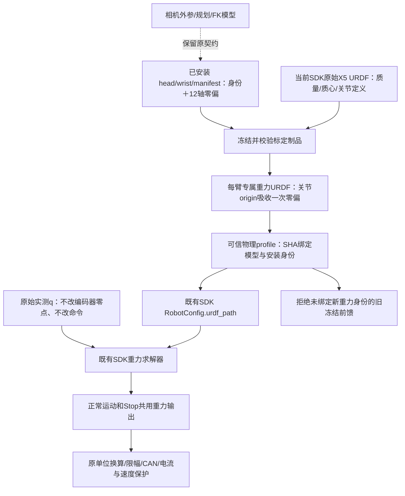
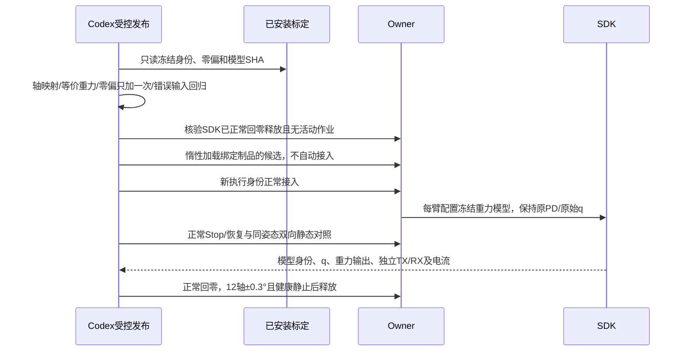

# 已安装关节标定接入 SDK 重力计算

Owner：session `01a16327-7545-7332-a361-0123ddad811d`；2026-10-27。维护触发：标定安装身份、坐标约定、SDK模型、发布或实测资格变化。用户明确要求先使用现有标定结果，再判断是否需要附加补偿；新增负载/摩擦拟合暂不执行。

## 当前实测：标定已接入，12个静态窗口完成，正常回零释放

统一入口`.evidence/gravity-calibration-20261027-v1/delivery.json`，最新实核`final-current-state.json`。当前已受控发布`robot-workbench-gravitycal-20261027-v1`；SDK二进制、EC legacy单位、PD、原始q与命令/限位/电流保护不变。左右臂各6轴零偏只通过各臂专属SDK模型origin应用一次，绑定实际安装manifest/head/wrist及原始模型SHA，身份`b1a68ef1f5ea8f4ac5edb7d6a2d1d80a448eeaccf52d023e51efaa08b2b711d3`。旧冻结FF缺少该身份即拒绝，未沿用旧FF或追加新偏置。

134项Linux回归通过；64个实际SDK纯求解姿态确认新模型g(q)与原模型g(q+delta)最大差4.44e−15，标定与SDK物理轴方向最小点积0.999999999973。未修改标定规划模型，也未调用SDK Cartesian/FK/IK执行控制。该校准是固定连接快照；安装新标定后需正常维护重新绑定，当前不支持静默热切换。

J2 P400/D0/I0、J3目标6.5°，6.5/7.65/9.5°双向、镜像次序两批共12个4秒保持窗口完成。J2/J3的实测SDK输出与新模型相符，中位差约浮点误差；一窗出现最大约0.00075/0.00045的快照时序差，保留而非滤除。J2/J3主机偏置均0。SDK实测7.65°从下方到达的新J2输出约0.7300–0.730096，旧模型在同一实际q约0.74684–0.746919；CAN FF仍0.520147，符合量化预期。

下表为末2秒“实发CAN目标−反馈”的两次均值，单位度。旧数据取前一阶段D0的b0/c0，属于**历史、非交错基线**；不能据此独立归因轮间小差异。

|目标|到达方向|原模型|标定接入后|
|---|---|---:|---:|
|6.50°|下方|0.043714|0.050738|
|6.50°|上方|0.024614|0.026991|
|7.65°|下方|0.043714|0.043714|
|7.65°|上方|0|0|
|9.50°|下方|0.054698|0.065548|
|9.50°|上方|0.026401|0.023899|

**结论：坐标标定确实生效，但没有证明精度改善，7.65°原两码/零码方向差仍在。** 9.5°的实发前馈比历史少一码，部分条件残差略增；不隐去不利结果，也不把两次历史对照认作显著退化。关节零偏修正不是质量/质心标定，不能据此宣布重力模型完全正确或直接增大额外补偿。

第一批在已确认执行中的参考上进行正常Stop：接受到SDK保持返回约5.28ms，先前调用已清退、保持返回已确认；之后约1.47秒独立观察中，J2有699条TX/698条RX，命令q/dq跨度0、位置反馈跨度0，跨越原0.1秒未来窗口而未续跑。Stop后的重力仍匹配新模型（中位误差约浮点精度，最大约2.95e−6）。显式恢复是`already_operable_no_fault_cleared`，没有清真实故障或自动续动作；固件ACK仍不支持，不宣称新增真实故障清锁资格。

两批共2,128,091帧独立CAN，零socket丢帧/零调度截断、无控制故障。均12轴进入±0.3°维护门（最大0.273208°）、健康静止后正常释放；第二批以新SDK身份再接入/再释放。当前SDK DISCONNECTED、无holder/nonce/活动作业。原始CAN/调度/事件/计划及完整标定/模型输入字节已保存，gzip解压SHA匹配，远端原文保留。曲线`calibration-comparison.png`、逐窗模型核对`a|b/gravity-audit.json`、停止证据`normal-stop-wire-audit.json`。

下一步先在明确单位与静态力平衡的基础上，设计多姿态联合辨识与有界补偿；新增干预按既有约定具体对齐后执行。不因仍有误差就认定全部是重力不足。当前仅完成静态候选资格，没有恢复1.5×动态平顺性或宣称静态TCP≤1mm全部通过。Fable5.1网页连接重置/模型选择失败，尚无有效外部意见；该请求仍未完成，不作为本轮验收依据。维护租约、FF完整绑定、限位一致性、长期内存与独立规划消费者待办保留。

## 实施前设计（以下组件图、时序图已按此落实）

## 已核实与边界

当前SDK按原始q、默认X5.urdf和g=[0,0,-9.807]求`inverse_dynamics(q,0,0)`。标定预览与规划桥使用`q_model=q_reported+zero_offsets_rad`；实际已安装头部结果确含左右臂各6个零偏，SDK未接入。相机外参T_link6_camera/T_world_camera不是惯性参数，也不独立提供基座相对真实重力的方向，本次不将其硬塞为g。

引用的J2模型0.746918879可独立复算：link2至link6贡献分别+1.497735/+0.372716/−0.012760/−0.352990/−0.757783模型Nm，和SDK记录差约9e−16。此处计算正确不等于现场质量/质心正确。静态电流可用于后续辨识；P是总电机输出来源，不是要重复扣除的外部负载。摩擦/线缆/比例和姿态历史仍须分离。

## 组件图

采用既有SDK的URDF配置入口，无需新改SDK二进制。把每个关节origin的旋转R改为`R*Rot(axis,delta)`，其求解等价于原模型输入`q+delta`；连杆质量/质心和原始q不变。重力模型是专属制品，不替换规划用名义URDF；不会同时又给q加delta。本轮实际使用的是joint controller，原生Cartesian/FK/IK入口不在执行链；模型路径会同时改变SDK内部该solver的FK/IK语义，须在代码核验中确认没有当前消费者，不能宣称配置只影响数学上的gravity一个函数。

先核对标定名义模型与SDK关节物理轴/符号一致性；局部link坐标翻转不能误判为关节值反号。几何尺寸不完全相同，当前标定零偏仍有模型误差/规范自由度的不确定性，作为显式可回退候选验证，不作为绝对机械零点真值。

## 时序与验收

受控试验沿用J2 P400/D0/I0、J3 6.5°及既有6.5/7.65/9.5°同目标双向静态范围；无新增FF、不放宽原保护、不增加诊断停止阈值，真实故障停止且不自动重试。先检查wire层是否真的因量化发生变化：7.65°引用姿态原始g2=0.746919，加现有左零偏后的条件计算0.730096，legacy编码可能仍同一码，不能把码级未动误判为标定未生效。运动与停止必须采用同一模型；校准身份变化后旧冻结FF拒绝。保持现有质量/质心、重力向量、单位、KP/KD和原始电流保护，用差异明确的最小静态对照判断后续，完整1.5×和额外补偿另行推进。

Fable5.1审阅请求已经按用户指定发起；当前网页存在连接重置及模型选择失败，尚无有效审阅意见，不作为发布已通过的证据。单独的多姿态联合质量/一阶矩/摩擦辨识仅作后续方案，未启动。
