# X5 重力模型、力矩单位与静态基线核验

Owner：session `01a16327-7545-7332-a361-0123ddad811d`；2026-10-26。
维护触发：模型、安装负载、固件/协议、SDK单位契约或实测资格变化。
本报告承接[控制链路审计](control-chain-and-p-only-20261026.md)，本轮先核验重力基础，再决定低PD；没有恢复1.5×动态研究。

## 2026-10-27 当前：已安装零偏已接入SDK重力，静态资格完成，残差仍在

用户要求先用现有标定，再考虑额外补偿。已受控发布gravitycal-v1，左右各6轴零偏通过专属SDK重力URDF应用一次，原始q/目标、单位、质量/质心/重力向量、PD及SDK二进制不变；相机外参不被错误用作重力方向。组件/时序、完整静态表与身份在[标定接入报告](gravity-calibration-integration-20261027.md)，交付入口`.evidence/gravity-calibration-20261027-v1/delivery.json`，最新实核`final-current-state.json`。当前SDK正常回零释放，无holder/nonce/活动作业。

134项Linux检查、64个纯SDK姿态等价检查通过；三姿态双向两次12窗、正常Stop/显式不续跑与释放再接入已完成。2,128,091帧独立CAN零丢帧/无调度截断，无控制故障；完整输入、命令、反馈、调度与原始CAN有SHA归档。真实故障清锁及固件Stop ACK不在本轮新增资格内。

零偏影响已在真实输出上验证：引用同q的J2模型0.746918879变为0.730096181，但7.65°实发FF仍0.52014652，两码/零码方向差不变。9.5°下方均值由历史0.054698°变为本轮0.065548°，其他条件有小幅正负变化；历史非交错基线、每条件两次不足以给小变化唯一归因，未证明整体改善，未恢复1.5×或宣称全部TCP≤1mm。本轮没有追加补偿；已知legacy额外÷1.4仍作为固定变量保留，后续须独立处理，避免附加补偿吸收单位错误。

补充纠正静态辨识口径：P是电机总输出来源，不是额外外部负载；不能因存在P就排除从电流辨识重力，也不能在机械力平衡里把P再扣一遍。理想静态KtI≈g(q)，实际还包含摩擦、线缆/外力、比例/电流环误差；方向依赖和0.58A取样阶段必须保留。多姿态联合质量/一阶矩辨识可研究，完整惯性张量不能从纯静态唯一辨识。Fable5.1的外部讨论请求尚受网页连接重置/模型选择失败阻塞，没有有效意见，不作已完成的第二审阅。

## 2026-10-27 最新：P400/D0/J2 I0，有界前馈四次因果对照完成

Owner仍为本Session。此节覆盖下方历史阶段状态；实际入口为`.evidence/j2-feedforward-causal-20261027-v1/delivery.json`，数值为`comparison.json`/`phase-metrics.csv`，图为`four-trial-comparison.png`，最新状态为`final-current-state.json`。source仍response-v4、SDK及全部原保护未改，未推广任何新补偿。两批均12轴进入±0.3°维护门（最大0.273208°）后正常释放，SDK DISCONNECTED，无holder/nonce/活动作业。

### 已执行对象、交接与证据

用户批准固定左J2目标7.65°、J3目标6.5°，J2 P400/D0/I0；方向下→上→上→下，分两批。各25秒内q/dq恒定，额外CAN前馈按0→5→10→0码渐变，每次渐变3秒、各平台4秒。100Hz参考经既有Owner共同解释器与SDK原生保留q/dq入口执行；原始CAN500Hz附近实际输出独立记录。保持其他左轴已接受输出作为冻结基线、其残差积分继续按原设置工作；右轴保持继承。每次探针结束先用同增益普通保持接回FF尾部，再恢复维护增益与回零。

Linux无控机检查执行实际四试次循环，覆盖FF制品生成、非选中轴基线携带、FF→普通保持→切增益顺序及外部Stop/epoch拒绝。既有1437窗口解释器检查继续有效。实机4,318个探针提交窗口确认J2积分偏置/下一拍累加速率为0、q/dq恒定、额外SDK输出0/0.102564/0.205128/0。独立CAN共2,383,758帧、零socket丢帧/零调度截断，无控制故障。两份批次各自包含原始CAN、调度、事件、快照、计划与释放收据；原始流已无损gzip复制到本地，逐份解压SHA256匹配远端，远端原文保留。本轮无录像/GPU、生产发布、commit或push；没有将无控机Stop检查冒充新的实机Stop资格。

归档工具首次误用系统旧Python的`hashlib.file_digest`，在读取前检查阶段失败；改为已核验Python3.11后仅重试只读复制，保留空partial和事故记录。第一批启动收据的人类描述误留旧D0.2/0标签，实际请求/所有探针CAN KD均0，详见`tooling-incidents.json`；未重放任何控机动作。

### 实测：前馈确实到了电机，但位置响应具有方向和历史依赖

每阶段仅统计平台末2秒，误差为**实发CAN目标−CAN反馈**。单位为度；CAN目标7.639000130°与名义7.65°另差0.010999870°。一码为0.021856939°，表中0不代表机械绝对误差为0。

|方向/重复|原基线|+5码|+10码|撤回后|
|---|---:|---:|---:|---:|
|下方到达，第一批|0.04371388|0.04371388|0.04209817|0.04369144|
|上方到达，第一批|0|0|0|0|
|上方到达，第二批|0|0|0|0|
|下方到达，第二批|0.04371388|0.04371388|0.02185694|0.02185694|

实发前馈各次均为0.52014652→0.59340659→0.66666667→0.52014652。上方两次电流均约0.34→0.39→0.42→0.34A；下方第一批0.5485→0.5721→0.5813→0.4872A，第二批0.5362→0.5552→0.5178→0.4142A。第二批+10码电流反降并不说明前馈没有生效：位置向目标移动一码时，P项从0.305180降到0.152590，减少量略大于新增前馈0.146520。

**结论边界：**新增前馈确实改变了电流与部分位置状态；残差不是未接收指令/READY停止保持/D项造成。相同剂量的两次下方到达响应不同，且一次改善在撤回后保留，支持静摩擦/传动迟滞/内部反馈量化等方向与历史相关机制，不能唯一认定为其中某一个硬件部件。当前证据不能将重力与摩擦拆成真实Nm，也不足以部署统一常数前馈。

最大剂量按无摩擦恒定负载静态近似，预期仅移动`Δq≈ΔT/P=0.146520/400 rad=0.020987°`，约一码；不是足以理论消除两码的剂量。+5码预测小于一码，没有码级变化不能证明完全未动。该试验也不能否定修正EC单位契约的收益；单位修复和足够精细的实际响应测量仍要分别验证。

### 为什么原前馈只有0.52；黑箱在哪里

已知发送链是`模型重力0.746919 → legacy额外÷1.4 → 0.533513 → CAN量化0.520147`，电机再按`(P位置项+D速度项+FF)/Kt`请求电流。0.52只是FF字段，P仍能承担额外保持作用，不能称为总驱动力。正式修复应继续使用已授权的显式、可回退EC力矩单位契约，保持原始电流保护，不把这次临时探针做成长期补丁，也不直接整臂放大输出。

仍不确定的是模型负载与现场质量/质心、摩擦/迟滞，以及固件内部PD实际使用的反馈、滤波、限幅和电流环误差。断开态J2只读11帧/9回复确认Kt1.4、电流环PI0.0359/250及浮点位置/速度/电流入口；未读到原始编码器/零偏。浮点格式不自动证明它就是PD内部量或机械绝对精度。查询的伺服位置增益也不是MIT包P400。活动SDK期间查询尚未资格验证，未注入此类报文。

### 后续优先级

1. 先资格验证更细遥测与SDK/Guard解析的兼容性，再在固定姿态同步核对浮点角度与电流；保留内部信号身份不确定性，不根据两码反馈强行反解真实负载。
2. 继续显式EC单位契约的受控验证与负载/双向保持辨识，保留原始电流边界；具体新增干预幅度先按用户约定对齐，未经新方案批准不自动提高剂量。
3. J2/J3静态基础明确后恢复同一1.5×平顺性/静态TCP≤1mm验收。维护租约、FF完整绑定、SDK/URDF限位一致性、完整业务长期内存和独立规划消费者仍保留。

## 当前结果与限制


### 2026-10-27 D0对照已完成：两码残差不由D直接制造

P400/I0、D0.2→0→0→0.2的24个双向窗口已完成，各条件两次。12个D0窗口的CAN KD均为0。7.65°从下方到达时，两档D及全部重复都保留0.043713878°残差；从上方均到实发CAN目标。四批正常回零释放，最后12轴最大0.273208°。共4,219,989帧CAN无socket丢帧/调度截断或控制故障。来源response-v4，SDK二进制及原保护未改；72项Linux回归及24条件实际脚本无控机检查通过。

逐层状态、闭环公式、CAN目标码33117与反馈码33115，以及电流不闭合量见[闭环与终点误差核算](control-chain-and-p-only-20261026.md)。READY后仍持续终点PD保持；本轮到位误差检查关闭，静止跨度和精度分别计算。名义总差0.054713748°由编码差0.010999870°与两码跟踪差0.043713878°组成。不能把0.022°编码粒度当作机械精度。

该窗口P项0.305180、D项−0.001727、前馈0.520147，按厂商公式预计电流0.588285A，实测0.545028A，差0.043257A。P400下半个反馈码的P输出变化量级约0.054497A，足以覆盖不闭合量级，但并非对内部反馈真值或传感误差界的实测证明。旧重力输出0.746919 SDK→除1.4→0.533513→编码0.520147的差值仍需因果验证，不能默认为物理重力补偿已正确。

新结果入口`.evidence/j2-damping-zero-20261027-v1/delivery.json`与`D0-vs-D02.png`；逐项计算`.evidence/j2-direction-load-20261027-v1/hold-chain-accounting.json`。本组D0没有消除指定平台残差，也未被推广为全轨迹最优；下一步仍需对齐有界FF干预。以下保留执行前设计。

### 2026-10-27 D0单变量对照设计：P400/I0、原前馈

用户明确要求试J2 D0/P400。证据根`.evidence/j2-damping-zero-20261027-v1/`，设计`design.json`。按D0.2→0→0→0.2，在原三个目标6.50/7.65/9.50°从两侧1°到达，各保持4秒、末2秒统计，共24窗/每条件两次。保持P400、J2 I0、原legacy重力/无新增FF、原其他关节；每批匹配实际位置后切参数，正常回零释放。0.8速度、原始电流、限位、反馈/Stop保护不变，不加新的研究中断阈值，真实故障停止且不自动重试。

研究接口原来要求所有P/D>0，SDK实际支持KD0；候选仅将研究KD验证改为>=0，P仍>0，页面KD最小值同步为0。仅本轮J2实际用0。SDK二进制及保护停止逻辑均不改，保护分支依旧构造独立的默认阻尼，不继承研究KD0。发布新源response-v4，完成Linux相关回归/实际24条件无控机检查后，以最新正常回零释放收据惰性加载，再显式接入测试。不能用CPU检查替代实机停止资格。

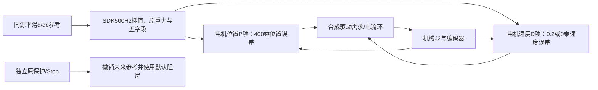

预期与分支：D0若末段残差基本不变，D不是主要静态偏差源；若两方向残差可重复降低且没有更大波动，保留D0候选但不直接推广完整1.5×；若去D改变运动/停位波动而残差未改善，说明D仍有阻尼作用，转回前馈/静态需求；真实保护故障则停止，不自动继续后续批次。去掉D同时去掉目标速度驱动项和速度反馈阻尼，不能把所有变化都称作噪声改善。

原P400/D0.2的末2秒，按原始CAN重建D项均值约−0.00173至+0.00189协议名义驱动量，折算P400静态角度最多约0.00027°，小于一码0.021857°；这提示直接D均值难以解释数码残差，但速度噪声、摩擦历史和动态到位过程可间接影响终态，仍按用户要求实测。0.022°只是CAN粒度，不能等同机械精度；残差超过一码也不能由量化单独解释。


### 2026-10-27 离线补充：J2可以读取电流，不能将其直接命名为独立外部负载

用户要求查看误差与负载的关系。本节只重用P200/P400双向辨识的24个静止窗口，没有SDK接入、CAN查询、控机或生产修改；不构成一次新的现场状态核验。证据为`.evidence/j2-direction-load-20261027-v1/load-error-analysis.json`与`load-error-current.png`，脚本`analyze_load.py`。四批原始frames.bin解压后逐批SHA一致，再独立解码电流并核对与原窗口均值/样本数相同。

**可获得的数据及边界。** J2为EC A4310；现有问答类型1报文包含输出位置uint16、速度uint12、实际相电流uint12、电机温度与MOS温度uint8、错误码。官方技术手册V1.20 §10.1明确称“电机相电流”，不是母线供电电流。既有电机只读参数查询核实电流范围±30A、Kt=1.4；可计算`名义输出扭矩≈1.4×I`。当前链路未取得独立外部力/负载传感器读数，也不能直接读出末端物体重量或可信负载百分比。温度依手册`(code−50)/2`解码，未与外部温度计交叉校准。

SDK兼容torque字段仍是`I×1.4×1.4`，不可直接作为物理Nm；保持它是为了原始过流保护兼容性。本分析使用独立CAN的原始A，未改这个字段或保护。相关原生来源为`ec-torque-contract-20261027-v1/source-candidate/src/app/controller_base.cpp`的`update_joint_state_()`；厂商来源`https://www.encos.cn/filedownload/3052924`，本地既有手册/参数证据在`gravity-model-audit-20261026-v1/`。knowledge lookup未命中已登记对象，判断依据为这些直接来源及原始数据，不新建canonical知识条目。

**观察结果。** 24个末2秒窗口的平均相电流约0.340–0.665A；电机温度按协议为36.5–37.0℃、MOS为44.5–45.0℃，所选窗口错误码均0。没有明显的大幅温度漂移证据，但不能由温度稳定排除摩擦变化。P200/P400各12个窗口中，相电流与实发目标残差的描述性Pearson r约0.904/0.836；扣除前馈等效电流后的r约0.955/0.922。窗口只有三个姿态/两方向/两重复，数据也来自闭环，**这些相关系数不是独立样本的因果证明**。


以J2=7.65°为例，两次重复均值如下。误差相对实际下发CAN目标；相对于此前名义目标误差，已经扣掉0.01099987°命令编码差。

|P|到达方向|实际相电流均值|实发目标−反馈|
|---:|---|---:|---:|
|200|从下方到达|0.47284A|0.06445°|
|400|从下方到达|0.53885A|0.04371°|
|200|从上方到达|0.34740A|0°（CAN分辨率下）|
|400|从上方到达|0.34147A|0°（CAN分辨率下）|

同P/同目标时，不同到达方向的电流及误差不同；换P后也出现“电流增大而误差减小”。所以电流提供了电机实际出力的观测，但不能把电流较大直接解释为外部负载更大。闭环中误差本身通过P项增加电流；机械侧的重力、摩擦、惯性/加速、外力等又决定运动响应。静止窗口去除了主要惯性项，仍不能凭电流唯一拆分重力与摩擦。

后续补偿对照应共同保留：原始电流A、实发FF及其等效电流、实际P/D、位置/速度、到达方向与温度；固定P400与同姿态/方向后，比较有界FF改变是否同时降低残差和P承担的额外输出。不能用`P×误差`自身充当独立负载，再以它与误差相关证明负载根因；当前也不能直接闭环追踪电流来保证位置精度。下一轮具体FF策略仍待对齐，原1.5×组合验收与工程待办沿用下节。


### 2026-10-27 P400/P200双向同目标辨识完成：共同偏置与方向效应均存在

本条覆盖下方新一轮设计的进行中状态。证据根`.evidence/j2-direction-load-20261027-v1/`；统一入口`delivery.json`、`comparison.json`、逐窗`case-metrics.csv`和`final-current-state.json`。按照400→200→200→400、镜像姿态及方向次序，24窗/12条件各两次均完成，全部实际起点位于指定目标侧。每批正常回零释放，最终12轴最大零位偏差0.273208°；SDK断开，无持权/nonce/活动作业，部署未变。4批4,227,363帧独立CAN零socket丢帧、无调度截断，无控制故障或自动重试。原始CAN与数值、调度证据均校验归档。

没有新生产代码或SDK发布。24条件实际驱动循环的Linux CPU检查覆盖P/D/I应用、接近方向、四秒保持、重复次数、外部Stop与清理权限；共用运维工具SHA未变。仍为D0.2/J2 I0及原前馈，未引入新FF。P400成为后续研究基线、P200保留对照，不表示普通action增益已经推广。

**双向结果有重复性，400并非只在单向好。** 下表为两次重复的末2秒均值，误差统一定义为“名义目标−实际角度”；正数表示实际角度较低。这里包含命令编码量化差。

|J2目标|P200：从下方到达|P200：从上方到达|P400：从下方到达|P400：从上方到达|
|---:|---:|---:|---:|---:|
|6.50°|+0.10685°|+0.10374°|+0.07346°|+0.04706°|
|7.65°|+0.07545°|+0.01100°|+0.05471°|+0.01100°|
|9.50°|+0.11244°|+0.04696°|+0.06863°|+0.02502°|

P200/P400的12个末段平均绝对误差约0.07607/0.04665°，最差窗口均值0.11244/0.07750°；两档最大末段位置跨度都只有约0.021857°。两次P400在7.65°、9.50°的相同方向结果基本重合，6.50°有约0.0043–0.0081°轮间差，仍小于码宽。没有观察到本组反向残差比200更差，但**400在6.50°的方向差更明显**，不能称为完全无副作用；本组不代替完整动态无超调、肉眼平顺或TCP资格。


**先扣除命令量化，再估计保持负载。** 三个名义目标到实际CAN目标分别差约0.019418/0.011000/0.003160°。例如7.65°从上方到达时，P200与P400都约差0.011°，原始反馈实际上已到达实发CAN目标；这部分不应当作重力缺口加入FF。

定义实发目标−反馈为`e`，共同项`C=(e_下方+e_上方)/2`、方向项`H=(e_下方−e_上方)/2`。方向差的全跨度是2H，不是H。两次重复均值如下：

|J2目标|P200共同项C|P400共同项C|P200方向项H|P400方向项H|
|---:|---:|---:|---:|---:|
|6.50°|0.08588°|0.04084°|0.00155°|0.01320°|
|7.65°|0.03222°|0.02186°|0.03222°|0.02186°|
|9.50°|0.07654°|0.04366°|0.03274°|0.02181°|

1. **共同剩余保持需求的证据较强。** 6.50°时P翻倍，共同角度残差约缩半；按实际P/D重建的共同项P200约0.300、P400约0.286协议名义Nm。9.50°分别约0.268/0.306，亦在编码不确定性范围内接近。这符合“相近静态需求由不同P用不同误差承担”，支持继续补偿辨识，但尚不能将其全部命名为纯重力。
2. **7.65°和9.50°的方向效应已经重复出现。** 同目标、同P、同前馈，改变到达方向后角度/电流改变；两个P档和两次重复方向一致。仅改变一个重力比例不足以解释。它可能包含静摩擦、传动滞回/弹性、位置相关电机扰动及固件效应，本试验没有唯一辨别这些物理来源。
3. **不能直接形成一个全局摩擦常数。** 6.50°的P200方向项接近零，P400却明显；7.65°/9.50°在换P后，名义力矩方向项也非严格不变。高P下一个反馈码对应P项约0.1526（P400）或0.0763（P200）名义Nm，量化误差会显著放大；内部反馈、原始电流校准和摩擦状态也尚未独立标定。
4. **共同项也不是一个固定常量。** P400的`电流×1.4−实发FF`共同项在三姿态约+0.282/+0.096/+0.169名义Nm，P200约+0.329/+0.054/+0.215；变化并非一个固定修正量。该估计不是独立轴端力矩测量，不能直接用作最终重力表。

详图`direction-comparison.png`同时保留P/D残差项及原始电流的独立对照；所有力矩量均为协议域估计。只有两次重复，报告观测范围，不作精确统计置信区间或唯一根因声明。

**下一步建议，尚未控机执行：** 保持P400/D0.2/I0，先在6.50°验证小幅共同FF，因为此处共同项在两档P下较一致、两方向仍有同号残差；采用零→有界渐变→保持→回零补偿的配对观察，并核验实际CAN增量及两方向改善。具体幅度/单位/次数仍按用户既有要求先对齐再执行。7.65°应特别避免按“从下方”的全部残差统一加FF，因为从上方当前已到实发目标，可能被推到另一侧；共同项验证后再讨论平滑且有状态的方向补偿。其后才是J2/J3组合和同一1.5×，静态TCP≤1mm与运动/停位平顺性尚未重新资格。维护租约、完整FF绑定、限位一致性、长期内存及独立规划消费者待办保留。

### 2026-10-27 新一轮设计：固定P400，以P200分离J2偏置和方向效应

用户明确选P400为基线、P200为对照；D0.2/J2 I0、legacy重力及前馈保持不变，不将本次选择改成普通动作默认。证据根`.evidence/j2-direction-load-20261027-v1/`，设计`design.json`。无生产代码/SDK发布需求，复用当前response-v3及其正常控制链。

目标J2绝对SDK角度6.50/7.65/9.50°，J3保持6.50°、其他轴沿用原中心。每次从目标下方1°或上方1°进入同一个目标，参考完成后保持4秒，末2秒作主要统计；实际起点是否在相应侧单独记录为科学有效性，不能只看指令方向。批序400→200→200→400，并镜像姿态/接近方向顺序，共24个窗口、12个条件各两次。每批恢复维护增益、正常回零释放，原始CAN在控制期间有界RAM记录、释放后保存；正式故障不自动重试，不添加额外速度/误差诊断停机门。

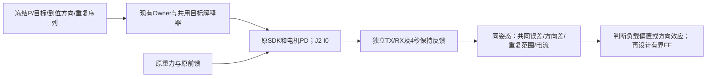

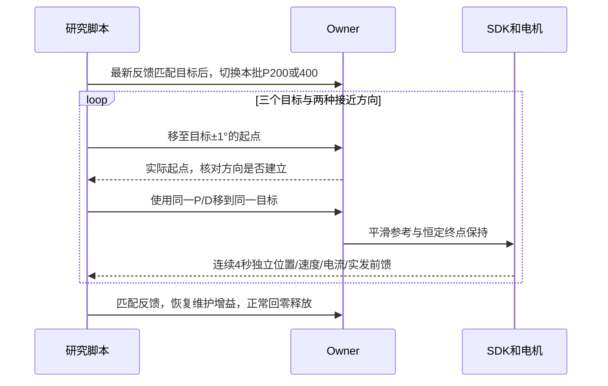

分析在每个P、同一姿态分别计算两方向残差的均值（共同项）和半差（方向项），同时用实际编码P/D及原始电流核对协议域保持需求。原始电流×1.4−FF不是独立力矩标定；量化、静摩擦、方向历史、关节弹性与固件效应仍需区分。两次重复只报告范围，不包装成精确置信区间。若P翻倍时角度共同项近似缩半但力矩共同项相近，支持剩余负载解释；若方向项稳定且跨P转换后的力矩差相近，支持方向相关阻力。没有直接新增FF、修改单位或全量增加重力输出。


### 2026-10-27 完整矩阵：180组完成，J2 P400/490没有显示出明确额外优势

本条覆盖下方进行中/首轮阶段状态。用户原定左J1–J6、P1/10/30/50、D0.2、被测轴I0，±1/±3/±5°参考结束后保持1秒，再同向增加0.15°，144组均完成；追加J2 P100/150/200/300/400/490各6组，共36组也完成。**180组完整参考不等于180组跟随或精度通过。** 原始数据/图/表的统一入口为`.evidence/joint-response-matrix-20261027-v1/delivery.json`；`matrix-summary.json`没有遗漏或重复组合，`case-metrics.csv`保存逐组窗口数据。

最后12轴回零最大偏差**0.273208°**，随后正常释放并核验SDK进程退出。最新API为DISCONNECTED、无holder/nonce/活动作业、部署文件未变。研究上限490、保存默认210；未推广试验增益，没有改变前馈/重力有效比例，没有恢复整段1.5×或宣称静态TCP≤1mm资格。当前源`robot-workbench-response-20261027-v3`；SDK SHA仍为`c04642434da4a6ab46d09adb688f5f00e3efb2ee1af71147fd54d53dbc6004d9`。

**发布与取证。** v2→v3只变更左J2研究上限及其测试；协议上限500，用户要求max−10即490。46项Linux回归、36条完整参考/20,856个翻译窗口/30项配置检查通过。实际CAN确认试验增益生效；D0.2是请求值，EC实际编码约0.195695，DM约0.199023。新增两档和剩余轴均使用新身份正常执行、回零释放，未加新的诊断中断阈值。全矩阵含历史中断证据共33批、48,663,625帧独立CAN，零记录socket丢帧、零调度截断；原始CAN/调度/命令/反馈均保留。无损压缩并解压SHA核对后，仅清理已本地归档的远端重复副本。早期0.1rad/s自行诊断门中断与工具维护预算不足的两次失败仍保留；本轮新增60组没有新增失败。不把CPU检查及正常生命周期扩为真实硬故障认证。

#### J2：高P对照

每档包含六个正反/幅度条件；下表误差为小段结束后末段窗口均值，不是全程误差；跨度包含该窗口的全部原始码值，不是周期拟合幅度。

|请求P|六组平均绝对误差|最差窗口均值误差|六组中最大末段跨度|
|---:|---:|---:|---:|
|100|0.11738°|0.21873°|0.15300°|
|150|0.05114°|0.14232°|0.04371°|
|200|0.04814°|0.12046°|0.10928°|
|300|0.02930°|0.06514°|0.02186°|
|400|0.02698°|0.05471°|0.04371°|
|490|0.03008°|0.05471°|0.02186°|

低P到300的改善明确；300→400→490没有单调收益。400相对300的平均误差差值只有约0.00232°，小于一个CAN位置码，且每个条件只做一轮、初始实测位置和摩擦/温度历史不完全相同，不能据此认证400是最优。P300/400/490六组的选中轴参考系数和分段时间逐项一致，原始曲线没有滤波或平移跟踪延迟。完整对照图`J2-maxP-matrix.png`，重点图如下。


#### 约1.1°附近的起伏：已排除上层来回发目标，尚未证明机械振动幅度

P300的+1.15°目标末段，反馈仅在**1.073429°与1.095286°**两个相邻码切换，跨度**0.02185694°**；1.198秒内288次码转换，不能将它当成机械振动频率。相邻样本相关系数约0.011；两个码下平均电流约0.52062/0.51861A，未见清楚的码间电流分离。实际CAN目标q、dq、FF均恒定。

P400、P490的同一末段均停在1.095286°单一码，码间起伏未重复出现，但相对名义+1.15°仍差0.054714°。这更支持先考虑反馈量化边界/测量噪声或低于码宽的微动，**不能唯一排除真实微振，也不能把一格跳变直接当成完整的一格物理运动**。CAN位置粒度不能证明内部编码器精度。小角度位于不同姿态/接近历史，单次出现的位置不能推广成固定机械故障点。

#### 3°首个平台不到位：有限P在承担剩余负载，重力和摩擦尚未分开

|请求P|+3°首个平台：目标−反馈|−3°首个平台：目标−反馈|追加到+3.15°后的误差|
|---:|---:|---:|---:|
|300|+0.068731°|+0.062456°|+0.000087°|
|400|+0.068731°|+0.037996°|+0.007335°|
|490|+0.047398°|+0.025196°|+0.026278°|

**必须分开首个3°平台和最终3.15°平台。** 追加小段的窗口位移还可能包含此前残差的消除，不能全部解释为0.15°指令独立引起的响应。

静止时的近似平衡为`P × 位置误差 + 前馈 ≈ 重力/负载 + 静摩擦及其他静态扰动`。本轮被测轴I0；D在静止时不能补恒定缺口。P变大可用更小的误差产生所需修正，但并不自动令误差归零。

P300在±3°首个平台，按`原始电流×1.4 − CAN前馈`估算的额外保持需求约+0.252/+0.295协议名义Nm；与需要正向P项一致，但含摩擦、固件/电流标定和反馈量化误差，两段也不是同一目标的双向到位，**不能唯一命名为重力缺口**。P400→490时+1.15°末段电流约0.53563→0.56102A，而反馈仍在同一码；与静态阻力区间或码内位移一致，不足以单独实锤摩擦。不同终点的保持需求估计还有正负变化，不能用一个常量FF统一解释。

**重力不足仍可能。** 当前SDK用实测q计算模型重力，排除了误用目标q这条候选；但实际输出仍沿用legacy的除1.4路径。J2中心名义模型约0.793–0.794，CAN约0.564，尚未独立验证现场载荷及物理Nm，不能称为补偿已正确，也不能直接把差值当成真实支撑缺口后整体加40%。同时，J1的模型重力接近零、实发FF在零编码附近，也有低P不动和方向残差；说明整套低P现象不能只归因重力。现有证据支持“负载偏置＋起动/摩擦或内部死区＋量化”分别辨识，尚无唯一硬件故障结论。

细分证据：`j2-hold-audit.json`、`J2-P300-hold-audit.png`、`j2-three-degree-plateaus.json`、`high-p-comparison-contract.json`。P项与电流换算均为协议域近似，不是独立轴端力矩标定。

#### 左六轴原矩阵总览与下一步


P1时六轴基本没有有效跟随；随着P增加，多数轴的终点残差下降。跨度小可能只是未运动，不能独立判平顺。各轴完整24组曲线：
[J1](../.evidence/joint-response-matrix-20261027-v1/J1-matrix.png)、[J2](../.evidence/joint-response-matrix-20261027-v1/J2-matrix.png)、[J3](../.evidence/joint-response-matrix-20261027-v1/J3-matrix.png)、[J4](../.evidence/joint-response-matrix-20261027-v1/J4-matrix.png)、[J5](../.evidence/joint-response-matrix-20261027-v1/J5-matrix.png)、[J6](../.evidence/joint-response-matrix-20261027-v1/J6-matrix.png)。

按推荐优先级：

1. 固定J2 P工作点、D0.2/I0，在**同一目标姿态**从两侧到达，先检验共同偏置和方向差重复性，再做单变量、有界FF渐变。P300–400保留为候选，490无明确推广依据；具体FF幅度/单位/试验顺序先与用户对齐，不直接部署电流差或全量重力修正。
2. 因果候选稳定后再做J2/J3组合与同一1.5×，分别验收运动/停位平顺性及静态TCP≤1mm；本矩阵不能代替这些资格。
3. 维护租约、完整前馈制品绑定、SDK/URDF限位一致性、完整业务长期内存和独立规划消费者工作继续保留。

本轮没有新视频、GPU工作、commit或push。

### 2026-10-27 用户纠正已落实：不以额外研究阈值中断原矩阵

用户指出0.154rad/s约8.8°/s，并不足以成为中断理由，要求不要自行加阈值反复打断研究。已承认并撤销本轮自行增加的0.1rad/s及0.5°误差中断分支：速度峰值、未测试轴漂移、超出目标包络的量只记录，正式0.8rad/s、原始电流、机械限位、CAN/反馈与Stop/epoch保护不变。实际sample回归核验0.154等观测不再抛停止，外部Stop仍拒绝后续提交和自动维护。无需新SDK或生产进程发布，批次脚本经Linux20,856窗口检查后以新身份继续原左臂矩阵。

此前“暂缓J2高P、先做其他关节首组”的提问已被这条用户纠正替代，不再等待该选择；当前进度以`.evidence/joint-response-matrix-20261027-v1/matrix-progress.json`为准。下节8组完成/第9组中断属于撤销额外门槛之前的阶段记录，不代表最终矩阵状态。旧失败不删除，已完成的组合不重放；正式保护或控制/CAN故障仍停止且不自动重试。


### 2026-10-27 首轮阶段记录：完成8组，第9组因额外诊断门中断（该门已撤销）

用户最终限定左臂6轴、P1/10/30/50、D0.2、被测轴I0；每个P档测试±1/±3/±5°大段，参考结束后保持1秒，再同方向增加0.15°，共144组。当前只完成**8个完整参考**，另1个参考中断；不是144组完成，也不把参考完成当作跟随通过。原始记录根`.evidence/joint-response-matrix-20261027-v1/`，矩阵真源`matrix-summary.json`、当前流水线`matrix-progress.json`；当前设备已正常回零释放，无自动续跑。

|已经执行的左J2条件|实测大段位移|小段后的窗口位移变化|状态|
|---|---:|---:|---|
|P1，±1/±3/±5°，共6组|基本在编码格内，无有效跟随|无有效0.15°跟随|全部参考完成|
|P10，+1°|约+0.195°|约−0.085°|参考完成，仍未跟随|
|P10，−1°|约0°|约−0.001°|参考完成，仍未跟随|
|P10，+3°|实际由约6.196°移动至7.705°|尚未下发0.15°|研究诊断停止|

上表位移从独立CAN原始位置求窗口差，未滤波/移时；小段窗口差还含大段运动的余波，**不能直接将−0.085°解释为正向小指令产生反向因果效果**。P1在5°误差下的P项只有约0.0873协议名义Nm，与P48在0.1°时约0.0838同量级。大指令但低P仍未起动不排除死区。多组低P基线在目标6.5°下偏约0.30°；静止保持偏差与方向/姿态有关，当前不能把重力误差或摩擦单独锁定。

**第9组在大段中停止。** 脚本在参考3.853秒观察J2速度0.118681rad/s，超过本轮预先记录的0.1rad/s运动诊断门；大段预计4.82秒结束，小段5.82秒开始，所以小段尚未执行。独立CAN记录峰值0.153846rad/s（参考3.547秒），同时实际下发速度约0.013187rad/s。此前20/50/100ms的原始角度位移分别约0.1093°/0.1967°/0.2841°，对应平均速度0.0987/0.0699/0.0503rad/s，不能只当作速度估计噪声。是实际延迟起动/速度突增证据，尚不能唯一分解摩擦释放、负载偏置、低阻尼与结构因素。

正常Stop→保持返回3.931ms；独立TX在Stop后50–300ms目标位置固定、速度为零编码。12轴回零最大0.273208°后正常释放。**0.8rad/s生产保护未触发且未改；0.1是本轮更低的研究诊断门。** 没有抬高诊断门、重跑该故障组、执行P30/P50或启动其他关节。已向用户提交具体顺序选择：暂缓J2高P，先做其他左臂关节P1、±1°首组，或先暂停全部实机审阅曲线；答复前不执行依赖该选择的动作。


**重力基础仍没有验收通过。** 本轮为保持比较基线，沿用legacy有效输出、不增加新FF；不是已将模型重力完整转换到协议力矩。离线重算J2基线模型值约0.7932–0.7944，SDK输出相符，但CAN前馈按原路径除1.4，期望约0.5665–0.5674，量化后实录约0.5641。此前显式EC单位候选同样用1/1.4重力隔离比例保留旧有效输出，不能将其测试成功误写为已恢复完整模型输出。名义模型与字段差约0.227，是已知换算差；模型/负载/物理Nm尚未完整标定，不能直接当成真实支撑缺口或整体加40%力。重力不足仍是明确候选，与摩擦/方向历史共同辨识。

**收尾工具问题已修复且与控制停止分开记录。** P1的+5°参考本身完成，随后回收命令时，工具按目标距实测位置估计0.5秒，但共用连续解释器从旧命令位置开始，将该段重定时为18.112秒；工具只等15.5秒而诊断退出。正常Stop/回零释放，失败保留。工具现用实测与实际输出命令两种起点中的最大距离计算速度/预算，并校验外部Stop改变epoch后不能自行再Stop并进入维护。通过实际函数回归后，仅执行尚未做的−5°，没有重放已完成组；该次回收、回零和释放完成。

新生产能力只有显式、严格限定的左单轴响应制品：七次曲线，段端q/dq/ddq/jerk连续，节点和分段边界均在100Hz网格；1/3/5°、1秒、0.15°与不变夹爪由解码器核对。原SDK、增益默认、模型、原始电流和0.8速度保护不变。右腕上限修改随用户限定左臂已撤回，未发布。当前实际源`robot-workbench-response-20261027-v1`；本轮61项相关Linux回归、最终网格17项回归及36完整参考/20,856翻译窗口检查通过。更早广范围版本212项通过不能替代最终收窄版本；中途一次完整重跑150秒超时已记录，后续相关检查单独通过。CPU证据不扩为真实硬故障资格。

本轮4个实机批次共3,185,310帧CAN，全部零socket丢帧、无调度截断，均已回零释放。原始CAN经本地无损归档、压缩及解压SHA校验后，只清理ARX重复副本；原件位于各批`raw/`，远端`lifecycle/local-archive-receipt.json`明确索引。本轮之前34个旧压缩原件也已校验保存于`.evidence/low-pd-identification-20261027-v2/raw-can-archive/`，节省远端354,334,334字节，不能再假定旧远端frames.bin.gz存在。数值/调度/收据继续保留。没有新视频、GPU工作、commit或push。

剩余矩阵136组（包括中断那组的未完成部分）仍未完成，顺序待用户选择；运动/静止≤1mm资格、J2/J3组合和同一1.5×继续未通过。维护租约、完整FF绑定、SDK/URDF限位一致性、长期业务内存与规划消费者待办保留。


### 2026-10-27 执行设计：大角度之后的小角度响应矩阵（执行状态见上节）

用户要求所有关节分别测试P1/10/30/50，先1°/3°/5°、间隔1秒后再0.15°；已确认时间从大段参考结束计算，小段同方向累加。用户随后限定先做左臂6个旋转关节，不含夹爪，逐轴、正反方向，共144组，右臂保持。D0.2、被测轴I0；未测试轴沿用原保持，当前重力模型不改，首轮不拟合新额外补偿，实际单位、额外项和电机类型分别记录。左J2先资格流程；其余按组执行，控制/CAN异常停止，不自动重试。

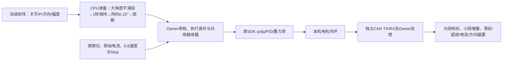

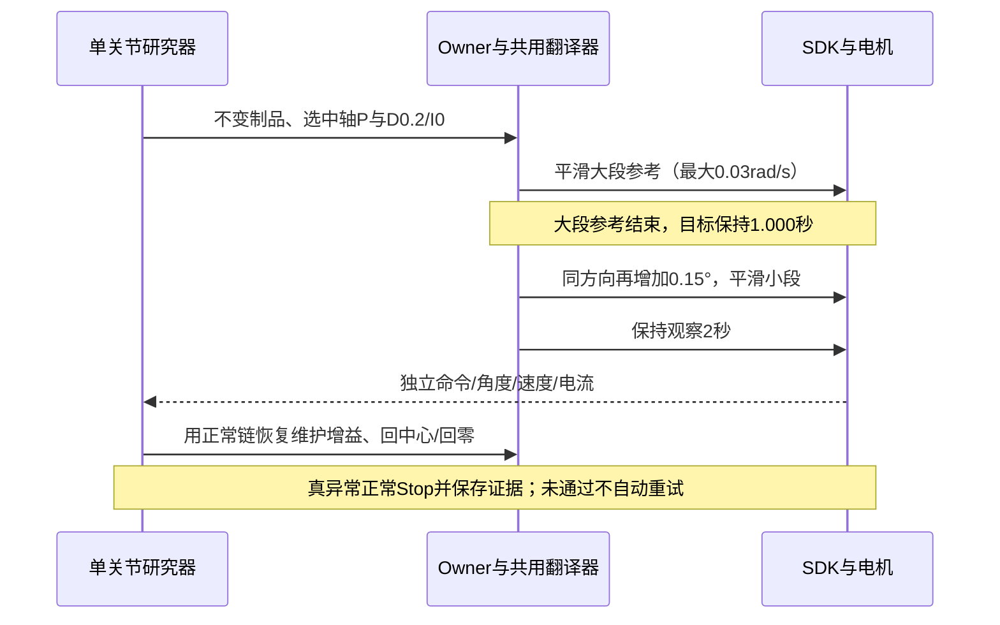

准备层用七次多项式令位置、速度、加速度与jerk在段端连续，参考100Hz、SDK频率和原保护不变。新增显式小响应制品类型，严格限定单轴、1/3/5°、0.15°、1秒保持和最大30秒，不冒充原50秒素材。左臂原研究范围已覆盖P50；曾准备的右J5/J6上限修改随范围收窄已撤回，不发布。全部默认增益与研究上限不变。新增运动段使用0.1rad/s脚本诊断门和目标包络外0.5°边界；它与上一固定姿态的0.05门分别记录，原生0.8保护不变。上述代码和CPU资格不代表真机执行通过。

J2/J3正反5.15°测试中心必须在SDK与URDF交集内部（左臂J2/J3约6.5°，右臂保持零目标），不在零位下界处向负方向测摩擦。检查每个实际准备制品及现场反馈绑定，不照搬左臂轴端力矩或左侧FF到右臂。数据按单组归档校验，先落实存储预算，再启动，不能在磁盘不足时开始整批。评估同时保留是否真的发生位移，不能只用≤1mm静态容差判定跟随成功。


### 2026-10-27 最新：J2低PD静态通过一次，小目标P扫描未形成跟随；双向起动已取得首对证据

本节覆盖下方旧的“J2尚未执行低PD”和本轮执行设计状态。当前主Owner仍为session `01a16327-7545-7332-a361-0123ddad811d`；没有新增SDK或生产源修改，复用已通过181项Linux检查的保持连续性版本。当前结果与原始证据入口为`.evidence/low-pd-identification-20261027-v2/`，其`lookup-identification.json`明确标记**不可部署**。只研究局部固定姿态及小幅响应，没有恢复整段1.5×。

1. **预平衡完成，指定低PD实际运行。** 首次用高P浮点残差估计−0.13659264，在切换后约4秒触发0.05rad/s静态诊断。独立TX显示切换前仍有+0.08006794的编码P输出承担负载，低P切换撤掉了它。新种子由总输出连续性修正为−0.0565246944，并增加“实际位置编码残差为零”的入口门。新批次P0.488400/D0.195695（对应请求0.5/0.2）、J2/J3 Ki0，实际持续23.299968秒；18秒正负单码FF、保持与撤回完成。左TCP原始FK峰值0.427099mm、上下峰峰值0.335683mm。这只资格当前姿态、当前到位历史的保持。
2. **从P0.5扫到48，未解决小目标起动。** P0.5/1/2/4/8及8/16/32/48两批，固定D0.2/I0与上述新偏置，逐档执行+0.15°→中心→−0.15°→中心。实际CAN核验目标、增益和电流；位置通常只变化一个约0.02185694°反馈格，没有形成有用的双向跟随。P16/32/48的正负目标平均电流差约0.0717/0.1201/0.1352A，说明输入到电机的响应通道工作。各点静态FK均≤1mm仍不能替代跟随验收：0.15°目标本来就很小，关节不动也可能落在1mm容差内。
3. **独立慢前馈探针取得首对起动证据。** 回到P0.5/D0.2/I0、同姿态与同预置偏置，固定q/dq，额外FF用4秒五次曲线分别向±0.25渐变；观察到同方向3个反馈码（约0.06557°）即正常Stop，保存原始诊断失败记录。没有抹掉失败或以维护成功替代实验结果。

|原姿态A、相同低PD|首次同方向达到3个反馈码时的新增FF|总CAN前馈字段|参考时刻|Stop→保持返回|
|---|---:|---:|---:|---:|
|正向一次|+0.249084|0.754579|6.49593s|11.174ms|
|反向一次|−0.190476|0.315018|4.50247s|4.993ms|

单位均是**协议名义Nm**，没有独立标定为真实轴端Nm。观测受慢渐变速率、编码刻度、取样和起动判据影响，不是精确静摩擦常数。正向在渐变达到平台后才跨过判据；两轮的初始位置码也有一个码范围内差异。仅一对试验不能证明重复性或唯一分解重力、摩擦、弹性、减速器滞回。增量中点+0.029304与半跨度0.219780只存为离线候选，不部署，不把完整起动门槛用于持续运动。

P项按弧度误差生成输出：`48 × (0.1 × π/180) ≈ 0.083776`；即使±0.15°也只有约0.125664。它们低于本次慢FF探针观察到的起动增量。这支持“小误差P输出落入起动死区”的解释；目前不支持“P没生效”，也不能凭这一组认定硬件故障或旧0.72°周期误差已经找到根因。蓝色CAN目标上的台阶来自约0.02186°位置编码，不能据此认定准备层没有平滑。0.1°本身仍有约4.6个反馈码，编码分辨率不能单独解释整段无跟随。


**相邻姿态B未取得低PD结果，已停止该分支，没有重试。** B取同一冻结参考1.92秒：J2≈5.525826°、J3≈4.953374°，各轴较A变化不足1°。高P210/D5准备后，预平衡参考约0.279秒时，脚本观察J2速度+0.057142rad/s，触发0.05诊断门；独立RX在该窗口有3帧超过门槛，峰值0.065934rad/s。此时FF渐变尚未开始（计划2秒开始），实际q、dq、FF编码均不变，位置反馈也仍同一码。故不能归因于新预平衡FF增量或P0.5；低PD实际TX帧数为0。速度估计噪声与编码内机械微动尚不能分开，不自动当作误报或增大门槛。正常Stop→保持5.356ms，随后低速回零、12轴最大0.273208°，正常释放；没有真实CAN/原生故障清锁测试。

三次起动/静态诊断Stop的独立TX均确认：Stop后50–300ms位置命令固定、速度为零编码，旧未来目标没有继续变动；正反起动两轮的新保持位置与旧参考不同。协议零速度码解码约−0.0043956rad/s，是量化中心问题，不能描述为故意给反向速度。固件硬件ACK仍不可得，不扩为所有真实硬故障均已认证。

本轮8个实际SDK批次共10,966,069帧，均零socket丢帧、调度未截断。另有一次空间预检拒绝和一次本地制品准备类型错误，均未接入SDK。`j2-scan2b`在高P入口因一个位置码的剩余P未过门，未执行新增扫描，证据保留。研究工具的equilibrium capture最多0.1°且记录原目标/新中心；原目标FK仍单独计算，不能借改中心改变精度口径。

已经正常回零释放，并惰性恢复旧单位默认，保持SDK断开；当前发布收据为同根`legacy-final/publication.json`。源码/SDK二进制、原始电流边界及0.8rad/s生产保护不变；无新低PD/补偿推广，无commit/push。清理仅对指定已完成本任务CAN原文和二进制无损gzip，逐份解压SHA256一致后移除冗余原件，原始内容/调度/反馈仍保留；没有删除其他任务数据或视频。

下一步按顺序：先分析B准备阶段速度尖峰并重新资格预平衡，不自动重放停止批次；补齐邻近姿态与双向起动重复性，再区分起动摩擦和运动摩擦、形成平滑且有界的补偿候选；小目标真正跟随通过后做J2/J3组合，再恢复同一1.5×。保持静态末端≤1mm及非预期上下峰峰值≤1mm，维护租约、FF完整制品绑定、SDK/URDF限位统一与完整业务长期内存继续保留。


### 2026-10-27 继续执行：J2预平衡、低PD辨识与P扫描

用户已明确要求推进三阶段。先复用已部署的保持连续性修复与单位契约，在原内部姿态以高PD仅作定位/预平衡：从当前两秒静态样本估计J2 P项，要求新偏置绝对值≤0.25协议名义Nm，4秒五次曲线加载；保持目标不变，实测|剩余P|<0.12、|误差|<0.03°才切到P0.5/D0.2/I0。新偏置显式写入制品，未修改关节保持项也显式带入。完成参考先转普通保持再改增益，避免清除其他轴补偿；结束时恢复维护增益、平滑撤回本轮偏置，正常回零释放。

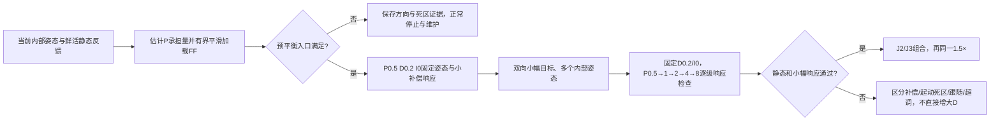

先完成J2单轴预平衡批次，再据实测选择后续分支；各批独立执行身份，真正控制/CAN故障立即停止，不自动重试。保持既有原始电流、限位、0.8rad/s生产保护及静态诊断门。低PD下的双向、多姿态数据足够且可重复时才形成查表；实际1.5×必须等组合与静态≤1mm资格。取证继续独立TX/RX与调度，不新增录像或GPU工作。证据根为`.evidence/low-pd-identification-20261027-v2/`；这里是本轮执行设计，不是完成声明。

### 2026-10-27 用户重新指定：从 P0.5 / D0.2 / I0 建立研究基线

**最新结果：左J3已完成指定低PD的真实静态基线；J2在切换入口停止，尚未执行低PD。** 修复后J3独立TX记录10842个低增益命令，持续22.245s，编码P0.488400/D0.195695，与请求0.5/0.2一致；18s正负单码前馈参考及结束普通保持完整完成。低增益探针窗口左TCP原始FK峰值0.187538mm、竖直峰峰值0.158618mm；J3位置原始CAN全程同一码，不能说真实机械位移严格为零，更不能从静止保持推断动态跟随已合格。正负±0.014652名义Nm没有使J3越过约0.02186°位置反馈刻度。本次仅资格这个姿态、从上方接近的保持；没有运行1.5×，没有将高PD下的+0.282共同项移植到J3。

修复后右J2在左J3切换前−150ms至后300ms的目标编码及前馈均不变（前馈0.021978），此前+0.542125的跳变消失。静态脚本轮询速度最大0.048351rad/s；独立CAN中J3瞬时绝对速度峰值约0.057143rad/s，说明0.05是脚本采样诊断门，不能宣称对全部CAN采样逐点保护。原0.8rad/s生产保护没有改动或触发。

J2准备完成后，P210/D5下的目标−反馈差约−0.037268°，P项稳定约−0.136592协议名义Nm，超过本次入口的|P项|<0.12且|误差|<0.03°条件。未下发低PD，独立TX中P0.5/D0.2帧数为0。这是切换入口未满足，不能称为低PD失败。下一步以约−0.137作为平滑预平衡的初始估计，再在0.5/0.2/I0下重新辨识；高P下半个位置码对应约0.0401名义Nm的不确定性，不能将该值当作精确重力标定。查表辨识记录保存在`lookup-identification.json`，当前只有J3单个条件的低PD观测及J2未验证种子，不可部署或外推。

**本轮中途定位并修复了切换缺陷。** 前两个独立执行分别只运行新增益约16/37ms，即因未改参右J2的0.092/0.145rad/s反馈触发静态诊断停止；原生0.8rad/s未触发。两次均正常回零释放、独立CAN零丢帧。第二次独立TX证实：左J3切换时，右J2的KP/KD未变，但前馈字段从0.036630跳到0.578755，约+0.542125协议单位。代码路径是任何增益变化→撤销双臂前驱解释器并清积分→双臂重新begin→固定命令FF清零。这里被清掉的是右臂已积累的负补偿，因而总前馈向上跳变；不能把这次扰动归为左J3低PD效果。第一次将0.05静态诊断门施加全臂不合适，第二次恢复其他轴原0.1门后暴露了可重复的切换激励，不再通过扩大门槛推进。

修复范围仅限已就绪的同配置保持态下改变P/D：Ki不变、前驱已到终点且未撤销、同epoch/同profile/同活动臂、无旧冻结FF时，经原Owner/RPC的epoch门只更新变化臂的原生Gain，保持原q/dq、未来保持队列和积分状态；随后仍用共用解释器建立新参考并继承有界保持。首次接入、Ki/启用状态改变、旧FF、未到位及故障态仍走原初始化/停止逻辑。RPC保持原停止竞争撤销：任何epoch竞争必须确认撤销未来队列后才能返回可恢复取消，未确认继续fail closed。新静态FF制品需显式带入未调参左臂关节当前有界保持量，研究轴仍为I0/零新偏置；不能因加载单轴探针把其余左臂补偿渐变清零。

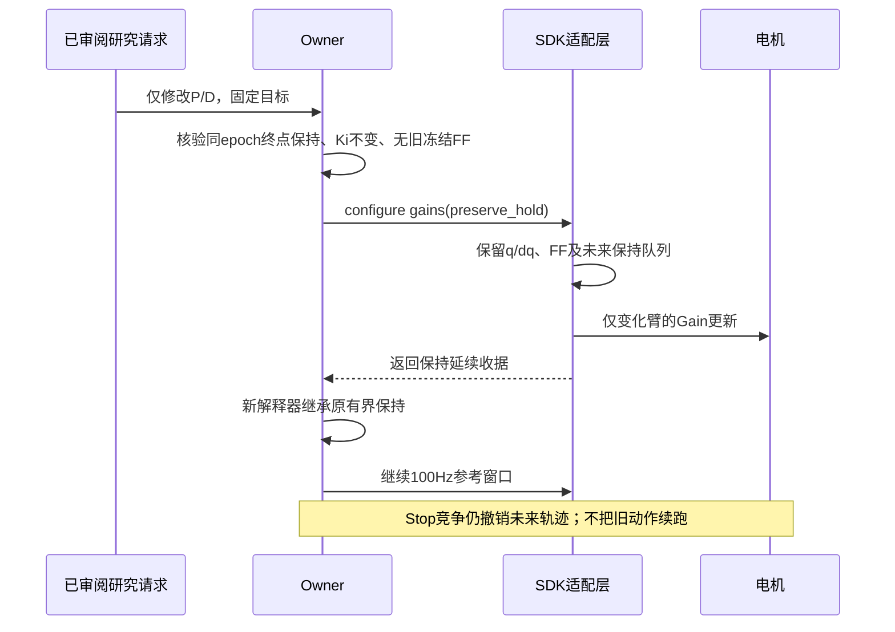

本节覆盖下方“继续105/3.5355或高PD固定后再降档”的下一步安排。用户明确要求从低增益重新研究，先找P的合适范围，再根据超调增加D；补偿也应在这组低增益下重新辨识。左J3、J2逐个测试，其余轴不同时修改；旧增益仅用于已验证的预定位与维护回零，不计入新研究结果。原始电流保护、0.8rad/s速度保护、Stop及故障退出契约均保留。

当前协议P为12位0～500、D为9位0～5；请求0.5/0.2预计编码为4/20，即约0.488400/0.195695，实机以独立TX解码核验。P以弧度位置误差生成协议名义扭矩，D以rad/s速度误差生成协议名义扭矩；不同控制接口的参数数值不能直接比较。低值作为本次实测起点，不预先认定最终最佳值。模型重力比例继续为1/1.4，I0禁止新增误差累加，不能将旧积分冻结量偷偷当成零积分。

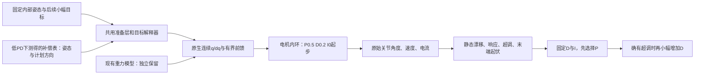

首批仅固定位置，左J3先、左J2后，各自独立执行身份。先从目标上方低速接近，要求切换前该轴P项绝对值<0.12名义Nm、位置误差<0.03°；研究期间使用0.5/0.2/0、不加载旧0.282补偿。沿用18秒平滑正负前馈模板，增量缩到一个协议码60/4095≈0.014652名义Nm，开始/结束归零，先观察基线再测小增量响应。静态诊断以0.25°漂移、0.05rad/s速度为停止门；这两个是取证诊断门，不替代原生0.8rad/s保护。异常即停止整个序列，不自动重试。

查表目前是辨识方向，尚未生成可部署的低PD补偿表。表的输入至少包括J2/J3姿态与计划接近方向，并绑定单位、模型、安装负载和适用范围；停位保持方向状态，表间平滑插值，不按含噪实测速度符号反复切换，不向未测姿态外推。此前高PD共同项/方向差只作先验，不视为低PD下已经成立的数据。

新候选及CPU证据入口：`.evidence/low-pd-restart-20261027-v1/`。181项Linux回归和2300窗口翻译器检查通过；覆盖保持输出继承、目标轴I0、新FF携带其他轴保持项、停止竞争确认撤销后保留连接等。SDK二进制未改；新RPC保持分支的Stop竞争属于CPU验证，本轮没有人为注入实机竞争或真实过载。4批共3074180帧，均零socket丢帧/无调度截断；均正常回零释放，最后12轴最大零位偏差0.273208°。实际最新源为`robot-workbench-lowpd-20261027-v1`，日常单位默认已恢复legacy，SDK DISCONNECTED、无持权/活动作业；新低PD及补偿没有推广到普通动作。最终状态和发布见本证据根`final-current-state.json`及`legacy-final/publication.json`。

用户授权清理不必要的历史中间结果后，仅将已完成CAN文本无损gzip，解压SHA256核对后移除冗余未压缩副本；二进制报文、原始内容、调度及分析均保留，没有删除其他任务数据或录像。原记录器空间门槛不变。先前未达标记录全部保留，不以新成功覆盖旧失败。

### 2026-10-27 最新：内部姿态的方向滞回可重复，共同补偿高PD通过，降档复核未过

本轮复用原已验证的SDK `c0464243…`，没有重新编译或扩大原始电流/输出保护。研究期间左J2/J3明确使用协议名义Nm，模型隔离比例仍1/1.4，Ki0；其余轴保持原配置。新增补偿是本轮数据计算、重新绑定的新制品，没有复用历史FF。以下结果覆盖下方“尚待双向对照”的安排。

**首先纠正辨识位置。** 第一轮要求J3到−1°准备下方起点，实际只到约+0.098°，未形成方向条件，脚本正常Stop，正负FF尚未执行。实际SDK输出目标确为−1°、反馈电流约−0.286A；SDK运行配置J3下限−0.1rad，而其实际使用的X5 URDF将J2/J3下限定义为0。证据与行程边界影响一致，不能把此前零位误差直接当成自由关节的重力/摩擦残差，也没有通过加大力继续向负侧试探。该次正常回零释放，失败保留。研究预检已要求双向范围位于URDF内部；全工作台的SDK/URDF限位一致性仍是待办，不宣称已全局修改。

改用冻结1.5×参考中1.837333秒的内部姿态：左六轴约`[-0.0172,4.6292,4.2080,-2.7602,0.1272,0.0523]°`。夹爪保持当前目标、右臂保持零目标；J3从目标±1°处低速到位，最大计划速度0.01rad/s。上下方向按下→上→上→下分两批，各轮同样施加0→+0.25→0→−0.25→0协议名义Nm的18秒平滑参考。两方向都核验实际达到起点后才记录。

|到位方向|J3无附加FF的平均偏差（两次）|左TCP静止峰值（两次）|
|---|---|---|
|从下方接近|−0.153573° / −0.153573°|1.4024 / 1.3996 mm|
|从上方接近|−0.000576° / −0.000576°|0.1650 / 0.1672 mm|

静态目标、P210/D5、单位/模型和Ki相同，差异随到位方向重复。正负小增量还留下不同的撤回后位置，说明历史依赖；不能归因于一个共同重力偏置，也不能只凭本组数据区分减速器摩擦、回差、弹性或角度相关扰动。独立CAN已解码核验两批各20个J2/J3静态窗口，原始电流与命令/角度证据保留。

局部近似由两方向的P残差求得：共同项约+0.28249、半方向差约0.28038协议名义Nm。它们是当前模型隔离比例/姿态下的命令域估计，不是独立物理重力和库仑摩擦标定。高P下半个位置码对应约0.0401名义Nm，不能把小数位当作物理精度。

先只加载共同项+0.28249，4秒五次曲线渐变，保持新补偿贯穿普通点的双向到位，再平滑撤回。CPU复用了实际继承逻辑检查2701窗口，补偿跨点不丢失、撤回连续且末端归零；实机记录也确认平台仍是该值。

|配置|加载后的静态峰值|从下方到位峰值|从上方到位峰值|本姿态静态1mm|
|---|---:|---:|---:|---|
|P210/D5，附加+0.28249|0.5155 mm|0.8909 mm|0.6280 mm|通过一次完整组|
|P105/D3.5355，附加+0.28249|0.1875 mm|1.4024 mm|0.7151 mm|未通过|

右端对应窗口峰值均小于0.26mm。全部数字为完整记录窗口的原始反馈FK三维距离；未平移时间、滤波或以均值替代峰值。高PD通过仅资格当前内部姿态，不代表全工作空间或1.5×轨迹资格。

首次降档尝试从低PD开始定位，在补偿加载前J3偏差−0.5033°触及0.5°诊断门，已正常Stop、用维护增益回零释放；该次不算“带补偿的低PD”对照。随后先以高PD从上方到位，要求J3 P项<0.12名义Nm、位置偏差<0.03°，再切换105/3.5355并加载共同补偿，完整低PD对照完成。D按√P同比例下降用于近似保留模型阻尼比，不把105/3.54称为最终低增益方案。降档后下方到位仍超1mm，故本轮没有恢复1.5×或推广新补偿。

四个完整批次独立CAN帧数分别1346619、1353147、1424816、1549045，均零丢帧、调度未截断；另有上述两个诊断停止批次，证据也保留。所有SDK均正常回零释放，最后12轴最大零位偏差0.273208°。没有真实CAN/原生故障重试，没有新视频/图像/GPU工作。原始CAN、调度、目标、反馈、各次执行身份与哈希核验数值副本位于`.evidence/ec-static-identification-20261027-v2/`及ARX对应任务目录。

下一步优先在已有慢速扫角证据上辨识方向/关节角度相关项，并在多个内部姿态复核后再做降增益。按本次低PD的共同FF加剩余P项，局部下一候选约为向角度增大方向0.564、减小方向0.123协议名义Nm，仅作为未验证方案；需要按计划方向保持状态、平滑切换，不根据含噪实测速度反复切换，也不能直接移植到关节边界或整段轨迹。低PD静态通过后才继续同一1.5×。

### 2026-10-27 后续已授权：双向静态辨识先于低PD

用户已明确要求继续单位候选、固定位置渐变及正反向静态对照，再在静态达标后验证低PD和同一1.5×。沿用已通过的小范围EC契约和原始电流边界，不重新编译SDK、不同时改模型/增益。分析与附加前馈统一用协议名义Nm，反馈同时保留原始A与兼容字段；物理输出轴绝对Nm仍未标定。

第一批研究左J3，在零目标两侧±1°分别低速预定位，再到同一零目标；顺序下→上→上→下，分两次短取证，每次两轮，正常回零释放。P210/D5、J2/J3 Ki0不变。每轮在同一位置施加相同0→+0.25→0→−0.25→0名义Nm渐变，2秒五次曲线升降、2秒平台，完整参考18秒；不会根据一次反馈自行加大幅度。其他关节目标固定，夹爪沿用当前策略，原0.8rad/s保护不变；预定位速度≤0.01rad/s，静态诊断速度≤0.1rad/s、零目标偏差≤0.5°。真实控制/CAN故障停止、不自动重试。

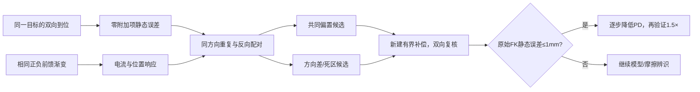

静态近似用`g_scaled(q)+FF+KP(q_target−q_actual)−KD*dq`对照原始电流乘Kt；两方向共同部分只作为慢偏置估计，两方向差只作为摩擦/滞回估计，需重复性支持，不能直接等同真实重力和库仑摩擦。若观察到方向相关且重复的误差，则在固定高PD下分别验证共同补偿与方向效应；若正负小增量仅改变电流，先量化可分辨位置响应边界，不直接跳到P0.5。研究补偿范围继续受原通道范围约束：后续候选J3最多±1.2、J2最多±0.5协议名义Nm，实际每一步以已取得数据确定；达到边界仍未达标则停止扩大并报告。

**2026-10-27更新：可回退的EC单位候选已完成CPU验证、左J2/J3各一次固定姿态小增量对照，以及单独的真实Stop/未来撤销检查。两次生命周期均已正常回零释放；目前工作台可访问、SDK DISCONNECTED，运行代码保留候选能力，但设备配置恢复旧单位默认。没有应用P0.5/D0.2，没有执行动态1.5×，静态1mm仍未达到。**

本次不可把“新单位验证”说成整臂重力已经校准：接入时选中轴的模型重力比例仍为1/1.4，保持旧实际输出；试验只对一个轴逐渐加入完整单位修正量的10%，然后归零。原始电流保护及最大CAN输出边界保持不变，旧FF制品与新单位不匹配会拒绝，选中轴要求Ki0。

|静态试验|实际CAN前馈增量（协议名义Nm）|实际电流增量A|关节平均偏差：前→平台→后|
|---|---:|---:|---|
|左J2|0.014652|0.009992|0.09380°→0.09589°→0.09113°|
|左J3|0.161172|0.105701|0.27321°→0.27321°→0.27321°|

计划增量分别为0.023769/0.157213；CAN字段存在约0.014652的量化步长，实际增量以线缆记录为准。两轴恢复后的前馈编码均回到原值。J3电流有响应而位置未跨过约0.02186°的编码步长，支持进一步区分静摩擦/死区与低于反馈分辨率的微动；不证明J3完全没有物理移动，也不能把单次响应当成绝对Nm标定或周期抖动根因。静态基线左端FK均值/峰值1.935/1.995mm，J3平台约1.849/1.908mm，包含其他关节变化，不能归因成J3增量收益。

Stop补验收在J3增量尚有未来平台/回落节点时触发。Owner已取消参考；Stop接收到保持返回本次约6.61ms。独立TX在请求后50–1500ms内12个关节的位置编码跨度均0、速度均为零编码，J3附加前馈被撤销。显式恢复为`already_operable_no_fault_cleared`，没有注入真实故障，不能声称真实故障清锁通过。最后12轴最大零位偏差0.273208°，正常释放。

最终173项Linux回归通过；旧/新模式18个原生故障案例、3个单位/限幅案例、6个原生导入/插值案例及真实SDK→适配器→RPC的假CAN组合检查通过，静态参考CPU执行2600窗口。物理两批CAN分别1032711/247712帧，均零丢帧、无调度截断；两批之间不宣称独立取证无缝覆盖。

首批在两组完整脉冲后触及研究脚本64MiB原始JSON缓存上限，正常Stop后维护回零已实际完成，但同一缓存检查又打断维护记录。已按真实执行身份核对这一次回零完成并释放，没有重发运动。记录器改为复用已有有界gzip内存流，134.2MB事件CPU回放压缩为19.8MB，保留64MiB压缩上限和8MiB维护预留；补Stop批次使用该修复完成。后续惰性发布还遇到Unix路径长度、复制时重排JSON使证据哈希变化、准备实例未关闭占用运维锁，均发生在SDK接入前；已修复，失败记录保留。另两次Stop启动预检分别因通用磁盘预算、混入旧派生manifest拒绝，均未接入：按90秒短取证实际预算保留2GiB+400MiB空间，输入包只包含源文件与当前请求后通过，没有删除旧数据。

证据根：`.evidence/ec-torque-contract-20261027-v1/`；主要入口为`static-analysis.json`、`unit-wire-analysis.json`、`stop-wire-qualified.json`、`tooling-incidents.json`、`final-current-state.json`。实际最终发布为`legacy-final/publication.json`，SDK SHA为`c04642434da4a6ab46d09adb688f5f00e3efb2ee1af71147fd54d53dbc6004d9`。下一步先设计双向、小幅静态辨识区分慢偏置与摩擦，满足静态1mm后再确定低PD范围并回到同一1.5×。

以下为2026-10-26形成的基线记录；运行/授权/完成状态由上方2026-10-27更新覆盖。

- 用户已确认机器为ARX X5；三路USB设备均为RealSense D405，左腕序列号与当前相机配置对应。
- SDK求解器对当前模型的重力与独立质量/力臂求和一致，最大差约`7.1e-15`；势能差分交叉检查最大差`1.24e-9`。这证明本组模型算术一致，不证明现场质量/质心与模型一致。
- Encos官方手册明确混控前馈字段为扭矩，固件在合成P/D/前馈后除以Kt；本机读回Kt=1.4，协议范围对应。现SDK发送前又除以1.4，存在明确的单位契约差异。原始CAN电流响应支持“扭矩字段进入固件再除Kt”，而非将其作为安培直接执行。
- 当前SDK还将EC电流回读乘1.4²。不能将该历史`effort`数值直接作为已标定的输出轴力矩。反馈比例修改会影响保护，不能只删一个乘法而不保持原始电流阈值。
- 受控静态基线已完成，J2/J3在线Ki0、无冻结FF、P210/D5；零位诊断姿态左端FK位置偏差峰值1.991mm，**静态1mm未通过**。低增益和动态轨迹未执行。
- SDK最终正常回零释放，12关节最大0.273208°；运行模块和页面默认配置未更换。2026-10-27用户已批准“新增单位契约候选并受控验证”；授权无需重问，实际构建/加载资格另行记录。

## 2026-10-27 单位候选实施设计（先于修改）

最小改动为SDK不可变的逐关节EC单位选择。默认空列表沿用旧换算；首轮只选择左J2/J3，以协议扭矩单位接收附加前馈。另设明确的模型重力比例：首轮为1/1.4，使接入、阻尼及零附加项的CAN输出与旧版一致。该比例是试验隔离参数，不称作已标定负载。其余轴、P/D、频率、速度保护不变。

反馈兼容字段仍保留旧`current*1.4²`，原始电流触发边界不变；新增诊断明确列出电流A、`current*Kt`名义扭矩及各轴命令单位。新单位轴的SDK指令限幅相应除1.4，保持原CAN字段上限；不能以更正单位为名放大最大输出。

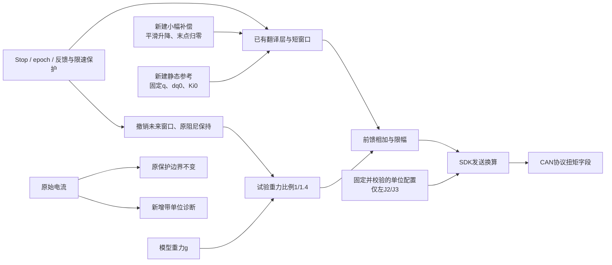

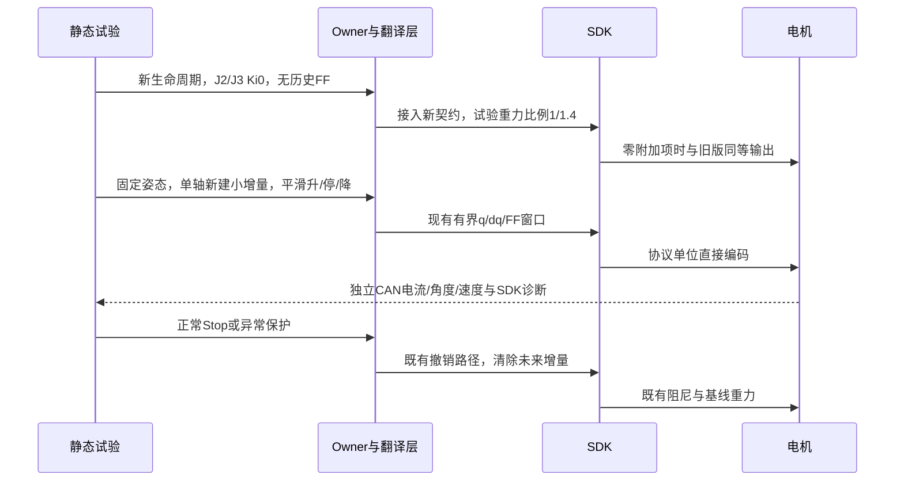

首轮保持P210/D5，按单轴0→10%单位修正量→0作固定姿态渐变；J3约0.157、J2约0.024协议扭矩单位，实际以新姿态模型值冻结。不是直接走到40%输出增量。沿用0.5°静态偏离/0.1rad/s试验门和0.8rad/s生产保护。记录基线、渐变、平台、恢复；若同向偏差扩大，则停止扩大修正量，转入模型/摩擦辨识。CPU需覆盖默认兼容、选轴、限幅、电流保护、故障阻尼、Stop/未来撤销、重接，以及旧补偿制品不可无条件迁移；实机检查不能由CPU通过代替。

## 1. 组件与单位链

```mermaid
flowchart LR
  M[URDF质量/质心/几何与重力向量] --> G[SDK模型重力 g(q)]
  B[主机历史FF与残余积分<br/>原SDK单位] --> A[SDK前馈总量]
  G --> A
  A --> C[当前EC发送路径：除以1.4]
  C --> T[实际CAN前馈字段<br/>厂家协议定义为扭矩]
  P[P×位置误差 + D×速度误差] --> U[固件合成扭矩需求]
  T --> U
  U --> K[固件除以Kt=1.4]
  K --> I[电流环与实际电机/传动]
  I --> R[CAN实际电流字段]
  R --> S[当前SDK回读：乘1.4²]
```

按手册定义，`I_req=(KP*e+KD*de+T_ff)/Kt`，EC-A4310-P2-36的混控扭矩范围±30Nm，电流范围±30A。
当前SDK将数值上属于模型Nm的g先除1.4再放入T_ff；忽略量化时，该部分的电流贡献为`g/1.4²`，而按手册单位应为`g/1.4`。
这意味着前馈通道的名义比例差为28.57%；修正后同一原始SDK数值的该项输入会增加40%。它**不意味着整机实际力矩必然增加40%，也不证明这一个因素解释所有误差**，因为P/D、历史FF、摩擦和模型误差同时存在。

比例问题不等于0.72°周期扰动根因。常量缩放本身不产生该空间周期；它可以改变闭环承担的负载，但不能据此排除传动、编码或摩擦因素。

## 2. 模型与现场负载

实际从当前已锁定模块的`RobotConfigFactory`读取到：

- 模型：X5；重力向量`[0,0,-9.807]`；base/eef为`base_link`/`eef_link`。
- 当前模型路径：`/home/wujie/work/feiyu.zhou/native-overcurrent-lock-20261026-v1/native-build-v1/source/models/X5.urdf`。
- SHA256：`b74c5fcf81901767fad33906852ae3400fad739270bd004653110577be11a08d`。
- 实际接入后端没有覆写重力向量或URDF；工作台另行设置DM速度编码/夹爪参数，不等于做了负载标定。

**纠正前一轮路径描述：**此前依据build receipt的`compiled_sdk_asset_root`推断仍从旧目录加载，这个推断不成立。纯SDK配置读取返回新构建目录；新旧X5文件字节一致，所以这次路径纠正不代表行为变化。

方舟官方Python手册第5页说明默认重力补偿仅包含夹爪；加装相机等附件后需要调整末端质量。厂家同时提供X5与X5-2025模型，末端质量分别0.60/0.65kg；当前第三方SDK模型为0.581kg。不能简单把这些数字的差全部解释为“漏了相机”：其他连杆质量/质心也不同。

|模型|link2质量kg|link3质量kg|link6质量kg|
|---|---:|---:|---:|
|当前实际SDK|1.165|0.546|0.581|
|厂家X5|1.0733|0.4994|0.600|
|厂家X5-2025|1.0733|0.4994|0.650|

在所查72个轨迹姿态，厂家2025与当前SDK的J2/J3重力差峰值约0.132/0.082模型Nm；仅加入已有几何零偏时约0.046/0.031。不同模型比较不是现场称重结果，不能自动晋级任何一个。
RealSense官方D405整机标称质量60g；按名义相机安装原点作质心估算，本段J2/J3附加重力峰值约0.236/0.245模型Nm。相机质心偏移30mm可额外带来约0.0177Nm的单轴上界变化。支架、转接件、线缆受力及实际抓取负载仍未被软件资料完整证明。

尚缺的现场事实不由用户猜测填补。可继续以当前安装的等效负载进行正反向静态辨识，但质量、质心、摩擦和真实Nm比例无法仅凭单个静态姿态唯一分离。

## 3. 本机协议实读与实际输出核验

SDK断开、总线主机TX安静后，只对can3的motor2/J2、motor4/J3各发送9个模式7参数查询，共18帧，全部得到对应回复；没有控制、使能、零点或参数配置帧。

|字段|J2/J3实际读回|
|---|---|
|Kt|1.4|
|KP/KD范围|0–500 / 0–5|
|位置/速度范围|±12.5rad / ±18rad/s|
|扭矩/电流范围|±30 / ±30|
|硬件/软件版本|1.0.1 / 1.0.0|
|电机CAN超时参数|500ms；本轮未修改|

固件版本读回不等于全部内部控制参数已标定。手册是厂家当前V1.20版；本机可读字段与对应定义一致，不将手册新增的所有功能外推为本机都支持。

利用第一次预检停止后的10秒原始CAN，将TX的P/D/前馈与RX位置/速度/电流组合成协议输入预测：

|关节|原始电流/合成输入比例|若字段为扭矩，期望1/1.4|按扭矩解释电流RMSE A|按电流解释RMSE A|
|---|---:|---:|---:|---:|
|J2|0.6790|0.7143|0.0582|0.1956|
|J3|0.7210|0.7143|0.0917|1.0969|

每轴约4870组TX/RX。此时停止保持的实际编码KP约20.879、KD约1.194，计算包含这些P/D项；**不是P0的纯重力悬浮实验**。插值只用于协议输入/电流关系诊断，不改控制精度评分。数据支持厂商单位定义，但没有外部力矩测量，仍不宣称Nm绝对精度已标定。

## 4. 受控静态结果与首次工具预检记录

### 首次预检

新SDK正常接入后，右J4约−2.20°超出工具假定的±2°起始范围；未下发静态位置目标或低增益。正常Stop完成、反馈健康静止。工具未正确展开Stop返回的嵌套回执，自动维护资格未成立，故没有绕过它直接回零。
随后核对真实Stop回执的barrier/accepted时间及已返回状态，独立启动维护记录，按正常接口回零释放；最大0.251351°。原失败与维护记录分开保留。首次捕获332382帧、独立维护41004帧，均零丢帧。两次捕获间的保持时段没有连续独立CAN覆盖，不冒充完整无缺口记录。

### 修正后的正式静态基线

保留原PD，J2/J3为210/5；新SDK的第一条位置参考直接以J2/J3 Ki0回零，保持其他轴设置，避免先开积分再关闭时继承偏置。既有`inherit_hold`确实可保留前段补偿，因此“Ki0”不自动意味着历史偏置为零。
本轮没有历史FF，J2/J3的SDK输出减去同模型重力后最大残差约0.000482/0.000478 SDK（反馈快照时间不同），支持不存在有意义的隐藏主机偏置。没有新增周期探针。

观察12秒、220份主机快照，并保留独立TX/RX和调度证据：

|指标|结果|
|---|---:|
|左J2平均位置偏差|+0.097759°|
|左J3平均位置偏差|+0.273208°|
|J2/J3位置峰峰值|0.021857° / 0°（反馈量化精度内）|
|左TCP位置误差均值/峰值|1.910 / 1.991mm|
|左TCP上下误差均值/峰峰值|1.903 / 0.159mm|
|右TCP位置误差峰值|1.135mm；本轮未调右臂|
|诊断过程关节最大偏差/速度|0.273208° / 0.065933rad/s|
|独立CAN|204074帧，零丢帧，调度未截断|

这是一组**零位、关闭两轴在线积分且无历史FF**的诊断结果，不可与此前递送终点、带补偿的0.3mm结果混为同一条件。
轨迹/保持时序完成，但静态1mm未通过；当前现象以偏置为主，不是该姿态下发生大幅周期振动。
之后恢复正常维护设置回零；12轴最大0.273208°、健康静止后正常释放。无CAN或控制故障，无SDK代码发布，无默认参数晋级。

## 5. 补偿缺口和低PD条件范围

在当前零位姿态，P项平均承担J2约−0.358、J3约−1.001的协议扭矩需求。它包括负载/模型、摩擦、到位方向、零偏等影响，不能直接称为重力模型误差。尤其方向为负，说明不能把“漏相机”当成唯一因素后直接增加所有前馈。
位置反馈半码对应P210约0.0401的输出估算不确定度；高刚度下不能声称已辨识到0.001量级的残差。

以每轴分别分配0.5mm的TCP位置误差预算，仅作局部估算：

|关节|当前TCP位置雅可比范数m/rad|P0.5允许的残余需求|P8允许的残余需求|P15允许的残余需求|
|---|---:|---:|---:|---:|
|J2|0.2063|0.00121|0.01939|0.03636|
|J3|0.4654|0.000537|0.00859|0.01611|

这些预算未包含其他关节贡献，也不是整个工作空间的1mm充分条件。当前未补偿残差远大于低P预算，因此**P0.5/D0.2/I0尚无执行依据**。

进一步独立计算模型惯量矩阵，并用纯SDK逆动力学逐轴加速度交叉验证72个姿态（无控制器构造）：

|关节|模型对角惯量范围kg·m²|P0.5/D0.2的模型固有频率Hz|模型阻尼比|
|---|---:|---:|---:|
|J2|0.1083–0.3000|0.205–0.342|0.258–0.430|
|J3|0.2115–0.2180|0.241–0.245|0.303–0.308|

模型中未包含尚未知的反射转子惯量、摩擦及固件动态，且对角近似将其他轴视为固定，不能将这些数字当成实机辨识结果。
若补偿缺口先满足上表，并以0.5–1Hz、阻尼比0.7–1作为低带宽静态初值目标，按`P=Jω²、D=2ζJω`得到：J2约P1.07–11.84、D0.48–3.77；J3约P2.09–8.60、D0.93–2.74。每一组必须由同一个姿态惯量/目标频率配对，不能任取范围两端拼成参数。
因此P约4–8、D约1–2可作为完成补偿核验后进一步缩小的候选区域；**不是本轮已批准、执行或通过的参数**。厂商给出的空载单电机参考15/0.5也不能直接套在整条承重机械臂上。

## 6. 下一步与新增SDK范围

用户已批准模型/输出核验、基于证据形成低PD候选以及受控静态验证。以上实际动作均在这个范围内；没有执行完整1.5×。

发现单位契约差异后，拟新增明确、可回退的EC扭矩单位入口：

1. 旧契约保持可回退，逐关节明确标识新契约；不得静默改变现有数值的含义。
2. 历史FF、Ki、限幅/斜率必须明确换算或重新辨识；不能沿用旧制品后叠加40%的前馈变化。
3. 反馈比例若修正，同时按原始电流保留既有保护触发边界；不借单位修复放宽过流保护。
4. 先CPU/原生编码与停止回归，再固定位置、高刚度保持下做有界渐变，仅针对左J2/J3；不直接换低P跑轨迹。
5. 实际辨识需分开正反向静态到位，区别重力慢偏置和静摩擦；合格后才推进低PD与同一1.5×。

该新增范围已于2026-10-27获用户明确批准，候选与受控静态/Stop检查完成情况见本报告顶部；未推广完整重力修正或低PD。
回零静态性能本身仍不是本轮推广目标；本次近零姿态仅用于重力诊断。长期内存、维护租约和真实软件故障清锁资格继续保留。

## 7. 来源与复核入口

证据根：`.evidence/gravity-model-audit-20261026-v1/`。

- `solver-audit.json`、`analyze.py`、`analysis.json`：模型路径/哈希、独立重力与势能检查、历史静态输出。
- `solver-mass-matrices.json`、`sensitivity-and-conditional-seeds.json`：模型惯量和条件初值；不是实机稳定性资格。
- `query_encos.py`、`encos-query.json`、`encos-parameters-decoded.json`：受限查询帧与本机真实返回。首次脚本在发帧前因缺失空nonce键退出，错误日志保留；修正后仅一批18帧。
- `static-v1/raw-unit-and-maintenance.json`：原始电流关系、预检失败与独立维护收尾。
- `static-v2/{analysis,static-completed,result}.json`、`snapshots.jsonl.gz`、`retrieved-manifest.json`：正式静态基线、原始快照及SHA核验。完整CAN和调度保留ARX同名目录。
- 方舟官方仓库：<https://github.com/ARXroboticsX/ARX_X5>，固定提交`c78328785ea23a81d908e1dcc551eca992f2f1e9`；手册/URDF文件大小、Git blob和SHA均校验，见`manuals/sources.json`。
- `manuals/python-guide.pdf`第5页：默认重力负载与加装相机的说明；`ros2-topics.pdf`前2页：2023/2025夹爪区别。
- Encos官方下载：<https://www.encos.cn/filedownload/3052924>；`manuals/encos-technical-v1.20.pdf`物理页11、31、43–47，分别为控制律、混控字段、查询和返回协议。相关控制律页已视觉核验，`encos-technical-source.json`保留哈希和来源。
- D405官方规格：<https://www.realsenseai.com/products/d405-series/>，60g仅为相机本体标称质量。
- SDK维护者说明：<https://github.com/real-stanford/arx5-sdk/issues/46>；反馈来自电流估计，不保证精确物理力矩。历史#37/#48的经验描述保留，但不替代本轮实际协议核验。

物理负载和真实Nm尚未完整标定，静态1mm未通过。不得把本报告的算法一致性、受控流程完成或手册参考值升级为整机精度/稳定性通过。
