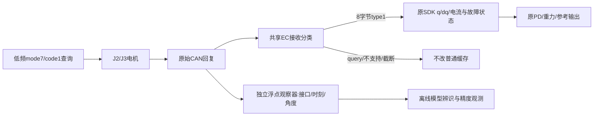
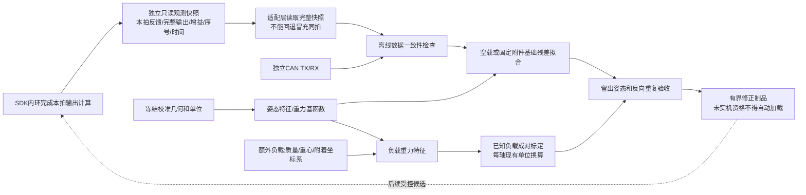
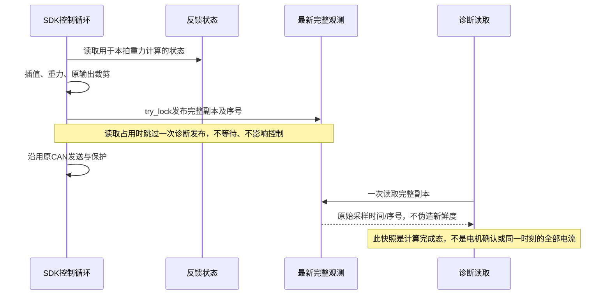

# 重力残差与可变末端负载：建模和观测方案

## 2026-10-28 目标已更新，细观测研究停止推进

用户将当前验收改为现有反馈一格内到位、无超调振动，运动允许滞后；不继续追求本轮0.01°测量入口。
SDK收包隔离v2此前已获批加载并通过普通Stop/生命周期验收；连接SDK后的独立浮点查询有回复缺失，
四块ABBA没有开始，现已停止推进。旧提案和CPU候选保留为历史，不作为当前待批准工作。

最新P100/400、D0/I0、标定重力基线的1.5×实拍在约4.91秒轨迹进度触发左J4速度保护，
当前尚无通过完整动态验收的最佳版本；随后显式维护恢复、正常回零释放完成，没有重跑研究。
当前目标、真实状态和视频证据统一见[控制阶段状态](control-runtime-status.md)首节及
`.evidence/current-control-video-20261028-v1/{delivery,analysis,final-current-state}.json`。
Owner为本任务session；新模型/测量/配置资格或真实状态改变时更新，不沿用下述历史active/未加载描述。

## 历史：2026-10-28细观测/编码残差候选，后续状态已由上节替代

完整目标保持：同一已登记1.5×整段轨迹中，J2/J3到位误差≤0.01°，控制过程不出现超调。
运动允许滞后沿用此前口径；本轮的静态观测及四块提案是研究阶段门，不代替整段验收。
证据入口`.evidence/j23-model-selection-20261028-v1/summary.json`，前一目标轮判定为有效进展，goal仍active。
新剂量/序列依此前约定先对齐；当前新SDK收包范围及四块方案已提交异步确认，未视为获批。
本节的维护触发为新模型/测量资格、SDK资格、用户批准、真实状态或实测结果变化。

### 后续CPU补查：总预算与插值位置，目标仍未达成

同一待确认SDK收包范围及A→B→B→A方案尚未取得人类答复，自动goal继续消息不作为批准。
上一目标轮与本次补查均有有效进展；本次没有SDK接入、发布、运动或新控制参数。
新批准、输出契约或数据变化时更新本小节。

现有192窗P误差代理与逐姿态编码项合计后，J2最大约1.04982、J3约1.88026 legacy SDK单位；
当前部署的附加总限值分别为1.2/2.0（已只读核对发布源函数及SHA）。
若保守地把最大旧P代理与一个完整位置码的0.21363 SDK预算相加，上界为1.06813/1.92264，
余量0.13187/0.07736。该筛查不要求扩大既有预算，但不是所需物理扭矩的实测或动态/负载可行性证明。
未来冻结前馈、积分和逐帧编码项必须共用总限额，不能各自使用一次完整限额；不可静默裁剪后宣称精度通过。

又用实际供应商quantizer，把100/200Hz参考q和前馈节点线性插值到500Hz，并遍历5个0～1.6ms采样相位。
这是对“在上层节点直接计算编码补偿，再线性插值”这一具体方法的检查，**不是对全部上层方案的不可能性证明**。
当前CPU比较未模拟上层FF slew limiter，不作为现有完整执行器回放资格。

|节点频率|关节|上层节点直接补偿最大等效误差/°|逐帧抵消最大等效误差/°|
|---|---|---:|---:|
|100Hz|J2|0.021827|0.002273|
|100Hz|J3|0.021823|0.002231|
|200Hz|J2|0.021822|0.002152|
|200Hz|J3|0.021826|0.002150|

100Hz的参考线性插值本身最大偏离约0.000176°；200Hz约0.0000642°，都显著小于上述编码问题。
加入真实节点插值后，逐帧CPU值约0.00227°，与前一节只算编码的0.002128°范围不同，不能混作两次实机结果。
证据为`output-budget.json`、`deployed-budget-source.json`及`node-compensation-check.json`。
保留同一1.5×轨迹和原始单位，不修改上层控制频率、SDK输出频率、PD或总限值。

现阶段仍缺：新SDK的完整回归/Stop资格、控机中的有效浮点测量、负载/历史模型的实机辨识与整段最大误差/超调验收。
当前这些CPU约束检查不能关闭整段≤0.01°/无超调目标。

### 已取得的新证据

1. 192窗中，同姿态/同方向的96组重复标签，每轴均有20组半极差超过0.01°。
   J2最大半极差0.01718°、J3为0.02186°。这是固定姿态/方向模型对现有P误差标签的代数拟合下界，
   不可据其宣称所有物理补偿模型均不可能达标。后续需要更细观测和历史状态。
2. 从已校验原始CAN重建384条J2/J3四秒保持曲线，每0.25秒统计。
   首/末1秒均值变化超过0.01°的窗口，J2为34/192、J3为20/192；最大变化约0.06557°/0.03247°。
   中位变化均为0，不能把所有窗口都解释成漂移。末2秒实际编码目标保持常值。
3. 厂家V1.20手册§9.3/§10.5列出mode7/code1角度float32查询。本机J2/J3均返回无错误的float角度与电流，
   新版code39编码器参数未返回，不声明本机支持它。SDK保持断开，首次六帧查询与后续100帧code1查询的
   主机TX增量分别精确为6和100，无本任务使能/运动/配置帧；设备侧既有超时阻尼流持续。
4. 每轴50个浮点位置样本中，J2有48个、J3有43个不同值，峰峰值0.002955°/0.001802°；
   同期粗16位码分别停在0.032785°/0.163927°，所有浮点值位于对应粗码区间。
   实际均匀查询约6.23Hz，往返中位约0.44/0.45ms、最大<0.63ms。
   它证明较细表示与单姿态重复读数可用，不证明绝对传感精度，也不代表已资格10Hz控机观测。

### 查询回复必须先隔离，不能直接混入控机

实际`libhardware.so`的纯函数回放表明：其comm_mode=0解码器收到A0/code1查询回复时，
位置rad保持原值，却把速度和电流缓存写为0；浮点角度字段也未被正确填充。
实际接收函数反汇编确认调用的就是comm_mode=0。该负例在CPU执行、strace无AF_CAN，未在连接SDK时发送查询。

候选在共享EC接收入口仅接受8字节type1正常/故障状态，查询及不支持/截断帧不进入普通状态缓存；
独立观察器按CAN接口和请求/回复时间保存float角度。原Guard仍以原始type1判断反馈健康，查询不能续命。

5000个含错误位的标准状态帧在候选与原库之间逐字节一致；查询、不支持和截断包保持整个状态数组不变。
CPU检查同时验证实际供应商接收GOT绑定到入口guard，strace无AF_CAN。
这是**standalone原生候选**，尚未集成/加载到实际SDK；必须继续资格SDK模块符号绑定、初始化、并发、
真实Stop/未来窗口撤销/恢复及生命周期。原库仅提供二进制，本候选通过固定ABI共享函数入口隔离；
库SHA与绑定必须在构造控制器前核验，不能在未知版本上静默启用。优先保留可替换为供应商源码修复的路径。

首次连续查询工具误把背景流计入1000条预算后退出，未保存部分样本；失败记录保留。
修复后只保留查询回复，背景流留计数/16条样本，2000条背景帧CPU回放通过。真实CAN未断流，SDK一直断开。
一个无效dummy CanInterface的CPU探针因公开头未含私有二进制布局失败；已弃用该路线，未构造硬件控制器。

### 编码补偿：先用可计算项消除软件损失

现有有效输出可写为`u = P*(q_CAN-q_actual)+u_FF`。
候选单独增加`delta_u_code=P*(q_reference-q_CAN)`，于是理想总输出等价于
`P*(q_reference-q_actual)+u_FF`。它补偿指令表示损失，不替代负载/摩擦模型。
由于原生500Hz时刻还会插值，必须在逐帧编码处计算；只在100Hz上层节点计算不能保证帧间抵消。
EC legacy中应在现有1.4换算之后的协议域相加，并纳入总附加输出预算；原始电流保护保留。

用本机实际供应商quantizer、同一1.5×参考，每轴17001个500Hz点、6种FF基值检查：
仅编码引起的最坏等效误差约0.02393°，抵消后最大0.002128°；最大附加量约0.153协议单位/0.214 legacy SDK单位。
q指令不变，P=0时新增项为0。它只是算术证明，未加载、未下发，不是机器人动力学仿真或真实无超调资格。
单独FF字段可能跳变，验收应检查它与编码P项合成的驱动力；不能据此放弃对总输出、q/dq、jerk和真实响应的检查。

后续模型分成可计算编码项、姿态/负载项、到位方向与静置历史项，保留现有PD内环。
从更细原始读数重新辨识各项；当前证据不足以宣称哪一完整模型已最佳，更未证明整段0.01°/无超调。

### 已提交对齐的下一步

先集成SDK收包隔离候选与独立浮点观测，完成CPU回归及受控加载/Stop/恢复资格；编码补偿继续仅CPU。
然后在姿态6、左J3、路径正向，执行A→B→B→A四块：A为同样46秒全零附加输出，B为原
0/+5/+10/0/−5/−10/0序列，3秒渐变/4秒平台；每块沿原C3路径到位、返回并正常回零释放。
双臂P100/400、D0/I0、0.8rad/s、夹爪及负载身份不变；左J2/J3浮点观察目标10Hz，实际频率/时延需另验。
真异常停止、不自动重试，不加入新的速度/漂移急停阈值。四块用于分离时间沉降与剂量效应，随后再扩展模型及整段验证。
具体机器字段、CPU门与范围见`next-proposal.json`；用户未答复前不加载或执行该新增研究。

## 2026-10-28 01:21：八块有界前馈对照完成，尚未推广补偿

用户明确批准姿态6、22，左J2/J3逐轴，路径正反到位各一次，共8块；实际证据入口为
`.evidence/ff-local-response-20261028-v1/summary.json`、`final-current-state.json`及`phase-metrics.csv`。
每块额外输出为`0→+5→+10→0→−5→−10→0` CAN码对应的legacy SDK增量，峰值±0.205128205；
3秒七阶渐变、4秒平台。双臂P保持`[100,400,400,100,100,100]`，D/I为0，0.8rad/s及原始电流/位置/反馈保护保留。
原参考的已资格C3路径用于双向到位和返回；研究窗口不改变q/dq或未选关节附加输出。

现有静态入口单份上限30秒，因此每块46秒序列在中间零平台拆为两份23秒制品；
交接期间保持相同q/dq、零附加输出，实际交接间隔0.406～0.450秒独立留证。
各平台统一统计末2秒；中央零平台使用第二制品的初2秒，图中省略交接等待并标明。
最初中央平台较早的诊断统计保留为`analysis-initial-center-window.json`，最终统一使用`analysis.json`。

### 实测结果：相对实际CAN编码目标的平均残差

下表单位为度，正值表示反馈小于编码目标。它不是相对任意名义目标的真实空间精度。

|姿态|关节|到位方向|初始0码|+10码|−10码|最终0码|
|---|---|---|---:|---:|---:|---:|
|6|J2|路径正向|0.03114|0.00000|0.06315|0.03281|
|6|J2|路径反向|0.03975|0.00863|0.05232|0.04013|
|6|J3|路径正向|0.15300|0.15300|0.15300|0.15300|
|6|J3|路径反向|0.08743|0.08743|0.08743|0.08743|
|22|J2|路径正向|0.06557|0.02884|0.02186|0.02186|
|22|J2|路径反向|0.06557|0.04371|0.04371|0.04371|
|22|J3|路径正向|0.06521|0.04371|0.06053|0.05029|
|22|J3|路径反向|0.06557|0.04371|0.06557|0.05730|

- 姿态6的J2在两方向加10码后，残差均减少约0.031°；撤回后基本回到初始水平，支持局部输出—位置响应。
- 同姿态J3在两方向的各7个平台中均未观察到位置码变化；残差分别约0.153°和0.087°。
  实际CAN附加量、原生附加输出及反馈电流均发生变化，不能解释为前馈未发送；但一个位置码内的微动仍不可见。
- 姿态22的J2在正向/反向干预后分别留下约−0.04371°/−0.02186°的零补偿返回差。
  它可能包含干预后状态记忆、摩擦/弹性预载、慢漂移或蠕变；固定顺序的本轮数据不能独立分解这些因素。
- 姿态22的J3正反向加10码均减少约一个位置码（0.0215°/0.0219°），说明小剂量响应随姿态变化；
  不能用姿态6的无跳码现象推广至全部姿态。

P400下一个位置码对应的P项变化为`400×25/65535=0.152590219`协议输出单位，
10个前馈码为`10×60/4095=0.146520147`，理想自由平衡位置变化仅0.020987465°，
略小于位置码0.021856939°。这是协议域的线性近似，不是轴端力矩标定，也不能据未跳码认定实际完全不动。
数值与假设见`resolution-accounting.json`。

静态误差与保持波动分别报告，未用平均值掩盖位置峰峰值。本轮每方向只做一次，无重复性资格；
没有把这8块拟成可发布模型，原192窗候选继续保持离线。
正反差异和撤回差使单一姿态函数不足的风险更明确，但仍不能把全部误差唯一归为重力或摩擦。

### 资格、状态和下一步

本节为2026-10-28实测状态记录；新采样、剂量、单位、负载、模型资格或真实运行状态变化时更新，
实时状态仍以带采样时间的原始收据核验。

本机与ARX Linux均执行实际8块驱动体及8份解释器输出检查：选定轴有界、其余附加量为0、q/dq不变、
零尾部、撤销后不提交、正常回零释放路径通过。生产代码、SDK二进制、重力参数与单位契约均未修改。
实机8块全部完成，无控制故障或自动故障重试；每块均正常回零释放。
独立CAN共13,274,313帧，socket丢帧0、调度截断0；原文和二进制本地gzip解压SHA均核对，远端原件保留。
同拍观测共9507条（包含缓存重复，不当成独立电机样本），校准身份、增益和附加输出范围通过。
12轴最大回零偏差不超过0.251351°。
唯一工具事件是第四块启动时监控读取空日志越界，硬件驱动独立继续；仅修复读取并监控原身份，未重放动作。

最终真实状态为SDK DISCONNECTED、无holder/nonce/活动作业或录制，保存配置不变。
0.01°未验收：例如姿态6的J2名义45.05738°，实际编码45.03622°，已有约0.02116°指令量化差；
反馈零码差不能独立证明最终目标。真实轴端扭矩与新增夹持负载尚未标定。

下一步优先：先设计等时长零补偿保持对照和跨方向重复，分离时间漂移与干预后记忆；
再据协议尺度设计J3更可辨识的有界剂量，具体幅度/序列仍须按既有约定先对齐，不自动扩大。
随后才拟合并资格方向/历史相关修正，保留新的留出姿态；当前6/22已参与干预，不再冒充完全未见验证点。
额外负载配对标定、较细测量及指令量化处理、同一1.5×动态平顺性/静态TCP验收继续保留。

## 48姿态实施结果：192窗完成，模型候选未加载

2026-10-27完成。统一入口`.evidence/gravity-sampling48-20261027-v1/summary.json`及
`final-current-state.json`。双臂研究增益为`[100,400,400,100,100,100]`，D/I全0；已保存至工作台研究配置，
结束后正常回零释放，SDK断开、无持权/活动作业。旧默认增益用于维护回零，不混入静态统计。

48个等时间间隔姿态、正反各2次，共192窗；36姿态的144窗用于拟合，12姿态的48窗留出。
F1在完成39窗后因研究工具64MiB事件预算停止，正常回零释放；已完成窗口保留，F1b新身份补9窗。
工具事件缓冲改为任务内独立256MiB上限，保留8MiB维护空间，不改变Owner、SDK或保护阈值。
R1、R2、F2各48窗完成。五份原始流共22647944帧CAN，无socket丢帧、无调度截断，
本地gzip解压SHA逐份匹配，远端原文保留；每批12轴最大回零误差均0.273207567°。
新参数下未再触发速度保护。19436条静态原生观测通过双臂增益、零主机偏置、同拍字段和标定身份检查；
其中包含10Hz缓存重复，数值统计使用独立CAN，不把缓存重复当独立样本数。

### 离线预测结果

先比较重力形状基函数、路径相关前馈表，再用训练姿态内部3折选择正则化检查较灵活的姿态/历史模型。
路径表整体较好，但仍不足以支持0.01°验收。表中为**留出输出预测残差除以P后的等效角度RMS**，
不是施加补偿后测得的真机角度误差；本轮没有加载任何拟合补偿。

|左臂关节|原待补偿量等效RMS/°|路径表预测残差等效RMS/°|
|---|---:|---:|
|J1|0.0791|0.0224|
|J2|0.0427|0.0193|
|J3|0.0885|0.0327|
|J4|0.0916|0.0439|
|J5|0.0568|0.0219|
|J6|0.0492|0.0281|

路径表留出最大等效残差仍达0.0437～0.1050°，不能用均方值掩盖。单纯重力形状模型留出RMS约
0.026～0.058°；扩大姿态/历史特征后约0.027～0.048°，未显示足以直接发布的整体收益。
模型均为当前左臂任务路径候选，不能泛化为整个工作空间，更不能宣称质量/重心已真实辨识。
右臂本轮固定姿态，未得到其全姿态模型。额外负载几何项有CPU验证，但没有加载物体的实测标定。

最终拟合标签采用独立CAN实际前馈之外的`KP*(q_cmd-q_feedback)`，D/I为0。
不把原生输出与CAN字段的不同编码/换算尺度误当负载缺口；最初使用统一原生到wire换算的诊断版本
已标为`*-pre-unit-audit`，不用于候选。模型数值域明确为CAN字段，尚未资格直接转换成全轴SDK附加输出。
J2/J3的既有EC增量映射可供下一步小信号验证；DM各轴映射仍应独立核对。

同姿态首轮正反到位差的各轴平均绝对值约0.035～0.065°；两轮反向重复差约0.002～0.008°。
支持方向/历史项重要，但不能将所有残差定性成确定摩擦。详细数据、三类模型与拟合脚本均在统一证据根。

### 前一阶段提出的提案（2026-10-28已执行，见文首）

先测现有48点中的索引6、22（原参考约4.604s、15.938s），仅左J2/J3逐轴加有界输出，
其余研究条件不变；每个姿态正反到位各一次，共8个块。每块额外CAN码为
`0→+5→+10→0→−5→−10→0`，3秒渐变、4秒平台；EC映射峰值约±0.20513 SDK单位，低于既有±2范围。
每块正常回零释放，不增加新保护阈值，真异常停止。目的为测局部输入—位置响应和方向记忆，
避免仅凭P项重构来假设所需补偿。具体字段见`next-ff-probe-proposal.json`。
用户于2026-10-28明确批准该具体提案；八块结果、实际资格与当前状态以文首为准。

## 最新实施约定：48姿态与混合P增益

用户确认无新增夹持物。经历右J5速度保护后，最新明确配置为双臂每侧
`P=[100,400,400,100,100,100]`、`D=[0,0,0,0,0,0]`、`I=[0,0,0,0,0,0]`。
它取代下文历史的全轴P400方案；正常回零/释放使用已有维护流程。
48点为原1.5×参考时间等宽区间中点，不含端点外推；正→反→反→正四批各48窗，共192窗，
每窗保持4秒、末2秒统计。每第四个姿态整组留出，36点拟合、12点验证。
右臂在该原轨迹中为固定姿态，因此该数据能辨识左臂路径内修正，不能宣称右臂全姿态模型已辨识。

实际证据根`.evidence/gravity-sampling48-20261027-v1/`，优先以该根的发布、执行与状态收据判定进度。
100份双向过渡参考已通过C3端点连续、原限位、规划速度/加速度/jerk检查；与原路径的最大关节偏离
约2.33e−8rad。原0.8rad/s速度保护、电流和故障保护不变。

### 两次前置事件与处理

首次接入被SDK模型路径检查拒绝：新二进制的工厂URDF位于新构建目录，而标定制品仍绑定旧目录。
在原生控制器构造前已拒绝；独立CAN仅7条参数查询，无运动控制帧。已保留失败、通过标准维护接口
清退退出实例，重新绑定相同SHA的源URDF；质量、重心、几何、零偏和左右烘焙模型未改变。
发布预检现同时检查真实SDK工厂返回路径和重力向量，避免只检查模块来源。

第二次在全轴P400/D0保持阶段，右J5触发0.8rad/s保护，触发反馈0.930402rad/s；48姿态尚未启动。
原始CAN显示目标始终约−0.010928°，切换前反馈约−0.120213°，已有0.109285°误差；
P约29.9145→400、D1→0，P项协议代理瞬变约0.705893。约88.7ms后触发保护，首0.1秒位置峰峰值0.633851°。
这次脚本沿用单关节逻辑，只匹配J2后就把12轴增益一起改大，是执行器扩展遗漏；已改为12轴均匹配反馈。
P增大、D移除、已有误差同时变化，不能凭此次区分完全匹配后的稳态稳定性。

保护记录SDK保持约2.47ms返回、约0.312s确认静止；随后显式Stop回执确认、反馈健康静止，
仅为维护显式恢复，以原维护增益低速回零并正常释放，没有续跑失败研究。
旧驱动等待记录器60秒超时导致内存中的快照/事件未归档，原始CAN和阶段文件仍完整保存；
已取消该等待超时，后续让驱动保留有界缓冲直到SDK退出、记录器归档完成，避免再丢失。

用户指定降低J1/J4/J5/J6至P100后，新身份四窗资格通过，691条静态样本确认双臂上述实际增益、
同拍快照和零附加积分；816417帧独立CAN无丢帧/调度截断，正常回零释放。
48姿态研究在该资格后推进，失败事件不混入训练数据。

Owner：session `01a16327-7545-7332-a361-0123ddad811d`，2026-10-27。
维护触发：观测API、单位、载荷定义、拟合资格、验收口径或实测结论变化。
前序证据：[五批剂量对照](ec-units-and-gravity-identification-20261027.md)。

## 目标及当前授权

用户同意先得到现有单位下能预测所需输出的修正模型，不要求系数等于真实质量/重心；
额外夹持负载必须分离。最新明确口径：静态到位优先，运动允许滞后，0.01°为最终目标，
补齐更细测量后验收。目前CAN指令与位置反馈一步均约0.02185694°，零码差不能证明真实误差≤0.01°；
对任意名义目标的最终0.01°验收还需处理指令量化，不仅是提高反馈测量分辨率。

本阶段保留关节PD内环，属于模型前馈/残差补偿，不是MPC；没有滚动时域在线优化。
现有机械几何、关节零偏、单位映射、0.8rad/s和原始电流保护继续作为冻结输入。
新增姿态/补偿剂量先形成具体可审阅序列再实机执行，不把CPU资格写成实机通过。

## 组件图

固定安装的相机、夹爪和线缆归入基础配置；新增杯子/物体归入独立负载。
负载参数是质量kg、重心m及明确的附着link坐标系。抓取中心改变、换工具或夹持位置改变时
需更新负载重心/身份，不能只保存一个“杯子重量”。空载指没有新增物体，不指拆除固定附件。

## 同拍观测时序

快照须包含本拍使用的反馈q/dq/电流、完整输出q/dq/前馈、增益、序号、计算时间及故障标识。
单独getter旧接口保持兼容，但新辨识不使用它们拼接成同拍快照。
发布使用try_lock，诊断读取滞后只影响诊断样本可用性；序号及时间明确暴露，控制保护不依赖该缓存。
正常与故障保持快照区分；未发布过有效快照时返回未就绪，不返回看似有效的零输出。

## 修正模型

在每轴现有输出单位中建模：

`u_required_i(q,history,payload) = u_nominal_i(q) + delta_u_base_i(q) + u_history_i + u_payload_i(q,payload)`。

`delta_u_base`采用少量可辨识的重力形状基函数；系数可按关节分别拟合，不能据其数值宣称
真实质量/重心已辨识。固定单位映射与原始电流通道同时保存，输出指令代理和电流代理分别报告，
不能把两者差直接命名为重力缺口。

负载重力可写为`Y_payload(q) * [m,m*cx,m*cy,m*cz]`，由冻结几何计算；
转成每轴现有单位需要固定的名义换算和后续已知负载对照。没有已知负载数据时只资格几何计算，
不得宣称新负载补偿已标定。静态数据不辨识转动惯量；恢复运动后，动态惯性/摩擦另验。

同一姿态正反到位必须重复；方向项是扰动代理，不强行解释为纯库仑摩擦。
基础模型以空载/固定附件数据拟合，已知新增负载以配对差拟合，训练与留出姿态分开。
拟合报告必须包含有效秩、奇异值、留出误差、单位与外推范围；窄姿态不足时拒绝发布模型。

## 验证与阶段门

1. CPU检查：快照并发一致性、读端阻塞不反压控制、未就绪/故障标识；普通输出与原保护不变。
2. 离线检查：重力基函数等于现有URDF重力求和；负载项与势能数值导数一致；零负载贡献为零。
3. 新实机数据之前，给出源轨迹内候选静态姿态、方向序列、重复数和不变参数；具体动作按已约定先对齐。
4. 以留出姿态的静态误差及保持波动选模型，保留CAN量化不确定性。修正输出有界，不因拟合追零放宽保护。
5. 模型候选通过后，再验证同一1.5×运动。静态前馈改善不等于动态跟踪已通过。

## 当前状态

2026-10-27已实现独立完整观测API、适配层读取和离线重力/负载特征及残差拟合。
SDK候选build `0f2348047c827dc93568ac6d35346a4eabf63695be767a293b7bc5a5ae1cfe16`已构建，
证据根`.evidence/gravity-model-payload-20261027-v1/`，尚未加载到运行服务。
实际SDK加fake transport的2000次计算/1270次并发读取、读者占锁时不阻塞写者、故障快照区分通过；
18项原生故障情形及3项单位/限幅/原始过流检查通过，strace无AF_CAN。
适配层、代数及相关本机25项检查通过；Linux组合回归见同根`python-qualification.json`。

离线重力求和与原校准模型100个姿态对照最大差1.78e−15；额外负载项与势能数值导数、
零负载、显式单位映射和未参与拟合的合成姿态验证通过。
这些是实现资格，尚无新实机训练样本、合格拟合系数或新增负载实测资格。

## 下一轮可审阅采样提案

**2026-10-27用户修订并明确授权**：没有新增夹持物；双臂12个旋转关节均使用P400/D0/I0，
改为均匀48姿态。以下旧12点提案已被取代，不执行。新采样点按原1.5×参考时间的48个等宽区间中心取值，
使首尾也能从路径两侧到达；不外推原路径。保留双向各2次，得到192个4秒窗口，按四个遍历批次
前进→后退→后退→前进执行，批间正常回零释放。每第四个姿态整组留出，训练与验证不混用同点的重复。
先以原7.65°四窗资格新快照和全臂增益，再开始48姿态；夹爪目标与禁用策略不改。

### 原12点提案（历史，已被48点取代）

只使用已登记1.5×原参考的姿态，输入SHA `9577e632e2f91c3a40c681b11d8283350569351fc254bb7b92f9dc03ce324b81`。
8个拟合点、4个留出点，原参考时间如下；精确六关节角度在`pose-proposal.json`。

|用途|1.5×参考时间/s|
|---|---|
|拟合|0、1.25、3.50、4.75、12.50、15.50、33、34|
|留出|2.75、11.75、20、28|

选点使当前重力基函数代数秩及相对1e−3数值门下的秩均为10；这不是物理参数唯一性的承诺，
更不是通过12点覆盖全工作空间。选择采用数值信息量及姿态差异，来源路径成员关系不替代新停位/过渡验收。

提案先在既有7.65°/P400/D0/I0条件完成新观测链四窗与正常释放验收；再采12姿态，每姿态正反向各2次、
保持4秒统计末2秒，共48窗。J2沿用P400/D0/I0，J3沿用P210/D5/I0，其他轴维持已验证配置，
不加载新的残差或负载补偿。过渡沿原参考路径、采用平滑停位/回零，不能把原路径成员点直接用直线拼接。
实际控制参考制品仍需在具体序列获批后完成同路径重定时、限位与连续性检查，再执行。
原0.8rad/s、电流、反馈和Stop保护保留，真控制/CAN异常停止，不自动重试；不增加额外诊断急停门。

第一轮必须确认没有额外夹持物；若有，应先记录负载和抓取坐标，不把未知载荷纳入空载基础模型。
额外负载首版采用显式质量/重心配置；未知负载在线估计不在本次候选资格中。
完整实机采样方案待用户审阅。当前仍为原A/legacy部署正常断开，无新增控机；未声明0.01°达标。
