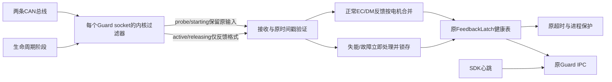
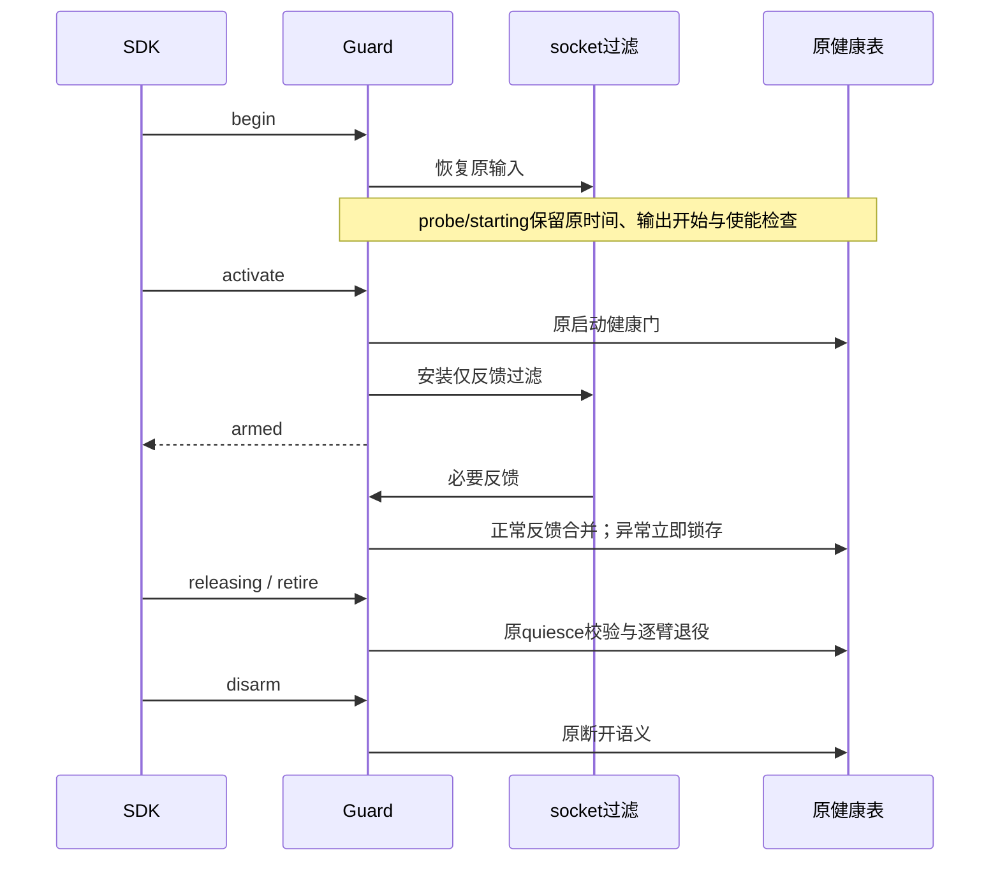

# Guard 前置过滤、状态合并与 35 ms 根因复现

Owner：Session `01a16327-7545-7332-a361-0123ddad811d`。2026-10-24。
最新状态：用户恢复研究后，过滤/合并及增强取证已随 smoothness-resume-20261024-v3
实际发布，初始化/反馈及必要维护中的正常释放已核验；五段研究未复现延迟故障。
详见[恢复研究报告](control-smoothness-resume-20261024.md)。历史 35 ms 根因仍未确定。
下方为独立候选 v2 的 68 项 Linux 检查与发布前调查记录，原始依据为
`.evidence/guard-frame-audit-20261024/`；本轮证据位于
`.evidence/guard-reduction-rootcause-20261024-v1/`。
维护触发：接口、保护语义、候选资格、复现归因或实际发布变化。

## 目标与独立验收

1. 正常运行时，在 Guard Python 接收之前排除不需要的 CAN 报文；重复正常反馈合并为
   每电机最新时间/状态，异常不被后续正常消息覆盖。初始化、故障锁存、100 ms 超时、
   释放/retire/disarm 必须保持原语义。
2. 独立复现历史 256 帧 wall 35.817 ms / thread CPU 29.474 ms，定位具体消耗。
   任意注入 sleep 或压力把 wall 拉到 35 ms 不是历史根因证明；过滤后变快也不是归因。
   必须分别记录输入、环境、各阶段 wall/CPU、实际竞争源及对照修复。

当前生产源码仍为 latency-root-cause-20261023-v2；独立采样与 CPU 检查不接入/运动、
不改变实际 Guard。新接入的 inference SDK 保持运行，不能为候选测试替换它。

## 候选组件与信息流

内核过滤拟用每 socket 的经典 BPF，不改变总线、SDK socket、帧发送或全局 loopback。
仅 CAN ID 过滤不足：EC 控制/反馈共享 ID，因此同时检查响应格式；保留所有原解析器
能够识别的故障/失能状态，不能只保留“正常”状态。初始化使用发送回显识别 output_started，
故 begin 前恢复宽接收，activate 验证后才切换反馈过滤；过滤安装失败走原监督异常退出，
不得默默失去监控。新过滤器不回溯修改已在队列中的帧，后置验证继续保留。

普通反馈合并只在 active/releasing 使用，复用原接收有效性判断；每电机合并最后时间，
状态异常前先提交本批正常前缀，再按原顺序锁存异常，后续正常帧不能抹掉故障。
probe/starting 不合并；release 中 retired 总线不再更新/参与丢失判断，其他总线仍受保护。
不修改时间戳、100 ms 门限、SDK 输出、增益或轨迹。现有调度边界不作为根因解决证据；
是否需要保留/调整它，须由吞吐与时延实测决定。

## 复现路线

固定旧代码与真实 256 帧输入，分别比较内存回放、内核 datagram 接收和独立被动 CAN；
复现与候选测试的时间统计分开。先定位 recvmsg、解包/时间戳、时钟转换、状态更新与循环
开销，再检查解释器、GC、系统调用及调度。任何人为扰动只能作为机制实验，不能冒充历史
事故的证据。短时无复现必须保留“未复现”，不得把原因改写为已解决。

初步对照：同一 passive observer 在系统 Python 3.10 下满批 1.325 ms，在生产使用的
Conda Python 3.11 下满批 1.194 ms；新实例环境无 PYTHONTRACEMALLOC/PYTHONMALLOC
覆盖，clocksource=tsc。单纯解释器版本差异尚不能解释历史 35 ms。

## 候选实现与资格（2026-10-24，最终 v2）

实现位于 `robot_workbench/can_feedback_filter.py` 与 `arx_output_guard.py`。
每 socket 的经典 BPF 根据 CAN ID、DLC 和协议响应特征前置过滤；DM 的所有状态值均
保留。begin 恢复宽接收，activate 原健康门通过后安装反馈过滤，安装失败进入原监督异常
路径；SDK socket、总线发送、增益与控制参考不变。内核过滤不清除已排队数据，原后置
验证继续存在。live passive 测试最开始的少量旧回显仍由后置验证排除，不能宣称队列被追溯过滤。

正常反馈在单轮接收批次内按电机合并；有效性在原接收处理时间判断，保留原始 RX 时间。
异常/失能前先提交正常前缀，再按原逻辑锁存；probe/starting 不合并。该方法没有通过
延后正常发布来凑固定批量。自然流通常每批很少，合并的收益主要在积累批次；不宣称普通
每个反馈都能被省掉，也没有新增聚合进程。现有 0.5 ms 调度边界未放宽，且不计为根因修复。

同时加入每批次的轻量 wall 分段计时：recvmsg、报头/时间戳、时钟映射、反馈验证、
合并/异常转换和合并状态提交；IPC 已就绪时再增加线程用户态/内核态 CPU、上下文切换、
缺页变化量。未就绪批次的 CPU 细分为 None，原总批次 CPU 仍保留。它包含测量开销，
不是零开销探针。>=5 ms 的批次概要留在 process_evidence，
结束/故障时由原持久化路径保存；热路径没有新增文件写入。

验证：

- Linux 68 项：过滤器 4、Guard 27、SDK 进程 18、控制操作 19；覆盖初始化回显、过滤
  失败、完整正常释放、逐臂退役、反馈丢失/恢复不清锁、心跳故障、故障后正常消息等。
- 协议 CPU 检查穷举首字节及相关 CAN ID/扩展/RTR 等输入；禁用夹爪过滤边界保持。
- 真正的 Linux socket BPF 对 63,305 条捕获数据回放，准确保留 31,657 条有效反馈，
  丢弃 31,648 条回显；保留字节与顺序一致。回放使用 Unix datagram，未发送 CAN。
- 独立真实 CAN socket 被动验证约 5 秒，有效反馈 31,650 条、13 个电机均约 487 Hz，
  未观察到 observer socket drop；生产 SDK nonce/epoch、READY 和健康保持不变。
- 完整影子监督循环使用真实 CAN 与假 SDK 心跳子进程，正常完成释放。候选 30 秒 CPU
  5.990 s；同候选、同 0.5 ms 边界/合并/诊断，唯独关闭 observer 的内核过滤时 CPU
  11.731 s，当前这组分次对照下降约 48.9%。它支持前置过滤的减负效果，不是长期稳定性
  或历史 35 ms 根因证明。生产源码、SDK 和控制参数没有更换。

候选冻结路径：`/home/wujie/work/feiyu.zhou/robot-workbench-guard-reduction-20261024-v2`。
最终回执为 `candidate-v2-checks.json` 与 `shadow-v2-{filtered,unfiltered}.json`；
v1 的 67 项检查及先前 CPU 对照独立保留，不作为最终 v2 数字。
本轮 `qualification.json` 记录源码 SHA、检查和资格边界；真实 SDK 的候选发布后生命周期
尚未验证，不把假 SDK 的 CPU 监督测试写成物理发布验收。

## 35 ms 调查结果：仍未复现，不能宣称根因解决

历史目标是 **256 帧 / wall 35.817 ms / thread CPU 29.474 ms**，不是任意一种 35 ms
端到端等待。历史原始帧、逐阶段 CPU 和当时完整调度环境没有被保存；现有证据只定位到
CAN 批处理段，不能唯一决定为什么该段单位工作异常昂贵。

|实验|结果|能说明什么|
|---|---|---|
|同帧内存/内核 datagram，带/不带分段测量，共 800 批|无 30 ms 批；带计时最大约 2.452 ms|正常解析/内核收包成本没有重现历史值；包含探针开销|
|旧完整监督循环、生产配置导入、同解释器与运行库环境，300 秒真实 CAN 旁听|29,822 次心跳；最大 CAN 批次 0.440 ms，最大往返 2.280 ms|该观察窗口未复现；没有用实际 SDK 或真实控制生成故障|
|只在影子 select 前等待 40 ms，三次积累真实满批|读到 256 帧，最大批处理 CPU 2.562 ms|积累本身不足以重现 29.474 ms CPU；约 40 ms 往返来自人工等待，绝非成功复现|
|再取 1,000 个不同的实时 256 帧批次，带分段计时及原始帧采样|wall 中位 1.709 ms、最大 4.115 ms；CPU 最大 3.812 ms|40 ms 仅等待旁听队列且不计入批处理；仍未复现历史异常昂贵批次|
|同一次 300 秒观察|约 53 万次 CPU 迁移，仍无历史慢批|迁移计数高本身不是根因证据；没有改生产亲和性|
|现有 Guard 的 20 秒系统调用观察|recvmsg 最大 0.886 ms，clock_gettime 最大 0.036 ms|本窗口未见相应内核长等待，不能外推历史；非阻塞读空计数不作为 CAN 故障|

正常观察的 perf 栈主要为 Python 解释器/字典/元组与系统调用，没有捕获目标慢批。
首次 perf 解码因 inline/addr2line 超时，已保留失败记录；关闭 inline 后成功，原始约
32 MiB perf 数据留在远端。当前 20 秒 SMI 观察为零，也不能据此判断历史 SMI 状态。

1,000 次满批回执为 `repeated-live-batches.json`，脚本为 `repeated_live_batches.py`。
累计 42.08 秒、进程 CPU 2.006 秒；刻意等待使独立旁听 socket 的默认接收缓冲溢出，
观察到 can3 丢 52,197 条、can1 丢 17,782 条。这些是旁听 socket 自身计数，不代表
生产 Guard 丢包，也不能称本次为无损捕获。所有采样均无状态锁存，前后生产 SDK 身份、
epoch、READY、健康静止及无自动动作状态一致；无 CAN 发送或实际 SDK 操作。

`historical-operation-window.json` 进一步核对本任务工具时序：00:11:13 故障发生在
回零后的保持阶段；双读取压力脚本直到 00:12:10 才创建，不能反向解释此前故障。
23:54 的 py-spy 采样也不是故障时的同时活动证据。该时序只覆盖本任务已保存操作，
不能据此排除当时网页或其他进程的活动。历史逐阶段与内核现场缺失，仍不能唯一归因。

结论：**前置过滤与合并是已验证的结构性减负候选；35 ms 的真正根因尚未找到，第二项
未完成。** 不通过提高阈值、延长窗口、固定 CPU 或人为 sleep 造一个数字来替代归因。
下一次实际异常昂贵批次需要收包/时钟/验证/状态更新的分段与用户态/内核态计时，候选
已准备相应观测入口。实际发布与新的控制试验未发生。
