# J3 周期分量：控制补偿、硬件溯源与频率对照

## 2026-10-25：分析获认可，后续仅1.5×；200Hz对照完成但不晋级

用户认可分析、授权自行排序，并明确仅研究1.5×；此前四档推广和独立静态扫频不再是自动执行项。
本session已完成100/200/200/100Hz同轨迹四轮和200Hz真实Stop/未来撤销/显式恢复、释放再接入资格。
位置/朝向与外壳视觉均没有一致收益，J3周期A分别0.02916/0.03055/0.03372/0.02908°；
递送静态FK全部≤0.4mm。保持默认100Hz和原增益配置，200Hz仅显式研究制品选择，当前正常回零释放。
报告：[1.5×参考节点频率研究](control-reference-rate-study-20261025.md)。新证据根`.evidence/reference-rate-200hz-20261025-v1/`。
下一步集中本批1.5×输入、反馈、补偿、末端位姿的可重复激励与响应相位；仍以位姿平顺性为主，J3周期为诊断。
原始CAN/录像/分段耗时完整保留，CPU/Guard根因与回零残差暂缓；不以未复现宣称修复。

## 2026-10-25：先审阅完整控制报告，暂不启动下一轮

本session维护，新review/实测/决策时更新。用户要求先梳理控制原理、已试/未试方法和行动方案，
review后再动作。统一入口：[控制原理与下一步审阅报告](control-principles-and-next-experiments-20261025.md)。
本轮仅只读调查、离线计算和10项本机CPU恢复检查；没有接入SDK、运动、调参或发布。
最后实际状态仍为正常释放DISCONNECTED，默认J3 210/5未变，330/5仅研究基线。

CPU/Guard间歇性异常调查按用户要求暂缓，旧记录的“优先查触发源”不再是当前行动顺序；
原因未证实、保护与原始证据保留，异常不自动恢复重试。主评仍为末端位置/朝向平顺性和递送静态≤1mm。
新审计发现0.008°协同探针低于EC位置LSB约0.02186°，dq修正也低于一格；并非必然无效，
但必须用实际编码后的激励判定辨识力。先审计实际输入/响应，再选择局部辨识和1.5×单变量方案。
报告中的新增探针及20%筛选目标均为待review建议，不是已批准/执行试验，也未宣称协同改善。

## 2026-10-25：10轮复现任务已完成，当前正常释放；协同实机资格仍待补

本session负责，下一次实验/故障/发布更新。用户临时优先的1×/1.5×共10轮已交替各5轮完成，
全部录制、回零，独立CAN/数值/视频核验通过，未复现；另完成300秒匹配静止对照，仍未复现。
没有加入协同修正，左J3固定330/5、其余原配置/保护不变。默认210/5未晋级。
10个视频已交付，完整结果与根因边界以[控制取证审计](control-storage-io-audit-20261024.md)最新节为准。
当前SDK正常释放DISCONNECTED，continuation已指向`.evidence/guard-idle-phase-20261025-v1/final-state.json`。

前期任务空间两相位制品通过本地和Linux各6501个窗口、63项Linux相关回归；
原0.02°幅度因jerk38.09rad/s³被CPU拒绝，0.008°探针总jerk约15.2、额外目标偏移≤0.0522mm。
实机Stop验收在下发首条运动前遇私有观察器陈旧误报，中止；后来Guard又发生独立保护退出。
因此不能把随后的10轮基线或正常释放当作协同Stop/恢复通过，也不能宣称协同已改善末端。
阶段目标仍是末端位置/朝向平顺性，J3周期作诊断；优先查清低处理能力状态与Guard消费余量，
然后补齐协同相位、停止恢复及1.5×单变量对照。原前馈/慢偏置/积分和低优先级项目继续保留。

## 2026-10-25 18:13：用户要求10轮1×/1.5×复现；协同试验暂缓，准备全生命周期证据

本session负责，复现/故障/终态时更新。17:51的协同Stop验收在第一条运动下发前失败，
原因是私有观察工具状态队列陈旧。失败收据中SDK仍健康静止，既没有align review/confirm，
也没有执行协同探针。独立观察结束约32.54秒后，17:52:41 SDK在静止阻尼态因Guard CAN超时退出。
当前旧SDK727019/Guard726884已由/proc核验不存在；can1/can3接口仍UP、ERROR-ACTIVE，
对应时段kernel日志无USB/CAN重置记录。不能把ERROR-ACTIVE协议状态误读为故障态。

第二个故障的Guard证据：can3 socket丢86帧，最后消费报文年龄约97.7ms，can1约64.4ms，
最早触发can3:7/8约100.4ms；心跳年龄2.17ms。可以确认消费积压/丢帧，不能证明两个电机停止回包。
前一独立观察器未覆盖后续退出现场，故不能给出完整TX/RX因果结论；不声称已找到Guard上游根因。
SDK收到Guard的SIGSTOP/SIGKILL后退出，未正常close，机械保持不能确认。

观察工具误报已用真实AF_UNIX CPU复现：主线程长时间做参考校验不收状态，队列保留旧消息，
生产者非阻塞发送丢弃新状态；主线程回来读到旧状态立刻误拒绝。新版独立接收线程维护最新状态，
Linux1.6秒暂停消费者后，旧状态年龄1.57s，新状态约5.4ms、零状态丢弃；真实生产者停止1.05秒仍拒绝。
仅修私有取证工具，不是Guard故障修复。两次Mac试具先后遇平台数据报大小/ENOBUFS差异，
修正跨平台试具后本机与Linux均通过；硬件未因这些CPU检查重试。

用户随后明确要求准备保存、连续10次1×/1.5×控制及录制来复现定位。本轮按总计10次交替各5次执行，
已在commentary声明；这是新的复现身份授权，非偷偷重放失败协同试验。
固定左J3 330/5、同原始连续参考、相同前馈值及源进度积分暂停，0.8rad/s保护、其余参数不变；
没有新任务空间修正，原Guard/SDK/Owner代码不变。每轮到起点→片段→相同倍率平滑回零并录像。
若故障重现则停止后续动作、先定位；不为凑满10轮连续清锁重试。只使用正常Owner/运维接口。

新根`.evidence/guard-ten-runs-20261025-v1/`，合同`contract.json`，远端同名task目录。
唯一独立CAN观察器在接入前启动，跨准备/各轮/等待/录像/释放，直到SDK退役后才归档。
固定4GiB memfd原始上限、1800秒时限、10万调度样本上限；主机MemAvailable约46.7GiB、磁盘约11.5GiB已核验。
每轮数值events先保内存，全连接结束再归档；视频独立CPU编码，帧号/源时间/相机身份保留。
持续记录TX/RX、接收丢帧、SDK/Guard/Owner/研究脚本/视频线程CPU与运行队列等待、wchan、
CPU频率、温度、节流计数、CPU/IO压力；Guard自带分段时序/退出收据继续保留。
当前perf_event_paranoid=4、ptrace_scope=1，无py-spy；不修改系统权限或用不可用的栈采样冒充证据。
各参考与前馈已有资格复用；1.5×基线另有2167个Linux窗口与63项相关检查通过。
新观察器先做SDK断开下的被动启动/主线程暂停/退出smoke，通过才进入本轮接入。

上轮1×最佳配置实拍仍可交付：127.972秒，28.49秒进研究段、85.04秒开始回零；
递送末1秒左/右FK误差峰值0.304/0.190mm，J3周期A0.03408°，反馈最大间隔13.43ms，无动作故障。
它不是新协同的效果，且不能因一次视频好看宣称330无漂移。协同1.5×Stop/对照尚未完成。

## 2026-10-25 17:46：用户指定直接1.5×对照；最佳既有330/5的1×实拍已完成并释放

本session负责，试验/结果/策略改变时更新。用户本轮明确要求：完成协同相位/路径进度/总输出连续性
及Stop/恢复检查，直接做1.5×对照，独立CAN继续辨识周期与慢偏置，并录当前最佳方案1×实拍。
原要求中的1×协同对照由最新“直接1.5×”替代；视频仍1×。原异常停止、不自动重试约定保留。

已在未变的cap400部署和SDK上以新nonce接入，复用已资格330/5、同A前馈/J3暂停累加策略，
完成到起点→53秒1×片段→平滑回零，12轴最大偏零0.229494°后正常释放，SDK/Guard退出。
独立CAN1517550帧、零丢帧；三相机预览实拍3180帧/127.972秒，实时播放、不剪切不变速。
本地交付`/Users/wujie/Documents/Codex/outputs/taskspace-live-20261025-v1/best-kp330-1x-control-and-home.mp4`；
证据`.evidence/taskspace-live-20261025-v1/video-delivery.json`与`release-result.json`。
这只是“已有重复性证据最好的研究配置”，不是已证明全局最优，也不冒充新协同效果。

### 本轮最小协同实现：先做准备层相位探针，不加载延迟反馈外环

把历史B1/B2/B3在同一空间进度的末端位置与朝向周期残差（λ0.718332°）拟合为6D模板，
经同一标定模型的加权阻尼Jacobian逆映射，生成多个左臂关节的小幅q/dq协同修正。
模板保留朝向分量，不仅移动TCP点；右臂、夹爪轨迹、原增益、前馈数值及积分策略均不改。
新输入作为已有不可变PreparedReference提交，继续共用同一翻译器、原生100Hz节点与Stop/epoch。
不会在Owner tick中跑FK/SVD/全局路径搜索；相位就是冻结参考的源进度，明确不宣称在线反馈外环。

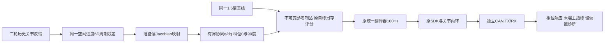

初始0.02°探针在CPU计算中jerk达到38.09rad/s³，已拒绝、未执行；保留拒绝制品。
缩小到约0.008°后两相位总命令jerk约15.25/15.18rad/s³，保持既有20上限；
新增位置目标偏移≤0.0522mm、朝向≤0.0072°。这是探针幅度，不是可望达到的真实误差。
四阶前的参考导数连续性/100Hz节点重叠/结束零速度需通过CPU链路核验；
原生SDK分别线性插值q/dq，不能声称物理执行处处具有连续有限jerk。

先用相位0在协同活跃段（源约45秒）做正常Stop，确认未来参考撤销、停止保持、显式恢复后旧动作不续跑，
然后正常低速回零释放。通过后新执行身份完成1.5× A→P0→P90→P90→P0→A；
每次回零、原速度0.8rad/s等保护不改，任何真实控制/证据异常停止、不自动重试。
J3暂停累加时刻按源进度缩放到[28.6667,29.3333,34,34.6667]秒，保留原偏置及限幅。
同一前馈表按源进度缩放，因果输入为实际CAN的q/dq探针；积分响应不可当成独立激励。

预先记录分析门：末端位置/朝向1–12Hz波动与静态≤1mm主评，J3单周期诊断；
模板两相位先验证响应方向/幅值可重复（方向余弦≥0.8、幅比0.5–2、幅值超过基线系数漂移2倍），
不成立则不反算固定补偿。任何保持/邻轴明显恶化停止后续，不凭单轮好看晋级。
暂不扩大0.008°探针或±2SDK补偿上限；拟合/比较必须对原基线目标计误差，不能让新目标掩盖路径变化。
低幅探针可能受编码量化与轮间漂移限制，检测不到响应也按有效结果保留，不宣称无影响。

详细制品/CPU/实机收据位于`.evidence/taskspace-live-20261025-v1/`，实时结果尚待本节后续更新。

## 2026-10-25 17:23：末端位姿成为主指标；历史重评分与有界修正需求回放完成，未上线外环

用户已批准：末端位置/姿态平顺性主评、J3周期幅度诊断；初版有界q/dq修正、保留关节内环。
本session负责，下一次控制策略、实测或人类决策时更新。本节覆盖下方“尚未批准”的历史状态。
本轮仅本地CPU代码/历史记录分析、远端原始文件只读；未接SDK、无动作、无新发布、无录像/GPU。
17:23只读状态仍DISCONNECTED，holder=null，上一批正常释放收据未变。默认210/5、研究330/5不变。

### 对象与信息流：评价和在线纠偏必须分开

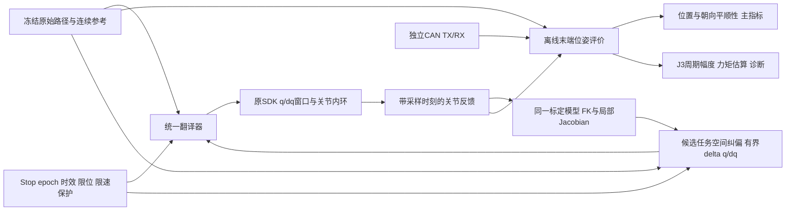

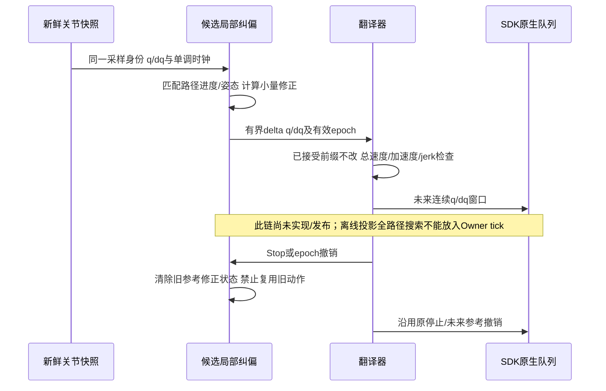

### 已完成的评价与结果

新增`precision_metrics.pose_residual`、`residual_band_metrics`仅由离线工具使用；
两臂共享同一空间进度，朝向使用该进度的SLERP，不另找一个有利时刻。
1–12Hz、2秒Hann窗、50%重叠、线性去趋势、向量功率RMS；超过30ms缺口不插值。
这是当前比较频带，非可见平顺性的普适验收阈值。停位另报绝对误差和中心化波动。
完整运动同时间残差另保留；本轮路径对齐只评分源44–51秒、候选参考43–52秒，
不把全局最近点投影当作全程顺序/停止/纯旋转资格；共同进度回退量完整记录。

重算v2历史七轮（A=210/5，B=330/5），不是新实机试验：

|指标，左末端|210基线4轮|330研究3轮|相邻基线按实时时刻插值对比|
|---|---|---|---|
|递送路径位置波动RMS|0.398–0.470mm|0.321–0.379mm|降低23.88%/16.48%/25.67%|
|递送朝向波动RMS|0.0762–0.0880°|0.0700–0.0762°|降低14.60%/11.20%/14.44%|
|递送末1秒位置误差峰值|0.174–0.261mm|0.260–0.313mm|均满足静态≤1mm；不代表运动全程≤1mm|

动态路径位置峰值仍1.32–2.04mm（全部七轮），不能把波动RMS当作最大偏差。
330末1秒中心化位置RMS为约0/0.060/0.085mm；未形成稳定优于210的保持收益。
量化反馈完全相同会给出零RMS，不能证明真实结构无运动。右臂低幅波动并无一致改善，
不得宣布双臂所有工况通过。FK仍看不到结构/基座/相机外壳弹性形变。
22项CPU检查通过（precision_metrics8+precision_study14）；没有新增实机资格。

### 有界q/dq需求原型：能算、量有界，不等于闭环有效

使用B2记录、全6D加权阻尼逆映射，仅生成左臂修正需求；朝向行权重0.2m/rad，
阻尼0.02m/rad，平滑tanh限制各轴±0.05°，两级2Hz因果低通的精确离散解保持q/dq一致。
原型按同时间反馈计算，尚未实现允许沿路径延迟的在线进度策略，因此不能直接成为验收控制器。
记录回放的delta q峰值≤0.0493°、delta dq峰值≤0.00663rad/s；解析速度上界0.02193rad/s。
Mac局部计算p99约0.40ms，观察到最大约1.55ms；不是ARX实时预算资格。
没有把`实测q+修正q`伪造为新实测、没有宣称平顺性改善。

两级2Hz低通在2.5Hz约有103°相位滞后、10Hz约157°，再叠加实际执行延迟，
直接追周期波动可能强化振动。此原型只用于边界/需求分析，不能直接上线追高频周期项。
修正仍需有带宽/相位证据的输入响应，补齐在线路径进度、总q/dq/ddq/jerk和窗口接缝、
结束转保持、Stop/epoch撤销、ARX耗时后，才做330基线与协同的单变量实机对照。
未用位置收益换取任意朝向放宽；初轮朝向至少不恶化、递送静态≤1mm，四档在稳定后验证。

### 力矩单位问题：已核实软件路径，不等于已标定真实Nm

部署源码EC_A4310：`send_recv_`将前馈除以1.4；`update_joint_state_`将固件
`current_actual_float`乘1.4×1.4。SDK维护者在issue46说明反馈是电流估算，准确力矩需额外标定。
issue37/48讨论重复系数及重力补偿依赖，不能据命名自行删除系数。本轮未改SDK。
区分：命令/读数单位、负载质量/重心/重力与摩擦辨识、机械配重。三个问题互有关联但不是一回事。

现有q+电流估算可拟合SDK单位的慢偏置/周期项，并用留出轮次检验；若力矩比例与负载都未知，
二者存在耦合，不能拿同一估算通道自己证明绝对Nm。真实Nm需要已知质量与力臂、经验证的
电机/减速器参数或独立力传感器作为锚。单条多轴关联轨迹不足以独立识别所有连杆质量/重心与摩擦。

本轮核验还发现`controller_telemetry`约10Hz缓存，100Hz反馈记录中其年龄最大约93.8ms。
这不是控制q反馈发生94ms停顿；不能把缓存字段重复100Hz计为高频扭矩样本。
分析已改用原始CAN约500Hz通道。SDK快照与最近CAN不是原子同拍，RX残差仍明显；B2有一个
原生输出快照与TX不一致（约4.77 SDK单位），因此软件源系数已证，逐样本闭环力矩标定未通过。
原首次未对遥测自身时间戳的比较保留在`rx-software-scale-samples.json`，不作有效标定证据。

固定0.718332°周期拟合：七轮直接TX前馈字段幅度约0.00043–0.00154，RX估算字段约0.0243–0.0680，
幅相并不恒定。两类字段不能当成同量纲真实力矩直接相减，且电机PD也会响应误差。
此记录不能证明换算引起周期波动；固定倍数本身不能解释每0.72°重复的空间结构。
下一步仍可在SDK单位辨识有界补偿，不必等完整Nm标定；但须分离周期扰动与控制器响应，
保留编码器误差/传动周期项/摩擦等未排除假设，不直接增加前馈上限。

证据入口`.evidence/taskspace-coordination-20261025-v1/`：`analysis.json`、
`taskspace-baseline.png`、`b2-correction-demand.npz`、`torque-audit.json`、
`sdk-source-excerpts.json`、`current-state.json`。可重跑`analyze.py`与`torque_audit.py`。
主要来源：[SDK issue46](https://github.com/real-stanford/arx5-sdk/issues/46)、
[issue37](https://github.com/real-stanford/arx5-sdk/issues/37)、[issue48](https://github.com/real-stanford/arx5-sdk/issues/48)。

优先级：有界协同的因果/连续性验证→受控Stop/恢复与1×单变量对照→稳定后四档；
原固定330前馈重复探针保留为独立路线，慢偏置/积分随后；CAN上游与回零静态残差仍按用户暂缓。
维护租约、前馈制品绑定、长期内存验证保留，无commit/push。

## 2026-10-25 13:32：新七轮复核通过研究选型门；用户转向评估末端任务空间协同

用户已回复“修复后继续新批次”。v2使用内存记录通道完成210→330→210→330→210→330→210，
无控制/记录异常；三次330的A为0.028510/0.023685/0.021349°，相对按实际时刻插值的相邻210
改善17.44%/23.57%/37.76%，中位23.57%。三个局部改善均正、邻轴/保持无明显恶化、递送终点≤1mm，
通过预先固定的下一阶段研究选型门；不宣称全局最优，v1反向样本与中断保留。默认210不变。
已回零正常释放，证据在`.evidence/j3-kp330-repeat-20261025-v2/final-summary.json`与
`repeatability.json`。三相位0/0.06sin/0.06cos的固定330制品仅在本地准备，尚未完成新CPU资格或实机探针。

用户随后询问通过多关节协同稳定末端的可行性；当前转为架构评估，无新动作、无控制器替换。
纯离线使用同一标定URDF/TCP，在约50秒姿态核验解析Jacobian与有限差分最大差6.46e−11。
假设J3多0.1°，TCP偏移0.7877mm；其他关节作位置优先最小范数修正，几何残差约0.00147mm，
但留下约0.119°朝向误差，其中J4约需−0.196°修正。此为理想几何算例，绝非实机成绩。
200个轨迹样本位置Jacobian秩3、六维位姿Jacobian秩6：六轴控制完整6D位姿一般没有局部冗余。
同一FK反馈+完整6D可逆映射也不凭空增加观测信息；任务权重与协调策略仍可改变控制行为。

建议讨论末端位置/姿态优先级，采用有界任务空间外环+原关节内环，积分仅处理慢偏差，
不叠加高增益积分追当前约2.5–10Hz的周期波动。反馈目标对齐采样时刻，并沿用允许延迟的空间路径口径。
通用FK+Jacobian+SVD在Mac隔离计算中位0.702ms，不能冒充ARX实时预算通过；轻量本地计算与
全局IK/碰撞服务分开，统一翻译器继续负责连续输出和同一Stop/epoch保护。
编码器FK看不到结构/支架/基座弹性抖动；真实爪体平稳需独立观测交叉验收。SDK前馈尚非完整标定Nm，
初步更适合有界q/dq纠偏，不能直接套真实力矩公式。该建议尚未成为已批准实施方案。
审计证据`.evidence/taskspace-feasibility-20261025-v1/audit.json`，附Modern Robotics任务空间PI与奇异性原始来源。
维护者仍为本session；下一次人类决策、实现或实测更新。原优化目标和未完成的前馈/四档工作保留。

## 2026-10-25 12:29：330首轮未复现改善；独立记录器状态陈旧使A2停止，已修工具并正常回零释放

维护者为本session，随恢复/新批次/验收变化更新。本节覆盖下方进行中状态。
复用cap400版本，以新SDK身份完成A1(210)和B1(330)，周期单边幅度分别0.024840°、0.035524°。
330本次比前一基线大约43%，与上一轮改善方向相反；后置A2中断，不能伪造配对基线、
不能宣称三次重复完成或330已可固定。两轮递送末1秒峰值≤0.261mm、保持无新增明显波动。
三次复核的内部比较在首个330前已固定为按评分窗口实际时刻线性插值前后基线，
中位改善≥15%、每对均改善；等权均值另报。该门不是用户最终验收目标。

A2在Motion中因私有研究脚本检测`wire/status.json`超过1秒未更新，显式提交Stop。
SDK/Guard没有保护退出或CAN失联，随后状态STOPPED_DAMPING_HOLD、健康静止、epoch3。
独立CAN原始记录919125帧、零丢帧；停止前3秒所有启用电机RX最大间隔≤5.331ms，
停止前最后回包距离Stop≤2.053ms。记录器采样线程最大间隔22.25ms，实时/单调时钟偏移
变化小于1微秒。J3在Stop后8.337ms由任务KP约209.890切为既有软保持约20.879，
20–250ms内目标跨度0。这里是命令端与健康状态证据，不冒充固件ack或独立机械精度计量。

直接问题是研究工具把磁盘状态文件作为实时存活真源。写入或读取延迟均可使健康记录被判陈旧；
当时未采样记录器主线程wchan，不能把历史具体内核调用确定为do_get_write_access。
已在Linux无CAN/SDK CPU替身下人为延迟元数据写入1.4s：旧工具状态年龄达1.009s，复现停止门；
新工具通过有界非阻塞AF_UNIX datagram+单调时钟传递状态，采集时零状态写盘，最大年龄0.1002s。
真实状态生产停顿仍被拒绝。原始CAN继续固定memfd接收、退出后归档；新增观察自身与研究脚本调度。
前两次CPU测试未模拟timeout子进程结构，未进入receiving，按失败保留；第三版完整通过，均未接硬件。
这是私有研究记录器修复，生产控制器、SDK、增益和保护没有改变。

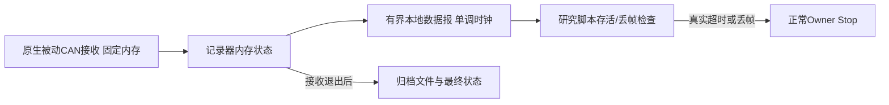

在同一健康SDK上，通过正常预览/确认链低速回零，无清锁/旁路/重接；12轴最大偏零0.251351°后
正常释放。新内存记录器随该回零/释放完成实机记录；SDK1748690、Guard1748661退出。
最终Guard左/右最大RX年龄3.488/3.621ms、socket丢帧/陈旧/未来0。当前DISCONNECTED。
失败A2未重放，剩余原批次未执行；已按“异常即停、不自动重试”约定请求新身份研究重启确认，
尚未得到回复。周期前馈、慢偏置/积分和四档速度未开始，不把工具修复当作控制性能验收。

证据根`.evidence/j3-kp330-repeat-20261025-v1/`：`interruption-summary.json`、
`a2-clock-check.json`、`a2-stop-can-evidence.json`、`observer-qualification.json`、
`cleanup-result.json`、`final-state.json`、`final-guard.json`。工具源码为`witness_memory.py`、
`live_status.py`和`release_memory.py`；未来研究必须接内存通道，不继续复用旧磁盘状态读取器。
continuation-state.json已指向释放终态。没有生产代码发布、commit/push、新GPU或录像。

## 2026-10-25 12:06：用户授权继续重复性→固定增益前馈→稳定候选四档

本session牵头；新结果/发布/人类决策时更新。开始时只读核验SDK断开、无任务/维护/故障锁，
沿用上节已发布源码，无生产修改。第一阶段210→330→210→330→210→330→210，
KD5、1×、同清理A前馈及44–51秒暂停累加，其他轴/保护不变，每次回零、故障即停不自动重试。
复用原153项及对应CPU窗口资格，不把复用写成新跑测试。

预先固定内部选型门：三个330相对各自前后210均值均改善、中位改善≥15%，递送终点≤1mm，
保持/邻轴无明显恶化。该门仅决定是否固定330进入下一阶段，不是用户最终幅度目标，也不证明
全局最优或真实空间可见平滑度。积分DC与基线漂移完整记录。新证据根
`.evidence/j3-kp330-repeat-20261025-v1/`，合同`contract.json`。

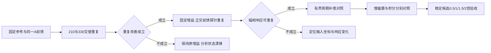

后续先沿用既有≤0.06 SDK新增项、左J3总补偿±2及原变化率/保护边界；不同时改增益和前馈，
不因未通过门槛强行反算补偿或提前四档推广。新增策略先记录具体方案、完成离线检查，
复用本轮明确继续研究的授权；超出已定范围才补充对齐。CAN触发源和回零静态残差暂缓不变。

## 2026-10-25 12:00：上限400已上线，七轮逐级探索完成，默认仍210，已正常释放

牵头仍为本session；新发布、试验或人类决策时更新。本节覆盖下方“准备中”的历史状态。
左J3研究上限400、默认210均已通过HTTP实核；其他轴上限、KD、参考、前馈和保护未变。
候选通过14项本地检查、153项Linux回归和四档12200个CPU参考窗口；同反馈时q/dq与补偿
完全一致，仅原生左J3 KP不同。实际源码为`robot-workbench-j3-kp-ceiling400-20261025-v1`，
SDK二进制未变，正常重新接入后完成以下7次到起点→53秒1×片段→回零。

|顺序|KP/KD|周期单边幅度A|去三次慢趋势后RMS|
|---|---|---:|---:|
|A1|210/5|0.039971°|0.044145°|
|B1|270/5|0.029120°|0.034326°|
|A2|210/5|0.032658°|0.039654°|
|C1|330/5|0.021627°|0.027873°|
|A3|210/5|0.026660°|0.036371°|
|D1|400/5|0.029824°|0.029045°|
|A4|210/5|0.025454°|0.038170°|

沿用λ=0.718332057°、源44–51秒、相同名义角与拟合阶数。用每档前后210均值作描述性比较，
270降低19.81%，330降低27.08%，400反而增加14.46%。210基线自身持续变化，且每个新档
只有一次样本，因此不能宣布330最优、不能把收益完全归为刚度或声称跨速度可重复；
400没有显示所选周期项继续改善。无默认增益晋级，下一步优先复核330及相邻基线重复性。

实际CAN KP分别约209.890/269.963/329.915/400.000、KD均5；积分逐包回放误差0，
分析窗累加确实暂停，七轮DC依次为−0.370464/−0.319750/−0.412799/−0.231796/
−0.371736/−0.117431/−0.373033 SDK。不同DC是已记录的状态差异，不能伪称所有初态相同。
该窗口无±2限幅或抗饱和触发。七轮递送终点最后1秒双侧FK峰值均≤0.261mm；
回零静态FK残差约1.68–2.04mm继续按用户要求暂缓，不能说所有静态端点达1mm。
递送末1秒J3位置峰峰值0或1个编码档(0.02185694°)，回零末1秒均0档；量化读数不变不等于
独立证明实体没有微动，也不能代替四档速度的可见平滑度验收。

全部7轮无控制故障，独立TX/RX共10594029帧零丢帧、调度零截断。Guard最终累计接收
左4033208/右3459334帧，socket丢帧/陈旧/未来计数均0，最大RX年龄4.343/3.435ms。
活跃期Guard不写盘，轮间读取的guard.json仅是启动快照；完整累计证据取最终释放后的记录，
不是伪称轮间拿到实时队列计数。原始CAN、Owner事件和独立调度分别保存，延迟根因不因此宣布解决。
释放前12轴最大偏零0.251351°，反馈健康静止，正常close返回；SDK1099631、Guard1099601及
全部七轮观察器已退出，当前DISCONNECTED。此轮未新注入超速/心跳故障，不扩大之前停止资格。

前馈下一阶段仍有空间：先在确定的增益下分开辨识慢偏置/姿态摩擦负载与角度周期项；
本轮误差拟合相位随档位变化，不能复用210下的逆补偿参数。先验证重复响应，再有界迭代幅相，
记录实际输出、限幅与变化率；不把角度误差直接乘KP当成已标定力矩。积分Ki/死区/带宽单轴
对照也未完成，但本轮不同时改。CAN上游触发与回零静态残差仍暂缓；长期内存等原待办保留。

证据根：`.evidence/j3-kp-ceiling400-20261025-v1/`。入口为`final-summary.json`、
`analysis.json`、`kp-ceiling400-results.png`、`final-state.json`、`final-guard.json`、
`release-result.json`及`research-publication.json`。continuation-state.json已指向该释放终态。
未commit/push，无新GPU/模型/录像任务；工作树其他已有改动保留。

## 2026-10-25：180/210/240六轮完成；批准研究上限400，默认仍210

牵头session继续维护；新发布/试验/用户决策时更新。当前已回零正常释放，SDK/Guard退出，
最后12轴最大偏零0.229494°。六轮全部完成，无控制故障；独立CAN累计9085191帧零丢帧、
调度零截断。CPU153项及9150个窗口通过，但不替代实机停止资格。本轮未重新注入停止故障。

|顺序|左J3 KP/KD|固定周期单边幅度A|
|---|---|---:|
|A1R|210/5|0.042181°|
|B1|180/5|0.039996°|
|C1|240/5|0.028541°|
|C2|240/5|0.035148°|
|B2|180/5|0.040780°|
|A2|210/5|0.028703°|

240均值比210低10.15%，180均值高13.96%；但210自身变化0.013478°，显著大于240的
均值改善0.003597°，不能认定240最优。CAN实核三档分别约209.890/179.976/239.927；
KD均为5。积分逐包重建误差0，44–51秒保持常量，无总限幅/抗饱和触发。首尾210积分DC仅差
约0.00165 SDK，不能把轮间漂移全归因于积分偏置。六轮递送末端最后1秒FK峰值均≤0.309mm；
回零静态FK残差独立保留且按用户要求暂缓。默认未变、无增益晋级。

证据：`.evidence/j3-basic-audit-20261025-v1/kp-analysis.json`、各轮CAN/积分回放、
`release-result.json`和`final-state.json`。当前实际指针已纠正为已释放。

用户随后明确“j3 kp研究上限提高到400”。只扩左J3研究校验/界面上限，默认210、KD上限5、
其他轴及保护不变。已核验加载SDK所链接的EC发送二进制：KP先限0..500再12位编码，
KD限0..5再9位编码；500是可表示上限，不是已验收运行参数。
研究按210→270→210→330→210→400→210逐级探索，同一1×参考、同一清理A前馈和积分规律，
每次回零；故障即停、不自动重试。若周期A或保持波动明显恶化则停止升档；插入基线用于观察漂移。
该新轮正在准备，不能当作已执行或已通过。新证据根`.evidence/j3-kp-ceiling400-20261025-v1/`。
前馈后续分慢变化补偿与角度周期补偿；相位响应仍缺重复性，不以误差直接乘KP充当力矩逆模型。
CAN消费触发源和回零静态残差继续暂缓，监测与异常停止规则保留。

## 2026-10-25 10:55：恢复J3基础调参，已批准仅左J3 KP邻域六轮

用户明确暂缓CAN上游触发调查，继续J3研究；原保护和新故障即停、不自动重试保持。
回零静态残差优化继续暂缓。当前已只读核验DISCONNECTED，研究配置左J3 KP=210/KD=5。
基础调参并未完成：旧KP减半和KD×0.8是整左臂粗对照，不能证明J3单轴局部最优；
外环积分有死区、幅值/斜率约束与组合抗饱和，但单轴Ki/死区/带宽没有完成系统对照。
旧积分ADDA中周期幅度均值0.042400°→0.032708°，单对分别改善4.67%与38.02%，重复性不足。
当前诊断A制品在44–51秒保留已有积分偏置而暂停累加，不能说整个积分关闭。

用户已批准KP顺序210→180→240→240→180→210，KD固定5，原1×53秒参考；
不加周期探针，其他关节、积分规律、0.8rad/s和全部保护保持。每次回零，异常即停。
冻结前馈使用同一去旧周期项A数值；更改gain声明必须生成新制品身份并保留原来源，
不能改写旧制品来假冒来源增益。原生输出/非J3补偿同输入回放一致性先通过，
实机记录实际CAN增益、补偿偏置与总幅值、固定0.718332057°主指标及频谱/保持波动。
各轮积分DC可能不同，须记录，不能伪称其状态完全相同。
本段记录的是已批准方案，尚不表示候选检查、动作或性能验收完成。
证据与执行身份入口：`.evidence/j3-basic-audit-20261025-v1/`。
维护者为本控制研究session；新资格/实测/用户优先级变化时更新。

## 当前状态补充：2026-10-25 02:05

按用户“直接真机复现”指示，在新SDK身份完成四次相同1× C配置的到起点/片段/回零，
再做180秒零位静止取证并正常释放，未复现CAN积压。当前DISCONNECTED，不是下节的故障锁。
生产代码、增益、参考和保护均未改；这四轮用于诊断，不作为原A/B/C六轮完整研究资格。
Guard队列积压的上游触发仍未完全定位，尚未发布根因修复，原六轮研究门仍待通过。
回零静态残差优化按用户最新要求暂缓。维护者/更新触发沿用本计划；权威实际状态、
释放收据和新诊断数据见[控制阶段状态](control-runtime-status.md)最新节及
`.evidence/guard-live-reproduction-20261025-v1/final-summary.json`。

## 最新进展：2026-10-25，3/6完成后按CAN复现停止

本节优先于下方历史“尚未加载/待支撑”描述。维护者为控制研究牵头session；新恢复/试验/指标时更新。
最新版v2接入→释放→再接入，以及受控未来参考拒绝后的停止、未来队列撤销、同SDK显式恢复已实核。
实际SDK为既有速度编码二进制，未改变增益、频率、参考或0.8rad/s保护。

| 顺序 | 条件 | 固定周期单边幅度 | 递送终点双侧峰值 | 实际结果 |
|---|---|---:|---:|---|
| A1R | 去除旧周期项的冻结基线 | 0.021106° | 0.346917 / 0.252975 mm | 片段与回零完成 |
| B1 | 基线＋0.04 SDK第一相位 | 0.027548° | 0.250656 / 0.151118 mm | 片段与回零完成 |
| C1 | 基线＋0.04 SDK正交相位 | 0.020061° | 0.308869 / 0.151118 mm | 片段与回零完成 |
| C2 | 同C1重复 | 未产生有效研究段 | 未验收 | 低速到起点时CAN保护退出 |
| B2、A2 | 原定重复 | 未执行 | 未验收 | 按异常停止约定保留 |

口径固定：周期0.7183320573477324°，源时间44–51秒，名义J3角度上的三次慢趋势+sin/cos；
没有重选窗口/周期改善分数。三次积分逐包重建全部匹配，窗口内积分分别恒定为−0.352167、
−0.369650、−0.323463 SDK单位；无总限幅或抗饱和触发。不同常量偏置仍是已知混杂因素。
三次回零单次静止FK快照左侧约2.040mm，右侧0.116mm；并非所有静态端点已达1mm。

**没有重复结果，不能判定相位响应可重复，未生成/执行逆补偿，未纳入常规配置。**
C2在00:43:07 CST触发Guard左RX队列丢253帧和98ms积压；独立RX持续且零丢帧，
详见[存储与故障审计](control-storage-io-audit-20261024.md)最新节。
当前SDK/Guard已退出，未重接/恢复/回零；不存在已完成六轮或当前仍保持的声明。

证据：`.evidence/control-acceptance-20261025-v1/`下a1r/b1/c1的score、trace、integral-replay、
原始TX/RX及c2-failure/c2-guard/c2-scheduling。A1R调度最早789样本被环形覆盖，其他记录完整；
后续记录器已用20000样本容量，B1/C1/C2零截断。前三轮结果保留，不为补记录自动重放动作。
下一步先离线定位Guard消费能力下降，再完成受控恢复和停止验收，之后再恢复批准的研究；
此次新故障后“不自动重试”的约定继续有效。

日期：2026-10-24。负责人：本任务 Session `01a16327-7545-7332-a361-0123ddad811d`。
状态：**两相位六轮已完成；J3积分暂停候选已上线，但ADDA四轮尚未开始。CAN反馈保护中断后，已完成获批的180秒阻尼静止恢复取证；根因未确认。**
最新状态见第8节；第6、7节保留此前方案与结果，不代表本轮新策略已通过实机验收。
用户要求先分析、提出方案、对齐后再测试；后来建议不同控制频率对照，但尚在澄清
SDK循环与上层参考更新的区别。动作/现场/正常回零维护既有授权保留，不重复询问。
本记录随方案确认、资格或实际结果变化更新；下一轮新增控制策略仍需先对齐具体方案。

## 1. 已确认优化对象

用户明确选择“只压低橙色约0.72°周期分量，其余误差另行处理”。
沿用当前配对分析定义，避免改口径造成虚假进步：

- `e(t)=J3反馈位置−同时间的准备后连续参考位置`，单位度。
- 取等效1×参考时间44–51秒；不同速度按同源时间段取样。
- 以参考J3角度θ为自变量，拟合三阶慢趋势和
  `a*sin(2πθ/λ)+b*cos(2πθ/λ)`，λ固定为历史基线得到的0.718332057°。
- 主指标为单个周期分量的单边幅度 `A=sqrt(a²+b²)`；峰峰值为2A。
  每轮用相同区间、趋势阶数、频率和取样方法，不重新挑选最好看的频率或片段。
- 同时报附近频谱/相位/高次分量、完整误差和其他关节，避免把频率迁移误当消除。
  这些不是本轮主优化目标，但原0.8rad/s等保护不变。
- 尚未确定最终幅度门槛；先前“降低50%/≤0.01°”只是询问，未获选择。

同一A1记录的完整误差为−0.1294°～+0.1158°，实际峰峰值0.2452°；其单周期分量
A=0.04215°、峰峰值0.08430°。0.04°不是实际总误差，也不是从0.1°改善后的结果。
前轮A/B两对的A分别下降5.84%/6.86%；此前因可见平滑度未稳定通过而未推广。
用户切换目标后，这个小幅可重复变化可作为后续依据，不能据此声称已达到新门槛。

图和原始统计：`.evidence/j3-plan-20261024/error-vs-periodic-amplitude.png`、
`metric-distinction.json`。此前完整过程见[研究记录](control-smoothness-resume-20261024.md)。

## 2. 周期究竟对应哪个频率

0.72°是**空间周期**，不是0.72Hz，也不是固定100/500Hz。
其瞬时时间频率约为 `f(t)=abs(J3角速度[°/s])/0.71833°`。

在同一路径位置（1×参考约第50秒，J3约50.30°）附近：

|轨迹倍率|参考J3速度 °/s|由空间周期换算 Hz|实际误差短窗谱峰约 Hz|
|---|---:|---:|---:|
|0.5×|1.761|2.45|2.5|
|1×|3.523|4.90|5.1|
|1.5×|5.284|7.36|7.3|
|2×|7.045|9.81|9.7|

短窗为等效1×时间49.5–50.5秒，四档实际窗长约2/1/0.67/0.5秒；频率分辨能力有限，
表中观测是约值，不能把FFT补零后的精细小数当测量精度。1×第46/48/50秒对应换算
频率约1.30/3.24/4.90Hz，说明同一条轨迹内部也会变频。
当时各档SDK名义500Hz、CAN发送实测中位间隔2.052ms约487Hz，参考节点100Hz、
窗口上传约50Hz均未随轨迹倍率改变。现有证据不支持该分量与其固定时钟一一对应。
不能因此排除控制环对位置扰动的放大，也不能排除采样/量化的间接影响。

空间周期约对应501次/输出轴一圈，这个“501次/圈”与“500次/秒”不是同一单位。
未取得本机准确极对数、传动比、齿数/编码器原始周期证据，不能自行认定对应某一机械阶次。
来源：`frequency-correspondence.json`、`local-time-frequency-check.json`。

## 3. 作用链及因素覆盖

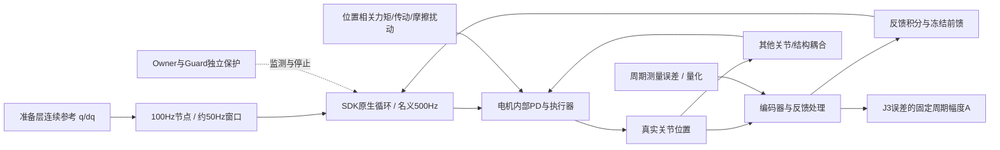

下表覆盖当前链路有实质解释力的因素，不声称已穷尽每种硬件失效模式。
“可能的源”与“放大/抑制因素”必须区分；闭环相关不等于激发因果。

|因素|如何影响选定周期分量|当前证据与区分方法|可能处理|
|---|---|---|---|
|电机齿槽/换相/电流环周期力矩|可能直接产生与转子角度绑定的扰动|固定角度周期支持这一类，但缺本机极对数/减速比/实际电流证据|位置力矩表或谐波前馈；先确定坐标、相位和响应|
|传动啮合、偏心、周期摩擦|可能产生角度重复力矩或传动误差|与电机周期在单条轨迹上难区分；需方向、负载、角度与独立输出测量|标定补偿；确认机械异常后再处理机械部件|
|编码器周期误差/安装偏心|既可污染观测，也会经闭环带来真实摆动|SDK/CAN共用同一编码器，二者吻合不构成独立测量；视频尚不能计量到此精度|独立测量交叉核验、编码器校准；不能仅靠压小读数证明真实改善|
|摩擦、黏滑、温度、负载/线缆|改变激发幅度、方向相关性、局部响应和跨次相位|现有同向空载轨迹不够分离；记录温度、方向和工况，不把短时漂移当控制效果|摩擦/负载补偿；热稳定后的成对比较|
|J2与其他关节的动态耦合|J3可能承受上游加速度、柔性或支座反力|本段J2/J3参考相关约0.997；不能只因J3误差最大就认定源在J3内部|后续独立小幅激励测交叉响应；必要时解耦补偿|
|结构柔性/共振|可放大某一速度下的角度周期激励|纯固定Hz共振不解释所有速度下固定角度周期，但可能放大它|频响/姿态相关阻尼、带限整形；不盲目加陷波|
|重力/惯量/工具负载模型|慢偏差消耗补偿余量，耦合或限幅可间接放大周期项|重力+编码残差的已测频带波动小；零位J3静态饱和问题独立存在|先分离慢补偿和周期补偿的预算；不以单周期目标掩盖静态问题|
|KP/KD及电机内部环路|决定扰动到位置误差的幅相，可能放大或抑制|降低整臂KP/KD曾变差；J2/J3 KD已到当前发送编码上限5；不能用更大无效数值冒充测试|只对单关节、按有效增益/频响调参；额外速度阻尼需核验时延|
|SDK/参考/积分更新频率|改变目标阶梯、重力与反馈刷新、量化更新和延迟|当前A没有与500/100Hz固定频率锁定；降频影响可以实测但不能预判方向|本轮优先比较SDK原生循环；不要同时改参考或安全循环|
|积分增益、死区、更新/反馈延迟|可改变阻尼和相位；死区让响应非线性|J3死区0.02865°；本段约41%–50%样本在死区；命令字段功率代理不能当真实物理功率|保留DC补偿，仅对J3做积分增益/动态部分对照，避免整体关积分引入静态混杂|
|补偿幅度/斜率限制和抗饱和|压缩实际输入、移相、产生谐波，削弱辨识|J3总bias上限1.5；本段基线触顶约3%–18%，随速度变化；前馈还受3 SDK单位/s限制|记录限幅前后和实际输入，不用请求值当生效值；不先放宽保护|
|前馈相位、幅度、索引坐标|误差模板不是力矩模板；按目标角索引与按实际角索引可能错相|0.1°相对0.72°已约50°相位；当前配对平均响应有滞后，局部响应不一致|固定周期的正交探测/有界迭代；绑定速度、姿态、坐标、校准与SDK版本|
|前馈/积分状态切换|切换自身会影响结果，破坏“只改一项”假设|现有冻结总补偿入口会重置左臂积分；A/B均同处理，但不是原控制器上简单加一个扰动|纯辨识需明确增量输入语义、保留积分状态和总限幅，不复用含糊接口|
|EC命令单位、限幅、内部滤波|改变实际P/D/前馈强度和测量相位|J3属于EC，前次DM速度修复不直接覆盖它；EC前馈发送/1.4，反馈力矩还有经验换算，未校准Nm|核对实际字节与厂家契约；不直接把SDK torque当Nm|
|位置/速度/力矩量化|可能形成小阶梯、极限环或经闭环放大|位置量化约0.02186°；0.06 SDK补偿对应的EC线端幅度仅约3个量化步；编码同周期q误差很小但不能绝对排除放大|对实际发送字节评分，统计量化敏感性；不靠平滑图表隐藏它|
|时间戳、采样、插值、统计口径|可制造相位错配或让幅度数字不可比|已发现并修正VFR随机取帧；瞬时峰值、RMS、单频幅度曾混淆|冻结指标和数据身份，使用原时间戳/精确帧索引，保留原始频谱与置信区间|
|电源/温度限流、线缆/连接异常|可造成间歇力矩不足，随姿态变化|未见该分量与长CAN断档对应；电机内部限流/温度未独立核验|有同步证据再定点检查，不把所有误差归因于偶发网络问题|

新增代码与数据事实见 `.evidence/j3-plan-20261024/factor-evidence.json`。
参考节点提前约28–40ms是**计划的未来窗口时间**，不是SDK计算耗时28–40ms；
预知前馈可按未来参考取值，反馈修正则仍有因果信息年龄，不能混为同一种延迟。

## 4. 用户提出的频率对照：建议的最小方案

待确认的是频率层级，不重新确认现场/动作授权。建议先改左臂SDK原生循环，
观察J2/J3；原接口按整臂生效，包括其他左关节和左夹爪的发送/反馈节奏。
右臂不变。若要求只改J2/J3，须另做原生逐关节发送调度，超出本次最小配置方案。

原生 `ControllerConfig.controller_dt` 已公开，构造时传入，C++按值复制；无需改电机
固件或修改已有SDK二进制，但需在公共适配器增加明确配置与读回，并受控重接SDK。
此参数还用于每周期速度限制、反馈缓存更新和过流计数，不能仅改sleep值。

|名义SDK频率|controller_dt|过流计数阈值（现有代码为计数>阈值触发）|名义连续检测时间|
|---|---:|---:|---:|
|500Hz|0.002s|20|约42ms|
|250Hz|0.004s|9|约40ms|
|125Hz|0.008s|4|约40ms|

同步收紧次数避免低频时把过流容忍拉长；这只是计数的名义时间预算，不承诺整个停止
链路的硬实时延迟。电流/力矩阈值、0.8rad/s保护和100ms心跳/反馈门均不放宽。
Owner/Guard安全巡检、100Hz参考节点、约50Hz积分/窗口提交、轨迹时长及KP/KD保持。
改变SDK循环不等于改变电机内部固件的PD频率；其真实内部频率未读取，不能编造。

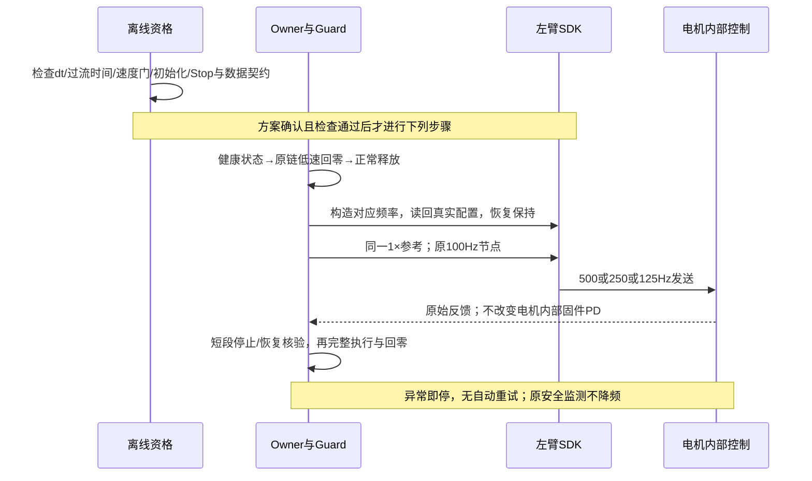

建议首轮顺序500→250→125→500，固定1×轨迹，复用相同输入和评分；最后500Hz
用于检查温度/时间漂移。每档先确认实际CAN发送间隔、反馈年龄和停止行为，不能只信
配置名。先评分J3固定0.71833°分量A；J2同时报完整频谱与其原有主分量，不能把J3的
0.72°硬套到J2。数据采集只保留数值/原生输入输出/被动CAN，不需要RGB-D原始录像。
若低频触发保护、延迟异常或明显恶化，终止后续动作，记录并按现有恢复语义处理。
每一频率下的控制和反馈时序必须真实记录，不能靠改采样标记或慢放轨迹伪装降频。

## 5. 其他方案及选择依据

1. **固定周期的幅相补偿**：最直接针对当前单分量；先取得正交输入对应的有效响应，
   再作有界迭代，不以误差×KP直接冒充完整扰动力矩。适合固定轨迹/速度；跨速度须重新
   核验。与频率试验分开，不在同一轮叠加。
2. **J3积分/阻尼局部对照**：保留静态偏置，只改变动态策略；可改善多条轨迹，但要检查
   静态误差、相位和饱和。KD编码上限与反馈延迟限制了直接“加大KD”的有效性。
3. **独立动态响应辨识**：小幅、带限、可复现输入，测实际输入和输出，区分闭环反应。
   优先闭环进行，不能把有强周期扰动/饱和时的一次比值当准确传递函数。
4. **物理源核验与标定**：编码器、实际电流/力矩、传动阶次、方向/负载依赖；可能得到
   更通用的修复，但现场与测量成本更高。没有独立证据前不宣称硬件坏或性能不足。

参考方法仅用于机制和设计，不把其他驱动器的参数/流程照搬到本机：

- [ODrive位置相关抗齿槽前馈](https://docs.odriverobotics.com/v/latest/guides/anticogging.html)：
  用标定的位置力矩表补偿；位置估计延迟/误差也会降低稳定裕量。
- [Renishaw编码器术语](https://www.renishaw.com/en/optical-and-inductive-encoders-glossary--27382)：
  周期误差、分辨率与精度是不同对象；不代表本机采用其编码器。
- [MathWorks闭环频响辨识](https://www.mathworks.com/help/slcontrol/ug/online-frequency-response-estimation-basics.html)：
  以独立注入和实际输出辨识；大扰动会污染估计。

## 6. 双线推进：2026-10-24 公开资料与离线分析

本节回应用户“针对性控制解决，同时调研方舟臂底层”的要求。本任务继续负责；
方案确认、型号/固件核实或新增实测时更新。公开资料说明产品能力和已知问题，不构成
本机故障诊断。尚未联系厂家、修改固件/电机参数、连接SDK或下发运动。

### 6.1 0.72°的准确含义与硬件阶次线索

误差里有一个随关节角度重复的近似波形，不等于每走0.72°发生一次离散顿挫。
它在一周期内连续起伏；其时间频率随速度改变，见第2节。主指标仍冻结在
λ=0.718332057°，下面的诊断拟合不改变验收口径。

厂家ENCOS《电机数据手册》PDF第2页（印刷页1）描述行星减速器、无刷电机，以及电机端/
输出端各一个14位编码器；PDF第3页（印刷页2）列出EC-A4310-P2-36的减速比36、双编码器。
已渲染并核对这两页。当前SDK配置只确认J3类型为EC_A4310，**不能由此确认本机完整
后缀、减速比、磁极数/极对数、齿数或固件版本**。

若本机确为36:1，则实测周期对应转子每圈约
`360/(36×0.718332057)=13.9211`次；精确14次对应输出周期0.7142857°。
这个数值接近值得核验，但不证明14磁极、7极对、换相阶次或某种齿数。齿槽、换相、
齿轮和编码器谐波对应的阶次关系不同，不可用一个接近的整数替代身份/机理证据。

新增离线脚本以参考角度均匀取样，分别用参考角度/反馈角度拟合同一误差，对比自由周期
和精确36×14阶次。七段记录的最佳周期约0.7135–0.7256°；使用精确14阶次时，残余MSE
相对各自最优拟合增加约0.03%–19.89%。它不是所有记录的精确最优值，也没有置信区间
足以宣称排除14阶次。反馈角度和误差共用编码器，二者拟合不是独立测量。

来源与复算：

- [厂家手册（世界机器人大会托管）](https://www.worldrobotconference.com/uploads/exuser2024/video/8kgvba.pdf)。
  本地`.evidence/j3-dual-track-20261024/encos-manufacturer-manual.pdf`，SHA256
  `c367b4e0df52cd1beb6bfc0ca4d85abface7c20ce57a9f863e345ad8d68ca677`；版本日期未确认。
- `check_rotor_order.py`与`rotor-order-compatibility.json`；仅离线兼容性检查，不作因果验收。

### 6.2 方舟/SDK资料能确定什么

|来源|查证结果|对本轮的影响|
|---|---|---|
|ARX官方ROS2的HybridJointCmd及控制代码|命令含position/velocity/torque/k_p/k_d；底层执行主要在库内|可沿现有前馈入口做小幅对照，不需要先增加整套控制器|
|arx5-sdk维护者issue34|MIT模式五项在电机内部求和，并有比上位SDK更高频的本地循环|500→250Hz不会等价改变固件内部PD频率；实际内部频率仍未知|
|EC力矩issue37、48|反馈×1.4×1.4和发送÷1.4的不对称有公开报告，维护者未给出完备解释|现有SDK字段不能直接当已校准Nm；数值响应辨识应使用明确SDK/线缆字段单位|
|力矩精度issue46|维护者说明电流估算力矩和线性关系需要额外标定|不能用当前torque字段单独证明真实力矩波纹或逆动力学参数|
|ARX官方《电机校准》|将当前物理位置设为零点；包含X5对应命令|这是零点校准，不是齿槽/电角度/编码器周期误差标定；本轮未执行任何命令|

精确代码固定于ARX_X5提交`c78328785ea23a81d908e1dcc551eca992f2f1e9`；源URL、SHA
和本地副本见`manufacturer-code-sources.json`。公开检索未找到能直接解释本机0.72°
现象的厂家缺陷通告，也未查到可核实的本机极对数/齿数/内部环频率；不据此猜测。

- [SDK维护者：MIT控制结构](https://github.com/real-stanford/arx5-sdk/issues/34#issuecomment-3684693083)
- [EC换算问题37](https://github.com/real-stanford/arx5-sdk/issues/37#issuecomment-3787726940)、
  [后续问题48](https://github.com/real-stanford/arx5-sdk/issues/48#issuecomment-5124663676)
- [力矩估计与标定说明](https://github.com/real-stanford/arx5-sdk/issues/46#issuecomment-4604574775)
- [ARX官方零点校准文档](https://github.com/ARXroboticsX/ARX_all_in_one_readme/blob/13df340df13420edc498d9b222ee51f9e2596fd6/%E7%94%B5%E6%9C%BA%E6%A0%A1%E5%87%86.pdf)

### 6.3 根因假设及可以推翻它的证据

|假设|现有支持/不足|下一项有区分力的证据|对应处理|
|---|---|---|---|
|转子位置相关力矩波纹，包括齿槽/电流环/换相|角度周期稳定、条件36×14接近；实际型号与电流未独立核实|确认传动比/极对数；在不同方向/速度下看相位是否锁定绝对转子角度，结合独立运动测量|有界角度前馈；若固件标定有误则针对底层修复|
|减速器周期传动误差或周期摩擦|与角度相关同样符合；无齿数/双编码器对照|电机端与输出端原始角度、方向/载荷依赖及独立输出角度|传动误差补偿或机械处理；不能仅增加KP掩盖|
|编码器周期测量误差|同一编码器同时进入控制与统计，现有CAN不能独立排除|独立测量与编码器读数同相对比；核实固件反馈坐标|编码器/读数校准；仅压小显示误差可能增加真实运动|
|J2耦合或结构响应，J3只是响应位置|该路径J2/J3高度相关，单路径无法分离|后续改变J2/J3运动相关性的有界对照|局部解耦或阻尼；不直接归咎J3电机|
|积分/限幅/采样环节放大位置扰动|已有相位滞后、限幅和闭环响应；非固定500/100Hz同频|先幅相辨识，再单独频率或积分对照|只调实证放大环节，不同时改变多层参数|

公开资料与现有反馈支持“位置相关源值得优先检查”，尚不能区分上述物理源。
当前14阶次假说是线索，不能把问题定性为硬件损坏或硬件性能不足。

### 6.4 控制侧建议：同基线的两个相位探针，先辨识再抵消

按位置增加反向前馈是可用方向。例如ODrive官方抗齿槽方案使用位置→力矩表，且提醒
位置估计延迟/误差会损伤稳定裕量；这是方法参考，本机没有因此获得ODrive功能或标定。
参考：[ODrive Anticogging](https://docs.odriverobotics.com/v/latest/guides/anticogging.html)。

此前两次J3分量A下降5.84%和6.86%，说明现有入口能影响此分量，但整体局部相位不稳定。
现有一组输入方向只能说明一个方向的响应，不能据此唯一确定两个幅相参数或直接使用
约−45°全局相位补偿。建议以下**尚未执行**的方案：

1. 固定1×原参考、当前SDK编码版本、原KP/KD、100Hz节点、约500HzSDK和原积分策略。
2. 复用已有“冻结总偏置+残差积分”的A基线。B/C只在J3分别加入同幅、相差90°的正弦项；
   名义新增幅度不超过既有0.06 SDK单位，λ固定0.718332057°，仍用43–52秒平滑包络。
   整体偏置限幅/斜率限制全部保留，不把0.06说成Nm，也不保证含积分响应的总输出差≤0.06。
3. 三种制品共同沿用现有factory的积分初始化：冻结表已含历史总偏置，继承值只作过渡，
   左积分按原逻辑重置再积分。它们相互比较，不把A称为“当前原积分控制完全不变”，
   更不能把冻结历史总偏置当纯新增项叠加到未清理的积分上。当前阶段无需新增控制接口。
4. 先CPU核验三者q/dq/增益完全相同、仅J3制品不同、限幅/斜率/接点连续、停止清未来；
   原SDK/制品身份不匹配则重新资格，不将旧结果视为新候选通过。此轮未生成或验收新B/C制品。
5. 方案对齐后按A→B→C→C→B→A做6次1×，每次正常回零。异常停止，不自动清锁/重试；
   0.8rad/s、心跳/反馈、限位及原停止行为全部保留。记录窗口、实际CAN输出、反馈、积分、
   限幅命中及分段延迟，不追加RGB-D大包。采集本身不等价于已测物理力矩。
6. 用独立选择的B/C探针系数与误差的sin/cos系数，估计包含原积分环的局部闭环响应。
   同时报实际限幅后的输入；积分变化是响应的一部分，不把总偏置差当独立外源直接相除。
   两方向若经限幅后近共线、重复响应不一致或变化低于基线漂移，就不求逆、不放大补偿。
7. 数据合格后再提出有界抵消候选，先报告本轮辨识结论；不把本次方案确认扩为未知幅值/
   任意自动迭代授权。最终幅度目标未获用户数值确认，不宣称已完成平滑度验收。

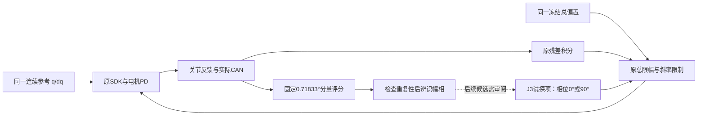

降低SDK频率仍保留为独立备选；现有证据不支持将其认定为主要周期源，因此建议不要
在幅相辨识同轮降频。硬件线继续优先查现有铭牌/BOM/固件记录；若公开材料和现有记录
仍不足，整理具体型号、极对数、齿数、反馈坐标及标定问题供用户/厂家确认，不自动发消息。

## 7. 已授权两相位辨识结果：A→B→C→C→B→A

用户明确选择“先做两相位辨识”。三份制品均通过3,050个Linux CPU窗口回放，共9,150个；
相同反馈下只有J3总输出改变，q/dq、其他关节、原总限幅/斜率及停止清队列检查通过。
B/C名义附加项峰值各0.06 SDK单位，相差90°；经过制品限幅后的两方向条件数1.046，
经过相同反馈CPU积分/总限制后的输出差条件数1.107。B总输出差最大0.070082、C为
0.059981 SDK单位，前者包含积分/抗饱和响应，不能把附加项上限误当总输出差上限。

六次均完成17秒左右的起点对齐、53秒原1×参考和约34秒回零，每次结束正常静止。
没有新SDK构建、重接、降频、修改增益或扩大保护；没有新视频或RGB-D采集。
当前模块、制品与源文件身份在执行前核对；每轮唯一目录禁止重放未知结果。

### 7.1 固定周期主指标

仍使用第1节的同一窗口、周期和三阶趋势。以下均为单边幅度A，非总误差峰值：

|条件|第一次A（°）|第二次A（°）|样本均值（°）|相对基线均值下降|
|---|---:|---:|---:|---:|
|A：同一冻结偏置+残差积分基线|0.054208|0.052204|0.053206|—|
|B：相位一|0.047894|0.040699|0.044297|16.75%|
|C：相差90°|0.037387|0.047622|0.042505|20.11%|

B相对配对基线下降11.65%/22.04%；C下降31.03%/8.78%。这些是六次样本的描述，
不是总体置信区间。C首次31%的收益不能称为可重复改善。完整残差和局部波段没有
同步一致下降，例如C在49–54°角度段的局部周期A为0.0241°/0.0549°。

### 7.2 为什么本轮不直接求一个固定反向补偿

先于B1结果冻结的辨识门要求：两次响应方向余弦≥0.8、幅度比例0.5–2、响应大于基线
系数漂移的2倍、矩阵条件数<10。这是保守的局部辨识可用性门，不是用户最终幅度验收线。

- 两个A基线的幅度接近，但误差分量相位移动约9.89°；sin/cos系数向量漂移0.00939°。
- 相对配对基线估计，B两次响应向量方向余弦0.418，C为0.542，均未通过重复性门。
  该差别不能直接定性为电机动力学改变，也可能包含基线漂移和闭环非线性。
- 平均响应矩阵条件数1.83，代数上可求逆；但漂移与探针带来的变化同量级，因此不把
  不稳定映射用于自动增大/移相控制。补充线性时间漂移拟合仍有残差，只有两残差自由度，
  不替代原有未通过的重复性门。
- **未生成、执行或推广下一组抵消系数。** 两个小探针都能影响选定分量，但根因尚未分离。

### 7.3 积分和实际输出取证

使用每个真实反馈样本、实际窗口时间、冻结前馈及首包保持偏置，逐步重建左臂积分。
六轮14,147个窗口的重建总偏置与保存的实际总偏置全部一致，最大差0；这证明离线重建
符合上位控制计算，不代表电机内环或真实Nm被独立测量。

C1/C2制品完全相同，但重建J3积分单周期系数分别约`[0.02956,0.00166]`和
`[0.03700,0.01629]` SDK单位，总输出亦不同。积分是反馈响应的一部分，尚不能据此
判定它是原始激发源。六轮分析窗内约8.90%–15.15%的窗口首点总偏置达到既有上限；
触顶比例与误差幅度并非单调对应，不支持直接放宽限幅作为修复。

前四轮分析窗的未来窗口首点间隔平均23.50–24.27ms，包含30/40ms间隔；100Hz节点
仍保留在覆盖未来的队列中，没有据此发生参考断流。**这个上传/积分更新间隔不是之前
40ms反馈读取等待。** 节拍与限幅可能影响闭环幅相，尚未建立它们对本周期的独立因果。

### 7.4 精度、安全、延迟与最终状态

- 33,260条研究轨迹反馈，记录到的速度峰值0.347252rad/s，反馈采样最大间隔15.783ms；
  无fault、Owner慢周期或SDK延迟事件。该速度统计不冒充未连续记录的回零段速度全量统计。
- 被动CAN共9,098,328帧，约218MB；无观察丢包、观察器未发CAN。实际J3发送中位间隔
  约2.052ms，未降频。12关节原生增益均未改变；J3线端KP209.8901/KD5是既有编码值。
- 六轮递送终点最后1秒均≤1mm，左右最大0.30887/0.12594mm。
  回零最终静止快照左TCP仍约2.040–2.118mm；它是旧遗留，不是合格的全终点1mm验收。
- Guard往返最大2.078ms、反馈读取最大4.199ms、翻译至提交最大9.844ms；提交成功后
  首个未来节点最小余量21.509ms。全部分段原始记录保留，未复现此前长等待故障。
- 最终重新核验READY、连接、健康静止、research持权、无动作/研究审阅，settings revision19、
  epoch3和原nonce不变。六个被动记录进程均核实退出，主服务与SDK保持保留。

主证据目录`.evidence/j3-phase-probe-20261024/`：`round-summary.json`、`analysis.json`、
`contract-verification.json`、`final-state.json`、各轮`*-score.json`/`*-integral-replay.json`。
原始events/完整CAN位于同名远端任务目录，摘要保存SHA256；本地有已校验的紧凑轨迹及
J2/J3原生输出。首次离线提取曾把`reference_started_s=null`的非运动状态当作第二个起点，
修正为仅接受唯一非空起点后重算同一数据；没有重跑任何实机动作。

硬件线补核了当前SDK源码：类型仍只有EC_A4310，未包含P2-36、极对数或齿数，结果见
`sdk-motor-identity-source-search.json`。硬件根因仍未确认。

## 8. J3积分暂停实现与实机前的CAN中断

本任务继续负责；下一次故障证据、诊断授权、发布或实验结果变化时更新。用户已批准
同一A基线、不加周期探针，按A→D→D→A四次对照；D仅在43–44秒平滑关闭J3误差累加，
44–51秒暂停，51–52秒平滑恢复，保留已有偏置、总限幅和抗饱和。

### 8.1 已完成的实现、检查与受控发布

- 新增显式`reference_feedforward.v2`及`j3_integral_pause_s`四个参考时刻；旧v1行为保留。
  新字段只接受合格研究profile、原生连续参考接口和显式开启积分的research审阅。
  轨迹身份/制品SHA、时长、时刻顺序、有限数和最小渐变时间均在执行前校验。
- 使用五次平滑权重的解析积分时钟，覆盖前一窗口至新首点的累积和整个未来窗口；
  暂停段不继续误差累加，现有偏置不清零，原抗饱和仍可按总预算约束偏置。
  新计划只继承实际有界输出，不继承暂停策略；停止撤销未来引用和积分对象。
- 107项Linux检查通过；A/D各3,050个原轨迹CPU窗口共6,100个通过。A与旧版CPU输出
  逐项一致，相同反馈下只有J3改变。D相对A的总输出差可达0.888483 SDK单位，仍满足
  原总幅度与变化率限制；这是暂停累积后的状态差，不是新增周期探针或扩大上限。
- 本地单独积分计算基准：A中位15.1µs/P99约62.5µs；D中位31.9µs/P99约101.9µs。
  这是CPU微基准，不冒充真机完整控制链耗时。
- 正常回零→正常释放、旧SDK/Guard退出→发布→重接→再次正常回零均通过。
  相机、模型和目标预览服务身份保留。SDK二进制、Guard/过滤/SDK进程代码及物理配置
  与上一版本一致，只有上位研究策略入口改变。

部署源码：`/home/wujie/work/feiyu.zhou/robot-workbench-j3-integral-pause-20261024-v1`。
运行目录：`/home/wujie/work/feiyu.zhou/j3-integral-pause-20261024-v1/workbench-run`。
证据：`.evidence/j3-integral-pause-20261024/qualification.json`、`two-way-qualification.json`、
`publication.json`、正常回零/释放/重接收据。原SDK SHA仍为
`c249a08c144198f2c0a1abe62d14f04ce443b55522f2213d050267c42f3d0d3c`。

### 8.2 20:45:14 CST反馈保护中断：D未运行，A1也未下发

A1执行器在前置状态检查即拒绝，远端`research/a1`目录尚未创建，未提交本轮起点、轨迹
或回零动作。后续只读取了Guard、内核、CAN接口及服务日志，没有自动清锁/重接。

已确认链条：

1. Guard在`1307530.907795448`主机单调秒判定反馈过期；左夹爪`can3:8`约100.572ms，
   左J1`can3:1`约100.314ms，其余左侧约99–100ms，右侧约74–75ms。
   原因字符串列出先越线的节点，不等于只有这两个电机存在问题。
2. 同时Owner/SDK租约心跳年龄为19.387ms，未超过100ms；不是Owner心跳丢失。
3. Guard记录了对SDK Worker发出的SIGSTOP、SIGKILL，Worker返回−9；监督进程退出1。
   进程退出已确认，正常SDK close未确认，机械停止/保持状态未独立确认。
4. 无同期USB掉线内核记录；`can1/can3`仍UP，CAN服务自10月22日以来未重启。
   SLCAN显示的零错误计数不能证明真实物理总线无异常。

触发保护的直接原因已知；底层究竟是SDK/驱动发送或反馈停顿、USB/CAN链路问题，还是
Guard消费旧报文形成积压，尚不能定论。故障前最后一次Guard请求仍在处理6帧，批处理
约2.159ms/CPU1.160ms，不能仅凭节点时间戳年龄把它定性为物理掉线。D策略未启用；
Guard及CAN配置也未在本次发布改变，但这些事实本身不能替代底层因果核验。

原始证据：`a1-preflight-rejection-state.json`、`can-fault-readonly-evidence.json`、
`can-service-readonly.json`、`fault-recovery-options.json`。当时独立CAN观察器尚未启动，
缺少同时间的独立TX/RX序列，是这次归因的明确缺口。

### 8.3 获批的180秒静止恢复取证

用户随后明确回复“已可靠支撑，允许仅静止恢复取证”。按一次新授权执行：先启动只接收
的CAN观察器，再通过已有`recover_control`进行一次中断恢复，不恢复旧动作，不执行ADDA。
同时约20Hz读取SDK/Guard/Owner线程调度统计、约2Hz保存控制快照，最多180秒，无自动重试。

结果：恢复成功，180秒无故障。229.1万帧CAN无观察丢包；观察段各节点发送最大间隔
6.171ms、反馈最大间隔7.323ms。352次快照中Guard往返最大0.275ms、反馈读取最大
1.015ms；没有记录到≥10ms慢调用事件。完整原始CAN约55MB、线程/快照/事件及SHA保留。

**本次恢复后的静止是KP=0的阻尼模式**，两臂KD约`[.2,.2,.2,.1,.1,.07]`，没有公共
目标解释器的活动参考；此前故障发生在原研究增益的位置保持，左KP为240/210/210/90/90/60。
因此，“180秒阻尼静止未复现”不能覆盖位置保持工况，也不能判定CAN问题已解决。

最终READY、连接、健康静止、无自动动作，控制权为恢复后的calibration，epoch0，
nonce=`751b359a1d570151997237de47e3fd477b9c2bcd8d955c6d`；SDK Worker2797964、Guard2797931。
阻尼模式不能表述为原研究增益的位置保持。用户的支撑事实沿用，未要求移开支撑。
静止记录已结束，未开始任何ADDA动作。证据为`static-result.json`、`static-after-state.json`、
`static-analysis.json`及远端`.../static-recovery-1/`。

当时提出额外位置保持180秒对照，用户回复“先保持当前阻尼状态，暂不新增操作”，因此未执行。
随后用户明确恢复研究并要求下次异常复现分析，按原已批准ADDA继续，见8.4；不再等待上述已拒绝的额外静止对照。该对照优先区分：独立RX仍
新鲜但Guard年龄增加（消费/积压方向）、本机TX先停（发送/调度方向）、TX回环继续而RX
停顿（驱动/USB/CAN/电机反馈方向）。主机TX回环不证明已到达物理总线，仍保留这一边界。

### 8.4 用户恢复研究后：ADDA四次轨迹与回零已完成，未推广

2026-10-24用户明确“先不管这次的异常，继续推进研究；下次再出现异常就要复现分析”。
沿用原已批准策略，核验阻尼连接健康后交接至research；没有再次发布、重接或改SDK。
顺序A1R→D1→D2→A2；A1R是首次真正执行的A1，原`a1`前置拒绝证据保留，没有重放旧动作。
每轮仍为1×、53秒参考及低速对齐/回零，q/dq制品、全部逐关节实际KP/KD和保护一致。

| 条件 | 固定0.718332°分量单边幅度A | 递送终点最后1秒TCP峰值（左/右） |
|---|---:|---:|
| A1R 原积分 | 0.038552° | 0.261 / 0.194 mm |
| D1 指定区间暂停累加 | 0.036750° | 0.304 / 0.151 mm |
| D2 指定区间暂停累加 | 0.028665° | 0.261 / 0.151 mm |
| A2 原积分 | 0.046249° | 0.260 / 0.189 mm |

A均值0.042400°，D均值0.032708°，下降22.86%；按首尾基线配对下降4.67%/38.02%。
每个条件只有两次，A自身幅度/相位也漂移；A2更换了观察器实现，因此不能据此宣称稳定
因果效应、全速资格或已解决可见抖动。当前默认配置不变。

9,552个原生窗口按实际反馈/时刻重建，重建总偏置与记录逐项一致。44–51秒D1/D2积分
分别固定为−0.331039/−0.207115 SDK单位；累加确实暂停，抗饱和没有在这段改写它们。
A1/A2的积分跨度约0.453/0.454，窗口首点总偏置触顶约16.33%/17.29%。
这说明动态积分/限幅影响闭环响应，但不是识别原始激发源的充分证据。

更关键的是：同一冻结前馈本身具有同频分量，系数[0.0257267,−0.0384758]、
幅度0.0462844 SDK单位。暂停残差积分并没有去掉这个已固化的控制项。
不能把D仍有波动直接推导成硬件固有误差。下一步应先离线隔离该固定项，再对齐实机方案。
直接相减会让26个原制品节点超过既有1.5上限，最大1.53260；该直接候选没有写入运行制品
或下发，必须保留原幅度/变化率限制，不能为辨识放宽保护。

四轮共22,315条反馈，没有fault、Owner慢周期或SDK延迟事件；最大反馈速度0.3473rad/s。
Guard/反馈读取/翻译至提交最大1.810/4.679/6.987ms，提交返回后首点最小余量24.777ms。
递送终点满足1mm；四轮回零左TCP快照均约2.040mm，历史遗留仍未通过，不混成递送资格。

### 8.5 本轮异常是观察器溢出，控制未故障；已做无运动复现

D2回零已在21:22:26.351 CST产生Owner到位成功事件。21:22:28.106的被动记录器
报告其socket丢326/227帧，执行器因取证不完整退出；跨轮观察器稍后也丢72/9帧。
当时及随后SDK/Guard持续健康，nonce/PID不变，无故障锁存；回零计划身份、到位事件和
后续静止反馈一致。D2研究段/递送终点记录完整，选定J2/J3发送最大间隔约4.82ms，
但整轮原始CAN不完整；保留原failure并用独立收据调和回零结果，未伪造成功或重跑D2。

记录器申请1MiB接收缓冲，系统`rmem_max=212992`，实际SO_RCVBUF为425984字节。
一次只读双socket对照中，仅让其中一个接收器停读200ms：该socket丢925帧，连续读的
socket零丢帧，SDK状态不变，复现了观察队列溢出机制。没有发送CAN或执行SDK操作。
这证明观察器丢帧不等于物理总线/SDK丢反馈；原记录器那次停读具体来自调度还是写盘，
没有其自身分段计时，仍未定论。原20:45 CAN故障也没有因此被解释或宣布修复。

复用设备已有`/usr/bin/candump`原生接收/写盘，Python仅低频监督和退出后转码；
未改内核缓冲、优先级、控制配置或保护。30秒静止验证38.13万帧零丢帧，随后A2
151.03万帧零丢帧、正常退出。原生记录时间精度1µs，原始文本、转换二进制和SHA均保留。
这是有界资格，不证明观察器长期不再丢帧。后续应保留实际缓冲、读取/写盘/调度耗时。

### 8.6 当前实际状态与证据

最终READY、SDK连接、健康静止、research持权、无自动动作/待审阅；已回零并保持原研究
增益的位置保持，不再是第8.3节的KP=0阻尼模式。nonce仍为
`751b359a1d570151997237de47e3fd477b9c2bcd8d955c6d`，epoch1，Worker2797964、Guard2797931。
全部本轮观察器已退出；相机/模型/Owner/工作台/预览服务身份保留。

统一证据：`.evidence/j3-integral-pause-20261024/round-summary.json`、`analysis.json`、
`final-state.json`、`resume-publication.json`。原始数据保留于远端同任务`research/`；
`d2-home-reconciliation.json`和`observer-drop-reproduction.json`分别证明回零调和与观察器复现。
`frozen-feedforward-periodic-analysis.json`记录新线索，全部积分重建文件及图可复算。
本阶段由当前牵头session负责；没有委派、Git提交/推送、GPU新占用或服务释放。

## 9. 已批准：统一周期补偿，左J3研究合计预算扩大到±2

用户先批准按统一周期补偿方案推进，随后明确将原±1.5 SDK预算改为±2。
范围为`x5_control50_damping_v1`研究profile的左J3；其他关节、右臂、普通profile、
变化率、q/dq、KP/KD、SDK频率及保护保持原契约。该预算是冻结前馈与积分的附加量合计，
不是电机总力矩、角速度或已标定N·m。

共用函数`torque_bias_limits`同时决定制品加载、ReferenceFeedforward合计输出、
ReferenceIntegral状态及原生适配器验收边界；生产修改仅在该函数增加明确的profile/side分支。
108项Linux检查通过，包含合计抗饱和、2接纳/2.001拒绝、右臂/旧profile边界与Stop撤销。
一项旧测试仍期待1.5，已按用户新契约更新后只重跑该25项套件；其他通过结果保留，不重复全套。

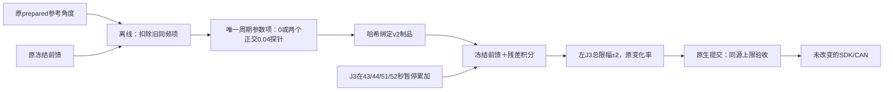

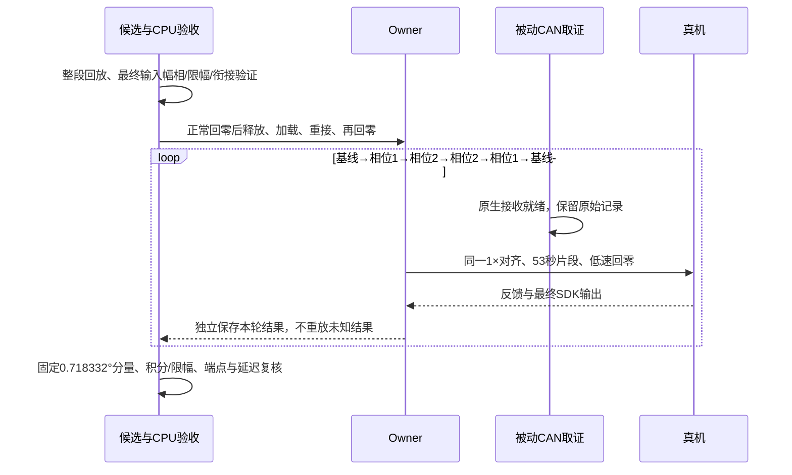

清理使用同一固定周期和44–51秒窗口拟合，按原制品插值的真实基函数校正系数，
不是先假定连续正弦再忽略制品插值误差；43–44秒渐入、51–52秒渐出。
清理后该口径的冻结前馈同频系数约为数值零，非J3列逐项不变。
A/B/C制品J3峰值约1.53432/1.52765/1.57250 SDK单位；B/C新增峰值≤0.04，
两个相位相差90°，J3制品最大分段变化率分别约1.526/1.537/2.605 SDK单位每秒。
实际限幅/变化率后的输出仍须经整段CPU和实机记录核验，不以制品曲线代替实际输出。

所有本轮制品沿用J3积分暂停策略，但暂停保留值可能随前段反馈而异；必须记录这一状态，
不能宣称内部积分初值在重复间完全相同。辨识继续使用基线漂移、重复响应方向/幅度及
条件数门；失败就不据此求逆推广，也不提高探针幅度或修改其他关节。异常再现立即停止
当前实验并分析TX/RX、控制/调度证据，不自动清锁重试。

本轮新证据目录`.evidence/j3-unified-periodic-20261024-v1/`；`contract.json`记录授权与
停止条件，`preparation.json`记录三制品与拟合。初始候选阶段见上文；后续实际发布与中断见9.1–9.3，不覆盖第8节已完成结果。

### 9.1 ±2已发布；新六轮未完成，首轮在分析窗前中断

三制品各3050、共9150个CPU窗口通过，原q/dq和窗口衔接不变；实际限幅后探针差异
峰值0.039995、两路输入矩阵条件数1.00043，CPU分析区无总限幅触顶。
正常回零→正常释放→发布→重接→回零均通过；61.73万帧切换期被动CAN无丢帧。
实际源码`/home/wujie/work/feiyu.zhou/robot-workbench-j3-unified-periodic-20261024-v1`；
SDK二进制不变。四个软件边界实核左J3为2、右J3仍1.5。

新A1只完成Align，随后开始Motion但未进入44–51秒分析窗。原生CAN记录器在准备期间
已报告can3丢7帧，执行器却没有在准备结束/确认动作前重新检查；确认进入队列后，
异常清理又用缓存`automatic_enabled`判断是否Stop，当时仍为false，因此未撤销排队动作。
发现后对匹配nonce/计划发出显式Stop。旧解释器把`target reference epoch revoked`当成
运动故障，造成FAULT_STOP_UNCONFIRMED。不能把这轮算作周期补偿效果验收，完整轮次0/6。

当前nonce=`376844781f6e95059feaac89dc52ff9326135be00c19d0ec`，epoch4，SDK仍连接，
反馈健康静止，双臂阻尼、无自动动作、非零姿态。set_damping_hold调用已返回；旧Stop回执
仍未确认，软件故障未清。没有重放A1、绕过锁定回零或自动重接。
证据为本轮`a1-observer-failure.json`、`stop-current-state.json`、`stop-recovery-options.json`。

### 9.2 取证链路真实复现：文件系统写阻塞→socket溢出

在当前阻尼状态下，只做被动接收对照，不发送CAN/SDK命令。nice15和nice0两个原生
candump接收器均在约71秒失败，各自丢318/207帧；两者同一时间连续6次调度采样为D态、
等待`do_get_write_access`，覆盖至少102ms；其间几乎无CPU执行和可运行等待累积。
因此这次复现直接指向文件系统写入阻塞，不支持仅靠提高优先级解决。
这是观察器链路的复现，不能据此宣称已定位20:45 SDK反馈超时的根因。

候选使用有512MiB预算的匿名内存临时文件接收，启动前检查/dev/shm空闲≥576MiB；
保留原生接收器、优先级和socket上限。接收器退出后才落盘归档并流式计算SHA，避免
磁盘写访问等待挡住实时接收。静止120秒取得151.98万帧，零丢帧，归档完成，进程退出；
同期磁盘对照也未再次遇到长阻塞，不能把这一轮当成故障下的优越性证明或长期验收。
辅助进程监控在退出时遇到/proc/io权限错误，原始capture独立完整并已调和；未重跑取证。

证据：`.evidence/j3-stop-race-20261024-v1/observer-priority-result.json`、
`observer-priority-analysis.json`、`observer-memory-result.json`及原始调度/原生CAN文件。
未来执行器候选还会在确认前再次检查观察器；确认意图发出后，清理不会因缓存自动标志
暂时为false而跳过Stop，并保存Stop结果/错误，避免静默吞掉清理失败。该执行器尚未运行。

### 9.3 Stop竞争修复已通过140项Linux检查，尚未加载

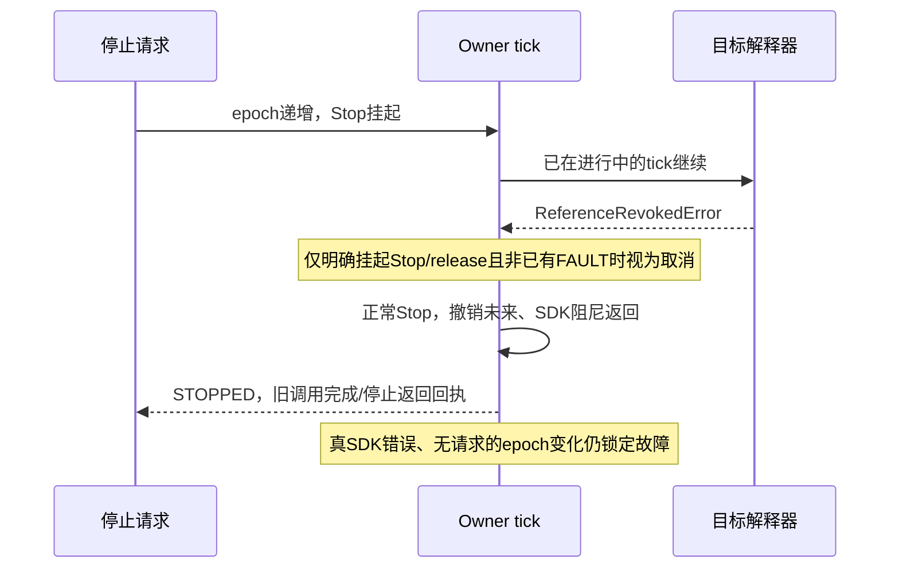

CPU确定性复现了反馈读取中途及提交中途Stop误锁。候选给撤销错误独立类型；Owner只在
确有挂起Stop/release且不是既有故障时消费为正常取消。Inference和Owner外层也复用该
判定，真正SDK错误即使和Stop同时出现仍保留故障，无请求epoch变化也仍故障。
Stop回执的prior_calls_complete按接受时的调用ID更新，不再永久停在初始false。

5项定点测试覆盖两处竞争、真实错误反例、无请求撤销反例及Infer提交中Stop；
连同共享入口/Infer/原生提交/Runtime/Owner进程/J3策略共140项Linux检查通过。
Owner进程测试结束有semaphore清理告警，测试退出0；日志保留，不冒充长期资源验收。
候选源码`/home/wujie/work/feiyu.zhou/robot-workbench-j3-stop-race-20261024-v1`，
发布预检及明确的非零释放dry-run通过，尚未释放当前SDK或发布候选。

已提出一次具体授权：可靠支撑后，允许当前位置正常释放→加载修复→重接→低速回零。
这是旧进程不可原地清锁、无法先回零时的替代维护路线；一般实验动作授权继续有效，
不再询问净空/支撑移开。**截至本节更新，该回复尚未收到，不执行依赖该授权的动作。**
新异常后没有增加运动；本轮新增真实动作仅维护回零与失败A1的已授权部分。

## 10. 原地软件误锁恢复候选：有证据的确认，不旁路驱动

用户明确授权一次越过Owner向SDK回零，并要求防止复发、补原地清锁再继续研究。
授权已记录，但本轮没有执行低层旁路、没有另开SDK客户端、没有释放/重接或运动。
当前旧进程没有能保留Owner指令准入/Stop撤销一致性的直达回零入口；用户仍不在现场，
不能把这条授权当作可靠支撑事实。阻塞是安全首次加载路径，而不是再次缺少同一动作授权。

在第9.3节取消预防修复上，增加针对本次已知误锁的原地确认恢复：

- 只识别target reference epoch revoked及原生提交期间的同类撤销；故障诊断必须来自
  同一次Stop屏障，且解释器版本早于该屏障，时间关系一致。其他未知故障不归入此通路。
- 明确核验接受Stop时的旧调用全部结束，没有运动/释放/采集排队；双臂各自阻尼调用在
  Stop之后成功返回。缺任一臂回执、错误回执或未知结构均拒绝。
- 反馈新鲜、健康且静止，踏板已释放且健康；物理反馈还必须晚于阻尼返回，并携带新鲜
  armed Guard状态。SDK终态故障、Guard异常、陈旧或运动反馈均不允许清锁。
- 查询只推导可恢复性，不改变锁存。现有显式recover在执行边界及Owner消费命令时复核，
  清除旧计划/引用并进入STOPPED，连接保持，不续跑；新动作仍必须重新审阅。
- 复用同一恢复谓词产生状态快照和执行判定，不新增第二个控制器。控制线程检查只读取
  内存中的反馈/回执，不增加文件读取或RPC。其他可恢复故障的已有处理保留。

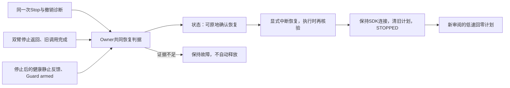

运维入口的支撑要求随实际恢复路线展示。可确认原地恢复或已健康无操作时，无需伪造
arms_supported=true；需要释放重接时仍必须真实支撑。准入、执行前及决定释放/接入前
均检查；原地条件在中途变化会失败，不自动降级为释放重接。原HTTP接口和恢复按钮复用。

176项Linux检查通过：原地恢复/拒绝证据、取消竞争、运维HTTP、动态支撑要求、Runtime、
共享链路、Infer及维护入口；未变模块复用同轮已通过结果，改动的恢复/Owner测试已重跑。
重点包含旧ValueError误锁、未知epoch/真实SDK错误仍故障、恢复不close/connect、不续跑、
新计划必须审阅、支撑条件变化禁止自动释放，以及控制线程恢复判据无文件/RPC读取。
发布预检通过，但这仍是**未加载的候选**，没有线上UI或真实原地恢复通过声明。

候选：`/home/wujie/work/feiyu.zhou/robot-workbench-in-place-software-stop-20261024-v1`。
本地证据：`.evidence/in-place-software-stop-20261024-v1/contract.json`、`qualification.json`、
`publication-dry-run.json`。新候选包含第9.3节Stop修复，替代其作为下一次加载对象；
已上线的±2配置不变。本轮没有commit/push、新GPU工作或常驻服务释放。

## 当前剩余事项

1. 通过受支持的首次加载路径更新当前旧进程；用户不在现场时保持SDK连接与阻尼，不用旁路指令或热注入替代安全恢复。
2. 加载后实核正常Stop与原地确认恢复、连接不变、旧计划不续跑及新审阅回零，再继续六轮周期补偿；不能以176项CPU检查替代真机验收。
3. 原CAN反馈超时根因仍未知；再次发生时保存独立TX/RX、Guard/SDK/Owner分段与调度信息分析。
4. 稳定候选后再做四档复验；回零残差、硬件身份、维护租约、前馈构建绑定、完整业务长期内存验收保留。
