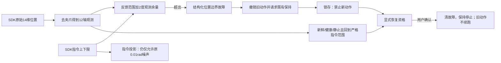
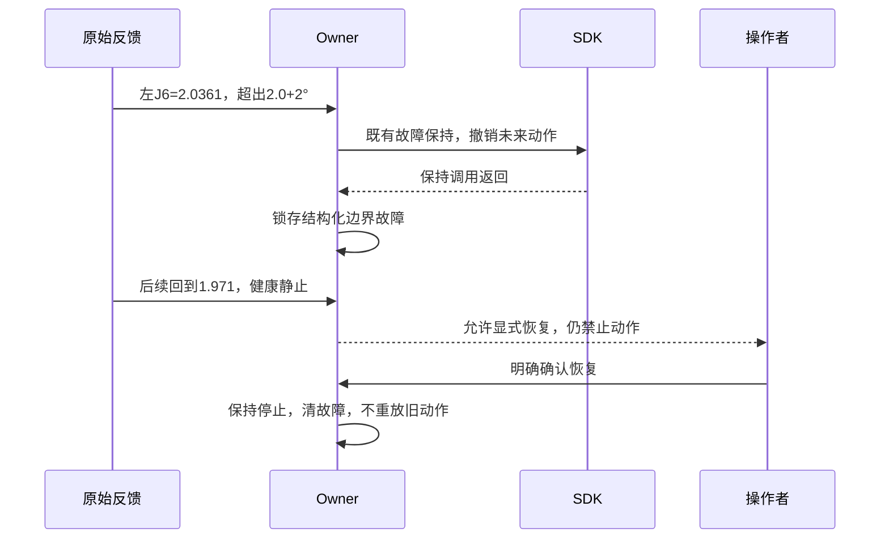

# 关节反馈越界与显式恢复

Owner：session `01a16327-7545-7332-a361-0123ddad811d`。日期2026-10-27；边界、恢复语义、实际发布或新证据变化时更新。证据根`.evidence/joint-boundary-incident-20261027-v1/`。

## 已确认的现场事实

报错的joint 5来自去除夹爪后的12轴向量、从0开始编号，实际是左J6。触发反馈2.036126137 rad，上限2 rad，超出0.036126137 rad（约2.07°），大于0.034906585 rad（2°）反馈观测容差。SDK的X5配置`include/app/config.h`明确J6范围[-2,2]；这是当前软件指令边界，不冒充已独立验证的机械极限。名义URDF该轴又是±1.57，三者统一属于另一个待办，不能为绕过本次保护随意扩大范围。

触发时无执行轨迹、两臂native P=0、低D，属于自由/低阻尼保持阶段，不能仅据此断言有人手动拖动或电机失控。记录速度峰值左J6约1.121 rad/s，当时保存的速度保护限值5 rad/s，因此本次由位置观测边界触发。研究工具此前0.8的实验配置未在本次下发；保留操作者现有设置，不静默改写。

当前SDK仍连接、Guard健康、反馈健康静止，左J6约1.971 rad已在指令区间内；保持调用已返回。旧软件仍保留FAULT_STOP_UNCONFIRMED、owner_exception，且无此类位置边界的显式恢复入口。不能自动清锁或用普通运动绕过。

## 修正范围

1. `JointPositionBoundaryError`区分feedback/command，报告left_J6等轴名、实际值、上下限、超出量和允许余量；原始反馈保留，保护阈值不变。
2. Owner将反馈越界归为joint_position_boundary，保留停止返回证据，不再归为笼统owner_exception。既有FAULT状态枚举兼容保留，停止是否返回单独展示，不等同固件ACK或物理严格静止认证。
3. 只有保持成功返回、SDK仍连接、没有原生故障、反馈新鲜健康静止、全部旋转关节回到严格指令范围内且物理Guard仍armed时，允许显式恢复。2°只是观测容差，不能当作恢复或运动的合法范围。
4. 恢复仅确认故障并保持停止，撤销旧执行身份和轨迹；继续运动需要新的审阅。无效指令、未成功停止、仍越界、Guard/原生故障均不得走该入口。

## 验证与发布状态

候选已通过238项Linux回归，包含共同Owner、边界策略、显式恢复、Stop竞争、统一Runtime及运维检查。source为`robot-workbench-boundary-recovery-20261027-v2`，冻结收据`qualification-v2.json`。当前运行进程尚未获得代码变更；未声称实机已验证新边界恢复。

另修复Runtime Stop回执只在STOPPED/MANUAL状态更新的遗漏：故障仍锁存时，若两个保持调用都在本次Stop接受后、对应epoch返回且无错误，也更新SDK保持返回证据。Guard退出仍清除证据，不把SDK返回当固件ACK或自动清锁。CPU实际共用Runtime测试覆盖此分支以及恢复后不重放旧轨迹。

当前旧SDK保持连接、双臂非零；新版未加载。已提交一次具体替代维护路线：现场可靠承托后，当前位置正常释放、加载、重接，仅验证保持与恢复入口；不回零、不执行研究。等待该路线回复，不能把正常回零维护授权扩为旁路清锁。

原始诊断还显示左J4约1.56424 rad，超过其SDK上限1.55约0.816°，但仍在2°反馈容差内，所以并非本次触发轴。名义URDF与SDK边界不一致继续保留为待核验事项，未更改任何边界。

## 受控加载与实际验收完成

用户明确确认“已可靠承托，允许当前位置释放、加载并重接”。先清理阻挡释放的遗留维护记录，再正常释放旧SDK；未执行回零或研究轨迹。发布前检验冻结源和原SDK哈希，加载boundary-recovery-v2，双臂限位、指令/反馈容差及操作者保存的保护配置均未改动。

第一次接入请求止于相机预检，左腕相机采集进程没有原始RGB-D帧，未到达SDK接入。保留该请求为unknown结果，核对后确认SDK仍断开；普通相机重启未恢复，随后经已有运维接口仅对左腕相机做一次软件复位，三路恢复新鲜帧，才以新请求继续。没有绕过相机门，也没有将第一次当作SDK接入成功。

实际验证：新SDK接入取得117个健康静止样本；普通Stop保持返回确认；显式恢复入口返回already_operable/no-resume；随后正常释放。独立CAN98,478帧、socket丢帧0、调度截断0。Stop后约1.925秒，12轴各937–938个TX的目标q/dq码值不变。结果见`validation-result-v2.json`、`all12-stop-wire.json`、`acceptance/`下SHA核验原始流。

本次没有故意越过真实限位。新位置故障的“返回严格合法范围后显式原地清锁”由真实共用Runtime的CPU故障注入/恢复测试覆盖；实机验证的是新版本加载、正常接入、静止保持、普通Stop、恢复入口与正常释放，不能混称新边界故障已在真机重现并清锁。最终SDK正常断开、无holder/nonce/活动动作。

旧记录器在首次释放尚未受理、主脚本退出后遇到状态socket ENOTCONN，原始内存未归档；这段没有SDK释放/运动请求。已保留该失败日志，后续释放及重接分别由新记录完整覆盖。验证用记录器容忍已退出读端的OSError，避免读端消失破坏后续归档；未将此工具调整当作控制层修复。

后续：正常使用中验证边界故障的显式恢复；SDK/URDF/真实机械限位统一仍待独立核验。按用户优先级继续保留重力剂量及1.5×研究，当前没有执行新研究轨迹，也未重新追查此前100ms根因。
