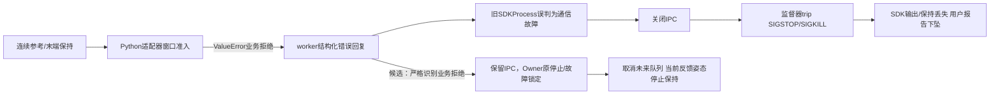
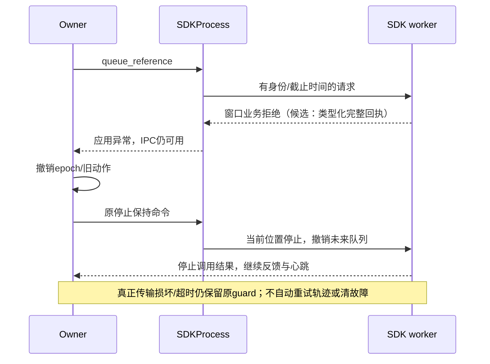
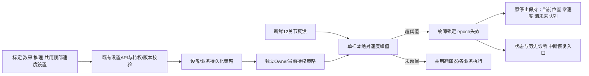
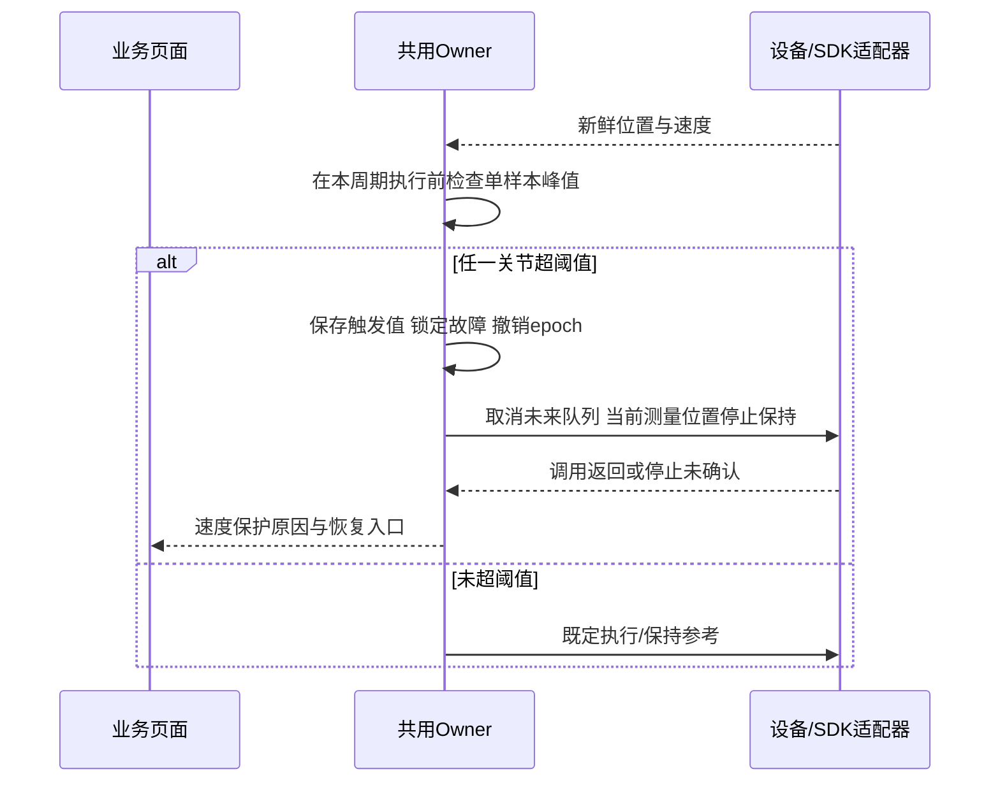

# 共用关节反馈速度保护

Owner：工作台 Session `01a13e4e-70dc-7513-9467-d34b9a7a99a3`；2026-10-22。
维护触发：默认阈值、触发/停止语义、持久化接口、UI或验收证据变化。

用户最新指定：默认开启，任一关节速度峰值超过**0.8rad/s**就中断控制并急停；阈值可修改和保存，
标定、数采、推理页面顶部均提供同一个共用模块。先实现保护，再恢复研究。
历史阶段（2026-10-22 15:23 CST）：峰值保护与独立控制研究栏目已受控发布至ARX6，
默认开启0.8rad/s；本轮保持SDK断开、无动作，真实停止/恢复待用户亲自操作后验收。
实际发布和配置链见`docs/precision-workbench.md`及续作状态所指收据。

## 2026-10-22 19:30 CST：新V10锁定后的只读核验

本节是较下方V8断控更新的实际状态观测，不代表候选发布或恢复验收。核验Session为
`01a16327-7545-7332-a361-0123ddad811d`；原资源Owner及预留未变。实际发布仍为
`preview-research-ui-20261022-v1`，窗口拒绝修复候选仍未激活。本次仅读取既有状态、
数字记录和运行源码，未接入SDK、运动、清锁、改增益或远端写入。

- 新记录`6d796ba142b426189c024180`是**V10低速回零**，不是2×主轨迹。冻结研究配置
  revision3、执行策略revision28；准备层命令速度上限0.1rad/s。19:24:07.045633 CST
  左J5反馈+0.824176788rad/s超过0.8rad/s，单样本触发正确。
- 同轮撤销旧epoch3并进入epoch4，解释器reference标记cancelled，原生prepared_reference
  清空。停止调用在触发后3.115ms返回；后续原生输出为固定测量姿态目标、12关节目标
  速度全0，双臂KP均为24/21/21/9/9/6、KD为1.2/1.2/1.2/1.1/1.1/1.07。
  这是已有保守停止保持，已退出V10运动增益；fault_manual=false，不是人工释放模式。
- Owner收据在触发后0.468669s首次满足现有静止判据；该判据含0.3s观察窗口、关节位置
  跨度≤0.3°，不等于机械速度严格为零。触发后记录到的最大关节位移0.007247925rad
  （0.415276°），不是TCP距离，也不是外部空间测量。业务日志保留75个触发后反馈样本，
  首样本在+0.155s；不据此声称完整覆盖停止瞬间。
- 19:30实核仍连接、反馈健康、stationary=true、automatic_enabled=false，运动故障锁保留。
  SDK attempt为904e799136f1edfd0814fbe52c66eb8c，guard无新事件、心跳健康。SSH按
  boot_id/start_ticks核验Owner3475633、supervisor194725、worker194760仍在；不沿用
  上一V8已退出的PID。两次读取间原生保持目标未变，未自动续跑。
- FAULT_STOP_UNCONFIRMED是旧TakeoverState.FAULT的固定枚举名；即使本次独立stop字段
  已确认调用返回与反馈满足静止判据，它也不会自动改名或解锁。页面应分别展示故障锁与
  停止观测。另有研究摘要峰值0.362637rad/s漏掉触发样本，以Owner本次trip的0.824177
  为准；约41秒前的显式Stop收据不属于本次故障。

本次符合软件契约的撤轨迹、保留SDK、保守保持、持续反馈和禁止自动恢复。它仅提供近
零位姿的一次停止观测，不能证明任意故障/姿态下的承重保持、机械零位移或踏板4等价。
静态核对恢复路径：新鲜健康反馈、静止、低于阈值及踏板输入健康时，经人工中断恢复
清除运动锁，保留停止保持；旧计划作废、不会续跑。本次没有调用恢复。

证据入口：`.evidence/v10-lock-behavior-20261022-v1/analysis.json`，包含原始三份记录
逐文件SHA256、实际源码摘要、两次状态读取与进程身份。优先补齐上一V8窗口拒绝导致
SDK退出的受控修复/停止恢复验收，再定位V10低速回零超速；页面停止确认与峰值显示
应同步修正，精度研究不能以本次一次观测直接恢复资格。

## 2026-10-22 V8执行后断控/下坠：新故障与修复前设计

本节为新V10核验前的历史故障。用户报告V8的2×执行后机械臂下坠；当时实核SDK worker/
监督器已退出，状态FAULT_STOP_UNCONFIRMED。保持断开，不自动恢复、接入、回零、执行
或更改增益；此前连接/动作授权不能替代本次停止失败后的新受控验收。Owner及预留保留。

事实分开记录：此前8次V10起点对齐均触发左J5单峰保护（0.868–1.286rad/s），冻结参数
与CAN编码前原生回显均为V10。用户确认当时V8草稿未保存。随后实际V8修订2起点动作完成，
2×轨迹已记录2516条有效参考阶段反馈，最大0.626373rad/s，未命中0.8阈值；本轮的
last_trip来自更早V10 epoch15，本轮执行epoch17。禁止把历史trip当成本轮触发原因。

V8本轮在25.5秒参考结束附近报`bounded, ordered future reference window required`。
SDKProcess.call把worker正常返回的应用ValueError纳入通信异常捕获，关闭socket；监督器
随后以worker IPC失败为由向原生worker发送SIGSTOP/SIGKILL。guard证据中最后Owner心跳
约50ms、最旧电机反馈约2.16ms，正常close/release未开始。这次不是已确认的心跳超时或
CAN失联。后续停止保持调用被SDKProcess已锁定failure直接拒绝，未完成正常踏板停止通路。
下坠由现场用户观察确认；SDK退出后没有独立测量，不能凭退出前低速度宣称机械已保持。
实际被拒窗口未留存，尚不能区分首点过期、跨度/形状等具体校验分支。

候选边界：只把可信worker对queue_reference的明确业务拒绝与真实传输故障区分；保留
身份、回复形状、连接状态校验。补充窗口拒绝时的有界时间/形状诊断，不放宽准入阈值，
不盲目扩大未来窗口或改速。CPU注入坏窗口、模拟延迟、真实IPC中断、停止失败，验证前者
仍能调用原停止且维持进程，后者不冒充成功。原停止模式虽使用当前测量位置及非零保守
增益，CPU通过仍不能验收真实承重或踏板4行为，须另作受控实机对照。

研究UI还需阻止未保存/失效配置发起准备与执行，并明确显示已保存配置；历史超速关联按
执行epoch与开始时间判断，原始历史不改写。诊断数值与图见
`.evidence/speed-stop-drop-20261022-v1/analysis.json`、`velocity-comparison.png`，8次V10
原始记录见`.evidence/research-start-speed-20261022-v1/`。截至本节写入仅为离线修复设计，
不代表候选已发布或机械停止/恢复通过。

离线候选现已实现：适配器自身的明确准入错误使用ReferenceWindowRejected类型，worker
返回经过身份/字段校验的reference_rejected；SDKProcess向Owner抛SDKCommandRejected，
不关闭IPC。Owner仍走原故障锁定与停止保持路径，撤销未来队列，不自动重试。原生调用
未分类异常、真断连、超时、身份/格式损坏仍保留原故障行为，不把未知错误泛化忽略。
窗口拒绝补充点数、形状、首末点前瞻时间及准入时刻；未放宽3ms/350ms/300ms窗口界限，
也未更改停止增益、速度阈值或SDK二进制。新诊断用于后续确认具体拒绝分支，当前历史
记录不足以证明是哪条窗口不等式失败。

前端候选同时阻断未保存/失效参数的准备与执行，显示实际将使用的已保存配置；本次试验
的超速关联要求epoch相同且触发不早于试验开始。历史trip明确分开显示，观测峰值包含本次
精确触发值，原始记录不改写；不能把业务轮询样本的峰值当作完整100Hz全局统计。

96项Linux定向检查通过（SDK RPC16、原生窗口9、共用执行22、解释器18、速度保护8、
Runtime23），包括真实CPU子进程/IPC中注入拒绝后保持通道可用于Stop、Owner锁故障并清
未来队列、不自动续跑、真正SDK损失和未分类异常不伪装成功。完整Node交互回归通过，
包含从已允许准备/执行的状态改草稿后必须拒绝，以及历史V10 trip不计入V8本轮。
候选在`robot-workbench-stop-rejection-candidate-20261022-v1`仅做CPU资格检查，未激活。
当时实际发布仍为原preview-research-ui版本，真机为FAULT_STOP_UNCONFIRMED/SDK断开；
后续用户建立的新连接与新V10事件见本文上方19:30实际核验，不覆盖历史失败。
资格收据为`.evidence/speed-stop-drop-20261022-v1/qualification.json`，机械承重、踏板4
等价行为及实际坏窗口分支仍未验收。用户于2026-10-22进一步明确：“下坠发生在接近结束时，
未操作停止&恢复”。因此本次记录应按自动执行结束附近的故障分析，不能归为人工点击
Stop或恢复引发。该现场描述与日志中终点附近的窗口拒绝及SDK终止相符，重点继续核查
正常结束到保持的转换；仍不据此断言被拒窗口具体违反哪项条件，或推断精确机械下坠时刻。
现场补充见`.evidence/speed-stop-drop-20261022-v1/human-observation.json`。SDK异常退出链
已由独立guard收据确认；本条补充不改变候选未发布、机械停止/承重尚未验收的边界。

## 判定与停止契约

- 比较新鲜反馈中左右12关节速度的绝对值；任一**单个样本严格大于**阈值就触发。
  不均值、不去峰、不等待连续超速。等于阈值不触发。夹爪速度单位不同，不混入rad/s。
- 默认`speed_protection={enabled:true,limit_rad_s:0.8}`；阈值必须为有限正数。
  到位/跟踪“仅记录”不影响它；对齐、运动、保持、回零以及无任务但仍连接的反馈都受检查。
- 判定在共用Owner读到反馈后、任何本周期新动作/轨迹下发前执行，与网页轮询和模型线程无关。
- 触发后在同一控制周期锁定故障、撤销epoch及未来输出/补偿，通过原停止保持模式取消SDK
  原生队列，保留服务/反馈，不直接杀SDK进程。停止模式使用已有保守增益与当前测量位置。
- “急停在原地”是立即请求当前姿态停止保持，不是宣称机械瞬间零位移。SDK调用返回与
  真正机械停止分别记录；失败保留未确认状态。落回阈值以下不自动恢复，须按现有中断恢复。
- 超速事件记录关节、带符号反馈值、绝对峰值、阈值、样本时间、业务及配置版本。
  反馈合法且超速时不误报为硬件数据损坏或Owner心跳故障。

## 配置、UI与兼容性

复用执行误差设置的设备/环境/业务命名空间、权限、修订号、原子持久化和撤销旧审批。
新增速度子配置，作为独立安全判断，不由误差开关控制。仅可信旧存档恢复时补齐默认值；
新HTTP设置请求须包含新配置，避免旧客户端修改误差时静默重置已保存的速度保护。
配置与原执行误差设置一致，需当前持权且空闲；应用/保存不下发运动。SDK断开时不假装
已经读到实际生效值。支持显式开关，默认开启；更改后不会自动执行或自动清故障。

三业务页顶部复用一个始终展开的速度保护条；原误差详情继续保留。两组草稿独立，
速度保存仅合并服务器当前误差设置，误差保存仅保留服务器当前速度设置。共享修订号
变化时保留未应用草稿并提示重新读取，禁止以旧修订覆盖新值。

## 验证边界

CPU验证：三业务默认值、正负方向、等值/单样本尖峰、夹爪排除；到位/跟踪关闭时仍触发；
对齐/执行/保持/回零/推理共用路径与原生队列撤销；跌回阈值后仍锁定；停止异常不冒充
成功；旧存档默认迁移、各业务保存/重启及越权/旧修订/非法数值拒绝。
页面验证：三业务顶部、默认开启、独立草稿、应用保存与版本冲突、未连接/旧后端不假报生效。
用两次真实振动数据做离线回放；不能把回放通过代替真实机械制动与停止模式稳定性验收。

前50秒四份不可变参考已通过SSH只读核对SHA256并重新计算三次插值的解析极值：
0.5/1/1.5/2倍命令峰值分别0.111422/0.222843/0.334265/0.445686rad/s，2倍小于原先
询问的0.5rad/s。V8全部已记录反馈（含回零）峰值分别0.252747/0.362637/0.516483/
0.648350rad/s，均不触发最新0.8阈值；这不证明未来试验一定不超速。

两次振动保留窗口各190个新鲜样本，均在窗口第一个样本被0.8单峰规则识别；该样本
左J5分别−4.560440/−6.076923rad/s，全窗口峰值5.747253/6.670330rad/s。窗口开始
之前振动已发生，不能把“窗口内首样本触发”写成从振动起点零延迟，更不能当作实机制动验收。
证据：`.evidence/joint-speed-protection-20261022-v1/replay.json`，同目录脚本可复核。

14:42 CST历史阶段为本地实现与CPU资格验证，**当时未更新实际V10控制进程、未重新接入SDK、未执行动作**。
实际发布与机械停止确认分别记录；用户当前禁止重新接入的要求优先于此前实验授权。

2026-10-22 14:42 CST 资格记录：

- `tests/test_speed_protection.py`当前8项专项测试通过，覆盖三业务人工执行、回零、规则
  数采、在线Infer的共用Owner，单峰、保持、未来队列撤销、恢复前再超速和停止异常。
- `scripts/check.sh`按完整入口分段完成1745次Python测试执行，36项环境依赖跳过；
  6个Node检查通过。首次运行暴露两处既有测试替身契约陈旧：取杯任务缺Owner身份、
  相机诊断SDK替身缺原生FIFO接口。仅补替身后复跑对应完整测试文件通过，原失败日志
  保留；未为此改动取杯或相机运行代码。额外复查当前23项Runtime与8项速度专项通过。
- 三业务真实HTML/JS页面以本地CPU协议设备验收并留截图；未使用真机相机、模型或动作。
- 14:37 CST只读HTTP仍为`connected=false`、`FAULT_STOP_UNCONFIRMED`、
  `automatic_enabled=false`，原runtime nonce保留，线上尚无新速度保护字段。
  14:41 CST自有ARX与739资源已SSH实核并经唯一加锁工具更新，预留保留。
- 统一证据：`.evidence/joint-speed-protection-20261022-v1/qualification.json`；
  源码哈希见同目录`candidate.json`。本轮无提交、推送或实际发布。

受控发布已于15:23 CST完成；本轮仍不自动接入或动作。剩余顺序：由用户亲自执行并核验
真实停止/恢复；处理振动事件中的高增益
与对齐失败后未Stop的执行器路径；恢复条件成立后完成真实停止/恢复验收，再恢复
0.5/1/1.5/2倍、同时间FK末端误差≤1mm的研究。0.8速度保护通过不代表振动根因已修复。
