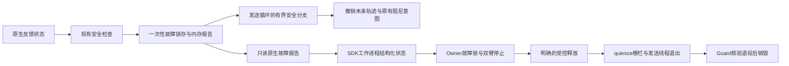

# 原生紧急分支锁问题：证据与最小修复契约

2026-10-26；维护者为本控制研究session `01a16327-7545-7332-a361-0123ddad811d`。状态：**范围已获批准并惰性发布；首次接入因发布脚本保留旧SDK的PYTHONPATH，被身份校验拒绝，SDK/Guard已退出，未重试。** 9类原生CPU故障、166项Linux回归及真实SDK→适配层→RPC的CPU组合证据仍保留，不能算实机停止通过。实现、资格或范围变化时更新。1.5×重力方向峰峰值≤1mm的主目标继续有效；锁问题不是已证明的抖动根因。

最新运行事实以[阶段状态文首](control-runtime-status.md)为准；下文“未发布/待批准”段落保留为发布前设计与准备历史。本次发布漏改systemd PYTHONPATH的负例与修正正例均已取得，修正尚未再应用在线。实际状态为断开故障、维护收尾待核验，不是正常释放；独立CAN的RX阻尼格式来源也仍待查，不能跳过后重连。

## 当前可审阅候选与边界

- SDK候选：`/home/wujie/work/feiyu.zhou/native-overcurrent-lock-20261026-v1/native-build-v1/source/python/arx5_interface.cpython-311-x86_64-linux-gnu.so`；SHA256 `c1e49abbe5a45355d08f7e67f107a7f93a8433e00174e5832a1a209569200942`；build ID `a40471ec2b9e141637aaf986d1084216ee228efc5d1bc048c05c63f2a31a5ac4`。
- 工作台候选：`/home/wujie/work/feiyu.zhou/robot-workbench-native-latch-20261026-v1`。仅SDK RPC、硬件适配/Owner、软件恢复准入及相关测试变化。与已发布源逐文件比较确认没有夹带其他历史改动；运行中的Owner仍为旧版本。
- 源码补丁、构建、测试和独立来源固定在`.evidence/native-overcurrent-lock-20261026-v1/`；`native-proposal.json`、`workbench-candidate.diff`、`native-build-receipt.json`、`native-qualification.json`、`module-qualification.json`、`workbench-qualification.json`、`adapter-qualification.json`分别给出边界证据。
- 本轮零物理CAN连接、零真机动作、零服务变更，现场SDK仍正常断开。CPU模拟器不是机械停止、承重或保护退役的物理资格。

故障检查现在先在内存锁存首个原因，再以专用异常展开state/cmd锁；发送循环每轮执行一次有界阻尼分支并让出生命周期锁。未来参考清除后普通动作接口永久拒绝该实例。`set_to_damping`只能确认故障阻尼，不能清锁或恢复运动；`quiesce`仍可退役发送线程。

**有效反馈**下保留原生KP0、默认KD乘原倍率、启用时的原生重力项及限幅意图；清掉旧轨迹和附加前馈。**无效/非有限反馈**不进入逆动力学，也不声称位置保持；使用有限的零目标阻尼输出，适配层停止健康另一臂后走既有Guard退出路径。首个故障原因保留，反馈后来恢复不能自动清锁。正常运动增益、参考/原生频率、CAN编码和阈值没有改变。

已核验固定vendor二进制：EC/DM的KD编码前都限制在0～5，原生故障分支传入的J2/J3 KD6实际编码为5，不是回绕。EC为9 bit、DM为12 bit；这是反汇编及常量证据，不冒充实机报文。见`emergency-kd-encoding-audit.json`。

RPC使用独立`SDKNativeFault`分类，确认故障输出后保留IPC；它不属于软件参考拒绝或可原地恢复清单。Owner对同一实例/时间戳只处理一次故障，撤销审批、未来队列和积分状态，保持只读诊断。健康另一臂复用原测量位置Stop。未知错误、坏报告或不可信反馈仍失败关闭，不做宽泛异常吞掉。

### 已通过与未通过的验收

- 9个实际原生候选代码场景：初始化失败/清理后新构造、嵌套state+cmd锁、异常插值、关节过流、位置异常、扭矩异常、夹爪异常、非有限速度、夹爪过流。故障锁存后普通命令被拒绝；读状态、阻尼确认、quiesce有界返回；旧未来不复活；quiesce后无发送；注入阻塞logger没有被故障关键路径调用。CAN由内存stub替代，strace未出现AF_CAN。
- 166项Linux工作台回归通过。测试进程退出时有10个semaphore资源追踪警告，原日志保留；不将其描述成无警告通过，亦未据此认定常驻服务内存泄漏。
- 模块导入/旧API/异常类型、原生容量/Stop及既有插值窗口回放通过；没有执行其他倍率的真机研究。
- 新SDK＋真实legacy backend＋本候选适配层＋真实RPC worker组合通过：左臂锁存、右臂正常Stop、无效反馈转Guard trip、禁止自动清锁、双臂正常quiesce/释放。CAN和Guard为测试替身，非AF_UNIX socket被测试preload拒绝；最大RPC墙钟约14.77ms，仅为该CPU检查观测。测试preload不属于发布合同。
- 首次组合检查的临时Gain数组断言不正确，且非daemon测试线程使失败进程滞留；已按确切PID/start_ticks/测试preload核验后清退，改为持有Gain对象再读其数组并增加进程内超时。原失败/清退证据保留；相关生产读取已核验没有同一临时对象访问写法。
- **待验：新增SDK故障处理范围确认后的受控加载、正常接入/Stop/未来撤销/显式软件恢复/释放再接入。** 不在真机上制造真实过载；CPU组合测试不替代这些物理资格。真实原生故障仍不允许原地清除。

此前SDK明确批准范围是新增保留q/dq和未来前缀入口；本次进入原生故障处理与无效反馈输出语义，需就新增范围对齐。已有正常维护、回零和实验现场授权继续有效，不重新询问场景或支撑。

### 受控发布和生命周期验收准备已完成，仍未执行

`publish.py`复用原受控发布流程，默认只预检。最新预检通过：核验实际Owner/服务归属、无活动任务、SDK断开、候选SHA/vendor固定、上一批12轴回零最大0.251351°及原SDK/Guard进程身份已退出。旧管理器的`publication_files.sdk_module`曾保留更早模块路径；候选将其与实际`physical-profile.sdk_quiesce.module`对齐，未更改运行中配置。

发布工具只在本任务收到新增SDK范围明确答复，并保存与本候选build/source manifest相符的批准收据后才允许`--apply`。发布仍惰性启动：只切换本任务Owner/业务/管理服务，核验其他服务身份保持，SDK不自动接入。新发布收据不继承旧模块的实机验收成功标记。当前没有批准收据，也没有执行发布。

`lifecycle-candidate/`复用最新独立CAN内存记录器和原正常Stop协议，准备了接入→正常回零释放→新身份再接入→同一1.5×片段运动中Stop→未来撤销→恢复语义核验→回零释放。连续TX/RX、调度证据跨两次接入保存；没有媒体。外部Stop/交接不触发新运动，失败回零不再尝试。控制代次已按真实Stop收据校正：请求时barrier=2，正常停止完成时epoch=3；清理必须同时匹配本脚本的accepted时间、barrier、停止返回和未变控制权，不能只猜`before+1`。

特别纠正验收归属：历史`vertical-stability-goal-20261025-v1`的真实恢复operation返回`already_operable=true`，属于正常Stop后的幂等恢复请求，**没有实际清除软件故障锁**。新协议明确分为`already_operable_no_fault_cleared`与`recoverable_software_fault_cleared`；本轮正常Stop协议仅覆盖前者。真实原生故障不支持原地清除，真实软件故障清锁也不得用这个无故障operation替代；其现有CPU状态转换证据与未来实际事件证据分别记录。

22项真实收据清理/恢复/未授权拒绝检查在本机和目标Linux通过；没有控机。`stage_lifecycle.py`必须在成功惰性发布后绑定实际Owner/后端身份、重绑完全相同数值FF到新SDK，再做目标Linux2167窗口回放；`launch_lifecycle.py`还会核对module、PID/start_ticks/boot_id、控制权、CAN接口、维护状态及一次性意图。两者已准备，均未运行。证据：`controlled-release-tools.json`、`publication-dry-run.json`、`publication-preparation.json`、`lifecycle-spec.json`、`protocol-cpu-receipt.json`、`prior-recovery-scope-audit.json`。

## 已核验事实

当前模块SHA256为`c249a08c144198f2c0a1abe62d14f04ce443b55522f2213d050267c42f3d0d3c`，build ID为`71544705abe0062ef7d1bd4f3d795b1f156460a9432c8ca23e6e70bcc4841044`。
`src/app/controller_base.cpp`的SHA256 `d04d12de62466d6204702751c53f2c9a1a8d048365e410bb5de845ef8cd4fb4a`及头文件SHA均与实际构建收据一致。

- `enter_emergency_state_()`在持有非递归`cmd_mutex_`时调用`set_gain()`；后者再次获取同一锁。
- 即使只移除这一处重复加锁，无限紧急循环仍在外层`lifecycle_mutex_`作用域内，其他线程的命令、Stop和quiesce不能完成。
- 部分sanity检查在持有`state_mutex_`，甚至同时持有`cmd_mutex_`时调用同一紧急函数，不能靠给mutex换成递归类型掩盖整个调用链。
- 紧急函数的调用者包括状态/插值命令异常、扭矩数据异常、夹爪数据异常和持续过流估计；不只过流一条路径。
- 保护路径还有同步logger调用；恢复停止能力不能依赖文件系统写入及时返回。
- 当前研究没有触发这些原生故障。最后四轮J2对照正常回零释放，当前SDK断开。没有在真机上制造过流。
- 已保存的较早源目录也含相关代码，但不是干净Git仓库，不能据其目录名归责于上游或某次补丁。此次C1/C2学习没有修改SDK二进制。

证据在`.evidence/native-overcurrent-lock-20261026-v1/`，包括`reproduction.json`、`lifecycle-source-audit.txt`、`sanity-callers.txt`及源码来源检查；构建绑定在`.evidence/j2-integral-freeze-1p5x-20261026-v1/native-source-match.json`。首次Mac最小程序超时未看见入口标记，已标记不合格；最终Linux结果在看见入口标记后确认自锁，并单独确认生命周期锁饥饿。该试验没有SDK对象、CAN或机器人命令，**不是完整SDK故障注入验收**。

## 组件与边界



- 正常动作、PD/CAN编码、FF、500Hz频率、速度/位置/心跳门槛均不因本修复改变。
- 故障检查只锁存首个原因并退出自己的锁作用域，不进入持锁的无限循环，不执行可能阻塞的日志写入。
- 发送循环每轮释放生命周期锁；安全分支直接更新内部状态，不在持有cmd锁时调用再次加锁的公共方法。
- 锁存后普通运动写入拒绝；读状态、明确停止及quiesce仍可完成。没有清锁后自动续跑，没有原地清除真实原生故障的入口。
- 原生紧急阻尼不等同于工作台普通Stop的定姿保持，不新增“所有原生故障均保证原位”的承诺。未知/无效反馈不能伪造成健康保持。
- 初始化未完成的故障须快速失败、没有泄漏的发送线程或虚假READY。已建立连接中的有效反馈故障与不可信反馈故障分别沿既有安全边界处理；实现前必须核对实际构造/销毁路径，不能让部分初始化对象继续输出。

## 目标时序

```mermaid
sequenceDiagram
  participant Loop as SDK发送循环
  participant Check as 安全检查
  participant Owner as Owner
  participant SDK as SDK接口
  participant Guard as 独立Guard
  Loop->>Check: 既有检查条件
  Check-->>Loop: 锁存原因，退出state/cmd锁
  Loop->>Loop: 撤销未来队列，进入有界安全输出
  Loop->>Loop: 释放lifecycle锁
  Owner->>SDK: 读取反馈及故障报告
  SDK-->>Owner: 当前实例的锁存原因/模式
  Owner->>Owner: 故障只处理一次，撤销业务审批及旧动作
  Owner->>SDK: 停止另一健康臂；故障臂只确认既有安全态
  Note over Owner,SDK: 不把原生锁存误当可恢复的普通参考拒绝
  Owner->>SDK: 经现有授权流程明确释放
  SDK->>SDK: quiesce可进入，停止并join发送线程
  SDK-->>Owner: 输出栅栏收据
  Owner->>Guard: 原顺序退役
```

## 最小实现范围

1. 原生层：`controller_base.h/.cpp`增加明确的内存故障状态和只读报告；调整共享紧急入口、检查返回、发送循环及命令/释放准入；pybind只增加所需只读能力。保留旧触发条件和阈值，暂不顺手修正其他SDK算法。
2. 工作台适配层：核验所载模块的能力/哈希；有效原生故障作为结构化已连接故障传递，不能落入SDK RPC的一般ValueError分支而直接关闭连接。发生不可信反馈时沿既有Guard退役边界，不假装还能定姿。
3. Owner：收到原生锁存后仅一次进入FAULT，清审批和未来动作；停止健康的另一臂；阻止将其当成可原地清除的软件误锁。保持只读诊断和受控释放可达。
4. 发布：独立候选源/模块/构建ID，原模块与C1配置可回退。当前没有接入SDK，不为惰性发布额外运动。真实接入、普通Stop/恢复、释放/再接入与意外故障“不自动重试”沿用原流程；CPU结果不冒充真机故障行为。

实现时先核对`SDKProcess.call()`的错误分类、worker序列化、`Owner.tick()/motion_fault()`、backend.stop/close及构造失败路径。当前一般RPC错误会关闭连接；新故障类型必须避免这一误分类，同时不得让未知异常被宽泛吞掉。

## 验证门

- 原锁序可重现；来自state锁/cmd锁/初始化检查的故障均能退出检查函数。
- 队列撤销、故障只锁存一次、新普通命令拒绝、没有旧轨迹复活。
- 故障后只读状态、明确Stop和quiesce并发可返回；quiesce返回后无新发送。
- 初始化失败不泄漏线程/连接；跨实例/跨epoch旧报告不可清锁或复用。
- 关键路径不因logger阻塞；正常路径与未启用候选行为保持兼容。
- SDK worker/Owner集成：逻辑原生锁存不误关闭IPC、不被软件恢复分支放行；真实失联/超时仍执行既有保护。
- 实际源码构建与模块哈希核验、目标Linux回归；通过后才进入受控加载与真实生命周期/普通Stop验收。是否需要额外原生故障的实机注入，应按最终候选的可验证范围单独列清，禁止用真实过载制造测试事件。

## 原生频率路线的附加发现

SDK的`controller_dt`同时决定发送循环和位置增量限速，并影响按周期计数的过流时间窗。默认计数为20，触发条件是`count > max`；不能只把2ms改为4ms而让过流等待时间加倍。控制配置工厂按值返回，可隔离左右配置；尚未加载250Hz候选。该路线需在故障契约闭环后再保留或更保守地换算时间语义，不能放宽保护来完成精度实验。

## 回到主目标

当前保留C1作为研究回退；C2性能未通过，J2积分关闭未显示各段一致收益。锁问题修复/资格闭环后继续同一1.5×下的平滑度研究，验收仍是原始反馈FK重力峰峰值≤1mm，包含完整保持区间；静态≤1mm、姿态/路径诊断及全部保护保留，不生成实验图片或视频。
