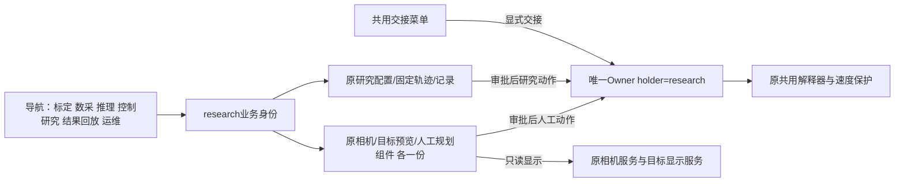
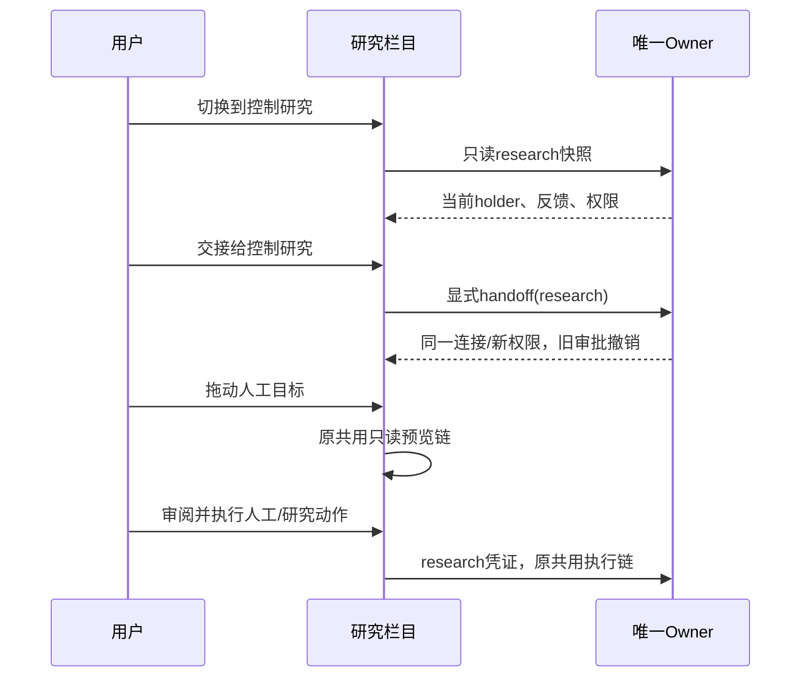
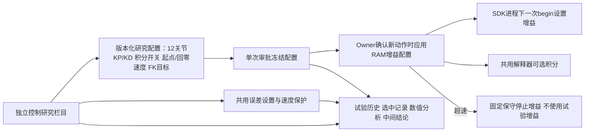
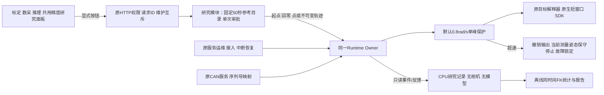
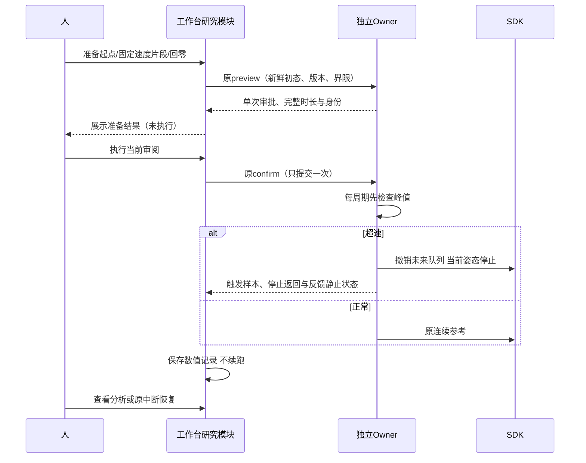
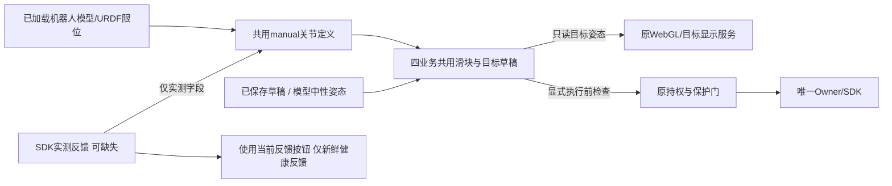
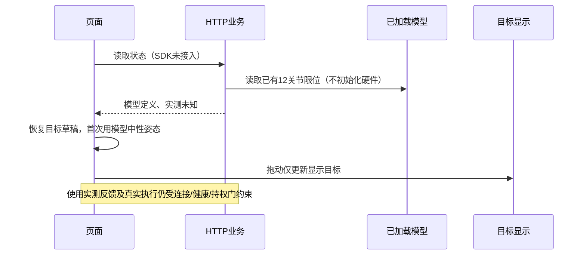
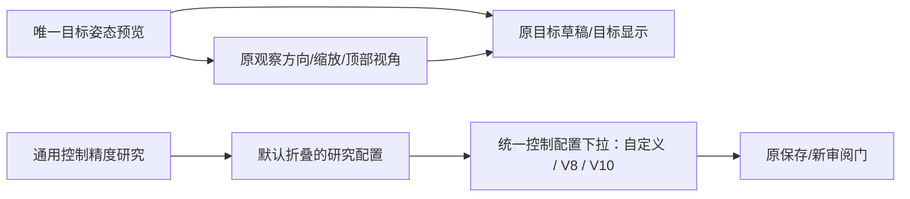
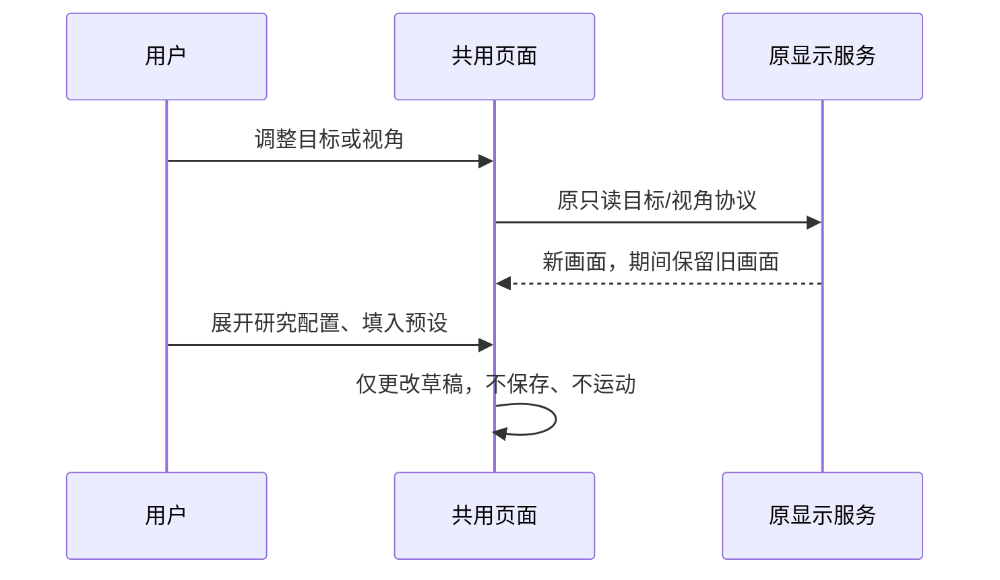

# 工作台控制精度研究模块

Owner：Session `01a13e4e-70dc-7513-9467-d34b9a7a99a3`；2026-10-22。
维护触发：研究参考、按钮、发布、权限或停止/恢复资格变化。

## 研究作为独立持权业务（V3实现前）

用户进一步明确：控制研究在结果回放之前，与其他控机业务一样具有控制权交接、目标浏览、
人工规划和观察相机。V2仅独立视图、借用当前业务身份的结构由此升级：新增`research`业务
凭证与持权/设置命名空间，仍只有一个设备Owner和SDK；进入栏目只读，显式交接才换持权者。

UI复用既有DOM组件，不复制相机/工具或增加服务；研究页隐藏标定队列、数采/推理任务及
业务结果卡。前端的可见性、自动预览、媒体订阅都按research真实业务路由。后端共用人工
入口增加research准入，保留对标定采图/其他业务专属命令的禁止。验证覆盖切页不交接、
交接到research、人工预览/执行身份、研究设置命名空间、Stop/保护以及原三业务回归。

## 独立栏目与可复现配置扩展（实现前）

用户进一步指定：控制研究在顶部导航与标定/数采/推理同级；集中控制优化配置，支持
左右逐关节KP/KD，保存中间结论。栏目复用已有持权业务身份，不新增第四个SDK Owner。

保存研究参数只写研究配置文件、撤销旧研究审批；不调用SDK、不热改正在执行的增益。
KP/KD在已采用V10逐关节上界内编辑，均要求有限正数；界面显示上界。每次新审批携带
完整配置，通过Owner验证并冻结；仅在新动作开始、原begin之前将参数放入SDK适配器内存，
随后由既有begin执行增益切换。普通动作重置试验覆盖；Stop始终使用原独立停止模式。
参数更改、配置版本变更、Owner/epoch变化都使旧审批失效；已有试验记录不随新配置改写。

参考片段四个速度使用既有不可变制品；原轨迹50源秒、解析速度/加速度上界与来源指纹只读。
当前积分开关可配置；未登记匹配且通过检查的前馈制品不提供伪可用开关。Owner/SDK周期、
原生窗口与硬件保护属于运行事实，明确只读，不添加不能实际生效的输入框。
研究历史保留独立配置快照、结果和结论，页面每次最多显示20条；历史数值日志不删除。

本轮用户要求：受控发布0.8rad/s峰值保护；准备V10环境，由人亲自操作，不自动接入或运动。
保留V10运动增益作为明确标记的实验配置，不当作常规生产配置；保护不证明振动根因消失。

## 组件与信息流（实现前）

研究模块只接受服务器配置中四份SHA256固定参考；浏览器不得提供路径、脚本或任意增益。
按钮：只读检查、准备回到起点、准备0.5/1/1.5/2倍片段、执行当前审阅、低速回零、停止、
跳转原恢复入口。准备只生成审批，执行才运动；不自动串联、重试、清故障或回零。
研究记录只含数值、命令、原生输出与状态，禁止录像和新模型/感知调用。
各业务使用当前持权身份与原配置版本，研究运动明确要求速度保护开启且为0.8rad/s。

## 接入问题与发布边界

本轮只读发现can3缺失、USB重枚举后slcand仍持旧设备；旧SDK已退出。另有恢复维护结束时
Owner退役清掉lease、旧客户端仍持lease再end导致`maintenance capability required`；应按
已验证退役收据结束本次客户端lease，禁止泛化忽略权限错误。
发布前重新核验SDK进程、CAN接收者、Owner身份和无进行中的维护。恢复原CAN服务只重建
既有接口，不接SDK。新Owner必须惰性启动；历史故障保留为历史，不捏造正常释放/机械停止。

## 验收

CPU：审批与执行分离、越权/维护/版本/参考变更/保护关闭拒绝；停止后不续跑；故障仍可
读结果；恢复lease清理范围严格；持久记录有界、重启可见。前端验证三页同模块、状态与按钮
权限、单次请求、原运维链接。Linux运行同链CPU检查；发布实核哈希、进程、热模型、相机。
本轮不自动制造真机振动。真正机械停止/恢复须由用户操作后依据新反馈判定，未执行不得通过。

## 2026-10-22 15:03 CST 实际发布

- 已恢复原`prometheus-x5-can.service`，can1/can3均UP；执行前实核无SDK模块加载者及CAN
  接收客户端。未改串口序列号映射、未接SDK、未发运动。
- 新源`/home/wujie/work/feiyu.zhou/robot-workbench-precision-panel-20261022-v1`，运行根
  `/home/wujie/work/feiyu.zhou/precision-panel-20261022-v1`。V10运动增益保持，追加默认
  开启0.8rad/s速度保护及独立研究面板；四份原始参考SHA256保持。
- 176项Linux CPU/协议检查通过（含完整50项HTTP、独立Owner进程、速度与研究模块）。
  当前SDK断开、无runtime nonce、接入Operation已允许、遗留维护已结束。相机、模型及
  目标显示进程身份不变，热模型绑定恢复；本轮SDK接入数0、运动数0。
- 旧恢复失败及其私密维护收据保留；仅在旧业务和惰性Owner退出实核后结束其维护窗口，
  未将其改成正常SDK释放。新代码修复退役成功后客户端仍持已被消费lease的问题。
- 发布动作与服务核验已完成，首轮收据生成误从断开状态读取`control_owner`字段导致
  KeyError；随后只通过权威Owner IPC补写收据，未重复发布、接入或动作。
- 共用Owner记录超速样本、原停止保持返回、之后反馈静止确认、触发后最大关节位移；
  页面展示这两级证据。反馈静止仍不是独立外部空间计量。
- 模块：准备起点／四档轨迹／低速回零、执行当前审阅、Stop、分析最近记录、原中断恢复
  索引。准备与执行分开，任务显示不覆盖标定/数采/Infer业务任务。数值日志gzip流式落盘，
  控制进程不做文件/模型/图像工作；分析在CPU子进程按同时间FK≤1mm口径执行。
- 当前浏览器自动化被Work设置禁用，不能生成本轮新模块的实际页面截图；实际HTML节点、
  三业务按钮与权限/请求行为由Node页面测试验收，实际HTTP页面可由用户直接查看。

权威实际发布收据：`.evidence/precision-workbench-20261022-v1/publication.json`；对应
`after-state.json`、`after-environment.json`、`can-repair.json`保留当前状态。
待用户亲自接入和操作后，另录真实停止/恢复验收；不得将CPU通过标成机械停止通过。

## 2026-10-22 15:23 CST 独立栏目V2实际发布

顶部导航新增与标定、数采、推理同级的**控制研究**；入口
`http://10.17.32.5:18868/?environment=physical&business=collection&view=control-research`。
V1在三个业务页插面板的形态已被此版替代。研究使用明确显示的持权业务身份，不创建第四
Owner、相机或SDK实例。误差设置及速度保护模块复用到本栏目，业务页继续保留原保护入口。

已实现并持久化：左右12关节KP/KD、有界积分开关、起点/回零速度、夹爪速度、同时间FK
TCP验收目标；四档不可变轨迹、起点/回零准备、单次执行、独立Stop、原中断恢复索引、
数值分析、最近20项试验索引和逐记录版本化结论。配置保存、审批绑定、实际begin应用分别
有边界；增益或积分开关变化强制撤销旧保持复用，走新的begin。普通动作开始时撤销研究
增益覆盖，回到该部署的原profile；当前部署原profile本身仍是V10实验配置。

未注册的匹配前馈制品不提供可用开关；轨迹源时长、指纹、控制内核周期/窗口等作为只读事实，
不伪装成已经支持热修改的配置。研究记录冻结设置、当时的误差/保护设置、评分模型/零偏/TCP，
分析展示请求增益与SDK原生遥测可观测到的增益，避免把草稿当作实际输出。分析不会覆盖更新
的中间结论；历史记录不随新配置改写。

V2源`/home/wujie/work/feiyu.zhou/robot-workbench-precision-panel-20261022-v2`，运行根
`/home/wujie/work/feiyu.zhou/precision-panel-20261022-v2`；研究持久数据目录保留V1的
`/home/wujie/work/feiyu.zhou/precision-panel-20261022-v1/studies`，发布不迁移或丢弃已有记录。
200项Linux CPU/协议检查及90项最后增量检查通过；本机UI、HTTP、研究/SDK通路检查通过。
V1完整入口分段运行暴露两处非确定性既有检查问题（macOS临时子进程组权限、预览时间戳
56ns浮点舍入），对应完整文件各复查一次通过，原失败日志保留；没有为此改运行代码。

线上实际HTTP已验证：保存同一份V10默认设置，修订号0→1，旧审批清空，SDK始终断开；
can1/can3维持UP，接入Operation允许，无遗留维护。相机、热模型与目标显示身份仍保留。
无SDK接入、运动、推理或视频采集。本轮浏览器自动化仍被Work设置禁用，视觉证据限制如上，
以实际HTTP页面及Node节点/交互验收替代，未宣称已经截图。

最新收据与验证位于`.evidence/precision-workbench-20261022-v2/`：`publication.json`、
`qualification.json`、`live-settings-check.json`。续作统一入口已指向此版实际收据。
**机械停止/恢复、V10振动根因修复及四档≤1mm精度研究均未冒充完成。**

## 2026-10-22 15:48 CST 独立持权与共用工作区V3实际发布

导航顺序已为标定、数采、推理、**控制研究**、结果与回放、服务运维。直接入口为
`http://10.17.32.5:18868/?environment=physical&business=research`；旧
`view=control-research`入口兼容映射到research。切栏目只读，显式交接才改变持权者。
研究具有独立research凭证和执行设置；相机、目标姿态/整机预览、人工规划使用原共用组件，
各一份DOM与原服务。未新增设备Owner或SDK实例。研究页隐藏其他业务的任务、标定队列及
业务结果卡；研究配置、四档参考、数值记录和逐记录结论保留。

用户明确授权“你直接释放就好，目前可以正常释放发布”。正常释放收据实核SDK关闭返回，
原worker/supervisor均退出，PID/start_ticks/boot_id对应；本轮没有回零或其他运动。
随后仅替换本任务业务、管理服务和已断开的Owner。新源为
`/home/wujie/work/feiyu.zhou/robot-workbench-precision-panel-20261022-v3`，运行根为
`/home/wujie/work/feiyu.zhou/precision-panel-20261022-v3`。研究数据仍使用V1的studies目录，
修订号1和V10参数保留。发布后SDK保持断开、holder和runtime nonce均为空，接入Operation
允许，无遗留维护或活动任务。没有自动接入、模型调用、动作或视频采集。

252项Linux检查通过，涵盖真实独立Owner IPC的research交接、相同连接身份保留、旧凭证
拒绝、共用人工规划/执行身份、研究设置与速度保护，及原业务回归。线上HTML和四份实际
`/web/`资产已核对（JS按管理服务正常注入部署SHA后比对）；共用DOM各一份、导航顺序正确。
15:50 CST实核can1/can3均UP，三路相机帧新鲜，原相机、热模型和目标显示进程身份未变，
模型绑定健康，部署文件未变。浏览器自动化被Work设置禁用，不能提供实际页面截图；以实际
HTTP资产、Node DOM/交互检查作为替代证据，不宣称完成视觉截图验收。

本轮实际证据统一在`.evidence/precision-workbench-20261022-v3/`：
`publication.json`、`direct-release-verified.json`、`qualification.json`、
`current-state.json`、`current-environment.json`和`live-acceptance.json`。
续作入口的current_publication/current_actual_state_evidence已指向V3实际收据和状态；
发布收据从父版本继承的历史动作/holder字段不能覆盖新鲜状态中已断开的事实。
ARX6与重建后的739均通过strict SSH核验并由唯一加锁gpu-usage更新本Session预留；
739旧UUID生命周期不复用，未触及734/741。资源表已更新，shadow核账仍报告既有非阻断
分类问题，不能表述为治理全部通过。

剩余优先事项：先由用户亲自接入、显式交接到控制研究并操作，依据新鲜反馈完成真实
停止/恢复验收；随后在保护开启的条件下继续振动根因和四档同时间FK≤1mm研究。
本次正常释放通过不能替代机械停止通过，也未宣称V10振动根因已修复。

## 未接入控制时的人工调姿（修复前设计，2026-10-22）

问题链：HTTP仅在SDK反馈及限位均存在时组装manual关节定义；前端又要求完整实测反馈才
创建滑块，导致断开控制时模型工具一起消失。已加载的标定几何本身具备URDF关节限位，
目标显示服务也独立于控制连接，应该直接复用这两项现有能力。

验收覆盖四业务首次未接入、连接后断开与重接、草稿恢复、夹爪目标和自动目标预览；
模型默认值不冒充实测值，断开时使用反馈和真实执行不可用。发布只替换业务与网页/管理
代码，保留Owner、SDK、相机、热模型及目标显示，不为预览修复回零或重接设备。

### 实现与实际验收

已实现上述边界：共用HTTP从现有geometry.limits补充12关节定义；未接入时positions为null、
夹爪实测为[null,null]。前端分开判断模型定义与健康反馈，首次离线目标取限位内中性姿态及
83mm夹爪，有草稿时恢复草稿。断开、重接均不覆盖已编辑目标；无健康新鲜反馈时“填入当前
实测姿态”不可用，真实执行仍走原持权与保护门。四业务共用同一修复。

实际发布源为`/home/wujie/work/feiyu.zhou/robot-workbench-offline-manual-preview-20261022-v1`，
运行根为`/home/wujie/work/feiyu.zhou/offline-manual-preview-20261022-v1`。只更新业务和管理/
网页入口，Owner继续V3、SDK保持断开；相机、模型、目标显示进程身份全部保留，热模型绑定
健康，无遗留维护。未执行机器人动作或重接SDK。

71项Linux检查（完整51项HTTP及20项共用目标路由）通过，本机完整HTTP与Node交互回归
通过。线上逐一核验标定、数采、推理、控制研究均返回模型关节定义且不伪造实测。SDK断开
时实际提交只读目标姿态，取得对应修订的渲染JPEG，回报关节位置与请求一致，之后控制
仍断开。图像为目标显示服务输出，不是浏览器截图或真机相机图像；浏览器自动化设置仍禁用。

本轮证据：`.evidence/offline-manual-preview-20261022-v1/`的`qualification.json`、
`publication.json`、`live-acceptance.json`、`current-state.json`、`current-environment.json`及
`offline-target.jpg`。发布预检最初触及正在运行管理服务的状态目录锁，未切换服务；改为
既有独立预检目录流程，管理服务退出后才接管原目录锁。未绕过锁或重复发布。
当前发布与实际状态续作指针已更新；真实停止/恢复和精度研究的验收状态不受本次预览修复改变。

## 预览入口合并与研究配置折叠（2026-10-22，实现前）

目标姿态与整机视角展示同一模型，合并为一个目标姿态预览入口；目标编辑和相机观察分别
沿用原通路，旧target/overview仅作内部渲染协议。相机控件一直可用，切换内部协议时保留
上一张有效画面。研究标题去掉V10限定，自定义参数与可选V10预设仍只改草稿，配置细节用
原生details默认折叠。按用户追加要求，V8/V10统一作为控制配置下拉项，不保留V10专用按钮；
下拉配置由后端从既有gains/profile定义生成，选择仅填草稿，保存/新审阅才应用。
当前已部署执行基线及参数上界保留，未新增未经验证的控制配置或
修改任何实际增益；这些执行事实仍在只读事实中披露。

V8实际发布收据指向x5_control50_pd30_feedback50_v1，V10指向x5_control50_damping_v1；
二者同左Kp、右参数、积分/周期/补偿边界，主要差异是左Kd。下拉项复用上述已存参数，
不从名字猜测或手工舍入。记录来源为control50-20261022-v8/v10的publication.json及
docs/control-prefix-precision-study.md的V8/V10对照。

本轮发布业务提供的配置目录与管理服务承载的页面；Owner、SDK、相机、模型和目标显示
进程保留，不因选择下拉项进行重接或运动。

### 实际发布与验收

已发布`robot-workbench-preview-research-ui-20261022-v1`业务/管理页面，运行根为
`/home/wujie/work/feiyu.zhou/preview-research-ui-20261022-v1`。预览仅保留“目标姿态预览”，
直接拖动、缩放、观察方向与顶部视角可用；内部相机/目标协议切换保持上一帧，继续严格
核对新画面身份。控制配置统一为后端目录驱动的下拉项：自定义/当前配置、V8、V10，无
版本专用按钮。逐关节参数等细节默认折叠；选择仅改草稿，保存及下一次新审阅才应用。
既有保存配置修订1未变，本轮没有擅自切到V8或V10。

14项Linux定向检查（研究6、执行设置8）及三套Node交互检查通过；新增覆盖真实配置参数
来源、V8/V10选择不发送请求、不改变保存值、默认折叠、唯一预览直接拖动及保留上一帧。
线上实际HTML/JS哈希、两项配置目录及健康状态已核验。浏览器自动化仍禁用，未生成本轮
页面截图，以实际DOM与交互检查替代，不使用旧图片冒充本轮视觉验收。

发布前用户已自行接入并交接到research；本轮保持该连接、持权及runtime nonce，Owner、
相机、热模型、目标显示进程身份不变，SDK重接与运动次数均为0。收据的连接字段已从原始
发布后实核状态补全，未沿用父收据的“断开”字段，也未为补收据重复发布或动作。
证据统一位于`.evidence/preview-research-ui-20261022-v1/`的`qualification.json`、
`publication.json`、`live-acceptance.json`、`current-state.json`和`current-environment.json`。
