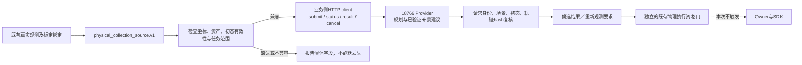
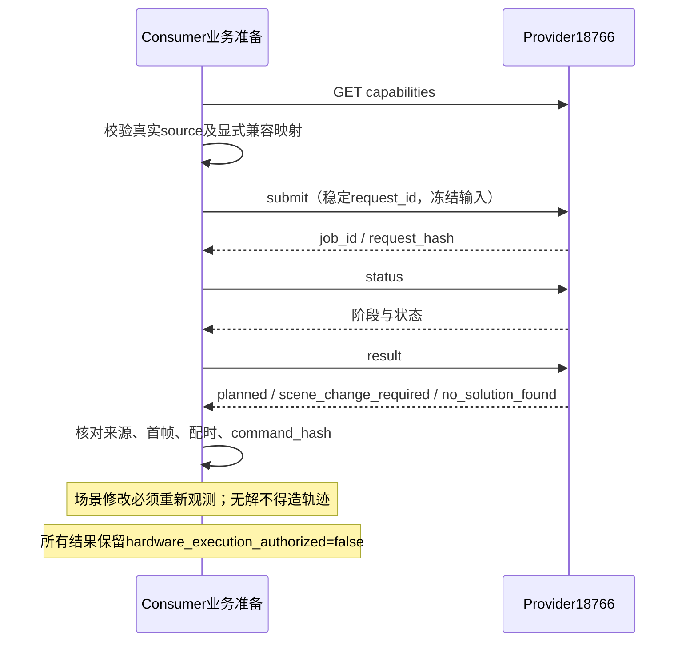

# 动作规划服务消费端契约

2026-10-26；Owner：本工作台session `01a16327-7545-7332-a361-0123ddad811d`。
用户在“动作设计工作台开发”chat明确要求双方对齐并接通规划接口；本session已读取该原始用户消息核验授权。
Provider统一协调入口为 `/Users/wujie/Developer/work/anyverse/_context/notes/action-design-planning-api-20261026.md`。
维护触发：Provider协议/模型、消费端映射或验收状态变化。

## 当前事实与改动边界

Provider `http://10.17.0.27:18766/api/scene-planning/capabilities`已只读实核；消费端薄HTTP client和结果绑定检查已实现，运行于业务/离线准备侧，不进入Owner控制循环。
代码隔离在 `/Users/wujie/Developer/worktrees/robot-workbench-scene-planning-consumer-20261026`，分支`feature/scene-planning-consumer`，基线e87aafc；文件为`rule_based_workbench/scene_planning_client.py`及同名测试，已加入`scripts/check.sh`。未commit/push/发布，不覆盖主工作树控制研究修改。
不将Provider的几何/配速通过冒充真机资格；不更改SDK、接入机器人、触发录像或自动执行返回轨迹。
本会话重力补偿主线仍等待新增SDK单位契约确认，接口协作不覆盖该决策。

## 已查实的真实样例

`.evidence/scene-planning-consumer-20261026-v1/observed-source.json`来自已封存20261022采集，102794字节，SHA256 `f7859d17b6e25ead167b49e1fa0e761635128fe7cee42829e6ecc1ce74b486fa`。
这是历史接口样例，不是fresh执行许可。原始SHA和读取来源见同目录`source-receipt.json`，Provider能力快照见`provider-capabilities.json`。

- scene保存m与wxyz；该样例已有显式`scene_support`和`unconstrained_detection`，直立/Z=.78的投影有安装平面来源，客户端不得二次猜测或静默改位姿。
- 只观测machine/cup，没有盖、盖盖区、交接区的实测来源。首个消费任务应使用`machine_release`前缀；其他任务参数的来源需明确。
- machine资产`coffee_final_machine/20261022.material.1`，cup为`white_green_cup_no_lid/同版`，原始输入和interaction profile散列保留。machine原始canonical yaw约−91°，不能假定Provider归一根的yaw0与其相同。
- `initial_state`保留reported、planned和model。`q_model=q_reported+zero_offsets_rad`；当前模型总棱柱行程到reported金属内距为`+0.008mm`，不是胶垫内表面净距。
- 右夹爪被禁用，reported=0为未知反馈；model82.992是明确标注的假设。Provider若只接受两个实测数值并开双爪，不能接收这个样例。
- `physical_calibration.T_environment_calibration_world`为I+Z0.865，与Provider基座安装矩阵一致。物体姿态已经是environment/world坐标，不再次应用相机外参。

## 尚待Provider明确的契约

1. machine canonical资产身份及root变换；当前capabilities只有cup/lid source hash，缺少可匹配机器资产的声明。
2. Consumer模型绑定URDF `92f12999...` 与Provider `7bf205b7...` 的几何兼容性/映射证据，不能通过改reference_id绕过。
3. left-only前缀中inactive-right/unknown-jaw的表达或明确拒绝；不存在把未知开度伪装成实测的默认值。
4. 未观测的lid等物体与recipe空间目标怎样表达；不得自动继承布局默认值并宣称它们来自真实观测。

已将样例及具体字段发送给Provider Owner；上述问题未解前，不把当前真实source提交给规划器或接入自动数采执行。
可独立完成HTTP生命周期和已封存Provider结果的绑定复核。网络超时不自动重复提交，job状态不等同于机器人状态。

## 已完成验证与双方决策

15项unittest及现有joint-space脚本通过，包含HTTP精确origin/header、请求/结果/首帧/时间线/command_hash、不同请求的cancel拒绝、重定向拒绝、写入超时不自动重试、场景建议边界与重新观测、坐标来源保持、inactive-right轨迹不得移动/开爪以及未知夹爪拒绝。
`cancel`接收自有提交回执，并在写入前只读核对服务器job的request_id/hash；不是任意job_id取消入口。

使用实际服务只读复核三份已有结果：prefix 1028帧、full 5773帧、scene_change_required 1027帧。没有新增规划/GPU请求；真实历史source按`unsupported_initial_state`拒绝，不能把这项负例通过写成真实pipeline接通。
证据入口为`.evidence/scene-planning-consumer-20261026-v1/delivery.json`及`client-acceptance.json`。

Provider已同意新增可选`context_sources`覆盖12字段并区分observation/recipe，left-only前缀固定右臂和右爪、返回active_arms与14位command_mask；未知右爪仍拒绝，不使用旧人工碰撞豁免。客户端已覆盖这些边界，Provider实际新版本联调仍待其部署回执。

739直接SSH读取冻结profile/URDF超时，没有改网络、重启实例或使用GPU。另用封存A1基体与source的三相机标定矩阵，按`a1_cal.py`重建光学关节，得到恰等于Provider的7bf205…URDF；原source声明仍是92f129…，故收据`consumer-model-reconstruction.json`明确byte_identity_matches=false。没有替换原绑定；两者等价性由Provider继续核验，不能仅凭重建结果放行。

## 输出边界

Provider返回30Hz模型坐标q、左右棱柱总行程mm和显式timeline；它不是SDK raw，也不等于现有物理执行plan。
消费者复用`joint_space.py`进行已确认的model/reported转换，并保留源、初态、标定、资产和结果hash；执行器原资格门独立。
`scene_change_required`仅显示建议并要求重新观测；`no_solution_found`保留有限搜索语义，不生成轨迹。
完整源转换/执行候选接线依赖上面的兼容契约，不能只完成HTTP调用就宣称真机pipeline已接通。
