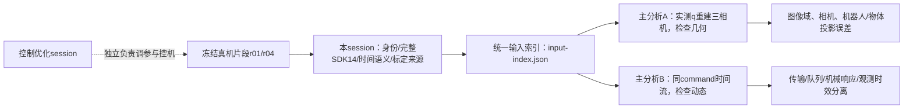

# Sim2real 真机证据统一入口

2026-10-25。协助负责人：`01a17398-e8b1-7973-8cf9-d42bc2fc3ca9`（[9.23] sim2real协助）；
主分析：`01a16f07-8038-79e0-a574-338ff00eb782`（sim 2 real 分析）。新证据、对齐结论或职责变化时更新。

用户已将本session切换为sim2real协助，控制优化由另一个session负责。
本轮仅读取已有记录、当前相机metadata与配置，生成CPU证据；没有接入SDK、下发运动、调参、发布、GPU请求或接管仿真服务。
本文件只声明sim2real输入准备状态，不替代控制session的当前运行状态入口。

## 1. 分工与两路比较



本session提供已有真机资料、边界与缺口；主分析负责渲染入口、图像比较、动态建模与验收整合。
不以图像平移或任意时间扭曲掩盖差异，不把Guard异常作为正常噪声拟合，不新增其他配速或动作。

## 2. 推荐冻结片段

证据原根：`/Users/wujie/Developer/work/anyverse/github/zhoufeiyu17/robot-workbench/.evidence/reference-rate-200hz-20261025-v1/`。
本session产物根（下称P）：`/Users/wujie/Developer/work/anyverse/github/zhoufeiyu17/robot-workbench/.evidence/sim2real-assist-20261025-01a17398/`。

- r01作为初始分析，r04作为同路径、同配置的留出重复；两者都是1.5×、35.333333秒研究参考、100Hz参考节点。
- 相同reference ID：`e70dd7aced1487b6fbbf0cfdcfd573526e8ae6eb76a57c6cebb14d05086dab93`。
- r02/r03为200Hz条件，暂不混入基础拟合；全部四轮没有控制故障，历史异常及Stop资格片段另存，不混入正常运动样本。
- 左6关节名义跨度约40.1/103.2/57.3/48.0/32.3/26.6°，右臂名义不动。右臂反馈少量量化变化不算姿态覆盖，不能认证右腕多姿态。
- r04只是相同动作的留出重复，不是未知轨迹、负载或新姿态泛化验收。
- 模式/增益/积分/前馈与代码身份以每轮`result.json`、`accepted-windows.json.gz`、publication和原始CAN为准；摘要称330/5不能替代逐关节配置。

视频：`/Users/wujie/Documents/Codex/outputs/reference-rate-200hz-20261025-v1/`，`manifest.json`包含完整路径、SHA、帧数、时长、阶段入口。
原始远端资料：`/home/wujie/work/feiyu.zhou/reference-rate-200hz-20261025-v1/`（ARX `10.17.32.5`），包含`research/r01|r04/events.jsonl.gz`、`lifecycle/frames.bin`及原分辨率预览录像。

## 3. 已交付可直接消费的输入

统一机器索引：**P/input-index.json**。输入/输出均记录SHA。

|文件|用途与约束|
|---|---|
|`r01-feedback-sdk14.npz`、`r04-feedback-sdk14.npz`|从原始事件提取q/dq完整SDK14、host monotonic/wall、两臂SDK timestamp、事件sequence；原先trace只有12臂关节|
|`r01-accepted-windows.json.gz`、`r04-accepted-windows.json.gz`|实际被接纳的未来q/dq/FF窗口及时间、reference ID；重放不可简单当作无重叠FIFO逐点串接|
|`r01-frame-pairing.npz`、`r04-frame-pairing.npz`|按每路camera host_receive_ns分别配对相邻反馈，保存原帧号、拼图frame index、video PTS、两端反馈index、插值SDK14与候选model12|
|`raw14-provenance.json`|源事件SHA、reference ID、样本数与原始字段列表|
|`build_input_index.py`|可重跑的本机CPU构造及断言；不连接相机/SDK|

r01有2640条配对记录（三路各880）；r04有2637条（head878、left879、right880）。仅选参考0–35.333秒且有反馈包围的图像，不外插、不将完整视频的Align/Return home冒充已配对。
最大反馈包围间隔分别11.118/12.669ms，这是插值支撑长度，不是曝光同步精度。
同源重复帧保留原frame_number，不能把预览重复帧当新增采集；每路独立配对，拼图同一frame index不代表三路同时曝光。
第一次构造的纳秒字段经过混合浮点数组导致精度丢失，被断言检出；已改为直接int64写出并通过原始时间戳等值检查，未改变原始记录。

重跑命令（仓库根，纯CPU）：

```sh
PYTHONPATH=.:calibration/infra OPENBLAS_NUM_THREADS=1 .venv/bin/python .evidence/sim2real-assist-20261025-01a17398/build_input_index.py
```

### q空间和夹爪

`q_sdk14`布局为左J1..J6、左jaw、右J1..J6、右jaw。臂角直接来自SDK`state.pos()`，该读取层没有加标定offset。
选12臂关节索引`[0,1,2,3,4,5,7,8,9,10,11,12]`后，既有FK按`q_model=q_reported+head joint_offsets`计算；对同一未烘焙offset的URDF只能加一次。
`q_model12_candidate`明确是候选绑定，不证明Isaac当前USD也采用同一关节定义/registration。

夹爪使用独立的command/feedback映射，不能把SDK位置直接乘1000当物理开口。
实际run记录`a1-pad-correction-3mm`、文件SHA `1b56775075b9fc84fe6df97b9c6eaadc826d23da8675aae5783502b9f8fd71bf`；精确文件已核验保存为P/jaw-mapping.json。
配对产物通过既有`feedback_gaps`换算左爪。右爪原记录明确`gripper_feedback_valid=false`、`operator_disabled_no_feedback`，所以`jaw_valid=[true,false]`，右物理开口输出NaN/unknown；SDK零值不当闭合真值。
该映射历史文件也标`physical_revalidation_passed=false`，左爪换算不是本轮新物理标尺验收。

## 4. 三相机图像域：已发现的实质性差异

|角色|序列号|本轮同capture实例核验的实际图像域|
|---|---|---|
|base_0|260522279090|raw，640×480，非零5项畸变系数，rectified=false|
|left_wrist_0|260622271169|raw，640×480，非零5项畸变系数，rectified=false|
|right_wrist_0|260622271762|raw，640×480，非零5项畸变系数，rectified=false|

**descriptor配置的腕部rectified=true/零畸变，与实际observed metadata不同。不能使用配置标签推断实际像素域。**
P/observed-camera-and-feedback-source.json保存三路完整observed K/系数、capture_instance_id、serial及source字段。
本轮事后读取的三个capture_instance_id逐个与r01/r04逐帧manifest相同；服务发布代码禁止同capture流变更observed intrinsics。
`rgbd_service._Preview.snapshot`直接将raw RGB bytes编码为JPEG（quality95/subsampling0），没有去畸变；录像再缩放拼图和H264编码。
这构成三路沿raw域产生的实现/身份依据；metadata仍标明是事后同capture实例核验，不冒充当时每帧已冻结全部内参。

原预览拼图1440×720：head占960×720，左右腕各480×360；本地导出960×480保留帧数/时序，head相当640×480、腕各320×240。
存在有损JPEG/H264、缩放和文字覆盖，不是原始RGB。该记录器没有逐帧归档原独立JPEG/RGB-D，不能从有损拼图恢复原始像素或遮挡区域。
比较时须统一raw/rectified域、K、缩放与遮罩，并遵守inverse_brown_conrady语义；不能只改rectified标签或简单二维贴图后声称外参通过。

## 5. 时间语义

- 相机manifest保存各路`host_receive_ns`；没有保存每帧曝光时刻和完整device timestamp关系。
- 实际legacy `read_calibration_state()`先调用`time.monotonic()`与`time.time_ns()`，再顺序读取左右`get_joint_state()`，返回两臂各自的SDK timestamp。源码路径/hash/函数摘录在P/observed-camera-and-feedback-source.json。
- 因此`sample_time_s/sample_wall_ns`是SDK快照读取前的host时刻，既不是电机采样时刻，也不保证左右臂原子同拍。
- 配对产物用同一host的wall差值桥接到monotonic参考进度；不估计控制滞后、不把相机接收时刻当曝光、不任意平移时间。
- 每轮原始窗口保留未来目标时间与host→SDK映射；CAN TX/RX反映总线事件。固件真正消费目标/采样时间仍unknown。

主分析已有独立输入审计：r01/r04三相机host_receive skew最大约44.18/44.74ms；host wall/monotonic offset跨度约4.864/6.4μs。
这些数值分别是接收时间差和host时钟读数一致性，不能解读成曝光精度或执行器延迟。

## 6. 标定、机器人模型和场景证据

当前已安装源只读副本：P/current-installed-source-audit.json，含active manifest/head/wrist的原内容、hash与mtime。
head v000005，ID `03bbd3c30ac48e9576a39f7062cdded458c751c14235916b176a573aa1154c82`；
wrist v000006，ID `c1f7cec6b6e695b4c9b62d9908b3f295bae5eaaf123de40f98b4aa966125013b`；installed_at为2026-09-23。

**本批run的calibration_snapshot_id=null、calibration_revision=0。** 当前active与历史profile逐项相同可支持候选来源核对，不能补造录制时完整profile绑定。
主分析已核37项（ID、外参、offset、资产geometry/seal、jaw mapping、K/serial）相等；像素域必须按上一节修正。

本批FK模型本地副本：`.../robot-workbench/.evidence/smoothness-priority-20261022-v1/scoring-model.urdf`，
SHA `682591d23e64deae66218e312523c4859a9c67eda26fb916dcfb9bc723810e3e`，已重新核验。
远端来源`/home/wujie/work/feiyu.zhou/joint-head-workbench-20260920/a1-r2-parking-20260923/assets/robot.urdf`；同目录manifest及parts/source哈希在P/robot-mesh-manifest-audit.json。
该manifest自身仍标有runtime_allowed=false/物理验证待补等历史限制，不作为完整Isaac动态资格。
mesh文件可按该远端assets目录中manifest.parts.path只读逐项核验；本轮未下载大包。

主分析比较发现：12臂+4指的parent/child/origin/axis一致，但4指上限、额外fixed camera joints、mesh/橡胶垫/材质有差异；实际Isaac USD尚未核等。
不得绕过`recovery_camera_binding.py`的URDF hash门，也不得用URDF中的名义camera mount替换标定光学外参。
本批没有冻结仿真环境world registration；历史scene_seed仅含双臂base变换，不能证明当前仿真base z=0.865m。

场景资产方面，发布时目录列出`coffee_final_machine`与`white_green_cup_no_lid`等，revision为`20261022.material.1`，
但scene_assets状态为`awaiting_prepare`、applied_pair_id=null。目录候选不等于当次实际场景绑定。
记录中没有精确冻结咖啡机/杯/盖/桌面的位姿、附着状态与质量。截图中的杯位于托盘，不能套新动作设计场景的杯初始位置。

## 7. 主分析产物索引与未完成项

主分析目录：`/Users/wujie/Documents/Codex/outputs/sim2real-analysis-20261025/`。

- `input-audit-v1.json`：原始控制/视频覆盖、关节误差、帧接收时间统计。
- `calibration-comparison-v1.json`：installed与历史profile逐项比对；腕部实际raw域解释已由下一份更正。
- `pixel-domain-and-robot-structure-v1.json`：三路raw域和机器人关节结构/mesh差异。
- `projection-preview-v1.json`、`project_existing_frames.py`及8张`r01/r04-overlay-*.jpg`：主分析完成2/12/23/33秒的CPU几何叠加。历史本地A1-cal-v5-v6包24项mesh SHA与真机manifest一致，其URDF SHA为`7bf205b7252905c55a4857a749f727756bf00be736811c047cdf8b8fd70759ff`，匹配历史相机profile，不需绕过hash门。该包位于`/Users/wujie/Developer/worktrees/rule-based-data-workbench-20260921/.agents/runs/20260923-212645-arx-a1-cal-installed/A1-cal-v5-v6`。
- `effective-tracking-v1.json/.png`、`fit_effective_tracking.py`：r01拟合常量有效相位/偏置，r04验证。左臂拟合lag为[-2,-1,0,1,1,2]ms，仅描述本数据，不是网络/电机延迟；1ms搜索网格不代表1ms精度，负值不证明因果超前。主分析报告r04去相位/偏置前后RMSE改善很小，不能当已辨识执行器模型写回仿真。
- `command-admission-timing-v1.json`：主分析拆分接纳RPC、含参考转换的总耗时、首点提前量与100ms重叠窗口；firmware_ack全部false。提交返回/SDK timestamp代理不冒充固件消费或电机采样时间，重叠窗口不能按FIFO直接串接。
- `minimum-capture-requirements-v1.json`：主分析的最小补采需求，状态requirements_only；不构成已启动采集或新增动作。

本session已读取投影索引并目视检查`r01-overlay-1124.jpg`：主体大体对应，局部轮廓仍有差异；右手指未知被排除，相机外壳/chassis、物体场景遮挡未建模。
这些是CPU几何候选图，不是完整Isaac场景渲染，也没有通过像素门槛验收。

下一步按优先级：

1. 主分析统一三路像素域，并核对实际仿真URDF/USD/mesh、世界registration；本session协助定位真机来源，不改控制代码。
2. 在上述边界明确后，先用实测q做机器人投影对比；物体位姿缺失单列，不随意从新设计场景补入。
3. 再按相同command/时间流做动态比较；读快照、SDK、CAN、机械响应与图像观测时效分开，留出r04。
4. 若原图/右爪/右腕姿态/物体位姿缺口阻塞正式验收，汇总最小补采需求，由控制负责人按其执行边界处理；本session不自行扩大采集。

本阶段完成的是证据交付与输入审计，**尚未完成sim2real渲染对齐或动态参数验收**。双方通过本入口接续，不要求用户在各记录间自行拼接信息。

## 8. 已有场景重建入口与当前输入缺口

以下路径均相对robot-workbench仓库根，本轮只读核验，没有启动流程。

|阶段|可复用入口|输入/输出和边界|
|---|---|---|
|采集封存|`rule_based_workbench/real_acquisition.py:prepare_inputs`、`real_observation.py:capture`|生成profile、rgbd-manifest、acquisition-binding和RGB-D NPZ；会读取当前相机，不能用来无声重采替代旧视频|
|像素域处理|`real_observation.py:inverse_brown_rectified_pixels`及RGB-D帧转换|将raw RGB与aligned depth按真实畸变同K矫正，保留original_intrinsics/rectification；和直接JPEG录像不同|
|已有RGB-D感知回放|`detector_adapter/isaac_rgbd_detection.py`|NPZ必须有rgb uint8、depth_m float32 aligned optical-Z米、K、相机position/quaternion_wxyz；后两项仅相机位姿。真正推理需要已授权GPU/模型，不是CPU读图|
|物体位姿转场景|`rule_based_workbench/source_from_detection.py:convert/build_source`|校验FoundationPose summary/observations、资产与采集hash，输出source.json/suite.json；physical分支还产hardware-binding.json|
|physical流程绑定|`rule_based_workbench/real_pipeline.py:preparation_stages`|负责传递physical-binding；不可通过不传绑定退回simulated-real默认分支来冒充物理重建|
|人工辅助RGB-D|`source_from_detection.py:convert_assisted`|同样要真实RGB-D npz/hash和assistance receipt，不是从有损RGB视频伪造检测摘要|
|只渲染首帧|`rule_based_workbench/playground_sim.py --mode first-frame`|需要有效source/suite/hardware-binding及模型；当前只写head first-frame.png，三路metadata不等于三路图像/视频已经导出|
|几何输入/完整回放|`playground_sim.py`与`isaac_lane.py`相应mode|会触发其他几何/规划或物理路径；本阶段不启动整个run_pipeline替代缺失输入|

自动重建要求连续至少9个有效head RGB-D帧跨度≥3秒，咖啡机/杯两个当前track，咖啡机朝向无歧义，资产/标定/输入绑定完整。
人工assisted可使用少量真实RGB-D帧，但必须有对应receipt和验证，不伪造3秒观测。
当前研究录像只有JPEG→缩放拼图→H264，缺少本段depth、独立原RGB与完整场景冻结，**不能直接消费为现有已验收的物体重建输入**。
不额外要求用户提供独立mask文件；核心缺失是有效深度及来源绑定，分割由原感知链处理。

若要复用旧数采RGB-D/检测结果，必须核对camera capture/frame/time、物体未改变与实际资产版本，不能因为动作指令相同就认定物体场景相同。
如果只能用现有RGB做物体位姿估计，应另标为候选并说明尺度/遮挡/深度歧义，不写成physical_rgbd或正式数采重建成功。
三路多时刻仿真图可复用camera_frame/preview_sensors逐路输出，但还需主分析完成同状态重建与时间推进契约，不能用单head首帧成功替代。

## 9. 最小补采的现有能力与待补接线（仅审计，未执行）

本轮源码审计见P/capture-capability-audit-v1.json，保存需求文件与实现文件的SHA。它描述本地实现能力，不宣称下一次部署已具备运行资格。

|要求|已有能力|实际缺口|
|---|---|---|
|三路独立raw RGB和时间|CommonCameraService带独占lease的raw RGB-D通道；metadata有source frame、device/host时间、observed intrinsics/畸变与capture身份|需要将原research片段与raw通道生命周期绑定，JPEG预览脚本不满足|
|无损保存/封存|ProcessRecordingSession隔离CPU进程、有界队列；SegmentWriter使用libx264rgb CRF0保存RGB、FFV1保存depth，分路索引和SHA|现有writer无RGB-only开关；最少代码路线先复用RGB-D，不在控制tick做像素编码/落盘|
|显式研究数据身份|validate_policy_source支持execution_kind=control_reference_study且training_observation=false|runtime prepared-reference目前只发研究事件；需接上source、执行身份、预录ready、Stop/异常/尾部排空与lease回收|
|完整标定与资产冻结|calibration_profile.build_device_profile、calibration capsule验证已有|在下一次真实执行边界锁定manifest/head/wrist、URDF/mesh、registration和相机实例；不能继续用snapshot_id=null补齐当次证明|
|初始物体场景|head RGB-D原采集/检测/assisted链已有|本段相应深度、pose、附着证据还没有；采到raw不等于检测/scene binding通过|

InferenceWorkflow的recording准备/续租谓词绑定inference holder/runner，不能直接照搬或把研究动作切到infer来省接线。
应保留原research执行器与reference，复用现有显式study source和录制组件，只补研究生命周期/事件桥；不新增另一套控制器。

建议最小顺序（待实现/资格，不是执行收据）：

1. 在CPU替身下验证准备取消、lease冲突、源身份变化、队列/磁盘阻塞、Stop后尾部封存；保留原始失败与退出语义。
2. 控制负责人下一次既有授权的35.333秒1.5×片段执行前，核对当前资源、相机lease和身份，冻结完整标定/模型/registration及reference/nonce/epoch。
3. 隔离录制准备就绪后，附带短静止head RGB-D窗口及三路预录，再执行原片段；轨迹、增益、速度、保护不变。
4. 结束排空至最后有效反馈/相机覆盖边界，封存原始RGB-D、指令窗口、SDK14与manifest，释放录制lease；不因录制失败自动重跑动作或清理其他数据。
5. 从精确对应的已存RGB-D派生物体scene binding。若检测后置，期间明确scene_unverified；若要求执行前完成场景资格，则前置检测实际通过，不能仅靠保存原图替代。

按640×480、三相机、30fps、RGB8+depth16、约40秒估算，未压缩数据约5.15GiB；这不是当前空闲容量或压缩率保证，实际还需检查尾部、缓冲与余量。
初版复用RGB-D比新造RGB-only编码器改动小；若吞吐/空间不满足，再明确选择降采样或RGB-only实现，不能静默丢帧。
右夹爪继续unknown并排除finger指标；机器人base可定义为分析world，但所有物体/相机变换必须同源一致，不把历史z=0.865当本次实测。

本节没有修改生产代码、启动采集、接入SDK或申请GPU。主分析与控制负责人需在已批准任务范围内协调接入时点，本session不直接执行本清单。
