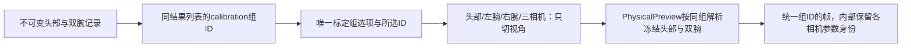
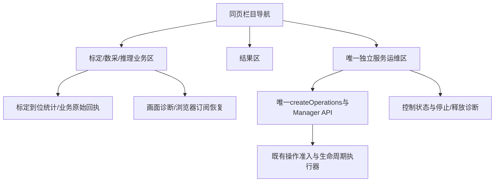
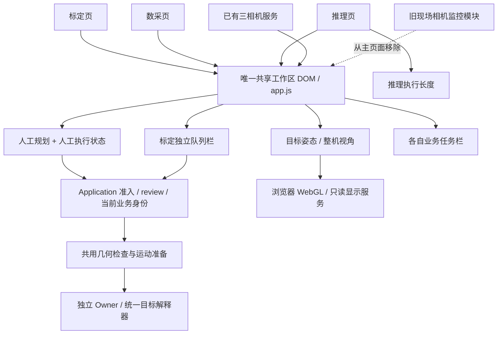
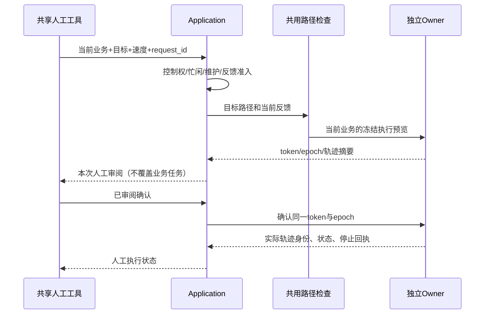
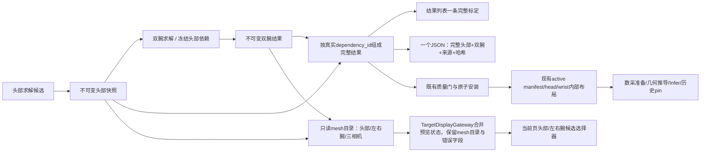
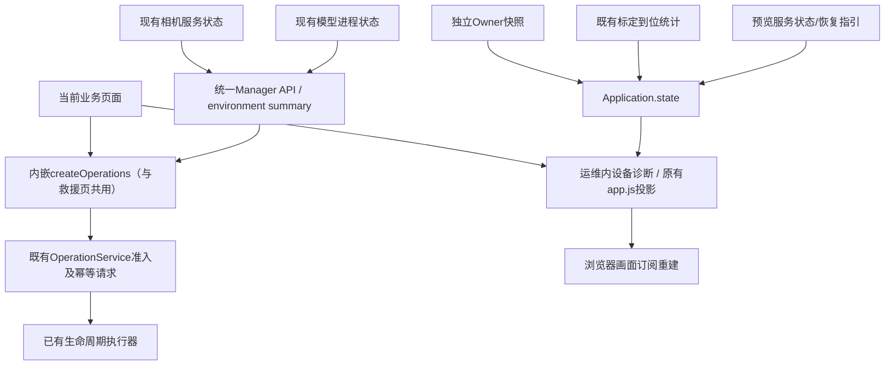
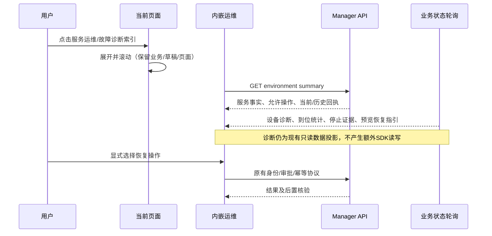
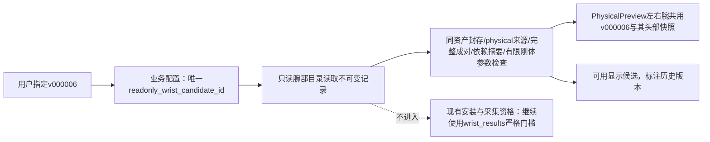

# 工作区工具、标定结果与内嵌运维

## 当前追加修正：一个标定组选项、独立运维栏目

用户于2026-10-21进一步要求：mesh也以完整标定组选择一次；运维必须是独立模块，
内容只含运维，不应在每个业务页页尾出现。此前v4的共享页尾并未满足该布局要求。

操作流程：业务页进入运维只切换可见栏目，保留当前业务、草稿与标定组选择，不改变
控制权。返回业务时运维区隐藏，业务误差设置不出现在运维栏目。标定组切相机不再
修改候选身份；服务仍检查资产、来源、依赖、实时图像/反馈配对。
本次只发布业务/管理显示层，保留发布前实际控制状态、独立Owner、相机与热模型，不重接SDK。
独立救援URL继续存在，但主导航不跳转网页。以下v1–v4设计与验收属于历史演进记录。

本次追加已实际发布为业务/管理v7，独立Owner仍为v2。147项Linux检查和3个Node入口
通过；四种相机视角实际浏览器选项均为同一完整组ID（头部v000005、双腕v000006），
只有一个完整组选项（另加空占位），没有按相机重选。真实CPU图像回归同时检查四个
视角帧都发布同一组ID，内部仍保留各相机对应的参数身份。

浏览器实际核验：标定/数采/推理三业务下运维不可见；进入独立运维栏目后业务区和
业务误差设置隐藏。全页仅1个运维实例，运维区内人工工具、任务、到位统计、原始
业务状态和画面恢复工具数量为0。统计/业务原始回执回到业务区，画面恢复归预览区，
运维保留生命周期、健康/依赖、服务管理、控制诊断及停止回执。

最终实页验收另修正两处显示边界：运维栏目隐藏业务请求/预览提示；运维初始化读取
URL显式指定的环境，避免模块早于业务应用挂载时读到下拉框默认Fake，误报无法核验。
fake/physical两方向初始化、无控制请求、业务轮询不泄漏提示均有Node回归；v7浏览器
已核验Physical/arx6身份、管理状态正常和三业务独立显示。

发布前控制已被重新接入且READY，本轮未提交该恢复；v7发布完整保留当时的Owner
PID、runtime_nonce、epoch和连接状态，未重接SDK、未运动、未跑推理、未重启相机。
此READY观察不能证明此前SIGKILL根因已修复。新增实际收据与截图统一见
`.evidence/workspace-tools-20261021/group-operations/v7/acceptance.json`、`publication.json`、
`actual-verification.json`、`browser-acceptance.json`及同目录PNG。

日期：2026-10-21。负责人：本任务 Codex；需求及验收者：用户。
权威范围：本仓库此次九项页面与结果整理。来源：用户本轮九项要求，
`web/{index.html,app.js,operations.js,physical_endpoint.js}`、
`robot_workbench/{service.py,workflows.py,physical_preview.py}`、
`calibration/infra/arx_env/joint_head_calibration_store.py` 的实际调用。
维护触发：上述模块边界、结果格式或实际发布发生变化。实际运行身份仍以
`.evidence/next-optimization-20261017/continuation-state.json` 的发布/实际状态收据为准。

## 修改前的事实与影响范围

1. 推理长度组件显式允许标定页显示，显示条件应仅为 inference。
2. `Application.state` 将人工执行状态覆盖业务 workflow；页面又把人工预检放到当前任务。
   应分离业务任务展示与人工执行展示，保留同一 Owner 执行身份核验。
3. 动作队列嵌套在人工工具中；拆成独立标定栏，仍读取同一 queue/revision。
4. mesh 目录依赖头部/双腕及明确 physical 来源；要检查目录生产与过滤，不能伪造腕部候选。
5. 完成标定的可使用单位本来就是 head+wrist group，但列表与下载暴露两个记录。
   统一成一份可下载、带哈希的完整结果；中间求解/依赖记录继续内部保留。
   不迁移、不删除历史版本，不改变已安装 active 的下游路径和 pin。
6. 人工工具与目标浏览只有一份 DOM，但 CSS 隐藏非标定页，人工后端也硬编码 calibration。
   显示共享组件、按当前业务显式提交，同样经过路径检查和统一 Owner 翻译器。
7. 移除主工作台现场相机入口和独立轮询脚本；保留实际三相机服务及其他已存在的 API 消费者。
8. 诊断读取业务状态、统计、预览与停止收据；合并到内嵌运维，读取来源及控制门不变。
9. 复用 `createOperations` 当前页展开；独立 `/operations` 保留为业务服务不可用时的救援入口。

## 组件图（1、2、3、6、7）

## 信息流（2、3、6）

仅切换页面/打开预览/运维不交接控制权、不接入 SDK，不执行机器人动作。
标定队列仍为标定业务专属；不将其隐式转换为数采或模型任务。

## 标定结果组件与信息流（4、5）

完整结果自包含，不要求用户另找头部文件。未完成/质量失败候选仍可诊断，明确显示
尚未形成完整标定，不以缺失字段猜配；重复腕部求解保留各自真实身份。
导出只读，不自动安装、重标定、重跑GPU或变更当前配置。

## 设备诊断组件图（8、9）

## 设备诊断信息流（8、9）

合并只改变显示归属；诊断没有新的控制客户端。顶部恢复继续共用既有环境操作入口，
运维中的设备/业务选择随当前上下文核验，不能凭缓存恢复或覆盖真实故障。

## 验收与发布边界

- 三业务相同共享工具，标定无推理长度，人工预检/执行不污染业务任务；队列独立。
- mesh 必须列出真实存在的头部/双腕候选，保留来源/依赖/质量约束。
- 完整结果列表、单文件下载、哈希、头腕依赖、不完整候选和旧数据读取回归。
- 运维展开/诊断索引/环境切换/关闭弹窗/旧救援入口回归；打开页面无动作副作用。
- 先CPU/HTTP/Node检查，再同版冻结发布和浏览器截图。此工作不自动恢复现有SIGKILL故障，
  不重新采集标定、不跑模型推理。实际故障根因仍未定案。
- 20:42 新鲜只读检查发现同一独立 Owner 已被重新接入且 READY，runtime_nonce 已变化；
  本轮没有提交该恢复。不能沿用19:37故障快照断言当前仍断开，也不据此判定根因已修复。
- 端到端CPU检查发现 Runtime 的白名单也将 `preview_workbench` 限于 calibration。
  本次将这一人工路径编译命令纳入三业务共用；非标定业务仍禁止捕获标定帧，推理模型
  准备只约束 `preview_inference`。控制权、epoch、Stop、限位、反馈和统一翻译器保持。
  这一小项需换版独立 Owner；发布时按项目既有授权先低速回零、正常释放、再换版接入，
  不重复询问。当前故障、活动任务或回零前置不满足时停止该维护，不绕过保护。

## 实际验收与遗留（2026-10-21 21时）

业务/管理源正式发布为 `workspace-tools-20261021-v4`；独立 Owner 为本轮 v2。
单一实际入口为 `.evidence/workspace-tools-20261021/latest-actual-publication.json` 与
`latest-actual-state.json`，完整九项验收及限制见同目录 `acceptance.json`。

本地全套1675次 unittest：1639通过、36既有条件跳过，6个Node入口通过；Linux候选
307项通过，完整结果最终49项及显示网关2项追加回归通过。浏览器三页均验证唯一共享
人工/目标模块、专属栏显示条件、队列分栏和内嵌运维；实际完整JSON下载校验整体和
内部记录哈希。内部 head/wrist 不可变记录及 active 布局保留，不要求用户管理两个下载文件。

现场验收发现独立目标显示网关原先替换了整个 preview，丢弃业务 mesh 目录。现由网关
显式保留 `mesh_candidates` / `mesh_catalog_error`，HTTP回归覆盖后发布v3；这次只换
业务与管理进程，Owner/SDK故障状态、相机、目标显示与热模型均保持。

v3验收时左右腕显示v000003/v000006及拒绝原因，均因宽泛工作台指纹不同而不可选；
随后按用户追加指令在v4启用v000006的只读显示（详见下节）。已有 wrist.plan 还引用
一个缺失的旧 stationary-v1/v7 seed 路径；该错误
在本轮发布前的预检即存在，未通过新动作复跑，也未把历史标定升级为当前合格标定。

本轮按既有授权先以0.1rad/s回零，正常释放并换版接入，均取得成功收据；但21:04:43
新SDK worker再次SIGKILL。最后心跳年龄13.25ms、保护进程没有termination发送记录，
具体发送源/客户端异常仍未定案，不能将它解释为100ms心跳超时。当前控制锁定断开，
输出进程退出已确认、机械状态未核验；没有自动恢复、重复重接或故障后的动作试验。
最后实际状态优先于早几秒的接入成功收据。

剩余按优先级：SDK退出根因及稳定恢复；缺失seed路径及后续标定安装资格；稳定后补实体三业务
人工动作验证。此前≤0.2°全关节精度残差、正式数采/Infer等项目待办不因此关闭。

## 用户追加：v000006作为显示候选

用户明确要求选择最新历史腕部结果为可用项。当前v000006的实体资产ID、封存摘要、
physical来源、依赖头部v000005已与当前配置核对一致；宽泛工作台指纹仍不同。

只对配置点名的一个历史ID放行显示指纹；不全局关闭几何检查。相机/反馈时间配对门
保持，SDK锁定时不能声称实时叠加成立。只换业务/管理层并保持Owner/SDK故障现场。

v4已实际发布；追加8项PhysicalPreview、28项标定库、49项工作流Linux检查通过。
正式浏览器中左腕、右腕均默认选中同一v000006，提示“用户指定的历史标定，仅用于
只读叠加”，显示1个可用/2个已保存候选。已保存选择，叠加开关保持关闭；当前SDK
故障未恢复，因此没有把旧反馈配到当前相机图像并伪称已验证实时叠加。实际证据：
`.evidence/workspace-tools-20261021/v6-publication.json`、`v6-display-selected.json`、
`v000006-browser-proof.json`、`v000006-available.png`。
